# Tài liệu nghiệp vụ hệ thống rạp chiếu phim (Perfo)

> Tài liệu được lập bằng cách đọc source code của repo `perfo-main` (backend .NET, frontend React, migration, seed, test, cấu hình). Quy ước: chỉ ghi điều có trong code; chỗ không xác định ghi "Chưa xác định"; nguồn trích dẫn dạng `đường dẫn::hàm`. Ngày tạo và phạm vi đọc ở **Phụ lục** cuối file.

## Mục lục

* [1. Tổng quan hệ thống](#s01)
* [2. Phân quyền và vai trò](#s02)
* [3. Mô hình dữ liệu](#s03)
* [4. Nghiệp vụ theo từng module](#s04)
  * 4.0 Quy ước chung: lỗi và định dạng phản hồi
  * 4.1 Xác thực và tài khoản (`AuthService`, `UserProfileService`)
  * 4.2 Phim và danh mục (`MovieService`, `CatalogService`)
  * 4.3 Phòng chiếu, sơ đồ ghế, loại ghế (`RoomService`)
  * 4.4 Suất chiếu (`ShowtimeService`)
  * 4.5 Đặt vé và giữ ghế (`BookingService`, `SeatExpirationService`)
  * 4.6 Thanh toán (`BookingService.CheckoutAsync`, `PaymentService`, `PaymentAdminService`)
  * 4.7 Hủy booking và hoàn tiền (`BookingService.CancelBookingAsync`, `CalculateRefundEligibilityAsync`)
  * 4.8 Vé và soát vé (`BookingService.CheckinAsync`)
  * 4.9 Bán vé tại quầy (`BookingService.CounterHoldSeatsAsync`, `CounterCheckoutAsync`)
  * 4.10 Combo / đồ ăn (`ComboService`)
  * 4.11 Tích lũy điểm và hạng thành viên (`BookingService`, `Catalog`)
  * 4.12 Đánh giá phim (`ReviewService`)
  * 4.13 Thông báo và email
  * 4.14 Báo cáo và dashboard (`ReportService`, `DashboardService`)
  * 4.15 Cài đặt rạp (`SettingsService`)
  * 4.16 Trợ lý AI (`GeminiAiAssistantService`, `AiToolExecutor`)
  * 4.17 Người dùng và nhân viên (`EmployeeService`)
  * 4.18 Upload file (`AdminUploadsController`, `CloudinaryFileStorage`)
  * 4.19 Chức năng không có trong code
* [5. Các luồng xuyên suốt (end-to-end)](#s05)
* [6. Thuật toán và logic đặc thù](#s06)
* [7. Tác vụ nền và sự kiện](#s07)
* [8. Tích hợp bên ngoài](#s08)
* [9. Cấu hình hệ thống](#s09)
* [10. Frontend](#s10)
* [11. Thông báo và nội dung gửi ra](#s11)
* [12. Dữ liệu seed và kịch bản mẫu](#s12)
* [13. Kiểm thử](#s13)
* [14. Từ điển thuật ngữ](#s14)
* [Phụ lục: thông tin tạo tài liệu](#phu-luc)

---

<a id="s01"></a>

# 1. Tổng quan hệ thống

> Phạm vi: dự án `perfo` (tên thương hiệu cấu hình mặc định: `Perfo` / `PERFO`, nguồn `appsettings.json` mục `Brand`). Mọi nội dung dưới đây lấy từ source; chỗ không xác định được ghi rõ.

## 1.1 Mục đích và đối tượng sử dụng

Hệ thống quản lý và bán vé rạp chiếu phim, gồm:

| Thành phần | Mô tả | Nguồn |
|---|---|---|
| Web khách hàng | Xem phim, lịch chiếu, chọn ghế, giữ ghế, thanh toán online, xem vé QR, hủy vé, đánh giá phim, xem hạng thành viên, chat trợ lý AI | `frontend/src/app/routes/client-routes.tsx` |
| Web quản trị / nhân viên | Dashboard, quản lý phim, suất chiếu, phòng/ghế, combo, đặt vé, thanh toán, báo cáo, người dùng, nhân viên, đánh giá, cài đặt, danh mục; bán vé tại quầy; soát vé QR | `frontend/src/app/routes/admin-routes.tsx` |
| REST API | ASP.NET Core, tiền tố `/api/v1`, 129 endpoint (bảng đầy đủ ở [02](#s02)) | `backend/Cinema.Api/Controllers` |
| Job nền | Hangfire (lưu trên PostgreSQL): giải phóng ghế hết hạn, vòng đời suất chiếu/phim, hoàn tiền khi hủy suất, gửi email | `backend/Cinema.Application/BackgroundJobs` |
| Realtime | SignalR hub `/hubs/showtimes` đẩy trạng thái ghế theo suất chiếu | `backend/Cinema.Infrastructure/Realtime` |
| Tích hợp ngoài | VNPay, MoMo, Stripe (thanh toán/hoàn tiền); Resend và SMTP/MailKit (email); Cloudinary (ảnh/video); Google Sign-In; Gemini (trợ lý AI) | `backend/Cinema.Infrastructure`, `Cinema.Application/Services/Ai` |

Actor: khách vãng lai (chưa đăng nhập), khách hàng (`Customer`), nhân viên (`Employee`), quản trị (`Admin`). Chi tiết ở [02](#s02).

## 1.2 Tech stack

| Lớp | Công nghệ (phiên bản theo `csproj`/`package.json`) | Vai trò |
|---|---|---|
| Backend | .NET `net10.0`, ASP.NET Core | Web API |
| ORM / DB | EF Core 10 + `Npgsql.EntityFrameworkCore.PostgreSQL` 10.0.3; PostgreSQL 16 (`docker-compose.yml`: `postgres:16-alpine`) | Lưu dữ liệu, migration |
| Validation | FluentValidation 12.1.1 | Kiểm tra request (filter `ValidationActionFilter`) |
| Mapping | Mapster 10.0.11 | DTO mapping (`MappingConfig`) |
| Auth | `Microsoft.AspNetCore.Authentication.JwtBearer`, `System.IdentityModel.Tokens.Jwt`, `PasswordHasher<User>` (Identity.Core), `Google.Apis.Auth` | JWT, hash mật khẩu, đăng nhập Google |
| Job | Hangfire 1.8.24 + `Hangfire.PostgreSql` | Tác vụ nền và retry |
| Realtime | SignalR | Đẩy trạng thái ghế |
| Thanh toán | `Stripe.net` 52.4.0; VNPay và MoMo gọi HTTP trực tiếp (`VnPayGateway`, `MomoGateway`) | Cổng thanh toán |
| Email | MailKit 4.17.0, Resend (HTTP) | Gửi email |
| File | CloudinaryDotNet 1.29.3 | Upload ảnh/video |
| QR | QRCoder 1.8.0 | Sinh ảnh QR (data URI) trong DTO vé |
| Log | Serilog.AspNetCore | Ghi log |
| API doc | Swashbuckle (chỉ hiển thị khi `ASPNETCORE_ENVIRONMENT=Development`, theo comment trong `Program.cs`) | Swagger 2 doc: `client`, `admin` |
| Frontend | React 19, `react-router` 7, TanStack Query 5, TanStack Table, Zustand 5, axios, react-hook-form + zod 3, `@microsoft/signalr` 10, recharts, tailwindcss 4, vite 8, `jsqr` (đọc QR bằng camera) | SPA |
| Test | xUnit (`Cinema.UnitTests`, `Cinema.IntegrationTests`), Playwright (đã cấu hình nhưng chưa có spec, xem [13](#s13)) | Kiểm thử |
| Triển khai | Docker (`backend/Dockerfile`, `frontend/Dockerfile`), `docker-compose.yml`, `render.yaml` (Render: web service Docker + static site + PostgreSQL) | Chạy dev/prod |

Lưu ý: comment trong `Program.cs` còn nhắc SQL Server và MediatR, nhưng code thực tế dùng PostgreSQL (`UsePostgreSqlStorage` cho Hangfire) và không dùng MediatR; một số script trong `package.json` (`docker:logs:db`, `docker:exec:db`) vẫn trỏ về `sqlserver`. Đây là phần còn sót, không phản ánh runtime hiện tại.

## 1.3 Sơ đồ kiến trúc

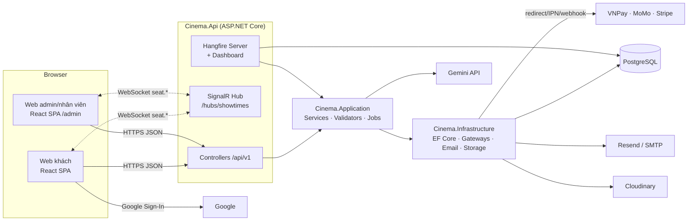

## 1.4 Cấu trúc thư mục

```
perfo-main/
├─ backend/
│  ├─ Cinema.Domain/          Entities, Enums (không phụ thuộc framework)
│  ├─ Cinema.Shared/          Hằng số (Roles, Policies, SignalREvents), Exceptions, ApiResponse
│  ├─ Cinema.Application/     Nghiệp vụ: Services, Validators, DTOs, Options, Utils, BackgroundJobs, MappingConfig, Interfaces
│  ├─ Cinema.Infrastructure/  AppDbContext + Configurations + Migrations + Seed; Payments (VNPay/MoMo/Stripe); Email; FileStorage; Realtime; Auth (Google)
│  ├─ Cinema.Api/             Program.cs, Controllers (Client/Admin/Payments/Health), Filters, Middlewares
│  └─ tests/                  Cinema.UnitTests, Cinema.IntegrationTests
├─ frontend/src/
│  ├─ app/routes/             router, client-routes, admin-routes, protected-route/*
│  ├─ features/{auth,client,admin}/   mỗi feature có api/, hooks/, pages/, components/, types/
│  ├─ api/                    axios.ts (interceptor refresh token), query-client.ts, query-keys.ts
│  ├─ stores/                 auth-store, dialog/alert/sheet store (Zustand)
│  ├─ hooks/, lib/, config/   use-showtime-hub, use-realtime-seat-map, signalr.ts, default-constants.ts, routes.ts
│  └─ layouts/                client, admin
├─ docker-compose.yml, render.yaml, .env.example, package.json
```

Chức năng từng project backend:

| Project | Chức năng | Ghi chú |
|---|---|---|
| `Cinema.Domain` | 29 entity (`Cinema.Domain/Entities`) + 9 enum | Xem [03](#s03) |
| `Cinema.Shared` | `Roles` (`Customer`, `Admin`, `Employee`), `Policies`, `SignalREvents`, các `AppException` kèm HTTP status | Xem 4.0 ở [04-modules](#s04) |
| `Cinema.Application` | Toàn bộ quy tắc nghiệp vụ; không phụ thuộc EF provider cụ thể ngoài `AppDbContext` | Xem [04](#s04) |
| `Cinema.Infrastructure` | DbContext, cổng thanh toán, email, Cloudinary, SignalR notifier | Xem [08](#s08) |
| `Cinema.Api` | Pipeline HTTP, authN/authZ, rate limit, CORS, Hangfire dashboard, xử lý lỗi | Xem [02](#s02), [07](#s07) |

Phản hồi API: các endpoint trả `ApiResponse` bao ngoài (`ApiResponseFilter`); riêng IPN/webhook thanh toán trả định dạng của từng cổng (thuộc tính `RawResponse`, xem [08](#s08)).

---

<a id="s02"></a>

# 2. Phân quyền và vai trò

## 2.1 Vai trò và policy

| Role (`Roles.*`) | Ý nghĩa | Nguồn |
|---|---|---|
| `Customer` | Khách hàng đăng ký/đăng nhập Google; có `CustomerProfile` | `Cinema.Shared/Constants/Roles.cs` |
| `Employee` | Nhân viên rạp (bán vé quầy, soát vé, xem phim/suất chiếu/đặt vé) | như trên |
| `Admin` | Quản trị toàn quyền | như trên |

Policy (`Program.cs`, `AddPolicy`; chỉ dựa trên **role claim**, không có kiểm tra `Employee.IsActive`):

| Policy | Điều kiện |
|---|---|
| `CustomerOnly` | role `Customer` |
| `AdminOnly` | role `Admin` |
| `EmployeeOnly` | role `Employee` — **được định nghĩa nhưng không endpoint nào dùng** |
| `StaffOnly` | role `Admin` hoặc `Employee` |

Không có `FallbackPolicy`: endpoint không gắn `[Authorize]` là **công khai**. Controller `AiController` (`POST /ai/chat`) cũng công khai; khi có người dùng đăng nhập thì lấy thông tin từ claim (xem [04](#s04)).

## 2.2 Xác thực

| Hạng mục | Giá trị thật | Nguồn |
|---|---|---|
| Access token | JWT HS256 (`SecurityAlgorithms.HmacSha256`), `Jwt:AccessTokenExpirationSeconds` mặc định 3600 s | `JwtTokenService.BuildToken`, `appsettings.json` |
| Claims | `AppClaimTypes.UserId`, `AppClaimTypes.Role`, `ClaimTypes.Role`, `sub`, `email`, và `AppClaimTypes.EmployeeId` nếu user có hồ sơ `Employee` | `JwtTokenService.BuildBaseClaims` |
| Refresh token | Chuỗi ngẫu nhiên (`GenerateOpaqueToken`), lưu **hash SHA-256 hex hoa**; hạn `Jwt:RefreshTokenExpirationDays` mặc định 30 ngày | `JwtTokenService.HashOpaqueToken`, `AuthService.RefreshAsync` |
| Xoay vòng refresh token | `RefreshAsync` cấp token mới, đánh dấu cũ thu hồi và nối `ReplacedByTokenId`; nếu dùng lại token đã thu hồi → thu hồi cả chuỗi (`RevokeTokenChainAsync`) và trả 401 | `AuthService.RefreshAsync` |
| Socket token | JWT riêng cho SignalR, `Jwt:SocketTokenExpirationSeconds` mặc định 300 s, lấy qua `POST /auth/socket-token` | `AuthService.GenerateSocketTokenAsync` |
| Xác nhận email | Token hash lưu `UserVerificationToken`, hạn `Email:EmailConfirmationExpirationHours` = 24 giờ | `AuthService.RegisterAsync`, `ConfirmEmailAsync` |
| Đặt lại mật khẩu | Hạn `Email:PasswordResetExpirationMinutes` = 30 phút, dùng một lần | `AuthService.ForgotPasswordAsync`, `ResetPasswordAsync` |
| Mật khẩu | `PasswordHasher<User>` (ASP.NET Identity); tự rehash khi `SuccessRehashNeeded` | `AuthService.LoginAsync` |
| Đăng nhập Google | `POST /auth/google` kiểm tra ID token qua `Google.Apis.Auth`; chỉ cho role `Customer`; email Google chưa xác thực bị từ chối; tài khoản đã có cùng email được liên kết | `GoogleLoginAsync`, `GoogleAuthService` |
| Rate limit | Policy `auth` (theo IP, 5 lượt/60 s) cho register/login/admin-login/google/refresh/forgot/reset; `booking-hold` 10 lượt/60 s cho `POST /bookings/hold`; global 100 lượt/60 s | `Program.cs` (`AddRateLimiter`), `appsettings.json` mục `RateLimit` |

Quan sát khi đọc code:

* `POST /auth/login` chỉ dành cho `Customer`; role khác bị `403` với thông báo "Vui lòng đăng nhập qua cổng quản trị". `POST /auth/admin-login` gọi `LoginAsync(adminOnly: true)` và **không kiểm tra role là Admin/Employee**: một `Customer` đăng nhập qua endpoint này vẫn nhận token (quyền thật vẫn bị policy chặn ở từng endpoint; web admin tự chuyển hướng về trang chủ nếu role không phải Admin/Employee, xem `AdminProtectedRoute`).
* Đăng nhập (mọi cổng) yêu cầu `IsActive` và `EmailConfirmed`; refresh cũng kiểm tra hai điều kiện này.
* Khóa tài khoản (`PUT /admin/users/{id}/status` với `isActive=false`) thu hồi toàn bộ refresh token của user (`EmployeeService.UpdateUserStatusAsync`; test `EmployeeServiceUserStatusTests`).
* Rate limit `booking-hold` chia theo `User.Identity.Name` rồi mới tới IP; JWT không có claim `name` nên có khả năng thực tế chia theo IP. **Chưa kiểm chứng khi chạy** (suy luận từ `Program.cs` và `JwtTokenService`).
* Hangfire Dashboard ở `/admin/hangfire` (không map khi môi trường `Testing`), dùng `HangfireAdminAuthorizationFilter`: môi trường `Development` cho **mọi người** truy cập; môi trường khác yêu cầu `User.Identity.IsAuthenticated` và role `Admin`. Việc trình duyệt gửi JWT khi điều hướng trực tiếp tới URL này **chưa xác định được từ code** (không có cookie auth trong `Program.cs`). Xem [07](#s07).
* `POST /ai/chat` công khai nhưng đọc claim `AppClaimTypes.UserId` nếu có token để cá nhân hóa (`AiController.Chat`).

## 2.3 Ma trận quyền theo endpoint

Ký hiệu: ✓ được gọi; – không được gọi. Cột "Khách" = chưa đăng nhập. Sinh trực tiếp từ attribute `[Authorize]`/`[AllowAnonymous]` của 129 endpoint trong `backend/Cinema.Api/Controllers`.


### AdminActorsController

| Method | Route | Policy | Khách | Customer | Employee | Admin | Rate limit | Hàm |
|---|---|---|:-:|:-:|:-:|:-:|---|---|
| GET | `/api/v1/admin/actors` | AdminOnly | – | – | – | ✓ |  | `GetAll` |
| POST | `/api/v1/admin/actors` | AdminOnly | – | – | – | ✓ |  | `Create` |
| PUT | `/api/v1/admin/actors/{id:int}` | AdminOnly | – | – | – | ✓ |  | `Update` |
| DELETE | `/api/v1/admin/actors/{id:int}` | AdminOnly | – | – | – | ✓ |  | `Delete` |

### AdminAgeRatingsController

| Method | Route | Policy | Khách | Customer | Employee | Admin | Rate limit | Hàm |
|---|---|---|:-:|:-:|:-:|:-:|---|---|
| GET | `/api/v1/admin/age-ratings` | AdminOnly | – | – | – | ✓ |  | `GetAll` |
| POST | `/api/v1/admin/age-ratings` | AdminOnly | – | – | – | ✓ |  | `Create` |
| PUT | `/api/v1/admin/age-ratings/{id:int}` | AdminOnly | – | – | – | ✓ |  | `Update` |
| DELETE | `/api/v1/admin/age-ratings/{id:int}` | AdminOnly | – | – | – | ✓ |  | `Delete` |

### AdminBookingsController

| Method | Route | Policy | Khách | Customer | Employee | Admin | Rate limit | Hàm |
|---|---|---|:-:|:-:|:-:|:-:|---|---|
| POST | `/api/v1/admin/bookings/counter-hold` | StaffOnly | – | – | ✓ | ✓ |  | `CounterHoldSeats` |
| GET | `/api/v1/admin/bookings` | StaffOnly | – | – | ✓ | ✓ |  | `GetBookings` |
| GET | `/api/v1/admin/bookings/{bookingId:int}` | StaffOnly | – | – | ✓ | ✓ |  | `GetBookingDetail` |
| POST | `/api/v1/admin/bookings/{bookingId:int}/counter-checkout` | StaffOnly | – | – | ✓ | ✓ |  | `CounterCheckout` |
| POST | `/api/v1/admin/bookings/checkin` | StaffOnly | – | – | ✓ | ✓ |  | `Checkin` |

### AdminCombosController

| Method | Route | Policy | Khách | Customer | Employee | Admin | Rate limit | Hàm |
|---|---|---|:-:|:-:|:-:|:-:|---|---|
| GET | `/api/v1/admin/combos` | AdminOnly | – | – | – | ✓ |  | `GetCombos` |
| POST | `/api/v1/admin/combos` | AdminOnly | – | – | – | ✓ |  | `Create` |
| PUT | `/api/v1/admin/combos/{id:int}` | AdminOnly | – | – | – | ✓ |  | `Update` |
| PUT | `/api/v1/admin/combos/{id:int}/toggle` | AdminOnly | – | – | – | ✓ |  | `Toggle` |

### AdminDashboardController

| Method | Route | Policy | Khách | Customer | Employee | Admin | Rate limit | Hàm |
|---|---|---|:-:|:-:|:-:|:-:|---|---|
| GET | `/api/v1/admin/dashboard/summary` | AdminOnly | – | – | – | ✓ |  | `GetSummary` |
| GET | `/api/v1/admin/dashboard/insights` | AdminOnly | – | – | – | ✓ |  | `GetInsights` |

### AdminDirectorsController

| Method | Route | Policy | Khách | Customer | Employee | Admin | Rate limit | Hàm |
|---|---|---|:-:|:-:|:-:|:-:|---|---|
| GET | `/api/v1/admin/directors` | AdminOnly | – | – | – | ✓ |  | `GetAll` |
| POST | `/api/v1/admin/directors` | AdminOnly | – | – | – | ✓ |  | `Create` |
| PUT | `/api/v1/admin/directors/{id:int}` | AdminOnly | – | – | – | ✓ |  | `Update` |
| DELETE | `/api/v1/admin/directors/{id:int}` | AdminOnly | – | – | – | ✓ |  | `Delete` |

### AdminEmployeesController

| Method | Route | Policy | Khách | Customer | Employee | Admin | Rate limit | Hàm |
|---|---|---|:-:|:-:|:-:|:-:|---|---|
| GET | `/api/v1/admin/employees` | AdminOnly | – | – | – | ✓ |  | `GetEmployees` |
| POST | `/api/v1/admin/employees` | AdminOnly | – | – | – | ✓ |  | `Create` |
| PUT | `/api/v1/admin/employees/{id:int}` | AdminOnly | – | – | – | ✓ |  | `Update` |

### AdminGenresController

| Method | Route | Policy | Khách | Customer | Employee | Admin | Rate limit | Hàm |
|---|---|---|:-:|:-:|:-:|:-:|---|---|
| GET | `/api/v1/admin/genres` | AdminOnly | – | – | – | ✓ |  | `GetAll` |
| POST | `/api/v1/admin/genres` | AdminOnly | – | – | – | ✓ |  | `Create` |
| PUT | `/api/v1/admin/genres/{id:int}` | AdminOnly | – | – | – | ✓ |  | `Update` |
| DELETE | `/api/v1/admin/genres/{id:int}` | AdminOnly | – | – | – | ✓ |  | `Delete` |

### AdminLanguagesController

| Method | Route | Policy | Khách | Customer | Employee | Admin | Rate limit | Hàm |
|---|---|---|:-:|:-:|:-:|:-:|---|---|
| GET | `/api/v1/admin/languages` | AdminOnly | – | – | – | ✓ |  | `GetAll` |
| POST | `/api/v1/admin/languages` | AdminOnly | – | – | – | ✓ |  | `Create` |
| PUT | `/api/v1/admin/languages/{id:int}` | AdminOnly | – | – | – | ✓ |  | `Update` |
| DELETE | `/api/v1/admin/languages/{id:int}` | AdminOnly | – | – | – | ✓ |  | `Delete` |

### AdminMembershipTiersController

| Method | Route | Policy | Khách | Customer | Employee | Admin | Rate limit | Hàm |
|---|---|---|:-:|:-:|:-:|:-:|---|---|
| GET | `/api/v1/admin/membership-tiers` | AdminOnly | – | – | – | ✓ |  | `GetAll` |
| POST | `/api/v1/admin/membership-tiers` | AdminOnly | – | – | – | ✓ |  | `Create` |
| PUT | `/api/v1/admin/membership-tiers/{id:int}` | AdminOnly | – | – | – | ✓ |  | `Update` |
| DELETE | `/api/v1/admin/membership-tiers/{id:int}` | AdminOnly | – | – | – | ✓ |  | `Delete` |

### AdminMoviesController

| Method | Route | Policy | Khách | Customer | Employee | Admin | Rate limit | Hàm |
|---|---|---|:-:|:-:|:-:|:-:|---|---|
| GET | `/api/v1/admin/movies` | StaffOnly | – | – | ✓ | ✓ |  | `GetMovies` |
| POST | `/api/v1/admin/movies` | AdminOnly | – | – | – | ✓ |  | `Create` |
| PUT | `/api/v1/admin/movies/{id:int}` | AdminOnly | – | – | – | ✓ |  | `Update` |
| DELETE | `/api/v1/admin/movies/{id:int}` | AdminOnly | – | – | – | ✓ |  | `Delete` |

### AdminPaymentsController

| Method | Route | Policy | Khách | Customer | Employee | Admin | Rate limit | Hàm |
|---|---|---|:-:|:-:|:-:|:-:|---|---|
| GET | `/api/v1/admin/payments` | AdminOnly | – | – | – | ✓ |  | `GetPayments` |
| GET | `/api/v1/admin/payments/{id:int}` | AdminOnly | – | – | – | ✓ |  | `GetDetail` |

### AdminPositionsController

| Method | Route | Policy | Khách | Customer | Employee | Admin | Rate limit | Hàm |
|---|---|---|:-:|:-:|:-:|:-:|---|---|
| GET | `/api/v1/admin/positions` | AdminOnly | – | – | – | ✓ |  | `GetAll` |
| POST | `/api/v1/admin/positions` | AdminOnly | – | – | – | ✓ |  | `Create` |
| PUT | `/api/v1/admin/positions/{id:int}` | AdminOnly | – | – | – | ✓ |  | `Update` |
| DELETE | `/api/v1/admin/positions/{id:int}` | AdminOnly | – | – | – | ✓ |  | `Delete` |

### AdminReportsController

| Method | Route | Policy | Khách | Customer | Employee | Admin | Rate limit | Hàm |
|---|---|---|:-:|:-:|:-:|:-:|---|---|
| GET | `/api/v1/admin/reports/revenue` | AdminOnly | – | – | – | ✓ |  | `GetRevenue` |
| GET | `/api/v1/admin/reports/top-movies` | AdminOnly | – | – | – | ✓ |  | `GetTopMovies` |
| GET | `/api/v1/admin/reports/employee-performance` | AdminOnly | – | – | – | ✓ |  | `GetEmployeePerformance` |

### AdminReviewsController

| Method | Route | Policy | Khách | Customer | Employee | Admin | Rate limit | Hàm |
|---|---|---|:-:|:-:|:-:|:-:|---|---|
| GET | `/api/v1/admin/reviews` | AdminOnly | – | – | – | ✓ |  | `GetReviews` |
| DELETE | `/api/v1/admin/reviews/{id:int}` | AdminOnly | – | – | – | ✓ |  | `Delete` |

### AdminRoomsController

| Method | Route | Policy | Khách | Customer | Employee | Admin | Rate limit | Hàm |
|---|---|---|:-:|:-:|:-:|:-:|---|---|
| GET | `/api/v1/admin/rooms` | AdminOnly | – | – | – | ✓ |  | `GetRooms` |
| POST | `/api/v1/admin/rooms` | AdminOnly | – | – | – | ✓ |  | `Create` |
| GET | `/api/v1/admin/rooms/{id:int}` | AdminOnly | – | – | – | ✓ |  | `GetById` |
| PUT | `/api/v1/admin/rooms/{id:int}` | AdminOnly | – | – | – | ✓ |  | `Update` |
| DELETE | `/api/v1/admin/rooms/{id:int}` | AdminOnly | – | – | – | ✓ |  | `Delete` |
| GET | `/api/v1/admin/rooms/{id:int}/seats` | AdminOnly | – | – | – | ✓ |  | `GetSeats` |
| PUT | `/api/v1/admin/rooms/{id:int}/seats` | AdminOnly | – | – | – | ✓ |  | `UpdateSeatLayout` |

### AdminScreenTypesController

| Method | Route | Policy | Khách | Customer | Employee | Admin | Rate limit | Hàm |
|---|---|---|:-:|:-:|:-:|:-:|---|---|
| GET | `/api/v1/admin/screen-types` | AdminOnly | – | – | – | ✓ |  | `GetAll` |
| POST | `/api/v1/admin/screen-types` | AdminOnly | – | – | – | ✓ |  | `Create` |
| PUT | `/api/v1/admin/screen-types/{id:int}` | AdminOnly | – | – | – | ✓ |  | `Update` |
| DELETE | `/api/v1/admin/screen-types/{id:int}` | AdminOnly | – | – | – | ✓ |  | `Delete` |

### AdminSeatTypesController

| Method | Route | Policy | Khách | Customer | Employee | Admin | Rate limit | Hàm |
|---|---|---|:-:|:-:|:-:|:-:|---|---|
| GET | `/api/v1/admin/seat-types` | AdminOnly | – | – | – | ✓ |  | `GetAll` |
| POST | `/api/v1/admin/seat-types` | AdminOnly | – | – | – | ✓ |  | `Create` |
| PUT | `/api/v1/admin/seat-types/{id:int}` | AdminOnly | – | – | – | ✓ |  | `Update` |
| DELETE | `/api/v1/admin/seat-types/{id:int}` | AdminOnly | – | – | – | ✓ |  | `Delete` |

### AdminSettingsController

| Method | Route | Policy | Khách | Customer | Employee | Admin | Rate limit | Hàm |
|---|---|---|:-:|:-:|:-:|:-:|---|---|
| GET | `/api/v1/admin/settings` | AdminOnly | – | – | – | ✓ |  | `Get` |
| PUT | `/api/v1/admin/settings` | AdminOnly | – | – | – | ✓ |  | `Update` |

### AdminShowtimesController

| Method | Route | Policy | Khách | Customer | Employee | Admin | Rate limit | Hàm |
|---|---|---|:-:|:-:|:-:|:-:|---|---|
| GET | `/api/v1/admin/showtimes` | StaffOnly | – | – | ✓ | ✓ |  | `GetShowtimes` |
| GET | `/api/v1/admin/showtimes/calendar` | StaffOnly | – | – | ✓ | ✓ |  | `GetCalendar` |
| POST | `/api/v1/admin/showtimes` | AdminOnly | – | – | – | ✓ |  | `Create` |
| PUT | `/api/v1/admin/showtimes/{id:int}` | AdminOnly | – | – | – | ✓ |  | `Update` |
| DELETE | `/api/v1/admin/showtimes/{id:int}` | AdminOnly | – | – | – | ✓ |  | `Delete` |
| POST | `/api/v1/admin/showtimes/bulk` | AdminOnly | – | – | – | ✓ |  | `BulkCreate` |
| POST | `/api/v1/admin/showtimes/auto-schedule/preview` | AdminOnly | – | – | – | ✓ |  | `PreviewAutoSchedule` |
| POST | `/api/v1/admin/showtimes/auto-schedule/apply` | AdminOnly | – | – | – | ✓ |  | `ApplyAutoSchedule` |
| POST | `/api/v1/admin/showtimes/clone` | AdminOnly | – | – | – | ✓ |  | `CloneShowtimes` |
| DELETE | `/api/v1/admin/showtimes/bulk` | AdminOnly | – | – | – | ✓ |  | `BulkDelete` |

### AdminUploadsController

| Method | Route | Policy | Khách | Customer | Employee | Admin | Rate limit | Hàm |
|---|---|---|:-:|:-:|:-:|:-:|---|---|
| POST | `/api/v1/admin/uploads/image` | AdminOnly | – | – | – | ✓ |  | `UploadImage` |
| POST | `/api/v1/admin/uploads/video` | AdminOnly | – | – | – | ✓ |  | `UploadVideo` |

### AdminUsersController

| Method | Route | Policy | Khách | Customer | Employee | Admin | Rate limit | Hàm |
|---|---|---|:-:|:-:|:-:|:-:|---|---|
| GET | `/api/v1/admin/users` | AdminOnly | – | – | – | ✓ |  | `GetUsers` |
| GET | `/api/v1/admin/users/admins` | AdminOnly | – | – | – | ✓ |  | `GetAdminUsers` |
| PUT | `/api/v1/admin/users/{id:int}/status` | AdminOnly | – | – | – | ✓ |  | `UpdateStatus` |
| PUT | `/api/v1/admin/users/{id:int}/role` | AdminOnly | – | – | – | ✓ |  | `UpdateRole` |

### AiController

| Method | Route | Policy | Khách | Customer | Employee | Admin | Rate limit | Hàm |
|---|---|---|:-:|:-:|:-:|:-:|---|---|
| POST | `/api/v1/ai/chat` | Công khai (không attribute, không có FallbackPolicy) | ✓ | ✓ | ✓ | ✓ |  | `Chat` |

### AuthController

| Method | Route | Policy | Khách | Customer | Employee | Admin | Rate limit | Hàm |
|---|---|---|:-:|:-:|:-:|:-:|---|---|
| POST | `/api/v1/auth/register` | Công khai (không attribute, không có FallbackPolicy) | ✓ | ✓ | ✓ | ✓ | auth | `Register` |
| POST | `/api/v1/auth/confirm-email` | Công khai (không attribute, không có FallbackPolicy) | ✓ | ✓ | ✓ | ✓ |  | `ConfirmEmail` |
| POST | `/api/v1/auth/login` | Công khai (không attribute, không có FallbackPolicy) | ✓ | ✓ | ✓ | ✓ | auth | `Login` |
| POST | `/api/v1/auth/admin-login` | Công khai (không attribute, không có FallbackPolicy) | ✓ | ✓ | ✓ | ✓ | auth | `AdminLogin` |
| POST | `/api/v1/auth/google` | Công khai (không attribute, không có FallbackPolicy) | ✓ | ✓ | ✓ | ✓ | auth | `GoogleLogin` |
| POST | `/api/v1/auth/refresh` | Công khai (không attribute, không có FallbackPolicy) | ✓ | ✓ | ✓ | ✓ | auth | `Refresh` |
| POST | `/api/v1/auth/logout` | Công khai (không attribute, không có FallbackPolicy) | ✓ | ✓ | ✓ | ✓ |  | `Logout` |
| POST | `/api/v1/auth/forgot-password` | Công khai (không attribute, không có FallbackPolicy) | ✓ | ✓ | ✓ | ✓ | auth | `ForgotPassword` |
| POST | `/api/v1/auth/reset-password` | Công khai (không attribute, không có FallbackPolicy) | ✓ | ✓ | ✓ | ✓ | auth | `ResetPassword` |
| POST | `/api/v1/auth/resend-confirmation` | Công khai (không attribute, không có FallbackPolicy) | ✓ | ✓ | ✓ | ✓ |  | `ResendConfirmationEmail` |
| POST | `/api/v1/auth/socket-token` | Authorize (mọi role đã đăng nhập) | – | ✓ | ✓ | ✓ |  | `GenerateSocketToken` |
| GET | `/api/v1/auth/me` | Authorize (mọi role đã đăng nhập) | – | ✓ | ✓ | ✓ |  | `Me` |

### BookingsController

| Method | Route | Policy | Khách | Customer | Employee | Admin | Rate limit | Hàm |
|---|---|---|:-:|:-:|:-:|:-:|---|---|
| POST | `/api/v1/bookings/hold` | Authorize (mọi role đã đăng nhập) | – | ✓ | ✓ | ✓ | booking-hold | `HoldSeats` |
| GET | `/api/v1/bookings` | Authorize (mọi role đã đăng nhập) | – | ✓ | ✓ | ✓ |  | `GetMyBookings` |
| GET | `/api/v1/bookings/{bookingId:int}` | Authorize (mọi role đã đăng nhập) | – | ✓ | ✓ | ✓ |  | `GetBookingDetail` |
| POST | `/api/v1/bookings/{bookingId:int}/checkout` | Authorize (mọi role đã đăng nhập) | – | ✓ | ✓ | ✓ |  | `Checkout` |
| POST | `/api/v1/bookings/{bookingId:int}/cancel` | Authorize (mọi role đã đăng nhập) | – | ✓ | ✓ | ✓ |  | `CancelBooking` |

### CatalogController

| Method | Route | Policy | Khách | Customer | Employee | Admin | Rate limit | Hàm |
|---|---|---|:-:|:-:|:-:|:-:|---|---|
| GET | `/api/v1/genres` | Công khai (không attribute, không có FallbackPolicy) | ✓ | ✓ | ✓ | ✓ |  | `GetGenres` |
| GET | `/api/v1/languages` | Công khai (không attribute, không có FallbackPolicy) | ✓ | ✓ | ✓ | ✓ |  | `GetLanguages` |
| GET | `/api/v1/age-ratings` | Công khai (không attribute, không có FallbackPolicy) | ✓ | ✓ | ✓ | ✓ |  | `GetAgeRatings` |
| GET | `/api/v1/membership-tiers` | Công khai (không attribute, không có FallbackPolicy) | ✓ | ✓ | ✓ | ✓ |  | `GetMembershipTiers` |

### CombosController

| Method | Route | Policy | Khách | Customer | Employee | Admin | Rate limit | Hàm |
|---|---|---|:-:|:-:|:-:|:-:|---|---|
| GET | `/api/v1/combos` | Công khai (không attribute, không có FallbackPolicy) | ✓ | ✓ | ✓ | ✓ |  | `GetCombos` |
| GET | `/api/v1/combos/suggestions` | Công khai (không attribute, không có FallbackPolicy) | ✓ | ✓ | ✓ | ✓ |  | `GetSuggestions` |

### MoviesController

| Method | Route | Policy | Khách | Customer | Employee | Admin | Rate limit | Hàm |
|---|---|---|:-:|:-:|:-:|:-:|---|---|
| GET | `/api/v1/movies` | Công khai (không attribute, không có FallbackPolicy) | ✓ | ✓ | ✓ | ✓ |  | `GetMovies` |
| GET | `/api/v1/movies/{movieId:int}` | Công khai (không attribute, không có FallbackPolicy) | ✓ | ✓ | ✓ | ✓ |  | `GetMovieDetail` |
| GET | `/api/v1/movies/{movieId:int}/reviews` | Công khai (không attribute, không có FallbackPolicy) | ✓ | ✓ | ✓ | ✓ |  | `GetReviews` |
| GET | `/api/v1/movies/{movieId:int}/can-review` | Công khai (không attribute, không có FallbackPolicy) | ✓ | ✓ | ✓ | ✓ |  | `GetCanReviewStatus` |
| POST | `/api/v1/movies/{movieId:int}/reviews` | CustomerOnly | – | ✓ | – | – |  | `CreateReview` |
| PUT | `/api/v1/movies/{movieId:int}/reviews/{id:int}` | CustomerOnly | – | ✓ | – | – |  | `UpdateReview` |
| DELETE | `/api/v1/movies/{movieId:int}/reviews/{id:int}` | CustomerOnly | – | ✓ | – | – |  | `DeleteReview` |

### SettingsController

| Method | Route | Policy | Khách | Customer | Employee | Admin | Rate limit | Hàm |
|---|---|---|:-:|:-:|:-:|:-:|---|---|
| GET | `/api/v1/settings` | Công khai (không attribute, không có FallbackPolicy) | ✓ | ✓ | ✓ | ✓ |  | `GetSettings` |

### ShowtimesController

| Method | Route | Policy | Khách | Customer | Employee | Admin | Rate limit | Hàm |
|---|---|---|:-:|:-:|:-:|:-:|---|---|
| GET | `/api/v1/showtimes` | Công khai (không attribute, không có FallbackPolicy) | ✓ | ✓ | ✓ | ✓ |  | `GetSchedule` |
| GET | `/api/v1/showtimes/{showtimeId:int}/seats` | Công khai (không attribute, không có FallbackPolicy) | ✓ | ✓ | ✓ | ✓ |  | `GetSeats` |
| GET | `/api/v1/showtimes/{showtimeId:int}/seat-suggestions` | Công khai (không attribute, không có FallbackPolicy) | ✓ | ✓ | ✓ | ✓ |  | `GetSeatSuggestions` |

### UsersController

| Method | Route | Policy | Khách | Customer | Employee | Admin | Rate limit | Hàm |
|---|---|---|:-:|:-:|:-:|:-:|---|---|
| GET | `/api/v1/users/me` | Authorize (mọi role đã đăng nhập) | – | ✓ | ✓ | ✓ |  | `GetMyProfile` |
| PUT | `/api/v1/users/me` | Authorize (mọi role đã đăng nhập) | – | ✓ | ✓ | ✓ |  | `UpdateMyProfile` |
| GET | `/api/v1/users/me/reviews` | Authorize (mọi role đã đăng nhập) | – | ✓ | ✓ | ✓ |  | `GetMyReviews` |
| POST | `/api/v1/users/me/change-password` | Authorize (mọi role đã đăng nhập) | – | ✓ | ✓ | ✓ |  | `ChangePassword` |

### HealthController

| Method | Route | Policy | Khách | Customer | Employee | Admin | Rate limit | Hàm |
|---|---|---|:-:|:-:|:-:|:-:|---|---|
| GET | `/api/v1/health` | Công khai (không attribute, không có FallbackPolicy) | ✓ | ✓ | ✓ | ✓ |  | `Get` |

### PaymentsController

| Method | Route | Policy | Khách | Customer | Employee | Admin | Rate limit | Hàm |
|---|---|---|:-:|:-:|:-:|:-:|---|---|
| GET | `/api/v1/payments/vnpay/ipn` | Công khai (không attribute, không có FallbackPolicy) | ✓ | ✓ | ✓ | ✓ |  | `VnPayIpn` |
| POST | `/api/v1/payments/momo/ipn` | Công khai (không attribute, không có FallbackPolicy) | ✓ | ✓ | ✓ | ✓ |  | `MomoIpn` |
| POST | `/api/v1/payments/stripe/webhook` | Công khai (không attribute, không có FallbackPolicy) | ✓ | ✓ | ✓ | ✓ |  | `StripeWebhook` |

## 2.4 Tóm tắt theo chức năng

| Chức năng | Khách | Customer | Employee | Admin |
|---|:-:|:-:|:-:|:-:|
| Xem phim, lịch chiếu, sơ đồ ghế, combo, danh mục, cài đặt rạp, hạng thành viên, đánh giá | ✓ | ✓ | ✓ | ✓ |
| Đăng ký, đăng nhập, quên mật khẩu, Google | ✓ | ✓ | ✓ | ✓ |
| Chat trợ lý AI | ✓ | ✓ | ✓ | ✓ |
| Hồ sơ cá nhân, đổi mật khẩu, vé của tôi | – | ✓ | ✓ | ✓ |
| Giữ ghế/thanh toán/hủy online (`/bookings/*`, chỉ cần đăng nhập, **không giới hạn role**) | – | ✓ | ✓ | ✓ |
| Viết/sửa/xóa đánh giá của mình | – | ✓ | – | – |
| Bán vé tại quầy, soát vé, xem danh sách đặt vé, xem phim/suất chiếu ở admin | – | – | ✓ | ✓ |
| Tạo/sửa/xóa phim, suất chiếu (đơn lẻ, hàng loạt, tự động xếp lịch, nhân bản) | – | – | – | ✓ |
| Phòng/ghế, combo, danh mục, thanh toán, báo cáo, dashboard, người dùng, nhân viên, đánh giá, cài đặt, upload | – | – | – | ✓ |
| Webhook/IPN thanh toán | công khai (xác thực bằng chữ ký cổng) | | | |

Lưu ý: `GET /admin/movies`, `GET /admin/showtimes`, `GET /admin/showtimes/calendar`, `GET /admin/bookings*` và các endpoint quầy/soát vé dùng `StaffOnly` nên nhân viên gọi được; sidebar web admin hiển thị đúng các mục này cho `Employee` (`admin-sidebar.tsx`). Frontend có component `AdminOnlyRoute` nhưng **không được dùng trong `admin-routes.tsx`**: mọi route `/admin/*` chỉ qua `AdminProtectedRoute` (Admin hoặc Employee); nhân viên gõ tay URL admin-only sẽ vào được trang nhưng API trả `403`.

---

<a id="s03"></a>

# 3. Mô hình dữ liệu

Nguồn: `backend/Cinema.Domain/Entities/*.cs`, `backend/Cinema.Domain/Enums/*.cs`, `backend/Cinema.Infrastructure/Persistence/Configurations/*.cs`, migration `Migrations/20261030084711_InitialCreate.cs` (migration duy nhất). Enum trạng thái được lưu dạng **chuỗi** (`HasConversion<string>()`) kèm check constraint `IN (...)`.

## 3.1 Sơ đồ ERD

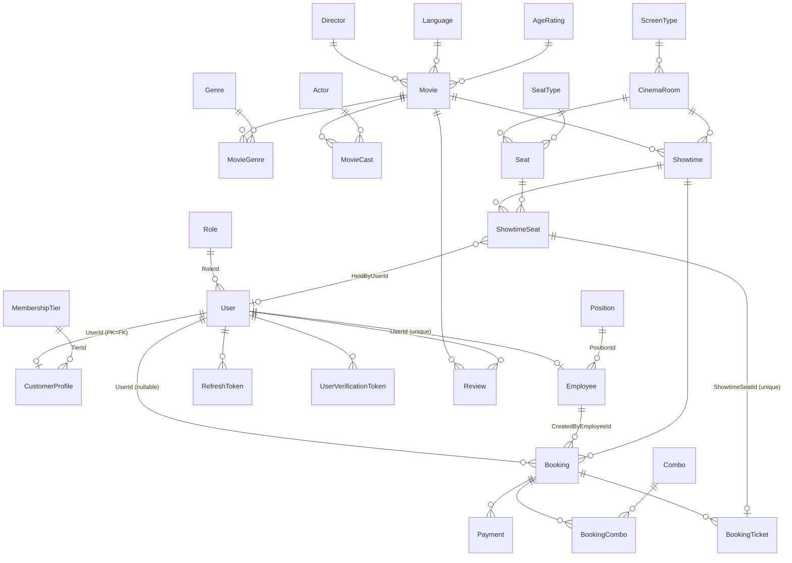

## 3.2 Danh sách entity

| Entity | Mục đích | Field quan trọng | Ràng buộc DB |
|---|---|---|---|
| `Role` | Vai trò | `RoleName` (`Customer`, `Admin`, `Employee`) | unique `RoleName` |
| `User` | Tài khoản (khách, nhân viên, admin) | `Email`, `PasswordHash`, `GoogleId?`, `RoleId`, `IsActive`, `EmailConfirmed`, `Phone?`, `Gender?`, `DateOfBirth?`, `Avatar?` | unique `Email`; unique có lọc `GoogleId IS NOT NULL`; `CK_Users_Gender` ∈ Male/Female/Other |
| `CustomerProfile` | Hồ sơ thành viên (PK = `UserId`) | `Points`, `TotalSpent`, `TierId?` | cascade theo User; `Points` mặc định 0 |
| `MembershipTier` | Hạng thành viên | `TierName`, `MinPoints`, `DiscountPercent` | unique `TierName`; `CK_MembershipTiers_Discount` 0–100 |
| `Employee` | Hồ sơ nhân viên | `UserId`, `PositionId?`, `HireDate?`, `IsActive` | unique `UserId` |
| `Position` | Chức vụ | `Name` | unique `Name` |
| `RefreshToken` | Refresh token (lưu hash SHA-256 hex hoa) | `TokenHash`, `ExpiresAt`, `IsRevoked`, `RevokedAt?`, `ReplacedByTokenId?` | unique `TokenHash` (`UQ_RefreshTokens_TokenHash`) |
| `UserVerificationToken` | Token xác thực email / đặt lại mật khẩu (lưu hash) | `Purpose`, `ExpiresAt`, `Used` | unique `TokenHash`; index (`UserId`,`Purpose`) |
| `Movie` | Phim | `Title`, `DurationMinutes`, `Status`, `AverageRating`, `DirectorId?`, `LanguageId?`, `AgeRatingId?`, `PosterUrl?`, `TrailerUrl?`, `ReleaseDate?`, `Subtitle?` | `CK_Movies_Duration` > 0; `CK_Movies_Status`; `CK_Movies_AverageRating` 0–5; index `Status`, `ReleaseDate` |
| `Genre`, `Language`, `AgeRating`, `Director`, `Actor` | Danh mục phim | `Name` (`AgeRating.Code` + `Description`) | unique `Name` (Genre, Language); unique `Code` (AgeRating) |
| `MovieGenre`, `MovieCast` | Bảng nối phim–thể loại, phim–diễn viên | `MovieCast.CharacterName?` | cascade theo Movie |
| `ScreenType` | Loại màn (2D/3D/IMAX theo seed) | `Name` | unique `Name` |
| `CinemaRoom` | Phòng chiếu | `RoomName`, `Rows`, `Cols`, `TotalSeats`, `IsActive`, `ScreenTypeId?` | unique `RoomName`; `CK_CinemaRooms_TotalSeats` ≥ 0 |
| `SeatType` | Loại ghế | `Name`, `PriceMultiplier` | unique `Name`; `CK_SeatTypes_PriceMultiplier` > 0; mặc định 1.0 |
| `Seat` | Ghế vật lý trong phòng | `SeatRow`, `SeatNumber`, `SeatTypeId?`, `IsActive`, `IsAisle`, `CoupleId?` (Guid) | unique (`RoomId`,`SeatRow`,`SeatNumber`) `UQ_Room_Seat`; `CK_Seats_SeatNumber` > 0 |
| `Showtime` | Suất chiếu | `MovieId`, `RoomId`, `StartTime`, `EndTime` (**đã gồm buffer**), `BasePrice`, `Status` | `CK_Showtime_Time` End > Start; `CK_Showtimes_BasePrice` ≥ 0; `CK_Showtimes_Status`; index thường `IX_Showtime_Room_Time` (không phải unique/exclusion) |
| `ShowtimeSeat` | Ghế của một suất (trạng thái + giá chốt) | `Status`, `Price`, `HeldByUserId?`, `HeldByBookingId?`, `HeldUntil?` | unique (`ShowtimeId`,`SeatId`) `UQ_Showtime_Seat`; `CK_ShowtimeSeats_Status` |
| `Booking` | Đơn đặt vé | `BookingCode`, `UserId?`, `Channel`, `CreatedByEmployeeId?`, `CustomerName`, `CustomerPhone?`, `TotalAmount`, `DiscountAmount`, `FinalAmount`, `Status`, `ExpiresAt?` | unique `BookingCode`; `CK_Bookings_*` (số tiền ≥ 0, Channel, Status); `CK_Booking_Channel_Employee` (Counter ⇔ có `CreatedByEmployeeId`); `CK_Booking_Customer_Identity` |
| `BookingTicket` | Vé từng ghế | `ShowtimeSeatId`, `Price`, `QrCode`, `IsCheckedIn`, `CheckedInAt?` | unique `ShowtimeSeatId` |
| `Combo` / `BookingCombo` | Combo bắp nước / combo trong đơn | `Combo.Price`, `IsActive`; `BookingCombo.Quantity`, `UnitPrice` (giá chốt) | `CK_Combos_Price` ≥ 0; `CK_BookingCombos_Quantity` > 0 |
| `Payment` | Giao dịch thanh toán/hoàn tiền | `PaymentMethod`, `TransactionId?`, `GatewayTransactionId?`, `GatewayResponseCode?`, `Amount`, `Status`, `PaidAt?`, `RefundTransactionId?`, `RefundedAmount?`, `RefundedAt?`, `AmountReceived?`, `ChangeGiven?` | `CK_Payments_Method/Amount/Status`; index `BookingId`, `Status` |
| `Review` | Đánh giá phim | `Rating`, `Comment?` | unique (`UserId`,`MovieId`); **`CK_Reviews_Rating` 1–5** |
| `CinemaSettings` | Cấu hình rạp (một dòng duy nhất) | `OpeningTime?`, `ClosingTime?`, `PointsPerAmount`, `CancelRefundPercent`, `CancelDeadlineHours`, `StopSellingMinutesBefore`, thông tin liên hệ | `CK_CinemaSettings_Id` Id = 1 |

### Enum

| Enum | Giá trị |
|---|---|
| `BookingChannel` | `Online`, `Counter` (bán tại quầy) |
| `BookingStatus` | `Pending`, `Confirmed`, `Cancelled`, `Expired` |
| `Gender` | `Male`, `Female`, `Other` |
| `MovieStatus` | `ComingSoon`, `NowShowing`, `Ended` |
| `PaymentMethod` | `VNPay`, `Momo`, `Cash`, `Stripe` |
| `PaymentStatus` | `Pending`, `Success`, `Failed`, `Refunded` |
| `ShowtimeSeatStatus` | `Available`, `Held`, `Booked` |
| `ShowtimeStatus` | `Scheduled`, `Cancelled`, `Completed` |
| `VerificationTokenPurpose` | `EmailConfirmation`, `PasswordReset` |

### Ghi chú về ràng buộc

* **Không có exclusion constraint chống trùng giờ chiếu** trong migration. `ExceptionHandlingMiddleware` có xử lý lỗi PostgreSQL `23P01` với tên `EX_Showtimes_Room_NoOverlap`, nhưng tên này chỉ xuất hiện trong middleware (tìm toàn repo). Chống trùng giờ hiện chỉ do `ShowtimeService.EnsureNoOverlapAsync` ở tầng ứng dụng, nên về lý thuyết có thể xảy ra race giữa hai yêu cầu đồng thời (chưa có test cho tình huống này).
* **Chống giữ trùng ghế** dựa vào câu lệnh cập nhật có điều kiện (`ExecuteUpdate` chuyển `Available → Held`, kiểm tra số dòng bị ảnh hưởng) trong `BookingService.CreateHoldBookingAsync`; unique `UQ_Showtime_Seat` chỉ đảm bảo mỗi ghế có một dòng cho mỗi suất; có integration test chạy song song (`HoldSeat_HighConcurrencyParallelRequests_OnlyOneWinsAndOthersGet409`).
* **Vé cũ còn trong DB sau khi hủy**: khi hủy booking đã xác nhận, ghế được trả về `Available` nhưng dòng `BookingTicket` không bị xóa. Khi ghế được xác nhận lại ở booking mới, `ConfirmBookingAndGenerateTicketsAsync` xóa các `BookingTicket` cũ của booking không phải `Confirmed` trên cùng ghế để không vi phạm unique `ShowtimeSeatId`.
* Thời gian lưu dạng `timestamp without time zone` (UTC); nghiệp vụ "ngày kinh doanh" dùng giờ Việt Nam (`Utils/VietnamTime.cs`, `DateTimeUtils.cs`).
* Mặc định `CinemaSettings`: cột DB `CancelRefundPercent` default 0, nhưng dòng seed trong migration có `CancelRefundPercent = 100`, `CancelDeadlineHours = 2`, `StopSellingMinutesBefore = 0`, `PointsPerAmount = 10000`, mở cửa `08:00`, đóng cửa `23:59` (xem [12](#s12)).

## 3.3 Sơ đồ chuyển trạng thái

### `Showtime.Status`

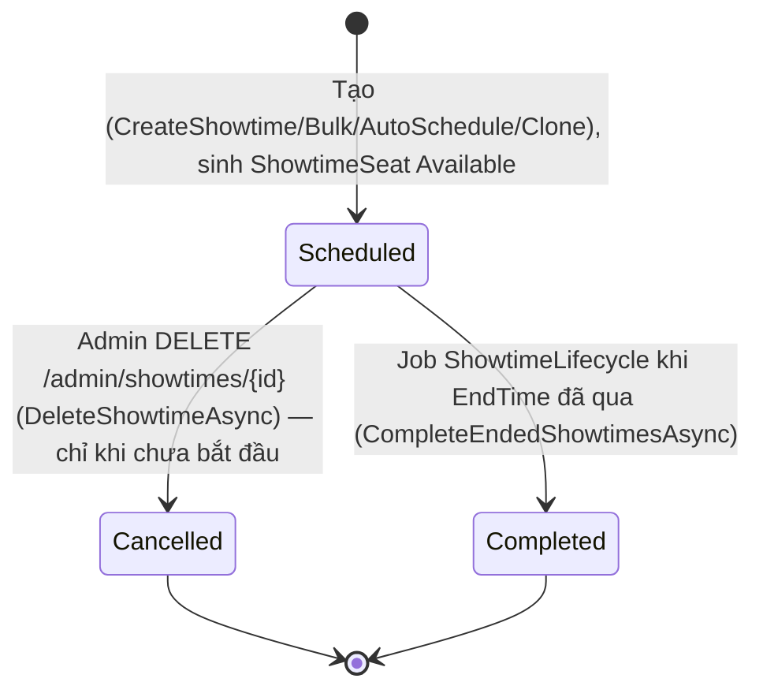

Tác dụng phụ khi `Scheduled → Cancelled`: booking `Pending` → `Cancelled` (payment `Pending` → `Failed`), ghế `Held` → `Available`, booking `Confirmed` → `Cancelled`, hoàn tiền (online: đưa job `ShowtimeRefundJob`; `Cash`: hoàn thủ công), đảo điểm thành viên, gửi email. Chi tiết ở [05](#s05).

### `ShowtimeSeat.Status`

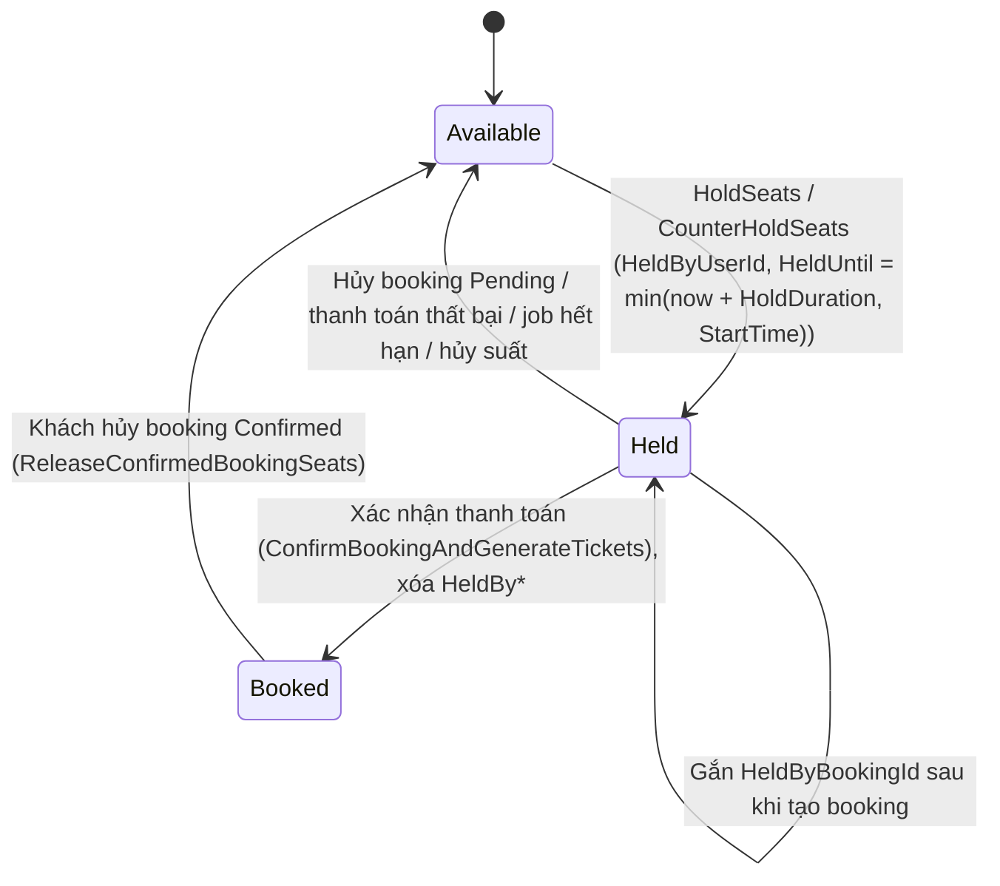

Ghế `Held` đã quá `HeldUntil` chỉ được người giữ cũ giành lại ngay; người khác phải chờ job giải phóng (xem `BookingService.CreateHoldBookingAsync`, `SeatExpirationService`). Riêng `Booked` của suất bị hủy **không** được trả về `Available` (chỉ ghế `Held` được thả).

### `Booking.Status`

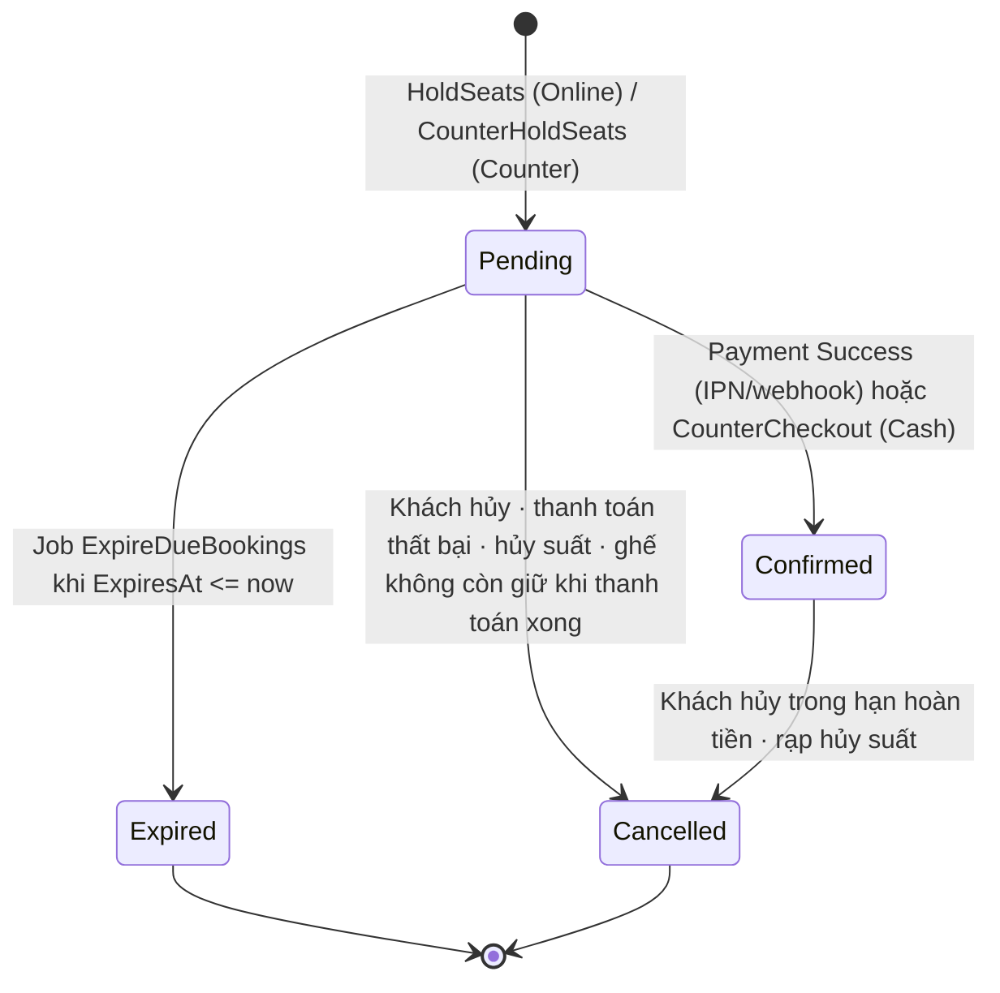

### `Payment.Status`

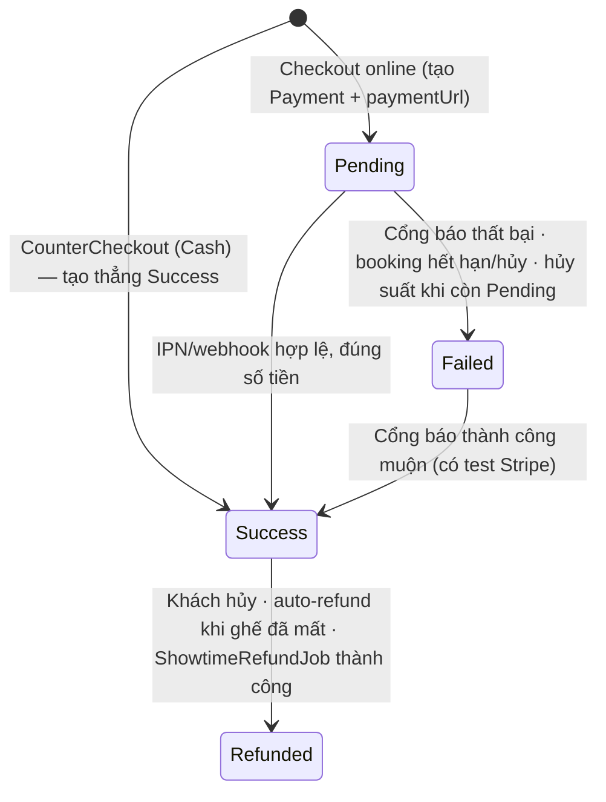

`Success` với booking đã `Cancelled` do rạp hủy suất `Cash` nằm trong "hàng đợi hoàn thủ công": **chưa xác định được từ code** cơ chế đánh dấu đã hoàn thủ công (không có endpoint ghi `Refunded` thủ công; `AdminPaymentsController` chỉ có `GET`).

### `BookingTicket` (cờ `IsCheckedIn`)

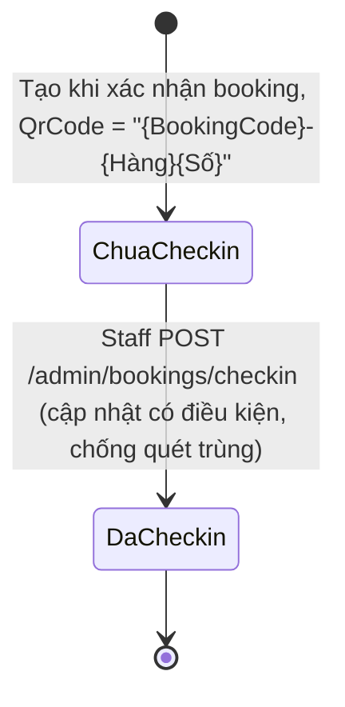

### `Movie.Status`

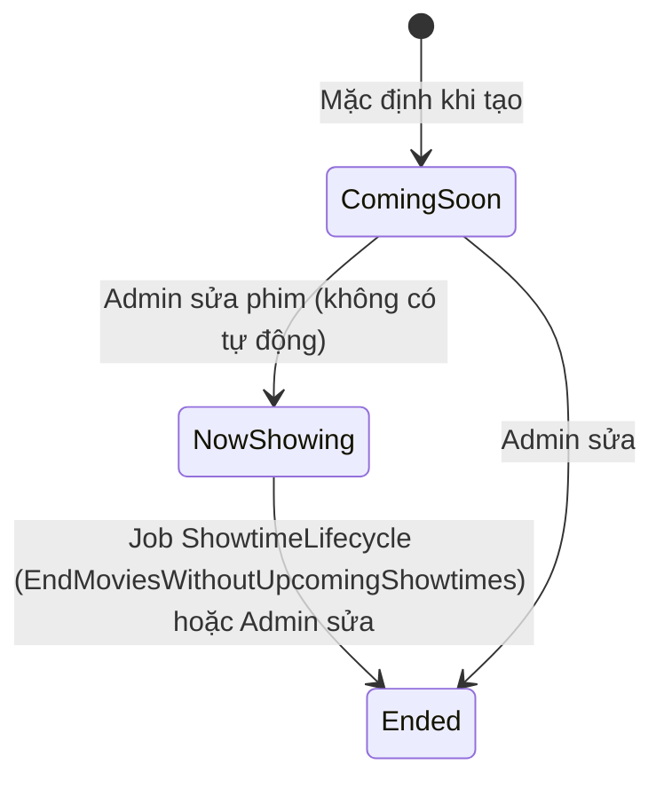

Không có chuyển tự động `ComingSoon → NowShowing` (đã tìm mọi chỗ gán `MovieStatus.*`). Admin có thể đặt bất kỳ trạng thái nào qua `PUT /admin/movies/{id}`; phim `Ended` không thể tạo/sửa suất chiếu.

### Các thực thể có "trạng thái" dạng cờ (không có state machine phức tạp)

| Thực thể | Cờ | Ý nghĩa |
|---|---|---|
| `User.IsActive` | khóa/mở | Khóa → thu hồi toàn bộ refresh token (`EmployeeService.UpdateUserStatusAsync`, test `EmployeeServiceUserStatusTests`) |
| `User.EmailConfirmed` | xác thực email | Chưa xác thực → không đăng nhập được |
| `CinemaRoom.IsActive` | phòng hoạt động | Không thể tắt khi có ghế đã đặt/giữ ở suất sắp tới |
| `Combo.IsActive` | đang bán | `ToggleComboAsync` đảo cờ |
| `Employee.IsActive` | còn làm việc | Chỉ được dùng để chặn hạ role xuống `Customer` (`EmployeeService.UpdateUserRoleAsync`) và hiển thị; **không có chỗ nào trong Application/Api chặn đăng nhập hay quyền theo cờ này** (đã tìm). Quầy bán vé yêu cầu claim `EmployeeId` (có hồ sơ `Employee`), không kiểm tra `IsActive` |
| `Seat.IsActive`, `Seat.IsAisle` | ghế hỏng / lối đi | Không sinh `ShowtimeSeat` |
| `RefreshToken.IsRevoked` | thu hồi | Quay vòng token khi refresh |
| `UserVerificationToken.Used` | đã dùng | Dùng một lần |

---

<a id="s04"></a>

# 4. Nghiệp vụ theo từng module

Quy ước: mã quy tắc `<MODULE>-nn`; "Nguồn" là `đường dẫn::hàm` tính từ `backend/Cinema.Application` (trừ khi ghi khác). Lỗi nghiệp vụ trả qua `ExceptionHandlingMiddleware`.

## 4.0 Quy ước chung: lỗi và định dạng phản hồi

| Exception (`Cinema.Shared/Exceptions`) | HTTP | Dùng khi |
|---|---|---|
| `ValidationAppException` / lỗi FluentValidation | 400 | Dữ liệu vào sai (kèm `errors` theo field) |
| `UnauthorizedAppException` | 401 | Sai thông tin đăng nhập, refresh token không hợp lệ |
| `ForbiddenAppException` | 403 | Không phải chủ tài nguyên / sai cổng đăng nhập |
| `NotFoundException` | 404 | Không tìm thấy |
| `ConflictAppException`, `SeatConflictException` | 409 | Trùng dữ liệu, ghế bị người khác giữ, trạng thái đang xử lý |
| `BusinessRuleException`, `SeatsNoLongerHeldException` | 422 | Vi phạm quy tắc nghiệp vụ |
| `DbUpdateException` do PostgreSQL | 409 / 400 | `23505` unique, `23P01` exclusion (tên `EX_Showtimes_Room_NoOverlap`, **không có trong DB**), `23514` check |

Tất cả phản hồi thành công/lỗi được bọc `ApiResponse` (`Cinema.Api/Filters/ApiResponseFilter.cs`); IPN/webhook thanh toán dùng `RawResponse` để trả đúng định dạng từng cổng. Request đi qua `ValidationActionFilter` (FluentValidation tự động).


---

## 4.1 Xác thực và tài khoản (`AuthService`, `UserProfileService`)

**Actor:** khách vãng lai, `Customer`, `Employee`, `Admin`.

**Luồng chính:** đăng ký → email xác thực (job nền) → xác nhận email → đăng nhập → dùng access token; refresh khi hết hạn; quên/đặt lại mật khẩu; đăng nhập Google (chỉ khách hàng); lấy socket token cho SignalR.

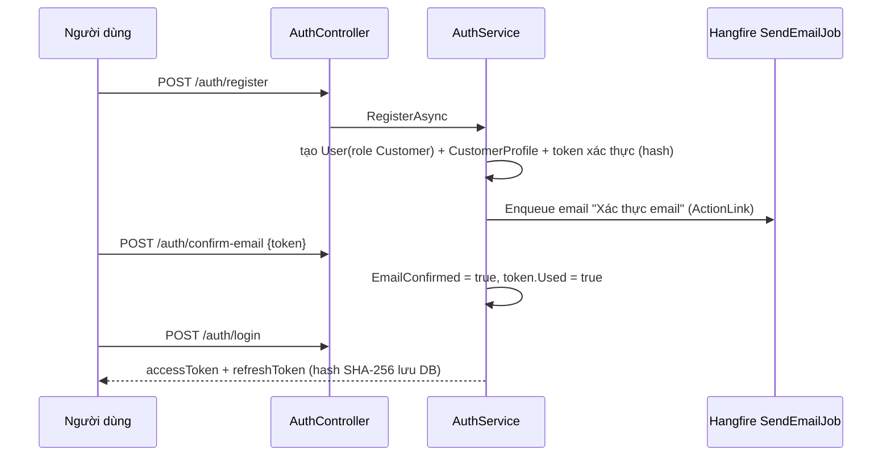

| Mã | Mô tả | Điều kiện | Kết quả/lỗi | Nguồn |
|---|---|---|---|---|
| AUTH-01 | Email là duy nhất | Đăng ký với email đã có | 409 | `Services/Auth/AuthService.cs::RegisterAsync`; unique `Email` |
| AUTH-02 | Đăng ký luôn tạo role `Customer` và hồ sơ thành viên | — | `CustomerProfile` điểm 0 | `RegisterAsync` |
| AUTH-03 | Cổng khách chỉ cho `Customer` | `/auth/login` với role khác | 403 "Vui lòng đăng nhập qua cổng quản trị" | `AuthService.LoginAsync(adminOnly=false)` |
| AUTH-04 | Cổng admin **không kiểm tra role** | `/auth/admin-login` | Mọi role đều nhận token (policy chặn sau) | `AuthService.LoginAsync(adminOnly=true)` |
| AUTH-05 | Phải kích hoạt và xác thực email | `IsActive=false` hoặc `EmailConfirmed=false` | Từ chối đăng nhập/refresh | `LoginAsync`, `RefreshAsync` |
| AUTH-06 | Quay vòng refresh token; dùng lại token đã thu hồi thu hồi cả chuỗi | Refresh | 401 | `RefreshAsync`, `RevokeTokenChainAsync` |
| AUTH-07 | Token xác thực email hạn 24 giờ, đặt lại mật khẩu 30 phút, dùng một lần | — | Token hết hạn/đã dùng bị từ chối | `ConfirmEmailAsync`, `ResetPasswordAsync`; `Options/EmailOptions` |
| AUTH-08 | Đặt lại mật khẩu thu hồi mọi refresh token còn hiệu lực của user; đổi mật khẩu yêu cầu email đã xác thực và mật khẩu hiện tại đúng (không thấy thu hồi token trong `ChangePasswordAsync`) | `/auth/reset-password`, `/users/me/change-password` | 400 "Token hết hạn, đã dùng hoặc không hợp lệ." / "Mật khẩu hiện tại không đúng." / 403 chưa xác thực email | `Services/Auth/AuthService.cs::ResetPasswordAsync`, `ChangePasswordAsync` |
| AUTH-09 | Google: email phải được Google xác thực; liên kết tài khoản cùng email; chỉ role `Customer` | `/auth/google` | 401/403 | `GoogleLoginAsync`; `Infrastructure/Auth/GoogleAuthService.cs` |
| AUTH-10 | Validator: `FullName` ≤ 100, `Email` ≤ 150 + định dạng, `Phone` ≤ 20 + regex `PhoneRegex`, mật khẩu `StrongPassword`: ≥ 8 ký tự, có chữ hoa, chữ thường và chữ số (`Validators/Auth/PasswordValidationExtensions.cs`) | Đăng ký | 400 | `Validators/Auth/AuthValidators.cs` |
| AUTH-11 | Hồ sơ cá nhân: `FullName` ≤ 100, `Phone` regex, `Avatar` ≤ 255, `Gender` ∈ Male/Female/Other | `PUT /users/me` | 400 | `Validators/Users/UserValidators.cs`, `Services/Users/UserProfileService.cs::UpdateMyProfileAsync` |

**Tác dụng phụ:** email xác thực/đặt lại mật khẩu qua `SendEmailJob` (xem [11](#s11)).

**Endpoint**

| Method | Route | Quyền | Hàm |
|---|---|---|---|
| POST | `/api/v1/auth/register` | Công khai · RL `auth` | `Auth.Register` |
| POST | `/api/v1/auth/confirm-email` | Công khai | `Auth.ConfirmEmail` |
| POST | `/api/v1/auth/login` | Công khai · RL `auth` | `Auth.Login` |
| POST | `/api/v1/auth/admin-login` | Công khai · RL `auth` | `Auth.AdminLogin` |
| POST | `/api/v1/auth/google` | Công khai · RL `auth` | `Auth.GoogleLogin` |
| POST | `/api/v1/auth/refresh` | Công khai · RL `auth` | `Auth.Refresh` |
| POST | `/api/v1/auth/logout` | Công khai | `Auth.Logout` |
| POST | `/api/v1/auth/forgot-password` | Công khai · RL `auth` | `Auth.ForgotPassword` |
| POST | `/api/v1/auth/reset-password` | Công khai · RL `auth` | `Auth.ResetPassword` |
| POST | `/api/v1/auth/resend-confirmation` | Công khai | `Auth.ResendConfirmationEmail` |
| POST | `/api/v1/auth/socket-token` | Đã đăng nhập | `Auth.GenerateSocketToken` |
| GET | `/api/v1/auth/me` | Đã đăng nhập | `Auth.Me` |
| GET | `/api/v1/users/me` | Đã đăng nhập | `Users.GetMyProfile` |
| PUT | `/api/v1/users/me` | Đã đăng nhập | `Users.UpdateMyProfile` |
| GET | `/api/v1/users/me/reviews` | Đã đăng nhập | `Users.GetMyReviews` |
| POST | `/api/v1/users/me/change-password` | Đã đăng nhập | `Users.ChangePassword` |


**Khác biệt client/server:** form đăng nhập phía web chỉ yêu cầu mật khẩu ≥ 6 ký tự (`login-form.tsx`), còn đăng ký/đặt lại dùng `passwordSchema` kèm thanh đo độ mạnh; server luôn áp `StrongPassword` khi đăng ký/đổi/đặt lại mật khẩu.
---

## 4.2 Phim và danh mục (`MovieService`, `CatalogService`)

**Actor:** khách xem; `StaffOnly` xem danh sách admin; `AdminOnly` sửa dữ liệu.

**Quy tắc phim**

| Mã | Mô tả | Điều kiện | Kết quả | Nguồn |
|---|---|---|---|---|
| MOV-01 | Phim có tiêu đề ≤ 200, `DurationMinutes` 1–600, có ít nhất một thể loại, `Status` hợp lệ | Tạo/sửa | 400 | `Validators/Movies/MovieValidators.cs` |
| MOV-02 | Xóa phim: nếu đã có suất chiếu → **không xóa**, đổi `Status = Ended`; nếu chưa có → xóa thật | `DELETE /admin/movies/{id}` | Xóa mềm theo điều kiện | `Services/Movies/MovieService.cs::DeleteMovieAsync` |
| MOV-03 | Phim `Ended` không được tạo/sửa suất chiếu | — | 422 | `ShowtimeService.CreateShowtimeAsync` (xem 4.4) |
| MOV-04 | `AverageRating` được cập nhật khi tạo/sửa/xóa đánh giá | — | Cột `Movies.AverageRating` (0–5) | `Services/Reviews/ReviewService.cs` (xem 4.12) |
| MOV-05 | Chuyển `NowShowing → Ended` tự động khi phim còn suất `Scheduled` nào kết thúc sau mốc cắt; công thức: phim `NowShowing`, có ít nhất một suất không `Cancelled`, và không còn suất `Scheduled` có `EndTime > cutoff` | Job mỗi phút | Phim thành `Ended` | `ShowtimeService.EndMoviesWithoutUpcomingShowtimesAsync` |
| MOV-06 | Không có chuyển tự động `ComingSoon → NowShowing` | — | Admin tự sửa | Đã tìm mọi chỗ gán `MovieStatus` |

**Quy tắc danh mục** (`Services/Catalog/CatalogService.cs`; validator `Validators/Catalog/CatalogValidators.cs`)

| Mã | Mô tả | Lỗi |
|---|---|---|
| CAT-01 | Tên duy nhất khi tạo: thể loại, ngôn ngữ, mã độ tuổi, chức vụ, loại màn hình, loại ghế, hạng thành viên | 409 "… đã tồn tại." |
| CAT-02 | Không xóa khi còn được tham chiếu (phim, nhân viên, phòng, ghế, khách hàng, danh sách diễn viên) | 409 "… đang được … tham chiếu, không thể xóa." |
| CAT-03 | Tên ≤ 50; `AgeRating.Code` ≤ 10, mô tả ≤ 255; `SeatType.PriceMultiplier` > 0; `MembershipTier.MinPoints` ≥ 0, `DiscountPercent` 0–100 | 400 |
| CAT-04 | Sửa `PriceMultiplier` hoặc `MinPoints`/`DiscountPercent` **không** tính lại ghế/suất/hạng đã có (giá ghế chốt lúc tạo suất; hạng chỉ xét lại khi điểm đổi) | — (`UpdateSeatTypeAsync`, `UpdateMembershipTierAsync` chỉ cập nhật bản ghi) |
| CAT-05 | Cập nhật tên không kiểm tra trùng ở service; dựa vào unique DB và middleware 409 | 409 |

**Endpoint**

| Method | Route | Quyền | Hàm |
|---|---|---|---|
| GET | `/api/v1/admin/actors` | AdminOnly | `AdminActors.GetAll` |
| POST | `/api/v1/admin/actors` | AdminOnly | `AdminActors.Create` |
| PUT | `/api/v1/admin/actors/{id:int}` | AdminOnly | `AdminActors.Update` |
| DELETE | `/api/v1/admin/actors/{id:int}` | AdminOnly | `AdminActors.Delete` |
| GET | `/api/v1/admin/age-ratings` | AdminOnly | `AdminAgeRatings.GetAll` |
| POST | `/api/v1/admin/age-ratings` | AdminOnly | `AdminAgeRatings.Create` |
| PUT | `/api/v1/admin/age-ratings/{id:int}` | AdminOnly | `AdminAgeRatings.Update` |
| DELETE | `/api/v1/admin/age-ratings/{id:int}` | AdminOnly | `AdminAgeRatings.Delete` |
| GET | `/api/v1/admin/directors` | AdminOnly | `AdminDirectors.GetAll` |
| POST | `/api/v1/admin/directors` | AdminOnly | `AdminDirectors.Create` |
| PUT | `/api/v1/admin/directors/{id:int}` | AdminOnly | `AdminDirectors.Update` |
| DELETE | `/api/v1/admin/directors/{id:int}` | AdminOnly | `AdminDirectors.Delete` |
| GET | `/api/v1/admin/genres` | AdminOnly | `AdminGenres.GetAll` |
| POST | `/api/v1/admin/genres` | AdminOnly | `AdminGenres.Create` |
| PUT | `/api/v1/admin/genres/{id:int}` | AdminOnly | `AdminGenres.Update` |
| DELETE | `/api/v1/admin/genres/{id:int}` | AdminOnly | `AdminGenres.Delete` |
| GET | `/api/v1/admin/languages` | AdminOnly | `AdminLanguages.GetAll` |
| POST | `/api/v1/admin/languages` | AdminOnly | `AdminLanguages.Create` |
| PUT | `/api/v1/admin/languages/{id:int}` | AdminOnly | `AdminLanguages.Update` |
| DELETE | `/api/v1/admin/languages/{id:int}` | AdminOnly | `AdminLanguages.Delete` |
| GET | `/api/v1/admin/membership-tiers` | AdminOnly | `AdminMembershipTiers.GetAll` |
| POST | `/api/v1/admin/membership-tiers` | AdminOnly | `AdminMembershipTiers.Create` |
| PUT | `/api/v1/admin/membership-tiers/{id:int}` | AdminOnly | `AdminMembershipTiers.Update` |
| DELETE | `/api/v1/admin/membership-tiers/{id:int}` | AdminOnly | `AdminMembershipTiers.Delete` |
| GET | `/api/v1/admin/movies` | StaffOnly | `AdminMovies.GetMovies` |
| POST | `/api/v1/admin/movies` | AdminOnly | `AdminMovies.Create` |
| PUT | `/api/v1/admin/movies/{id:int}` | AdminOnly | `AdminMovies.Update` |
| DELETE | `/api/v1/admin/movies/{id:int}` | AdminOnly | `AdminMovies.Delete` |
| GET | `/api/v1/admin/positions` | AdminOnly | `AdminPositions.GetAll` |
| POST | `/api/v1/admin/positions` | AdminOnly | `AdminPositions.Create` |
| PUT | `/api/v1/admin/positions/{id:int}` | AdminOnly | `AdminPositions.Update` |
| DELETE | `/api/v1/admin/positions/{id:int}` | AdminOnly | `AdminPositions.Delete` |
| GET | `/api/v1/admin/screen-types` | AdminOnly | `AdminScreenTypes.GetAll` |
| POST | `/api/v1/admin/screen-types` | AdminOnly | `AdminScreenTypes.Create` |
| PUT | `/api/v1/admin/screen-types/{id:int}` | AdminOnly | `AdminScreenTypes.Update` |
| DELETE | `/api/v1/admin/screen-types/{id:int}` | AdminOnly | `AdminScreenTypes.Delete` |
| GET | `/api/v1/admin/seat-types` | AdminOnly | `AdminSeatTypes.GetAll` |
| POST | `/api/v1/admin/seat-types` | AdminOnly | `AdminSeatTypes.Create` |
| PUT | `/api/v1/admin/seat-types/{id:int}` | AdminOnly | `AdminSeatTypes.Update` |
| DELETE | `/api/v1/admin/seat-types/{id:int}` | AdminOnly | `AdminSeatTypes.Delete` |
| GET | `/api/v1/genres` | Công khai | `Catalog.GetGenres` |
| GET | `/api/v1/languages` | Công khai | `Catalog.GetLanguages` |
| GET | `/api/v1/age-ratings` | Công khai | `Catalog.GetAgeRatings` |
| GET | `/api/v1/membership-tiers` | Công khai | `Catalog.GetMembershipTiers` |
| GET | `/api/v1/movies` | Công khai | `Movies.GetMovies` |
| GET | `/api/v1/movies/{movieId:int}` | Công khai | `Movies.GetMovieDetail` |
| GET | `/api/v1/movies/{movieId:int}/reviews` | Công khai | `Movies.GetReviews` |
| GET | `/api/v1/movies/{movieId:int}/can-review` | Công khai | `Movies.GetCanReviewStatus` |
| POST | `/api/v1/movies/{movieId:int}/reviews` | CustomerOnly | `Movies.CreateReview` |
| PUT | `/api/v1/movies/{movieId:int}/reviews/{id:int}` | CustomerOnly | `Movies.UpdateReview` |
| DELETE | `/api/v1/movies/{movieId:int}/reviews/{id:int}` | CustomerOnly | `Movies.DeleteReview` |


---

## 4.3 Phòng chiếu, sơ đồ ghế, loại ghế (`RoomService`)

**Mục đích:** quản lý phòng, lưới ghế (hàng × cột), ghế đôi (`CoupleId`), lối đi (`IsAisle`), loại ghế (hệ số giá).

| Mã | Mô tả | Điều kiện | Kết quả | Nguồn |
|---|---|---|---|---|
| ROOM-01 | Tên phòng duy nhất (≤ 50); `screenType` phải tồn tại | Tạo/sửa | 409 "roomName đã tồn tại." / 400 "screenType không tồn tại." | `Services/Rooms/RoomService.cs`; `Validators/Rooms/RoomValidators.cs` |
| ROOM-02 | `Rows`, `Cols` chỉ đặt lúc tạo; sửa phòng không đổi kích thước. Không thấy validator giới hạn `Rows`/`Cols` | — | **Chưa xác định giới hạn** (đã xem `RoomValidators.cs`) | `RoomService.UpdateRoomAsync` |
| ROOM-03 | Cập nhật sơ đồ ghế: ghế có `SeatRow` ≤ 5 ký tự, `SeatNumber` > 0, không trùng (hàng, số), tối thiểu một ghế | `PUT /admin/rooms/{id}/seats` | 400 | `RoomValidators.cs` (validator `Seats`), `UpdateSeatLayoutAsync` |
| ROOM-04 | Quy tắc bố trí ghế (ghế đôi, lối đi) kiểm tra bằng `SeatLayoutRules` | Sửa sơ đồ | 422 | `Utils/SeatLayoutRules.cs` |
| ROOM-05 | Không tắt hoạt động phòng khi có ghế đã đặt/đang giữ ở suất sắp tới | `UpdateRoomAsync` (IsActive=false) | 409 "Phòng đang có ghế đã đặt hoặc đang được giữ ở suất chiếu sắp tới, không thể ngừng hoạt động." | `RoomService.UpdateRoomAsync` |
| ROOM-05b | Không xóa phòng đang có suất chiếu sắp tới | `DELETE /admin/rooms/{id}` | 422 "Phòng đang có suất chiếu sắp tới, không thể xoá." (có kiểm tra thêm `hasAnyShowtimes`; nhánh xử lý phòng từng có suất: xem `DeleteRoomAsync`) | `RoomService.DeleteRoomAsync` |
| ROOM-05c | Sửa sơ đồ ghế không được đụng ghế đang được đặt/giữ ở suất sắp tới; ghế đôi và tham chiếu loại ghế phải hợp lệ | `PUT /admin/rooms/{id}/seats` | 409 "Không thể thay đổi ghế đang được đặt hoặc giữ ở suất chiếu sắp tới."; 400 "Dữ liệu ghế đôi không hợp lệ." / "Dữ liệu tham chiếu không hợp lệ." | `RoomService.UpdateSeatLayoutAsync` |
| ROOM-06 | Ghế `IsAisle` hoặc `IsActive=false` không sinh `ShowtimeSeat` | Tạo suất | — | `ShowtimeService.CreateShowtimeAsync` |

**Endpoint**

| Method | Route | Quyền | Hàm |
|---|---|---|---|
| GET | `/api/v1/admin/rooms` | AdminOnly | `AdminRooms.GetRooms` |
| POST | `/api/v1/admin/rooms` | AdminOnly | `AdminRooms.Create` |
| GET | `/api/v1/admin/rooms/{id:int}` | AdminOnly | `AdminRooms.GetById` |
| PUT | `/api/v1/admin/rooms/{id:int}` | AdminOnly | `AdminRooms.Update` |
| DELETE | `/api/v1/admin/rooms/{id:int}` | AdminOnly | `AdminRooms.Delete` |
| GET | `/api/v1/admin/rooms/{id:int}/seats` | AdminOnly | `AdminRooms.GetSeats` |
| PUT | `/api/v1/admin/rooms/{id:int}/seats` | AdminOnly | `AdminRooms.UpdateSeatLayout` |

---

## 4.4 Suất chiếu (`ShowtimeService`)

**Mục đích:** lập lịch chiếu; sinh ghế theo suất (`ShowtimeSeat`) với giá chốt; chống trùng phòng/giờ; kiểm tra giờ hoạt động rạp; tạo hàng loạt, tự động xếp lịch, nhân bản.

**Actor:** `Admin` (ghi); `Staff` (xem lịch); khách xem lịch công khai.

**Công thức thời gian:** `EndTime = StartTime + DurationMinutes + RoomBufferMinutes` (mặc định buffer 15 phút, `Booking:RoomBufferMinutes`, `Options/BookingOptions.cs`). Kiểm tra trùng giờ dùng `EndTime` (đã gồm buffer); kiểm tra giờ hoạt động dùng `end = start + duration` (không gồm buffer). Nguồn: `ShowtimeService.CreateShowtimeAsync`, `EnsureNoOverlapAsync`, `ValidateOperatingHoursAsync`.

| Mã | Mô tả | Điều kiện | Kết quả/lỗi | Nguồn |
|---|---|---|---|---|
| SHW-01 | Phim và phòng phải tồn tại | Tạo/sửa/hàng loạt | 400 "movieId không tồn tại." / "roomId không tồn tại." | `CreateShowtimeAsync`, `BulkCreateShowtimesAsync` |
| SHW-02 | Không tạo suất cho phim `Ended` | — | 422 "Phim đã ngừng chiếu (Ended), không thể tạo suất chiếu." | như trên |
| SHW-03 | Phòng phải `IsActive` và đã có ghế (ghế `IsActive` và không `IsAisle`) | — | 422 "Phòng chiếu không hoạt động (inactive)." / "Phòng chiếu chưa được thiết lập sơ đồ ghế." | như trên |
| SHW-04 | Giờ bắt đầu phải ở tương lai | `StartTime <= now` | 422 "Giờ bắt đầu suất chiếu phải ở tương lai." | `EnsureStartsInFuture` |
| SHW-05 | Không trùng khung giờ trong cùng phòng (tính cả buffer) | Có suất khác của phòng giao khoảng `[Start, End)` | 409 "Trùng khung giờ chiếu trong phòng này." | `EnsureNoOverlapAsync` (không có ràng buộc DB) |
| SHW-06 | Giờ hoạt động: nếu `OpeningTime`/`ClosingTime` đã cấu hình, suất phải bắt đầu sau giờ mở và **kết thúc** (`start + duration`) trước hoặc đúng giờ đóng; nếu `ClosingTime ≤ OpeningTime` thì đóng cửa là ngày hôm sau. Bật `AllowAfterHours` thì chỉ cần giờ **bắt đầu** nằm trước giờ đóng | `CinemaSettings` có giờ | 422 "Suất chiếu hh:mm - hh:mm nằm ngoài khung giờ hoạt động của rạp (a - b)." | `Utils/OperatingHours.cs::Violation`, `ValidateOperatingHoursAsync` |
| SHW-07 | Không đổi phòng sau khi tạo | `UpdateShowtime` đổi `RoomId` | 422 "Không thể đổi phòng chiếu sau khi đã tạo suất chiếu. Hãy hủy và tạo suất chiếu mới." | `UpdateShowtimeAsync` |
| SHW-08 | Không sửa suất đã có booking `Confirmed` | — | 409 "Suất chiếu đã có booking đã xác nhận (Confirmed), không thể sửa." | `UpdateShowtimeAsync` |
| SHW-09 | Không sửa suất đang có booking `Pending` (khách đang giữ ghế/thanh toán) | — | 409 "Suất chiếu đang có khách giữ ghế hoặc đang thanh toán (Pending), không thể sửa lúc này. Vui lòng thử lại sau vài phút." | `UpdateShowtimeAsync` |
| SHW-10 | Chỉ thao tác trên suất `Scheduled` | Sửa/hủy suất ở trạng thái khác | 422 "Chỉ có thể … suất chiếu đang ở trạng thái Scheduled (hiện tại: …)." | `EnsureScheduled` |
| SHW-11 | Giá ghế chốt khi tạo: `ShowtimeSeat.Price` = `BasePrice` × `SeatType.PriceMultiplier` (ghế chưa có loại → hệ số 1); đổi giá sau đó không tự tính lại | Tạo suất | — | `GenerateShowtimeSeatsAsync`; test `SeatPriceUsesSeatTypeMultiplier` |
| SHW-12 | Không hủy suất đã bắt đầu | `StartTime <= now` | 422 "Suất chiếu đã bắt đầu, không thể hủy." | `DeleteShowtimeAsync` |
| SHW-13 | Tạo hàng loạt: `DaysOfWeek` + `Times` trong khoảng `From..To`; tối đa `MaxBatchSize` suất mỗi lần (**2000**) | Vượt | 422 "Tối đa {MaxBatchSize} suất chiếu mỗi lần tạo hàng loạt. Hãy thu hẹp khoảng ngày." | `BulkCreateShowtimesAsync` |
| SHW-13b | Tạo hàng loạt/áp dụng xếp lịch tự động/nhân bản dùng chung `CreateShowtimesBatchAsync`: từng mục vi phạm (phim/phòng không tồn tại, giờ không ở tương lai, phim `Ended`, phòng không hoạt động hoặc chưa có ghế, ngoài giờ hoạt động, trùng giờ với suất đã có: "Trùng khung giờ với suất chiếu đã có.") **bị bỏ qua và liệt kê** trong `skipped` (ngày, giờ, lý do) kèm `TotalCreated`/`TotalSkipped`, không làm hỏng cả lô | Bất kỳ mục lỗi nào | 200 với danh sách bỏ qua | `ShowtimeService.CreateShowtimesBatchAsync`, `BulkCreateShowtimesAsync` |
| SHW-14 | Tự động xếp lịch: `toDate ≥ date`, tối đa `MaxAutoScheduleDays` (**31**) ngày, tối đa 20 phim, `Shows` 1–20 mỗi phim, `Items` áp dụng ≤ 1000; cần ít nhất một phòng hoạt động đã có ghế; phim `Ended` bị từ chối | — | 400/422 tương ứng | `PreviewAutoScheduleAsync`, `ApplyAutoScheduleAsync`; `Validators/Showtimes/ShowtimeValidators.cs` |
| SHW-15 | Nhân bản lịch: nguồn có suất; ≤ `MaxBatchSize`; `ShiftDays` 1–366 | — | 422 "Không có suất chiếu nào trong khoảng ngày nguồn để nhân bản." / "Tối đa … mỗi lần nhân bản…" | `CloneShowtimesAsync` |
| SHW-16 | Job vòng đời: suất `Scheduled` có `EndTime` đã qua → `Completed`; phim `NowShowing` hết suất tương lai → `Ended` | Chạy theo `ShowtimeLifecycleCron` | — | `CompleteEndedShowtimesAsync`, `EndMoviesWithoutUpcomingShowtimesAsync` |
| SHW-17 | `Scheduler:*` (`FitWeight`, `LoadWeight`, `StepMinutes`…) **chưa được dùng**: `ShowtimeService._scheduler` chỉ gán, `ShowtimeScheduler.Build` gọi không truyền option | — | Dùng giá trị mặc định `SchedulerOptions` | `ShowtimeService` (khai báo/gán `_scheduler`) |

**Tác dụng phụ khi hủy suất (`DeleteShowtimeAsync`):** xem luồng ở [05 §5.4](#s05). **Bulk delete:** `DELETE /admin/showtimes/bulk` (hàm `BulkDeleteShowtimesAsync`).

**Endpoint**

| Method | Route | Quyền | Hàm |
|---|---|---|---|
| GET | `/api/v1/admin/showtimes` | StaffOnly | `AdminShowtimes.GetShowtimes` |
| GET | `/api/v1/admin/showtimes/calendar` | StaffOnly | `AdminShowtimes.GetCalendar` |
| POST | `/api/v1/admin/showtimes` | AdminOnly | `AdminShowtimes.Create` |
| PUT | `/api/v1/admin/showtimes/{id:int}` | AdminOnly | `AdminShowtimes.Update` |
| DELETE | `/api/v1/admin/showtimes/{id:int}` | AdminOnly | `AdminShowtimes.Delete` |
| POST | `/api/v1/admin/showtimes/bulk` | AdminOnly | `AdminShowtimes.BulkCreate` |
| POST | `/api/v1/admin/showtimes/auto-schedule/preview` | AdminOnly | `AdminShowtimes.PreviewAutoSchedule` |
| POST | `/api/v1/admin/showtimes/auto-schedule/apply` | AdminOnly | `AdminShowtimes.ApplyAutoSchedule` |
| POST | `/api/v1/admin/showtimes/clone` | AdminOnly | `AdminShowtimes.CloneShowtimes` |
| DELETE | `/api/v1/admin/showtimes/bulk` | AdminOnly | `AdminShowtimes.BulkDelete` |
| GET | `/api/v1/showtimes` | Công khai | `Showtimes.GetSchedule` |
| GET | `/api/v1/showtimes/{showtimeId:int}/seats` | Công khai | `Showtimes.GetSeats` |
| GET | `/api/v1/showtimes/{showtimeId:int}/seat-suggestions` | Công khai | `Showtimes.GetSeatSuggestions` |


---

## 4.5 Đặt vé và giữ ghế (`BookingService`, `SeatExpirationService`)

**Mục đích:** khách chọn ghế → giữ ghế có thời hạn → thanh toán; một booking gồm nhiều vé, combo, giảm giá theo hạng.

**Giá trị cấu hình thật** (`Options/BookingOptions.cs`, `appsettings.json` mục `Booking`): `HoldDurationMinutes` = 15; `RoomBufferMinutes` = 15; `CheckInOpenMinutes` = 30; `MaxSeatsPerBooking` = 10; `MaxComboQuantity` = 10 (giá trị tối đa dùng trong validator).

| Mã | Mô tả | Điều kiện | Kết quả/lỗi | Nguồn |
|---|---|---|---|---|
| BK-01 | Suất phải còn `Scheduled`, chưa bắt đầu | — | 422 "Suất chiếu không còn khả dụng để đặt vé." / "Suất chiếu đã bắt đầu hoặc đã kết thúc." | `BookingService.CreateHoldBookingAsync` |
| BK-02 | Ngừng bán online trước giờ chiếu `StopSellingMinutesBefore` phút (0 = không giới hạn); chỉ áp cho kênh `Online` | Còn ≤ N phút | 422 "Đã ngừng bán vé online cho suất chiếu này (trước giờ chiếu N phút)." | `CreateHoldBookingAsync` |
| BK-03 | Số ghế mỗi lần giữ: không rỗng, không trùng, ≤ `MaxSeatsPerBooking` (10) | — | 400 | `Validators/Bookings/BookingValidators.cs` |
| BK-04 | `CustomerName` bắt buộc ≤ 100; `CustomerPhone` tùy chọn, ≤ 20 và khớp `PhoneRegex` | — | 400; 400 "Thiếu tên khách hàng." | `BookingValidators.cs`, `CreateHoldBookingAsync` |
| BK-05 | Mỗi khách chỉ có một booking `Pending` cho một suất chiếu (online) | Đã có | 409 "Đang có một booking Pending khác chưa hoàn tất cho suất chiếu này." | `CreateHoldBookingAsync` |
| BK-06 | Giữ ghế nguyên tử: chuyển `Available → Held` bằng câu lệnh cập nhật có điều kiện; ghế `Held` đã quá hạn chỉ chính người giữ cũ giành lại ngay; ghế bị người khác giữ/đặt → thất bại | Có ghế xung đột | 409 `SeatConflictException` kèm `conflictSeatIds` (toàn bộ giao dịch bị rollback) | `CreateHoldBookingAsync`; test `HoldSeat_HighConcurrencyParallelRequests_OnlyOneWinsAndOthersGet409` |
| BK-07 | `HeldUntil` = `min(now + HoldDurationMinutes, StartTime)`; `Booking.ExpiresAt` đặt bằng cùng mốc | — | — | `CreateHoldBookingAsync`, `Utils/BookingSeatHold.cs` |
| BK-08 | Quy tắc chọn ghế (chỉ **online**): ghế đôi chọn cùng cặp, không để trống ghế lẻ giữa các ghế đã chọn/đã bán | — | 422 với thông báo từ `SeatLayoutRules.ValidateSelection` | `HoldSeatsAsync` (gọi `ValidateSelection`); kênh quầy **không** gọi |
| BK-09 | Combo: `comboId` phải tồn tại và đang bán; `Quantity` 1..`MaxComboQuantity`; đơn giá chốt vào `BookingCombo.UnitPrice` | — | 400 "Một hoặc nhiều comboId không tồn tại hoặc đã ngừng bán." | `BuildBookingCombosAsync` |
| BK-10 | Giá: `TotalAmount` = tổng giá ghế (`ShowtimeSeat.Price`) + tổng combo; `DiscountAmount` = làm tròn `TotalAmount × DiscountPercent hạng / 100` (0 chữ số thập phân, away-from-zero); `FinalAmount` = `Total − Discount` | Khách có hạng | — | `CreateHoldBookingAsync`, `CalculateDiscountAmountAsync` |
| BK-11 | Mã booking duy nhất, thử lại có giới hạn | Không sinh được | 422 "Không thể sinh mã booking duy nhất, vui lòng thử lại." | `GenerateUniqueBookingCodeAsync` |
| BK-12 | Xem chi tiết booking phải là chủ | — | 403 "Bạn không phải chủ booking này." | `GetBookingDetailAsync` |
| BK-13 | Hết hạn: job mỗi phút chuyển booking `Pending` có `ExpiresAt <= now` sang `Expired`, trả ghế `Held` về `Available`, payment `Pending` → `Failed`; ngoài ra giải phóng ghế `Held` quá `HeldUntil` không còn booking Pending | Cron `ReleaseExpiredSeatsCron` | — | `SeatExpirationService.ExpireDueBookingsAsync`, `ReleaseStaleHeldSeatsAsync` |
| BK-14 | Giới hạn tần suất: `booking-hold` 10 lượt/60 giây trên `POST /bookings/hold` | — | 429 | `Program.cs` (`AddRateLimiter`) |
| BK-15 | Toàn bộ `/bookings/*` (`GET /bookings`, `GET /bookings/{id}`, hold, checkout, cancel) chỉ cần đăng nhập, **không giới hạn role** `Customer` | — | — | `Controllers/Client/BookingsController` (`[Authorize]` cấp class) |

**Endpoint**

| Method | Route | Quyền | Hàm |
|---|---|---|---|
| POST | `/api/v1/bookings/hold` | Đã đăng nhập · RL `booking-hold` | `Bookings.HoldSeats` |
| GET | `/api/v1/bookings` | Đã đăng nhập | `Bookings.GetMyBookings` |
| GET | `/api/v1/bookings/{bookingId:int}` | Đã đăng nhập | `Bookings.GetBookingDetail` |
| POST | `/api/v1/bookings/{bookingId:int}/checkout` | Đã đăng nhập | `Bookings.Checkout` |
| POST | `/api/v1/bookings/{bookingId:int}/cancel` | Đã đăng nhập | `Bookings.CancelBooking` |


---

## 4.6 Thanh toán (`BookingService.CheckoutAsync`, `PaymentService`, `PaymentAdminService`)

**Mục đích:** tạo giao dịch cổng, nhận kết quả server-to-server, xác nhận booking, phát vé.

**Phương thức:** `VNPay`, `Momo`, `Stripe` (online); `Cash` (quầy, xem 4.9). Chi tiết giao thức và biến cấu hình ở [08](#s08).

| Mã | Mô tả | Điều kiện | Kết quả/lỗi | Nguồn |
|---|---|---|---|---|
| PAY-01 | Chỉ chủ booking được thanh toán; booking phải `Pending` và chưa hết hạn | — | 403 / 422 "Booking không ở trạng thái Pending hoặc đã hết hạn." | `CheckoutAsync` |
| PAY-02 | Cổng phải được cấu hình | Thiếu khóa | 422 "Payment gateway '…' chưa được cấu hình." | `CheckoutAsync` |
| PAY-03 | Mỗi lần checkout tạo `Payment` `Pending` và trả `paymentUrl` (Stripe: URL Checkout Session) | — | — | `CheckoutAsync` |
| PAY-04 | IPN/webhook phải qua kiểm tra chữ ký, khớp số tiền và `TransactionId` | Sai | Từ chối, phản hồi theo định dạng cổng | `PaymentService.ProcessVnPayIpnAsync`, `ProcessMomoIpnAsync`, `ProcessStripeWebhookAsync` |
| PAY-05 | Thành công → `Payment.Success`, `PaidAt`, xác nhận booking, sinh vé; lặp IPN không gây trùng (idempotent theo trạng thái) | — | — | `PaymentService`, `BookingService.ConfirmBookingAndGenerateTicketsAsync` |
| PAY-06 | Thanh toán thành công nhưng ghế không còn được giữ → **tự hoàn tiền** toàn phần qua cổng; thành công → `Payment.Refunded`; lỗi → để `Success` và gửi email cảnh báo hoàn tay | `SeatsNoLongerHeldException` | Email khách "Đã hoàn tiền"/"Chờ hoàn tiền"; email vận hành gửi tới `CinemaSettings.Email` nếu có | `PaymentService` (nhánh `SeatsNoLongerHeld`), `EmailTemplates.SeatsExpiredAfterPayment*` |
| PAY-07 | Cổng báo thất bại → `ProcessPaymentFailureAsync`: payment `Failed`, booking `Pending` → `Cancelled`, trả ghế | — | — | `BookingService.ProcessPaymentFailureAsync` |
| PAY-08 | Thanh toán `Failed` có thể chuyển `Success` nếu cổng báo thành công muộn và ghế còn giữ | — | Booking vẫn được xác nhận | test `PaymentServiceStripeTests` (`SuccessAfterPaymentMarkedFailed_StillConfirmsBooking`) |
| PAY-09 | Admin xem danh sách/chi tiết payment (`GET`) | — | — | `PaymentAdminService` |

**Endpoint**

| Method | Route | Quyền | Hàm |
|---|---|---|---|
| GET | `/api/v1/admin/payments` | AdminOnly | `AdminPayments.GetPayments` |
| GET | `/api/v1/admin/payments/{id:int}` | AdminOnly | `AdminPayments.GetDetail` |
| GET | `/api/v1/payments/vnpay/ipn` | Công khai | `Payments.VnPayIpn` |
| POST | `/api/v1/payments/momo/ipn` | Công khai | `Payments.MomoIpn` |
| POST | `/api/v1/payments/stripe/webhook` | Công khai | `Payments.StripeWebhook` |


---

## 4.7 Hủy booking và hoàn tiền (`BookingService.CancelBookingAsync`, `CalculateRefundEligibilityAsync`)

**Actor:** khách (chủ booking). Hoàn tiền khi rạp hủy suất xem [05 §5.4](#s05).

| Mã | Mô tả | Điều kiện | Kết quả/lỗi | Nguồn |
|---|---|---|---|---|
| RF-01 | Chỉ chủ booking được hủy | — | 403 | `CancelBookingAsync` |
| RF-02 | Booking `Pending` → hủy, trả ghế, payment `Pending` → `Failed`, không hoàn tiền | — | `Cancelled` | `CancelBookingAsync` |
| RF-03 | Booking đã `Cancelled`/`Expired` không hủy lại | — | 422 "Booking không ở trạng thái có thể hủy (đã Cancelled/Expired)." | như trên |
| RF-04 | Có vé đã check-in thì không tự hủy | — | 422 "Booking đã có vé được check-in — vui lòng liên hệ trực tiếp rạp để được hỗ trợ." | như trên |
| RF-05 | Booking quầy (`Cash`) hoặc không xác định giao dịch cổng thì không tự hủy/hoàn | — | 422 "Booking thanh toán tại quầy hoặc chưa xác định được giao dịch — vui lòng liên hệ trực tiếp rạp…" | như trên |
| RF-06 | Điều kiện hoàn: `CancelRefundPercent > 0` (nếu ≤ 0: "Rạp hiện không hỗ trợ hoàn tiền."); còn ít nhất `CancelDeadlineHours` giờ trước giờ chiếu (nếu muộn hơn: "Đã quá hạn hoàn tiền — chỉ áp dụng trước giờ chiếu ít nhất N giờ."); tiền hoàn = `Math.Round(Payment.Amount × CancelRefundPercent / 100, 0)`. Giá trị seed: 100% và 2 giờ | Không đủ điều kiện | 422 với `IneligibleReason` | `BookingService.CalculateRefundEligibility` (private static); test `CancelBookingAsync_ReturnsRoundedRefundAmount` |
| RF-07 | Chống hủy đồng thời: chuyển `Confirmed → Cancelled` bằng cập nhật có điều kiện trước khi gọi cổng | Thua cuộc đua | 409 "Booking đang được xử lý hoặc đã được hủy." | `CancelBookingAsync` |
| RF-08 | Hoàn tiền qua cổng; thất bại → rollback | Cổng lỗi | 422 "Hoàn tiền thất bại: …. Vui lòng thử lại sau hoặc liên hệ rạp." | `CancelBookingAsync` |
| RF-09 | Thành công: `Payment.Refunded`, `RefundedAmount`, `RefundedAt`, `RefundTransactionId`; trả ghế về `Available` (vé cũ vẫn còn trong DB); đảo điểm thành viên với số tiền `FinalAmount × RefundAmount / Payment.Amount` (hoàn một phần thì đảo một phần); gửi email "Xác nhận hủy vé & hoàn tiền" | — | `Cancelled` | `CancelBookingAsync`, `ReleaseConfirmedBookingSeatsAsync`, `ReverseLoyaltyAsync` |
| RF-10 | `CalculateRefundEligibilityAsync` (public, có trong `IBookingService`) **không được controller nào gọi**; không có endpoint xem trước số tiền hoàn. Frontend không có bước xem trước từ API riêng (**chưa xác định** cách UI hiển thị số tiền hoàn) | — | Có khung, chưa dùng ngoài `CancelBookingAsync` | `IBookingService`, tìm toàn backend |

---

## 4.8 Vé và soát vé (`BookingService.CheckinAsync`)

**Actor:** `Staff` quét QR (camera `jsqr` hoặc nhập mã).

**Mã QR/`QrCode`:** `"{BookingCode}-{SeatRow}{SeatNumber}"`, không ký số; ảnh QR (`data:` URI) sinh ở tầng DTO bằng `Utils/QrCodeHelper.cs`, không đính kèm email.

| Mã | Mô tả | Điều kiện | Kết quả/lỗi | Nguồn |
|---|---|---|---|---|
| TK-01 | QR phải tồn tại | — | 404 "QR không hợp lệ." | `CheckinAsync` |
| TK-02 | Booking phải `Confirmed` | — | 422 "Vé không còn hiệu lực (booking đã hủy hoặc chưa thanh toán)." | `CheckinAsync` |
| TK-03 | Mỗi vé chỉ check-in một lần (cập nhật có điều kiện `!IsCheckedIn`) | Quét lại | 409 "Vé đã check-in trước đó." | `CheckinAsync` |
| TK-04 | Suất không `Cancelled` | — | 422 "Suất chiếu đã bị hủy." | `CheckinAsync` |
| TK-05 | Mở check-in trước giờ chiếu `CheckInOpenMinutes` (30) phút | Sớm hơn | 422 "Chưa tới giờ check-in (mở trước giờ chiếu 30 phút)." | `CheckinAsync` |
| TK-06 | Không check-in sau `EndTime` (gồm buffer) | Muộn hơn | 422 "Suất chiếu đã kết thúc." | `CheckinAsync` |

Email xác nhận ghi "có mặt trước 15 phút" trong khi mở check-in là 30 phút: hai con số độc lập, không xung đột nhưng khác nhau (`EmailTemplates.BookingConfirmed` vs `BookingOptions.CheckInOpenMinutes`).

---

## 4.9 Bán vé tại quầy (`BookingService.CounterHoldSeatsAsync`, `CounterCheckoutAsync`)

**Actor:** `Staff` có hồ sơ `Employee` (claim `EmployeeId`); thiếu hồ sơ → 422 "Tài khoản không có hồ sơ Employee — không thể thực hiện counter booking." (`AdminBookingsController.GetCurrentEmployeeId`).

| Mã | Mô tả | Điều kiện | Kết quả/lỗi | Nguồn |
|---|---|---|---|---|
| CT-01 | Giữ ghế dùng cùng lõi `CreateHoldBookingAsync` với kênh `Counter`: không áp `StopSellingMinutesBefore`, không áp `ValidateSelection`; `CreatedByEmployeeId` bắt buộc (ràng buộc `CK_Booking_Channel_Employee`) | — | Booking `Pending` | `CounterHoldSeatsAsync` |
| CT-02 | Khách quầy có thể gắn `UserId` hội viên (để tích điểm/giảm hạng) hoặc để khách vãng lai kèm tên | — | `CK_Booking_Customer_Identity` | `Validators/Bookings/BookingValidators.cs`, cấu hình `BookingConfiguration` |
| CT-03 | Thu tiền chỉ cho booking kênh `Counter`, `Pending`, chưa hết hạn | — | 422 "Chỉ có thể thu tiền tại quầy cho booking tạo tại quầy." / "Booking không ở trạng thái Pending hoặc đã hết hạn giữ ghế." | `CounterCheckoutAsync` |
| CT-04 | `AmountReceived` phải ≥ `FinalAmount`; tiền thối = `AmountReceived − FinalAmount` | Thiếu | 422 "Số tiền nhận không đủ." | `CounterCheckoutAsync` |
| CT-05 | Thành công: `Payment` `Cash` `Success` (lưu `AmountReceived`, `ChangeGiven`), xác nhận booking, sinh vé | — | — | `CounterCheckoutAsync` |

Giao diện quầy tính tổng tạm tính chỉ từ ghế (không gồm combo); số tiền chính thức lấy từ phản hồi giữ ghế (`use-counter-flow.ts`).

**Endpoint quầy/soát vé/xem booking:**

| Method | Route | Quyền | Hàm |
|---|---|---|---|
| POST | `/api/v1/admin/bookings/counter-hold` | StaffOnly | `AdminBookings.CounterHoldSeats` |
| GET | `/api/v1/admin/bookings` | StaffOnly | `AdminBookings.GetBookings` |
| GET | `/api/v1/admin/bookings/{bookingId:int}` | StaffOnly | `AdminBookings.GetBookingDetail` |
| POST | `/api/v1/admin/bookings/{bookingId:int}/counter-checkout` | StaffOnly | `AdminBookings.CounterCheckout` |
| POST | `/api/v1/admin/bookings/checkin` | StaffOnly | `AdminBookings.Checkin` |

---

## 4.10 Combo / đồ ăn (`ComboService`)

**Actor:** khách (xem combo đang bán, nhận gợi ý), `Admin` (CRUD, bật/tắt).

| Mã | Mô tả | Điều kiện | Kết quả | Nguồn |
|---|---|---|---|---|
| CB-01 | `Name` ≤ 150, `Description` ≤ 500, `Price` ≥ 0, `ImageUrl` ≤ 255 | Tạo/sửa | 400 | `Validators/Combos/ComboValidators.cs` |
| CB-02 | Không xóa combo; chỉ bật/tắt `IsActive` | `PUT /admin/combos/{id}/toggle` | Combo tắt không đặt được (BK-09) | `ComboService.ToggleComboAsync` |
| CB-03 | Giá combo chốt vào `BookingCombo.UnitPrice` khi giữ ghế; đổi giá sau không ảnh hưởng booking cũ | — | — | `BookingService.BuildBookingCombosAsync` |
| CB-04 | Gợi ý combo theo suất và số ghế: tối đa `MaxComboSuggestions` = 3 | `GET /combos/suggestions?showtimeId&seatCount` | Danh sách `ComboSuggestionDto` | `ComboService.GetComboSuggestionsAsync` (công thức ở [06](#s06)) |

**Endpoint**

| Method | Route | Quyền | Hàm |
|---|---|---|---|
| GET | `/api/v1/admin/combos` | AdminOnly | `AdminCombos.GetCombos` |
| POST | `/api/v1/admin/combos` | AdminOnly | `AdminCombos.Create` |
| PUT | `/api/v1/admin/combos/{id:int}` | AdminOnly | `AdminCombos.Update` |
| PUT | `/api/v1/admin/combos/{id:int}/toggle` | AdminOnly | `AdminCombos.Toggle` |
| GET | `/api/v1/combos` | Công khai | `Combos.GetCombos` |
| GET | `/api/v1/combos/suggestions` | Công khai | `Combos.GetSuggestions` |


---

## 4.11 Tích lũy điểm và hạng thành viên (`BookingService`, `Catalog`)

**Mục đích:** khách có `CustomerProfile` (`Points`, `TotalSpent`, `TierId`); điểm tính khi xác nhận booking; hạng quyết định % giảm giá cho lần đặt sau.

| Mã | Mô tả | Điều kiện | Kết quả | Nguồn |
|---|---|---|---|---|
| LY-01 | Điểm cộng = `floor(FinalAmount / PointsPerAmount)`; `PointsPerAmount` mặc định 10.000 (VNĐ) trong `CinemaSettings` (validator > 0) | Booking có `UserId` được xác nhận | `Points += điểm`, `TotalSpent += FinalAmount` | `BookingService.ApplyLoyaltyAsync`, `Validators/Settings/SettingValidators.cs` |
| LY-02 | Hạng = hạng có `MinPoints` cao nhất mà `Points` đạt; khi **cộng điểm** chỉ nâng hạng, không hạ | — | `TierId` cập nhật nếu khác | `ApplyLoyaltyAsync` |
| LY-03 | Khi hoàn tiền/hủy suất đảo điểm tương ứng và **xét lại hạng** theo điểm mới (có thể hạ) | Hủy booking đã xác nhận có `UserId` | `Points`, `TotalSpent` giảm; `TierId` tính lại | `ReverseLoyaltyAsync` |
| LY-04 | Giảm giá = `DiscountPercent` của hạng hiện tại áp lên `TotalAmount` (BK-10) | Khách có hạng | `DiscountAmount` | `CalculateDiscountAmountAsync` |
| LY-05 | **Không có chức năng đổi điểm** (redeem) và **không có voucher/mã khuyến mãi**: không entity, không endpoint | — | Điểm chỉ dùng để xét hạng | Tìm toàn backend |
| LY-06 | Sửa `MinPoints`/`DiscountPercent` của hạng không xét lại hạng của khách hiện có | — | — | `CatalogService.UpdateMembershipTierAsync` |

`MembershipTier` có `TierName` unique, `MinPoints` ≥ 0, `DiscountPercent` 0–100 (`CK_MembershipTiers_Discount`). Hồ sơ khách: `GET /users/me` trả điểm, hạng (`UserProfileService.GetMyProfileAsync`). Trang `/membership` ở frontend hiển thị các hạng từ `GET /membership-tiers`.

---

## 4.12 Đánh giá phim (`ReviewService`)

| Mã | Mô tả | Điều kiện | Kết quả/lỗi | Nguồn |
|---|---|---|---|---|
| RV-01 | Mỗi người một đánh giá cho mỗi phim | Đã có | 409 "Bạn đã đánh giá phim này rồi." (unique `UserId`+`MovieId`) | `ReviewService.CreateReviewAsync` |
| RV-02 | Phải có vé đã **check-in** của phim đó mới được đánh giá | Chưa check-in | 422 "Bạn cần check-in xem phim này trước khi đánh giá." | `CreateReviewAsync` |
| RV-03 | Chỉ chủ đánh giá được sửa/xóa của mình | — | 403 "Bạn không phải chủ đánh giá này." | `UpdateReviewAsync`, `DeleteMyReviewAsync` |
| RV-04 | `Comment` ≤ 1000 | — | 400 | `Validators/Reviews/ReviewValidators.cs` |
| RV-05 | **Thang điểm không nhất quán:** validator cho `Rating` 1–10, nhưng ràng buộc DB `CK_Reviews_Rating` là 1–5 (và `CK_Movies_AverageRating` 0–5); giao diện dùng 5 sao; `ShowtimeScheduler.Heat` chia `AverageRating` cho 10. Điểm 6–10 qua validator sẽ bị DB từ chối (lỗi check constraint → 400) | Gửi `rating` > 5 | Lỗi | `ReviewValidators.cs`, `ReviewConfiguration.cs`, `Utils/ShowtimeScheduler.cs::Heat` |
| RV-06 | Admin xóa mọi đánh giá; admin xem danh sách | — | — | `ReviewService.DeleteReviewAsync`, `GetReviewsAdminAsync` |
| RV-07 | `GET /movies/{id}/can-review` công khai: trả trạng thái đánh giá của người dùng hiện tại nếu có token (`GetUserMovieReviewStatusAsync`) | — | — | `MoviesController` |

Các endpoint đánh giá nằm trong `MoviesController` (xem bảng 4.2) và `AdminReviewsController`:

| Method | Route | Quyền | Hàm |
|---|---|---|---|
| GET | `/api/v1/admin/reviews` | AdminOnly | `AdminReviews.GetReviews` |
| DELETE | `/api/v1/admin/reviews/{id:int}` | AdminOnly | `AdminReviews.Delete` |


---

## 4.13 Thông báo và email

Hàng đợi `SendEmailJob` (Hangfire) gọi `IEmailService` (Resend, dự phòng SMTP MailKit). Danh sách đầy đủ ở [11](#s11). Không có thông báo đẩy/SMS; realtime chỉ là trạng thái ghế ([07](#s07)).

---

## 4.14 Báo cáo và dashboard (`ReportService`, `DashboardService`)

**Actor:** `Admin` (toàn bộ controller `AdminReports`, `AdminDashboard`).

| Mã | Mô tả | Nguồn |
|---|---|---|
| RP-01 | Báo cáo doanh thu theo `day`/`week`/`month` (tham số khác → 400). Chỉ tính `Payment` `Success` hoặc `Refunded` có `PaidAt` trong khoảng `[from, to)`. Doanh thu ròng = `max(0, Amount − RefundedAmount)`; chỉ giữ dòng ròng > 0; tách doanh thu vé (tổng `Ticket.Price`) và combo | `ReportService.GetRevenueReportAsync` |
| RP-02 | Top phim: vé thuộc booking `Confirmed`, nhóm theo phim, `TicketsSold` và `Revenue = Σ Ticket.Price`, lấy `limit` phim đầu | `GetTopMoviesReportAsync` |
| RP-03 | Hiệu suất nhân viên: chỉ booking `Confirmed` kênh `Counter`, nhóm theo `CreatedByEmployeeId`; `Revenue = Σ FinalAmount` (**không trừ hoàn tiền**), `TicketsSold`, `BookingCount` | `GetEmployeePerformanceReportAsync` |
| RP-04 | Dashboard (`GetSummaryAsync`): doanh thu hôm nay và % thay đổi so với hôm qua (không có hôm qua → `null`), booking `Pending` còn hạn giữ, tỉ lệ lấp đầy các suất hôm nay; ranh giới ngày theo nửa đêm giờ Việt Nam; thanh toán hoàn một phần chỉ tính phần giữ lại. `GetInsightsAsync`: `days` bị chặn trần 90; gồm suất chiếu hôm nay và phim hàng đầu trong cửa sổ. Công thức từng chỉ số: xem `DashboardService.cs` (không đọc lại ở mức công thức; mô tả theo test `DashboardServiceTests`) | `DashboardService` |

**Endpoint**

| Method | Route | Quyền | Hàm |
|---|---|---|---|
| GET | `/api/v1/admin/dashboard/summary` | AdminOnly | `AdminDashboard.GetSummary` |
| GET | `/api/v1/admin/dashboard/insights` | AdminOnly | `AdminDashboard.GetInsights` |
| GET | `/api/v1/admin/reports/revenue` | AdminOnly | `AdminReports.GetRevenue` |
| GET | `/api/v1/admin/reports/top-movies` | AdminOnly | `AdminReports.GetTopMovies` |
| GET | `/api/v1/admin/reports/employee-performance` | AdminOnly | `AdminReports.GetEmployeePerformance` |


---

## 4.15 Cài đặt rạp (`SettingsService`)

Một dòng duy nhất `CinemaSettings` (`Id = 1`, `CK_CinemaSettings_Id`).

| Mã | Mô tả | Giá trị/Lỗi | Nguồn |
|---|---|---|---|
| ST-01 | Chưa có dòng cấu hình → 404 "Chưa có cấu hình rạp — liên hệ Admin khởi tạo." (seed tạo sẵn) | 404 | `SettingsService.GetSettingsAsync` |
| ST-02 | `Name` bắt buộc ≤ 150; `Address` bắt buộc ≤ 255; `Phone` ≤ 20; `Email` hợp lệ ≤ 150; `TaxCode` ≤ 50; `LogoUrl` ≤ 255 | 400 | `Validators/Settings/SettingValidators.cs` |
| ST-03 | `OpeningTime`/`ClosingTime` phải hợp lệ; dùng cho SHW-06 và gợi ý AI | 400 | `SettingValidators.cs` |
| ST-04 | `PointsPerAmount` > 0 | 400 | như trên |
| ST-05 | `CancelRefundPercent` 0–100; `CancelDeadlineHours` ≥ 0 (service còn kiểm lại: 422 "CancelRefundPercent phải trong khoảng 0-100." / "CancelDeadlineHours không được âm.") | 400/422 | `UpdateSettingsAsync` |
| ST-06 | `StopSellingMinutesBefore` 0–1440 | 400 | `SettingValidators.cs` |

`GET /settings` công khai (`SettingsController`); `GET`/`PUT /admin/settings` dành `AdminOnly`.

| Method | Route | Quyền | Hàm |
|---|---|---|---|
| GET | `/api/v1/admin/settings` | AdminOnly | `AdminSettings.Get` |
| PUT | `/api/v1/admin/settings` | AdminOnly | `AdminSettings.Update` |
| GET | `/api/v1/settings` | Công khai | `Settings.GetSettings` |


---

## 4.16 Trợ lý AI (`GeminiAiAssistantService`, `AiToolExecutor`)

**Mục đích:** chat hỏi lịch chiếu, ghế trống, booking của tôi; dùng Gemini function calling.

| Mã | Mô tả | Giá trị | Nguồn |
|---|---|---|---|
| AI-01 | Model mặc định `gemini-2.5-flash`, `BaseUrl` `https://generativelanguage.googleapis.com/v1beta/models`; khóa cấu hình `Gemini:ApiKey` | — | `Options/GeminiOptions.cs` |
| AI-02 | Đầu vào: `Message` bắt buộc ≤ 1000; lịch sử mỗi mục có `Role` hợp lệ, `Content` bắt buộc ≤ 2000 | 400 | `Validators/Ai/AiValidators.cs` |
| AI-03 | Công cụ AI được gọi: `search_showtimes` (tối đa 8 suất), `get_seat_availability` (tối đa 40 nhãn ghế), `get_my_bookings` (tối đa 5 booking, cần đăng nhập) | — | `Services/Ai/AiToolExecutor.cs` |
| AI-04 | Giới hạn vòng lặp: `MaxToolRounds` = 4, `MaxTotalToolCalls` = 8, `MaxCards` = 6 | — | `GeminiAiAssistantService` |
| AI-05 | Ghế trống theo AI = `Available` hoặc `Held` đã quá `HeldUntil` | — | `AiToolExecutor.GetSeatAvailabilityAsync` |
| AI-06 | Prompt hệ thống kèm giờ mở/đóng cửa (mặc định chữ "08:00"/"23:30" khi chưa cấu hình) và thông tin người dùng đăng nhập (tên, email) gửi tới Gemini | — | `GeminiAiAssistantService` |
| AI-07 | Endpoint công khai; `UserId` lấy từ claim nếu có | — | `AiController.Chat` |

Trợ lý chỉ đọc dữ liệu (không đặt vé, không thay đổi dữ liệu).

| Method | Route | Quyền | Hàm |
|---|---|---|---|
| POST | `/api/v1/ai/chat` | Công khai | `Ai.Chat` |


---

## 4.17 Người dùng và nhân viên (`EmployeeService`)

| Mã | Mô tả | Điều kiện | Kết quả/lỗi | Nguồn |
|---|---|---|---|---|
| EMP-01 | Khóa/mở tài khoản; khóa thu hồi toàn bộ refresh token | `PUT /admin/users/{id}/status` | — | `UpdateUserStatusAsync`; test `EmployeeServiceUserStatusTests` |
| EMP-02 | Đổi role: `roleId` phải tồn tại | — | 400 "roleId không tồn tại." | `UpdateUserRoleAsync` |
| EMP-03 | Không hạ role xuống `Customer` khi còn hồ sơ `Employee` đang hoạt động | — | 409 "Không thể hạ role xuống Customer khi còn hồ sơ Employee đang hoạt động — vô hiệu hóa Employee trước." | `UpdateUserRoleAsync` |
| EMP-04 | Tạo hồ sơ nhân viên: user phải tồn tại (404), chưa có hồ sơ (409 "userId đã có hồ sơ Employee."), role phải là Admin hoặc Employee (422), `positionId` tồn tại (404) | — | như cột trước | `CreateEmployeeAsync` |
| EMP-05 | Sửa hồ sơ: `positionId` phải tồn tại | — | 400 "positionId không tồn tại." | `UpdateEmployeeAsync` |

**Endpoint**

| Method | Route | Quyền | Hàm |
|---|---|---|---|
| GET | `/api/v1/admin/employees` | AdminOnly | `AdminEmployees.GetEmployees` |
| POST | `/api/v1/admin/employees` | AdminOnly | `AdminEmployees.Create` |
| PUT | `/api/v1/admin/employees/{id:int}` | AdminOnly | `AdminEmployees.Update` |
| GET | `/api/v1/admin/users` | AdminOnly | `AdminUsers.GetUsers` |
| GET | `/api/v1/admin/users/admins` | AdminOnly | `AdminUsers.GetAdminUsers` |
| PUT | `/api/v1/admin/users/{id:int}/status` | AdminOnly | `AdminUsers.UpdateStatus` |
| PUT | `/api/v1/admin/users/{id:int}/role` | AdminOnly | `AdminUsers.UpdateRole` |


---

## 4.18 Upload file (`AdminUploadsController`, `CloudinaryFileStorage`)

| Mã | Mô tả | Giá trị | Nguồn |
|---|---|---|---|
| UP-01 | Ảnh: đuôi cho phép `.jpg .jpeg .png .webp`, tối đa 5 MB | Mặc định `CloudinaryOptions`; sai → 400 | `Options/CloudinaryOptions.cs`, `Infrastructure/FileStorage/CloudinaryFileStorage.cs` |
| UP-02 | Video: `.mp4 .mov .webm .avi`, tối đa 100 MB; request giới hạn `RequestSizeLimit` 100 MB | như trên | `AdminUploadsController.UploadVideo` |
| UP-03 | File rỗng/null → 400; Cloudinary lỗi → 422 "Upload Cloudinary thất bại: …" | — | `CloudinaryFileStorage` |

| Method | Route | Quyền | Hàm |
|---|---|---|---|
| POST | `/api/v1/admin/uploads/image` | AdminOnly | `AdminUploads.UploadImage` |
| POST | `/api/v1/admin/uploads/video` | AdminOnly | `AdminUploads.UploadVideo` |


---

## 4.19 Chức năng không có trong code

Đã tìm trong backend và frontend nhưng **không thấy**: khuyến mãi/voucher/mã giảm giá; đổi điểm lấy ưu đãi; hoàn tiền thủ công có endpoint ghi nhận; thông báo SMS/push; đặt vé hộ khách ngoài kênh quầy; thanh toán một phần/trả góp; sắp xếp hạng khách tự động theo thời gian (hạng chỉ đổi khi điểm đổi).

---

<a id="s05"></a>

# 5. Các luồng xuyên suốt (end-to-end)

## 5.1 Khách đặt vé online: chọn suất → giữ ghế → thanh toán → xác nhận → phát vé

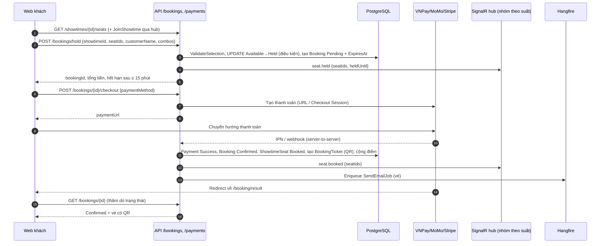

Điểm cần lưu ý:

* Trang `/booking/result` **không** xác nhận thanh toán; nó chỉ hỏi lại trạng thái booking do IPN/webhook cập nhật (`booking-result-page.tsx`).
* Thanh toán thành công nhưng ghế không còn giữ (booking đã hết hạn/hủy): booking bị đóng, **tự hoàn toàn bộ** qua cổng; thành công thì `Payment.Refunded` và email "Đã hoàn tiền"; thất bại thì email "Chờ hoàn tiền" cho khách và email vận hành tới `CinemaSettings.Email` (nếu có) (`PaymentService`, `EmailTemplates.SeatsExpiredAfterPayment*`).
* Cổng báo lỗi: `ProcessPaymentFailureAsync` hủy booking, trả ghế, `Payment.Failed`, phát `seat.released`.

## 5.2 Hết hạn giữ ghế, thanh toán thất bại, hủy booking, hoàn vé

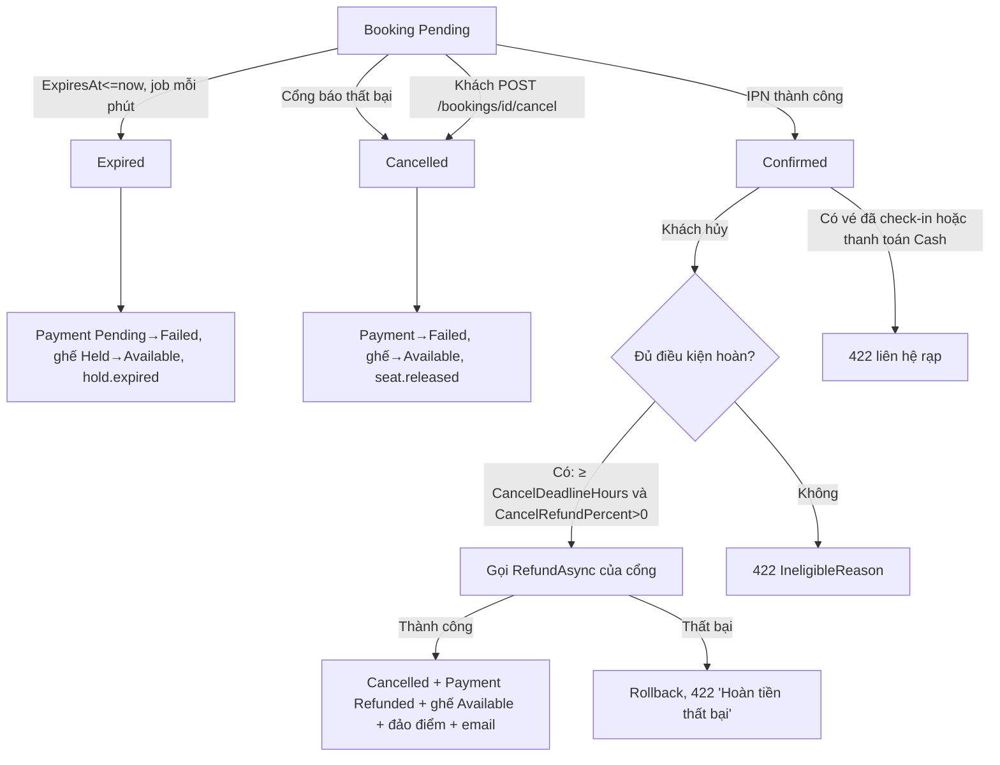

Chi tiết quy tắc: BK-13, PAY-06/07, RF-01..RF-10 ([04](#s04)).

## 5.3 Tạo/sửa suất chiếu

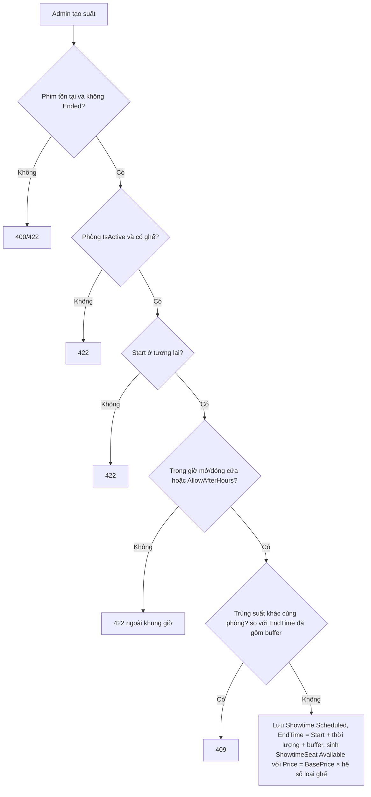

Các chế độ tạo:

| Chế độ | Endpoint | Hành vi | Giới hạn |
|---|---|---|---|
| Đơn lẻ | `POST /admin/showtimes` | Như sơ đồ trên | — |
| Hàng loạt | `POST /admin/showtimes/bulk` | `DaysOfWeek` × `Times` trong `From..To` cho một phim/phòng | ≤ 2000 suất |
| Xếp lịch tự động | `POST /admin/showtimes/auto-schedule/preview`, `.../apply` | Xem trước theo ngày/danh sách phim và số suất; áp dụng mục đã chọn | ≤ 31 ngày, ≤ 20 phim, `Shows` 1–20, ≤ 1000 mục áp dụng |
| Nhân bản | `POST /admin/showtimes/clone` | Sao khoảng ngày nguồn sang khoảng đích dịch `ShiftDays` (1–366) | ≤ 2000 suất |
| Hủy hàng loạt | `DELETE /admin/showtimes/bulk` | Hủy nhiều suất | `ShowtimeIds` không rỗng |

Với ba chế độ hàng loạt/tự động/nhân bản, mục nào vi phạm được **bỏ qua và báo lại** trong `skipped` (SHW-13b) thay vì dừng cả lô. Sửa suất bị chặn khi có booking `Confirmed` hoặc `Pending` (SHW-08, SHW-09) và không đổi được phòng (SHW-07).

## 5.4 Rạp hủy suất chiếu → xử lý booking → hoàn tiền

```mermaid
sequenceDiagram
  autonumber
  participant AD as Admin
  participant API as ShowtimeService.DeleteShowtimeAsync
  participant DB as PostgreSQL
  participant JOB as Hangfire
  participant GW as Cổng thanh toán
  AD->>API: DELETE /admin/showtimes/{id}
  API->>API: Chặn nếu đã bắt đầu (422)
  API->>DB: Showtime → Cancelled
  API->>DB: Booking Pending → Cancelled; Payment Pending → Failed; ghế Held → Available
  API->>DB: Booking Confirmed → Cancelled; đảo điểm theo FinalAmount
  alt Payment online (VNPay/Momo/Stripe)
    API->>JOB: Enqueue ShowtimeRefundJob(paymentId)
    JOB->>GW: RefundAsync toàn bộ Payment.Amount
    GW-->>JOB: kết quả
    JOB->>DB: Payment Refunded + email "đã hoàn tiền" (thành công)
    JOB-->>JOB: thất bại → ném lỗi để Hangfire retry (30s, 2 phút, 10 phút)
    JOB->>DB: lần cuối vẫn lỗi → email "hoàn tiền thủ công" cho khách
  else Payment Cash (quầy)
    API->>JOB: Enqueue email "ShowtimeCancelledManualRefund"
    Note over API: Đếm vào manualRefundCount, rạp hoàn tiền mặt thủ công
  end
```

Lưu ý:

* Hoàn tiền khi **rạp hủy suất luôn hoàn toàn bộ `Payment.Amount`**, không áp `CancelRefundPercent`/`CancelDeadlineHours` (khác với khách tự hủy).
* Ghế `Booked` của suất bị hủy **không** được trả về `Available` (chỉ ghế `Held` được thả); `ShowtimeSeat` của suất `Cancelled` không còn bán được vì suất không còn `Scheduled`.
* Email vào hàng đợi có `try/catch`: lỗi enqueue được log (`ShowtimeCancelEmailEnqueueFailed`, `ShowtimeRefundEnqueueFailed`) và không làm hỏng việc hủy suất.
* Không có endpoint ghi nhận "đã hoàn tiền mặt thủ công" (chưa xác định trong code).

## 5.5 Bán vé tại quầy

```mermaid
sequenceDiagram
  participant ST as Nhân viên (web admin /admin/counter)
  participant API as AdminBookingsController
  participant DB as PostgreSQL
  ST->>API: POST /admin/bookings/counter-hold {showtimeId, seatIds, customerName/userId, combos}
  API->>DB: Cần claim EmployeeId; giữ ghế (Channel=Counter, CreatedByEmployeeId)
  API-->>ST: bookingId, FinalAmount
  ST->>API: POST /admin/bookings/{id}/counter-checkout {paymentMethod, amountReceived}
  API->>DB: AmountReceived ≥ FinalAmount; Payment Cash Success (ChangeGiven); Booking Confirmed; tạo vé
  API-->>ST: vé có QR, tiền thối
  ST->>API: POST /admin/bookings/checkin {qrCode} (soát vé, quét camera hoặc nhập mã)
```

## 5.6 Điểm thành viên: tích lũy, hoàn trừ

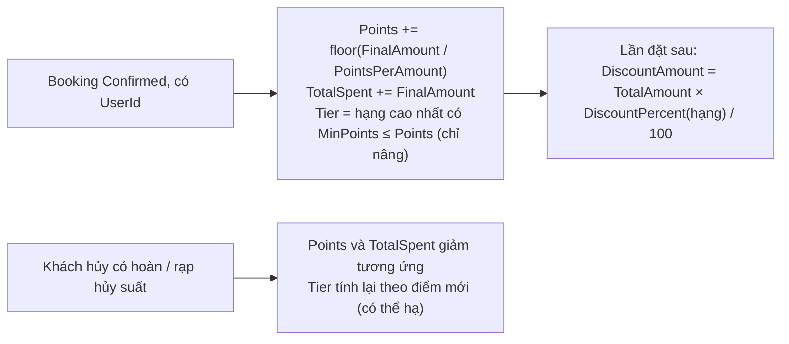

Không có bước "đổi điểm" (xem 4.19).

---

<a id="s06"></a>

# 6. Thuật toán và logic đặc thù

Các ví dụ số dưới đây là **minh họa** do tài liệu tính từ công thức trong code (không phải dữ liệu seed), trừ khi ghi nguồn khác.

## 6.1 Tính giá

1. **Giá ghế** (chốt lúc tạo suất): `ShowtimeSeat.Price = Showtime.BasePrice × SeatType.PriceMultiplier` (`ShowtimeService.GenerateShowtimeSeatsAsync`). Ví dụ: `BasePrice = 90.000 VNĐ`, ghế thường hệ số 1.0 → 90.000; ghế VIP hệ số 1.5 → 135.000.
2. **Tổng tạm tính** (`TotalAmount`) = Σ giá ghế + Σ (`BookingCombo.UnitPrice × Quantity`). Ví dụ: 2 ghế thường (180.000) + 1 combo 70.000 → 250.000.
3. **Giảm giá** = làm tròn 0 chữ số (`Math.Round`, away-from-zero) của `TotalAmount × DiscountPercent / 100` theo hạng hiện tại (`CalculateDiscountAmountAsync`). Hạng 10% → 25.000.
4. **Thành tiền** `FinalAmount = TotalAmount − DiscountAmount` = 225.000.
5. **Điểm** = `floor(225.000 / 10.000)` = 22 điểm (`PointsPerAmount` = 10.000 theo seed).
6. **Hoàn tiền khi khách hủy** (đủ điều kiện): `Math.Round(Payment.Amount × CancelRefundPercent / 100, 0)`. Với 225.000 và 50% → 112.500. Điểm đảo = `FinalAmount × RefundAmount / Payment.Amount` (ở đây 225.000 × 112.500 / 225.000 = 112.500 → 11 điểm).

Không có khuyến mãi theo mã, không có phụ thu theo khung giờ/ngày lễ.

## 6.2 Thời gian suất chiếu và chống trùng giờ

* `EndTime = StartTime + DurationMinutes + RoomBufferMinutes (15)`. Ví dụ: phim 120 phút, bắt đầu 18:00 → `EndTime = 20:15`.
* Trùng giờ nếu có suất khác cùng phòng với `start < other.End && end > other.Start` (khoảng nửa mở). Suất kế tiếp ở phòng đó sớm nhất 20:15.
* Giờ hoạt động kiểm tra bằng `start` và `start + duration` (không gồm buffer): với đóng cửa 23:59, phim 120 phút phải bắt đầu muộn nhất 21:59; nếu bật `AllowAfterHours` thì chỉ cần bắt đầu trước 23:59.
* `ClosingTime ≤ OpeningTime` được hiểu là đóng cửa vào ngày hôm sau (`OperatingHours.Window`). Múi giờ nghiệp vụ là giờ Việt Nam (`VietnamTime`).

## 6.3 Gợi ý ghế (`SeatLayoutRules.Suggest`, `ShowtimeService.GetSeatSuggestionsAsync`)

Với `count` ghế liền nhau, mỗi hàng chọn cửa sổ tốt nhất rồi lấy 3 hàng điểm cao nhất (`top = 3`):

* Chỉ xét các đoạn ghế `Available` liền số (`SplitRuns`).
* Loại cửa sổ để lại **đúng một ghế trống** ở đầu hoặc cuối đoạn (tránh ghế lẻ).
* Ghế đôi (`CoupleId`) phải nằm trọn trong cửa sổ.
* `Điểm = 0,45 × điểm giữa hàng + 0,45 × điểm độ sâu hàng + 0,1 (nếu cùng loại ghế)`.
  * Điểm giữa = `1 − |tâm cửa sổ − (cols+1)/2| / (cols/2)` (không âm).
  * Điểm độ sâu: `depth = (chỉ số hàng + 1)/số hàng`; `rowScore = max(0, 1 − max(0,5 − depth, depth − 0,7, 0) × 2)`; tức hàng ở khoảng 50–70% chiều sâu là tốt nhất.
* Ví dụ: 10 cột, 10 hàng, hàng thứ 5 (depth 0,5), chọn ghế 5–6 cùng loại: tâm 5,5 = giữa → 0,45 + 0,45 + 0,1 = **1,0**.

## 6.4 Quy tắc chọn ghế hợp lệ (`ValidateSelection`, chỉ kênh online)

* Chọn một ghế đôi thì phải chọn cả cặp: "Ghế đôi phải được chọn cùng nhau."
* Sau khi coi các ghế đã chọn là bị chiếm, nếu một ghế trống **đứng lẻ giữa** (đoạn trống dài 1) mà kề với ghế vừa chọn thì từ chối: "Không thể để trống ghế lẻ X{n}. Vui lòng chọn lại để không bỏ lẻ ghế." Ví dụ: hàng A trống A1–A5; chọn A2 → A1 thành lẻ, từ chối; chọn A1–A2 hợp lệ.

## 6.5 Tự động xếp lịch (`ShowtimeScheduler.Build`)

Đầu vào: ngày, giờ mở/đóng, `AllowAfterHours`, buffer, danh sách phòng (số ghế), phim (thời lượng, số suất cần, **độ hot**), các khoảng bận hiện có.

**Độ hot** (`Heat`) = `clamp(0,7 × vé/vé_tối_đa + 0,3 × điểm_đánh_giá/10, 0, 1)`; số vé tính trong 7 ngày gần nhất (hằng số trong `ShowtimeService`, không dùng `Scheduler:HeatLookbackDays`), `vé_tối_đa` là cao nhất trong các phim đang xếp. Ví dụ: 50/100 vé, rating 4 → 0,35 + 0,12 = **0,47**. (Công thức chia rating cho 10, trong khi DB giới hạn rating 1–5: xem RV-05.)

**Quy trình**

1. Cửa sổ ngày: `[open, close]` (nếu không có giờ đóng, `open + DefaultWindowMinutes (960)`).
2. Phim xếp theo độ hot giảm dần (đồng hạng theo `MovieId`).
3. Mỗi phim có các **giờ lý tưởng** chia đều: `latest = windowEnd − duration` (hoặc `windowEnd − 1` nếu `AllowAfterHours`); `ideal_i = open + span × (i + 0,5)/shows`, làm tròn lên bước `StepMinutes (5)`. Ví dụ: mở 08:00, đóng 23:59, phim 120 phút, 3 suất → span 839 phút → **10:20, 15:00, 19:40**.
4. Vòng tròn: lần lượt mỗi phim còn suất cần đặt, sinh ứng viên giờ (giờ mở, giờ lý tưởng, giờ đóng − thời lượng, và ngay sau/trước các khoảng bận, đều căn bước 5 phút), lọc ứng viên: trong giờ hoạt động, không đè khoảng bận (khối = thời lượng + buffer), cách suất khác của cùng phim ≥ `MinSameMovieGapMinutes (60)` phút.
5. **Điểm ứng viên** = `−khoảng_cách_tới_giờ_lý_tưởng / SpreadMinutes (30) + fit × FitWeight (4) − số_suất_đã_có_trong_phòng × LoadWeight (0,5)` với `fit = 1 − |độ_hot − số_ghế_phòng/số_ghế_phòng_lớn_nhất|` (phim hot nên vào phòng lớn). Ví dụ: hot 0,47, phòng 100/150 ghế → fit = 0,80; lệch giờ lý tưởng 10 phút; phòng đã có 2 suất → `−0,33 + 3,21 − 1,0 ≈ 1,88`.
6. Chọn ứng viên điểm cao nhất (đồng điểm: sớm hơn, rồi `RoomId` nhỏ hơn), bỏ giờ lý tưởng gần nhất, ghi khoảng bận, giảm số suất còn lại. Phim không còn ứng viên thì dừng xếp thêm.
7. Kết quả sắp theo giờ rồi phòng; `ApplyAutoScheduleAsync` tạo suất thật qua `CreateShowtimesBatchAsync` (hàm dùng chung với tạo hàng loạt/nhân bản; cách hàm này xử lý từng mục xung đột: xem `ShowtimeService.cs`).

**Lưu ý hiện trạng:** `ShowtimeService` gọi `Build` mà không truyền `SchedulerOptions`, nên các giá trị `Scheduler:*` trong `appsettings`/biến môi trường **không có tác dụng**; thuật toán luôn dùng mặc định cùng giá trị như trên (SHW-17).

## 6.6 Gợi ý combo (`ComboService.GetComboSuggestionsAsync`)

* Với mỗi combo đang bán: `size` = tổng số lượng đồ uống trích từ **mô tả** combo bằng `DrinkRegex` (mẫu ở `ComboService.cs` dòng 18); `sold` = số lượng combo đã bán (booking `Confirmed`) của các phim **cùng thể loại**.
* `quantity = ceil(số_ghế / size)` (nếu `size = 0` thì 1).
* `fit = 3 − min(3, quantity × size − số_ghế + (quantity − 1))` (nếu `size = 0` thì 0).
* `Điểm = fit + (phim độ tuổi P hoặc K và size ≥ 3 ? 1 : 0) + (suất bắt đầu từ 21h hoặc trước 6h giờ VN và giá ≤ giá trung vị ? 0,5 : 0) + 2 × sold / sold_cao_nhất`.
* Giữ combo có `size > 0` hoặc đã có bán; sắp điểm giảm dần rồi giá tăng dần; lấy tối đa 3. Nhãn: "Phù hợp cho N người" / "Phù hợp cho N người (xK)" / "Bán chạy cùng thể loại"; cờ "bán chạy nhất" khi `sold = sold_cao_nhất > 0`.
* Ví dụ: 3 người, combo mô tả có 3 đồ uống (`size = 3`) → `quantity = 1`, `fit = 3`; combo `size = 2` → `quantity = 2`, `fit = 3 − min(3, 4 − 3 + 1) = 1`.

## 6.7 Tính điểm và hạng

Xem LY-01..LY-06 và 6.1. Ví dụ hạng: các hạng có `MinPoints` 0 / 100 / 500; khách đang 98 điểm, thanh toán 225.000 (+22) → 120 điểm → nâng lên hạng `MinPoints = 100`. Khi hoàn đủ → trừ 22 → 98 → xét lại thành hạng thấp hơn.

## 6.8 Giữ ghế và tranh chấp

`CreateHoldBookingAsync` chạy trong một transaction: với mỗi ghế chọn, câu lệnh cập nhật có điều kiện chỉ chuyển ghế `Available` (hoặc `Held` đã hết hạn của chính người đó) sang `Held`; nếu số ghế cập nhật khác số ghế yêu cầu thì rollback và trả `409` kèm danh sách ghế xung đột. Vì kiểm tra nằm trong câu lệnh nên hai yêu cầu song song cùng ghế chỉ một bên thành công (có integration test).

---

<a id="s07"></a>

# 7. Tác vụ nền và sự kiện

## 7.1 Hangfire

Cấu hình trong `Cinema.Api/Program.cs`: lưu trữ PostgreSQL (`Hangfire.PostgreSql`), `AddHangfireServer()`, bộ lọc retry toàn cục `AutomaticRetryAttribute { Attempts = BackgroundJobs:RetryAttempts (3), DelaysInSeconds = BackgroundJobs:RetryDelaysSeconds ([30, 120, 600]) }`. Recurring job chỉ đăng ký khi môi trường **không** phải `Testing`. Dashboard ở `/admin/hangfire` (xem [02](#s02)).

| Tên job | Lịch/điều kiện | Làm gì | Idempotent? | Retry | Nguồn |
|---|---|---|---|---|---|
| `ReleaseExpiredSeatsJob` (id `RecurringJobIds.ReleaseExpiredSeats`) | Recurring, `BackgroundJobs:ReleaseExpiredSeatsCron` mặc định `* * * * *` (mỗi phút) | `SeatExpirationService.ExpireDueBookingsAsync`: booking `Pending` có `ExpiresAt <= now` → `Expired`, payment `Pending` → `Failed`, ghế → `Available`, phát `hold.expired`; cũng dọn ghế `Held` quá hạn không còn booking `Pending` (`ReleaseStaleHeldSeatsAsync`, không phát realtime) | Có: chỉ tác động bản ghi còn ở trạng thái chờ; chạy lại không đổi kết quả (test `SeatExpirationServiceTests`) | Retry toàn cục 3 lần | `BackgroundJobs/ReleaseExpiredSeatsJob.cs`, `Services/Bookings/SeatExpirationService.cs` |
| `ShowtimeLifecycleJob` (id `RecurringJobIds.UpdateShowtimeLifecycle`) | Recurring, `ShowtimeLifecycleCron` mặc định `* * * * *` | Gọi lần lượt `CompleteEndedShowtimesAsync` (suất `Scheduled` có `EndTime` đã qua → `Completed`) rồi `EndMoviesWithoutUpcomingShowtimesAsync` (phim `NowShowing` có suất nhưng hết suất tương lai → `Ended`) | Có (chuyển trạng thái một chiều) | Retry toàn cục | `BackgroundJobs/ShowtimeLifecycleJob.cs`, `ShowtimeService` |
| `ShowtimeRefundJob` | Enqueue (một lần/payment) khi rạp hủy suất, từ `ShowtimeService.DeleteShowtimeAsync` | Hoàn **toàn bộ** `Payment.Amount` qua cổng; thành công → `Payment.Refunded` + email "đã hoàn tiền"; thất bại → ném lỗi để Hangfire retry; ở lần retry cuối (`RetryCount` bằng số lần cho phép) gửi email "hoàn tiền thủ công" (nếu booking có `User`) rồi vẫn ném lỗi để đánh dấu job thất bại | Có: chỉ hoàn khi `Payment.Status == Success`, booking `Cancelled`, suất `Cancelled` và phương thức không phải `Cash`; ngược lại thoát sớm (chạy lại không hoàn hai lần) | 3 lần, 30 giây / 2 phút / 10 phút | `BackgroundJobs/ShowtimeRefundJob.cs` |
| `SendEmailJob` | Enqueue từ Auth, Booking, Payment, Showtime, `ShowtimeRefundJob` | Gọi `IEmailService.SendAsync(to, subject, html)` | Không (có thể gửi trùng nếu retry sau khi đã gửi) | Retry toàn cục 3 lần | `BackgroundJobs/SendEmailJob.cs` |

Ghi chú: có test cho `SeatExpirationService`, `ShowtimeLifecycle` và `ShowtimeRefundJob` (thành công idempotent; cổng từ chối thì giữ ở hàng đợi thủ công, trong `ShowtimeServiceFixesTests`); `SendEmailJob` **chưa có unit test** (xem [13](#s13)).

## 7.2 Realtime (SignalR)

* Hub `ShowtimeHub` tại `/hubs/showtimes` (`app.MapHub`). Client gọi `JoinShowtime(showtimeId)` / `LeaveShowtime(showtimeId)` để vào/rời nhóm `showtime-{id}`.
* **Hub không gắn `[Authorize]`**: ai cũng nối được; JWT có thể gửi qua query `?access_token=` (cấu hình `OnMessageReceived` trong `Program.cs`), nhưng hub không bắt buộc. Backend vẫn cấp `socket-token` 300 giây cho client đăng nhập.
* Sự kiện (`Cinema.Shared/Constants/SignalREvents.cs`; phát bởi `SignalRRealtimeNotifier`; **chỉ gửi cho nhóm của suất tương ứng**):

| Sự kiện | Payload | Phát khi | Nơi phát |
|---|---|---|---|
| `seat.held` | `showtimeId, seatIds, heldByUserId, heldUntil` | Giữ ghế thành công (online/quầy) | `BookingService.CreateHoldBookingAsync` |
| `seat.booked` | `showtimeId, seatIds` | Xác nhận booking | `BookingService.ConfirmBookingAndGenerateTicketsAsync` |
| `seat.released` | `showtimeId, seatIds` | Hủy booking, thanh toán thất bại | `BookingService.CancelBookingAsync`, `ProcessPaymentFailureAsync` |
| `hold.expired` | `showtimeId, bookingId, seatIds` | Job hết hạn giữ ghế | `SeatExpirationService.ExpireDueBookingsAsync` |

* Không phát realtime khi: hủy suất chiếu, `ReleaseStaleHeldSeatsAsync`, hoàn ghế sau khi khách hủy booking đã xác nhận (chỉ xác nhận có phát ở `CancelBookingAsync`: xem dòng gọi `NotifySeatReleasedAsync`; các nhánh khác **chưa xác định**).
* Phía client: `use-showtime-hub.ts` quản lý kết nối, `use-realtime-seat-map.ts` cập nhật cache TanStack Query của sơ đồ ghế khi nhận sự kiện (chi tiết ở [10](#s10)).

---

<a id="s08"></a>

# 8. Tích hợp bên ngoài

Chỉ ghi **tên** biến cấu hình, không ghi giá trị. Tên biến môi trường lấy từ `.env.example` / `docker-compose.yml`; khóa `appsettings` lấy từ `Cinema.Application/Options/*.cs`.

## 8.1 Cổng thanh toán (`Cinema.Infrastructure/Payments`)

Giao diện chung `IPaymentGateway` (`Cinema.Application/Interfaces/IPaymentGateway.cs`): tạo thanh toán (`CreatePaymentAsync`), xác thực callback/IPN, hoàn tiền (`RefundAsync`). Ba cổng được đăng ký trong `Infrastructure/DependencyInjection.cs` và tìm theo tên phương thức (`PaymentGatewayExtensions.FindByMethod`).

| | VNPay | MoMo | Stripe |
|---|---|---|---|
| Lớp | `VnPayGateway` | `MomoGateway` | `StripeGateway` |
| Tạo thanh toán | Dựng URL `BaseUrl?...&vnp_SecureHash=` (lệnh `vnp_Command=pay`, `vnp_OrderType=other`, `vnp_Locale=vn`, `vnp_TxnRef` = `Payment.TransactionId`) | POST `Endpoint` với `requestType=captureWallet`, `lang=vi`, `orderId` = `TransactionId`; trả `payUrl` | Tạo Checkout Session (Stripe.net), `ReturnUrl`, tiền tệ `Stripe:Currency` (mặc định `vnd`); số tiền nhân 100 trừ loại tiền không có phần thập phân |
| Chữ ký | HMAC-SHA512 (`HmacSigner.Sha512Hex`) trên các tham số `vnp_*` sắp xếp, bỏ `vnp_SecureHash(Type)` | HMAC-SHA256 (`HmacSigner.Sha256Hex`) trên chuỗi tham số cố định | Chữ ký webhook do Stripe (`EventUtility.ConstructEvent`) với `Stripe:WebhookSecret` |
| Thành công | `vnp_ResponseCode == "00"` | `resultCode == "0"` | Sự kiện `checkout.session.completed`; mã giao dịch cổng = `PaymentIntentId` |
| Callback xử lý | IPN server-to-server `PaymentService.ProcessVnPayIpnAsync` | IPN `ProcessMomoIpnAsync` | Webhook `ProcessStripeWebhookAsync` |
| Hoàn tiền | API `ApiUrl`, `vnp_Command=refund`, `vnp_TransactionType="02"` (luôn dùng mã này kể cả khi hoàn một phần; hành vi phía VNPay **chưa xác định từ code**); thành công khi `vnp_ResponseCode == "00"` | POST `RefundEndpoint` với `transId` = `GatewayTransactionId`, `orderId` mới (Guid) | `RefundService` theo `PaymentIntent`, lý do `requested_by_customer`; thành công khi trạng thái refund hợp lệ |
| Lỗi hoàn tiền | `RefundResult(false, null, message)`: gọi API lỗi, response rỗng, hoặc mã khác "00" | tương tự | tương tự; thiếu `SecretKey` → "Stripe SecretKey chưa được cấu hình." |
| Biến cấu hình | `VNPAY_TMN_CODE`, `VNPAY_HASH_SECRET`, `VNPAY_BASE_URL`, `VNPAY_RETURN_URL`, `VNPAY_IPN_URL`, `VNPAY_API_URL` | `MOMO_PARTNER_CODE`, `MOMO_ACCESS_KEY`, `MOMO_SECRET_KEY`, `MOMO_ENDPOINT`, `MOMO_RETURN_URL`, `MOMO_IPN_URL`, `MOMO_REFUND_ENDPOINT` | `STRIPE_SECRET_KEY`, `STRIPE_PUBLISHABLE_KEY`, `STRIPE_WEBHOOK_SECRET`, `STRIPE_RETURN_URL`, `STRIPE_CURRENCY` |
| Mặc định | `BaseUrl`/`ApiUrl` trỏ sandbox VNPay | `Endpoint`/`RefundEndpoint` trỏ môi trường test MoMo | `ReturnUrl` = `http://localhost:5173/booking/result` |

**Callback/IPN và định dạng phản hồi:** các endpoint IPN/webhook không bọc `ApiResponse` mà trả đúng định dạng cổng yêu cầu (`RawResponse`).

| Method | Route | Quyền | Hàm |
|---|---|---|---|
| GET | `/api/v1/payments/vnpay/ipn` | Công khai | `Payments.VnPayIpn` |
| POST | `/api/v1/payments/momo/ipn` | Công khai | `Payments.MomoIpn` |
| POST | `/api/v1/payments/stripe/webhook` | Công khai | `Payments.StripeWebhook` |

**Luồng callback tóm tắt:** cổng gọi IPN/webhook → xác thực chữ ký → tìm `Payment` theo `TransactionId` → kiểm tra số tiền → nếu đã `Success` thì trả OK (idempotent) → thành công: `BookingService.ConfirmBookingAndGenerateTicketsAsync`; thất bại: `ProcessPaymentFailureAsync`; ghế đã mất: tự hoàn tiền (xem PAY-06 ở [04](#s04)). Trang kết quả frontend (`/booking/result`) không tự xác nhận mà chỉ **thăm dò trạng thái booking** từ API (`booking-result-page.tsx`, `use-booking-flow.ts`).

**Điểm cần lưu ý (rủi ro, không phải hành vi mong muốn):**

* `StripeGateway.VerifyWebhook`: nếu `Stripe:WebhookSecret` để trống thì sự kiện được phân tích và coi là hợp lệ (`signatureValid: true`) mà **không kiểm tra chữ ký**. Khi xác minh chữ ký thất bại, log cảnh báo in tám ký tự đầu của secret. Validator khởi động môi trường Production (`ProductionOptionsValidator`) có kiểm tra khóa bắt buộc; phạm vi cụ thể xem `Options/ProductionOptionsValidator.cs` (có test `ProductionOptionsValidatorTests`).
* `StripeGateway.VerifyCallback` (xác thực trang trả về) **không được `PaymentService` gọi**; chỉ webhook xử lý Stripe.
* `VnPay:IpnUrl` không được `VnPayGateway` dùng khi dựng yêu cầu (chỉ `ProductionOptionsValidator` kiểm tra là URL công khai khi cổng được cấu hình); `Momo:IpnUrl` được gửi trong yêu cầu tạo thanh toán MoMo. Việc VNPay thực sự gọi IPN phụ thuộc URL đăng ký trên cổng của merchant (**không xác định từ code**).

## 8.2 Email (`Infrastructure/Email`)

| Thành phần | Mô tả |
|---|---|
| `FallbackEmailService` (đăng ký làm `IEmailService`) | Nếu có `Email:ResendApiKey` thì gửi bằng `ResendEmailService`; lỗi và có `SmtpHost` thì rơi về `MailKitEmailService` (SMTP); nếu không có Resend thì dùng SMTP |
| `SendEmailJob` | Gọi `IEmailService.SendAsync` trong Hangfire (retry theo cấu hình toàn cục, xem [07](#s07)) |
| Biến cấu hình | `RESEND_API_KEY`, `RESEND_FROM_ADDRESS`, `SMTP_HOST`, `SMTP_PORT` (mặc định 587), `SMTP_USER`, `SMTP_PASSWORD`, `SMTP_FROM_ADDRESS` (mặc định `no-reply@perfo.local`), `SMTP_FROM_NAME`; thương hiệu: `BRAND_NAME`, `BRAND_DISPLAY_NAME`, `BRAND_TAGLINE`, `BRAND_SUPPORT_EMAIL` |
| Liên kết trong email | Dựng từ `App:FrontendBaseUrl` / `FRONTEND_BASE_URL` |

## 8.3 Lưu trữ file: Cloudinary

`CloudinaryFileStorage` (`IFileStorage`): upload ảnh (≤ 5 MB; `.jpg .jpeg .png .webp`) và video (≤ 100 MB; `.mp4 .mov .webm .avi`); lỗi Cloudinary → 422 "Upload Cloudinary thất bại: …". Biến: `CLOUDINARY_CLOUD_NAME`, `CLOUDINARY_API_KEY`, `CLOUDINARY_API_SECRET` (giới hạn kích thước/đuôi cấu hình qua `Cloudinary:*`). Endpoint `POST /admin/uploads/image|video` (Admin).

## 8.4 Đăng nhập Google

`GoogleAuthService` kiểm tra Google ID token (thư viện `Google.Apis.Auth`) với `Google:ClientId`; frontend cần `VITE_GOOGLE_CLIENT_ID`. Biến: `GOOGLE_CLIENT_ID`, `GOOGLE_CLIENT_SECRET`. Quy tắc nghiệp vụ ở AUTH-09.

## 8.5 Gemini (trợ lý AI)

`GeminiAiAssistantService` gọi REST Gemini bằng `HttpClient` (typed client đăng ký trong `Cinema.Application/DependencyInjection.cs`, và cũng được đăng ký ở `Infrastructure/DependencyInjection.cs`: hai chỗ đăng ký cùng một interface). Biến: `GEMINI_API_KEY`, `GEMINI_MODEL` (mặc định `gemini-2.5-flash`). Dữ liệu gửi đi gồm tin nhắn, lịch sử hội thoại và thông tin tóm tắt người dùng đã đăng nhập (tên, email) theo prompt hệ thống; kết quả công cụ (suất chiếu, ghế trống, booking của tôi) được đưa lại cho model. Xem AI-01..AI-07.

## 8.6 SignalR và Hangfire

Xem [07](#s07).

---

<a id="s09"></a>

# 9. Cấu hình hệ thống

Nguồn: `Cinema.Application/Options/*.cs`, `Cinema.Api/appsettings.json`, `appsettings.Development.json` (có), không có `appsettings.Production.json`; biến môi trường mẫu `.env.example`; ánh xạ vào container ở `docker-compose.yml` và `render.yaml`. ASP.NET Core nạp biến môi trường dạng `Section__Key` tự động; `.env.example` dùng tên phẳng (vd `JWT_SECRET`) và `docker-compose.yml` ánh xạ sang `Jwt__Secret`.

**Lưu ý bảo mật cấu hình:** trong `appsettings.json` mọi khóa bí mật (Jwt, Cloudinary, SMTP, VNPay, MoMo, Stripe, Gemini, Google) **để trống**; chỉ `ConnectionStrings:DefaultConnection` có giá trị (chuỗi kết nối cục bộ; không ghi lại tại đây). Môi trường không phải Production dùng khóa JWT giả khi `Jwt:Secret` trống (theo `Program.cs`).

## 9.1 Bảng cấu hình ứng dụng

| Khóa | Ý nghĩa | Mặc định | Ảnh hưởng nghiệp vụ |
|---|---|---|---|
| `RunMigrationsOnStartup` | Tự chạy migration khi khởi động | `false` trong `appsettings.json`; `RUN_MIGRATIONS_ON_STARTUP` trong `.env.example` | Khởi tạo DB và seed |
| `App:ApiBaseUrl`, `App:FrontendBaseUrl` | URL API / web | `http://localhost:8080`, `http://localhost:5173` (appsettings; mặc định class dùng `https://localhost:8080`) | Link trong email, return URL |
| `Cors:AllowedOrigins` | Origin được phép | `[]` | Gọi API từ trình duyệt (`CORS_ALLOWED_ORIGIN`) |
| `Jwt:Issuer`, `Jwt:Audience` | Issuer/Audience | `Perfo`, `Perfo.Client` | Xác thực |
| `Jwt:AccessTokenExpirationSeconds` | Thời hạn access token | 3600 | Phiên đăng nhập |
| `Jwt:RefreshTokenExpirationDays` | Thời hạn refresh token | 30 | Duy trì đăng nhập |
| `Jwt:SocketTokenExpirationSeconds` | Thời hạn socket token | 300 | Kết nối SignalR |
| `Booking:HoldDurationMinutes` | Thời gian giữ ghế | 15 | BK-07, BK-13 |
| `Booking:RoomBufferMinutes` | Buffer dọn phòng cộng vào `EndTime` | 15 | SHW-05 |
| `Booking:CheckInOpenMinutes` | Mở check-in trước giờ chiếu | 30 | TK-05 |
| `Booking:MaxSeatsPerBooking` | Số ghế tối đa mỗi booking | 10 (chỉ trong class `BookingOptions`) | BK-03 |
| `Booking:MaxComboQuantity` | Số lượng tối đa mỗi combo | 10 (chỉ trong class) | BK-09 |
| `Booking:PointsPerVnd` | **Không có trong `BookingOptions`; không dùng** | 0.0001 | Không có (điểm thật tính bằng `CinemaSettings.PointsPerAmount`) |
| `RateLimit:GlobalPermitLimit` / `GlobalWindowSeconds` / `GlobalSegmentsPerWindow` | Giới hạn toàn cục | 100 / 60 / 4 | Chống lạm dụng |
| `RateLimit:AuthPermitLimit` / `AuthWindowSeconds` | Giới hạn policy `auth` | 5 / 60 | Đăng nhập, đăng ký… |
| `RateLimit:BookingHoldPermitLimit` / `BookingHoldWindowSeconds` | Giới hạn `booking-hold` | 10 / 60 | `POST /bookings/hold` |
| `BackgroundJobs:ReleaseExpiredSeatsCron` | Lịch giải phóng ghế | `* * * * *` (mỗi phút) | BK-13 |
| `BackgroundJobs:ShowtimeLifecycleCron` | Lịch cập nhật vòng đời | `* * * * *` | SHW-16 |
| `BackgroundJobs:RetryAttempts` | Số lần retry job | 3 | Hangfire, `ShowtimeRefundJob` |
| `BackgroundJobs:RetryDelaysSeconds` | Trì hoãn giữa các lần retry | `[30, 120, 600]` | như trên |
| `Scheduler:StepMinutes` | Bước thử giờ | 5 | **Chưa nối** vào `ShowtimeService` (SHW-17) |
| `Scheduler:MinSameMovieGapMinutes` | Giãn cách tối thiểu cùng phim | 60 | như trên |
| `Scheduler:DefaultWindowMinutes` | Cửa sổ mặc định | 960 | như trên |
| `Scheduler:SpreadMinutes` | Độ phân tán | 30 | như trên |
| `Scheduler:FitWeight`, `LoadWeight` | Trọng số điểm | 4 ; 0.5 | như trên |
| `Scheduler:HeatLookbackDays` | Số ngày tính độ hot | 7 | **Không dùng**: `ShowtimeService` cứng 7 ngày |
| `Email:*` | SMTP/Resend, hạn token | Xem 8.2; xác nhận email 24 giờ; đặt lại mật khẩu 30 phút | AUTH-07 |
| `Brand:*` | Tên thương hiệu trong email | `Perfo`, `PERFO`, "Vé điện tử · Không cần in" | Nội dung email |
| `Cloudinary:*` | Upload | 5 MB ảnh, 100 MB video | UP-01, UP-02 |
| `VnPay:*`, `Momo:*`, `Stripe:*` | Cổng thanh toán | Xem 8.1 | PAY-* |
| `Gemini:*`, `Google:*` | AI, Google Sign-In | Xem 8.4, 8.5 | AI-*, AUTH-09 |

## 9.2 Cấu hình trong DB (`CinemaSettings`, một dòng `Id = 1`)

Sửa tại `PUT /admin/settings` (trang Cài đặt). Giá trị seed lấy từ migration `InitialCreate`.

| Trường | Ý nghĩa | Seed/mặc định | Ảnh hưởng nghiệp vụ |
|---|---|---|---|
| `Name`, `Address`, `Phone`, `Email`, `TaxCode`, `LogoUrl` | Thông tin rạp | Theo seed | Hiển thị; `Email` nhận cảnh báo hoàn tiền thủ công (PAY-06) |
| `OpeningTime`, `ClosingTime` | Giờ hoạt động | 08:00 / 23:59 | SHW-06; prompt AI |
| `PointsPerAmount` | VNĐ cho 1 điểm | 10.000 | LY-01 |
| `CancelRefundPercent` | % hoàn khi khách hủy | 100 (cột DB mặc định 0, nhưng dòng seed là 100) | RF-06 |
| `CancelDeadlineHours` | Hạn hủy hoàn tiền (giờ trước giờ chiếu) | 2 | RF-06 |
| `StopSellingMinutesBefore` | Ngừng bán online trước giờ chiếu | 0 (không giới hạn) | BK-02 |

## 9.3 Cấu hình frontend

`VITE_API_BASE_URL`, `VITE_SIGNALR_HUB_URL`, `VITE_GOOGLE_CLIENT_ID` (`.env.example`; `frontend/src/config/default-constants.ts`).

---

<a id="s10"></a>

# 10. Frontend

Nguồn: `frontend/src` (React 19 + `react-router` 7, TanStack Query 5, Zustand 5, axios, react-hook-form + zod, `@microsoft/signalr`). Router: `app/routes/router.tsx` (gốc có `ErrorPage`, `/403` → `ForbiddenPage`, `*` → `NotFoundPage`).

## 10.1 Cây route và phân quyền

| Route | Trang | Guard | Ghi chú |
|---|---|---|---|
| `/` | `HomePage` | Công khai | `ClientLayout` |
| `/movies`, `/movies/:id` | Danh sách / chi tiết phim (đánh giá) | Công khai | |
| `/schedule` | Lịch chiếu cả rạp | Công khai | `GET /showtimes` |
| `/membership` | Các hạng thành viên | Công khai | `GET /membership-tiers` |
| `/booking/:showtimeId` | Chọn ghế, combo, thanh toán | **Không bọc guard route**; yêu cầu đăng nhập khi giữ ghế (`use-require-auth`) | `BookingPage` |
| `/booking/result` | Kết quả thanh toán (thăm dò trạng thái) | Công khai | `BookingResultPage` |
| `/account/profile`, `/account/tickets`, `/account/tickets/:id`, `/account/reviews`, `/account/change-password` | Tài khoản | `CustomerProtectedRoute`: chỉ kiểm tra **đã đăng nhập** (không kiểm tra role Customer); chưa đăng nhập → `/auth/login?redirect=` | `AccountLayout` |
| `/auth/login`, `/auth/register`, `/auth/confirm-email`, `/auth/forgot-password`, `/auth/reset-password` | Xác thực | `GuestRoute` (đã đăng nhập → về `/` hoặc `?redirect=`) | `AuthLayout` |
| `/admin/login` | Đăng nhập quản trị | `GuestRoute` về dashboard (chỉ chuyển hướng nếu role Admin) | `AdminAuthLayout` |
| `/admin` → `AdminIndexRedirect` | Điều hướng theo role | `AdminProtectedRoute` (Admin hoặc Employee, else về `/`) | `getAdminHomePath`: Employee → `/admin/bookings/counter`, Admin → `/admin/dashboard` |
| `/admin/dashboard`, `movies`, `showtimes`, `bookings`, `bookings/:id`, `bookings/counter`, `checkin`, `payments`, `reports`, `users`, `employees`, `rooms`, `rooms/:id/seats`, `combos`, `reviews`, `settings`, `catalog`, `catalog/{genres,languages,age-ratings,seat-types,screen-types,membership-tiers,positions,actors,directors}` | Quản trị | Tất cả chỉ qua `AdminProtectedRoute` | Component `AdminOnlyRoute` có sẵn (Employee → quầy, role khác → `/`) nhưng **không được dùng** |

Phân quyền thực tế ở sidebar (`layouts/admin/admin-sidebar.tsx`, lọc theo `roles`):

| Mục menu | Admin | Employee |
|---|:-:|:-:|
| Bán vé tại quầy, Soát vé, Quản lý phim, Suất chiếu, Quản lý đặt vé | ✓ | ✓ |
| Dashboard, Phòng chiếu, Combo, Giao dịch & thanh toán, Báo cáo, Khách hàng, Nhân viên, Đánh giá phim, Danh mục, Cài đặt | ✓ | – |

Nhân viên gõ tay URL admin-only vẫn vào được khung trang; mọi API tương ứng trả `403` (policy `AdminOnly`).

## 10.2 Trang và chức năng chính

| Trang | Role | Thao tác | API gọi | Validation phía client | Trạng thái UI |
|---|---|---|---|---|---|
| Đặt vé (`features/client/bookings`) | Khách đăng nhập | Chọn ghế trên sơ đồ, xem gợi ý ghế, chọn combo + gợi ý combo, nhập tên/SĐT, chọn cổng thanh toán, đếm ngược giữ ghế (`use-countdown`) | `GET /showtimes/{id}/seats`, `/seat-suggestions`, `/combos`, `/combos/suggestions`, `POST /bookings/hold`, `/bookings/{id}/checkout`, `/cancel` | Tên bắt buộc; nút giữ ghế chỉ bật khi hợp lệ (`canHold`); số điện thoại hiển thị là bắt buộc nhưng không chặn `canHold` | Loading/skeleton sơ đồ; hết hạn giữ ghế; lỗi `409` ghế xung đột |
| Kết quả thanh toán | Khách | Hiển thị thành công/thất bại/đang xử lý; tải vé có QR | `GET /bookings/{id}` (thăm dò) | — | Đang chờ → thành công/thất bại |
| Vé của tôi | Khách | Xem danh sách, chi tiết vé (QR), hủy vé | `GET /bookings`, `/bookings/{id}`, `POST /bookings/{id}/cancel` | — | Loading/empty/error |
| Đánh giá | Khách | Gửi/sửa/xóa đánh giá | `POST/PUT/DELETE /movies/{id}/reviews`, `GET /users/me/reviews` | Giao diện 5 sao (DB 1–5; validator server 1–10) | — |
| Trợ lý AI | Mọi người | Chat | `POST /ai/chat` | — | Loading/lỗi |
| Quầy bán vé (`features/admin/counter`) | Admin, Employee | Chọn suất → ghế → khách/hội viên → combo → thu tiền mặt | `POST /admin/bookings/counter-hold`, `/{id}/counter-checkout` | Tổng tạm tính chỉ cộng ghế (không combo); số tiền thật lấy từ server; tiền nhận phải ≥ tổng | Loading/in vé |
| Soát vé (`features/admin/checkin`) | Admin, Employee | Quét QR bằng camera (`jsqr`, `use-qr-camera-scanner`) hoặc nhập mã; âm thanh kết quả | `POST /admin/bookings/checkin` | Mã bắt buộc | Quét/kết quả thành công/lỗi |
| Suất chiếu (`features/admin/showtimes`) | Admin, Employee xem; ghi chỉ Admin | Lịch, tạo, sửa, hủy; tạo hàng loạt; tự động xếp lịch (xem trước/áp dụng); nhân bản; hủy hàng loạt | `/admin/showtimes/*` | `startTime`, `fromDate/toDate`, `daysOfWeek` ≥ 1, giờ chiếu, ngày bắt đầu/kết thúc nhân bản bắt buộc | Loading/danh sách bỏ qua (`skipped`) |
| Phòng/ghế | Admin | Tạo/sửa phòng, trình soạn sơ đồ ghế, tự sinh lưới | `/admin/rooms/*` | Tên phòng bắt buộc, tối đa **100** ký tự ở client (server ≤ **50**: lệch) | — |
| Phim | Admin/Staff xem | CRUD phim, diễn viên, tải ảnh/video | `/admin/movies/*`, `/admin/uploads/*` | Tiêu đề ≤ 200, ≥ 1 thể loại, trạng thái bắt buộc | — |
| Combo, Danh mục, Nhân viên, Khách hàng, Đánh giá, Thanh toán | Admin | CRUD/xem | `/admin/*` tương ứng | Combo: tên ≤ 150, mô tả ≤ 500; vai trò bắt buộc ở form đổi role | — |
| Báo cáo, Dashboard | Admin | Biểu đồ (recharts) | `/admin/reports/*`, `/admin/dashboard/*` | Khoảng ngày | — |
| Cài đặt | Admin | Sửa cấu hình rạp | `GET/PUT /admin/settings` | Tên rạp, địa chỉ bắt buộc; email hợp lệ | — |

Form đăng nhập: email hợp lệ, mật khẩu ≥ 6 ký tự (server yêu cầu ≥ 8 với chữ hoa/thường/số khi đăng ký). Đăng ký: họ tên ≥ 2 ký tự, SĐT tùy chọn, `passwordSchema`, xác nhận mật khẩu khớp.

## 10.3 Quản lý state, cache và realtime

| Chủ đề | Cách làm | Nguồn |
|---|---|---|
| Auth | Store Zustand `auth-store.ts` (`isInitialized`, `isAuthenticated`, `user` với `role`); khởi tạo bằng refresh token | `stores/auth-store.ts` |
| HTTP | `axios` với interceptor tự refresh access token khi `401` và thử lại yêu cầu | `api/axios.ts` |
| Cache server-state | TanStack Query (`api/query-client.ts`, khóa trong `api/query-keys.ts`); mutation vô hiệu hóa khóa liên quan | `features/*/hooks` |
| UI toàn cục | Store dialog/alert/sheet (Zustand) | `stores/*` |
| Realtime | `lib/signalr.ts` dựng kết nối tới `/hubs/showtimes`; `use-showtime-hub.ts` gọi `JoinShowtime/LeaveShowtime`; `use-realtime-seat-map.ts` nhận `seat.held`, `seat.booked`, `seat.released`, `hold.expired` và ghi vào cache sơ đồ ghế; tên sự kiện khớp backend | `hooks/` |
| Đếm ngược giữ ghế | `use-countdown.ts` theo `expiresAt` của booking | `hooks/use-countdown.ts` |
| Hằng số | `config/default-constants.ts`, `config/routes.ts` (`ROUTES`, `getAdminHomePath`) | `config/` |

Không có test frontend (xem [13](#s13)).

---

<a id="s11"></a>

# 11. Thông báo và nội dung gửi ra

Mọi thông báo là **email HTML** gửi bằng `SendEmailJob` → `FallbackEmailService` (Resend, dự phòng SMTP). Template ở `Cinema.Application/Utils/EmailTemplates.cs` (các hàm `ActionLink`, `BookingConfirmed`, `BookingCancelledRefunded`, `ShowtimeCancelledAutoRefunded`, `ShowtimeCancelledManualRefund`, `SeatsExpiredAfterPayment`, `SeatsExpiredAfterPaymentCustomer`). Tên thương hiệu lấy từ `Brand:Name`. Không có SMS/push.

| # | Sự kiện kích hoạt | Người nhận | Tiêu đề | Nội dung chính | Nguồn |
|---|---|---|---|---|---|
| 1 | Đăng ký tài khoản / yêu cầu gửi lại xác thực | Chủ tài khoản | Biến `subject` theo mục đích (nhãn nút: "Xác thực email") | Liên kết xác thực (hạn 24 giờ) dựng từ `App:FrontendBaseUrl` | `AuthService` → `EmailTemplates.ActionLink` |
| 2 | Quên mật khẩu | Chủ tài khoản | Biến `subject` theo mục đích (nhãn nút: "Đặt lại mật khẩu") | Liên kết đặt lại (hạn 30 phút) | như trên |
| 3 | Booking được xác nhận (online/quầy có email) | Khách | "Vé xem phim của bạn — {Brand}" | Mã booking, phim, suất, ghế, tổng tiền, hướng dẫn xuất trình mã QR tại quầy, nhắc "có mặt trước 15 phút" | `BookingService.ConfirmBookingAndGenerateTicketsAsync` → `BookingConfirmed` |
| 4 | Khách hủy booking đã thanh toán và được hoàn | Khách | "Xác nhận hủy vé & hoàn tiền — {Brand}" | Mã booking, số tiền hoàn | `BookingService.CancelBookingAsync` → `BookingCancelledRefunded` |
| 5 | Rạp hủy suất, đã hoàn tự động | Khách | "Suất chiếu bị hủy — đã hoàn tiền {BookingCode}" | Thông báo hủy suất và hoàn toàn bộ | `ShowtimeRefundJob` → `ShowtimeCancelledAutoRefunded` |
| 6 | Rạp hủy suất, cần hoàn thủ công (Cash, hoặc hoàn tự động thất bại ở lần cuối) | Khách | "Suất chiếu bạn đặt vé đã bị hủy — {BookingCode}" | Thông báo hủy suất, rạp sẽ liên hệ hoàn tiền | `ShowtimeService.DeleteShowtimeAsync`, `ShowtimeRefundJob` → `ShowtimeCancelledManualRefund` |
| 7 | Thanh toán thành công nhưng ghế không còn giữ | Khách | "[{Brand}] Đã hoàn tiền — Booking {Code}" hoặc "[{Brand}] Chờ hoàn tiền — Booking {Code}" | Kết quả tự hoàn tiền | `PaymentService` → `SeatsExpiredAfterPaymentCustomer` |
| 8 | Như 7 | Rạp (`CinemaSettings.Email`, nếu có) | "[{Brand}] Đã tự động hoàn tiền — Booking #{id}" hoặc "[{Brand}] CẦN HOÀN TIỀN THỦ CÔNG — Booking #{id}" | Cảnh báo vận hành | `PaymentService` → `SeatsExpiredAfterPayment` |

Điểm cần lưu ý: email #5 và #6 do `ShowtimeRefundJob` chỉ gửi khi `booking.User` khác null, nên khách vãng lai ở quầy (không tài khoản) không nhận email từ job; email hủy suất cho booking `Cash` đi qua danh sách `emailJobs` của `DeleteShowtimeAsync` (tiêu đề không đọc lại). Các tiêu đề #3–#8 lấy từ chuỗi tại điểm gửi; tiêu đề email #1/#2 phụ thuộc biến `subject` trong `AuthService.IssueVerificationTokenAndSendEmailAsync` (chưa xác định giá trị). Email #3 không đính kèm ảnh QR (QR hiển thị trên web: `QrCodeHelper` tạo data URI trong DTO vé).

---

<a id="s12"></a>

# 12. Dữ liệu seed và kịch bản mẫu

Nguồn: `Cinema.Infrastructure/Persistence/Seed/{SeedData,DbInitializer,ShowtimeSeeder,BookingScenarioSeeder}.cs`, migration `InitialCreate` (`HasData`).

## 12.1 Khi nào seed chạy

`Program.cs` đọc `RunMigrationsOnStartup` (mặc định trong code **true**, trong `appsettings.json` là **false**; `.env.example`/`docker-compose.yml` truyền `RUN_MIGRATIONS_ON_STARTUP`). Khi bật: `Database.MigrateAsync()` rồi `DbInitializer.SeedAsync` (không điều kiện theo môi trường trong đoạn gọi này).

## 12.2 Dữ liệu tĩnh (`SeedData` → `HasData`)

| Nhóm | Nội dung |
|---|---|
| Role | `Customer`, `Admin`, `Employee` |
| Tài khoản | Có tài khoản admin mặc định (email `admin@cinema.local`); mật khẩu theo tài liệu dự án (không ghi lại ở đây) |
| Hạng thành viên | `Thành viên` (0 điểm, 0%), `Bạc` (500, 5%), `Vàng` (2000, 10%), `Kim Cương` (5000, 15%) |
| Loại ghế | `Standard` ×1,0; `VIP` ×1,5; `Couple` ×2,0 |
| Phòng | `Cinema Hall 01`, `Cinema Hall 02`, `3D Experience Hall 03`, `IMAX Grand Theatre 04` (kèm sơ đồ ghế, ghế đôi theo `CoupleId`) |
| Phim | Khoảng 38 phim kèm thể loại, ngôn ngữ, độ tuổi, đạo diễn, diễn viên |
| Combo | 5 combo |
| Cài đặt rạp | Mở cửa 08:00, đóng 23:59, `PointsPerAmount` 10.000, `CancelRefundPercent` 100, `CancelDeadlineHours` 2, `StopSellingMinutesBefore` 0 |

(Số lượng phim/combo/thể loại do đếm mẫu khai báo trong `SeedData.cs`; chưa đối chiếu với dữ liệu sau migration.)

## 12.3 Dữ liệu động (`DbInitializer.SeedAsync`)

1. **Tài khoản thử nghiệm** (13 tài khoản kèm hồ sơ): admin; khách `customer`, `customer2`, `customer3`, `customer4`, `newbie` (khách mới), `inactive` (bị khóa), `unverified` (chưa xác thực email), `google` (đăng nhập Google); nhân viên `employee`, `manager`, `shiftlead`, `employee.inactive` (tất cả dạng `...@cinema.local`). Mật khẩu thử nghiệm đặt trong code; **không ghi lại ở đây**. Seeder còn đặt lại mật khẩu admin về giá trị tài liệu nếu khác, và ghi log mật khẩu tài khoản thử nghiệm ở mức Information (cần lưu ý nếu chạy ngoài môi trường phát triển).
2. **Token xác thực mẫu**: `demo-email-confirm-token` (xác nhận email) và `demo-password-reset-token` (đặt lại mật khẩu) để thử luồng email.
3. **Phòng thêm**: một phòng lounge (có lối đi + 1 ghế hỏng) và một phòng bảo trì không hoạt động.
4. **Suất chiếu** (`ShowtimeSeeder`): `PastDays = 7`, `FutureDays = 7`, mỗi phòng/ngày 3–4 suất, buffer 15 phút; `TopUpFutureAsync` đảm bảo luôn có suất tương lai mỗi lần khởi động.
5. **Kịch bản booking** (`BookingScenarioSeeder`, mã booking tiền tố `BKD`): đủ các trạng thái `Pending`/`Confirmed`/`Expired`/`Cancelled` (hủy khi Pending, thanh toán thất bại, khách hủy được hoàn, tự hoàn khi ghế đã mất, rạp hủy suất hoàn tự động/thủ công), kênh Online/Counter, check-in toàn bộ/một phần/no-show, thanh toán VNPay/Momo/Stripe/Cash, tích điểm và nâng hạng theo thứ tự thời gian, đánh giá. Chạy trong một transaction; lỗi thì rollback và vẫn bảo đảm có suất tương lai. Chỉ chạy một lần (nếu chưa có booking mã `BKD*`).

## 12.4 Chạy ở môi trường dev

Theo `docker-compose.yml`/`.env.example`: `docker compose up` (PostgreSQL 16 + API + web) với `RUN_MIGRATIONS_ON_STARTUP=true`; Swagger chỉ ở môi trường `Development`; web ở `http://localhost:5173`, API ở `http://localhost:8080` (giá trị mặc định cấu hình `App:*`). Lệnh cụ thể chưa đối chiếu với `package.json` ở thư mục gốc (một số script còn trỏ `sqlserver`, xem [01](#s01)).

---

<a id="s13"></a>

# 13. Kiểm thử

Nguồn: `backend/tests/Cinema.UnitTests` (xUnit), `backend/tests/Cinema.IntegrationTests` (xUnit, host thử nghiệm). Đếm theo thuộc tính `[Fact]`/`[Theory]` (không đếm từng dòng dữ liệu của Theory): **321 test** (35 file).

## 13.1 Tóm tắt theo module

| Module | File test (số test) | Hành vi được bảo vệ (theo tên test/nội dung đọc) | Vùng chưa có test |
|---|---|---|---|
| Xác thực | `AuthServiceTests` (24), `JwtTokenServiceTests` (9), `AuthValidatorsTests` (15), `AuthEndpointsTests` (11, tích hợp) | Đăng ký/đăng nhập, xác thực email, refresh/quay vòng token, đặt lại mật khẩu, JWT claims, validator | Đăng nhập Google end-to-end; rate limit `auth` |
| Đặt vé/giữ ghế | `BookingServiceTests` (21), `BookingServiceSeatHoldTests` (6), `BookingValidatorsTests` (20), `BookingFlowEndpointsTests` (6) | Giữ ghế tạo booking `Pending`, xung đột ghế rollback toàn bộ (có test đồng thời), một khách một booking `Pending` mỗi suất, giảm giá theo hạng, checkout (chủ sở hữu, hết hạn, cổng chưa cấu hình), xác nhận idempotent, ghế không còn giữ → hủy booking, hủy Pending/trong hạn/quá hạn hoàn, hoàn tiền làm tròn, `ProcessPaymentFailure` | `ValidateSelection` chỉ gián tiếp; `GetBookingsAdminAsync` lọc nâng cao |
| Quầy/soát vé | `BookingServiceCounterCheckinTests` (13), `AdminBookingsEndpointsTests` (9) | Giữ ghế quầy (khách vãng lai không tài khoản; khách `Customer` gọi bị 403; thiếu hồ sơ `Employee` → 422), thu tiền mặt và tiền thối, thiếu tiền → 422 và booking vẫn `Pending`, check-in hợp lệ / đã check-in 409 / QR lạ 404 / sớm hơn 30 phút 422 | Xung đột ghế giữa quầy và online |
| Điểm thành viên | `BookingServiceLoyaltyTests` (4) | Đảo điểm: tụt dưới ngưỡng thì hạ hạng, còn đủ thì giữ hạng; hoàn một phần đảo điểm theo tỉ lệ; email xác nhận chứa tên phim | Đảo điểm khi hủy suất chiếu (chỉ được kiểm gián tiếp) |
| Thanh toán | `PaymentServiceVnPayTests` (8), `PaymentServiceStripeTests` (16) | IPN VNPay, webhook Stripe (kể cả thành công muộn sau thất bại), tự hoàn khi ghế mất | **MoMo** (không có test), `PaymentAdminService` |
| Giữ ghế hết hạn | `SeatExpirationServiceTests` (7) | Hết hạn booking, trả ghế, phát `hold.expired` | — |
| Suất chiếu | `ShowtimeServiceCreateTests` (14), `ShowtimeServiceFixesTests` (19), `ShowtimeServiceAutoScheduleTests` (4), `ShowtimeLifecycleTests` (5), `ShowtimeValidatorsTests` (15), `AdminShowtimesBulkEndpointsTests` (6) | Tạo (sinh một `ShowtimeSeat` cho mỗi ghế hoạt động không phải lối đi), giá ghế theo hệ số, trùng giờ (kể cả suất liền kề sau buffer hợp lệ, bỏ qua suất đã hủy), giờ hoạt động, sửa bị chặn khi có booking `Pending`/giữ ghế/`Confirmed` (suất hết hạn không chặn), hủy suất (đưa job hoàn tiền thay vì gọi cổng, đánh dấu payment `Pending` thất bại), `ShowtimeRefundJob` thành công idempotent và khi cổng từ chối thì giữ ở hàng đợi thủ công, hàng loạt bỏ qua mục trùng/quá khứ, xếp lịch theo khoảng ngày, nhân bản lịch (chạy lần hai bị bỏ qua) | Race trùng giờ (không có ràng buộc DB); `ShowtimeRefundJob` lần retry cuối gửi email thủ công |
| Thuật toán | `ShowtimeSchedulerTests` (7), `OperatingHoursTests` (6) | Xếp lịch theo độ hot, khung giờ, qua đêm | Gợi ý ghế (`SeatLayoutRules.Suggest`) và gợi ý combo (không thấy file test chuyên biệt theo tên file) |
| Phòng/ghế | `RoomServiceSeatLayoutTests` (8), `AdminRoomsEndpointsTests` (8) | Sơ đồ ghế, ghế đôi, chặn đổi khi có suất sắp tới | — |
| Nhân viên/người dùng | `EmployeeServiceUserStatusTests` (2) | Khóa tài khoản thu hồi token | Đổi role, tạo nhân viên, `UserProfileService` |
| Báo cáo/dashboard | `ReportServiceTests` (9), `DashboardServiceTests` (8) | Doanh thu ròng, top phim, hiệu suất; dashboard: % thay đổi doanh thu hôm nay so với hôm qua, booking `Pending` còn hạn giữ, tỉ lệ lấp đầy suất hôm nay, `days` của insights bị chặn trần 90, ranh giới nửa đêm giờ Việt Nam, thanh toán hoàn một phần chỉ tính phần giữ lại | — |
| Đánh giá | `ReviewServiceTests` (2) | Tạo đánh giá cập nhật `AverageRating` của phim; đánh giá thứ hai tính lại trung bình toàn bộ | Mâu thuẫn thang điểm 1–5/1–10 (RV-05) không được bảo vệ |
| Tiện ích | `CodeGeneratorTests` (5), `DateTimeUtilsTests` (9), `EmailTemplatesTests` (7), `EnumConvertersTests` (10) | Sinh mã, thời gian, template email, enum | — |
| Cấu hình | `ProductionOptionsValidatorTests` (5) | Kiểm tra cấu hình bắt buộc ở Production | — |
| Realtime | `SignalRShowtimeHubTests` (3, tích hợp) | Nhận sự kiện theo nhóm suất | Xác thực hub |

## 13.2 Vùng chưa có test

* **MoMo**, `SendEmailJob`, `PaymentAdminService`, `ComboService` (kể cả gợi ý), `CatalogService`, `MovieService`, `SettingsService`, `GeminiAiAssistantService`, `AiToolExecutor`, `CloudinaryFileStorage`, `GoogleAuthService`.
* Frontend: không có unit test; `playwright.config.ts` có nhưng **thư mục `e2e` không tồn tại và không có file spec**; không có CI (`.github` không có trong repo).

## 13.3 Dùng test để xác nhận hành vi

Những hành vi đã đối chiếu với test: giữ ghế đồng thời chỉ một bên thắng (`HoldSeat_HighConcurrencyParallelRequests_OnlyOneWinsAndOthersGet409`), giá ghế theo hệ số (`SeatPriceUsesSeatTypeMultiplier`), hoàn tiền làm tròn (`CancelBookingAsync_ReturnsRoundedRefundAmount`), hoàn điểm tỉ lệ (`CancelBookingAsync_PartialRefund_RevokesLoyaltyProportionallyToRefund`), thanh toán thành công muộn (`SuccessAfterPaymentMarkedFailed_StillConfirmsBooking`). Các tên test này lấy từ kết quả liệt kê khi đọc; chưa chạy bộ test (môi trường đọc code không có .NET SDK/DB).

---

<a id="s14"></a>

# 14. Từ điển thuật ngữ

| Thuật ngữ nghiệp vụ (VI) | Tên trong code | Giải thích |
|---|---|---|
| Suất chiếu | `Showtime` | Một buổi chiếu một phim ở một phòng; `Status`: `Scheduled`, `Cancelled`, `Completed` |
| Ghế của suất | `ShowtimeSeat` | Ghế vật lý gắn với một suất, có trạng thái và giá chốt |
| Còn trống / Đang giữ / Đã đặt | `Available` / `Held` / `Booked` | Trạng thái `ShowtimeSeatStatus` |
| Giữ ghế | `Hold`, `HoldSeatsAsync`, `HeldUntil`, `HeldByUserId` | Giữ ghế có thời hạn (mặc định 15 phút) trước khi thanh toán |
| Đặt vé | `Booking` | Đơn gồm vé và combo; `Pending`, `Confirmed`, `Cancelled`, `Expired` |
| Hết hạn | `Expired`, `ExpiresAt` | Booking `Pending` quá hạn giữ ghế |
| Vé | `BookingTicket` | Vé từng ghế, có `QrCode`, `IsCheckedIn` |
| Soát vé / Check-in | `CheckinAsync`, `CheckInOpenMinutes` | Quét QR tại rạp; mở trước giờ chiếu 30 phút |
| Kênh bán | `BookingChannel`: `Online`, `Counter` | Online qua web; quầy do nhân viên |
| Quầy bán vé | `Counter`, `CounterHoldSeatsAsync`, `CounterCheckoutAsync` | Bán vé tại rạp, thu tiền mặt |
| Thanh toán | `Payment`, `PaymentMethod`, `PaymentStatus` | `VNPay`, `Momo`, `Stripe`, `Cash` |
| Hoàn tiền | `Refunded`, `RefundedAmount`, `RefundAsync` | Hoàn qua cổng; `CancelRefundPercent`, `CancelDeadlineHours` |
| Hoàn tiền thủ công | `ShowtimeCancelledManualRefund`, `manualRefundCount` | Rạp tự hoàn ngoài hệ thống (Cash hoặc hoàn tự động lỗi) |
| Buffer dọn phòng | `RoomBufferMinutes` | 15 phút cộng vào `Showtime.EndTime` |
| Giờ hoạt động | `OpeningTime`, `ClosingTime`, `OperatingHours` | Khung giờ rạp; suất phải nằm trong khung |
| Ngoài giờ | `AllowAfterHours` ("AfterHours") | Cho phép suất kết thúc sau giờ đóng nếu bắt đầu trước giờ đóng |
| Ngừng bán online | `StopSellingMinutesBefore` | Phút trước giờ chiếu thì ngừng bán online |
| Tạo hàng loạt | `BulkCreateShowtimesAsync` | Sinh nhiều suất theo thứ trong tuần và giờ |
| Tự động xếp lịch | `PreviewAutoScheduleAsync`, `ApplyAutoScheduleAsync`, `ShowtimeScheduler` | Đề xuất lịch theo độ hot |
| Độ hot | `Heat` | 0–1, từ số vé 7 ngày và điểm đánh giá |
| Nhân bản lịch | `CloneShowtimesAsync`, `ShiftDays` | Sao lịch sang khoảng ngày khác |
| Hạng thành viên | `MembershipTier`, `TierId`, `DiscountPercent` | Quy định mức giảm giá |
| Điểm tích lũy | `Points`, `PointsPerAmount`, `TotalSpent` | `floor(FinalAmount / PointsPerAmount)` |
| Loại ghế / hệ số giá | `SeatType`, `PriceMultiplier` | Nhân với `BasePrice` |
| Ghế đôi | `CoupleId` | Hai ghế liền phải chọn cùng nhau |
| Lối đi | `IsAisle` | Ô trống trong lưới, không bán |
| Loại màn hình | `ScreenType` | 2D/3D/IMAX... |
| Độ tuổi | `AgeRating` (`P`, `K`...) | Phân loại độ tuổi phim |
| Combo | `Combo`, `BookingCombo` | Bắp nước; giá chốt `UnitPrice` |
| Cài đặt rạp | `CinemaSettings` | Một dòng `Id = 1` |
| Nhân viên | `Employee`, `Position` | Hồ sơ nhân viên và chức vụ |
| Quyền | `Roles`, `Policies` (`AdminOnly`, `StaffOnly`, `CustomerOnly`, `EmployeeOnly`) | Phân quyền theo role |
| Token làm mới | `RefreshToken` | Lưu hash, xoay vòng |
| Socket token | `socket-token` | JWT ngắn hạn cho SignalR |
| Việc nền | Hangfire job | `ReleaseExpiredSeatsJob`, `ShowtimeLifecycleJob`, `ShowtimeRefundJob`, `SendEmailJob` |
| Cổng thanh toán | `IPaymentGateway` | `VnPayGateway`, `MomoGateway`, `StripeGateway` |
| IPN | `ProcessVnPayIpnAsync`, `ProcessMomoIpnAsync` | Callback server-to-server của cổng |
| Webhook | `ProcessStripeWebhookAsync` | Callback Stripe |

---

<a id="phu-luc"></a>

# Phụ lục: thông tin tạo tài liệu

**Ngày tạo:** 31/10/2026.

## A.1 Thư mục/khu vực đã đọc

| Khu vực | Mức độ đọc |
|---|---|
| `backend/Cinema.Domain` (29 entity, 9 enum) | Đọc toàn bộ |
| `backend/Cinema.Shared` (hằng số, exception) | Đọc toàn bộ |
| `backend/Cinema.Infrastructure/Persistence` (DbContext, Configurations, Seed, `InitialCreate.cs`) | Đọc toàn bộ cấu hình và migration; seed đọc theo cấu trúc, đếm dữ liệu mẫu |
| `backend/Cinema.Infrastructure` (Payments, Email, FileStorage, Realtime, Auth, DI) | Đọc toàn bộ |
| `backend/Cinema.Application` (Services, Validators, BackgroundJobs, Options, Utils, DI) | Đọc toàn bộ service; validator trích quy tắc bằng script; `EmailTemplates` đọc hàm, tiêu đề, người nhận (không đọc từng dòng HTML) |
| `backend/Cinema.Api` (Program.cs, Controllers, Filters, Middlewares, appsettings) | Đọc toàn bộ; ma trận endpoint sinh tự động từ attribute |
| `backend/tests` | Đếm test, đọc tên test của các lớp chính; **chưa chạy test** |
| `frontend/src` | Đọc router, guard, layout/sidebar, store, axios, query client, hook realtime, luồng đặt vé, kết quả thanh toán, quầy, soát vé, schema zod; liệt kê endpoint các file `api` |
| `docker-compose.yml`, `render.yaml`, `.env.example`, `package.json`, `Dockerfile` | Đọc các phần liên quan cấu hình/triển khai |

## A.2 Khu vực không đọc hoặc bỏ qua và lý do

* `Migrations/*.Designer.cs`, `AppDbContextModelSnapshot.cs`: file sinh tự động, trùng nội dung với configuration.
* `Cinema.Application/DTOs`, `MappingConfig`: không đọc chi tiết; ảnh hưởng chủ yếu định dạng phản hồi (một số chi tiết DTO của dashboard, vé, booking **chưa xác định**).
* `Utils/JsonDateTimeConverters.cs`, `EnumConverters.cs`: chỉ đọc lướt.
* `DashboardService`: mô tả dựa trên test và DTO, không ghi công thức từng chỉ số.
* Nội dung HTML của template email; `ResendEmailService`/`MailKitEmailService` chỉ đọc đủ để mô tả fallback.
* Frontend: `components/ui`, biểu đồ, bảng, trang chủ, danh mục, người dùng, nhân viên, đánh giá, thanh toán, báo cáo (chỉ nắm qua route, endpoint và schema); không đọc từng component.
* Không thể xác minh khi chạy: rate limit theo user hay IP, truy cập Hangfire Dashboard từ trình duyệt, hành vi VNPay khi hoàn một phần, cấu hình thực tế của cổng thanh toán/biến môi trường production.
* Không có trong repo: CI (`.github`), thư mục `frontend/e2e`, file `appsettings.Production.json`.

## A.3 Mức độ tự tin theo module

| Module | Mức | Ghi chú |
|---|---|---|
| Xác thực, tài khoản | Cao | |
| Phân quyền (ma trận endpoint) | Cao | Sinh từ attribute; policy `EmployeeOnly` không dùng |
| Mô hình dữ liệu, state machine | Cao | Payment thủ công: chưa xác định cơ chế ghi nhận |
| Phim, danh mục | Trung bình | `CatalogService` đọc lọc quy tắc, không đọc từng CRUD |
| Phòng, sơ đồ ghế | Trung bình–cao | Giới hạn `Rows`/`Cols` chưa xác định |
| Suất chiếu, xếp lịch | Cao | `Scheduler:*` chưa nối vào service |
| Đặt vé, giữ ghế | Cao | |
| Thanh toán (VNPay/MoMo/Stripe) | Trung bình–cao | Giao thức đọc ở mức tham số chính; MoMo không có test |
| Hủy/hoàn tiền | Cao | |
| Vé, soát vé, quầy | Cao | |
| Combo | Trung bình–cao | Mẫu `DrinkRegex` chưa ghi |
| Điểm, hạng thành viên | Cao | Không có đổi điểm/voucher |
| Đánh giá | Cao | Mâu thuẫn thang điểm RV-05 |
| Báo cáo, dashboard | Trung bình | Dashboard dựa trên test |
| Cài đặt rạp | Cao | |
| Trợ lý AI | Trung bình | |
| Người dùng, nhân viên | Cao | |
| Upload file | Cao | |
| Job nền, realtime | Cao | |
| Tích hợp ngoài, cấu hình | Cao | |
| Frontend | Trung bình | Chỉ các luồng chính |
| Seed | Trung bình | Số lượng dữ liệu mẫu đếm từ mã khai báo |
| Kiểm thử | Trung bình | Dựa trên tên test, chưa chạy |

## A.4 Tổng hợp điểm lệch/rủi ro phát hiện từ code

1. Thang điểm đánh giá: validator 1–10, DB và UI 1–5 (RV-05).
2. Không có ràng buộc DB chống trùng giờ chiếu dù middleware nhắc tới (mục 3.2).
3. `Scheduler:*` và `Scheduler:HeatLookbackDays` không có tác dụng (SHW-17); `Booking:PointsPerVnd` là cấu hình thừa.
4. Stripe webhook không kiểm tra chữ ký khi `Stripe:WebhookSecret` trống; log có thể in tám ký tự đầu của secret (mục 8.1).
5. `/auth/admin-login` không kiểm tra role; `AdminOnlyRoute` không được dùng; `/bookings/*` mở cho mọi role đã đăng nhập; hub SignalR không `[Authorize]`.
6. `CalculateRefundEligibilityAsync` public nhưng không controller nào dùng; không có endpoint xem trước hoàn tiền.
7. Không có voucher, đổi điểm, ghi nhận hoàn tiền thủ công.
8. Lệch giá trị giữa client và server: tên phòng ≤ 100 (client) so với ≤ 50 (server); đăng nhập client ≥ 6 ký tự so với server ≥ 8 khi đăng ký.
9. Seeder ghi log mật khẩu tài khoản thử nghiệm ở mức Information và đặt lại mật khẩu admin về giá trị tài liệu.
10. Chú thích cũ trong `Program.cs` và script `package.json` còn nhắc SQL Server/MediatR.
