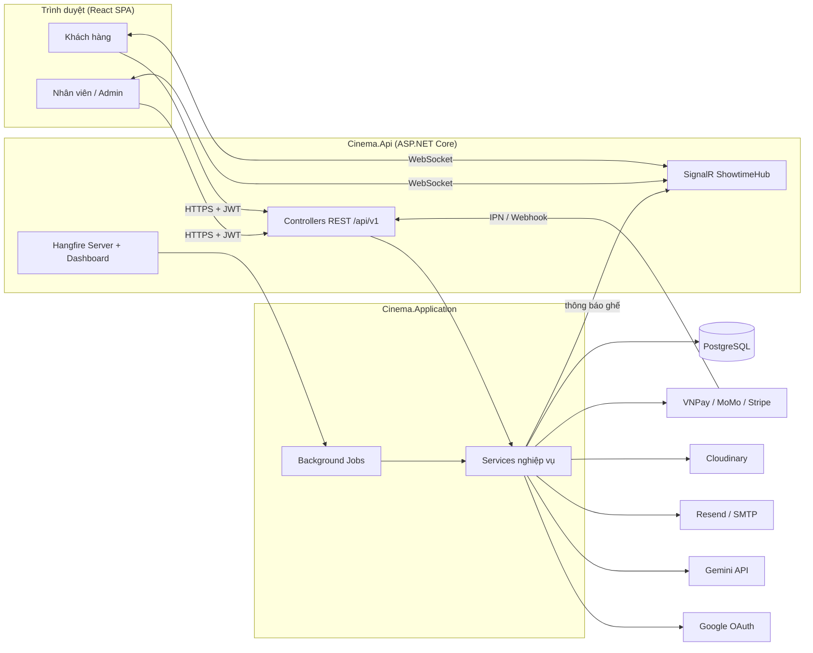
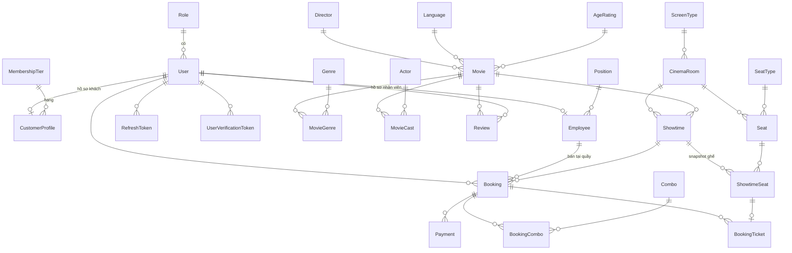
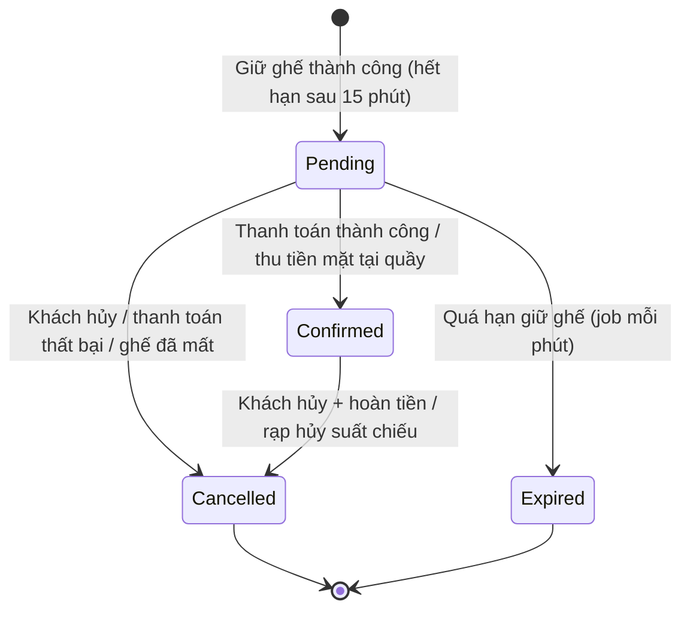
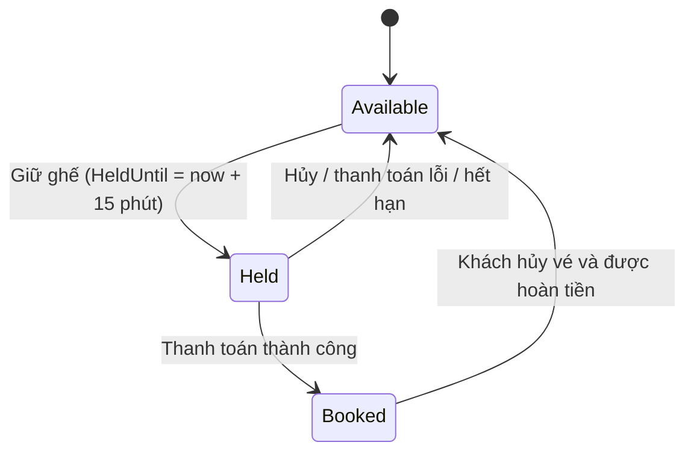
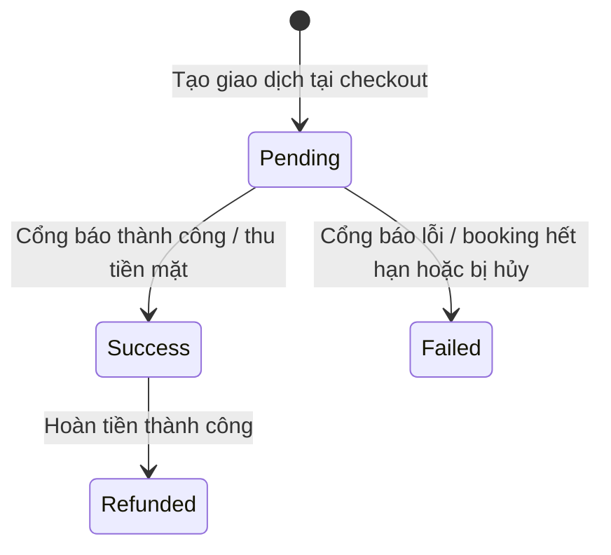
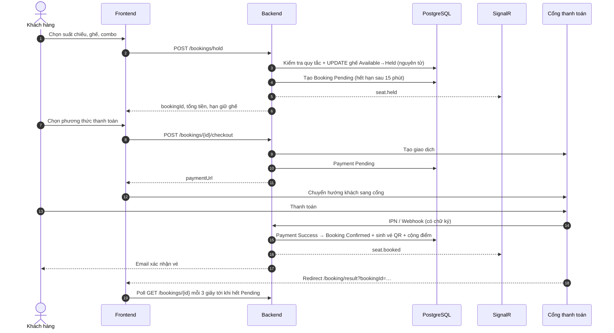

# PERFO — TÀI LIỆU NGHIỆP VỤ HỆ THỐNG

> Hệ thống đặt vé xem phim trực tuyến và quản lý rạp chiếu phim (Cinema Booking & Management System).
>
> **Nguồn tài liệu:** được trích xuất trực tiếp từ mã nguồn `perfo-main` (backend ASP.NET Core / frontend React). Mọi con số, quy tắc, trạng thái trong tài liệu đều lấy từ code thực tế; các điểm mã nguồn chưa nhất quán hoặc có rủi ro được ghi riêng ở **Mục 12**.

---

## Mục lục

1. [Tổng quan hệ thống](#1-tổng-quan-hệ-thống)
2. [Tác nhân và phân quyền](#2-tác-nhân-và-phân-quyền)
3. [Mô hình dữ liệu nghiệp vụ](#3-mô-hình-dữ-liệu-nghiệp-vụ)
4. [Quy trình nghiệp vụ chi tiết](#4-quy-trình-nghiệp-vụ-chi-tiết)
5. [Bảng quy tắc và công thức tính toán](#5-bảng-quy-tắc-và-công-thức-tính-toán)
6. [Màn hình và điều hướng](#6-màn-hình-và-điều-hướng)
7. [Danh mục API](#7-danh-mục-api)
8. [Kiến trúc kỹ thuật và triển khai](#8-kiến-trúc-kỹ-thuật-và-triển-khai)
9. [Dữ liệu mẫu và tài khoản thử nghiệm](#9-dữ-liệu-mẫu-và-tài-khoản-thử-nghiệm)
10. [Kiểm thử](#10-kiểm-thử)
11. [Thuật ngữ](#11-thuật-ngữ)
12. [Ghi chú, điểm chưa nhất quán và rủi ro](#12-ghi-chú-điểm-chưa-nhất-quán-và-rủi-ro)

---

## 1. Tổng quan hệ thống

### 1.1 Mục tiêu

Perfo phục vụ **một cụm rạp chiếu phim duy nhất** (cấu hình rạp là bản ghi duy nhất `CinemaSettings.Id = 1`). Hệ thống số hóa trọn vòng đời kinh doanh của rạp:

- **Khách hàng:** xem phim, xem lịch chiếu, chọn ghế theo sơ đồ thời gian thực, mua combo bắp nước, thanh toán online, nhận vé QR, tích điểm hội viên, đánh giá phim, hỏi trợ lý AI.
- **Nhân viên:** bán vé tại quầy (thu tiền mặt), soát vé bằng mã QR/camera.
- **Quản trị:** quản lý phim, phòng chiếu, sơ đồ ghế, xếp lịch chiếu (thủ công, hàng loạt, tự động), combo, nhân sự, hội viên, giao dịch, báo cáo doanh thu và cấu hình vận hành.

### 1.2 Phân hệ chức năng

| Phân hệ | Mô tả ngắn |
|---|---|
| Xác thực & tài khoản | Đăng ký, xác thực email, đăng nhập (email/mật khẩu, Google), làm mới token, quên/đặt lại mật khẩu, hồ sơ cá nhân |
| Danh mục phim | Phim, thể loại, ngôn ngữ, phân loại độ tuổi, đạo diễn, diễn viên |
| Phòng chiếu & ghế | Phòng, loại màn hình, loại ghế, trình soạn sơ đồ ghế (ghế đôi, lối đi) |
| Suất chiếu | Tạo lẻ, tạo hàng loạt, xếp lịch tự động, sửa, hủy, vòng đời tự động |
| Đặt vé online | Giữ ghế, combo, giảm giá hội viên, thanh toán VNPay / MoMo / Stripe, xác nhận, hủy, hoàn tiền |
| Bán vé tại quầy | Giữ ghế, thu tiền mặt, tính tiền thối |
| Soát vé | Quét QR/nhập mã, kiểm tra thời gian cho phép |
| Hội viên | Tích điểm, 4 hạng, chiết khấu theo hạng |
| Đánh giá | Chấm điểm 1–10 và bình luận, chỉ sau khi đã soát vé |
| Trợ lý AI | Chatbot Gemini có function-calling tra cứu lịch chiếu, ghế trống, vé của khách |
| Thời gian thực | SignalR đồng bộ trạng thái ghế giữa các khách |
| Báo cáo | Dashboard, doanh thu, phim bán chạy, hiệu suất nhân viên |
| Cấu hình | Thông tin rạp, giờ hoạt động, chính sách hoàn/hủy, quy đổi điểm |

### 1.3 Công nghệ

| Lớp | Công nghệ |
|---|---|
| Backend | ASP.NET Core (.NET 10), kiến trúc nhiều tầng `Api / Application / Domain / Infrastructure / Shared` |
| CSDL | PostgreSQL 16 (Npgsql, EF Core + Migrations) |
| Job nền | Hangfire (lưu trữ PostgreSQL) |
| Realtime | SignalR (`/hubs/showtimes`) |
| Xác thực | JWT Bearer + refresh token xoay vòng; Google Sign-In |
| Validate / Map | FluentValidation, Mapster |
| Log | Serilog (console + file xoay theo ngày) |
| Lưu trữ media | Cloudinary |
| Email | Resend (ưu tiên) → SMTP MailKit (dự phòng) |
| Thanh toán | VNPay, MoMo, Stripe |
| AI | Google Gemini (`gemini-2.5-flash`) |
| Frontend | React 19, TypeScript, Vite, Tailwind CSS v4, TanStack Query/Table, React Router 7, Zustand, React Hook Form + Zod, Recharts, SignalR client |
| Triển khai | Docker Compose (dev), Render (API + DB + static web), Vercel (rewrite SPA) |

### 1.4 Sơ đồ kiến trúc tổng thể



---

## 2. Tác nhân và phân quyền

### 2.1 Tác nhân

| Tác nhân | Vai trò (`Roles`) | Mô tả |
|---|---|---|
| Khách vãng lai | — | Xem phim, lịch chiếu, combo, hạng thành viên, đánh giá, chat AI. Không đặt được vé |
| Khách hàng | `Customer` | Đặt vé online, quản lý vé, hồ sơ, điểm, đánh giá |
| Nhân viên | `Employee` | Bán vé tại quầy, soát vé, xem phim/suất chiếu/đặt vé. Bắt buộc có hồ sơ `Employee` |
| Quản trị viên | `Admin` | Toàn quyền quản trị. Bản ghi seed của Admin cũng có hồ sơ `Employee` nên bán vé tại quầy được |
| Hệ thống | — | Job nền Hangfire (mỗi phút), webhook cổng thanh toán |
| Dịch vụ ngoài | — | VNPay, MoMo, Stripe, Google, Gemini, Cloudinary, Resend/SMTP |

Chính sách ủy quyền (`Policies`): `CustomerOnly`, `AdminOnly`, `EmployeeOnly`, `StaffOnly` (= Admin hoặc Employee).

### 2.2 Ma trận quyền chức năng

| Chức năng | Khách vãng lai | Customer | Employee | Admin |
|---|:--:|:--:|:--:|:--:|
| Xem phim, lịch chiếu, combo, hạng hội viên, đánh giá | ✔ | ✔ | ✔ | ✔ |
| Chat với trợ lý AI | ✔ (hạn chế) | ✔ (xem được vé của mình) | ✔ | ✔ |
| Giữ ghế, thanh toán, hủy đặt vé online | ✘ | ✔ | ✘ | ✘ |
| Viết / sửa / xóa đánh giá của mình | ✘ | ✔ | ✘ | ✘ |
| Hồ sơ, đổi mật khẩu, điểm, hạng | ✘ | ✔ | ✘ | ✘ |
| Bán vé tại quầy (`counter-hold`, `counter-checkout`) | ✘ | ✘ | ✔ | ✔ |
| Soát vé (`checkin`) | ✘ | ✘ | ✔ | ✔ |
| Xem danh sách / chi tiết đặt vé (admin) | ✘ | ✘ | ✔ | ✔ |
| Xem danh sách phim, suất chiếu, lịch (admin) | ✘ | ✘ | ✔ | ✔ |
| Tạo / sửa / xóa phim | ✘ | ✘ | ✘ | ✔ |
| Tạo / sửa / hủy suất chiếu, xếp lịch tự động | ✘ | ✘ | ✘ | ✔ |
| Phòng chiếu, sơ đồ ghế | ✘ | ✘ | ✘ | ✔ |
| Combo, danh mục (thể loại, ngôn ngữ, độ tuổi, loại ghế, loại màn hình, đạo diễn, diễn viên, vị trí, hạng thành viên) | ✘ | ✘ | ✘ | ✔ |
| Người dùng, nhân viên, phân quyền, khóa tài khoản | ✘ | ✘ | ✘ | ✔ |
| Giao dịch thanh toán | ✘ | ✘ | ✘ | ✔ |
| Dashboard, báo cáo | ✘ | ✘ | ✘ | ✔ |
| Quản lý đánh giá (xóa) | ✘ | ✘ | ✘ | ✔ |
| Cài đặt rạp, upload ảnh/video | ✘ | ✘ | ✘ | ✔ |
| Hangfire Dashboard (`/admin/hangfire`) | ✘ | ✘ | ✘ | ✔ (production) |

### 2.3 Cổng đăng nhập và điều hướng theo vai trò

- **Cổng khách hàng:** `/auth/login` → API `POST /auth/login`. Tài khoản staff dùng cổng này sẽ bị từ chối kèm hướng dẫn dùng cổng quản trị.
- **Cổng quản trị:** `/admin/login` → API `POST /auth/admin-login`.
- Sau đăng nhập admin: `Admin` → `/admin/dashboard`; `Employee` → `/admin/bookings/counter`.
- Menu admin lọc theo vai trò (Employee chỉ thấy: Bán vé tại quầy, Soát vé, Quản lý phim, Suất chiếu, Quản lý đặt vé).
- Đăng nhập Google chỉ dành cho `Customer`; tài khoản quản trị bị từ chối.

---

## 3. Mô hình dữ liệu nghiệp vụ

### 3.1 Sơ đồ thực thể (rút gọn)



### 3.2 Nhóm thực thể

**Người dùng & bảo mật**

| Thực thể | Trường chính | Ghi chú |
|---|---|---|
| `Role` | `RoleName` | Seed: 1 = Customer, 2 = Admin, 3 = Employee |
| `User` | `FullName, Email, PasswordHash, Phone, Avatar, GoogleId, RoleId, DateOfBirth, Gender, IsActive, EmailConfirmed` | Email là định danh duy nhất; `IsActive=false` là khóa tài khoản |
| `CustomerProfile` | `UserId, Points, TierId, TotalSpent` | Tạo cùng lúc với user khi đăng ký |
| `Employee` | `UserId, PositionId, HireDate, IsActive` | Mỗi user tối đa 1 hồ sơ |
| `Position` | `Name` | Seed: Quản lý rạp, Trưởng ca, Nhân viên bán vé |
| `MembershipTier` | `TierName, MinPoints, DiscountPercent` | Xem 4.11 |
| `RefreshToken` | `TokenHash, ExpiresAt, IsRevoked, ReplacedByTokenId` | Lưu **hash SHA-256**, không lưu token gốc |
| `UserVerificationToken` | `TokenHash, Purpose, ExpiresAt, Used` | Mục đích: `EmailConfirmation`, `PasswordReset` |

**Nội dung phim**

| Thực thể | Trường chính |
|---|---|
| `Movie` | `Title, OriginalTitle, Description, DirectorId, DurationMinutes, ReleaseDate, LanguageId, Subtitle, AgeRatingId, PosterUrl, TrailerUrl, Status, AverageRating, CreatedAt` |
| `Genre`, `Language`, `AgeRating (Code, Description)`, `Director`, `Actor` | Danh mục dùng chung |
| `MovieGenre`, `MovieCast (CharacterName)` | Bảng nối nhiều-nhiều |
| `Review` | `MovieId, UserId, Rating (1–10), Comment, CreatedAt` |

**Rạp, phòng, ghế, suất chiếu**

| Thực thể | Trường chính | Ghi chú |
|---|---|---|
| `CinemaSettings` | `Name, Address, Phone, Email, TaxCode, LogoUrl, OpeningTime, ClosingTime, PointsPerAmount, CancelRefundPercent, CancelDeadlineHours, StopSellingMinutesBefore` | Bản ghi duy nhất `Id = 1` |
| `ScreenType` | `Name` | Seed: 2D, 3D, IMAX |
| `CinemaRoom` | `RoomName, ScreenTypeId, TotalSeats, IsActive, Rows, Cols` | Tên phòng là duy nhất |
| `SeatType` | `Name, PriceMultiplier` | Seed: Standard ×1.0, VIP ×1.5, Couple ×2.0 |
| `Seat` | `RoomId, SeatRow, SeatNumber, SeatTypeId, IsActive, IsAisle, CoupleId` | `IsAisle` = lối đi (không bán); `CoupleId` (GUID) nối 2 ghế đôi |
| `Showtime` | `MovieId, RoomId, StartTime, EndTime, BasePrice, Status` | `EndTime` = giờ bắt đầu + thời lượng phim + đệm phòng |
| `ShowtimeSeat` | `ShowtimeId, SeatId, Status, HeldByUserId, HeldUntil, Price` | **Ảnh chụp (snapshot)** ghế tại thời điểm tạo suất, kèm giá đã chốt |

**Đặt vé & thanh toán**

| Thực thể | Trường chính |
|---|---|
| `Booking` | `UserId?, ShowtimeId, BookingCode, Channel, CreatedByEmployeeId?, CustomerName, CustomerPhone, TotalAmount, DiscountAmount, FinalAmount, Status, CreatedAt, ExpiresAt` |
| `BookingTicket` | `BookingId, ShowtimeSeatId, Price, QrCode, IsCheckedIn, CheckedInAt` |
| `BookingCombo` | `BookingId, ComboId, Quantity, UnitPrice` (giá chốt tại thời điểm đặt) |
| `Combo` | `Name, Description, Price, ImageUrl, IsActive` |
| `Payment` | `BookingId, PaymentMethod, TransactionId, GatewayTransactionId, GatewayResponseCode, Amount, Status, PaidAt, CreatedAt, RefundTransactionId, RefundedAmount, RefundedAt, AmountReceived, ChangeGiven` |

### 3.3 Danh sách trạng thái (enum)

| Enum | Giá trị |
|---|---|
| `MovieStatus` | `ComingSoon`, `NowShowing`, `Ended` |
| `ShowtimeStatus` | `Scheduled`, `Cancelled`, `Completed` |
| `ShowtimeSeatStatus` | `Available`, `Held`, `Booked` |
| `BookingStatus` | `Pending`, `Confirmed`, `Cancelled`, `Expired` |
| `BookingChannel` | `Online`, `Counter` |
| `PaymentMethod` | `VNPay`, `Momo`, `Cash`, `Stripe` |
| `PaymentStatus` | `Pending`, `Success`, `Failed`, `Refunded` |
| `VerificationTokenPurpose` | `EmailConfirmation`, `PasswordReset` |
| `Gender` | `Male`, `Female`, `Other` |

### 3.4 Vòng đời trạng thái

**Đặt vé (`Booking`)**



**Ghế của suất chiếu (`ShowtimeSeat`)**



**Thanh toán (`Payment`)**



**Phim và suất chiếu**

- Phim: `ComingSoon` → `NowShowing` (admin đổi thủ công) → `Ended` (admin hoặc tự động).
- Suất chiếu: `Scheduled` → `Completed` (tự động khi `EndTime` đã qua) hoặc `Cancelled` (admin hủy).

---

## 4. Quy trình nghiệp vụ chi tiết

### 4.1 Tài khoản và xác thực

#### 4.1.1 Đăng ký (khách hàng)

1. Khách nhập họ tên, email, số điện thoại, mật khẩu (`POST /auth/register`).
2. Hệ thống kiểm tra email chưa tồn tại; gán vai trò `Customer`; băm mật khẩu bằng `PasswordHasher` của ASP.NET Identity.
3. Tạo đồng thời `User` (`EmailConfirmed = false`) và `CustomerProfile` (0 điểm, chưa có hạng).
4. Sinh token xác thực email ngẫu nhiên 32 byte; **chỉ lưu hash SHA-256**. Gửi email chứa liên kết `…/auth/confirm-email?token=…` (hiệu lực **24 giờ**) qua job nền.
5. Khách mở liên kết → `POST /auth/confirm-email` → token hợp lệ, chưa dùng, chưa hết hạn → `EmailConfirmed = true`.
6. Có thể gửi lại email xác thực (`POST /auth/resend-confirmation`): token cũ còn hiệu lực bị vô hiệu, cấp token mới. Phản hồi luôn trung tính để **không lộ** email có tồn tại hay không.

**Chính sách mật khẩu:** tối thiểu 8 ký tự, có ít nhất 1 chữ hoa, 1 chữ thường, 1 chữ số.

#### 4.1.2 Đăng nhập

| Cổng | Endpoint | Quy tắc |
|---|---|---|
| Khách hàng | `POST /auth/login` | Chỉ vai trò `Customer`; staff bị từ chối (403) và được hướng dẫn dùng cổng quản trị |
| Quản trị / nhân viên | `POST /auth/admin-login` | Dùng cho Admin, Employee |
| Google | `POST /auth/google` | Nhận `idToken`; chỉ `Customer` |

Điều kiện chung khi đăng nhập email/mật khẩu (kiểm tra theo thứ tự):
1. Email tồn tại và mật khẩu đúng, nếu sai trả cùng một thông báo "Sai email hoặc mật khẩu" (không phân biệt nguyên nhân).
2. Tài khoản `IsActive = true`, nếu không → 403 "Tài khoản đã bị khóa".
3. `EmailConfirmed = true`, nếu không → 403 yêu cầu xác thực email.
4. Nếu băm mật khẩu cũ cần nâng cấp (`SuccessRehashNeeded`) hệ thống băm lại tự động.

Kết quả: `accessToken` (JWT), `refreshToken` (chuỗi ngẫu nhiên), `expiresIn`, thông tin người dùng (gồm vai trò, hạng).

**Đăng nhập Google**
- Xác minh `idToken` với Google; email Google phải được xác thực.
- Nếu chưa có tài khoản: tự tạo `Customer` (`EmailConfirmed = true`, mật khẩu ngẫu nhiên không dùng được, avatar lấy từ Google) kèm `CustomerProfile`.
- Nếu email đã tồn tại: liên kết `GoogleId` vào tài khoản đó và coi như đã xác thực email.
- Tài khoản bị khóa hoặc không phải `Customer` bị từ chối.

#### 4.1.3 Token và phiên đăng nhập

| Loại | Thời hạn | Ghi chú |
|---|---|---|
| Access token (JWT HS256) | 3.600 giây (cấu hình) | Claim: `userId`, `role`, `sub`, `email`, và `employeeId` nếu có hồ sơ nhân viên |
| Refresh token | 30 ngày (cấu hình) | **Xoay vòng**: mỗi lần refresh cấp token mới, token cũ bị thu hồi và ghi `ReplacedByTokenId` |
| Socket token | 300 giây | `POST /auth/socket-token`, dùng cho kết nối SignalR |

- Frontend có interceptor axios: khi gặp 401, tự gọi `/auth/refresh` **một lần duy nhất** (singleton promise) rồi thử lại request; thất bại thì đăng xuất và chuyển về trang đăng nhập (giữ `redirect`).
- Đăng xuất (`POST /auth/logout`) thu hồi refresh token hiện tại.
- SignalR nhận JWT qua query `?access_token=` cho đường dẫn `/hubs/*`.

#### 4.1.4 Quên và đặt lại mật khẩu

1. `POST /auth/forgot-password` → luôn trả thông báo trung tính. Nếu email tồn tại: tạo token mục đích `PasswordReset`, hiệu lực **30 phút**, gửi email liên kết `…/reset-password?token=…`.
2. `POST /auth/reset-password` → token hợp lệ → đổi mật khẩu, đánh dấu token đã dùng, **thu hồi toàn bộ refresh token đang hoạt động** của người dùng.

#### 4.1.5 Hồ sơ cá nhân

- Xem/cập nhật: họ tên, điện thoại, ảnh đại diện, ngày sinh, giới tính (`GET/PUT /users/me`).
- Hồ sơ trả kèm: điểm, tổng chi tiêu, hạng hiện tại, **hạng kế tiếp và số điểm còn thiếu**.
- Đổi mật khẩu (`POST /users/me/change-password`): phải nhập đúng mật khẩu hiện tại và mật khẩu mới đạt chính sách.

#### 4.1.6 Quản trị người dùng và nhân viên (Admin)

- Danh sách người dùng lọc theo vai trò và từ khóa tên/email.
- **Khóa/mở khóa** tài khoản (`PUT /admin/users/{id}/status`).
- **Đổi vai trò** (`PUT /admin/users/{id}/role`). Không được hạ xuống `Customer` nếu người đó còn hồ sơ `Employee` đang hoạt động.
- **Tạo hồ sơ nhân viên:** user phải đã mang vai trò `Admin` hoặc `Employee`; mỗi user chỉ có một hồ sơ; có thể gán vị trí công tác và ngày vào làm. Quy trình thực tế: (1) tạo tài khoản → (2) đổi vai trò sang Employee → (3) tạo hồ sơ nhân viên.
- Cập nhật nhân viên: vị trí, ngày vào làm, trạng thái hoạt động.

---

### 4.2 Quản lý phim và danh mục

#### 4.2.1 Phim

- Thuộc tính: tên, tên gốc, mô tả, đạo diễn, thời lượng (phút), ngày khởi chiếu, ngôn ngữ, phụ đề, phân loại độ tuổi, poster, trailer, trạng thái, nhiều thể loại, nhiều diễn viên (kèm tên nhân vật).
- Khi tạo/sửa, hệ thống kiểm tra mọi khóa tham chiếu (đạo diễn, ngôn ngữ, độ tuổi, thể loại, diễn viên) có tồn tại và trả lỗi theo từng trường.
- Cập nhật phim đồng bộ lại danh sách thể loại và diễn viên (thêm mới, bớt đi, đổi tên nhân vật).
- **Xóa phim (mềm/cứng):**
  - Phim **đã từng có suất chiếu** → không xóa, chuyển sang `Ended`.
  - Phim chưa có suất chiếu nào → xóa hẳn.
- Phim `ComingSoon → NowShowing` do admin đặt thủ công. Chuyển sang `Ended` có thể do admin hoặc job tự động (xem 4.4.7).

#### 4.2.2 Hiển thị cho khách

- Danh sách phim: phân trang **con trỏ (cursor)** theo `MovieId` tăng dần, giới hạn 1–50 mỗi trang; lọc theo trạng thái, thể loại, ngôn ngữ, độ tuổi, từ khóa tên.
- Chi tiết phim: thông tin đầy đủ, dàn diễn viên, đạo diễn, **các suất chiếu trong 7 ngày tới** (trạng thái `Scheduled`) kèm số ghế còn trống / tổng ghế.
- Trang chủ: hero carousel, mục "Phim đang chiếu", "Phim sắp chiếu", carousel combo, giới thiệu trải nghiệm rạp.
- Trang lịch chiếu (`/schedule`): lịch cả rạp theo ngày, nhóm theo phim, kèm số ghế còn trống.

#### 4.2.3 Danh mục (Admin)

Quản lý CRUD cho: thể loại, ngôn ngữ, phân loại độ tuổi (mã P/K/T13/T16/T18/C), loại màn hình, loại ghế (hệ số giá), đạo diễn, diễn viên, vị trí nhân viên, hạng thành viên. Toàn bộ trong "Trung tâm danh mục" (`/admin/catalog`).

Quy tắc chung:
- Tên/mã **không được trùng** (409 nếu trùng).
- **Không xóa** mục đang được tham chiếu (ví dụ thể loại đang gắn vào phim, loại ghế đang gắn vào ghế, vị trí đang có nhân viên) → 409 kèm giải thích.

---

### 4.3 Phòng chiếu và sơ đồ ghế

#### 4.3.1 Phòng chiếu

- Tạo phòng: tên (duy nhất), loại màn hình, số hàng, số cột. `TotalSeats` ban đầu = 0 cho tới khi dựng sơ đồ ghế.
- Sửa phòng: tên, loại màn hình, `IsActive`.
- **Xóa phòng:**
  - Còn suất chiếu `Scheduled` trong tương lai → **chặn** (422).
  - Từng có suất chiếu (lịch sử) → chỉ **vô hiệu hóa** (`IsActive = false`).
  - Chưa từng có suất chiếu → xóa hẳn.

#### 4.3.2 Trình soạn sơ đồ ghế

Admin dựng sơ đồ trong lưới `Rows × Cols` (`/admin/rooms/{id}/seats`), có công cụ **tự động sinh** (auto-generate) và bảng kiểm tra hợp lệ. Mỗi ô gồm: hàng (A, B, …), số ghế, loại ghế, đang hoạt động hay không, có phải lối đi không, và nhóm ghế đôi.

Quy tắc khi lưu (`PUT /admin/rooms/{id}/seats`):
- Mọi `SeatTypeId` phải tồn tại.
- **Ghế đôi:** mỗi `CoupleId` phải có đúng **2 ghế** và **cùng một hàng**.
- So khớp theo cặp (hàng, số): ghế mới được tạo; ghế đổi thuộc tính được cập nhật.
- Ghế bị bỏ khỏi sơ đồ: nếu **đã có lịch sử suất chiếu** thì chỉ chuyển `IsActive = false`; nếu chưa → xóa hẳn.
- `TotalSeats` = số ghế `IsActive` và không phải lối đi. Cập nhật lại `Rows`, `Cols`.
- Kết quả trả về số ghế tạo mới / cập nhật / vô hiệu / xóa.

> Thay đổi sơ đồ phòng **không ảnh hưởng** các suất chiếu đã tạo, vì `ShowtimeSeat` là ảnh chụp tại thời điểm tạo suất.

---

### 4.4 Quản lý suất chiếu

#### 4.4.1 Quy tắc chung khi tạo suất chiếu

| Điều kiện | Xử lý nếu vi phạm |
|---|---|
| Phim tồn tại, không ở trạng thái `Ended` | Lỗi nghiệp vụ |
| Phòng tồn tại và `IsActive` | Lỗi nghiệp vụ |
| Phòng đã có sơ đồ ghế (ít nhất 1 ghế hoạt động, không phải lối đi) | Lỗi nghiệp vụ |
| Nằm trong giờ hoạt động của rạp (trừ khi đánh dấu `AllowAfterHours`) | Lỗi nghiệp vụ |
| Không chồng lấn với suất `Scheduled` khác trong cùng phòng | 409 "Trùng khung giờ chiếu trong phòng này" |

- **Giờ kết thúc** = giờ bắt đầu + thời lượng phim + **15 phút đệm dọn phòng** (`RoomBufferMinutes`). Việc kiểm tra chồng lấn dùng khoảng đã gồm đệm.
- **Giá vé từng ghế** = `BasePrice × PriceMultiplier` của loại ghế (không có loại ghế → ×1,0). Giá này được **chốt** vào `ShowtimeSeat.Price` ngay lúc tạo suất.
- Tạo suất đồng thời sinh toàn bộ `ShowtimeSeat` trạng thái `Available` từ các ghế đang hoạt động và không phải lối đi.

#### 4.4.2 Giờ hoạt động của rạp (`OperatingHours`)

- Cấu hình `OpeningTime`, `ClosingTime`. Nếu giờ đóng cửa **nhỏ hơn hoặc bằng** giờ mở cửa, hệ thống hiểu là **qua nửa đêm** (đóng cửa vào ngày hôm sau).
- Mặc định: suất chiếu phải **kết thúc** (không tính đệm) trước giờ đóng cửa.
- Với `AllowAfterHours = true`: chỉ cần **bắt đầu** trước giờ đóng cửa (cho phép suất chiếu kéo dài quá giờ).
- Chưa cấu hình giờ → không giới hạn.

#### 4.4.3 Tạo hàng loạt (Bulk)

Đầu vào: 1 phim, 1 phòng, khoảng ngày (từ–đến), các thứ trong tuần (`Mon…Sun`), danh sách giờ chiếu `HH:mm`, giá cơ bản.

Với mỗi cặp (ngày hợp lệ × giờ) hệ thống tạo suất; trường hợp vi phạm giờ hoạt động hoặc trùng giờ sẽ được **bỏ qua kèm lý do**, không làm hỏng cả lô. Kết quả trả về danh sách *đã tạo* và *bị bỏ qua*.

#### 4.4.4 Xếp lịch tự động (Auto-schedule)

Quy trình hai bước: **xem trước (preview)** → **áp dụng (apply)**.

*Đầu vào:* ngày cần xếp; danh sách phim (tối đa **20**), mỗi phim chọn số suất (1–20) và giá riêng (tùy chọn); danh sách phòng giới hạn (tùy chọn); giá mặc định; cờ `AllowAfterHours`.

*Thuật toán (`ShowtimeScheduler`):*
1. **Độ "hot" của phim** (`Heat`, 0–1) = `0,7 × (vé bán 7 ngày gần nhất / vé bán cao nhất trong nhóm) + 0,3 × (điểm đánh giá / 10)`.
2. Phim hot hơn được xếp trước; mỗi phim có các **mốc thời gian lý tưởng** chia đều trong khung giờ hoạt động (khung mặc định 16 giờ nếu chưa có giờ đóng cửa).
3. Với mỗi suất, thử các thời điểm ứng viên (bước 5 phút) ở từng phòng, loại những ứng viên chồng lấn lịch đã có hoặc vi phạm giờ hoạt động, và loại ứng viên cách suất cùng phim khác **dưới 60 phút**.
4. Chấm điểm: `−(khoảng cách tới mốc lý tưởng)/30 + 4 × độ khớp − 0,5 × số suất đã xếp ở phòng`, trong đó độ khớp `= 1 − |Heat − (số ghế phòng / số ghế phòng lớn nhất)|` — nghĩa là **phim hot được ưu tiên phòng lớn**.
5. Chọn ứng viên điểm cao nhất; lặp vòng tròn qua các phim cho tới khi đủ số suất hoặc hết chỗ. Suất không xếp được được báo trong danh sách `unplaced`.

*Áp dụng:* nhận danh sách suất đã duyệt (tối đa **200**), gọi lại quy trình tạo suất cho từng mục; mục nào lỗi thì bỏ qua và báo lý do.

#### 4.4.5 Sửa suất chiếu

- **Không đổi được phòng** (phải hủy và tạo suất mới).
- **Không sửa được** nếu suất đã có booking `Confirmed` (409).
- Đổi giờ/phim/giá hợp lệ theo các quy tắc ở 4.4.1; đổi giá cơ bản sẽ **tính lại giá** mọi ghế chưa `Booked`.

#### 4.4.6 Hủy suất chiếu (xóa mềm, hàng loạt được)

Khi admin hủy suất chiếu (`DELETE /admin/showtimes/{id}`), suất chuyển `Cancelled`. Với **mọi booking `Pending` và `Confirmed`**:

1. Booking → `Cancelled`.
2. Booking đã `Confirmed` của thành viên: **thu hồi điểm** và tổng chi tiêu đã cộng.
3. Hoàn tiền:
   - Thanh toán online → gọi API hoàn tiền của cổng, hoàn **100% số tiền đã thanh toán** (không áp dụng `CancelRefundPercent`).
   - Thanh toán **tiền mặt** hoặc hoàn tiền tự động **thất bại** → tính vào số **"cần hoàn thủ công"**.
4. Email thông báo cho khách (loại *đã hoàn tiền tự động* hoặc *sẽ hoàn thủ công*) — chỉ gửi khi booking gắn với tài khoản.
5. Giải phóng các ghế đang `Held`.
6. Phản hồi trả về số booking cần hoàn thủ công (`ManualRefundCount`).

Hủy hàng loạt (`DELETE /admin/showtimes/bulk`) gọi lặp quy trình trên và báo từng mục thành công/thất bại.

#### 4.4.7 Vòng đời tự động (job `update-showtime-lifecycle`, chạy mỗi phút)

1. Suất `Scheduled` có `EndTime` **đã qua** → `Completed`.
2. Phim `NowShowing` đã từng có suất (không bị hủy) nhưng **không còn suất `Scheduled` nào** kết thúc sau mốc (hiện tại − **1 ngày** ân hạn) → phim chuyển `Ended`.

#### 4.4.8 Lịch chiếu cho quản trị

- Danh sách suất (lọc phòng, phim, ngày, trạng thái; phân trang theo trang).
- **Lịch (calendar)** theo khoảng ngày (tối đa **92 ngày**), nhóm theo ngày, kèm số ghế trống/tổng; giao diện có dạng lưới lịch và bộ lọc phòng.

---

### 4.5 Đặt vé online (luồng chính)

#### 4.5.1 Tổng quan các bước



#### 4.5.2 Bước 1 — Chọn suất và ghế

- Khách xem sơ đồ ghế (`GET /showtimes/{id}/seats`) với trạng thái từng ghế, giá, loại ghế, vị trí lối đi. Sơ đồ **cập nhật thời gian thực** qua SignalR (4.16).
- **Gợi ý ghế** (`GET /showtimes/{id}/seat-suggestions?count=1..10`): xem 4.13.
- **Gợi ý combo** (`GET /combos/suggestions?showtimeId&seatCount`): xem 4.12.
- Chọn ghế đôi sẽ tự động chọn cả cặp. Ghế không còn `Available` không chọn được.
- Chưa đăng nhập mà bấm "Giữ ghế" → hộp thoại yêu cầu đăng nhập, quay lại đúng trang sau khi đăng nhập (`redirect`).

#### 4.5.3 Bước 2 — Giữ ghế (`POST /bookings/hold`)

Giới hạn tốc độ: **10 yêu cầu / 60 giây / người dùng** (`booking-hold`).

Kiểm tra theo thứ tự:

| # | Kiểm tra | Lỗi |
|---|---|---|
| 1 | **Quy tắc bố trí ghế:** ghế đôi phải chọn cả cặp; không để lại **ghế lẻ đơn độc** cạnh ghế vừa chọn | 422 |
| 2 | Suất chiếu tồn tại, trạng thái `Scheduled` | 404 / 422 |
| 3 | Suất chưa bắt đầu (`StartTime > now`) | 422 |
| 4 | **Đã ngừng bán online** nếu `now ≥ StartTime − StopSellingMinutesBefore` (chỉ khi cấu hình > 0; **không áp dụng cho bán tại quầy**) | 422 |
| 5 | Có tên khách (`customerName`, ≤ 100 ký tự); số điện thoại đúng mẫu `^(0\|\+84)[0-9]{9,10}$` nếu có | 400 |
| 6 | Người dùng **chưa có booking `Pending` còn hạn** cho suất này | 409 |
| 7 | Combo (nếu có) tồn tại và đang bán | 400 |

**Giữ ghế chống tranh chấp:** thực hiện trong một transaction bằng một câu `UPDATE … WHERE Status = Available` (nguyên tử). Nếu số dòng cập nhật khác số ghế yêu cầu → hoàn tác và trả `409 SeatConflict` kèm **danh sách ghế bị xung đột** để giao diện đánh dấu lại.

Sau khi giữ ghế thành công:
- `HeldUntil` = hiện tại + **15 phút** (`HoldDurationMinutes`).
- Tính tiền (xem mục 5): `TotalAmount` = tổng giá ghế + tổng combo; `DiscountAmount` = chiết khấu hạng; `FinalAmount` = `TotalAmount − DiscountAmount`.
- Tạo `Booking` `Pending`, mã dạng `BK` + `yyyyMMdd` + 4 ký tự ngẫu nhiên `A–Z0–9` (thử tối đa 5 lần để đảm bảo duy nhất), `ExpiresAt` = `HeldUntil`.
- Phát sự kiện SignalR `seat.held`.

Giao diện hiển thị **đồng hồ đếm ngược** thời gian giữ ghế. Khi hết hạn, toast cảnh báo và quay về bước chọn ghế.

#### 4.5.4 Bước 3 — Thanh toán (`POST /bookings/{id}/checkout`)

- Điều kiện: chủ booking, trạng thái `Pending` và chưa hết hạn.
- Phương thức hợp lệ: **`VNPay`, `Momo`, `Stripe`** (tiền mặt chỉ dùng tại quầy).
- Mã giao dịch nội bộ = `BookingCode` + dấu thời gian Unix.
- Tạo `Payment` `Pending`, gọi cổng để lấy `paymentUrl`; frontend chuyển hướng khách sang đó.
- Khách có thể quay lại tiếp tục thanh toán một booking còn hạn (**chế độ resume**, tham số `?resume={bookingId}` trên trang đặt vé); nếu booking đã hết hạn hoặc không còn `Pending`, giao diện báo rõ lý do.

#### 4.5.5 Bước 4 — Cổng thanh toán gọi lại và xác nhận

| Cổng | Endpoint nhận | Xác thực | Kiểm tra số tiền | Mã phản hồi cho cổng |
|---|---|---|---|---|
| VNPay | `GET/POST /payments/vnpay/ipn` | Chữ ký HMAC | Có (sai số ≤ 0,01) | `RspCode`: 00 thành công, 01 không thấy đơn, 04 sai số tiền, 97 sai chữ ký, 99 chưa cấu hình |
| MoMo | `POST /payments/momo/ipn` | Chữ ký | Có | `resultCode`: 0 thành công, 1 không thấy đơn, 4 sai số tiền, 97 sai chữ ký, 99 chưa cấu hình |
| Stripe | `POST /payments/stripe/webhook` | Header `Stripe-Signature` + secret | — | 400 nếu sai chữ ký, còn lại 200; xử lý sự kiện `checkout.session.completed` |

Nguyên tắc xử lý (`PaymentService`):
1. **Idempotent:** giao dịch đã `Success` hoặc `Failed` thì bỏ qua, vẫn trả thành công cho cổng.
2. Ghi `GatewayResponseCode`, trạng thái, `PaidAt`, `GatewayTransactionId` (dùng cho hoàn tiền sau này).
3. **Thành công** → xác nhận booking (4.5.6).
4. **Thất bại** → booking `Pending` bị hủy, ghế được giải phóng, các payment đang `Pending` khác chuyển `Failed`; khách phải giữ ghế lại từ đầu.

#### 4.5.6 Xác nhận booking và phát hành vé

`ConfirmBookingAndGenerateTickets` (cũng idempotent — booking đã `Confirmed` thì bỏ qua):

1. Lấy các ghế `Held` do người giữ đang nắm. Nếu **không còn ghế nào** → xử lý tình huống 4.7.3.
2. Trong một transaction: booking → `Confirmed`; mỗi ghế → `Booked` (xóa thông tin giữ); **tạo `BookingTicket`** cho từng ghế với:
   - `Price` = giá ghế đã chốt;
   - `QrCode` = `{BookingCode}-{Hàng}{Số}` (ví dụ `BK20261028AB12-C7`);
   - `IsCheckedIn = false`.
3. **Cộng điểm hội viên** (4.11).
4. Phát SignalR `seat.booked`.
5. Đưa vào hàng đợi **email xác nhận vé** (chỉ khi booking gắn với tài khoản).

#### 4.5.7 Bước 5 — Trang kết quả

Cổng chuyển khách về `/booking/result?bookingId=…`. Trang tự **thăm dò lại mỗi 3 giây** khi booking còn `Pending` (vì IPN có thể đến sau redirect). Khi `Confirmed`: hiển thị hiệu ứng chúc mừng (confetti) và vé QR; khi `Cancelled/Expired`: hiển thị trạng thái tương ứng.

#### 4.5.8 Quản lý vé của khách

- **Danh sách đặt vé của tôi** (`GET /bookings`): phân trang con trỏ, lọc trạng thái, mới nhất trước.
- **Chi tiết** (`GET /bookings/{id}`): phim, suất, ghế, combo, tổng/giảm/thực trả, danh sách vé (QR, trạng thái check-in), các lần thanh toán, hạn giữ ghế (nếu còn `Pending`). Chỉ chủ booking xem được (403 nếu khác).
- Trang chi tiết vé hiển thị **vé QR** (`perfo-ticket`, `ticket-qr-card`).

---

### 4.6 Giải phóng ghế và hết hạn đặt vé (job `release-expired-seats-and-bookings`, mỗi phút)

1. Tìm mọi booking `Pending` có `ExpiresAt < now`.
2. Với mỗi booking: trả các ghế `Held` của người giữ về `Available`; booking → `Expired`; các `Payment` đang `Pending` → `Failed`.
3. Phát SignalR `hold.expired` (kèm `bookingId`, `seatIds`) để giao diện của chính khách đó biết giữ ghế đã hết.
4. Cuối cùng quét thêm các ghế `Held` đã quá `HeldUntil` nhưng **không còn gắn booking `Pending` nào** (ghế mồ côi) và trả về `Available`.

Do job chạy mỗi phút, ghế có thể được trả muộn tối đa khoảng 1 phút sau khi hết hạn.

---

### 4.7 Hủy vé, hoàn tiền

#### 4.7.1 Khách tự hủy (`POST /bookings/{id}/cancel`)

| Trạng thái booking | Xử lý |
|---|---|
| `Pending` | Hủy ngay: giải phóng ghế, booking `Cancelled`, payment `Pending` → `Failed`; không có hoàn tiền |
| `Confirmed` | Hủy có điều kiện — xem bên dưới |
| `Cancelled` / `Expired` | Từ chối (422) |

Điều kiện hủy booking `Confirmed`:
1. **Chưa có vé nào được check-in**; nếu có → từ chối, hướng dẫn liên hệ rạp.
2. Phải có giao dịch thanh toán `Success` **không phải tiền mặt**; booking mua tại quầy hoặc không xác định được giao dịch → liên hệ rạp.
3. Chính sách hoàn tiền của rạp (`CinemaSettings`):
   - `CancelRefundPercent` ≤ 0 → rạp không hỗ trợ hoàn tiền.
   - Chỉ hủy được khi `now ≤ StartTime − CancelDeadlineHours` (mặc định **2 giờ**).
   - Số tiền hoàn = `Số tiền đã thanh toán × CancelRefundPercent / 100` (làm tròn đến đồng; mặc định **100%**).
4. Gọi API hoàn tiền của cổng. **Thất bại → không hủy**, báo lỗi để khách thử lại hoặc liên hệ rạp.
5. Thành công → trong một transaction: giải phóng ghế `Booked` về `Available`, booking `Cancelled`, payment `Refunded` (ghi số tiền, thời điểm, mã hoàn tiền), **thu hồi điểm** đã cộng; phát `seat.released`; gửi email "Xác nhận hủy vé & hoàn tiền".

#### 4.7.2 Rạp hủy suất chiếu

Xem 4.4.6 (hoàn 100%, hoàn thủ công cho tiền mặt/hoàn lỗi).

#### 4.7.3 Thanh toán xong nhưng ghế đã mất (tình huống ngoại lệ)

Nếu cổng báo thanh toán thành công nhưng **không còn ghế `Held`** (đã bị job giải phóng, hoặc khách thanh toán quá hạn):

1. Booking chuyển `Cancelled`.
2. Hệ thống **tự động gọi hoàn tiền** toàn bộ số tiền.
3. Gửi email cho **địa chỉ email của rạp** (`CinemaSettings.Email`):
   - Hoàn thành công → tiêu đề "Đã tự động hoàn tiền — Booking #…".
   - Hoàn thất bại → "CẦN HOÀN TIỀN THỦ CÔNG — Booking #…".
4. Ghi log mức nghiêm trọng (Critical) để vận hành theo dõi.

> Lưu ý: `ConfirmBooking` xác nhận dựa trên ghế còn ở trạng thái `Held`, không đối chiếu lại `HeldUntil`; do đó thanh toán trễ vài chục giây ngay sau hạn nhưng **trước khi job chạy** vẫn có thể được xác nhận.

---

### 4.8 Bán vé tại quầy (nhân viên)

Màn hình: `/admin/bookings/counter`, 4 bước: **Chọn suất → Chọn ghế → Thanh toán → Hoàn tất**.

1. **Chọn suất:** chọn ngày, chọn suất trong lịch cả rạp.
2. **Chọn ghế:** sơ đồ thời gian thực; chọn combo; nhập tên và số điện thoại khách.
3. **Giữ ghế** (`POST /admin/bookings/counter-hold`):
   - Yêu cầu tài khoản có hồ sơ `Employee` (422 nếu không).
   - Booking kênh `Counter`, ghi `CreatedByEmployeeId`; ghế được giữ **dưới danh nghĩa tài khoản nhân viên**, 15 phút.
   - Mỗi nhân viên chỉ có **1 booking `Pending` còn hạn mỗi suất**.
   - Dữ liệu khách: validator cho phép gửi `userId` (khách hội viên) **hoặc** `customerName`, nhưng service luôn đòi `customerName` không rỗng (thiếu → 400). Giao diện quầy hiện chỉ nhập tên và số điện thoại, **không chọn khách hội viên** (xem Mục 12).
   - Không áp dụng giới hạn "ngừng bán online" và (theo mã hiện tại) **không áp dụng quy tắc ghế lẻ / ghế đôi** như bán online.
4. **Thu tiền** (`POST /admin/bookings/{id}/counter-checkout`): nhập `amountReceived`; phải ≥ `FinalAmount`; hệ thống tính **tiền thối** = đã nhận − phải trả; tạo `Payment` `Cash` trạng thái `Success` (lưu `AmountReceived`, `ChangeGiven`); xác nhận booking và phát vé ngay trong cùng transaction.
5. **Hoàn tất:** hiển thị vé QR và tiền thối.

Hệ thống không gửi email nếu booking quầy không gắn tài khoản.

---

### 4.9 Soát vé (check-in)

Màn hình: `/admin/checkin`. Hai cách nhập: **quét QR bằng camera** (thư viện `jsQR`) hoặc **nhập tay mã**; có âm thanh báo kết quả.

`POST /admin/bookings/checkin` với `qrCode`:

| Điều kiện | Kết quả |
|---|---|
| Không tìm thấy mã | 404 "QR không hợp lệ" |
| Vé đã check-in | 409 "Vé đã check-in trước đó" |
| `now < StartTime − 30 phút` | 422 "Chưa tới giờ check-in" |
| `now > EndTime` | 422 "Suất chiếu đã kết thúc" |
| Hợp lệ | `IsCheckedIn = true`, ghi `CheckedInAt`; trả thông tin phim/ghế/suất |

Cửa sổ soát vé: **từ 30 phút trước giờ chiếu đến hết giờ kết thúc suất** (đã gồm đệm 15 phút). Check-in là điều kiện để khách **được đánh giá phim** (4.10) và là điều kiện **chặn hủy vé** (4.7.1).

---

### 4.10 Đánh giá phim

| Quy tắc | Chi tiết |
|---|---|
| Ai được đánh giá | Chỉ `Customer` đã có **ít nhất một vé được check-in** của phim đó |
| Số lượng | Mỗi khách **một đánh giá** cho mỗi phim (trùng → 409) |
| Nội dung | Điểm nguyên **1–10**, bình luận tùy chọn ≤ 1.000 ký tự |
| Sửa / xóa | Chủ đánh giá sửa hoặc xóa của chính mình (403 nếu không phải chủ) |
| Quản trị | Admin xóa bất kỳ đánh giá; lọc theo phim và điểm |
| Điểm trung bình phim | `AverageRating` = trung bình các đánh giá, làm tròn 2 chữ số; được tính lại khi **sửa** hoặc **xóa** đánh giá (xem Mục 12 về trường hợp tạo mới) |
| Hiển thị | Danh sách đánh giá theo phim (cursor, mới nhất trước); trang "Đánh giá của tôi" |

Endpoint `GET /movies/{id}/can-review` cho biết khách hiện có được phép đánh giá hay không (chưa đánh giá và đã check-in). Khách chưa đăng nhập luôn nhận `false`.

---

### 4.11 Hội viên và tích điểm

#### 4.11.1 Các hạng (dữ liệu seed, admin có thể chỉnh)

| Hạng | Điểm tối thiểu | Chiết khấu |
|---|---:|---:|
| Thành viên | 0 | 0% |
| Bạc | 500 | 5% |
| Vàng | 2.000 | 10% |
| Kim Cương | 5.000 | 15% |

#### 4.11.2 Quy tắc

- **Tích điểm:** khi booking được xác nhận, cộng `floor(FinalAmount / PointsPerAmount)` điểm. `PointsPerAmount` mặc định **10.000 VNĐ = 1 điểm** (cấu hình trong cài đặt rạp). Tổng chi tiêu (`TotalSpent`) cộng thêm `FinalAmount`.
- **Xếp hạng:** sau khi cộng điểm, hệ thống chọn hạng **có `MinPoints` lớn nhất** mà không vượt quá số điểm hiện có; nếu khác hạng hiện tại thì nâng hạng và ghi log `TierUpgraded`.
- **Chiết khấu:** áp dụng **tại thời điểm giữ ghế** theo hạng hiện tại của khách, trên **tổng tiền (ghế + combo)**.
- **Thu hồi điểm:** khi vé bị hủy (khách hủy có hoàn tiền hoặc rạp hủy suất), trừ `floor(FinalAmount / PointsPerAmount)` điểm và trừ `FinalAmount` khỏi `TotalSpent`, không để âm. Hạng **không** được tính lại sau thu hồi (xem Mục 12).
- Trang `/membership` giới thiệu các hạng, bảng so sánh quyền lợi và FAQ; hồ sơ khách hiển thị điểm, hạng, điểm còn thiếu để lên hạng kế tiếp.

---

### 4.12 Combo bắp nước và gợi ý combo

- Admin quản lý combo: tên, mô tả, giá, ảnh, bật/tắt bán (`PUT /admin/combos/{id}/toggle`). Combo ngừng bán không đặt được và không hiển thị cho khách.
- Khi đặt vé, khách chọn số lượng từng combo; **đơn giá được chốt** vào `BookingCombo.UnitPrice` tại thời điểm đặt.
- **Gợi ý combo** (`GET /combos/suggestions`, `seatCount` 1–20) trả tối đa **3 combo** theo điểm:
  1. Đọc **số lượng đồ uống** từ mô tả combo bằng biểu thức chính quy (ví dụ "2 Coca-Cola" → quy mô 2 người).
  2. Số lượng gợi ý = `ceil(số ghế / quy mô combo)`; nhãn "Phù hợp cho N người".
  3. Điểm = độ khớp số người (tối đa 3) + 1 nếu phim thiếu nhi (`P`, `K`) và combo từ 3 người + 0,5 nếu suất khuya (từ 21h đến trước 6h giờ Việt Nam) và combo giá không vượt trung vị + tối đa 2 điểm theo **doanh số combo của các phim cùng thể loại**.
  4. Combo bán chạy nhất cùng thể loại được đánh dấu nổi bật.

---

### 4.13 Gợi ý ghế (`SeatLayoutRules`)

Khách nhập số người (1–10) → hệ thống trả **3 phương án tốt nhất**, mỗi hàng đề xuất tối đa một cụm ghế liền kề:

- Chỉ xét các cụm ghế **trống, liên tiếp**.
- Không đề xuất cụm làm **chừa ghế lẻ** (ghế trống đơn độc ngay sát cụm).
- Với ghế đôi, phải lấy **cả cặp**.
- Điểm = `0,45 × độ gần tâm hàng + 0,45 × điểm vị trí hàng + 0,1 nếu cùng loại ghế`. Vị trí hàng tốt nhất nằm khoảng **50%–70% độ sâu phòng**.
- Trả về hàng, số ghế, id ghế, tổng giá, điểm.

**Quy tắc kiểm tra lựa chọn thủ công (áp dụng khi giữ ghế online):**
1. Ghế đôi phải chọn **cả hai ghế**.
2. Sau khi chọn, không để lại ghế trống đơn lẻ nằm sát ghế vừa chọn ("Không thể để trống ghế lẻ A5…").

---

### 4.14 Trợ lý AI (Gemini)

- Widget nổi trên giao diện khách: lời chào, 4 gợi ý nhanh ("Phim nào đang chiếu hôm nay?", "Lịch chiếu cuối tuần này", "Suất tối nay còn ghế không?", "Vé tôi đã đặt"), hiển thị Markdown, chỉ báo đang gõ, **thẻ kết quả** (suất chiếu, vé) có liên kết.
- Endpoint `POST /ai/chat` mở cho cả khách vãng lai. Tin nhắn ≤ 1.000 ký tự; mỗi tin trong lịch sử ≤ 2.000 ký tự.
- **System prompt** được dựng mới mỗi lần, gồm: tên/địa chỉ/hotline/giờ mở cửa rạp; thời gian hiện tại; thông tin khách (tên, email, điểm, hạng nếu đã đăng nhập); danh sách phim đang/sắp chiếu (id, tên, thể loại, thời lượng, độ tuổi); danh sách combo; quy tắc ứng xử (tiếng Việt, xưng hô, không bịa, bắt buộc dùng hàm để lấy lịch chiếu/ghế).
- **Function calling** (3 hàm):

| Hàm | Mục đích | Điều kiện |
|---|---|---|
| `search_showtimes` | Tìm suất chiếu sắp tới theo phim (id hoặc một phần tên) và ngày; mặc định 7 ngày tới; tối đa 8 kết quả | Mọi người |
| `get_seat_availability` | Số ghế còn, giá theo loại ghế, danh sách ghế trống (tối đa 40 nhãn) | Mọi người |
| `get_my_bookings` | Vé/đơn của chính khách; lọc "chỉ sắp chiếu", trạng thái; tối đa 5 | **Chỉ khi đã đăng nhập** (hàm không được khai báo cho khách vãng lai) |

- **Giới hạn an toàn:** tối đa **4 vòng** gọi hàm, tối đa **8 lần** gọi hàm tổng, tối đa **6 thẻ** trả về (loại trùng), `temperature = 0,5`, `maxOutputTokens = 2048`.
- Chưa cấu hình `GEMINI_API_KEY` hoặc Gemini lỗi → trả thông báo thân thiện, không làm sập chức năng khác.
- AI **chỉ tra cứu và tư vấn**, không thể đặt vé hay thay đổi dữ liệu.

---

### 4.15 Email thông báo

Mọi email gửi qua **job nền Hangfire** `SendEmailJob` (tự thử lại 3 lần, cách 30 giây / 2 phút / 10 phút). Kênh gửi: **Resend** trước; nếu lỗi và có cấu hình SMTP thì chuyển sang **SMTP (MailKit)**; nếu không có khóa Resend thì dùng SMTP.

| Mẫu email | Khi nào | Người nhận |
|---|---|---|
| Liên kết hành động (xác thực email / đặt lại mật khẩu) | Đăng ký, gửi lại xác thực, quên mật khẩu | Khách |
| Vé xem phim (xác nhận đặt vé) | Booking `Confirmed` và gắn tài khoản | Khách |
| Hủy vé & hoàn tiền | Khách hủy booking đã thanh toán | Khách |
| Suất chiếu bị hủy — đã hoàn tiền | Rạp hủy suất, hoàn tự động thành công | Khách |
| Suất chiếu bị hủy — hoàn thủ công | Rạp hủy suất, thanh toán tiền mặt hoặc hoàn tự động lỗi | Khách |
| Ghế hết hạn sau thanh toán | Thanh toán thành công nhưng ghế đã mất | **Email của rạp** (`CinemaSettings.Email`) |

---

### 4.16 Thời gian thực (SignalR)

- Hub: `/hubs/showtimes`. Client gọi `JoinShowtime(showtimeId)` khi vào trang đặt vé/bán vé và `LeaveShowtime` khi rời; mỗi suất chiếu là một nhóm `showtime-{id}`.
- Sự kiện máy chủ phát tới nhóm:

| Sự kiện | Khi nào | Dữ liệu |
|---|---|---|
| `seat.held` | Giữ ghế thành công | `showtimeId, seatIds, heldByUserId, heldUntil` |
| `seat.booked` | Xác nhận booking | `showtimeId, seatIds` |
| `seat.released` | Khách hủy booking đã thanh toán / hủy giữ ghế | `showtimeId, seatIds` |
| `hold.expired` | Job giải phóng booking hết hạn | `showtimeId, bookingId, seatIds` |

- Frontend giữ một bản đồ trạng thái ghế **gộp dữ liệu ban đầu và các sự kiện realtime**; riêng `hold.expired` của chính booking mình thì hiện cảnh báo và quay về bước chọn ghế.
- Kết nối dùng **socket token** ngắn hạn (300 giây), nếu lấy token lỗi thì dùng access token; tự kết nối lại theo lịch 0 / 1 / 3 / 5 / 10 giây.

---

### 4.17 Dashboard và báo cáo (Admin)

**Dashboard** (`/admin/dashboard`)

| Chỉ số | Cách tính |
|---|---|
| Doanh thu hôm nay | Tổng `FinalAmount` các booking `Confirmed` tạo trong ngày (theo ngày UTC) |
| Doanh thu hôm qua, % thay đổi | So sánh với hôm qua (chỉ tính % khi hôm qua > 0) |
| Vé bán hôm nay | Số vé thuộc booking `Confirmed` tạo hôm nay |
| Booking xác nhận hôm nay | Đếm booking `Confirmed` |
| Booking đang giữ chỗ | Booking `Pending` còn hạn |
| Tỷ lệ lấp đầy hôm nay | Ghế `Booked` / tổng ghế của các suất bắt đầu hôm nay |
| Biểu đồ doanh thu | Theo ngày, bộ lọc 1–90 ngày |
| Top 5 phim | Theo doanh thu trong kỳ |
| Suất chiếu hôm nay | Danh sách suất trong ngày |

**Báo cáo** (`/admin/reports`, lọc khoảng ngày)

| Báo cáo | Nội dung |
|---|---|
| Doanh thu | Nhóm theo `day` / `week` (ISO) / `month`; tách **doanh thu vé** và **doanh thu combo**, tổng doanh thu (`FinalAmount`), số booking; tổng kết kỳ |
| Phim bán chạy | Xếp theo doanh thu vé, kèm số vé bán; giới hạn do người dùng chọn |
| Hiệu suất nhân viên | Chỉ booking kênh `Counter` đã `Confirmed`: số vé, doanh thu, số booking theo từng nhân viên |

Mọi báo cáo tính theo thời điểm **tạo booking** và chỉ tính booking `Confirmed`.

---

### 4.18 Cài đặt hệ thống (Admin)

| Nhóm | Trường | Mặc định / ràng buộc |
|---|---|---|
| Thông tin rạp | Tên, địa chỉ, điện thoại, email, mã số thuế, logo | Email dùng nhận cảnh báo hoàn tiền (4.7.3) |
| Giờ hoạt động | `OpeningTime`, `ClosingTime` | Seed 08:00 – 23:59; đóng ≤ mở nghĩa là qua nửa đêm |
| Tích điểm | `PointsPerAmount` | 10.000 VNĐ / điểm |
| Hoàn/hủy vé | `CancelRefundPercent` | 100%, hợp lệ 0–100 |
| | `CancelDeadlineHours` | 2 giờ, không âm |
| Bán online | `StopSellingMinutesBefore` | 0 = không giới hạn |

Khách xem được cài đặt công khai qua `GET /settings` (dùng để hiển thị chính sách hủy/hoàn trên trang vé).

---

### 4.19 Tải lên hình ảnh và video (Admin)

- `POST /admin/uploads/image`: `.jpg .jpeg .png .webp`, tối đa **5 MB**.
- `POST /admin/uploads/video`: `.mp4 .mov .webm .avi`, tối đa **100 MB**.
- Lưu trên **Cloudinary**, theo thư mục (`folder`); trả về `url` và `publicId`. Dùng cho poster, trailer, ảnh combo, avatar đạo diễn/diễn viên, logo rạp, avatar khách.

---

## 5. Bảng quy tắc và công thức tính toán

### 5.1 Tham số cấu hình

| Tham số | Giá trị mặc định | Nơi cấu hình |
|---|---|---|
| Thời gian giữ ghế | **15 phút** | `Booking:HoldDurationMinutes` |
| Đệm dọn phòng giữa các suất | **15 phút** | `Booking:RoomBufferMinutes` |
| Hạn hủy vé trước giờ chiếu | **2 giờ** | `CinemaSettings.CancelDeadlineHours` |
| Tỷ lệ hoàn tiền khi khách hủy | **100%** | `CinemaSettings.CancelRefundPercent` |
| Quy đổi điểm | **10.000 VNĐ = 1 điểm** | `CinemaSettings.PointsPerAmount` |
| Ngừng bán online trước giờ chiếu | **0 phút (tắt)** | `CinemaSettings.StopSellingMinutesBefore` |
| Mở soát vé trước giờ chiếu | **30 phút** | Cố định trong mã |
| Ân hạn kết thúc phim | **1 ngày** | Cố định trong mã |
| Hạn email xác thực / đặt lại mật khẩu | **24 giờ / 30 phút** | `Email:*` |
| Hạn access / refresh / socket token | **3.600 giây / 30 ngày / 300 giây** | `Jwt:*`, cố định |

### 5.2 Công thức tiền

```
Giá ghế (ShowtimeSeat.Price) = BasePrice của suất × PriceMultiplier của loại ghế
TotalAmount    = Σ giá ghế + Σ (đơn giá combo × số lượng)
DiscountAmount = round(TotalAmount × DiscountPercent của hạng / 100)   // làm tròn ra xa số 0
FinalAmount    = TotalAmount − DiscountAmount

Điểm cộng      = floor(FinalAmount / PointsPerAmount)
Tiền hoàn (khách hủy)  = round(Số tiền đã thanh toán × CancelRefundPercent / 100)
Tiền hoàn (rạp hủy suất) = 100% số tiền đã thanh toán
Tiền thối (quầy)       = AmountReceived − FinalAmount   (bắt buộc AmountReceived ≥ FinalAmount)
```

Ví dụ: suất IMAX giá cơ bản 130.000 VNĐ; ghế VIP (×1,5) = 195.000; ghế đôi (×2,0, mua 2 ghế trong cặp) = 2 × 260.000. Khách hạng Vàng (10%) mua 1 ghế VIP + 1 Double Combo (95.000): Total = 290.000; Giảm = 29.000; Final = 261.000; được `floor(261.000 / 10.000) = 26` điểm.

### 5.3 Giá cơ bản trong dữ liệu seed suất chiếu

| Loại màn hình | Giá cơ bản |
|---|---:|
| 2D | 75.000 |
| 3D | 95.000 |
| IMAX | 130.000 |

### 5.4 Định dạng mã

| Mã | Định dạng | Ví dụ |
|---|---|---|
| Mã đặt vé | `BK` + `yyyyMMdd` (UTC) + 4 ký tự `A-Z0-9` | `BK20261028K7Q2` |
| Mã QR vé | `{BookingCode}-{Hàng}{Số ghế}` | `BK20261028K7Q2-C7` |
| Mã giao dịch | `{BookingCode}` + Unix timestamp (giây) | `BK20261028K7Q21793181000` |

### 5.5 Giới hạn tốc độ (rate limit)

| Chính sách | Áp dụng | Hạn mức |
|---|---|---|
| Toàn cục | Mọi yêu cầu, theo IP, cửa sổ trượt | 100 / 60 giây |
| `auth` | Đăng ký, đăng nhập (cả admin, Google), refresh, quên/đặt lại mật khẩu — theo IP | 5 / 60 giây |
| `booking-hold` | Giữ ghế online — theo người dùng | 10 / 60 giây |

Vượt hạn mức → HTTP 429.

### 5.6 Mã lỗi nghiệp vụ

| HTTP | Loại | Ví dụ |
|---|---|---|
| 400 | Validation | Dữ liệu không hợp lệ, danh sách lỗi theo trường |
| 401 | Unauthorized | Sai thông tin đăng nhập, refresh token không hợp lệ |
| 403 | Forbidden | Tài khoản khóa, chưa xác thực email, không phải chủ booking |
| 404 | NotFound | Không tìm thấy phim, suất, booking… |
| 409 | Conflict / SeatConflict | Trùng giờ chiếu, email đã tồn tại, ghế đã bị giữ (kèm danh sách ghế) |
| 422 | BusinessRule | Vi phạm quy tắc nghiệp vụ |
| 429 | Rate limit | Vượt hạn mức |

Phản hồi thống nhất dạng `ApiResponse { success, data, message, errors }` (do `ApiResponseFilter` bọc; riêng webhook thanh toán dùng phản hồi thô theo yêu cầu cổng).

---

## 6. Màn hình và điều hướng

### 6.1 Phía khách hàng

| Đường dẫn | Màn hình | Bảo vệ |
|---|---|---|
| `/` | Trang chủ (hero, phim đang/sắp chiếu, combo, trải nghiệm rạp) | Công khai |
| `/movies` | Danh sách phim, bộ lọc, cuộn vô hạn | Công khai |
| `/movies/:id` | Chi tiết phim: trailer, dàn diễn viên, suất chiếu 7 ngày, đánh giá | Công khai |
| `/schedule` | Lịch chiếu toàn rạp theo ngày | Công khai |
| `/membership` | Hạng thành viên, so sánh, FAQ | Công khai |
| `/booking/:showtimeId` | Chọn ghế, combo, thanh toán (`?resume=` để tiếp tục) | Công khai xem; cần đăng nhập để giữ ghế |
| `/booking/result` | Kết quả thanh toán | Công khai |
| `/account/profile` | Hồ sơ, điểm, hạng | Customer |
| `/account/tickets` | Danh sách vé | Customer |
| `/account/tickets/:id` | Chi tiết vé, QR, hủy vé | Customer |
| `/account/reviews` | Đánh giá của tôi | Customer |
| `/account/change-password` | Đổi mật khẩu | Customer |
| `/auth/login`, `/register`, `/confirm-email`, `/forgot-password`, `/reset-password` | Xác thực | Chỉ khách chưa đăng nhập |

Tiện ích toàn cục: tìm kiếm phim ở header, chuyển giao diện sáng/tối, widget trợ lý AI, SEO (thẻ meta, sitemap).

### 6.2 Phía quản trị

| Nhóm menu | Màn hình | Đường dẫn | Admin | Employee |
|---|---|---|:--:|:--:|
| Tổng quan | Dashboard | `/admin/dashboard` | ✔ | ✘ |
| Nghiệp vụ rạp | Bán vé tại quầy | `/admin/bookings/counter` | ✔ | ✔ |
| | Soát vé | `/admin/checkin` | ✔ | ✔ |
| Quản lý rạp & phim | Quản lý phim | `/admin/movies` | ✔ | ✔ (xem) |
| | Suất chiếu | `/admin/showtimes` | ✔ | ✔ (xem) |
| | Phòng chiếu, sơ đồ ghế | `/admin/rooms`, `/admin/rooms/:id/seats` | ✔ | ✘ |
| | Bắp nước & Combo | `/admin/combos` | ✔ | ✘ |
| Đơn hàng & tài chính | Quản lý đặt vé, chi tiết | `/admin/bookings`, `/admin/bookings/:id` | ✔ | ✔ |
| | Giao dịch & thanh toán | `/admin/payments` | ✔ | ✘ |
| | Báo cáo & doanh thu | `/admin/reports` | ✔ | ✘ |
| Người dùng & đánh giá | Khách hàng | `/admin/users` | ✔ | ✘ |
| | Nhân viên | `/admin/employees` | ✔ | ✘ |
| | Đánh giá phim | `/admin/reviews` | ✔ | ✘ |
| Hệ thống & danh mục | Trung tâm danh mục (9 loại) | `/admin/catalog/*` | ✔ | ✘ |
| | Cài đặt hệ thống | `/admin/settings` | ✔ | ✘ |

Màn hình quản trị dùng bảng dữ liệu có lọc, sắp xếp, phân trang, chọn cột hiển thị; biểu mẫu mở dạng hộp thoại/ngăn trượt (dialog, sheet).

---

## 7. Danh mục API

Tiền tố chung: `/api/v1`. Tài liệu Swagger chia hai bộ (`client`, `admin`), chỉ bật ở môi trường Development.

### 7.1 Công khai và khách hàng

| Phương thức | Đường dẫn | Mô tả | Quyền |
|---|---|---|---|
| GET | `/health` | Kiểm tra sống | Công khai |
| POST | `/auth/register` | Đăng ký | Công khai (rate `auth`) |
| POST | `/auth/confirm-email` | Xác thực email | Công khai |
| POST | `/auth/resend-confirmation` | Gửi lại email xác thực | Công khai |
| POST | `/auth/login` | Đăng nhập khách | Công khai (rate `auth`) |
| POST | `/auth/admin-login` | Đăng nhập quản trị | Công khai (rate `auth`) |
| POST | `/auth/google` | Đăng nhập Google | Công khai (rate `auth`) |
| POST | `/auth/refresh` | Làm mới token | Công khai (rate `auth`) |
| POST | `/auth/logout` | Đăng xuất | Công khai |
| POST | `/auth/forgot-password`, `/auth/reset-password` | Quên / đặt lại mật khẩu | Công khai (rate `auth`) |
| POST | `/auth/socket-token` | Token cho SignalR | Đăng nhập |
| GET | `/auth/me` | Thông tin phiên | Đăng nhập |
| GET | `/movies` | Danh sách phim (cursor, lọc) | Công khai |
| GET | `/movies/{id}` | Chi tiết phim + suất 7 ngày | Công khai |
| GET | `/movies/{id}/reviews` | Đánh giá của phim | Công khai |
| GET | `/movies/{id}/can-review` | Có được đánh giá không | Công khai |
| POST/PUT/DELETE | `/movies/{id}/reviews[/{reviewId}]` | Tạo / sửa / xóa đánh giá | Customer |
| GET | `/genres`, `/languages`, `/age-ratings`, `/membership-tiers` | Danh mục công khai | Công khai |
| GET | `/combos`, `/combos/suggestions` | Combo, gợi ý combo | Công khai |
| GET | `/settings` | Cài đặt rạp công khai | Công khai |
| GET | `/showtimes?date=` | Lịch chiếu cả rạp theo ngày | Công khai |
| GET | `/showtimes/{id}/seats` | Sơ đồ ghế của suất | Công khai |
| GET | `/showtimes/{id}/seat-suggestions?count=` | Gợi ý ghế | Công khai |
| POST | `/bookings/hold` | Giữ ghế | Đăng nhập (rate `booking-hold`) |
| GET | `/bookings`, `/bookings/{id}` | Vé của tôi / chi tiết | Đăng nhập |
| POST | `/bookings/{id}/checkout` | Tạo thanh toán | Đăng nhập |
| POST | `/bookings/{id}/cancel` | Hủy booking | Đăng nhập |
| GET/PUT | `/users/me` | Hồ sơ | Đăng nhập |
| GET | `/users/me/reviews` | Đánh giá của tôi | Đăng nhập |
| POST | `/users/me/change-password` | Đổi mật khẩu | Đăng nhập |
| POST | `/ai/chat` | Trò chuyện với trợ lý AI | Công khai |

### 7.2 Webhook thanh toán

| Phương thức | Đường dẫn | Bên gọi |
|---|---|---|
| GET, POST | `/payments/vnpay/ipn` | VNPay |
| POST | `/payments/momo/ipn` | MoMo |
| POST | `/payments/stripe/webhook` | Stripe |

### 7.3 Quản trị (`/admin/...`)

| Nhóm | Đường dẫn | Phương thức | Quyền |
|---|---|---|---|
| Đặt vé | `/admin/bookings` (+ `/{id}`) | GET | Staff |
| | `/admin/bookings/counter-hold` | POST | Staff |
| | `/admin/bookings/{id}/counter-checkout` | POST | Staff |
| | `/admin/bookings/checkin` | POST | Staff |
| Phim | `/admin/movies` | GET | Staff |
| | `/admin/movies`, `/admin/movies/{id}` | POST, PUT, DELETE | Admin |
| Suất chiếu | `/admin/showtimes`, `/admin/showtimes/calendar` | GET | Staff |
| | `/admin/showtimes`, `/{id}` | POST, PUT, DELETE | Admin |
| | `/admin/showtimes/bulk` | POST, DELETE | Admin |
| | `/admin/showtimes/auto-schedule/preview`, `/apply` | POST | Admin |
| Phòng | `/admin/rooms`, `/{id}`, `/{id}/seats` | GET, POST, PUT, DELETE | Admin |
| Combo | `/admin/combos`, `/{id}`, `/{id}/toggle` | GET, POST, PUT | Admin |
| Danh mục | `/admin/genres`, `languages`, `age-ratings`, `directors`, `actors`, `seat-types`, `screen-types`, `positions`, `membership-tiers` | GET, POST, PUT, DELETE | Admin |
| Người dùng | `/admin/users`, `/admin/users/admins`, `/{id}/status`, `/{id}/role` | GET, PUT | Admin |
| Nhân viên | `/admin/employees`, `/{id}` | GET, POST, PUT | Admin |
| Giao dịch | `/admin/payments`, `/{id}` | GET | Admin |
| Đánh giá | `/admin/reviews`, `/{id}` | GET, DELETE | Admin |
| Báo cáo | `/admin/reports/revenue`, `/top-movies`, `/employee-performance` | GET | Admin |
| Dashboard | `/admin/dashboard/summary`, `/insights` | GET | Admin |
| Cài đặt | `/admin/settings` | GET, PUT | Admin |
| Upload | `/admin/uploads/image`, `/video` | POST | Admin |

### 7.4 Phân trang

| Kiểu | Dùng cho | Tham số |
|---|---|---|
| **Cursor** (cuộn vô hạn) | Phim, đánh giá, vé của tôi | `cursor`, `limit` (1–50) → `items, nextCursor, hasMore` |
| **Offset** (bảng quản trị) | Mọi danh sách admin | `page`, `pageSize` (mặc định 10; giao diện cho 10/20/50/100) |

---

## 8. Kiến trúc kỹ thuật và triển khai

### 8.1 Cấu trúc mã nguồn

```
perfo-main/
├─ backend/
│  ├─ Cinema.Api/             Controllers (Client, Admin), Filters, Middlewares, Program.cs
│  ├─ Cinema.Application/     Services nghiệp vụ, DTOs, Validators, MappingConfig, BackgroundJobs, Utils, Options
│  ├─ Cinema.Domain/          Entities, Enums (không phụ thuộc tầng khác)
│  ├─ Cinema.Infrastructure/  EF Core (AppDbContext, Configurations, Migrations, Seed),
│  │                          Payments (VnPay/Momo/Stripe), Email, FileStorage (Cloudinary), Auth (Google), Realtime (SignalR)
│  ├─ Cinema.Shared/          Exceptions, Constants (Roles, Policies, SignalREvents…), ApiResponse
│  └─ tests/                  Cinema.UnitTests, Cinema.IntegrationTests
├─ frontend/src/
│  ├─ app/                    providers, routes (client/admin), guards, modal toàn cục
│  ├─ features/               theo nghiệp vụ: auth, client/{movies,bookings,account,ai,…}, admin/{movies,showtimes,rooms,counter,checkin,…}
│  ├─ components/             ui (shadcn/Base UI), common (data-table, seat-map, form, date-time…)
│  ├─ layouts/                client, admin
│  ├─ hooks, stores (Zustand), api (axios, query client), lib, types
├─ docker-compose.yml  render.yaml  .env.example  package.json (script tiện ích)
└─ .agents/                   Quy tắc & design system giao diện cho trợ lý lập trình
```

Quy ước: Controller mỏng → Service chứa nghiệp vụ → `IAppDbContext` truy cập dữ liệu; tầng Application chỉ phụ thuộc interface (`IPaymentGateway`, `IEmailService`, `IRealtimeNotifier`, `IFileStorage`, `IGoogleAuthService`, `IAiAssistantService`), phần hiện thực nằm ở Infrastructure.

### 8.2 Chuỗi xử lý yêu cầu (middleware)

`ForwardedHeaders` → bật buffering body (cần cho xác minh chữ ký Stripe) → log yêu cầu Serilog → xử lý ngoại lệ toàn cục → (Swagger, chuyển HTTPS ở Development) → CORS → Rate limiter → Authentication (JWT) → Authorization (policy) → Controllers / SignalR Hub / Hangfire Dashboard.

Xử lý ngoại lệ toàn cục ánh xạ `AppException` sang mã HTTP tương ứng (mục 5.6); lỗi ràng buộc PostgreSQL: `23503` → 400, `23505` → 409, `23514` → 400; xung đột đồng thời (`DbUpdateConcurrencyException`) → 409.

### 8.3 Cơ chế đảm bảo toàn vẹn dữ liệu

| Vấn đề | Giải pháp |
|---|---|
| Hai khách tranh cùng ghế | `UPDATE … WHERE Status = Available` nguyên tử trong transaction; thiếu dòng cập nhật → hoàn tác và trả danh sách ghế xung đột |
| Cổng gọi lại nhiều lần | Idempotent: bỏ qua giao dịch đã `Success/Failed`; xác nhận booking cũng idempotent |
| Gian lận callback | Xác minh chữ ký (VNPay, MoMo, Stripe) và đối chiếu số tiền (VNPay, MoMo) |
| Hai suất chồng giờ cùng phòng | Kiểm tra giao khoảng `[Start, End + đệm)` với suất `Scheduled` |
| Lộ thông tin tài khoản | Phản hồi trung tính ở quên mật khẩu / gửi lại xác thực; lỗi đăng nhập không phân biệt nguyên nhân |
| Lưu token | Refresh token và token xác thực chỉ lưu **hash SHA-256** |
| Hoàn tiền thất bại | Không đổi trạng thái booking khi hoàn tiền lỗi (khách hủy); tự động thử hoàn khi ghế hết hạn sau thanh toán |
| Dữ liệu lịch sử | Phim/phòng/ghế đã có suất chiếu chỉ bị vô hiệu hóa chứ không xóa |

### 8.4 Job nền (Hangfire, lưu trong PostgreSQL)

| Job | Mã | Chu kỳ | Nhiệm vụ |
|---|---|---|---|
| Giải phóng ghế & hết hạn booking | `release-expired-seats-and-bookings` | Mỗi phút | Mục 4.6 |
| Vòng đời suất chiếu | `update-showtime-lifecycle` | Mỗi phút | Mục 4.4.7 |
| Gửi email | `SendEmailJob` (kích hoạt theo sự kiện) | Hàng đợi | Mục 4.15 |

Thử lại tự động 3 lần (30 giây, 2 phút, 10 phút). Bảng điều khiển tại `/admin/hangfire` (Development: ai cũng vào được; khác Development: yêu cầu vai trò Admin). Tắt Hangfire trong môi trường `Testing`.

### 8.5 Cấu hình môi trường

| Nhóm | Biến chính (`.env` / `appsettings`) |
|---|---|
| CSDL | `POSTGRES_*`, `ConnectionStrings__DefaultConnection` |
| Chạy | `ASPNETCORE_ENVIRONMENT`, `RunMigrationsOnStartup` (tự migrate **và seed** khi khởi động), `PORT` |
| URL | `App__ApiBaseUrl`, `App__FrontendBaseUrl`, `Cors__AllowedOrigins__0` |
| JWT | `Jwt__Secret` (≥ 64 ký tự khuyến nghị), `Issuer`, `Audience`, `AccessTokenExpirationSeconds`, `RefreshTokenExpirationDays` |
| Media | `Cloudinary__CloudName / ApiKey / ApiSecret` |
| Email | `Email__ResendApiKey`, `Email__ResendFromAddress`, `Email__Smtp*`, `FromAddress`, `FromName` |
| Thanh toán | `VnPay__TmnCode / HashSecret / BaseUrl / ReturnUrl / IpnUrl / ApiUrl`; `Momo__PartnerCode / AccessKey / SecretKey / Endpoint / ReturnUrl / IpnUrl / RefundEndpoint`; `Stripe__SecretKey / PublishableKey / WebhookSecret / ReturnUrl / Currency (vnd)` |
| AI & đăng nhập | `Gemini__ApiKey`, `Gemini__Model`; `Google__ClientId / ClientSecret` |
| Giới hạn | `RateLimit__*`, `Booking__*` |
| Frontend (lúc build) | `VITE_API_BASE_URL`, `VITE_GOOGLE_CLIENT_ID`, `VITE_SITE_URL` (+ `VITE_SIGNALR_HUB_URL` trong Docker dev) |

Các cổng thanh toán đều dùng môi trường **sandbox/test** theo cấu hình mẫu.

### 8.6 Triển khai

| Môi trường | Thành phần |
|---|---|
| Docker Compose (dev) | `postgres:16-alpine` (5432) · `api` (8080, `dotnet watch` hot-reload) · `frontend` (5173, Vite HMR); health check cho DB và API |
| Render | Cơ sở dữ liệu `cinema-db` (Singapore) · web dịch vụ Docker `cinema-api` (health check `/api/v1/health`, tự migrate) · site tĩnh `cinema-web` (build Vite, rewrite mọi đường dẫn về `index.html`) |
| Vercel (tùy chọn) | `vercel.json` rewrite SPA |
| Image production | .NET 10 alpine, chạy bằng user không phải root |

Lệnh tiện ích gốc (`package.json`): `setup`, `docker:*`, `dev:backend`, `dev:frontend`, `db:migration:*`, `db:update`, `db:reset`, `test:*`, `format:backend` (CSharpier).

### 8.7 Kiến trúc frontend

- **Dữ liệu:** TanStack Query (cache, đồng bộ), axios với interceptor gắn Bearer và tự refresh khi 401.
- **Trạng thái:** Zustand — phiên đăng nhập (access token trong bộ nhớ, refresh token trong `localStorage`), hộp thoại / alert / sheet toàn cục.
- **Bảo vệ route:** `CustomerProtectedRoute`, `GuestRoute`, `AdminProtectedRoute` (Admin hoặc Employee), `AdminIndexRedirect`.
- **Biểu mẫu & kiểm tra:** React Hook Form + Zod; tham số URL qua `nuqs`.
- **Bảng admin:** TanStack Table (lọc, sắp xếp, phân trang, ẩn/hiện cột).
- **Biểu đồ:** Recharts. **QR:** `qrcode.react` (hiển thị), `jsQR` (quét camera).
- **Giao diện:** Tailwind v4 + token màu của design system **Perfo** (nền kem, mực nâu đỏ, đỏ nhung `primary`, vàng `accent`; không bo góc/đổ bóng/gradient). Quy tắc ghi tại `.agents/rules/perfo-design.md`: không đổi namespace `Cinema.*`, tên DB, route, tên trường DTO, logic nghiệp vụ và phân quyền khi chỉnh giao diện.
- **Ngôn ngữ giao diện:** tiếng Việt.

---

## 9. Dữ liệu mẫu và tài khoản thử nghiệm

### 9.1 Dữ liệu khởi tạo (migration `HasData`)

| Nhóm | Nội dung |
|---|---|
| Vai trò | Customer, Admin, Employee |
| Vị trí | Quản lý rạp, Trưởng ca, Nhân viên bán vé |
| Loại màn hình | 2D, 3D, IMAX |
| Loại ghế | Standard ×1,0; VIP ×1,5; Couple ×2,0 |
| Thể loại | 10 (Hành động, Hài, Chính kịch, Kinh dị, Khoa học viễn tưởng, Hoạt hình, Lãng mạn, Tâm lý, Phiêu lưu, Bí ẩn) |
| Ngôn ngữ | Tiếng Việt, Anh, Hàn, Nhật |
| Phân loại độ tuổi | P, K, T13, T16, T18, C |
| Hạng thành viên | Thành viên / Bạc / Vàng / Kim Cương |
| Combo | Solo 65.000 · Double 95.000 · VIP Cheese 129.000 · Family Party 189.000 · Caramel Sweet 109.000 |
| Phòng chiếu | Cinema Hall 01 (2D, 5×10 = 50 ghế) · Cinema Hall 02 (2D, 50 ghế) · 3D Experience Hall 03 (4×10 = 40) · IMAX Grand Theatre 04 (6×10 = 60) |
| Phim, diễn viên, đạo diễn | 19 phim, 38 diễn viên, 44 vai diễn, nhiều đạo diễn Việt Nam và quốc tế |
| Cài đặt rạp | Tên "Cinema", mở cửa 08:00, đóng cửa 23:59, 10.000 VNĐ/điểm |

### 9.2 Khởi tạo động khi ứng dụng chạy (`DbInitializer`)

- Tạo các **tài khoản thử nghiệm** (nếu chưa có).
- Nếu số suất chiếu hợp lệ trong tương lai **ít hơn 20** (suất bắt đầu sau `now + CancelDeadlineHours + 30 phút`), tạo suất chiếu cho **8 ngày** (hôm nay đến +7), mỗi phòng hoạt động, 4 khung giờ/ngày **09:00, 13:00, 17:00, 21:00**, phim `NowShowing` xoay vòng; giá cơ bản theo loại màn hình (mục 5.3); toàn bộ ghế `Available`.

### 9.3 Tài khoản thử nghiệm

| Vai trò | Email | Mật khẩu | Ghi chú |
|---|---|---|---|
| Admin | `admin@cinema.local` | `Admin@123` | Có hồ sơ Employee (Quản lý rạp) |
| Employee | `employee@cinema.local` | `Employee@123` | Nhân viên bán vé |
| Customer — Thành viên | `customer@cinema.local` | `Customer@123` | 300 điểm |
| Customer — Bạc | `customer2@cinema.local` | `Customer@123` | 800 điểm |
| Customer — Vàng | `customer3@cinema.local` | `Customer@123` | 2.500 điểm |
| Customer — Kim Cương | `customer4@cinema.local` | `Customer@123` | 6.000 điểm |

> ⚠️ Chỉ dùng cho phát triển/kiểm thử. Xem cảnh báo bảo mật ở Mục 12.

---

## 10. Kiểm thử

| Loại | Công cụ | Phạm vi |
|---|---|---|
| Unit test backend | xUnit, CSDL SQLite in-memory | Tiện ích (mã, enum, ngày giờ, giờ hoạt động, **thuật toán xếp lịch**), validator (đăng nhập, đặt vé, suất chiếu), service (auth, JWT, booking, bán quầy & check-in, hết hạn ghế, vòng đời suất, tạo suất, xếp lịch tự động, thanh toán VNPay/Stripe, dashboard, báo cáo) |
| Integration test | `WebApplicationFactory` (`CinemaApiFactory`) với cổng thanh toán, email, Google **giả** | Luồng đặt vé, đặt vé phía admin, xác thực, suất chiếu hàng loạt, phòng chiếu, SignalR hub |
| E2E frontend | Playwright | Cấu hình sẵn (`playwright.config.ts`, script `test:e2e*`) |
| Tải | k6 (qua PowerShell) | Script `test:load` tham chiếu kịch bản `browse-movies-stress.js`, `peak-ticket-rush.js` — **thư mục `load-tests/` không có trong gói mã đã cung cấp** |

Lệnh: `npm run test:unit`, `test:integration`, `test:backend`, `test:e2e`, `test:all`.

---

## 11. Thuật ngữ

| Thuật ngữ | Giải thích |
|---|---|
| Suất chiếu (Showtime) | Một lần chiếu một phim tại một phòng vào một thời điểm cụ thể |
| Ghế suất chiếu (ShowtimeSeat) | Bản chụp ghế của phòng cho một suất; mang trạng thái và giá riêng |
| Giữ ghế (Hold) | Khóa tạm ghế cho một booking `Pending` trong 15 phút |
| Booking | Đơn đặt vé gồm các vé, combo, thanh toán |
| Kênh (Channel) | `Online` (khách tự đặt) hoặc `Counter` (nhân viên bán tại quầy) |
| IPN | Instant Payment Notification — cổng thanh toán gọi về máy chủ báo kết quả |
| Ghế lẻ | Ghế trống đơn độc bị kẹp giữa các ghế đã chọn/đã bán, hệ thống không cho tạo ra |
| Ghế đôi (Couple) | Hai ghế liền nhau cùng `CoupleId`, bán cùng nhau |
| Lối đi (Aisle) | Ô trống trên sơ đồ ghế, không bán |
| Đệm phòng (Room buffer) | 15 phút dọn phòng cộng vào cuối mỗi suất |
| Hạng thành viên | Cấp ưu đãi theo điểm tích lũy |
| Cursor pagination | Phân trang theo mốc id, phù hợp cuộn vô hạn |
| Socket token | Token ngắn hạn dùng riêng cho kết nối SignalR |

---

## 12. Ghi chú, điểm chưa nhất quán và rủi ro

Các mục dưới đây được rút ra từ việc **đọc mã nguồn**, chưa chạy hệ thống thực tế. Mục nào mang tính suy luận được ghi rõ "cần kiểm chứng".

### 12.1 Bảo mật và vận hành

| # | Phát hiện | Mức | Đề xuất |
|---|---|:--:|---|
| 1 | **Tài khoản thử nghiệm được seed ở mọi môi trường** khi `RunMigrationsOnStartup = true` (cấu hình Render đặt `true`), và mỗi lần khởi động **đặt lại mật khẩu Admin về `Admin@123`** | Cao | Chỉ seed ở Development; không đặt lại mật khẩu admin ở production; đổi/xóa tài khoản mẫu |
| 2 | `POST /auth/admin-login` **không kiểm tra vai trò**: khách hàng vẫn nhận được token qua cổng này (bị chặn ở endpoint admin và ở frontend, nhưng token vẫn được cấp) | Trung bình | Từ chối vai trò `Customer` ở cổng admin |
| 3 | Nếu `Cors:AllowedOrigins` rỗng thì cho phép **mọi origin kèm credentials** | Trung bình | Bắt buộc đặt origin ở production (Render để `sync: false`, cần điền) |
| 4 | Refresh token lưu trong `localStorage` (dễ bị đánh cắp nếu có XSS) | Thấp–TB | Cân nhắc cookie HttpOnly |
| 5 | Bảng Hangfire ngoài Development xác thực bằng `HttpContext.User`, trong khi JWT đi qua header `Authorization` nên truy cập bằng trình duyệt thuần **có thể không đăng nhập được** (cần kiểm chứng) | Thấp | Kiểm tra cách truy cập thực tế ở production |
| 6 | Nếu chưa nhập **email rạp** ở Cài đặt, thư cảnh báo "cần hoàn tiền thủ công / đã tự hoàn" (4.7.3) **không được gửi** (chỉ có log). Dữ liệu seed không có email | Cao (vận hành) | Bắt buộc cấu hình email rạp trước khi chạy thật |

### 12.2 Nghiệp vụ

| # | Phát hiện | Chi tiết |
|---|---|---|
| 7 | **Bán quầy gắn tài khoản hội viên có thể hỏng khi xác nhận** (cần kiểm chứng) | `counter-hold` giữ ghế dưới `userId` của **nhân viên**, nhưng bước xác nhận/giải phóng tìm ghế theo `booking.UserId` (khách). Khi truyền `userId`, không tìm thấy ghế → booking bị hủy. Giao diện quầy hiện **không gửi `userId`** nên chưa bộc lộ; đồng nghĩa hội viên **không thể tích điểm/hưởng chiết khấu khi mua tại quầy** |
| 8 | Bán quầy **không kiểm tra ghế lẻ / ghế đôi**; giao diện quầy chọn từng ghế riêng lẻ nên có thể bán **nửa cặp ghế đôi** hoặc để lại ghế lẻ | Online đã có kiểm tra (4.13), quầy thì chưa |
| 9 | **Điểm trung bình phim không được tính lại khi tạo đánh giá mới**, chỉ khi sửa/xóa | Nên gọi tính lại sau khi tạo |
| 10 | **Hạng thành viên chỉ tăng**: thu hồi điểm (hủy vé) không tính lại hạng; FAQ nêu "xét lại theo năm dương lịch, tự điều chỉnh hạng" nhưng **không có logic/job** tương ứng. Quyền lợi "ưu tiên giữ chỗ sự kiện", "combo miễn phí sinh nhật" chỉ là nội dung hiển thị, chưa có xử lý | Cần quyết định chính sách rồi hiện thực hoặc sửa nội dung FAQ |
| 11 | Quản trị viên **không có thao tác hủy/hoàn một booking cụ thể** (chỉ hủy cả suất); khách mua bằng tiền mặt hoặc đã check-in được hướng dẫn "liên hệ rạp" nhưng chưa có công cụ xử lý | Bổ sung chức năng hủy/hoàn thủ công cho nhân viên |
| 12 | Hủy vé đã thanh toán gọi **hoàn tiền ở cổng trước**, rồi mới cập nhật DB trong transaction; nếu bước DB lỗi sau khi cổng đã hoàn thì dữ liệu lệch (tiền đã hoàn nhưng booking còn `Confirmed`) | Thêm cơ chế bù trừ/đối soát |
| 13 | Gọi `checkout` nhiều lần cho cùng booking sẽ tạo **nhiều `Payment` `Pending`**; không có chặn | Dùng lại payment đang chờ hoặc vô hiệu bản cũ |
| 14 | Email xác nhận vé **chưa có tên phim** (mã truyền chuỗi rỗng nên dòng "Phim" bị lược bỏ) | Truyền tên phim vào mẫu |
| 15 | `Booking:PointsPerVnd` trong `appsettings.json` **không được sử dụng**; quy đổi điểm thật lấy từ `CinemaSettings.PointsPerAmount` | Xóa cấu hình thừa để tránh nhầm |
| 16 | `ZaloPay` có hằng số tên nhưng **không có cổng**; validator chỉ chấp nhận VNPay, Momo, Stripe | Bỏ hằng số hoặc hiện thực |
| 17 | `ConfirmBooking` không đối chiếu `HeldUntil` nên thanh toán trễ ngay sau hạn (trước khi job chạy) vẫn được xác nhận | Chấp nhận được; cần biết khi đối soát |

### 12.3 Thời gian và thời gian thực

| # | Phát hiện | Chi tiết |
|---|---|---|
| 18 | **Không có quy đổi múi giờ ở backend** | Dữ liệu lưu dạng UTC; "hôm nay" của dashboard/báo cáo tính theo ngày UTC; giờ mở/đóng cửa so sánh trực tiếp với giờ của suất chiếu; seed dùng 09/13/17/21 giờ theo UTC; gợi ý combo cứng +7 giờ. Cần thống nhất quy ước (rạp ở UTC+7) khi vận hành |
| 19 | SignalR: sau khi **tự kết nối lại**, client không gọi lại `JoinShowtime` (nhóm gắn với kết nối cũ) nên có thể mất cập nhật realtime tới khi tải lại trang (cần kiểm chứng) | Đăng ký `onreconnected` để join lại và tải lại sơ đồ ghế |

### 12.4 Tài liệu và công cụ

| # | Phát hiện |
|---|---|
| 20 | Một số chú thích trong `Program.cs` đã cũ (nhắc "SQL Server", "MediatR"); thực tế dùng **PostgreSQL** và service thông thường |
| 21 | Thiếu `README`; script `test:load` tham chiếu thư mục `load-tests/` không có trong gói |
| 22 | `AdminOnlyRoute` (frontend) được định nghĩa nhưng chưa được dùng; việc giới hạn trang theo vai trò ở giao diện dựa vào ẩn menu, **backend vẫn là lớp bảo vệ thực sự** bằng policy |

---

*Hết tài liệu.*
