# MÃ NGUỒN SƠ ĐỒ BỔ SUNG (PLANTUML)

Mã dùng cho `ma-nguon-so-do.md` của outline hợp nhất (`outline-bao-cao-hop-nhat.md`). Số hiệu hình đã đánh lại theo outline hợp nhất.

Cách cập nhật `ma-nguon-so-do.md`:

- Xóa toàn bộ mã PlantUML của Hình 3.4 đến Hình 3.81 (số cũ).
- Thay mã Hình 3.3 bằng mã trong file này.
- Thêm mã Hình 3.4–3.24 (use case package) và Hình 4.4–4.25 (sơ đồ lớp) trong file này.
- Mã Mermaid của các hình Chương 4 hiện có đổi số: Hình 4.4–4.44 (cũ) thành Hình 4.26–4.66 (cộng 22). Hình 4.1–4.3 giữ nguyên.

---

### Hình 3.3. Sơ đồ package use case tổng quát

```plantuml
@startuml
' Hình 3.3. Sơ đồ package use case tổng quát
left to right direction
skinparam shadowing false
actor "Khách vãng lai" as A_KVL
actor "Người dùng đã đăng nhập" as A_NDN
actor "Khách hàng" as A_KH
actor "Nhân viên" as A_NV
actor "Quản trị viên" as A_QTV
actor "Hệ thống tác vụ nền" as A_HTN <<Hệ thống>>
actor "Cổng VNPay" as A_VNP <<Hệ thống>>
actor "Cổng MoMo" as A_MOM <<Hệ thống>>
actor "Cổng Stripe" as A_STR <<Hệ thống>>
actor "Google" as A_GGL <<Hệ thống>>
actor "Gemini" as A_GEM <<Hệ thống>>
actor "Dịch vụ email" as A_EML <<Hệ thống>>
actor "Cloudinary" as A_CLD <<Hệ thống>>
rectangle "XT\nXác thực\n(11 use case)" as P_XT
rectangle "HS\nHồ sơ cá nhân\n(4 use case)" as P_HS
rectangle "DP\nDuyệt phim\n(8 use case)" as P_DP
rectangle "DG\nĐánh giá phim\n(4 use case)" as P_DG
rectangle "DV\nĐặt vé trực tuyến\n(9 use case)" as P_DV
rectangle "TT\nThanh toán trực tuyến\n(6 use case)" as P_TT
rectangle "AI\nTrợ lý AI\n(1 use case)" as P_AI
rectangle "BQ\nBán vé tại quầy\n(1 use case)" as P_BQ
rectangle "SV\nSoát vé\n(1 use case)" as P_SV
rectangle "QB\nQuản lý booking\n(2 use case)" as P_QB
rectangle "QP\nQuản lý phim\n(5 use case)" as P_QP
rectangle "QD\nQuản lý danh mục\n(10 use case)" as P_QD
rectangle "QR\nQuản lý phòng chiếu\n(3 use case)" as P_QR
rectangle "QS\nQuản lý suất chiếu\n(9 use case)" as P_QS
rectangle "QN\nQuản lý người dùng\n(7 use case)" as P_QN
rectangle "QV\nQuản lý đánh giá\n(3 use case)" as P_QV
rectangle "QT\nQuản lý thanh toán\n(2 use case)" as P_QT
rectangle "BC\nBáo cáo thống kê\n(5 use case)" as P_BC
rectangle "CH\nCấu hình rạp\n(2 use case)" as P_CH
rectangle "TP\nTải tệp\n(2 use case)" as P_TP
rectangle "HT\nVận hành hệ thống\n(8 use case)" as P_HT
A_KVL -- P_XT
A_EML -- P_XT
A_GGL -- P_XT
A_NV -- P_XT
A_QTV -- P_XT
A_NDN -- P_XT
A_NDN -- P_HS
A_KVL -- P_DP
A_KH -- P_DG
A_KH -- P_DV
A_KVL -- P_DV
A_KH -- P_TT
A_VNP -- P_TT
A_MOM -- P_TT
A_STR -- P_TT
A_HTN -- P_TT
A_EML -- P_TT
A_KVL -- P_AI
A_KH -- P_AI
A_GEM -- P_AI
A_NV -- P_BQ
A_QTV -- P_BQ
A_NV -- P_SV
A_QTV -- P_SV
A_NV -- P_QB
A_QTV -- P_QB
A_NV -- P_QP
A_QTV -- P_QP
A_CLD -- P_QP
A_QTV -- P_QD
A_CLD -- P_QD
A_QTV -- P_QR
A_NV -- P_QS
A_QTV -- P_QS
A_EML -- P_QS
A_QTV -- P_QN
A_NV -- P_QN
A_QTV -- P_QV
A_QTV -- P_QT
A_QTV -- P_BC
A_QTV -- P_CH
A_CLD -- P_CH
A_QTV -- P_TP
A_CLD -- P_TP
A_HTN -- P_HT
A_EML -- P_HT
A_VNP -- P_HT
A_MOM -- P_HT
A_STR -- P_HT
A_QTV -- P_HT
A_KVL -- P_HT
@enduml
```



### Hình 3.4. Sơ đồ use case package Xác thực

```plantuml
@startuml
' Hình 3.4. Sơ đồ use case package Xác thực
left to right direction
skinparam shadowing false
skinparam usecase { BackgroundColor #FFFFFF }
actor "Khách vãng lai" as A_KVL
actor "Dịch vụ email" as A_EML <<Hệ thống>>
actor "Google" as A_GGL <<Hệ thống>>
actor "Nhân viên" as A_NV
actor "Quản trị viên" as A_QTV
actor "Người dùng đã đăng nhập" as A_NDN
rectangle "Package Xác thực" {
  usecase "UC-XT-01\nĐăng ký tài khoản" as UC_XT_01
  usecase "UC-XT-02\nXác nhận email" as UC_XT_02
  usecase "UC-XT-03\nGửi lại email xác nhận" as UC_XT_03
  usecase "UC-XT-04\nĐăng nhập bằng email" as UC_XT_04
  usecase "UC-XT-05\nĐăng nhập bằng Google" as UC_XT_05
  usecase "UC-XT-06\nĐăng nhập trang quản trị" as UC_XT_06
  usecase "UC-XT-07\nKhôi phục mật khẩu" as UC_XT_07
  usecase "UC-XT-08\nDuy trì phiên đăng nhập" as UC_XT_08
  usecase "UC-XT-09\nĐăng xuất" as UC_XT_09
  usecase "UC-XT-10\nXem thông tin phiên hiện tại" as UC_XT_10
  usecase "UC-XT-11\nCấp socket token cho kết nối thời gian thực" as UC_XT_11
}
usecase "UC-HT-03\nGửi email" as UC_HT_03 #DDDDDD
usecase "UC-DV-02\nXem sơ đồ ghế của suất chiếu" as UC_DV_02 #DDDDDD
A_KVL -- UC_XT_01
A_EML -- UC_XT_01
A_KVL -- UC_XT_02
A_KVL -- UC_XT_03
A_EML -- UC_XT_03
A_KVL -- UC_XT_04
A_KVL -- UC_XT_05
A_GGL -- UC_XT_05
A_NV -- UC_XT_06
A_QTV -- UC_XT_06
A_KVL -- UC_XT_07
A_EML -- UC_XT_07
A_NDN -- UC_XT_08
A_NDN -- UC_XT_09
A_NDN -- UC_XT_10
A_NDN -- UC_XT_11
UC_XT_01 .> UC_HT_03 : <<include>>
UC_XT_03 .> UC_HT_03 : <<include>>
UC_XT_07 .> UC_HT_03 : <<include>>
UC_XT_11 .> UC_DV_02 : <<extend>>
@enduml
```

### Hình 3.5. Sơ đồ use case package Hồ sơ cá nhân

```plantuml
@startuml
' Hình 3.5. Sơ đồ use case package Hồ sơ cá nhân
left to right direction
skinparam shadowing false
skinparam usecase { BackgroundColor #FFFFFF }
actor "Người dùng đã đăng nhập" as A_NDN
rectangle "Package Hồ sơ cá nhân" {
  usecase "UC-HS-01\nXem hồ sơ cá nhân" as UC_HS_01
  usecase "UC-HS-02\nCập nhật hồ sơ cá nhân" as UC_HS_02
  usecase "UC-HS-03\nĐổi mật khẩu" as UC_HS_03
  usecase "UC-HS-04\nXem đánh giá của tôi" as UC_HS_04
}
A_NDN -- UC_HS_01
A_NDN -- UC_HS_02
A_NDN -- UC_HS_03
A_NDN -- UC_HS_04
@enduml
```

### Hình 3.6. Sơ đồ use case package Duyệt phim

```plantuml
@startuml
' Hình 3.6. Sơ đồ use case package Duyệt phim
left to right direction
skinparam shadowing false
skinparam usecase { BackgroundColor #FFFFFF }
actor "Khách vãng lai" as A_KVL
rectangle "Package Duyệt phim" {
  usecase "UC-DP-01\nXem danh sách phim" as UC_DP_01
  usecase "UC-DP-02\nXem chi tiết phim" as UC_DP_02
  usecase "UC-DP-03\nXem đánh giá của phim" as UC_DP_03
  usecase "UC-DP-04\nXem lịch chiếu theo ngày" as UC_DP_04
  usecase "UC-DP-05\nXem danh mục lọc" as UC_DP_05
  usecase "UC-DP-06\nXem các hạng thành viên" as UC_DP_06
  usecase "UC-DP-07\nXem thông tin rạp" as UC_DP_07
  usecase "UC-DP-08\nXem danh sách combo" as UC_DP_08
}
usecase "UC-DV-01\nĐặt vé trực tuyến" as UC_DV_01 #DDDDDD
A_KVL -- UC_DP_01
A_KVL -- UC_DP_02
A_KVL -- UC_DP_03
A_KVL -- UC_DP_04
A_KVL -- UC_DP_05
A_KVL -- UC_DP_06
A_KVL -- UC_DP_07
A_KVL -- UC_DP_08
UC_DP_02 .> UC_DP_03 : <<include>>
UC_DV_01 .> UC_DP_02 : <<extend>>
UC_DV_01 .> UC_DP_04 : <<extend>>
@enduml
```

### Hình 3.7. Sơ đồ use case package Đánh giá phim

```plantuml
@startuml
' Hình 3.7. Sơ đồ use case package Đánh giá phim
left to right direction
skinparam shadowing false
skinparam usecase { BackgroundColor #FFFFFF }
actor "Khách hàng" as A_KH
rectangle "Package Đánh giá phim" {
  usecase "UC-DG-01\nKiểm tra quyền đánh giá" as UC_DG_01
  usecase "UC-DG-02\nViết đánh giá" as UC_DG_02
  usecase "UC-DG-03\nSửa đánh giá" as UC_DG_03
  usecase "UC-DG-04\nXóa đánh giá của mình" as UC_DG_04
}
A_KH -- UC_DG_01
A_KH -- UC_DG_02
A_KH -- UC_DG_03
A_KH -- UC_DG_04
UC_DG_02 .> UC_DG_01 : <<include>>
@enduml
```

### Hình 3.8. Sơ đồ use case package Đặt vé trực tuyến

```plantuml
@startuml
' Hình 3.8. Sơ đồ use case package Đặt vé trực tuyến
left to right direction
skinparam shadowing false
skinparam usecase { BackgroundColor #FFFFFF }
actor "Khách hàng" as A_KH
actor "Khách vãng lai" as A_KVL
rectangle "Package Đặt vé trực tuyến" {
  usecase "UC-DV-01\nĐặt vé trực tuyến" as UC_DV_01
  usecase "UC-DV-02\nXem sơ đồ ghế của suất chiếu" as UC_DV_02
  usecase "UC-DV-03\nChọn ghế" as UC_DV_03
  usecase "UC-DV-04\nGiữ ghế" as UC_DV_04
  usecase "UC-DV-05\nChọn combo" as UC_DV_05
  usecase "UC-DV-06\nXem gợi ý ghế" as UC_DV_06
  usecase "UC-DV-07\nXem danh sách đơn đặt vé của tôi" as UC_DV_07
  usecase "UC-DV-08\nHủy đơn đặt vé" as UC_DV_08
  usecase "UC-DV-09\nXem vé điện tử" as UC_DV_09
}
usecase "UC-TT-01\nThanh toán đơn đặt vé trực tuyến" as UC_TT_01 #DDDDDD
usecase "UC-HT-03\nGửi email" as UC_HT_03 #DDDDDD
usecase "UC-BQ-01\nBán vé tại quầy" as UC_BQ_01 #DDDDDD
usecase "UC-DP-02\nXem chi tiết phim" as UC_DP_02 #DDDDDD
usecase "UC-DP-04\nXem lịch chiếu theo ngày" as UC_DP_04 #DDDDDD
usecase "UC-XT-11\nCấp socket token cho kết nối thời gian thực" as UC_XT_11 #DDDDDD
usecase "UC-TT-06\nHoàn tiền" as UC_TT_06 #DDDDDD
A_KH -- UC_DV_01
A_KVL -- UC_DV_02
A_KH -- UC_DV_02
A_KH -- UC_DV_03
A_KH -- UC_DV_04
A_KH -- UC_DV_05
A_KVL -- UC_DV_06
A_KH -- UC_DV_06
A_KH -- UC_DV_07
A_KH -- UC_DV_08
A_KH -- UC_DV_09
UC_DV_01 .> UC_DV_02 : <<include>>
UC_DV_01 .> UC_DV_03 : <<include>>
UC_DV_01 .> UC_DV_04 : <<include>>
UC_DV_01 .> UC_TT_01 : <<include>>
UC_DV_08 .> UC_HT_03 : <<include>>
UC_BQ_01 .> UC_DV_02 : <<include>>
UC_DV_01 .> UC_DP_02 : <<extend>>
UC_DV_01 .> UC_DP_04 : <<extend>>
UC_DV_05 .> UC_DV_01 : <<extend>>
UC_DV_08 .> UC_DV_01 : <<extend>>
UC_DV_09 .> UC_DV_01 : <<extend>>
UC_XT_11 .> UC_DV_02 : <<extend>>
UC_DV_06 .> UC_DV_02 : <<extend>>
UC_TT_06 .> UC_DV_08 : <<extend>>
@enduml
```

### Hình 3.9. Sơ đồ use case package Thanh toán trực tuyến

```plantuml
@startuml
' Hình 3.9. Sơ đồ use case package Thanh toán trực tuyến
left to right direction
skinparam shadowing false
skinparam usecase { BackgroundColor #FFFFFF }
actor "Khách hàng" as A_KH
actor "Cổng VNPay" as A_VNP <<Hệ thống>>
actor "Cổng MoMo" as A_MOM <<Hệ thống>>
actor "Cổng Stripe" as A_STR <<Hệ thống>>
actor "Hệ thống tác vụ nền" as A_HTN <<Hệ thống>>
actor "Dịch vụ email" as A_EML <<Hệ thống>>
rectangle "Package Thanh toán trực tuyến" {
  usecase "UC-TT-01\nThanh toán đơn đặt vé trực tuyến" as UC_TT_01
  usecase "UC-TT-02\nXử lý IPN của VNPay" as UC_TT_02
  usecase "UC-TT-03\nXử lý IPN của MoMo" as UC_TT_03
  usecase "UC-TT-04\nXử lý webhook của Stripe" as UC_TT_04
  usecase "UC-TT-05\nPhát hành vé sau thanh toán" as UC_TT_05
  usecase "UC-TT-06\nHoàn tiền" as UC_TT_06
}
usecase "UC-DV-01\nĐặt vé trực tuyến" as UC_DV_01 #DDDDDD
usecase "UC-HT-03\nGửi email" as UC_HT_03 #DDDDDD
usecase "UC-BQ-01\nBán vé tại quầy" as UC_BQ_01 #DDDDDD
usecase "UC-HT-04\nHoàn tiền khi hủy suất chiếu" as UC_HT_04 #DDDDDD
usecase "UC-DV-08\nHủy đơn đặt vé" as UC_DV_08 #DDDDDD
A_KH -- UC_TT_01
A_VNP -- UC_TT_01
A_MOM -- UC_TT_01
A_STR -- UC_TT_01
A_VNP -- UC_TT_02
A_MOM -- UC_TT_03
A_STR -- UC_TT_04
A_HTN -- UC_TT_05
A_EML -- UC_TT_05
A_HTN -- UC_TT_06
A_VNP -- UC_TT_06
A_MOM -- UC_TT_06
A_STR -- UC_TT_06
A_EML -- UC_TT_06
UC_DV_01 .> UC_TT_01 : <<include>>
UC_TT_02 .> UC_TT_05 : <<include>>
UC_TT_03 .> UC_TT_05 : <<include>>
UC_TT_04 .> UC_TT_05 : <<include>>
UC_TT_05 .> UC_HT_03 : <<include>>
UC_TT_06 .> UC_HT_03 : <<include>>
UC_BQ_01 .> UC_TT_05 : <<include>>
UC_HT_04 .> UC_TT_06 : <<include>>
UC_TT_06 .> UC_DV_08 : <<extend>>
UC_TT_06 .> UC_TT_05 : <<extend>>
@enduml
```

### Hình 3.10. Sơ đồ use case package Trợ lý AI

```plantuml
@startuml
' Hình 3.10. Sơ đồ use case package Trợ lý AI
left to right direction
skinparam shadowing false
skinparam usecase { BackgroundColor #FFFFFF }
actor "Khách vãng lai" as A_KVL
actor "Khách hàng" as A_KH
actor "Gemini" as A_GEM <<Hệ thống>>
rectangle "Package Trợ lý AI" {
  usecase "UC-AI-01\nTrò chuyện với trợ lý AI" as UC_AI_01
}
A_KVL -- UC_AI_01
A_KH -- UC_AI_01
A_GEM -- UC_AI_01
@enduml
```

### Hình 3.11. Sơ đồ use case package Bán vé tại quầy

```plantuml
@startuml
' Hình 3.11. Sơ đồ use case package Bán vé tại quầy
left to right direction
skinparam shadowing false
skinparam usecase { BackgroundColor #FFFFFF }
actor "Nhân viên" as A_NV
actor "Quản trị viên" as A_QTV
rectangle "Package Bán vé tại quầy" {
  usecase "UC-BQ-01\nBán vé tại quầy" as UC_BQ_01
}
usecase "UC-DV-02\nXem sơ đồ ghế của suất chiếu" as UC_DV_02 #DDDDDD
usecase "UC-TT-05\nPhát hành vé sau thanh toán" as UC_TT_05 #DDDDDD
usecase "UC-QN-03\nTìm kiếm khách hàng" as UC_QN_03 #DDDDDD
A_NV -- UC_BQ_01
A_QTV -- UC_BQ_01
UC_BQ_01 .> UC_DV_02 : <<include>>
UC_BQ_01 .> UC_TT_05 : <<include>>
UC_QN_03 .> UC_BQ_01 : <<extend>>
@enduml
```

### Hình 3.12. Sơ đồ use case package Soát vé

```plantuml
@startuml
' Hình 3.12. Sơ đồ use case package Soát vé
left to right direction
skinparam shadowing false
skinparam usecase { BackgroundColor #FFFFFF }
actor "Nhân viên" as A_NV
actor "Quản trị viên" as A_QTV
rectangle "Package Soát vé" {
  usecase "UC-SV-01\nSoát vé" as UC_SV_01
}
A_NV -- UC_SV_01
A_QTV -- UC_SV_01
@enduml
```

### Hình 3.13. Sơ đồ use case package Quản lý booking

```plantuml
@startuml
' Hình 3.13. Sơ đồ use case package Quản lý booking
left to right direction
skinparam shadowing false
skinparam usecase { BackgroundColor #FFFFFF }
actor "Nhân viên" as A_NV
actor "Quản trị viên" as A_QTV
rectangle "Package Quản lý booking" {
  usecase "UC-QB-01\nXem danh sách booking" as UC_QB_01
  usecase "UC-QB-02\nXem chi tiết booking" as UC_QB_02
}
A_NV -- UC_QB_01
A_QTV -- UC_QB_01
A_NV -- UC_QB_02
A_QTV -- UC_QB_02
@enduml
```

### Hình 3.14. Sơ đồ use case package Quản lý phim

```plantuml
@startuml
' Hình 3.14. Sơ đồ use case package Quản lý phim
left to right direction
skinparam shadowing false
skinparam usecase { BackgroundColor #FFFFFF }
actor "Nhân viên" as A_NV
actor "Quản trị viên" as A_QTV
actor "Cloudinary" as A_CLD <<Hệ thống>>
rectangle "Package Quản lý phim" {
  usecase "UC-QP-01\nXem danh sách phim (quản trị)" as UC_QP_01
  usecase "UC-QP-02\nThêm phim" as UC_QP_02
  usecase "UC-QP-03\nSửa phim" as UC_QP_03
  usecase "UC-QP-04\nXóa phim" as UC_QP_04
  usecase "UC-QP-05\nXóa nhiều phim" as UC_QP_05
}
usecase "UC-TP-01\nTải ảnh lên" as UC_TP_01 #DDDDDD
usecase "UC-TP-02\nTải video lên" as UC_TP_02 #DDDDDD
A_NV -- UC_QP_01
A_QTV -- UC_QP_01
A_QTV -- UC_QP_02
A_CLD -- UC_QP_02
A_QTV -- UC_QP_03
A_CLD -- UC_QP_03
A_QTV -- UC_QP_04
A_QTV -- UC_QP_05
UC_QP_05 .> UC_QP_04 : <<include>>
UC_TP_01 .> UC_QP_02 : <<extend>>
UC_TP_02 .> UC_QP_02 : <<extend>>
UC_TP_01 .> UC_QP_03 : <<extend>>
UC_TP_02 .> UC_QP_03 : <<extend>>
@enduml
```

### Hình 3.15. Sơ đồ use case package Quản lý danh mục

```plantuml
@startuml
' Hình 3.15. Sơ đồ use case package Quản lý danh mục
left to right direction
skinparam shadowing false
skinparam usecase { BackgroundColor #FFFFFF }
actor "Quản trị viên" as A_QTV
actor "Cloudinary" as A_CLD <<Hệ thống>>
rectangle "Package Quản lý danh mục" {
  usecase "UC-QD-01\nQuản lý thể loại phim" as UC_QD_01
  usecase "UC-QD-02\nQuản lý ngôn ngữ" as UC_QD_02
  usecase "UC-QD-03\nQuản lý phân loại độ tuổi" as UC_QD_03
  usecase "UC-QD-04\nQuản lý diễn viên" as UC_QD_04
  usecase "UC-QD-05\nQuản lý đạo diễn" as UC_QD_05
  usecase "UC-QD-06\nQuản lý loại màn hình" as UC_QD_06
  usecase "UC-QD-07\nQuản lý loại ghế" as UC_QD_07
  usecase "UC-QD-08\nQuản lý chức vụ nhân viên" as UC_QD_08
  usecase "UC-QD-09\nQuản lý hạng thành viên" as UC_QD_09
  usecase "UC-QD-10\nQuản lý combo" as UC_QD_10
}
usecase "UC-TP-01\nTải ảnh lên" as UC_TP_01 #DDDDDD
A_QTV -- UC_QD_01
A_QTV -- UC_QD_02
A_QTV -- UC_QD_03
A_QTV -- UC_QD_04
A_CLD -- UC_QD_04
A_QTV -- UC_QD_05
A_CLD -- UC_QD_05
A_QTV -- UC_QD_06
A_QTV -- UC_QD_07
A_QTV -- UC_QD_08
A_QTV -- UC_QD_09
A_QTV -- UC_QD_10
A_CLD -- UC_QD_10
UC_TP_01 .> UC_QD_04 : <<extend>>
UC_TP_01 .> UC_QD_05 : <<extend>>
UC_TP_01 .> UC_QD_10 : <<extend>>
@enduml
```

### Hình 3.16. Sơ đồ use case package Quản lý phòng chiếu

```plantuml
@startuml
' Hình 3.16. Sơ đồ use case package Quản lý phòng chiếu
left to right direction
skinparam shadowing false
skinparam usecase { BackgroundColor #FFFFFF }
actor "Quản trị viên" as A_QTV
rectangle "Package Quản lý phòng chiếu" {
  usecase "UC-QR-01\nQuản lý phòng chiếu" as UC_QR_01
  usecase "UC-QR-02\nXem sơ đồ ghế của phòng" as UC_QR_02
  usecase "UC-QR-03\nSoạn sơ đồ ghế" as UC_QR_03
}
A_QTV -- UC_QR_01
A_QTV -- UC_QR_02
A_QTV -- UC_QR_03
@enduml
```

### Hình 3.17. Sơ đồ use case package Quản lý suất chiếu

```plantuml
@startuml
' Hình 3.17. Sơ đồ use case package Quản lý suất chiếu
left to right direction
skinparam shadowing false
skinparam usecase { BackgroundColor #FFFFFF }
actor "Nhân viên" as A_NV
actor "Quản trị viên" as A_QTV
actor "Dịch vụ email" as A_EML <<Hệ thống>>
rectangle "Package Quản lý suất chiếu" {
  usecase "UC-QS-01\nXem danh sách suất chiếu" as UC_QS_01
  usecase "UC-QS-02\nXem lịch suất chiếu dạng lịch" as UC_QS_02
  usecase "UC-QS-03\nTạo suất chiếu" as UC_QS_03
  usecase "UC-QS-04\nSửa suất chiếu" as UC_QS_04
  usecase "UC-QS-05\nHủy suất chiếu" as UC_QS_05
  usecase "UC-QS-06\nTạo suất chiếu hàng loạt" as UC_QS_06
  usecase "UC-QS-07\nTự động xếp lịch chiếu" as UC_QS_07
  usecase "UC-QS-08\nNhân bản lịch chiếu" as UC_QS_08
  usecase "UC-QS-09\nXóa nhiều suất chiếu" as UC_QS_09
}
usecase "UC-HT-04\nHoàn tiền khi hủy suất chiếu" as UC_HT_04 #DDDDDD
usecase "UC-HT-03\nGửi email" as UC_HT_03 #DDDDDD
A_NV -- UC_QS_01
A_QTV -- UC_QS_01
A_NV -- UC_QS_02
A_QTV -- UC_QS_02
A_QTV -- UC_QS_03
A_QTV -- UC_QS_04
A_QTV -- UC_QS_05
A_EML -- UC_QS_05
A_QTV -- UC_QS_06
A_QTV -- UC_QS_07
A_QTV -- UC_QS_08
A_QTV -- UC_QS_09
UC_QS_05 .> UC_HT_04 : <<include>>
UC_QS_05 .> UC_HT_03 : <<include>>
UC_QS_09 .> UC_QS_05 : <<include>>
@enduml
```

### Hình 3.18. Sơ đồ use case package Quản lý người dùng

```plantuml
@startuml
' Hình 3.18. Sơ đồ use case package Quản lý người dùng
left to right direction
skinparam shadowing false
skinparam usecase { BackgroundColor #FFFFFF }
actor "Quản trị viên" as A_QTV
actor "Nhân viên" as A_NV
rectangle "Package Quản lý người dùng" {
  usecase "UC-QN-01\nXem danh sách người dùng" as UC_QN_01
  usecase "UC-QN-02\nXem danh sách tài khoản quản trị" as UC_QN_02
  usecase "UC-QN-03\nTìm kiếm khách hàng" as UC_QN_03
  usecase "UC-QN-04\nKhóa hoặc mở khóa tài khoản" as UC_QN_04
  usecase "UC-QN-05\nĐổi vai trò tài khoản" as UC_QN_05
  usecase "UC-QN-06\nCập nhật trạng thái nhiều tài khoản" as UC_QN_06
  usecase "UC-QN-07\nQuản lý nhân viên" as UC_QN_07
}
usecase "UC-BQ-01\nBán vé tại quầy" as UC_BQ_01 #DDDDDD
A_QTV -- UC_QN_01
A_QTV -- UC_QN_02
A_NV -- UC_QN_03
A_QTV -- UC_QN_03
A_QTV -- UC_QN_04
A_QTV -- UC_QN_05
A_QTV -- UC_QN_06
A_QTV -- UC_QN_07
UC_QN_03 .> UC_BQ_01 : <<extend>>
@enduml
```

### Hình 3.19. Sơ đồ use case package Quản lý đánh giá

```plantuml
@startuml
' Hình 3.19. Sơ đồ use case package Quản lý đánh giá
left to right direction
skinparam shadowing false
skinparam usecase { BackgroundColor #FFFFFF }
actor "Quản trị viên" as A_QTV
rectangle "Package Quản lý đánh giá" {
  usecase "UC-QV-01\nXem danh sách đánh giá" as UC_QV_01
  usecase "UC-QV-02\nXóa đánh giá" as UC_QV_02
  usecase "UC-QV-03\nXóa nhiều đánh giá" as UC_QV_03
}
A_QTV -- UC_QV_01
A_QTV -- UC_QV_02
A_QTV -- UC_QV_03
@enduml
```

### Hình 3.20. Sơ đồ use case package Quản lý thanh toán

```plantuml
@startuml
' Hình 3.20. Sơ đồ use case package Quản lý thanh toán
left to right direction
skinparam shadowing false
skinparam usecase { BackgroundColor #FFFFFF }
actor "Quản trị viên" as A_QTV
rectangle "Package Quản lý thanh toán" {
  usecase "UC-QT-01\nXem danh sách thanh toán" as UC_QT_01
  usecase "UC-QT-02\nXem chi tiết thanh toán" as UC_QT_02
}
A_QTV -- UC_QT_01
A_QTV -- UC_QT_02
@enduml
```

### Hình 3.21. Sơ đồ use case package Báo cáo thống kê

```plantuml
@startuml
' Hình 3.21. Sơ đồ use case package Báo cáo thống kê
left to right direction
skinparam shadowing false
skinparam usecase { BackgroundColor #FFFFFF }
actor "Quản trị viên" as A_QTV
rectangle "Package Báo cáo thống kê" {
  usecase "UC-BC-01\nXem tổng quan dashboard" as UC_BC_01
  usecase "UC-BC-02\nXem nhận định (insights)" as UC_BC_02
  usecase "UC-BC-03\nXem báo cáo doanh thu" as UC_BC_03
  usecase "UC-BC-04\nXem báo cáo phim bán chạy" as UC_BC_04
  usecase "UC-BC-05\nXem báo cáo hiệu suất nhân viên" as UC_BC_05
}
A_QTV -- UC_BC_01
A_QTV -- UC_BC_02
A_QTV -- UC_BC_03
A_QTV -- UC_BC_04
A_QTV -- UC_BC_05
@enduml
```

### Hình 3.22. Sơ đồ use case package Cấu hình rạp

```plantuml
@startuml
' Hình 3.22. Sơ đồ use case package Cấu hình rạp
left to right direction
skinparam shadowing false
skinparam usecase { BackgroundColor #FFFFFF }
actor "Quản trị viên" as A_QTV
actor "Cloudinary" as A_CLD <<Hệ thống>>
rectangle "Package Cấu hình rạp" {
  usecase "UC-CH-01\nXem cấu hình rạp" as UC_CH_01
  usecase "UC-CH-02\nCập nhật cấu hình rạp" as UC_CH_02
}
usecase "UC-TP-01\nTải ảnh lên" as UC_TP_01 #DDDDDD
A_QTV -- UC_CH_01
A_QTV -- UC_CH_02
A_CLD -- UC_CH_02
UC_TP_01 .> UC_CH_02 : <<extend>>
@enduml
```

### Hình 3.23. Sơ đồ use case package Tải tệp

```plantuml
@startuml
' Hình 3.23. Sơ đồ use case package Tải tệp
left to right direction
skinparam shadowing false
skinparam usecase { BackgroundColor #FFFFFF }
actor "Quản trị viên" as A_QTV
actor "Cloudinary" as A_CLD <<Hệ thống>>
rectangle "Package Tải tệp" {
  usecase "UC-TP-01\nTải ảnh lên" as UC_TP_01
  usecase "UC-TP-02\nTải video lên" as UC_TP_02
}
usecase "UC-QP-02\nThêm phim" as UC_QP_02 #DDDDDD
usecase "UC-QP-03\nSửa phim" as UC_QP_03 #DDDDDD
usecase "UC-QD-04\nQuản lý diễn viên" as UC_QD_04 #DDDDDD
usecase "UC-QD-05\nQuản lý đạo diễn" as UC_QD_05 #DDDDDD
usecase "UC-QD-10\nQuản lý combo" as UC_QD_10 #DDDDDD
usecase "UC-CH-02\nCập nhật cấu hình rạp" as UC_CH_02 #DDDDDD
A_QTV -- UC_TP_01
A_CLD -- UC_TP_01
A_QTV -- UC_TP_02
A_CLD -- UC_TP_02
UC_TP_01 .> UC_QP_02 : <<extend>>
UC_TP_02 .> UC_QP_02 : <<extend>>
UC_TP_01 .> UC_QP_03 : <<extend>>
UC_TP_02 .> UC_QP_03 : <<extend>>
UC_TP_01 .> UC_QD_04 : <<extend>>
UC_TP_01 .> UC_QD_05 : <<extend>>
UC_TP_01 .> UC_QD_10 : <<extend>>
UC_TP_01 .> UC_CH_02 : <<extend>>
@enduml
```

### Hình 3.24. Sơ đồ use case package Vận hành hệ thống

```plantuml
@startuml
' Hình 3.24. Sơ đồ use case package Vận hành hệ thống
left to right direction
skinparam shadowing false
skinparam usecase { BackgroundColor #FFFFFF }
actor "Hệ thống tác vụ nền" as A_HTN <<Hệ thống>>
actor "Dịch vụ email" as A_EML <<Hệ thống>>
actor "Cổng VNPay" as A_VNP <<Hệ thống>>
actor "Cổng MoMo" as A_MOM <<Hệ thống>>
actor "Cổng Stripe" as A_STR <<Hệ thống>>
actor "Quản trị viên" as A_QTV
actor "Khách vãng lai" as A_KVL
rectangle "Package Vận hành hệ thống" {
  usecase "UC-HT-01\nGiải phóng ghế hết hạn" as UC_HT_01
  usecase "UC-HT-02\nCập nhật vòng đời suất chiếu" as UC_HT_02
  usecase "UC-HT-03\nGửi email" as UC_HT_03
  usecase "UC-HT-04\nHoàn tiền khi hủy suất chiếu" as UC_HT_04
  usecase "UC-HT-05\nKhởi tạo dữ liệu khi khởi động" as UC_HT_05
  usecase "UC-HT-06\nXem bảng điều khiển Hangfire" as UC_HT_06
  usecase "UC-HT-07\nKiểm tra sức khỏe hệ thống" as UC_HT_07
  usecase "UC-HT-08\nĐồng bộ điểm thành viên hết hạn" as UC_HT_08
}
usecase "UC-XT-01\nĐăng ký tài khoản" as UC_XT_01 #DDDDDD
usecase "UC-XT-03\nGửi lại email xác nhận" as UC_XT_03 #DDDDDD
usecase "UC-XT-07\nKhôi phục mật khẩu" as UC_XT_07 #DDDDDD
usecase "UC-DV-08\nHủy đơn đặt vé" as UC_DV_08 #DDDDDD
usecase "UC-TT-05\nPhát hành vé sau thanh toán" as UC_TT_05 #DDDDDD
usecase "UC-TT-06\nHoàn tiền" as UC_TT_06 #DDDDDD
usecase "UC-QS-05\nHủy suất chiếu" as UC_QS_05 #DDDDDD
A_HTN -- UC_HT_01
A_HTN -- UC_HT_02
A_HTN -- UC_HT_03
A_EML -- UC_HT_03
A_HTN -- UC_HT_04
A_VNP -- UC_HT_04
A_MOM -- UC_HT_04
A_STR -- UC_HT_04
A_EML -- UC_HT_04
A_HTN -- UC_HT_05
A_QTV -- UC_HT_06
A_KVL -- UC_HT_07
A_HTN -- UC_HT_08
UC_XT_01 .> UC_HT_03 : <<include>>
UC_XT_03 .> UC_HT_03 : <<include>>
UC_XT_07 .> UC_HT_03 : <<include>>
UC_DV_08 .> UC_HT_03 : <<include>>
UC_TT_05 .> UC_HT_03 : <<include>>
UC_TT_06 .> UC_HT_03 : <<include>>
UC_QS_05 .> UC_HT_04 : <<include>>
UC_QS_05 .> UC_HT_03 : <<include>>
UC_HT_04 .> UC_TT_06 : <<include>>
UC_HT_04 .> UC_HT_03 : <<include>>
@enduml
```

### Hình 4.4. Sơ đồ lớp miền

```plantuml
@startuml
' Hình 4.4. Sơ đồ lớp miền
skinparam shadowing false
skinparam classAttributeIconSize 0
hide empty members
skinparam class {
  BackgroundColor<<Controller>> #DCEBFA
  BackgroundColor<<Service>> #E3F4E1
  BackgroundColor<<Gateway>> #FDE9D0
  BackgroundColor<<Job>> #FFF3C4
  BackgroundColor<<Utility>> #EEEEEE
  BackgroundColor<<Hub>> #E8DFF5
  BackgroundColor<<Entity>> #FFFFFF
  BackgroundColor<<DTO>> #F7F7F7
  BackgroundColor<<record>> #F7F7F7
  BackgroundColor<<Options>> #F7F7F7
  BackgroundColor<<Validator>> #F7F7F7
  BackgroundColor<<Exception>> #FAD9D9
}
skinparam class { BackgroundColor<<Entity>> #FFFFFF }
hide enum methods
class Actor <<Entity>> {
  +ActorId : int
  +FullName : string
  +AvatarUrl : string?
}
class AgeRating <<Entity>> {
  +AgeRatingId : int
  +Code : string
  +Description : string?
}
class Booking <<Entity>> {
  +BookingId : int
  +UserId : int?
  +ShowtimeId : int
  +BookingCode : string
  +Channel : BookingChannel
  +CreatedByEmployeeId : int?
  +CustomerName : string
  +CustomerPhone : string?
  +TotalAmount : decimal
  +DiscountAmount : decimal
  +FinalAmount : decimal
  +Status : BookingStatus
  +CreatedAt : DateTime
  +ExpiresAt : DateTime?
}
class BookingCombo <<Entity>> {
  +BookingComboId : int
  +BookingId : int
  +ComboId : int
  +Quantity : int
  +UnitPrice : decimal
}
class BookingTicket <<Entity>> {
  +TicketId : int
  +BookingId : int
  +ShowtimeSeatId : int
  +Price : decimal
  +QrCode : string?
  +IsCheckedIn : bool
  +CheckedInAt : DateTime?
}
class CinemaRoom <<Entity>> {
  +RoomId : int
  +RoomName : string
  +ScreenTypeId : int?
  +TotalSeats : int
  +IsActive : bool
  +Rows : int
  +Cols : int
}
class CinemaSettings <<Entity>> {
  +Id : int
  +Name : string
  +Address : string
  +Phone : string?
  +Email : string?
  +TaxCode : string?
  +LogoUrl : string?
  +OpeningTime : TimeOnly?
  +ClosingTime : TimeOnly?
  +UpdatedAt : DateTime?
  +PointsPerAmount : decimal
  +CancelRefundPercent : decimal
  +CancelDeadlineHours : int
  +StopSellingMinutesBefore : int
  +HoldDurationMinutes : int
  +CheckInOpenMinutes : int
  +SeatGapRuleMode : SeatGapRuleMode
}
class Combo <<Entity>> {
  +ComboId : int
  +Name : string
  +Description : string?
  +Price : decimal
  +ImageUrl : string?
  +IsActive : bool
}
class CustomerProfile <<Entity>> {
  +UserId : int
  +Points : int
  +TierId : int?
  +TotalSpent : decimal
}
class Director <<Entity>> {
  +DirectorId : int
  +FullName : string
  +AvatarUrl : string?
}
class Employee <<Entity>> {
  +EmployeeId : int
  +UserId : int
  +PositionId : int?
  +HireDate : DateOnly?
  +IsActive : bool
}
class Genre <<Entity>> {
  +GenreId : int
  +Name : string
}
class Language <<Entity>> {
  +LanguageId : int
  +Name : string
}
class LoyaltyPointEntry <<Entity>> {
  +EntryId : int
  +UserId : int
  +BookingId : int?
  +Points : int
  +RevokedPoints : int
  +EarnedAt : DateTime
}
class MembershipTier <<Entity>> {
  +TierId : int
  +TierName : string
  +MinPoints : int
  +DiscountPercent : decimal
}
class Movie <<Entity>> {
  +MovieId : int
  +Title : string
  +OriginalTitle : string?
  +Description : string?
  +DirectorId : int?
  +DurationMinutes : int
  +ReleaseDate : DateOnly?
  +LanguageId : int?
  +Subtitle : string?
  +AgeRatingId : int?
  +PosterUrl : string?
  +TrailerUrl : string?
  +Status : MovieStatus
  +AverageRating : decimal
  +CreatedAt : DateTime
}
class MovieCast <<Entity>> {
  +MovieId : int
  +ActorId : int
  +CharacterName : string?
}
class MovieGenre <<Entity>> {
  +MovieId : int
  +GenreId : int
}
class Payment <<Entity>> {
  +PaymentId : int
  +BookingId : int
  +PaymentMethod : PaymentMethod
  +TransactionId : string?
  +GatewayTransactionId : string?
  +GatewayResponseCode : string?
  +Amount : decimal
  +Status : PaymentStatus
  +PaidAt : DateTime?
  +CreatedAt : DateTime
  +RefundTransactionId : string?
  +RefundedAmount : decimal?
  +RefundedAt : DateTime?
  +AmountReceived : decimal?
  +ChangeGiven : decimal?
}
class Position <<Entity>> {
  +PositionId : int
  +Name : string
}
class RefreshToken <<Entity>> {
  +RefreshTokenId : int
  +UserId : int
  +TokenHash : string
  +ExpiresAt : DateTime
  +IsRevoked : bool
  +CreatedAt : DateTime
  +RevokedAt : DateTime?
  +ReplacedByTokenId : int?
}
class Review <<Entity>> {
  +ReviewId : int
  +MovieId : int
  +UserId : int
  +Rating : int
  +Comment : string?
  +CreatedAt : DateTime
}
class Role <<Entity>> {
  +RoleId : int
  +RoleName : string
}
class ScreenType <<Entity>> {
  +ScreenTypeId : int
  +Name : string
}
class Seat <<Entity>> {
  +SeatId : int
  +RoomId : int
  +SeatRow : string
  +SeatNumber : int
  +SeatTypeId : int?
  +IsActive : bool
  +IsAisle : bool
  +CoupleId : Guid?
}
class SeatType <<Entity>> {
  +SeatTypeId : int
  +Name : string
  +PriceMultiplier : decimal
}
class Showtime <<Entity>> {
  +ShowtimeId : int
  +MovieId : int
  +RoomId : int
  +StartTime : DateTime
  +EndTime : DateTime
  +BasePrice : decimal
  +Status : ShowtimeStatus
  +CreatedAt : DateTime
}
class ShowtimeSeat <<Entity>> {
  +ShowtimeSeatId : int
  +ShowtimeId : int
  +SeatId : int
  +Status : ShowtimeSeatStatus
  +HeldByUserId : int?
  +HeldByBookingId : int?
  +HeldUntil : DateTime?
  +Price : decimal
}
class User <<Entity>> {
  +UserId : int
  +FullName : string
  +Email : string
  +PasswordHash : string
  +Phone : string?
  +Avatar : string?
  +GoogleId : string?
  +RoleId : int
  +DateOfBirth : DateOnly?
  +Gender : Gender?
  +IsActive : bool
  +EmailConfirmed : bool
  +CreatedAt : DateTime
  +UpdatedAt : DateTime?
}
class UserVerificationToken <<Entity>> {
  +TokenId : int
  +UserId : int
  +TokenHash : string
  +Purpose : VerificationTokenPurpose
  +ExpiresAt : DateTime
  +Used : bool
  +CreatedAt : DateTime
}
enum BookingChannel {
  Online
  Counter
}
enum BookingStatus {
  Pending
  Confirmed
  Cancelled
  Expired
}
enum Gender {
  Male
  Female
  Other
}
enum MovieStatus {
  ComingSoon
  NowShowing
  Ended
}
enum PaymentMethod {
  VNPay
  Momo
  Cash
  Stripe
}
enum PaymentStatus {
  Pending
  Success
  Failed
  Refunded
}
enum SeatGapRuleMode {
  Strict
  AllowEdge
  Off
}
enum ShowtimeSeatStatus {
  Available
  Held
  Booked
}
enum ShowtimeStatus {
  Scheduled
  Cancelled
  Completed
}
enum VerificationTokenPurpose {
  EmailConfirmation
  PasswordReset
}
Booking "*" --> "0..1" User : User
Booking "*" --> "1" Showtime : Showtime
Booking "*" --> "0..1" Employee : CreatedByEmployee
BookingCombo "*" --> "1" Booking : Booking
BookingCombo "*" --> "1" Combo : Combo
BookingTicket "*" --> "1" Booking : Booking
BookingTicket "0..1" -- "1" ShowtimeSeat : ShowtimeSeat
CinemaRoom "*" --> "0..1" ScreenType : ScreenType
CustomerProfile "0..1" -- "1" User : User
CustomerProfile "*" --> "0..1" MembershipTier : Tier
Employee "0..1" -- "1" User : User
Employee "*" --> "0..1" Position : Position
LoyaltyPointEntry "*" --> "1" User : User
LoyaltyPointEntry "0..1" --> "0..1" Booking : Booking
Movie "*" --> "0..1" Director : Director
Movie "*" --> "0..1" Language : Language
Movie "*" --> "0..1" AgeRating : AgeRating
MovieCast "*" --> "1" Movie : Movie
MovieCast "*" --> "1" Actor : Actor
MovieGenre "*" --> "1" Movie : Movie
MovieGenre "*" --> "1" Genre : Genre
Payment "*" --> "1" Booking : Booking
RefreshToken "*" --> "1" User : User
RefreshToken "*" --> "0..1" RefreshToken : ReplacedByToken
Review "*" --> "1" Movie : Movie
Review "*" --> "1" User : User
Seat "*" --> "1" CinemaRoom : Room
Seat "*" --> "0..1" SeatType : SeatType
Showtime "*" --> "1" Movie : Movie
Showtime "*" --> "1" CinemaRoom : Room
ShowtimeSeat "*" --> "1" Showtime : Showtime
ShowtimeSeat "*" --> "1" Seat : Seat
ShowtimeSeat "*" --> "0..1" User : HeldByUser
User "*" --> "1" Role : Role
UserVerificationToken "*" --> "1" User : User
Booking ..> BookingChannel
Booking ..> BookingStatus
CinemaSettings ..> SeatGapRuleMode
Movie ..> MovieStatus
Payment ..> PaymentMethod
Payment ..> PaymentStatus
Showtime ..> ShowtimeStatus
ShowtimeSeat ..> ShowtimeSeatStatus
User ..> Gender
UserVerificationToken ..> VerificationTokenPurpose
@enduml
```

### Hình 4.5. Sơ đồ lớp package Xác thực

```plantuml
@startuml
' Hình 4.5. Sơ đồ lớp package Xác thực
left to right direction
skinparam shadowing false
skinparam classAttributeIconSize 0
hide empty members
skinparam class {
  BackgroundColor<<Controller>> #DCEBFA
  BackgroundColor<<Service>> #E3F4E1
  BackgroundColor<<Gateway>> #FDE9D0
  BackgroundColor<<Job>> #FFF3C4
  BackgroundColor<<Utility>> #EEEEEE
  BackgroundColor<<Hub>> #E8DFF5
  BackgroundColor<<Entity>> #FFFFFF
  BackgroundColor<<DTO>> #F7F7F7
  BackgroundColor<<record>> #F7F7F7
  BackgroundColor<<Options>> #F7F7F7
  BackgroundColor<<Validator>> #F7F7F7
  BackgroundColor<<Exception>> #FAD9D9
}
class AuthController <<Controller>> {
  +Register(RegisterRequest request) : IActionResult
  +ConfirmEmail(ConfirmEmailRequest request) : IActionResult
  +Login(LoginRequest request) : IActionResult
  +AdminLogin(LoginRequest request) : IActionResult
  +GoogleLogin(GoogleLoginRequest request) : IActionResult
  +Refresh(RefreshRequest request) : IActionResult
  +Logout(LogoutRequest request) : IActionResult
  +ForgotPassword(ForgotPasswordRequest request) : IActionResult
  .. rút gọn: 8/12 ..
}
interface IAuthService {
  +RegisterAsync(RegisterRequest request) : RegisterResponse
  +ConfirmEmailAsync(ConfirmEmailRequest request) : MessageResponse
  +LoginAsync(LoginRequest request, bool adminOnly) : LoginResponse
  +GoogleLoginAsync(GoogleLoginRequest request) : LoginResponse
  +RefreshAsync(RefreshRequest request) : RefreshResponse
  +GetMeAsync(int userId) : MeResponse
  +LogoutAsync(LogoutRequest request) : MessageResponse
  +ForgotPasswordAsync(ForgotPasswordRequest request) : MessageResponse
  .. rút gọn: 8/11 ..
}
class AuthService <<Service>>
interface ITokenService {
  +GenerateAccessToken(User user) : AccessTokenResult
  +GenerateSocketToken(User user) : AccessTokenResult
  +GenerateOpaqueToken() : string
  +HashOpaqueToken(string token) : string
}
class JwtTokenService <<Service>>
interface IGoogleAuthService {
  +VerifyIdTokenAsync(string idToken) : GoogleUserInfo
}
class GoogleAuthService <<Service>>
class SendEmailJob <<Job>> {
  +RunAsync(string toEmail, string subject, string htmlbody) : void
}
interface IAppDbContext
class User <<Entity>>
class Role <<Entity>>
class CustomerProfile <<Entity>>
class RefreshToken <<Entity>>
class UserVerificationToken <<Entity>>
class RegisterRequest <<DTO>>
class LoginRequest <<DTO>>
class LoginResponse <<DTO>>
class RefreshResponse <<DTO>>
class MeResponse <<DTO>>
class SocketTokenResponse <<DTO>>
class JwtOptions <<Options>>
class EmailOptions <<Options>>
class AppUrlOptions <<Options>>
AuthController ..> IAuthService
AuthService ..|> IAuthService
AuthService ..> ITokenService
JwtTokenService ..|> ITokenService
AuthService ..> IGoogleAuthService
GoogleAuthService ..|> IGoogleAuthService
AuthService ..> SendEmailJob
AuthService ..> IAppDbContext
AuthService ..> User
AuthService ..> RefreshToken
AuthService ..> UserVerificationToken
AuthService ..> CustomerProfile
AuthService ..> Role
AuthController ..> LoginRequest
AuthController ..> LoginResponse
AuthService ..> RegisterRequest
AuthService ..> RefreshResponse
AuthService ..> MeResponse
AuthService ..> SocketTokenResponse
JwtTokenService ..> JwtOptions
AuthService ..> EmailOptions
AuthService ..> AppUrlOptions
AuthService ..> JwtOptions
@enduml
```

### Hình 4.6. Sơ đồ lớp package Hồ sơ cá nhân

```plantuml
@startuml
' Hình 4.6. Sơ đồ lớp package Hồ sơ cá nhân
left to right direction
skinparam shadowing false
skinparam classAttributeIconSize 0
hide empty members
skinparam class {
  BackgroundColor<<Controller>> #DCEBFA
  BackgroundColor<<Service>> #E3F4E1
  BackgroundColor<<Gateway>> #FDE9D0
  BackgroundColor<<Job>> #FFF3C4
  BackgroundColor<<Utility>> #EEEEEE
  BackgroundColor<<Hub>> #E8DFF5
  BackgroundColor<<Entity>> #FFFFFF
  BackgroundColor<<DTO>> #F7F7F7
  BackgroundColor<<record>> #F7F7F7
  BackgroundColor<<Options>> #F7F7F7
  BackgroundColor<<Validator>> #F7F7F7
  BackgroundColor<<Exception>> #FAD9D9
}
class UsersController <<Controller>> {
  +GetMyProfile() : IActionResult
  +UpdateMyProfile(UpdateProfileRequest request) : IActionResult
  +GetMyReviews(string? cursor, int? limit = null) : ActionResult<CursorPageResult<UserMyReviewDto>>
  +ChangePassword(ChangePasswordRequest request) : IActionResult
}
interface IUserProfileService {
  +GetMyProfileAsync(int userId) : UserProfileDto
  +UpdateMyProfileAsync(int userId, UpdateProfileRequest request) : UserProfileDto
}
class UserProfileService <<Service>>
interface IAuthService {
  +ChangePasswordAsync(int userId, ChangePasswordRequest request) : MessageResponse
}
class AuthService <<Service>>
interface IReviewService {
  +GetMyReviewsAsync(int userId, string? cursor, int limit) : CursorPageResult<UserMyReviewDto>
}
class ReviewService <<Service>>
interface IAppDbContext
class User <<Entity>>
class CustomerProfile <<Entity>>
class MembershipTier <<Entity>>
class Review <<Entity>>
class RefreshToken <<Entity>>
class UserProfileDto <<DTO>>
class UpdateProfileRequest <<DTO>>
class ChangePasswordRequest <<DTO>>
class UserMyReviewDto <<DTO>>
class NextTierDto <<DTO>>
class UpdateProfileRequestValidator <<Validator>>
class ChangePasswordRequestValidator <<Validator>>
UsersController ..> IUserProfileService
UsersController ..> IAuthService
UsersController ..> IReviewService
UserProfileService ..|> IUserProfileService
AuthService ..|> IAuthService
ReviewService ..|> IReviewService
UserProfileService ..> IAppDbContext
UserProfileService ..> User
UserProfileService ..> CustomerProfile
UserProfileService ..> MembershipTier
AuthService ..> RefreshToken
ReviewService ..> Review
UserProfileService ..> UserProfileDto
UserProfileService ..> UpdateProfileRequest
AuthService ..> ChangePasswordRequest
ReviewService ..> UserMyReviewDto
UserProfileDto --> NextTierDto
UpdateProfileRequestValidator ..> UpdateProfileRequest
ChangePasswordRequestValidator ..> ChangePasswordRequest
@enduml
```

### Hình 4.7. Sơ đồ lớp package Duyệt phim

```plantuml
@startuml
' Hình 4.7. Sơ đồ lớp package Duyệt phim
left to right direction
skinparam shadowing false
skinparam classAttributeIconSize 0
hide empty members
skinparam class {
  BackgroundColor<<Controller>> #DCEBFA
  BackgroundColor<<Service>> #E3F4E1
  BackgroundColor<<Gateway>> #FDE9D0
  BackgroundColor<<Job>> #FFF3C4
  BackgroundColor<<Utility>> #EEEEEE
  BackgroundColor<<Hub>> #E8DFF5
  BackgroundColor<<Entity>> #FFFFFF
  BackgroundColor<<DTO>> #F7F7F7
  BackgroundColor<<record>> #F7F7F7
  BackgroundColor<<Options>> #F7F7F7
  BackgroundColor<<Validator>> #F7F7F7
  BackgroundColor<<Exception>> #FAD9D9
}
class MoviesController <<Controller>> {
  +GetMovies(MovieListFilter filter, string? cursor, int? limit) : IActionResult
  +GetMovieDetail(int movieId) : IActionResult
  +GetReviews(int movieId, string? cursor, int? limit) : IActionResult
}
class ShowtimesController <<Controller>> {
  +GetSchedule(DateOnly? date, string? screenType) : IActionResult
}
class CatalogController <<Controller>> {
  +GetGenres() : IActionResult
  +GetLanguages() : IActionResult
  +GetAgeRatings() : IActionResult
  +GetMembershipTiers() : IActionResult
}
class SettingsController <<Controller>> {
  +GetSettings() : ActionResult<CinemaSettingsDto>
}
class CombosController <<Controller>> {
  +GetCombos() : IActionResult
}
interface IMovieService {
  +GetMoviesAsync(MovieListFilter filter, string? cursor, int limit) : CursorPageResult<MovieListItemDto>
  +GetMovieDetailAsync(int movieId) : MovieDetailDto
}
class MovieService <<Service>>
interface IReviewService {
  +GetMovieReviewsAsync(int movieId, string? cursor, int limit) : CursorPageResult<ReviewDto>
}
class ReviewService <<Service>>
interface IShowtimeService {
  +GetWholeCinemaScheduleAsync(DateOnly date, string? screenType) : WholeCinemaScheduleDto
}
class ShowtimeService <<Service>>
interface ICatalogService {
  +GetGenresAsync() : List<GenreDto>
  +GetLanguagesAsync() : List<LanguageDto>
  +GetAgeRatingsAsync() : List<AgeRatingDto>
  +GetMembershipTiersAsync() : List<MembershipTierDto>
}
class CatalogService <<Service>>
interface ISettingsService {
  +GetSettingsAsync() : CinemaSettingsDto
}
class SettingsService <<Service>>
interface IComboService {
  +GetActiveCombosAsync() : List<ComboDto>
}
class ComboService <<Service>>
interface IAppDbContext
class Movie <<Entity>>
class Showtime <<Entity>>
class Review <<Entity>>
class Genre <<Entity>>
class Language <<Entity>>
class AgeRating <<Entity>>
class MembershipTier <<Entity>>
class CinemaSettings <<Entity>>
class Combo <<Entity>>
class MovieListFilter <<record>>
class MovieListItemDto <<DTO>>
class MovieDetailDto <<DTO>>
class UpcomingShowtimeDto <<DTO>>
class WholeCinemaScheduleDto <<DTO>>
class ReviewDto <<DTO>>
class CinemaSettingsDto <<DTO>>
class ComboDto <<DTO>>
MoviesController ..> IMovieService
MoviesController ..> IReviewService
ShowtimesController ..> IShowtimeService
CatalogController ..> ICatalogService
SettingsController ..> ISettingsService
CombosController ..> IComboService
MovieService ..|> IMovieService
ReviewService ..|> IReviewService
ShowtimeService ..|> IShowtimeService
CatalogService ..|> ICatalogService
SettingsService ..|> ISettingsService
ComboService ..|> IComboService
MovieService ..> IAppDbContext
MovieService ..> Movie
MovieService ..> MovieListFilter
MovieService ..> MovieListItemDto
MovieService ..> MovieDetailDto
MovieService ..> UpcomingShowtimeDto
ReviewService ..> Review
ReviewService ..> ReviewDto
ShowtimeService ..> Showtime
ShowtimeService ..> WholeCinemaScheduleDto
CatalogService ..> Genre
CatalogService ..> Language
CatalogService ..> AgeRating
CatalogService ..> MembershipTier
SettingsService ..> CinemaSettings
SettingsService ..> CinemaSettingsDto
ComboService ..> Combo
ComboService ..> ComboDto
@enduml
```

### Hình 4.8. Sơ đồ lớp package Đánh giá phim

```plantuml
@startuml
' Hình 4.8. Sơ đồ lớp package Đánh giá phim
left to right direction
skinparam shadowing false
skinparam classAttributeIconSize 0
hide empty members
skinparam class {
  BackgroundColor<<Controller>> #DCEBFA
  BackgroundColor<<Service>> #E3F4E1
  BackgroundColor<<Gateway>> #FDE9D0
  BackgroundColor<<Job>> #FFF3C4
  BackgroundColor<<Utility>> #EEEEEE
  BackgroundColor<<Hub>> #E8DFF5
  BackgroundColor<<Entity>> #FFFFFF
  BackgroundColor<<DTO>> #F7F7F7
  BackgroundColor<<record>> #F7F7F7
  BackgroundColor<<Options>> #F7F7F7
  BackgroundColor<<Validator>> #F7F7F7
  BackgroundColor<<Exception>> #FAD9D9
}
class MoviesController <<Controller>> {
  +GetCanReviewStatus(int movieId) : ActionResult<CanReviewResponse>
  +CreateReview(int movieId, CreateReviewRequest request) : IActionResult
  +UpdateReview(int movieId, int id, CreateReviewRequest request) : IActionResult
  +DeleteReview(int movieId, int id) : IActionResult
}
interface IReviewService {
  +GetUserMovieReviewStatusAsync(int userId, int movieId) : CanReviewResponse
  +CreateReviewAsync(int userId, int movieId, CreateReviewRequest request) : ReviewDto
  +UpdateReviewAsync(int userId, int movieId, int reviewId, CreateReviewRequest request) : ReviewDto
  +DeleteMyReviewAsync(int userId, int movieId, int reviewId) : DeleteReviewResponse
}
class ReviewService <<Service>>
interface IAppDbContext
class Review <<Entity>>
class Movie <<Entity>>
class BookingTicket <<Entity>>
class CanReviewResponse <<DTO>>
class CreateReviewRequest <<DTO>>
class ReviewDto <<DTO>>
class DeleteReviewResponse <<DTO>>
class CreateReviewRequestValidator <<Validator>>
MoviesController ..> IReviewService
ReviewService ..|> IReviewService
ReviewService ..> IAppDbContext
ReviewService ..> Review
ReviewService ..> Movie
ReviewService ..> BookingTicket
ReviewService ..> CanReviewResponse
ReviewService ..> CreateReviewRequest
ReviewService ..> ReviewDto
ReviewService ..> DeleteReviewResponse
CreateReviewRequestValidator ..> CreateReviewRequest
@enduml
```

### Hình 4.9. Sơ đồ lớp package Đặt vé trực tuyến

```plantuml
@startuml
' Hình 4.9. Sơ đồ lớp package Đặt vé trực tuyến
left to right direction
skinparam shadowing false
skinparam classAttributeIconSize 0
hide empty members
skinparam class {
  BackgroundColor<<Controller>> #DCEBFA
  BackgroundColor<<Service>> #E3F4E1
  BackgroundColor<<Gateway>> #FDE9D0
  BackgroundColor<<Job>> #FFF3C4
  BackgroundColor<<Utility>> #EEEEEE
  BackgroundColor<<Hub>> #E8DFF5
  BackgroundColor<<Entity>> #FFFFFF
  BackgroundColor<<DTO>> #F7F7F7
  BackgroundColor<<record>> #F7F7F7
  BackgroundColor<<Options>> #F7F7F7
  BackgroundColor<<Validator>> #F7F7F7
  BackgroundColor<<Exception>> #FAD9D9
}
class BookingsController <<Controller>> {
  +HoldSeats(HoldSeatsRequest request) : ActionResult<HoldBookingResponse>
  +GetMyBookings(string? status, string? cursor, int? limit = null) : ActionResult<CursorPageResult<BookingListItemDto>>
  +GetBookingDetail(int bookingId) : ActionResult<BookingDetailDto>
  +CancelBooking(int bookingId) : ActionResult<CancelBookingResponse>
}
class ShowtimesController <<Controller>> {
  +GetSeats(int showtimeId) : IActionResult
  +GetSeatSuggestions(int showtimeId, int count) : IActionResult
}
class CombosController <<Controller>> {
  +GetCombos() : IActionResult
  +GetSuggestions(int showtimeId, int seatCount) : IActionResult
}
interface IBookingService {
  +HoldSeatsAsync(int userId, HoldSeatsRequest request) : HoldBookingResponse
  +GetMyBookingsAsync(int userId, string? status, string? cursor, int limit) : CursorPageResult<BookingListItemDto>
  +GetBookingDetailAsync(int userId, int bookingId) : BookingDetailDto
  +CancelBookingAsync(int userId, int bookingId) : CancelBookingResponse
  +CalculateRefundEligibilityAsync(DateTime showtimeStartTime, decimal paidAmount) : RefundEligibility
  +ReverseLoyaltyAsync(int userId, int bookingId, decimal finalAmount) : void
}
class BookingService <<Service>>
interface IShowtimeService {
  +GetShowtimeSeatsAsync(int showtimeId) : ShowtimeSeatsResponseDto
  +GetSeatSuggestionsAsync(int showtimeId, int count) : List<SeatSuggestionDto>
}
class ShowtimeService <<Service>>
interface IComboService {
  +GetActiveCombosAsync() : List<ComboDto>
  +GetComboSuggestionsAsync(int showtimeId, int seatCount) : List<ComboSuggestionDto>
}
class ComboService <<Service>>
interface IRealtimeNotifier {
  +NotifySeatHeldAsync(int showtimeId, List<int> seatIds, int heldByUserId, DateTime heldUntil) : void
  +NotifySeatReleasedAsync(int showtimeId, List<int> seatIds) : void
  +NotifySeatBookedAsync(int showtimeId, List<int> seatIds) : void
  +NotifyHoldExpiredAsync(int showtimeId, int bookingId, List<int> seatIds) : void
}
class SignalRRealtimeNotifier <<Service>>
class ShowtimeHub <<Hub>> {
  +JoinShowtime(int showtimeId) : void
  +LeaveShowtime(int showtimeId) : void
}
class SeatLayoutRules <<Utility>> {
  +LoadSeatSlotsAsync(this IAppDbContext db, int showtimeId) : List<SeatSlot>
  +LoadSeatGapRuleModeAsync(this IAppDbContext db) : SeatGapRuleMode
  +Suggest(IReadOnlyList<SeatSlot> seats, int cols, int count, int top = 3) : List<SeatSuggestionDto>
  +ValidateSelection(IReadOnlyList<SeatSlot> seats, ICollection<int> selectedSeatIds, SeatGapRuleMode gapRuleMode = SeatGapRuleMode.Strict) : string?
}
class SeatConflictException <<Exception>>
class BookingOptions <<Options>>
interface IAppDbContext
class Booking <<Entity>>
class BookingTicket <<Entity>>
class BookingCombo <<Entity>>
class ShowtimeSeat <<Entity>>
class Combo <<Entity>>
class HoldSeatsRequest <<DTO>>
class HoldBookingResponse <<DTO>>
class BookingListItemDto <<DTO>>
class BookingDetailDto <<DTO>>
class CancelBookingResponse <<DTO>>
class ShowtimeSeatsResponseDto <<DTO>>
class SeatSuggestionDto <<DTO>>
class ComboSuggestionDto <<DTO>>
class HoldSeatsRequestValidator <<Validator>>
BookingsController ..> IBookingService
ShowtimesController ..> IShowtimeService
CombosController ..> IComboService
BookingService ..|> IBookingService
ShowtimeService ..|> IShowtimeService
ComboService ..|> IComboService
BookingService ..> IRealtimeNotifier
SignalRRealtimeNotifier ..|> IRealtimeNotifier
SignalRRealtimeNotifier ..> ShowtimeHub
BookingService ..> SeatLayoutRules
ShowtimeService ..> SeatLayoutRules
BookingService ..> SeatConflictException
BookingService ..> BookingOptions
BookingService ..> IAppDbContext
BookingService ..> Booking
BookingService ..> BookingTicket
BookingService ..> BookingCombo
BookingService ..> ShowtimeSeat
ComboService ..> Combo
BookingService ..> HoldSeatsRequest
BookingService ..> HoldBookingResponse
BookingService ..> BookingListItemDto
BookingService ..> BookingDetailDto
BookingService ..> CancelBookingResponse
ShowtimeService ..> ShowtimeSeatsResponseDto
ShowtimeService ..> SeatSuggestionDto
ComboService ..> ComboSuggestionDto
HoldSeatsRequestValidator ..> HoldSeatsRequest
@enduml
```

### Hình 4.10. Sơ đồ lớp package Thanh toán trực tuyến

```plantuml
@startuml
' Hình 4.10. Sơ đồ lớp package Thanh toán trực tuyến
left to right direction
skinparam shadowing false
skinparam classAttributeIconSize 0
hide empty members
skinparam class {
  BackgroundColor<<Controller>> #DCEBFA
  BackgroundColor<<Service>> #E3F4E1
  BackgroundColor<<Gateway>> #FDE9D0
  BackgroundColor<<Job>> #FFF3C4
  BackgroundColor<<Utility>> #EEEEEE
  BackgroundColor<<Hub>> #E8DFF5
  BackgroundColor<<Entity>> #FFFFFF
  BackgroundColor<<DTO>> #F7F7F7
  BackgroundColor<<record>> #F7F7F7
  BackgroundColor<<Options>> #F7F7F7
  BackgroundColor<<Validator>> #F7F7F7
  BackgroundColor<<Exception>> #FAD9D9
}
class BookingsController <<Controller>> {
  +Checkout(int bookingId, CheckoutRequest request) : ActionResult<CheckoutResponse>
}
class PaymentsController <<Controller>> {
  +VnPayIpn() : IActionResult
  +MomoIpn() : IActionResult
  +StripeWebhook() : IActionResult
}
interface IBookingService {
  +CheckoutAsync(int userId, int bookingId, CheckoutRequest request) : CheckoutResponse
  +ConfirmBookingAndGenerateTicketsAsync(int bookingId) : void
  +ProcessPaymentFailureAsync(int bookingId) : void
  +ReverseLoyaltyAsync(int userId, int bookingId, decimal finalAmount) : void
}
class BookingService <<Service>>
interface IPaymentService {
  +ProcessVnPayIpnAsync(IReadOnlyDictionary<string, string> parameters) : VnPayIpnResult
  +ProcessMomoIpnAsync(IReadOnlyDictionary<string, string> parameters) : MomoIpnResult
  +ProcessStripeWebhookAsync(string jsonPayload, string? stripeSignature) : StripeWebhookResult
}
class PaymentService <<Service>>
interface IPaymentGateway {
  +CreatePaymentAsync(CreatePaymentRequest request) : CreatePaymentResult
  +VerifyCallback(IReadOnlyDictionary<string, string> queryOrFormParams) : GatewayCallbackResult
  +VerifyWebhook(string rawBody, string? signatureHeader) : GatewayCallbackResult
  +RefundAsync(RefundRequest request) : RefundResult
}
class VnPayGateway <<Gateway>>
class MomoGateway <<Gateway>>
class StripeGateway <<Gateway>> {
  +VerifyWebhook(string rawBody, string? signatureHeader) : GatewayCallbackResult
}
class HmacSigner <<Utility>> {
  +Sha256Hex(string key, string data) : string
  +Sha512Hex(string key, string data) : string
}
class ShowtimeRefundJob <<Job>> {
  +RunAsync(int paymentId, PerformContext? context) : void
}
class SendEmailJob <<Job>> {
  +RunAsync(string toEmail, string subject, string htmlbody) : void
}
class EmailTemplates <<Utility>> {
  +BookingConfirmed(BrandOptions brand, string customerName, string bookingCode, string movieTitle, int seatCount) : string
  +BookingCancelledRefunded(BrandOptions brand, string customerName, string bookingCode, decimal refundAmount) : string
  +SeatsExpiredAfterPayment(BrandOptions brand, bool autoRefunded, int bookingId, int paymentId, decimal amount) : string
}
class QrCodeHelper <<Utility>> {
  +GenerateDataUri(string content) : string
}
class CodeGenerator <<Utility>> {
  +GeneratePaymentTransactionId(string bookingCode) : string
  +GenerateTicketQrPayload(string bookingCode, string seatRow, int seatNumber) : string
}
class SeatsNoLongerHeldException <<Exception>>
class VnPayOptions <<Options>>
class MomoOptions <<Options>>
class StripeOptions <<Options>>
interface IAppDbContext
class Payment <<Entity>>
class Booking <<Entity>>
class BookingTicket <<Entity>>
class ShowtimeSeat <<Entity>>
class CheckoutRequest <<DTO>>
class CheckoutResponse <<DTO>>
class GatewayCallbackResult <<record>>
class VnPayIpnResult <<record>>
class MomoIpnResult <<record>>
class StripeWebhookResult <<record>>
class RefundRequest <<record>>
class RefundResult <<record>>
BookingsController ..> IBookingService
PaymentsController ..> IPaymentService
BookingService ..|> IBookingService
PaymentService ..|> IPaymentService
PaymentService ..> IBookingService
BookingService ..> IPaymentGateway
PaymentService ..> IPaymentGateway
VnPayGateway ..|> IPaymentGateway
MomoGateway ..|> IPaymentGateway
StripeGateway ..|> IPaymentGateway
VnPayGateway ..> HmacSigner
MomoGateway ..> HmacSigner
VnPayGateway ..> VnPayOptions
MomoGateway ..> MomoOptions
StripeGateway ..> StripeOptions
PaymentService ..> SendEmailJob
PaymentService ..> EmailTemplates
PaymentService ..> SeatsNoLongerHeldException
BookingService ..> SeatsNoLongerHeldException
BookingService ..> QrCodeHelper
BookingService ..> CodeGenerator
PaymentService ..> IAppDbContext
BookingService ..> IAppDbContext
PaymentService ..> Payment
BookingService ..> Payment
BookingService ..> Booking
BookingService ..> BookingTicket
BookingService ..> ShowtimeSeat
BookingService ..> CheckoutRequest
BookingService ..> CheckoutResponse
IPaymentGateway ..> GatewayCallbackResult
IPaymentGateway ..> RefundRequest
IPaymentGateway ..> RefundResult
IPaymentService ..> VnPayIpnResult
IPaymentService ..> MomoIpnResult
IPaymentService ..> StripeWebhookResult
ShowtimeRefundJob ..> IPaymentGateway
@enduml
```

### Hình 4.11. Sơ đồ lớp package Trợ lý AI

```plantuml
@startuml
' Hình 4.11. Sơ đồ lớp package Trợ lý AI
left to right direction
skinparam shadowing false
skinparam classAttributeIconSize 0
hide empty members
skinparam class {
  BackgroundColor<<Controller>> #DCEBFA
  BackgroundColor<<Service>> #E3F4E1
  BackgroundColor<<Gateway>> #FDE9D0
  BackgroundColor<<Job>> #FFF3C4
  BackgroundColor<<Utility>> #EEEEEE
  BackgroundColor<<Hub>> #E8DFF5
  BackgroundColor<<Entity>> #FFFFFF
  BackgroundColor<<DTO>> #F7F7F7
  BackgroundColor<<record>> #F7F7F7
  BackgroundColor<<Options>> #F7F7F7
  BackgroundColor<<Validator>> #F7F7F7
  BackgroundColor<<Exception>> #FAD9D9
}
class AiController <<Controller>> {
  +Chat(AiChatRequest request) : ActionResult<AiChatResponse>
}
interface IAiAssistantService {
  +ChatAsync(int? userId, AiChatRequest request) : AiChatResponse
}
class GeminiAiAssistantService <<Service>>
class AiToolExecutor <<Service>> {
  +BuildFunctionDeclarations(bool isAuthenticated) : JsonArray
  +ExecuteAsync(string name, JsonObject? args, int? userId) : ToolResult
}
class ToolResult <<record>>
class GeminiOptions <<Options>>
class BrandOptions <<Options>>
interface IAppDbContext
class Movie <<Entity>>
class Showtime <<Entity>>
class ShowtimeSeat <<Entity>>
class Booking <<Entity>>
class Combo <<Entity>>
class AiChatRequest <<DTO>>
class AiChatResponse <<DTO>>
class ChatMessageDto <<DTO>>
class AiCardDto <<DTO>>
class AiChatRequestValidator <<Validator>>
class ChatMessageDtoValidator <<Validator>>
class CinemaSettings <<Entity>>
AiController ..> IAiAssistantService
GeminiAiAssistantService ..|> IAiAssistantService
GeminiAiAssistantService ..> AiToolExecutor
GeminiAiAssistantService ..> GeminiOptions
GeminiAiAssistantService ..> BrandOptions
GeminiAiAssistantService ..> IAppDbContext
AiToolExecutor ..> IAppDbContext
AiToolExecutor ..> ToolResult
GeminiAiAssistantService ..> Movie
GeminiAiAssistantService ..> Combo
AiToolExecutor ..> Showtime
AiToolExecutor ..> ShowtimeSeat
AiToolExecutor ..> Booking
GeminiAiAssistantService ..> AiChatRequest
GeminiAiAssistantService ..> AiChatResponse
AiChatRequest --> ChatMessageDto
AiChatResponse --> AiCardDto
AiChatRequestValidator ..> AiChatRequest
ChatMessageDtoValidator ..> ChatMessageDto
GeminiAiAssistantService ..> CinemaSettings
@enduml
```

### Hình 4.12. Sơ đồ lớp package Bán vé tại quầy

```plantuml
@startuml
' Hình 4.12. Sơ đồ lớp package Bán vé tại quầy
left to right direction
skinparam shadowing false
skinparam classAttributeIconSize 0
hide empty members
skinparam class {
  BackgroundColor<<Controller>> #DCEBFA
  BackgroundColor<<Service>> #E3F4E1
  BackgroundColor<<Gateway>> #FDE9D0
  BackgroundColor<<Job>> #FFF3C4
  BackgroundColor<<Utility>> #EEEEEE
  BackgroundColor<<Hub>> #E8DFF5
  BackgroundColor<<Entity>> #FFFFFF
  BackgroundColor<<DTO>> #F7F7F7
  BackgroundColor<<record>> #F7F7F7
  BackgroundColor<<Options>> #F7F7F7
  BackgroundColor<<Validator>> #F7F7F7
  BackgroundColor<<Exception>> #FAD9D9
}
class AdminBookingsController <<Controller>> {
  +CounterHoldSeats(CounterHoldRequest request) : ActionResult<CounterHoldResponse>
  +CounterCheckout(int bookingId, CounterCheckoutRequest request) : ActionResult<CounterCheckoutResponse>
}
class AdminUsersController <<Controller>> {
  +SearchCustomers(string? q) : IActionResult
}
interface IBookingService {
  +CounterHoldSeatsAsync(int employeeId, int employeeUserId, CounterHoldRequest request) : CounterHoldResponse
  +CounterCheckoutAsync(int bookingId, CounterCheckoutRequest request) : CounterCheckoutResponse
  +ConfirmBookingAndGenerateTicketsAsync(int bookingId) : void
}
class BookingService <<Service>>
interface IEmployeeService {
  +SearchCustomersForCounterAsync(string? query) : List<CustomerLookupItemDto>
}
class EmployeeService <<Service>>
class SeatLayoutRules <<Utility>> {
  +ValidateSelection(IReadOnlyList<SeatSlot> seats, ICollection<int> selectedSeatIds, SeatGapRuleMode gapRuleMode = SeatGapRuleMode.Strict) : string?
}
class QrCodeHelper <<Utility>> {
  +GenerateDataUri(string content) : string
}
class BookingOptions <<Options>>
interface IAppDbContext
class Booking <<Entity>>
class BookingTicket <<Entity>>
class Payment <<Entity>>
class Employee <<Entity>>
class User <<Entity>>
class CounterHoldRequest <<DTO>>
class CounterHoldResponse <<DTO>>
class CounterCheckoutRequest <<DTO>>
class CounterCheckoutResponse <<DTO>>
class CustomerLookupItemDto <<DTO>>
class CounterHoldRequestValidator <<Validator>>
class CounterCheckoutRequestValidator <<Validator>>
AdminBookingsController ..> IBookingService
AdminUsersController ..> IEmployeeService
BookingService ..|> IBookingService
EmployeeService ..|> IEmployeeService
BookingService ..> SeatLayoutRules
BookingService ..> QrCodeHelper
BookingService ..> BookingOptions
EmployeeService ..> BookingOptions
BookingService ..> IAppDbContext
EmployeeService ..> IAppDbContext
BookingService ..> Booking
BookingService ..> BookingTicket
BookingService ..> Payment
BookingService ..> Employee
EmployeeService ..> User
BookingService ..> CounterHoldRequest
BookingService ..> CounterHoldResponse
BookingService ..> CounterCheckoutRequest
BookingService ..> CounterCheckoutResponse
EmployeeService ..> CustomerLookupItemDto
CounterHoldRequestValidator ..> CounterHoldRequest
CounterCheckoutRequestValidator ..> CounterCheckoutRequest
@enduml
```

### Hình 4.13. Sơ đồ lớp package Soát vé

```plantuml
@startuml
' Hình 4.13. Sơ đồ lớp package Soát vé
left to right direction
skinparam shadowing false
skinparam classAttributeIconSize 0
hide empty members
skinparam class {
  BackgroundColor<<Controller>> #DCEBFA
  BackgroundColor<<Service>> #E3F4E1
  BackgroundColor<<Gateway>> #FDE9D0
  BackgroundColor<<Job>> #FFF3C4
  BackgroundColor<<Utility>> #EEEEEE
  BackgroundColor<<Hub>> #E8DFF5
  BackgroundColor<<Entity>> #FFFFFF
  BackgroundColor<<DTO>> #F7F7F7
  BackgroundColor<<record>> #F7F7F7
  BackgroundColor<<Options>> #F7F7F7
  BackgroundColor<<Validator>> #F7F7F7
  BackgroundColor<<Exception>> #FAD9D9
}
class AdminBookingsController <<Controller>> {
  +Checkin(CheckinRequest request) : ActionResult<CheckinResponse>
}
interface IBookingService {
  +CheckinAsync(CheckinRequest request) : CheckinResponse
}
class BookingService <<Service>>
interface IAppDbContext
class BookingTicket <<Entity>>
class Booking <<Entity>>
class Showtime <<Entity>>
class CinemaSettings <<Entity>>
class CheckinRequest <<DTO>>
class CheckinResponse <<DTO>>
class CheckinRequestValidator <<Validator>>
AdminBookingsController ..> IBookingService
BookingService ..|> IBookingService
BookingService ..> IAppDbContext
BookingService ..> BookingTicket
BookingService ..> Booking
BookingService ..> Showtime
BookingService ..> CinemaSettings
BookingService ..> CheckinRequest
BookingService ..> CheckinResponse
CheckinRequestValidator ..> CheckinRequest
@enduml
```

### Hình 4.14. Sơ đồ lớp package Quản lý booking

```plantuml
@startuml
' Hình 4.14. Sơ đồ lớp package Quản lý booking
left to right direction
skinparam shadowing false
skinparam classAttributeIconSize 0
hide empty members
skinparam class {
  BackgroundColor<<Controller>> #DCEBFA
  BackgroundColor<<Service>> #E3F4E1
  BackgroundColor<<Gateway>> #FDE9D0
  BackgroundColor<<Job>> #FFF3C4
  BackgroundColor<<Utility>> #EEEEEE
  BackgroundColor<<Hub>> #E8DFF5
  BackgroundColor<<Entity>> #FFFFFF
  BackgroundColor<<DTO>> #F7F7F7
  BackgroundColor<<record>> #F7F7F7
  BackgroundColor<<Options>> #F7F7F7
  BackgroundColor<<Validator>> #F7F7F7
  BackgroundColor<<Exception>> #FAD9D9
}
class AdminBookingsController <<Controller>> {
  +GetBookings(AdminBookingListFilter filter, int page = Pagination.DefaultPage, int pageSize = Pagination.DefaultPageSize) : ActionResult<OffsetPageResult<AdminBookingListItemDto>>
  +GetBookingDetail(int bookingId) : ActionResult<AdminBookingDetailDto>
}
interface IBookingService {
  +GetBookingsAdminAsync(AdminBookingListFilter filter, int page, int pageSize) : OffsetPageResult<AdminBookingListItemDto>
  +GetBookingDetailAdminAsync(int bookingId) : AdminBookingDetailDto
}
class BookingService <<Service>>
class AdminBookingListFilter <<record>>
interface IAppDbContext
class Booking <<Entity>>
class BookingTicket <<Entity>>
class BookingCombo <<Entity>>
class Payment <<Entity>>
class AdminBookingListItemDto <<DTO>>
class AdminBookingDetailDto <<DTO>>
AdminBookingsController ..> IBookingService
BookingService ..|> IBookingService
BookingService ..> AdminBookingListFilter
BookingService ..> IAppDbContext
BookingService ..> Booking
BookingService ..> BookingTicket
BookingService ..> BookingCombo
BookingService ..> Payment
BookingService ..> AdminBookingListItemDto
BookingService ..> AdminBookingDetailDto
@enduml
```

### Hình 4.15. Sơ đồ lớp package Quản lý phim

```plantuml
@startuml
' Hình 4.15. Sơ đồ lớp package Quản lý phim
left to right direction
skinparam shadowing false
skinparam classAttributeIconSize 0
hide empty members
skinparam class {
  BackgroundColor<<Controller>> #DCEBFA
  BackgroundColor<<Service>> #E3F4E1
  BackgroundColor<<Gateway>> #FDE9D0
  BackgroundColor<<Job>> #FFF3C4
  BackgroundColor<<Utility>> #EEEEEE
  BackgroundColor<<Hub>> #E8DFF5
  BackgroundColor<<Entity>> #FFFFFF
  BackgroundColor<<DTO>> #F7F7F7
  BackgroundColor<<record>> #F7F7F7
  BackgroundColor<<Options>> #F7F7F7
  BackgroundColor<<Validator>> #F7F7F7
  BackgroundColor<<Exception>> #FAD9D9
}
class AdminMoviesController <<Controller>> {
  +GetMovies(AdminMovieListFilter filter, int page = Pagination.DefaultPage, int pageSize = Pagination.DefaultPageSize) : IActionResult
  +Create(UpsertMovieRequest request) : IActionResult
  +Update(int id, UpsertMovieRequest request) : IActionResult
  +Delete(int id) : IActionResult
  +BulkDelete(BulkDeleteMoviesRequest request) : IActionResult
}
interface IMovieService {
  +GetMoviesAdminAsync(AdminMovieListFilter filter, int page, int pageSize) : OffsetPageResult<AdminMovieListItemDto>
  +CreateMovieAsync(UpsertMovieRequest request) : MovieDetailDto
  +UpdateMovieAsync(int movieId, UpsertMovieRequest request) : MovieDetailDto
  +DeleteMovieAsync(int movieId) : DeleteMovieResponse
  +BulkDeleteMoviesAsync(BulkDeleteMoviesRequest request) : BulkDeleteMoviesResponse
}
class MovieService <<Service>>
class AdminMovieListFilter <<record>>
interface IAppDbContext
class Movie <<Entity>>
class MovieGenre <<Entity>>
class MovieCast <<Entity>>
class Director <<Entity>>
class Language <<Entity>>
class AgeRating <<Entity>>
class Genre <<Entity>>
class Actor <<Entity>>
class AdminMovieListItemDto <<DTO>>
class UpsertMovieRequest <<DTO>>
class MovieDetailDto <<DTO>>
class DeleteMovieResponse <<DTO>>
class BulkDeleteMoviesRequest <<DTO>>
class BulkDeleteMoviesResponse <<DTO>>
class UpsertMovieRequestValidator <<Validator>>
class BulkDeleteMoviesRequestValidator <<Validator>>
class BookingOptions <<Options>>
AdminMoviesController ..> IMovieService
MovieService ..|> IMovieService
MovieService ..> IAppDbContext
MovieService ..> AdminMovieListFilter
MovieService ..> Movie
MovieService ..> MovieGenre
MovieService ..> MovieCast
MovieService ..> Director
MovieService ..> Language
MovieService ..> AgeRating
MovieService ..> Genre
MovieService ..> Actor
MovieService ..> AdminMovieListItemDto
MovieService ..> UpsertMovieRequest
MovieService ..> MovieDetailDto
MovieService ..> DeleteMovieResponse
MovieService ..> BulkDeleteMoviesResponse
UpsertMovieRequestValidator ..> UpsertMovieRequest
BulkDeleteMoviesRequestValidator ..> BulkDeleteMoviesRequest
BulkDeleteMoviesRequestValidator ..> BookingOptions
@enduml
```

### Hình 4.16. Sơ đồ lớp package Quản lý danh mục

```plantuml
@startuml
' Hình 4.16. Sơ đồ lớp package Quản lý danh mục
left to right direction
skinparam shadowing false
skinparam classAttributeIconSize 0
hide empty members
skinparam class {
  BackgroundColor<<Controller>> #DCEBFA
  BackgroundColor<<Service>> #E3F4E1
  BackgroundColor<<Gateway>> #FDE9D0
  BackgroundColor<<Job>> #FFF3C4
  BackgroundColor<<Utility>> #EEEEEE
  BackgroundColor<<Hub>> #E8DFF5
  BackgroundColor<<Entity>> #FFFFFF
  BackgroundColor<<DTO>> #F7F7F7
  BackgroundColor<<record>> #F7F7F7
  BackgroundColor<<Options>> #F7F7F7
  BackgroundColor<<Validator>> #F7F7F7
  BackgroundColor<<Exception>> #FAD9D9
}
class AdminGenresController <<Controller>> {
  +GetAll(int page = Pagination.DefaultPage, int pageSize = Pagination.DefaultPageSize) : IActionResult
  +Create(UpsertGenreRequest request) : IActionResult
  +Update(int id, UpsertGenreRequest request) : IActionResult
  +Delete(int id) : IActionResult
}
class AdminLanguagesController <<Controller>> {
  +GetAll(int page = Pagination.DefaultPage, int pageSize = Pagination.DefaultPageSize) : IActionResult
}
class AdminAgeRatingsController <<Controller>> {
  +GetAll(int page = Pagination.DefaultPage, int pageSize = Pagination.DefaultPageSize) : IActionResult
}
class AdminActorsController <<Controller>> {
  +GetAll(string? search, int page = Pagination.DefaultPage, int pageSize = Pagination.DefaultPageSize) : IActionResult
  +BulkDelete(BulkIdsRequest request) : IActionResult
}
class AdminDirectorsController <<Controller>> {
  +GetAll(string? search, int page = Pagination.DefaultPage, int pageSize = Pagination.DefaultPageSize) : IActionResult
  +BulkDelete(BulkIdsRequest request) : IActionResult
}
class AdminScreenTypesController <<Controller>> {
  +GetAll(int page = Pagination.DefaultPage, int pageSize = Pagination.DefaultPageSize) : IActionResult
}
class AdminSeatTypesController <<Controller>> {
  +GetAll(int page = Pagination.DefaultPage, int pageSize = Pagination.DefaultPageSize) : IActionResult
}
class AdminPositionsController <<Controller>> {
  +GetAll(int page = Pagination.DefaultPage, int pageSize = Pagination.DefaultPageSize) : IActionResult
}
class AdminMembershipTiersController <<Controller>> {
  +GetAll(int page = Pagination.DefaultPage, int pageSize = Pagination.DefaultPageSize) : IActionResult
}
class AdminCombosController <<Controller>> {
  +GetCombos(int page = Pagination.DefaultPage, int pageSize = Pagination.DefaultPageSize) : IActionResult
  +Create(UpsertComboRequest request) : IActionResult
  +Update(int id, UpsertComboRequest request) : IActionResult
  +Toggle(int id) : IActionResult
  +BulkSetActive(BulkStatusRequest request) : IActionResult
}
interface ICatalogService {
  +GetGenresAdminAsync(int page, int pageSize) : OffsetPageResult<GenreDto>
  +CreateGenreAsync(UpsertGenreRequest request) : GenreDto
  +UpdateGenreAsync(int id, UpsertGenreRequest request) : GenreDto
  +DeleteGenreAsync(int id) : DeleteCategoryResponse
  +GetActorsAdminAsync(string? search, int page, int pageSize) : OffsetPageResult<ActorDto>
  +BulkDeleteActorsAsync(BulkIdsRequest request) : BulkActionResponse
  +GetDirectorsAdminAsync(string? search, int page, int pageSize) : OffsetPageResult<DirectorDto>
  +BulkDeleteDirectorsAsync(BulkIdsRequest request) : BulkActionResponse
  .. rút gọn: 8/14 ..
}
class CatalogService <<Service>>
interface IComboService {
  +GetCombosAdminAsync(int page, int pageSize) : OffsetPageResult<AdminComboDto>
  +CreateComboAsync(UpsertComboRequest request) : AdminComboDto
  +UpdateComboAsync(int comboId, UpsertComboRequest request) : AdminComboDto
  +ToggleComboAsync(int comboId) : ToggleComboResponse
  +SetCombosActiveAsync(BulkStatusRequest request) : BulkActionResponse
}
class ComboService <<Service>>
class BulkOperation <<Utility>> {
  +RunAsync(IEnumerable<int> ids, Func<int, Task> action, Action<int, Exception>? onUnexpected = null) : BulkActionResponse
  +Build(List<BulkActionResultItem> results) : BulkActionResponse
}
interface IAppDbContext
class Genre <<Entity>>
class Language <<Entity>>
class AgeRating <<Entity>>
class Actor <<Entity>>
class Director <<Entity>>
class ScreenType <<Entity>>
class SeatType <<Entity>>
class Position <<Entity>>
class MembershipTier <<Entity>>
class Combo <<Entity>>
class UpsertGenreRequest <<DTO>>
class UpsertPersonRequest <<DTO>>
class UpsertSeatTypeRequest <<DTO>>
class UpsertMembershipTierRequest <<DTO>>
class UpsertComboRequest <<DTO>>
class DeleteCategoryResponse <<DTO>>
class BulkActionResponse <<DTO>>
AdminGenresController ..> ICatalogService
AdminLanguagesController ..> ICatalogService
AdminAgeRatingsController ..> ICatalogService
AdminActorsController ..> ICatalogService
AdminDirectorsController ..> ICatalogService
AdminScreenTypesController ..> ICatalogService
AdminSeatTypesController ..> ICatalogService
AdminPositionsController ..> ICatalogService
AdminMembershipTiersController ..> ICatalogService
AdminCombosController ..> IComboService
CatalogService ..|> ICatalogService
ComboService ..|> IComboService
CatalogService ..> IAppDbContext
ComboService ..> IAppDbContext
CatalogService ..> BulkOperation
CatalogService ..> Genre
CatalogService ..> Language
CatalogService ..> AgeRating
CatalogService ..> Actor
CatalogService ..> Director
CatalogService ..> ScreenType
CatalogService ..> SeatType
CatalogService ..> Position
CatalogService ..> MembershipTier
ComboService ..> Combo
CatalogService ..> UpsertGenreRequest
CatalogService ..> UpsertPersonRequest
CatalogService ..> UpsertSeatTypeRequest
CatalogService ..> UpsertMembershipTierRequest
ComboService ..> UpsertComboRequest
CatalogService ..> DeleteCategoryResponse
CatalogService ..> BulkActionResponse
ComboService ..> BulkActionResponse
@enduml
```

### Hình 4.17. Sơ đồ lớp package Quản lý phòng chiếu

```plantuml
@startuml
' Hình 4.17. Sơ đồ lớp package Quản lý phòng chiếu
left to right direction
skinparam shadowing false
skinparam classAttributeIconSize 0
hide empty members
skinparam class {
  BackgroundColor<<Controller>> #DCEBFA
  BackgroundColor<<Service>> #E3F4E1
  BackgroundColor<<Gateway>> #FDE9D0
  BackgroundColor<<Job>> #FFF3C4
  BackgroundColor<<Utility>> #EEEEEE
  BackgroundColor<<Hub>> #E8DFF5
  BackgroundColor<<Entity>> #FFFFFF
  BackgroundColor<<DTO>> #F7F7F7
  BackgroundColor<<record>> #F7F7F7
  BackgroundColor<<Options>> #F7F7F7
  BackgroundColor<<Validator>> #F7F7F7
  BackgroundColor<<Exception>> #FAD9D9
}
class AdminRoomsController <<Controller>> {
  +GetRooms(int page = Pagination.DefaultPage, int pageSize = Pagination.DefaultPageSize) : IActionResult
  +Create(CreateRoomRequest request) : IActionResult
  +GetById(int id) : IActionResult
  +Update(int id, UpdateRoomRequest request) : IActionResult
  +Delete(int id) : IActionResult
  +GetSeats(int id) : IActionResult
  +UpdateSeatLayout(int id, UpdateSeatLayoutRequest request) : IActionResult
}
interface IRoomService {
  +GetRoomsAsync(int page, int pageSize) : OffsetPageResult<AdminRoomDto>
  +GetRoomByIdAsync(int roomId) : AdminRoomDto
  +CreateRoomAsync(CreateRoomRequest request) : AdminRoomDto
  +UpdateRoomAsync(int roomId, UpdateRoomRequest request) : AdminRoomDto
  +DeleteRoomAsync(int roomId) : DeleteRoomResponse
  +GetRoomSeatsAsync(int roomId) : List<SeatDto>
  +UpdateSeatLayoutAsync(int roomId, UpdateSeatLayoutRequest request) : UpdateSeatLayoutResponse
}
class RoomService <<Service>>
interface IAppDbContext
class CinemaRoom <<Entity>>
class Seat <<Entity>>
class SeatType <<Entity>>
class ScreenType <<Entity>>
class Showtime <<Entity>>
class ShowtimeSeat <<Entity>>
class AdminRoomDto <<DTO>>
class CreateRoomRequest <<DTO>>
class UpdateRoomRequest <<DTO>>
class SeatDto <<DTO>>
class SeatLayoutItem <<DTO>>
class UpdateSeatLayoutRequest <<DTO>>
class UpdateSeatLayoutResponse <<DTO>>
class DeleteRoomResponse <<DTO>>
class UpdateSeatLayoutRequestValidator <<Validator>>
class CreateRoomRequestValidator <<Validator>>
AdminRoomsController ..> IRoomService
RoomService ..|> IRoomService
RoomService ..> IAppDbContext
RoomService ..> CinemaRoom
RoomService ..> Seat
RoomService ..> SeatType
RoomService ..> ScreenType
RoomService ..> Showtime
RoomService ..> ShowtimeSeat
RoomService ..> AdminRoomDto
RoomService ..> CreateRoomRequest
RoomService ..> UpdateRoomRequest
RoomService ..> SeatDto
RoomService ..> UpdateSeatLayoutResponse
RoomService ..> DeleteRoomResponse
UpdateSeatLayoutRequest --> SeatLayoutItem
UpdateSeatLayoutRequestValidator ..> UpdateSeatLayoutRequest
CreateRoomRequestValidator ..> CreateRoomRequest
@enduml
```

### Hình 4.18. Sơ đồ lớp package Quản lý suất chiếu

```plantuml
@startuml
' Hình 4.18. Sơ đồ lớp package Quản lý suất chiếu
left to right direction
skinparam shadowing false
skinparam classAttributeIconSize 0
hide empty members
skinparam class {
  BackgroundColor<<Controller>> #DCEBFA
  BackgroundColor<<Service>> #E3F4E1
  BackgroundColor<<Gateway>> #FDE9D0
  BackgroundColor<<Job>> #FFF3C4
  BackgroundColor<<Utility>> #EEEEEE
  BackgroundColor<<Hub>> #E8DFF5
  BackgroundColor<<Entity>> #FFFFFF
  BackgroundColor<<DTO>> #F7F7F7
  BackgroundColor<<record>> #F7F7F7
  BackgroundColor<<Options>> #F7F7F7
  BackgroundColor<<Validator>> #F7F7F7
  BackgroundColor<<Exception>> #FAD9D9
}
class AdminShowtimesController <<Controller>> {
  +GetShowtimes(AdminShowtimeListFilter filter, int page = Pagination.DefaultPage, int pageSize = Pagination.DefaultPageSize) : IActionResult
  +GetCalendar(AdminShowtimeCalendarFilter filter) : IActionResult
  +Create(UpsertShowtimeRequest request) : IActionResult
  +Update(int id, UpsertShowtimeRequest request) : IActionResult
  +Delete(int id) : IActionResult
  +BulkCreate(BulkCreateShowtimesRequest request) : IActionResult
  +PreviewAutoSchedule(AutoScheduleRequest request) : IActionResult
  +ApplyAutoSchedule(ApplyAutoScheduleRequest request) : IActionResult
  .. rút gọn: 8/10 ..
}
interface IShowtimeService {
  +GetShowtimesAdminAsync(AdminShowtimeListFilter filter, int page, int pageSize) : OffsetPageResult<AdminShowtimeDto>
  +GetShowtimesCalendarAsync(AdminShowtimeCalendarFilter filter) : ShowtimeCalendarResponseDto
  +CreateShowtimeAsync(UpsertShowtimeRequest request) : CreateShowtimeResponse
  +UpdateShowtimeAsync(int showtimeId, UpsertShowtimeRequest request) : AdminShowtimeDto
  +DeleteShowtimeAsync(int showtimeId) : DeleteShowtimeResponse
  +BulkCreateShowtimesAsync(BulkCreateShowtimesRequest request) : BulkCreateShowtimesResponse
  +BulkDeleteShowtimesAsync(BulkDeleteShowtimesRequest request) : BulkDeleteShowtimesResponse
  +PreviewAutoScheduleAsync(AutoScheduleRequest request) : AutoScheduleResponseDto
  .. rút gọn: 8/10 ..
}
class ShowtimeService <<Service>>
class ShowtimeScheduler <<Utility>> {
  +Heat(int tickets, int maxTickets, decimal rating) : double
  +Build(DateOnly day, TimeOnly? opening, TimeOnly? closing, bool allowAfterHours, int bufferMinutes, IReadOnlyList<SchedulerRoom> rooms, IReadOnlyList<SchedulerMovie> movies, IReadOnlyList<SchedulerBusy> busy, SchedulerOptions? schedulerOptions = null) : List<SchedulerSlot>
}
class OperatingHours <<Utility>> {
  +Violation(DateTime start, DateTime end, TimeOnly? opening, TimeOnly? closing, bool allowAfterHours) : string?
}
class VietnamTime <<Utility>> {
  +ToUtc(DateTime value) : DateTime
  +ToLocal(DateTime utc) : DateTime
  +LocalDate(DateTime utc) : DateOnly
  +Today(DateTime? utcNow = null) : DateOnly
}
interface IBookingService {
  +HoldSeatsAsync(int userId, HoldSeatsRequest request) : HoldBookingResponse
  +GetMyBookingsAsync(int userId, string? status, string? cursor, int limit) : CursorPageResult<BookingListItemDto>
  +GetBookingDetailAsync(int userId, int bookingId) : BookingDetailDto
  +CheckoutAsync(int userId, int bookingId, CheckoutRequest request) : CheckoutResponse
  +CancelBookingAsync(int userId, int bookingId) : CancelBookingResponse
  +CounterHoldSeatsAsync(int employeeId, int employeeUserId, CounterHoldRequest request) : CounterHoldResponse
  +GetBookingsAdminAsync(AdminBookingListFilter filter, int page, int pageSize) : OffsetPageResult<AdminBookingListItemDto>
  +GetBookingDetailAdminAsync(int bookingId) : AdminBookingDetailDto
  .. rút gọn: 8/14 ..
}
interface IPaymentGateway {
  +CreatePaymentAsync(CreatePaymentRequest request) : CreatePaymentResult
  +VerifyCallback(IReadOnlyDictionary<string, string> queryOrFormParams) : GatewayCallbackResult
  +VerifyWebhook(string rawBody, string? signatureHeader) : GatewayCallbackResult
  +RefundAsync(RefundRequest request) : RefundResult
}
class SendEmailJob <<Job>> {
  +RunAsync(string toEmail, string subject, string htmlbody) : void
}
class ShowtimeRefundJob <<Job>> {
  +RunAsync(int paymentId, PerformContext? context) : void
}
class EmailTemplates <<Utility>> {
  +ShowtimeCancelledAutoRefunded(BrandOptions brand, string customerName, string bookingCode, decimal refundAmount) : string
  +ShowtimeCancelledManualRefund(BrandOptions brand, string customerName, string bookingCode, decimal amountDue) : string
}
class BookingOptions <<Options>>
class SchedulerOptions <<Options>>
interface IAppDbContext
class Showtime <<Entity>>
class ShowtimeSeat <<Entity>>
class CinemaRoom <<Entity>>
class Movie <<Entity>>
class Booking <<Entity>>
class Payment <<Entity>>
class AdminShowtimeListFilter <<record>>
class AdminShowtimeCalendarFilter <<record>>
class AdminShowtimeDto <<DTO>>
class UpsertShowtimeRequest <<DTO>>
class CreateShowtimeResponse <<DTO>>
class DeleteShowtimeResponse <<DTO>>
class BulkCreateShowtimesRequest <<DTO>>
class BulkCreateShowtimesResponse <<DTO>>
class AutoScheduleRequest <<DTO>>
class AutoScheduleResponseDto <<DTO>>
class CloneShowtimesRequest <<DTO>>
class UpsertShowtimeRequestValidator <<Validator>>
AdminShowtimesController ..> IShowtimeService
ShowtimeService ..|> IShowtimeService
ShowtimeService ..> ShowtimeScheduler
ShowtimeService ..> OperatingHours
ShowtimeService ..> VietnamTime
ShowtimeService ..> IBookingService
ShowtimeService ..> IPaymentGateway
ShowtimeService ..> SendEmailJob
ShowtimeService ..> ShowtimeRefundJob
ShowtimeService ..> EmailTemplates
ShowtimeService ..> BookingOptions
ShowtimeService ..> SchedulerOptions
ShowtimeService ..> IAppDbContext
ShowtimeService ..> Showtime
ShowtimeService ..> ShowtimeSeat
ShowtimeService ..> CinemaRoom
ShowtimeService ..> Movie
ShowtimeService ..> Booking
ShowtimeService ..> Payment
ShowtimeService ..> AdminShowtimeListFilter
ShowtimeService ..> AdminShowtimeCalendarFilter
ShowtimeService ..> AdminShowtimeDto
ShowtimeService ..> UpsertShowtimeRequest
ShowtimeService ..> CreateShowtimeResponse
ShowtimeService ..> DeleteShowtimeResponse
ShowtimeService ..> BulkCreateShowtimesRequest
ShowtimeService ..> BulkCreateShowtimesResponse
ShowtimeService ..> AutoScheduleRequest
ShowtimeService ..> AutoScheduleResponseDto
ShowtimeService ..> CloneShowtimesRequest
UpsertShowtimeRequestValidator ..> UpsertShowtimeRequest
@enduml
```

### Hình 4.19. Sơ đồ lớp package Quản lý người dùng

```plantuml
@startuml
' Hình 4.19. Sơ đồ lớp package Quản lý người dùng
left to right direction
skinparam shadowing false
skinparam classAttributeIconSize 0
hide empty members
skinparam class {
  BackgroundColor<<Controller>> #DCEBFA
  BackgroundColor<<Service>> #E3F4E1
  BackgroundColor<<Gateway>> #FDE9D0
  BackgroundColor<<Job>> #FFF3C4
  BackgroundColor<<Utility>> #EEEEEE
  BackgroundColor<<Hub>> #E8DFF5
  BackgroundColor<<Entity>> #FFFFFF
  BackgroundColor<<DTO>> #F7F7F7
  BackgroundColor<<record>> #F7F7F7
  BackgroundColor<<Options>> #F7F7F7
  BackgroundColor<<Validator>> #F7F7F7
  BackgroundColor<<Exception>> #FAD9D9
}
class AdminUsersController <<Controller>> {
  +GetUsers(int? roleId, string? search, int page = Pagination.DefaultPage, int pageSize = Pagination.DefaultPageSize) : IActionResult
  +GetAdminUsers(string? search, bool availableOnly = true) : IActionResult
  +SearchCustomers(string? q) : IActionResult
  +UpdateStatus(int id, UpdateUserStatusRequest request) : IActionResult
  +UpdateRole(int id, UpdateUserRoleRequest request) : IActionResult
  +BulkUpdateStatus(BulkStatusRequest request) : IActionResult
}
class AdminEmployeesController <<Controller>> {
  +GetEmployees(int? positionId, int page = Pagination.DefaultPage, int pageSize = Pagination.DefaultPageSize) : IActionResult
  +Create(CreateEmployeeRequest request) : IActionResult
  +Update(int id, UpdateEmployeeRequest request) : IActionResult
}
interface IEmployeeService {
  +GetUsersAdminAsync(int? roleId, string? search, int page, int pageSize) : OffsetPageResult<AdminUserListItemDto>
  +GetAdminUsersForSelectAsync(string? search, bool availableOnly) : List<AdminUserSelectDto>
  +SearchCustomersForCounterAsync(string? query) : List<CustomerLookupItemDto>
  +UpdateUserStatusAsync(int userId, UpdateUserStatusRequest request) : UpdateUserStatusResponse
  +BulkUpdateUserStatusAsync(BulkStatusRequest request, int currentUserId) : BulkActionResponse
  +UpdateUserRoleAsync(int userId, UpdateUserRoleRequest request) : UpdateUserRoleResponse
  +GetEmployeesAdminAsync(int? positionId, int page, int pageSize) : OffsetPageResult<AdminEmployeeDto>
  +CreateEmployeeAsync(CreateEmployeeRequest request) : AdminEmployeeDto
  .. rút gọn: 8/9 ..
}
class EmployeeService <<Service>>
class BulkOperation <<Utility>> {
  +RunAsync(IEnumerable<int> ids, Func<int, Task> action, Action<int, Exception>? onUnexpected = null) : BulkActionResponse
}
class BookingOptions <<Options>>
interface IAppDbContext
class User <<Entity>>
class Role <<Entity>>
class Employee <<Entity>>
class Position <<Entity>>
class AdminUserListItemDto <<DTO>>
class AdminUserSelectDto <<DTO>>
class CustomerLookupItemDto <<DTO>>
class UpdateUserStatusRequest <<DTO>>
class UpdateUserRoleRequest <<DTO>>
class AdminEmployeeDto <<DTO>>
class CreateEmployeeRequest <<DTO>>
class UpdateEmployeeRequest <<DTO>>
class UpdateUserRoleRequestValidator <<Validator>>
class CreateEmployeeRequestValidator <<Validator>>
AdminUsersController ..> IEmployeeService
AdminEmployeesController ..> IEmployeeService
EmployeeService ..|> IEmployeeService
EmployeeService ..> BulkOperation
EmployeeService ..> BookingOptions
EmployeeService ..> IAppDbContext
EmployeeService ..> User
EmployeeService ..> Role
EmployeeService ..> Employee
EmployeeService ..> Position
EmployeeService ..> AdminUserListItemDto
EmployeeService ..> AdminUserSelectDto
EmployeeService ..> CustomerLookupItemDto
EmployeeService ..> UpdateUserStatusRequest
EmployeeService ..> UpdateUserRoleRequest
EmployeeService ..> AdminEmployeeDto
EmployeeService ..> CreateEmployeeRequest
EmployeeService ..> UpdateEmployeeRequest
UpdateUserRoleRequestValidator ..> UpdateUserRoleRequest
CreateEmployeeRequestValidator ..> CreateEmployeeRequest
@enduml
```

### Hình 4.20. Sơ đồ lớp package Quản lý đánh giá

```plantuml
@startuml
' Hình 4.20. Sơ đồ lớp package Quản lý đánh giá
left to right direction
skinparam shadowing false
skinparam classAttributeIconSize 0
hide empty members
skinparam class {
  BackgroundColor<<Controller>> #DCEBFA
  BackgroundColor<<Service>> #E3F4E1
  BackgroundColor<<Gateway>> #FDE9D0
  BackgroundColor<<Job>> #FFF3C4
  BackgroundColor<<Utility>> #EEEEEE
  BackgroundColor<<Hub>> #E8DFF5
  BackgroundColor<<Entity>> #FFFFFF
  BackgroundColor<<DTO>> #F7F7F7
  BackgroundColor<<record>> #F7F7F7
  BackgroundColor<<Options>> #F7F7F7
  BackgroundColor<<Validator>> #F7F7F7
  BackgroundColor<<Exception>> #FAD9D9
}
class AdminReviewsController <<Controller>> {
  +GetReviews(int? movieId, int? rating, int page = Pagination.DefaultPage, int pageSize = Pagination.DefaultPageSize) : IActionResult
  +Delete(int id) : IActionResult
  +BulkDelete(BulkDeleteReviewsRequest request) : IActionResult
}
interface IReviewService {
  +GetReviewsAdminAsync(int? movieId, int? rating, int page, int pageSize) : OffsetPageResult<AdminReviewDto>
  +DeleteReviewAsync(int reviewId) : DeleteReviewResponse
  +BulkDeleteReviewsAsync(BulkDeleteReviewsRequest request) : BulkDeleteReviewsResponse
}
class ReviewService <<Service>>
interface IAppDbContext
class BookingOptions <<Options>>
class Review <<Entity>>
class Movie <<Entity>>
class AdminReviewDto <<DTO>>
class DeleteReviewResponse <<DTO>>
class BulkDeleteReviewsRequest <<DTO>>
class BulkDeleteReviewsResponse <<DTO>>
class BulkDeleteReviewsRequestValidator <<Validator>>
AdminReviewsController ..> IReviewService
ReviewService ..|> IReviewService
ReviewService ..> IAppDbContext
ReviewService ..> Review
ReviewService ..> Movie
ReviewService ..> AdminReviewDto
ReviewService ..> DeleteReviewResponse
ReviewService ..> BulkDeleteReviewsResponse
BulkDeleteReviewsRequestValidator ..> BulkDeleteReviewsRequest
BulkDeleteReviewsRequestValidator ..> BookingOptions
@enduml
```

### Hình 4.21. Sơ đồ lớp package Quản lý thanh toán

```plantuml
@startuml
' Hình 4.21. Sơ đồ lớp package Quản lý thanh toán
left to right direction
skinparam shadowing false
skinparam classAttributeIconSize 0
hide empty members
skinparam class {
  BackgroundColor<<Controller>> #DCEBFA
  BackgroundColor<<Service>> #E3F4E1
  BackgroundColor<<Gateway>> #FDE9D0
  BackgroundColor<<Job>> #FFF3C4
  BackgroundColor<<Utility>> #EEEEEE
  BackgroundColor<<Hub>> #E8DFF5
  BackgroundColor<<Entity>> #FFFFFF
  BackgroundColor<<DTO>> #F7F7F7
  BackgroundColor<<record>> #F7F7F7
  BackgroundColor<<Options>> #F7F7F7
  BackgroundColor<<Validator>> #F7F7F7
  BackgroundColor<<Exception>> #FAD9D9
}
class AdminPaymentsController <<Controller>> {
  +GetPayments(AdminPaymentListFilter filter, int page = Pagination.DefaultPage, int pageSize = Pagination.DefaultPageSize) : IActionResult
  +GetDetail(int id) : IActionResult
}
interface IPaymentAdminService {
  +GetPaymentsAsync(AdminPaymentListFilter filter, int page, int pageSize) : OffsetPageResult<AdminPaymentListItemDto>
  +GetPaymentDetailAsync(int paymentId) : AdminPaymentDetailDto
}
class PaymentAdminService <<Service>>
class AdminPaymentListFilter <<record>>
interface IAppDbContext
class Payment <<Entity>>
class Booking <<Entity>>
class AdminPaymentListItemDto <<DTO>>
class AdminPaymentDetailDto <<DTO>>
class AdminPaymentBookingBriefDto <<DTO>>
AdminPaymentsController ..> IPaymentAdminService
PaymentAdminService ..|> IPaymentAdminService
PaymentAdminService ..> AdminPaymentListFilter
PaymentAdminService ..> IAppDbContext
PaymentAdminService ..> Payment
PaymentAdminService ..> Booking
PaymentAdminService ..> AdminPaymentListItemDto
PaymentAdminService ..> AdminPaymentDetailDto
AdminPaymentDetailDto --> AdminPaymentBookingBriefDto
@enduml
```

### Hình 4.22. Sơ đồ lớp package Báo cáo thống kê

```plantuml
@startuml
' Hình 4.22. Sơ đồ lớp package Báo cáo thống kê
left to right direction
skinparam shadowing false
skinparam classAttributeIconSize 0
hide empty members
skinparam class {
  BackgroundColor<<Controller>> #DCEBFA
  BackgroundColor<<Service>> #E3F4E1
  BackgroundColor<<Gateway>> #FDE9D0
  BackgroundColor<<Job>> #FFF3C4
  BackgroundColor<<Utility>> #EEEEEE
  BackgroundColor<<Hub>> #E8DFF5
  BackgroundColor<<Entity>> #FFFFFF
  BackgroundColor<<DTO>> #F7F7F7
  BackgroundColor<<record>> #F7F7F7
  BackgroundColor<<Options>> #F7F7F7
  BackgroundColor<<Validator>> #F7F7F7
  BackgroundColor<<Exception>> #FAD9D9
}
class AdminDashboardController <<Controller>> {
  +GetSummary() : IActionResult
  +GetInsights(int days) : IActionResult
}
class AdminReportsController <<Controller>> {
  +GetRevenue(DateOnly fromDate, DateOnly toDate, string groupBy) : IActionResult
  +GetTopMovies(DateOnly fromDate, DateOnly toDate, int? limit) : IActionResult
  +GetEmployeePerformance(DateOnly fromDate, DateOnly toDate) : IActionResult
}
interface IDashboardService {
  +GetSummaryAsync() : DashboardSummaryDto
  +GetInsightsAsync(int days) : DashboardInsightsDto
}
class DashboardService <<Service>>
interface IReportService {
  +GetRevenueReportAsync(DateOnly fromDate, DateOnly toDate, string groupBy) : RevenueReportDto
  +GetTopMoviesReportAsync(DateOnly fromDate, DateOnly toDate, int limit) : List<TopMovieDto>
  +GetEmployeePerformanceReportAsync(DateOnly fromDate, DateOnly toDate) : List<EmployeePerformanceDto>
}
class ReportService <<Service>>
class DateTimeUtils <<Utility>> {
  +GetPeriodKey(DateTime createdAt, string groupBy) : string
  +GetStartOfDay(DateOnly date) : DateTime
  +GetStartOfNextDay(DateOnly date) : DateTime
}
interface IAppDbContext
class Booking <<Entity>>
class Payment <<Entity>>
class Showtime <<Entity>>
class Movie <<Entity>>
class Employee <<Entity>>
class DashboardSummaryDto <<DTO>>
class DashboardInsightsDto <<DTO>>
class DashboardShowtimeItemDto <<DTO>>
class RevenueReportDto <<DTO>>
class TopMovieDto <<DTO>>
class EmployeePerformanceDto <<DTO>>
class BookingTicket <<Entity>>
class ShowtimeSeat <<Entity>>
AdminDashboardController ..> IDashboardService
AdminReportsController ..> IReportService
DashboardService ..|> IDashboardService
ReportService ..|> IReportService
DashboardService ..> IReportService
ReportService ..> DateTimeUtils
DashboardService ..> IAppDbContext
ReportService ..> IAppDbContext
DashboardService ..> Booking
DashboardService ..> Showtime
ReportService ..> Booking
ReportService ..> Payment
ReportService ..> Movie
ReportService ..> Employee
DashboardService ..> DashboardSummaryDto
DashboardService ..> DashboardInsightsDto
DashboardSummaryDto --> DashboardShowtimeItemDto
ReportService ..> RevenueReportDto
ReportService ..> TopMovieDto
ReportService ..> EmployeePerformanceDto
DashboardService ..> Payment
DashboardService ..> BookingTicket
DashboardService ..> ShowtimeSeat
ReportService ..> BookingTicket
@enduml
```

### Hình 4.23. Sơ đồ lớp package Cấu hình rạp

```plantuml
@startuml
' Hình 4.23. Sơ đồ lớp package Cấu hình rạp
left to right direction
skinparam shadowing false
skinparam classAttributeIconSize 0
hide empty members
skinparam class {
  BackgroundColor<<Controller>> #DCEBFA
  BackgroundColor<<Service>> #E3F4E1
  BackgroundColor<<Gateway>> #FDE9D0
  BackgroundColor<<Job>> #FFF3C4
  BackgroundColor<<Utility>> #EEEEEE
  BackgroundColor<<Hub>> #E8DFF5
  BackgroundColor<<Entity>> #FFFFFF
  BackgroundColor<<DTO>> #F7F7F7
  BackgroundColor<<record>> #F7F7F7
  BackgroundColor<<Options>> #F7F7F7
  BackgroundColor<<Validator>> #F7F7F7
  BackgroundColor<<Exception>> #FAD9D9
}
class AdminSettingsController <<Controller>> {
  +Get() : IActionResult
  +Update(UpdateSettingsRequest request) : IActionResult
}
class SettingsController <<Controller>> {
  +GetSettings() : ActionResult<CinemaSettingsDto>
}
interface ISettingsService {
  +GetSettingsAsync() : CinemaSettingsDto
  +UpdateSettingsAsync(UpdateSettingsRequest request) : CinemaSettingsDto
}
class SettingsService <<Service>>
interface IAppDbContext
class CinemaSettings <<Entity>>
enum SeatGapRuleMode
class CinemaSettingsDto <<DTO>>
class UpdateSettingsRequest <<DTO>>
class UpdateSettingsRequestValidator <<Validator>>
AdminSettingsController ..> ISettingsService
SettingsController ..> ISettingsService
SettingsService ..|> ISettingsService
SettingsService ..> IAppDbContext
SettingsService ..> CinemaSettings
CinemaSettings --> SeatGapRuleMode
SettingsService ..> CinemaSettingsDto
SettingsService ..> UpdateSettingsRequest
UpdateSettingsRequestValidator ..> UpdateSettingsRequest
@enduml
```

### Hình 4.24. Sơ đồ lớp package Tải tệp

```plantuml
@startuml
' Hình 4.24. Sơ đồ lớp package Tải tệp
left to right direction
skinparam shadowing false
skinparam classAttributeIconSize 0
hide empty members
skinparam class {
  BackgroundColor<<Controller>> #DCEBFA
  BackgroundColor<<Service>> #E3F4E1
  BackgroundColor<<Gateway>> #FDE9D0
  BackgroundColor<<Job>> #FFF3C4
  BackgroundColor<<Utility>> #EEEEEE
  BackgroundColor<<Hub>> #E8DFF5
  BackgroundColor<<Entity>> #FFFFFF
  BackgroundColor<<DTO>> #F7F7F7
  BackgroundColor<<record>> #F7F7F7
  BackgroundColor<<Options>> #F7F7F7
  BackgroundColor<<Validator>> #F7F7F7
  BackgroundColor<<Exception>> #FAD9D9
}
class AdminUploadsController <<Controller>> {
  +UploadImage(string folder = "misc", IFormFile? file = null) : IActionResult
  +UploadVideo(string folder = "misc", IFormFile? file = null) : IActionResult
}
interface IFileStorage {
  +UploadImageAsync(Stream fileStream, string fileName, string contentType, string folder) : FileUploadResult
  +UploadVideoAsync(Stream fileStream, string fileName, string contentType, string folder) : FileUploadResult
  +DeleteAsync(string publicId, string resourceType = "image") : void
}
class CloudinaryFileStorage <<Service>>
class FileUploadResult <<record>>
class UploadImageResponse <<DTO>>
class CloudinaryOptions <<Options>>
AdminUploadsController ..> IFileStorage
CloudinaryFileStorage ..|> IFileStorage
IFileStorage ..> FileUploadResult
AdminUploadsController ..> UploadImageResponse
CloudinaryFileStorage ..> CloudinaryOptions
@enduml
```

### Hình 4.25. Sơ đồ lớp package Vận hành hệ thống

```plantuml
@startuml
' Hình 4.25. Sơ đồ lớp package Vận hành hệ thống
left to right direction
skinparam shadowing false
skinparam classAttributeIconSize 0
hide empty members
skinparam class {
  BackgroundColor<<Controller>> #DCEBFA
  BackgroundColor<<Service>> #E3F4E1
  BackgroundColor<<Gateway>> #FDE9D0
  BackgroundColor<<Job>> #FFF3C4
  BackgroundColor<<Utility>> #EEEEEE
  BackgroundColor<<Hub>> #E8DFF5
  BackgroundColor<<Entity>> #FFFFFF
  BackgroundColor<<DTO>> #F7F7F7
  BackgroundColor<<record>> #F7F7F7
  BackgroundColor<<Options>> #F7F7F7
  BackgroundColor<<Validator>> #F7F7F7
  BackgroundColor<<Exception>> #FAD9D9
}
class ReleaseExpiredSeatsJob <<Job>> {
  +RunAsync() : void
}
class ShowtimeLifecycleJob <<Job>> {
  +RunAsync() : void
}
class ExpireLoyaltyPointsJob <<Job>> {
  +RunAsync() : void
}
class LoyaltyExpiryService <<Service>> {
  +RecalculateAllAsync() : void
}
class LoyaltyWindow <<Utility>> {
  +Months : int = 12
}
class SendEmailJob <<Job>> {
  +RunAsync(string toEmail, string subject, string htmlbody) : void
}
class ShowtimeRefundJob <<Job>> {
  +RunAsync(int paymentId, PerformContext? context) : void
}
interface ISeatExpirationService {
  +ReleaseStaleHeldSeatsAsync(List<int>? showtimeIds) : int
  +ExpireDueBookingsAsync() : void
}
class SeatExpirationService <<Service>>
interface IShowtimeService {
  +CompleteEndedShowtimesAsync() : int
  +EndMoviesWithoutUpcomingShowtimesAsync() : int
}
class ShowtimeService <<Service>>
interface IRealtimeNotifier {
  +NotifyHoldExpiredAsync(int showtimeId, int bookingId, List<int> seatIds) : void
}
class SignalRRealtimeNotifier <<Service>>
interface IEmailService {
  +SendAsync(string toEmail, string subject, string htmlBody) : void
}
class FallbackEmailService <<Service>>
class ResendEmailService <<Service>>
class MailKitEmailService <<Service>>
interface IPaymentGateway {
  +RefundAsync(RefundRequest request) : RefundResult
}
class BackgroundJobOptions <<Options>>
class RecurringJobIds <<Utility>>
class HealthController <<Controller>> {
  +Get() : IActionResult
}
class HangfireAdminAuthorizationFilter <<Utility>> {
  +Authorize(DashboardContext context) : bool
}
class DbInitializer <<Utility>> {
  +SeedAsync(AppDbContext db, ILogger logger, bool seedDemoScenarios = true) : void
}
interface IAppDbContext
class Booking <<Entity>>
class ShowtimeSeat <<Entity>>
class Payment <<Entity>>
class Showtime <<Entity>>
class Movie <<Entity>>
class CustomerProfile <<Entity>>
class MembershipTier <<Entity>>
class LoyaltyPointEntry <<Entity>>
ReleaseExpiredSeatsJob ..> ISeatExpirationService
SeatExpirationService ..|> ISeatExpirationService
SeatExpirationService ..> IRealtimeNotifier
SignalRRealtimeNotifier ..|> IRealtimeNotifier
SeatExpirationService ..> IAppDbContext
SeatExpirationService ..> Booking
SeatExpirationService ..> ShowtimeSeat
SeatExpirationService ..> Payment
ShowtimeLifecycleJob ..> IShowtimeService
ShowtimeService ..|> IShowtimeService
ShowtimeService ..> Showtime
ShowtimeService ..> Movie
SendEmailJob ..> IEmailService
FallbackEmailService ..|> IEmailService
ResendEmailService ..|> IEmailService
MailKitEmailService ..|> IEmailService
FallbackEmailService ..> ResendEmailService
FallbackEmailService ..> MailKitEmailService
ShowtimeRefundJob ..> IPaymentGateway
ShowtimeRefundJob ..> IAppDbContext
ShowtimeRefundJob ..> Payment
ShowtimeRefundJob ..> BackgroundJobOptions
ExpireLoyaltyPointsJob ..> LoyaltyExpiryService
ExpireLoyaltyPointsJob ..> BackgroundJobOptions
LoyaltyExpiryService ..> IAppDbContext
LoyaltyExpiryService ..> LoyaltyWindow
LoyaltyExpiryService ..> LoyaltyPointEntry
LoyaltyExpiryService ..> CustomerProfile
LoyaltyExpiryService ..> MembershipTier
@enduml
```
