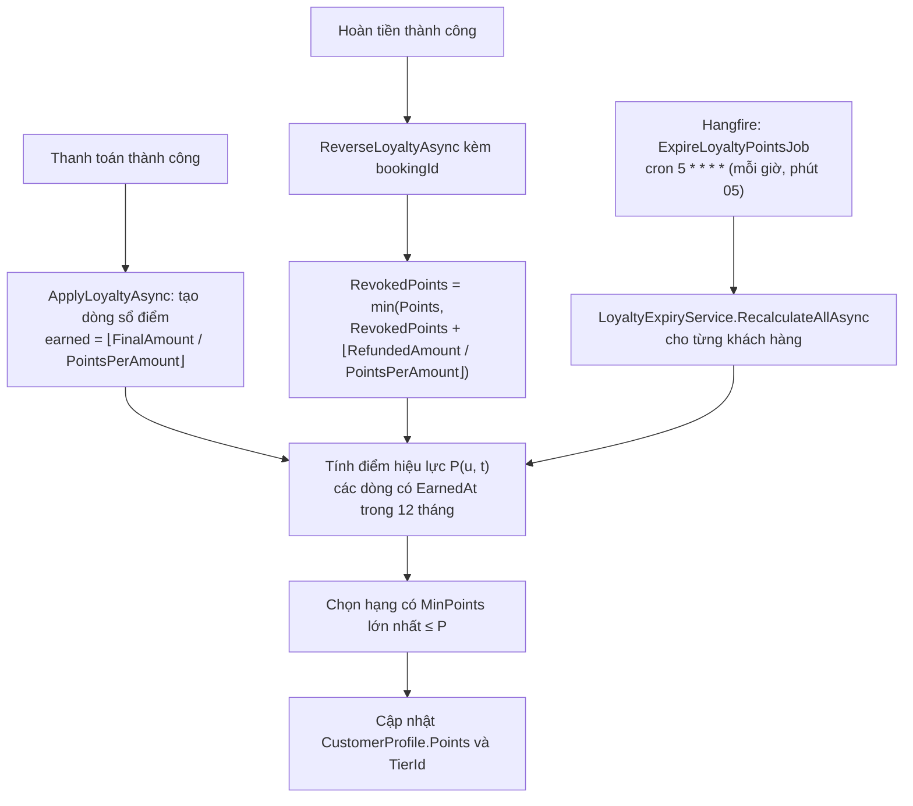
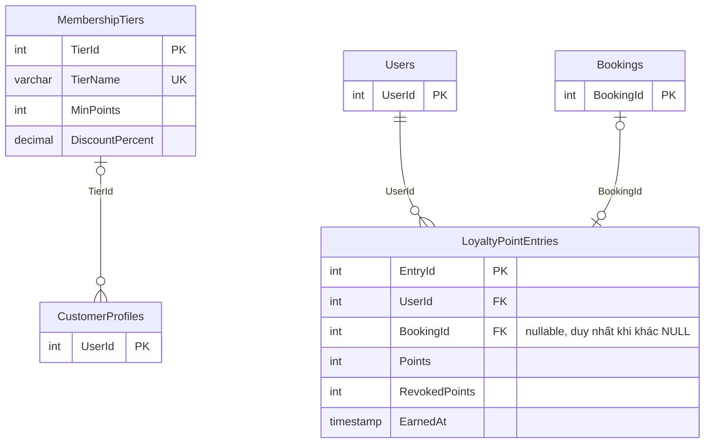
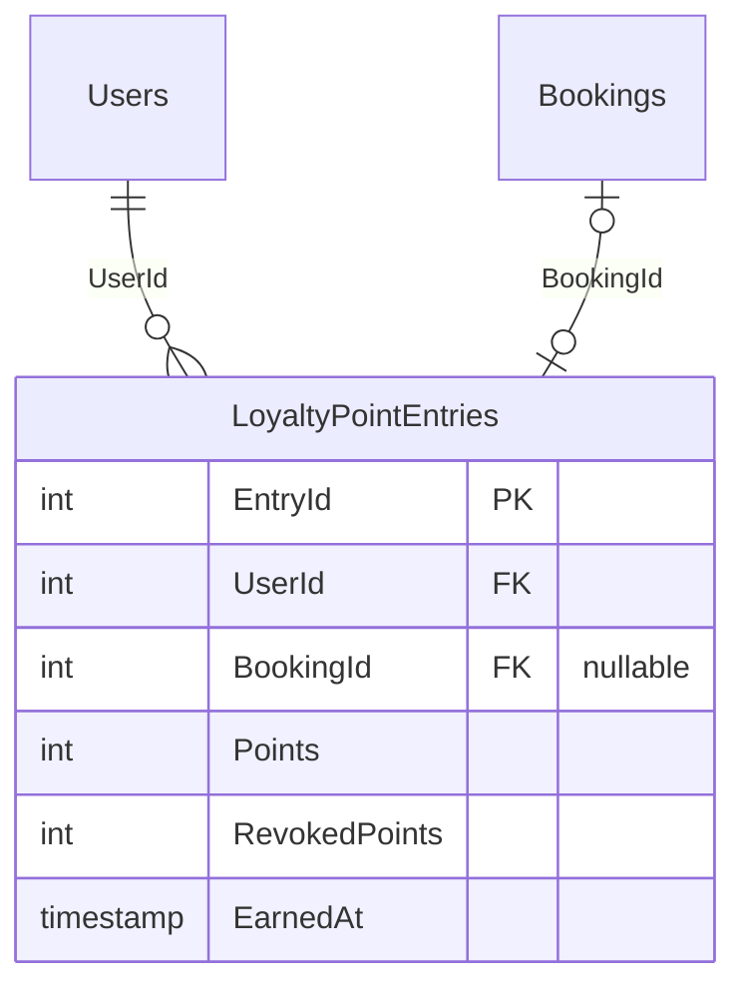

# MÃ NGUỒN SƠ ĐỒ MERMAID BỔ SUNG — ĐIỂM THÀNH VIÊN 12 THÁNG

Các đoạn dưới đây dán vào `ma-nguon-so-do.md` (file Mermaid gốc, chưa có trong cuộc trò chuyện này). Tên cột khóa chính của `Users`, `Bookings`, `CustomerProfiles` lấy theo quy ước của outline; cần đối chiếu với ERD hiện có.

### Hình 4.58. Lưu đồ ghi sổ điểm, thu hồi và đồng bộ điểm hết hạn

### Hình 4.34. ERD module Thành viên

### Hình 4.26. Sơ đồ ERD đầy đủ — phần cần thêm

Thêm khối thực thể và hai quan hệ sau vào ERD đầy đủ:

### Hình 4.51 và Hình 4.54 — bước cần thêm

- Hình 4.51 (tuần tự phát hành vé): sau bước tạo vé và mã QR, thêm thông điệp `BookingService → DB: ghi LoyaltyPointEntry(BookingId, Points, EarnedAt)`, rồi `BookingService → DB: tính lại Points, TierId từ sổ điểm`.
- Hình 4.54 (lưu đồ hủy vé): sau bước hoàn tiền qua cổng, đổi bước "thu hồi điểm" thành "thu hồi điểm vào đúng dòng sổ điểm của booking (`bookingId`), tính lại điểm và hạng".
