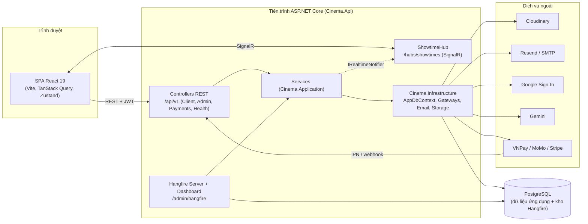
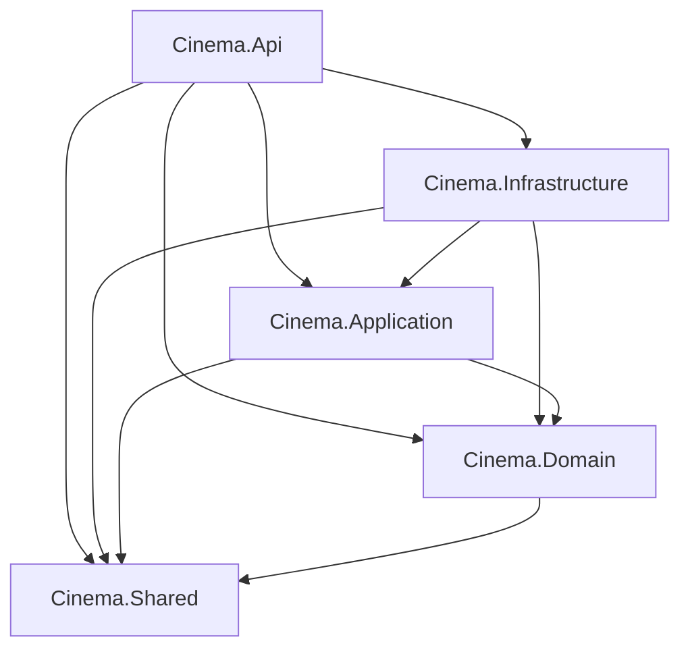
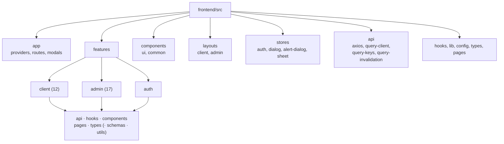

# CHƯƠNG 4. THIẾT KẾ HỆ THỐNG

## 4.1 KIẾN TRÚC HỆ THỐNG

Mục này mô tả cách Perfo tổ chức các thành phần ở mức hệ thống (Mục 4.1.1), tầng backend (Mục 4.1.2) và frontend (Mục 4.1.3), sau đó trình bày ba quy ước xuyên suốt của backend: dạng phản hồi API (Mục 4.1.4), cơ chế xử lý lỗi (Mục 4.1.5) và quản lý cấu hình (Mục 4.1.6). Các nguyên lý phân tầng đã được trình bày ở Mục 2.5.3; ở đây chỉ nêu cách Perfo áp dụng chúng trong mã nguồn.

### 4.1.1 Kiến trúc tổng thể

Perfo gồm một ứng dụng một trang (SPA) viết bằng React 19 và một dịch vụ backend viết bằng ASP.NET Core trên nền `net10.0`. Hai thành phần trao đổi dữ liệu theo hai kênh: các lời gọi REST qua HTTPS với tiền tố `/api/v1`, và một kết nối SignalR tới `ShowtimeHub` tại đường dẫn `/hubs/showtimes` để nhận cập nhật tình trạng ghế theo thời gian thực. Đối với dữ liệu nghiệp vụ, SPA chỉ trao đổi với backend; dữ liệu nằm trong cơ sở dữ liệu PostgreSQL mà backend truy cập qua Entity Framework Core (`AppDbContext`, trình điều khiển Npgsql). Hình 4.1 thể hiện các thành phần và hướng trao đổi dữ liệu giữa chúng.

*Hình 4.1. Kiến trúc tổng thể*

Toàn bộ phần phía máy chủ chạy trong **một tiến trình** duy nhất. Tiến trình này đồng thời đảm nhiệm bốn vai trò: (i) phục vụ các controller REST thuộc hai nhóm `Controllers/Client` và `Controllers/Admin` cùng `HealthController` (`GET /api/v1/health`) và `PaymentsController`; (ii) lưu trú `ShowtimeHub` của SignalR; (iii) chạy máy chủ xử lý tác vụ nền Hangfire (`AddHangfireServer`) với kho lưu trữ là chính cơ sở dữ liệu PostgreSQL (`UsePostgreSqlStorage`, dùng chung chuỗi kết nối với ứng dụng); và (iv) cung cấp bảng điều khiển Hangfire tại `/admin/hangfire`, chỉ cho phép vai trò `Admin` truy cập ngoài môi trường Development (`HangfireAdminAuthorizationFilter`). Ba tác vụ định kỳ được đăng ký khi khởi động bằng `RecurringJob.AddOrUpdate`, theo múi giờ nghiệp vụ `VietnamTime.Zone`: `ReleaseExpiredSeatsJob` (mã `release-expired-seats-and-bookings`), `ShowtimeLifecycleJob` (mã `update-showtime-lifecycle`) và `ExpireLoyaltyPointsJob` (mã `expire-loyalty-points`); biểu thức cron của chúng nằm trong nhóm cấu hình `BackgroundJobs` (Bảng 4.3). Các tác vụ khác như gửi thư (`SendEmailJob`) và hoàn tiền khi hủy suất chiếu (`ShowtimeRefundJob`) được đưa vào hàng đợi thông qua `IBackgroundJobClient` do các service nghiệp vụ gọi. Vì tác vụ nền và API dùng chung tiến trình, hệ thống không cần một dịch vụ worker riêng; đổi lại, việc mở rộng theo chiều ngang cần được cân nhắc riêng.

Backend tích hợp với các dịch vụ bên ngoài thông qua các giao diện khai báo ở tầng Application và được hiện thực ở tầng Infrastructure (Mục 4.1.2):

- **Lưu trữ tệp:** Cloudinary (`IFileStorage`, hiện thực `CloudinaryFileStorage`) cho ảnh và video tải lên.
- **Gửi thư:** `IEmailService` được hiện thực bởi `FallbackEmailService`, ưu tiên gửi qua Resend (`ResendEmailService`) khi có `Email:ResendApiKey` và lùi về SMTP (`MailKitEmailService`) khi Resend lỗi mà `Email:SmtpHost` đã cấu hình.
- **Đăng nhập Google:** `IGoogleAuthService` (`GoogleAuthService`).
- **Trợ lý AI:** `IAiAssistantService` (`GeminiAiAssistantService`) gọi mô hình Gemini.
- **Cổng thanh toán:** VNPay, MoMo và Stripe, mỗi cổng là một hiện thực của `IPaymentGateway` (`VnPayGateway`, `MomoGateway`, `StripeGateway`). Ngoài chiều backend gọi cổng, các cổng còn gọi ngược về backend qua các endpoint công khai của `PaymentsController`: `GET`/`POST /api/v1/payments/vnpay/ipn`, `POST /api/v1/payments/momo/ipn` và `POST /api/v1/payments/stripe/webhook`; các endpoint này được đánh dấu `[RawResponse]` để phản hồi theo định dạng riêng của từng cổng (Mục 4.1.4).

Thứ tự các thành phần trong đường ống xử lý yêu cầu (`Program.cs`) là: `UseForwardedHeaders` (đọc `X-Forwarded-For` và `X-Forwarded-Proto` do proxy của nền tảng triển khai chèn vào); một middleware bật `EnableBuffering` để thân yêu cầu đọc được nhiều lần, phục vụ xác minh chữ ký webhook Stripe; `UseSerilogRequestLogging`; `UseAppExceptionHandling` (Mục 4.1.5); Swagger UI và `UseHttpsRedirection` (chỉ ở môi trường Development); `UseCors("Default")`; `UseRateLimiter` (bỏ qua ở môi trường Testing); `UseAuthentication`; `UseAuthorization`; và cuối cùng là ánh xạ `MapControllers`, bảng điều khiển Hangfire và `MapHub<ShowtimeHub>`. Việc đặt middleware xử lý ngoại lệ phía ngoài các thành phần còn lại bảo đảm mọi ngoại lệ phát sinh trong đường ống đều được chuyển thành phản hồi JSON thống nhất. Cơ chế xác thực JWT, các chính sách phân quyền (`Policies.CustomerOnly`, `AdminOnly`, `EmployeeOnly`, `StaffOnly`) và các chính sách giới hạn tốc độ (`auth`, `booking-hold`) được đăng ký trong cùng tệp; chi tiết của chúng được trình bày ở các mục thiết kế bảo mật và API tương ứng.

Về triển khai, tệp `docker-compose.yml` định nghĩa hai dịch vụ cho môi trường phát triển: `api` (cổng 8080, đích build `dev` chạy `dotnet watch`) và `frontend` (cổng 5173). Tệp này không có dịch vụ cơ sở dữ liệu: chuỗi kết nối được truyền vào qua biến `DATABASE_URL`, trỏ tới PostgreSQL đám mây (Neon) theo ghi chú trong tệp. Chi tiết quy trình triển khai được trình bày ở Chương 5.

### 4.1.2 Kiến trúc phân tầng backend

Giải pháp backend (`backend/Cinema.slnx`) gồm năm project sản phẩm và hai project kiểm thử. Quan hệ phụ thuộc dưới đây được đọc trực tiếp từ các phần tử `ProjectReference` trong từng tệp `.csproj` và được thể hiện ở Hình 4.2.

*Hình 4.2. Phụ thuộc giữa các project backend*

- **`Cinema.Shared`** không tham chiếu project nào. Project này chứa các thành phần dùng chung cho mọi tầng: hằng số (`Roles`, `Policies`, `AppClaimTypes`, `RecurringJobIds`, `SignalREvents`, `Pagination`, `CursorPagination`, `PaymentMethodNames`, `ShowtimeLookahead`), hệ thống ngoại lệ ứng dụng (thư mục `Exceptions`, Mục 4.1.5), tài nguyên thông điệp (`Resources/Messages.resx`) và kiểu phản hồi `ApiResponse` (Mục 4.1.4).
- **`Cinema.Domain`** chỉ tham chiếu `Cinema.Shared` và không có gói NuGet nào. Project chứa các thực thể (thư mục `Entities`, ví dụ `Booking`, `Showtime`, `LoyaltyPointEntry`) và các kiểu liệt kê (`Enums`).
- **`Cinema.Application`** tham chiếu `Cinema.Domain` và `Cinema.Shared`. Đây là nơi đặt logic nghiệp vụ: các service (`Services/*`), các giao diện cổng ra (`Interfaces/*`, gồm `IAppDbContext`, `IPaymentGateway`, `IEmailService`, `IFileStorage`, `IRealtimeNotifier`, `IGoogleAuthService`, `IAiAssistantService`), DTO, bộ kiểm tra dữ liệu (`Validators`), cấu hình ánh xạ (`MappingConfig`), các lớp Options (`Options`) và các tác vụ nền (`BackgroundJobs`). Gói đáng chú ý gồm FluentValidation 12.1.1, Mapster 10.0.11, Hangfire.Core, QRCoder, `Microsoft.Extensions.Identity.Core` (băm mật khẩu) và Entity Framework Core.
- **`Cinema.Infrastructure`** tham chiếu `Cinema.Application`, `Cinema.Domain` và `Cinema.Shared`. Project hiện thực các giao diện do Application khai báo: truy cập dữ liệu (`Persistence`: `AppDbContext`, cấu hình thực thể, dữ liệu khởi tạo `Seed`, tiện ích chuỗi kết nối), `Payments` (VNPay, MoMo, Stripe), `Email`, `FileStorage`, `Auth` (Google), và `Realtime` (`ShowtimeHub`, `SignalRRealtimeNotifier`). Các gói tương ứng gồm Npgsql.EntityFrameworkCore.PostgreSQL, CloudinaryDotNet, MailKit, Stripe.net, Google.Apis.Auth và Hangfire.PostgreSql.
- **`Cinema.Api`** (`Microsoft.NET.Sdk.Web`) tham chiếu cả bốn project còn lại. Project chứa `Program.cs`, các controller, các bộ lọc (`ApiResponseFilter`, `ValidationActionFilter`, `HangfireAdminAuthorizationFilter`) và middleware xử lý ngoại lệ; gói đi kèm gồm Microsoft.AspNetCore.Authentication.JwtBearer, Serilog.AspNetCore, Swashbuckle.AspNetCore và Hangfire.AspNetCore.

Hai project kiểm thử nằm trong `backend/tests`: `Cinema.UnitTests` tham chiếu `Cinema.Domain`, `Cinema.Application` và `Cinema.Infrastructure`; `Cinema.IntegrationTests` tham chiếu thêm `Cinema.Api` để dựng ứng dụng trong môi trường `Testing` (chi tiết ở Chương 6).

Chiều phụ thuộc vì vậy là `Api → Infrastructure → Application → Domain → Shared`, đồng thời `Api` tham chiếu trực tiếp cả `Application`, `Domain` và `Shared`. Điểm cốt lõi là `Cinema.Application` **không** tham chiếu `Cinema.Infrastructure`: tầng nghiệp vụ chỉ biết các giao diện, còn hiện thực cụ thể được gắn vào lúc chạy. Ví dụ, các service trong Application truy cập dữ liệu qua giao diện `IAppDbContext` (khai báo các thuộc tính `DbSet<T>`, `Database` và `SaveChangesAsync`), do `AppDbContext` của Infrastructure hiện thực; mã nguồn không có lớp repository riêng, các service viết truy vấn LINQ trực tiếp trên `IAppDbContext`. Cũng cần ghi nhận hai điểm mà Perfo nới lỏng so với mô hình thuần túy ở Mục 2.5.3: `Cinema.Application` phụ thuộc gói Entity Framework Core (vì `IAppDbContext` dùng `DbSet<T>`) và `Hangfire.Core` (vì service gọi `IBackgroundJobClient`). Việc `Cinema.Api` tham chiếu `Cinema.Infrastructure` là cần thiết vì đây là điểm lắp ráp (composition root): `Program.cs` gọi `AddInfrastructure`, tham chiếu `AppDbContext` để chạy migration và ánh xạ `ShowtimeHub`.

Việc đăng ký phụ thuộc diễn ra qua hai phương thức mở rộng được `Program.cs` gọi theo thứ tự `AddInfrastructure(builder.Configuration)` rồi `AddApplication()`. `AddApplication` (trong `Cinema.Application/DependencyInjection.cs`) đăng ký dạng `Scoped` các service nghiệp vụ như `IAuthService`, `ITokenService`, `ICatalogService`, `IMovieService`, `IRoomService`, `IShowtimeService`, `IBookingService`, `IComboService`, `IPaymentService`, `IPaymentAdminService`, `IReviewService`, `ISettingsService`, `IUserProfileService`, `IReportService`, `IDashboardService`, `IEmployeeService`, `ISeatExpirationService`, cùng `LoyaltyExpiryService` và `AiToolExecutor`. `AddInfrastructure` (trong `Cinema.Infrastructure/DependencyInjection.cs`) đăng ký `AppDbContext` với Npgsql (bật `EnableSensitiveDataLogging` và `EnableDetailedErrors` chỉ khi môi trường là Development), ánh xạ `IAppDbContext` sang `AppDbContext`, và đăng ký các hiện thực `IFileStorage`, `IEmailService`, `IRealtimeNotifier`, `IGoogleAuthService`, `IAiAssistantService` cùng ba hiện thực của `IPaymentGateway`. Vì có ba hiện thực chung một giao diện, các service nhận `IEnumerable<IPaymentGateway>` và chọn cổng bằng phương thức mở rộng `FindByMethod(methodName)`, so khớp với thuộc tính `MethodName` của từng cổng (các giá trị lấy từ `PaymentMethodNames`).

Ba thư viện còn lại được nối vào đường ống ở tầng Api và Application. **Mapster** được cấu hình bởi `AddMapsterConfig()`, quét assembly của Application để nạp mọi lớp `IRegister` (ví dụ `BookingMappingConfig`, `AuthMappingConfig`) vào `TypeAdapterConfig.GlobalSettings` và đăng ký `IMapper` dạng `Scoped`. **FluentValidation** đăng ký toàn bộ `IValidator<T>` bằng `AddValidatorsFromAssembly`; `ValidationActionFilter` (Mục 4.1.5) tự tìm bộ kiểm tra tương ứng với kiểu của từng tham số action và chạy trước khi action được thực thi. **Options pattern** được dùng để gắn các nhóm cấu hình vào các lớp POCO và tiêm qua `IOptions<T>` (Mục 4.1.6).

### 4.1.3 Kiến trúc frontend

Frontend nằm trong thư mục `frontend/`, xây dựng bằng React 19, TypeScript, Vite 8 và Tailwind CSS 4. Các thư viện chính gồm React Router 7 (định tuyến), TanStack Query 5 (quản lý dữ liệu từ máy chủ), Zustand 5 (trạng thái cục bộ), Axios (HTTP), `@microsoft/signalr` (thời gian thực), React Hook Form với Zod (biểu mẫu) và `nuqs` (đồng bộ tham số truy vấn lên URL). Hình 4.3 thể hiện cách tổ chức thư mục `frontend/src`.

*Hình 4.3. Tổ chức mã nguồn frontend*

Mã nguồn được chia theo **tính năng** thay vì theo loại tệp. Thư mục `src/features` có ba nhánh: `client` (12 tính năng dành cho khách hàng: `account`, `ai`, `bookings`, `catalog`, `combos`, `home`, `membership`, `movies`, `policies`, `schedule`, `settings`, `showtimes`), `admin` (17 tính năng của khu quản trị và nghiệp vụ nhân viên: `bookings`, `catalog`, `checkin`, `combos`, `counter`, `dashboard`, `employees`, `login`, `movies`, `payments`, `reports`, `reviews`, `rooms`, `settings`, `showtimes`, `uploads`, `users`) và `auth` (đăng nhập, đăng ký, xác nhận email, quên và đặt lại mật khẩu). Bên trong mỗi tính năng, mã được tách thành các thư mục con tùy nhu cầu: `api` (hàm gọi endpoint), `hooks` (hook truy vấn và biến đổi dữ liệu), `components`, `pages`, `types`, và ở một số tính năng có thêm `schemas` hoặc `utils`. Các thành phần dùng chung đặt ngoài `features`: `components/ui` (các thành phần giao diện nền theo cấu hình shadcn kiểu `base-nova` trên thư viện Base UI), `components/common` (thành phần ghép dùng lại như `data-table`, `seat-map`, `form`, `combo-picker`, `filter`), `layouts` (khung trang cho `client` và `admin`), `hooks` (hook dùng chung như `use-showtime-hub`, `use-realtime-seat-map`), `lib` (hàm tiện ích, định dạng, `signalr.ts`), `config` (`env.ts`, `routes.ts`, `brand.ts`, `default-constants.ts`) và `types` (kiểu `ApiResponse`, các kiểu phân trang, kiểu liệt kê).

**Định tuyến** được khai báo trong `app/routes`. `router.tsx` tạo bộ định tuyến bằng `createBrowserRouter` với một `RootLayout` chung (gắn các hộp thoại toàn cục `GlobalModals` và `Toaster`, đồng thời chèn thẻ `noindex` cho các đường dẫn không cần lập chỉ mục), nối hai tập tuyến `clientRoutes` và `adminRoutes`, cộng với trang `/403`, trang không tìm thấy và `ErrorPage` làm `errorElement`. Nhánh client dùng `ClientLayout` tại `/` cho các trang công khai (phim, lịch chiếu, đặt vé, thành viên, chính sách); nhóm `account` được bọc bởi `CustomerProtectedRoute`, còn nhóm `/auth` được bọc bởi `GuestRoute` để chuyển người đã đăng nhập về trang chủ. Nhánh admin có trang đăng nhập riêng tại `/admin/login` (cũng bọc bởi `GuestRoute`) và các trang quản trị dưới `/admin` được bọc bởi `AdminProtectedRoute`, chỉ chấp nhận người dùng có vai trò `Admin` hoặc `Employee`, rồi hiển thị trong `AdminLayout`.

**Trạng thái** được chia theo bản chất dữ liệu. Dữ liệu đến từ máy chủ do TanStack Query quản lý; trạng thái giao diện cục bộ nằm trong các store Zustand ở `src/stores`: `auth-store` (access token, thông tin người dùng, cờ `isInitialized` và `isAuthenticated`), cùng `dialog-store`, `alert-dialog-store` và `sheet-store` điều khiển các hộp thoại, hộp xác nhận và bảng trượt toàn cục. Access token chỉ được giữ trong bộ nhớ của store; refresh token được lưu trong `localStorage` thông qua đối tượng `refreshTokenStorage`.

**Lớp `api`** (`src/api`) gồm bốn tệp. `axios.ts` tạo `apiClient` với `baseURL` lấy từ biến build `VITE_API_BASE_URL` và thời gian chờ `API_TIMEOUT_MS` (20 000 ms), kèm các hàm bọc `apiGet`, `apiPost`, `apiPut`, `apiDelete` và `apiUpload`; một interceptor yêu cầu gắn tiêu đề `Authorization: Bearer <accessToken>` từ store. `query-client.ts` tạo `QueryClient` toàn cục với `staleTime` 30 giây, `gcTime` 5 phút, không tự làm mới khi cửa sổ lấy lại tiêu điểm, tối đa hai lần thử lại cho truy vấn (không thử lại với lỗi mã 4xx) và không thử lại với mutation; `QueryCache` và `MutationCache` hiển thị thông báo lỗi chung (trừ khi `meta.skipErrorToast`) và thông báo thành công lấy từ trường `message` của phản hồi (trừ khi `meta.skipSuccessToast`). `query-keys.ts` là đối tượng `queryKeys` gom khóa truy vấn theo nhóm (`movies`, `showtimes`, `bookings`, `adminMovies`, …) dưới dạng hàm trả về mảng `as const`, để mọi nơi dùng cùng một khóa. `query-invalidation.ts` là bản đồ tập trung "thao tác thay đổi dữ liệu nào thì làm mới các truy vấn nào" (ví dụ `movieChanged`, `showtimeChanged`, `bookingChanged`): hook mutation chỉ khai báo `meta: { invalidates: "<tên>" }`, còn `MutationCache.onSuccess` gọi `invalidateRelated` và chờ các truy vấn đang hiển thị tải lại xong trước khi hoàn tất mutation, nhờ đó giao diện không nhấp nháy dữ liệu cũ.

**Cơ chế làm mới token dùng chung một promise** nằm trong `axios.ts`. Khi một yêu cầu nhận mã 401 (và không thuộc nhóm đường dẫn xác thực như `/auth/login`, `/auth/refresh`, `/auth/logout`, …, cũng chưa được thử lại), interceptor phản hồi gọi `refreshAccessToken()`. Hàm này giữ biến mô-đun `refreshPromise`: nếu đã có một lần làm mới đang chạy thì mọi nơi gọi đều nhận lại cùng promise đó, nhờ vậy nhiều yêu cầu cùng hết hạn đồng thời chỉ phát sinh **một** lời gọi `POST /auth/refresh`; biến được đặt về `null` trong khối `finally` khi lần làm mới kết thúc. Lời gọi làm mới dùng trực tiếp `axios` thay vì `apiClient` nên không đi qua các interceptor của chính nó. Khi thành công, token mới được ghi vào store và `localStorage`, rồi yêu cầu gốc được gửi lại đúng một lần (cờ `_retry`). Nếu làm mới thất bại do không nhận được phản hồi hoặc nhận mã 401 hoặc 403, phiên bị xóa và người dùng được chuyển về trang đăng nhập (trang đăng nhập quản trị nếu đang ở `/admin`); với các lỗi tạm thời khác của máy chủ, phiên được giữ lại. Cũng `refreshAccessToken` này được `SessionInitializer` (nằm trong `AppProviders`) gọi một lần khi ứng dụng khởi động nếu đã có refresh token, để khôi phục phiên.

**Thời gian thực** do hook `useShowtimeHub` đảm nhận: hook dựng `HubConnection` tới `SIGNALR_HUB_URL` (suy ra từ `VITE_API_BASE_URL` bằng cách bỏ `/api/v1` và nối `/hubs/showtimes`), lấy token ngắn hạn qua `authApi.getSocketToken()` (có dự phòng bằng access token hiện tại), bật tự kết nối lại theo `SIGNALR_RECONNECT_DELAYS_MS`, gọi phương thức `JoinShowtime` của hub, đăng ký bốn sự kiện `SeatHeld`, `SeatBooked`, `SeatReleased`, `HoldExpired` và gọi `LeaveShowtime` khi rời trang.

### 4.1.4 Phản hồi API thống nhất

Mọi endpoint REST của Perfo trả về cùng một dạng bao ngoài, được định nghĩa bởi lớp `ApiResponse` trong `Cinema.Shared/Results/ApiResponse.cs`. Lớp này **không** phải kiểu generic: trường `Data` có kiểu `object?`, còn kiểu tham số `ApiResponse<T>` chỉ tồn tại ở phía frontend (`src/types/api.ts`) để gắn kiểu cho trường `data`. Lớp có hai phương thức tạo sẵn là `SuccessResponse(data, message = null)` và `ErrorResponse(message, errors = null)`. Cấu trúc đầy đủ được tóm tắt ở Bảng 4.1.

*Bảng 4.1. Cấu trúc phản hồi API*

| Thành phần | Kiểu hoặc tham số | Ý nghĩa |
|---|---|---|
| `ApiResponse.Success` | `bool` | `true` với phản hồi thành công, `false` với phản hồi lỗi. |
| `ApiResponse.Data` | `object?` | Dữ liệu trả về của endpoint; không có giá trị trong phản hồi lỗi. |
| `ApiResponse.Message` | `string?` | Thông điệp cho người dùng. Với phản hồi thành công, chỉ có khi action gắn `[SuccessMessage(nameof(Messages.…))]` (lấy từ tài nguyên `Messages`); với phản hồi lỗi là thông điệp lỗi. |
| `ApiResponse.Errors` | `IDictionary<string, string[]>?` | Chi tiết lỗi theo khóa (khóa trường dữ liệu viết thường chữ đầu, hoặc khóa riêng như `conflictSeatIds`); chỉ có khi lỗi cần chi tiết. |
| Bộ lọc bọc phản hồi | `ApiResponseFilter` (đăng ký toàn cục trong `AddControllers`) | Bọc giá trị của `ObjectResult` chưa phải `ApiResponse` bằng `SuccessResponse`; bọc `EmptyResult` thành mã 200 với `Data = null`. Bỏ qua khi có ngoại lệ hoặc khi action gắn `[RawResponse]`. |
| Phân trang offset | tham số `page` (mặc định `Pagination.DefaultPage` = 1), `pageSize` (mặc định `Pagination.DefaultPageSize` = 20) | Trả về `OffsetPageResult<T>` gồm `Items`, `Page`, `PageSize`, `TotalItems`, `TotalPages`; `TotalPages` = ⌈`TotalItems` / `PageSize`⌉ (bằng 0 nếu `PageSize` ≤ 0). |
| Phân trang con trỏ | tham số `cursor` (chuỗi, có thể rỗng), `limit` (mặc định `CursorPagination.DefaultLimit` = 10, kẹp trong khoảng 1–50 bởi `AppControllerBase.ClampLimit`) | Trả về `CursorPageResult<T>` gồm `Items`, `NextCursor`, `HasMore`; con trỏ được mã hóa/giải mã bởi `CursorCodec`. |

`ApiResponseFilter` là bộ lọc hành động (`IActionFilter`) chạy ở `OnActionExecuted`. Khi action trả về một `ObjectResult` (ví dụ kết quả của `Ok(...)`) mà giá trị chưa phải `ApiResponse`, bộ lọc thay giá trị đó bằng `ApiResponse.SuccessResponse(value, message)`; nhờ vậy các controller chỉ cần trả về DTO hoặc kết quả phân trang thuần. Thông điệp thành công được tra từ `Messages.ResourceManager` theo khóa khai báo trong `SuccessMessageAttribute`; thuộc tính này vắng mặt thì `Message` là `null`. Hai thuộc tính đi kèm bộ lọc là `[SuccessMessage]` (gắn thông điệp) và `[RawResponse]` (tắt việc bọc, dùng cho các endpoint IPN và webhook của cổng thanh toán, vì các cổng yêu cầu định dạng phản hồi riêng). Phản hồi lỗi không đi qua bộ lọc này mà do `ValidationActionFilter`, `InvalidModelStateResponseFactory` và `ExceptionHandlingMiddleware` tạo bằng `ApiResponse.ErrorResponse` (Mục 4.1.5).

Cả hai kiểu phân trang đều có mặt trong hệ thống vì phục vụ hai ngữ cảnh khác nhau. **Phân trang offset** được dùng cho các danh sách quản trị cần biết tổng số bản ghi và nhảy tới trang bất kỳ (ví dụ danh sách phòng chiếu, thanh toán, đánh giá, booking của khu quản trị); `GetRoomsAsync` tính `Skip((page - 1) * pageSize).Take(pageSize)` và `TotalItems` bằng một truy vấn đếm riêng. Giá trị mặc định ở controller là 1 và 20; đối với danh sách booking quản trị, `BookingService.GetBookingsAdminAsync` còn kẹp `page` về tối thiểu 1 và dùng `BookingOptions.DefaultPageSize` hoặc giới hạn trên `BookingOptions.MaxPageSize` (Bảng 4.3) khi `pageSize` không hợp lệ hoặc quá lớn. **Phân trang con trỏ** được dùng cho các danh sách cuộn vô hạn ở phía khách hàng (ví dụ đánh giá phim, danh sách phim, lịch sử booking), nơi không cần tổng số trang. `CursorCodec.Encode` tuần tự hóa `CursorPayload(Id)` thành JSON rồi mã hóa Base64; `Decode` trả về `null` khi con trỏ rỗng hoặc không giải mã được (khi đó truy vấn bắt đầu từ đầu danh sách). Dịch vụ truy vấn `limit + 1` bản ghi để biết còn dữ liệu hay không: `HasMore` bằng `true` khi số bản ghi lấy được lớn hơn `limit`, và `NextCursor` được mã hóa từ định danh của phần tử cuối trong trang; ở `GetMovieReviewsAsync`, danh sách sắp xếp giảm dần theo `ReviewId` và điều kiện lọc là `ReviewId < cursorId`.

### 4.1.5 Xử lý lỗi

Perfo xử lý lỗi theo nguyên tắc: tầng nghiệp vụ báo lỗi bằng ngoại lệ có kiểu, còn việc chuyển ngoại lệ thành phản hồi HTTP được tập trung ở một nơi duy nhất là `ExceptionHandlingMiddleware`, đăng ký qua phương thức mở rộng `UseAppExceptionHandling`. Nhờ vậy service không cần biết đến mã trạng thái HTTP và mọi lỗi đều có cùng dạng `ApiResponse` với `Success = false`.

Hệ thống ngoại lệ nằm trong `Cinema.Shared/Exceptions`. Lớp cơ sở trừu tượng `AppException` mang `StatusCode` và `Errors` (từ điển lỗi tùy chọn); các lớp con cố định mã trạng thái trong hàm tạo: `ValidationAppException` (400, nhận thêm `errors`), `UnauthorizedAppException` (401), `ForbiddenAppException` (403), `NotFoundException` (404), `ConflictAppException` (409), `SeatConflictException` (409, mang danh sách `ConflictSeatIds`) và `BusinessRuleException` (422). `SeatsNoLongerHeldException` kế thừa `BusinessRuleException`, nhận `bookingId` và tạo thông điệp từ `Messages.Rule_SeatsNoLongerHeld` (“Booking {0}: ghế giữ đã hết hạn trước khi xác nhận thanh toán.”), nên cũng trả mã 422. Thông điệp của mọi ngoại lệ lấy từ tài nguyên `Messages` (tệp `Messages.resx`) thay vì chuỗi viết cứng trong từng service.

Middleware bao `await next(context)` trong một khối `try` và bắt các nhóm lỗi theo thứ tự sau. Nhóm đầu là `AppException`: ghi nhật ký mức cảnh báo, rồi trả về mã `ex.StatusCode` cùng `ApiResponse.ErrorResponse(ex.Message, ex.Errors)`; riêng `SeatConflictException` được xử lý trước, đưa danh sách ghế xung đột vào `errors["conflictSeatIds"]` dưới dạng mảng chuỗi để frontend biết ghế nào cần làm mới. Nhóm thứ hai là `DbUpdateConcurrencyException`, trả 409 với thông điệp `Db_ConcurrencyConflict`. Nhóm thứ ba là `DbUpdateException` có ngoại lệ trong là `PostgresException`: mã `SqlState` của PostgreSQL được ánh xạ sang mã HTTP và thông điệp tương ứng, với `23503` (vi phạm khóa ngoại) và `23514` (vi phạm ràng buộc kiểm tra) ra 400, còn `23505` (vi phạm tính duy nhất) và `23P01` (vi phạm ràng buộc loại trừ) ra 409; trường hợp `23P01` có ràng buộc tên `EX_Showtimes_Room_NoOverlap` được trả thông điệp riêng `Conflict_ShowtimeOverlapInRoom` (“Trùng khung giờ chiếu trong phòng này.”), các `SqlState` khác trả 400 với `Db_ConstraintError`. Cách làm này biến các ràng buộc khai báo ở cơ sở dữ liệu (chống trùng, chống chồng lịch chiếu trong cùng phòng) thành lớp bảo vệ cuối cùng mà người dùng vẫn nhận được thông báo dễ hiểu. Cuối cùng, mọi ngoại lệ còn lại bị ghi nhật ký mức lỗi cùng đường dẫn yêu cầu và trả mã 500. Tại đây hệ thống **ẩn chi tiết lỗi theo môi trường**: khi `env.IsDevelopment()` là đúng, thông điệp có dạng `[DEV ONLY] <tên kiểu>: <thông điệp>` và `errors` chứa `exceptionType`, `message`, `innerException` và tối đa 8 dòng đầu của `stackTrace`; ở mọi môi trường khác, phản hồi chỉ có thông điệp chung `System_UnexpectedError` (“Đã xảy ra lỗi hệ thống. Vui lòng thử lại sau.”) và không có `errors`. Phản hồi được tuần tự hóa với quy ước `camelCase`. Bảng 4.2 tổng hợp toàn bộ ánh xạ.

*Bảng 4.2. Ánh xạ ngoại lệ và lỗi PostgreSQL sang mã HTTP*

| Nguồn lỗi | Ngoại lệ/mã | Mã HTTP | Nội dung phản hồi |
|---|---|---|---|
| Không tìm thấy | `NotFoundException` | 404 | `Message` = thông điệp của ngoại lệ. |
| Xung đột | `ConflictAppException` | 409 | `Message` = thông điệp của ngoại lệ. |
| Xung đột ghế | `SeatConflictException` | 409 | `Message` = thông điệp; `Errors["conflictSeatIds"]` = danh sách mã ghế xung đột. |
| Cấm truy cập | `ForbiddenAppException` | 403 | `Message` = thông điệp của ngoại lệ. |
| Chưa xác thực | `UnauthorizedAppException` | 401 | `Message` = thông điệp của ngoại lệ. |
| Dữ liệu sai | `ValidationAppException` | 400 | `Message` và `Errors` do nơi ném ngoại lệ truyền vào. |
| Quy tắc nghiệp vụ | `BusinessRuleException` | 422 | `Message` = thông điệp của ngoại lệ. |
| Ghế không còn được giữ | `SeatsNoLongerHeldException` | 422 | `Message` = `Rule_SeatsNoLongerHeld` kèm mã booking (thuộc tính `BookingId` không nằm trong phản hồi). |
| PostgreSQL `23503` | `DbUpdateException` (ngoại lệ trong `PostgresException`) | 400 | `Db_ForeignKeyViolation`: “Dữ liệu tham chiếu (khóa ngoại) không hợp lệ.” |
| PostgreSQL `23505` | `DbUpdateException` | 409 | `Db_UniqueViolation`: “Dữ liệu đã tồn tại (vi phạm ràng buộc duy nhất).” |
| PostgreSQL `23514` | `DbUpdateException` | 400 | `Db_CheckViolation`: “Dữ liệu không thỏa mãn ràng buộc kiểm tra.” |
| PostgreSQL `23P01` | `DbUpdateException` | 409 | `Conflict_ShowtimeOverlapInRoom` nếu tên ràng buộc là `EX_Showtimes_Room_NoOverlap`; ngược lại `Db_ExclusionViolation`. |
| PostgreSQL mã khác | `DbUpdateException` | 400 | `Db_ConstraintError`: “Lỗi ràng buộc dữ liệu.” |
| Xung đột đồng thời | `DbUpdateConcurrencyException` | 409 | `Db_ConcurrencyConflict`: “Dữ liệu đã bị thay đổi bởi người dùng khác. Vui lòng tải lại và thử lại.” |
| Kiểm tra dữ liệu đầu vào | `ValidationActionFilter` (FluentValidation) và `InvalidModelStateResponseFactory` (ModelState) | 400 | `Common_InvalidData` (“Dữ liệu không hợp lệ.”); `Errors` theo từng trường, khóa viết thường chữ cái đầu. |
| Lỗi không lường trước | `Exception` | 500 | Development: `[DEV ONLY] …` kèm chi tiết; môi trường khác: `System_UnexpectedError`. |

Hai điểm cần lưu ý khi đọc bảng. Thứ nhất, lỗi kiểm tra dữ liệu đầu vào không đi qua middleware vì không có ngoại lệ nào được ném: `ValidationActionFilter` chạy trước action, duyệt các tham số của action, tìm `IValidator<T>` tương ứng trong container và, nếu không hợp lệ, gán ngay `BadRequestObjectResult` chứa `ApiResponse.ErrorResponse(Messages.Common_InvalidData, errors)`, với các khóa lỗi được đổi thành dạng viết thường chữ cái đầu để khớp quy ước JSON; việc tắt phản hồi tự động mặc định của ASP.NET Core (`InvalidModelStateResponseFactory`) cho phép các lỗi ràng buộc kiểu dữ liệu khi gắn mô hình cũng trả về đúng dạng này. Thứ hai, các phản hồi 401, 403 do cơ chế xác thực JWT và phân quyền theo chính sách tạo ra (token sai, hết hạn, thiếu vai trò) không đi qua `ApiResponse`, vì mã nguồn không đăng ký xử lý riêng cho các sự kiện từ chối của JwtBearer; frontend dựa vào mã trạng thái 401 để kích hoạt cơ chế làm mới token (Mục 4.1.3). Tương tự, `AddRateLimiter` chỉ đặt `RejectionStatusCode` là 429 mà không định nghĩa nội dung phản hồi.

### 4.1.6 Quản lý cấu hình

Perfo áp dụng **Options pattern** của .NET để tách cấu hình khỏi mã. Mỗi nhóm cấu hình trong `appsettings.json` tương ứng với một lớp POCO trong `Cinema.Application/Options`; lớp khai báo hằng `SectionName` (tên nhóm trong tệp cấu hình) và các thuộc tính có **giá trị mặc định ngay trong lớp**. `Program.cs` gắn từng nhóm bằng `builder.Services.Configure<T>(GetSection(T.SectionName))`, và các service nhận cấu hình bằng cách tiêm `IOptions<T>` (ví dụ `JwtTokenService` nhận `IOptions<JwtOptions>`, `BookingService` nhận `IOptions<BookingOptions>`). Với các giá trị cần dùng ngay lúc dựng đường ống (khóa JWT, cấu hình giới hạn tốc độ, cấu hình tác vụ nền, múi giờ), `Program.cs` còn đọc thẳng nhóm cấu hình vào đối tượng cục bộ bằng hàm `BindSection<T>`. Mã nguồn có 14 lớp Options, được liệt kê ở Bảng 4.3, trong đó `AppUrlOptions` (nhóm `App`) chứa địa chỉ gốc của API và frontend dùng để dựng liên kết trong thư; riêng nhóm `Cors` không có lớp Options, danh sách origin được đọc trực tiếp từ khóa `Cors:AllowedOrigins`. Hai giá trị `Brand:TimeZoneId` và `Brand:BookingCodePrefix` được áp dụng **một lần** khi khởi động qua `VietnamTime.Configure` và `CodeGenerator.Configure`; múi giờ không hợp lệ làm ứng dụng ném `InvalidOperationException` ngay tại thời điểm này. Một số giá trị nghiệp vụ khác, chẳng hạn thời gian giữ ghế và thời điểm mở soát vé, hiện không nằm trong các lớp Options mà được lưu trong cơ sở dữ liệu (thực thể `CinemaSettings`) để quản trị viên thay đổi khi hệ thống đang chạy (Mục về cấu hình rạp).

*Bảng 4.3. Nhóm cấu hình ứng dụng*

| Nhóm | Nguồn | Giá trị mặc định chính (lớp Options) | Ghi chú |
|---|---|---|---|
| `ConnectionStrings:DefaultConnection` | `appsettings.json`, biến `ConnectionStrings__DefaultConnection` | `Host=localhost;Port=5432;Database=CinemaDb;Username=postgres;Password=` (trong `appsettings.json`) | Đọc qua `GetPostgresConnectionString()`; thiếu khóa thì ném `InvalidOperationException`; chấp nhận cả dạng URI `postgres://`, `postgresql://` và đọc tham số `sslmode`. |
| `App` | `AppUrlOptions` | `ApiBaseUrl` = `https://localhost:8080` (lớp) / `http://localhost:8080` (`appsettings.json`); `FrontendBaseUrl` = `http://localhost:5173` | Ở Production, cả hai phải là URL tuyệt đối và không trỏ về localhost. |
| `Jwt` | `appsettings.json` / `JwtOptions` | `Issuer` = `Perfo`; `Audience` = `Perfo.Client`; `Secret` rỗng; `AccessTokenExpirationSeconds` = 3600; `RefreshTokenExpirationDays` = 30; `SocketTokenExpirationSeconds` = 300 | `Secret` ≥ 32 ký tự ở Production. Ngoài Production, nếu `Secret` rỗng thì `Program.cs` dùng khóa giữ chỗ dành cho phát triển để dựng tham số xác thực. |
| `Cors` | `appsettings.json` (khóa `Cors:AllowedOrigins`) | Mảng rỗng | Không có lớp Options. Mảng rỗng: chấp nhận mọi origin kèm `AllowCredentials`; ở Production danh sách origin là bắt buộc. |
| `Brand` | `appsettings.json` / `BrandOptions` | `Name` = `Perfo`; `DisplayName` = `PERFO`; `Tagline` = `Vé điện tử · Không cần in`; `SupportEmail` rỗng; `TimeZoneId` = `Asia/Ho_Chi_Minh`; `Locale` = `vi-VN`; `CurrencyCode` = `VND`; `BookingCodePrefix` = `BK` | `TimeZoneId` và `BookingCodePrefix` được áp dụng một lần khi khởi động. |
| `Booking` | `Options/BookingOptions.cs` | `RoomBufferMinutes` = 15; `MaxSeatsPerBooking` = 10; `MaxComboQuantity` = 10; `CustomerLookupLimit` = 20; `BulkDeleteLimit` = 50; `BookingCodeMaxAttempts` = 5; `DefaultPageSize` = 20; `MaxPageSize` = 100 | Giá trị mặc định nằm trong lớp Options; `appsettings.json` lặp lại cùng giá trị. |
| `RateLimit` | `Options/RateLimitOptions.cs` | Toàn cục: `GlobalPermitLimit` = 100, `GlobalWindowSeconds` = 60, `GlobalSegmentsPerWindow` = 4; `auth`: `AuthPermitLimit` = 5, `AuthWindowSeconds` = 60; `booking-hold`: `BookingHoldPermitLimit` = 10, `BookingHoldWindowSeconds` = 60 | Toàn cục dùng cửa sổ trượt theo địa chỉ IP; hai chính sách còn lại dùng cửa sổ cố định (`booking-hold` ưu tiên khóa theo người dùng). |
| `Scheduler` | `Options/SchedulerOptions.cs` | `StepMinutes` = 5; `MinSameMovieGapMinutes` = 60; `DefaultWindowMinutes` = 960; `SpreadMinutes` = 30; `FitWeight` = 4; `LoadWeight` = 0,5; `HeatLookbackDays` = 7 | Tham số của thuật toán xếp lịch chiếu tự động. |
| `BackgroundJobs` | `Options/BackgroundJobOptions.cs` | `ReleaseExpiredSeatsCron` = `* * * * *`; `ShowtimeLifecycleCron` = `* * * * *`; `ExpireLoyaltyPointsCron` = `5 * * * *`; `RetryAttempts` = 3; `RetryDelaysSeconds` = [30, 120, 600] | Dùng cho `RecurringJob.AddOrUpdate` và `AutomaticRetryAttribute` toàn cục của Hangfire. |
| `VnPay` | `appsettings.json` / `VnPayOptions` | `TmnCode`, `HashSecret`, `ReturnUrl`, `IpnUrl` rỗng; `BaseUrl` và `ApiUrl` trỏ môi trường sandbox của VNPay | Đủ tham số khi bật cổng: ở Production, nếu `TmnCode` hoặc `HashSecret` có giá trị thì cả hai, cùng `ReturnUrl` và `IpnUrl` (công khai, không localhost), đều bắt buộc. |
| `Momo` | `appsettings.json` / `MomoOptions` | `PartnerCode`, `AccessKey`, `SecretKey`, `ReturnUrl`, `IpnUrl` rỗng; `Endpoint` và `RefundEndpoint` trỏ môi trường thử nghiệm của MoMo | Đủ tham số khi bật cổng: nếu một trong ba khóa `PartnerCode`, `AccessKey`, `SecretKey` có giá trị thì cả ba, cùng `ReturnUrl` và `IpnUrl` công khai, đều bắt buộc ở Production. |
| `Stripe` | `appsettings.json` / `StripeOptions` | `SecretKey`, `PublishableKey`, `WebhookSecret` rỗng; `ReturnUrl` = `http://localhost:5173/booking/result`; `Currency` = `vnd` | Ở Production, nếu `SecretKey` có giá trị thì `ReturnUrl` phải công khai (không localhost). |
| `Cloudinary` | `appsettings.json` / `CloudinaryOptions` | `CloudName`, `ApiKey`, `ApiSecret` rỗng; `MaxFileSizeBytes` = 5 MiB; `AllowedExtensions` = `.jpg`, `.jpeg`, `.png`, `.webp`; `MaxVideoFileSizeBytes` = 100 MiB; `AllowedVideoExtensions` = `.mp4`, `.mov`, `.webm`, `.avi` | Không nằm trong `ProductionOptionsValidator`. |
| `Email` | `appsettings.json` / `EmailOptions` | `SmtpHost` rỗng; `SmtpPort` = 587; `FromAddress` = `no-reply@perfo.local`; `EmailConfirmationExpirationHours` = 24; `PasswordResetExpirationMinutes` = 30; `ResendApiKey`, `ResendFromAddress` rỗng | Không nằm trong `ProductionOptionsValidator`; `FallbackEmailService` chọn Resend hoặc SMTP theo khóa nào được cấu hình. |
| `Gemini` | `appsettings.json` / `GeminiOptions` | `ApiKey` rỗng; `Model` = `gemini-2.5-flash`; `BaseUrl` = `https://generativelanguage.googleapis.com/v1beta/models` | Không nằm trong `ProductionOptionsValidator`. |
| `Google` | `appsettings.json` / `GoogleOptions` | `ClientId`, `ClientSecret` rỗng | Không nằm trong `ProductionOptionsValidator`. |

**Kiểm tra cấu hình Production.** Khi `builder.Environment.IsProduction()` là đúng, `Program.cs` gọi `ProductionOptionsValidator.Validate(...)` ngay sau khi đăng ký dịch vụ và **trước** `builder.Build()`, truyền vào các nhóm `App`, `Jwt`, danh sách origin CORS, `VnPay`, `Momo` và `Stripe`. Hàm thu thập mọi lỗi vào một danh sách thay vì dừng ở lỗi đầu tiên và kiểm tra: độ dài `Jwt:Secret` tối thiểu 32 ký tự (`MinJwtSecretLength`); `App:ApiBaseUrl` và `App:FrontendBaseUrl` là URL tuyệt đối không trỏ về localhost; `Cors:AllowedOrigins` có ít nhất một phần tử; và, **chỉ khi** một cổng thanh toán đã được bật (có ít nhất một khóa bí mật được điền), các tham số bắt buộc của cổng đó như đã nêu ở Bảng 4.3. Nếu danh sách lỗi không rỗng, ứng dụng ném `InvalidOperationException` với thông điệp “Cấu hình Production không hợp lệ:” kèm từng lỗi trên một dòng, và tiến trình dừng ngay lúc khởi động thay vì chạy với cấu hình thiếu an toàn. Các nhóm `Cloudinary`, `Email`, `Gemini` và `Google` không nằm trong phạm vi kiểm tra này, nên thiếu cấu hình ở các nhóm đó chỉ biểu hiện khi tính năng tương ứng được dùng. Mã nguồn không bật `ValidateOnStart` cho các lớp Options.

**Cấu hình theo môi trường.** Ứng dụng nhận biết môi trường qua `ASPNETCORE_ENVIRONMENT` với ba giá trị được mã nguồn xử lý riêng:

- **Development** (mặc định của `docker-compose.yml`): Swagger UI với hai tài liệu `client` và `admin` (phân loại theo tiền tố `api/v1/admin`), `UseHttpsRedirection`, ghi nhật ký dữ liệu nhạy cảm và lỗi chi tiết của EF Core, bảng điều khiển Hangfire mở không kiểm tra vai trò, và phản hồi lỗi 500 kèm chi tiết ngoại lệ.
- **Production** (giá trị `ENV` trong `Dockerfile` của stage `production` và trong `render.yaml`): bật `ProductionOptionsValidator`, bảng điều khiển Hangfire yêu cầu người dùng đã xác thực có vai trò `Admin`, Swagger tắt, và phản hồi lỗi 500 chỉ có thông điệp chung.
- **Testing** (đặt bởi `CinemaApiFactory` trong dự án kiểm thử tích hợp): bỏ qua cấu hình Hangfire, bảng điều khiển, `UseRateLimiter` và các tác vụ định kỳ để bài kiểm thử không phụ thuộc thời gian chạy nền; cơ sở dữ liệu là container PostgreSQL do Testcontainers dựng.

Các giá trị được nạp theo thứ tự ưu tiên mặc định của `WebApplication.CreateBuilder`, trong đó biến môi trường ghi đè `appsettings.json`; quy ước đặt tên của .NET dùng dấu gạch dưới kép thay cho dấu hai chấm (ví dụ `Jwt__Secret`, `Cors__AllowedOrigins__0`). Cả `docker-compose.yml` (môi trường phát triển, giá trị lấy từ tệp `.env` mẫu `.env.example`) và `render.yaml` (môi trường triển khai) truyền cấu hình theo cách này; bí mật như `Jwt__Secret`, chuỗi kết nối hay khóa cổng thanh toán không được ghi trong `appsettings.json`. Biến `PORT`, nếu có, được `Program.cs` dùng để đặt địa chỉ lắng nghe `http://0.0.0.0:{PORT}`. Cờ `RunMigrationsOnStartup` (đọc bằng `GetValue("RunMigrationsOnStartup", true)`) điều khiển việc chạy `MigrateAsync` và nạp dữ liệu khởi tạo `DbInitializer.SeedAsync` khi khởi động. Ngoài ra, `render.yaml` và `Dockerfile` đặt các biến `DOTNET_GCConserveMemory=9`, `DOTNET_GCHeapHardLimit=402653184` (384 MiB) và `DOTNET_GCDynamicAdaptationMode=0` để phù hợp tài nguyên bộ nhớ giới hạn của gói triển khai miễn phí (khoảng 512 MB).

<!-- GHI CHÚ ĐỐI CHIẾU

(a) [CẦN BỔ SUNG] còn lại
- Hình 4.1, 4.2, 4.3: chưa có mã Mermaid đính kèm (outline ghi "[CẦN BỔ SUNG: vẽ]"). Trong bài chỉ dùng placeholder `hinh/4.1.png`, `hinh/4.2.png`, `hinh/4.3.png`. Bản nháp Mermaid dựng từ code ở cuối khối này, cần dán vào `ma-nguon-so-do.md` rồi xuất ảnh.
- Mục 4.1.6: đoạn nhắc "Mục về cấu hình rạp" (CinemaSettings: thời gian giữ ghế, mở soát vé) là tham chiếu chéo chưa có số mục; cần thay bằng số mục thật khi gộp báo cáo (Chương 3/4 phần cấu hình rạp). Tương tự "Chương 5" (triển khai) và "Chương 6" (kiểm thử) là tham chiếu theo cấu trúc chương trong quy định.
- Mục 4.1.2/4.1.1: chưa trích dẫn tài liệu cho khái niệm phân tầng (đã chuyển sang Mục 2.5.3), nên không có [CẦN BỔ SUNG: trích dẫn nhóm Tx] trong phạm vi này.

(b) Chỗ outline/comment lệch code
1. 4.1.4, Bảng 4.1: outline ghi `ApiResponse<T>`; code `Cinema.Shared/Results/ApiResponse.cs` là lớp KHÔNG generic (`Data` kiểu `object?`). `ApiResponse<T>` chỉ có ở frontend (`frontend/src/types/api.ts`). Bài viết theo code.
2. 4.1.5, Bảng 4.2: outline ghi `ConflictException`; code là `ConflictAppException` (`Cinema.Shared/Exceptions/ConflictAppException.cs`). Dòng "Xung đột" trong outline được tách thành hai dòng (`ConflictAppException`, `SeatConflictException`) vì `SeatConflictException` có payload riêng `conflictSeatIds`.
3. 4.1.5, Bảng 4.2: thêm các dòng outline không có nhưng middleware/filter thực tế xử lý: `DbUpdateConcurrencyException` (409), PostgreSQL mã khác (400, `Db_ConstraintError`), kiểm tra dữ liệu đầu vào (`ValidationActionFilter`, `InvalidModelStateResponseFactory`, 400), `Exception` chưa lường trước (500). Dòng PostgreSQL "23503/23505/23514/23P01" của outline được tách theo từng mã.
4. 4.1.5: outline ghi "ẩn chi tiết lỗi ở Production"; code (`ExceptionHandlingMiddleware`) hiển thị chi tiết chỉ khi `env.IsDevelopment()`, còn mọi môi trường khác (gồm Testing) đều ẩn. Bài viết theo code.
5. 4.1.6: outline liệt kê 14 nhóm trong "Options pattern" (gồm Cors); code KHÔNG có `CorsOptions` (đọc trực tiếp `Cors:AllowedOrigins` trong `Program.cs`), và có thêm `AppUrlOptions` (nhóm `App`) mà outline không liệt kê. Nhóm "BackgroundJob" của outline có tên khóa cấu hình thật là `BackgroundJobs` (lớp `BackgroundJobOptions`). Tổng số lớp Options = 14 (chưa tính `ProductionOptionsValidator`, là lớp tĩnh kiểm tra).
6. 4.1.6, Bảng 4.3: outline gộp 4 dòng (Jwt; Cors; VnPay/Momo/Stripe; Booking/RateLimit/Scheduler/BackgroundJob); bài tách thành từng nhóm và thêm cột "Giá trị mặc định chính" (không bỏ dòng nào), thêm các dòng ConnectionStrings, App, Brand, Cloudinary, Email, Gemini, Google.
7. 4.1.6, `ProductionOptionsValidator` chỉ kiểm: Jwt:Secret (≥ 32), App:ApiBaseUrl/FrontendBaseUrl (URL tuyệt đối, không loopback), Cors:AllowedOrigins (không rỗng), VnPay/Momo/Stripe (có điều kiện). Không kiểm Cloudinary/Email/Gemini/Google.
8. Giá trị mặc định có hai nguồn: `AppUrlOptions.ApiBaseUrl` mặc định lớp là `https://localhost:8080` nhưng `appsettings.json` là `http://localhost:8080`; `RunMigrationsOnStartup` mặc định trong code là `true` nhưng `appsettings.json` đặt `false` (docker-compose và render.yaml đặt `true`). `EmailOptions.ResendFromAddress` mặc định lớp là rỗng, còn compose/.env.example dùng `onboarding@resend.dev`. Bài viết ghi giá trị theo lớp Options và nêu rõ chỗ khác biệt (riêng mục App).
9. Biến `Booking__CheckInOpenMinutes` trong `docker-compose.yml` (và `BOOKING_CHECK_IN_OPEN_MINUTES` trong `.env.example`) không có thuộc tính tương ứng trong `BookingOptions`; `CheckInOpenMinutes` hiện nằm ở thực thể `CinemaSettings` (DB, xem migration). Biến này là tàn dư, không ảnh hưởng. Bài viết không nêu nó trong Bảng 4.3.
10. Biến `VITE_SIGNALR_HUB_URL` được khai báo trong `docker-compose.yml`, `.env.example`, `render.yaml` nhưng mã frontend không đọc nó; `SIGNALR_HUB_URL` (`frontend/src/lib/signalr.ts`) được suy ra từ `VITE_API_BASE_URL`. Bài viết theo code.
11. Chú thích trong `Program.cs` lệch code: "Storage: SQL Server" (thực tế `UsePostgreSqlStorage`), "MediatR (CQRS handlers)" (không có MediatR trong csproj), "repositories" trong chú thích Infrastructure (không có lớp repository). Bài viết theo code.
12. `appsettings.Local.json.example` có trong `backend/Cinema.Api` nhưng `Program.cs` không gọi `AddJsonFile("appsettings.Local.json")` và repo không có `scripts/setup-env.mjs` (được tham chiếu trong `package.json`); chưa rõ cách tệp Local được nạp, nên bài viết không mô tả nó.
13. Quan sát phụ (không đưa vào bài): `ApiResponseFilter` bọc cả `ObjectResult` có mã ≥ 400 bằng `SuccessResponse` (Success = true); hiện không controller nào trả `ObjectResult` lỗi trực tiếp nên không phát sinh. `IAiAssistantService` được đăng ký hai lần (Scoped ở Infrastructure, `AddHttpClient<>` ở Application, đăng ký sau cùng thắng); `IPaymentGateway` đăng ký ba hiện thực nên phải lấy qua `IEnumerable<IPaymentGateway>` + `FindByMethod`.
14. Đã dùng số liệu đếm thư mục: 12 tính năng client, 17 tính năng admin (đếm từ `frontend/src/features`). Nếu thêm/bớt thư mục thì cần cập nhật.

--- Bản nháp Mermaid (dán vào ma-nguon-so-do.md, chỉ gồm thành phần có thật trong code) ---

### Hình 4.1. Kiến trúc tổng thể

### Hình 4.2. Phụ thuộc giữa các project backend

### Hình 4.3. Tổ chức mã nguồn frontend

-->
