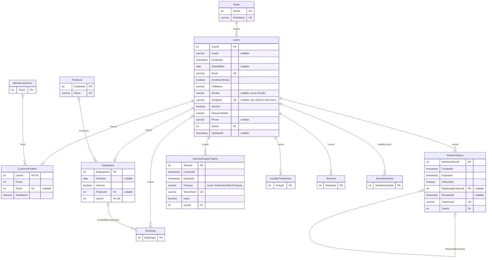

## 4.3 CƠ SỞ DỮ LIỆU

Mục này trình bày thiết kế cơ sở dữ liệu của hệ thống Perfo: các nguyên tắc chung (Mục 4.3.1), sơ đồ thực thể – quan hệ (ERD) đầy đủ (Mục 4.3.2), cách chia 30 thực thể thành 9 module (Mục 4.3.3) và mô tả chi tiết module đầu tiên là Tài khoản người dùng (Mục 4.3.4). Các module còn lại được mô tả theo cùng cấu trúc ở Mục 4.3.5 đến Mục 4.3.12.

### 4.3.1 Nguyên tắc thiết kế

Hệ thống dùng một cơ sở dữ liệu PostgreSQL duy nhất, được vận hành trên dịch vụ đám mây Neon; chuỗi kết nối được cấp qua cấu hình `ConnectionStrings:DefaultConnection` và nạp bằng `GetPostgresConnectionString`. Toàn bộ truy cập dữ liệu đi qua một ngữ cảnh Entity Framework Core là `AppDbContext`, khai báo 30 tập thực thể (`DbSet`) tương ứng 30 bảng, kết nối bằng thư viện `Npgsql.EntityFrameworkCore.PostgreSQL`. Việc dùng một cơ sở dữ liệu cho mọi nghiệp vụ cho phép các thao tác đa bảng, như tạo đơn đặt vé cùng vé, combo và dòng sổ điểm, thực hiện trong cùng một giao dịch.

Lược đồ được xây dựng theo hướng Code First. Mỗi bảng ứng với một lớp thực thể trong `Cinema.Domain/Entities`; cấu hình ánh xạ (kiểu cột, độ dài, giá trị mặc định, chỉ mục, ràng buộc) được viết bằng Fluent API trong các lớp `IEntityTypeConfiguration<T>` thuộc `Cinema.Infrastructure/Persistence/Configurations` và được nạp tự động bằng `ApplyConfigurationsFromAssembly` trong `AppDbContext.OnModelCreating`. Dữ liệu danh mục gốc (vai trò, chức vụ, hạng thành viên, loại màn hình, thể loại,…) được khai báo qua `HasData` trong `SeedData.Apply`. Phiên bản lược đồ được quản lý bằng migration đặt tại `Cinema.Infrastructure/Migrations`; khi ứng dụng khởi động và cấu hình `RunMigrationsOnStartup` bật (mặc định là `true`), `Program.cs` gọi `Database.MigrateAsync()` rồi `DbInitializer.SeedAsync` để áp dụng migration và nạp dữ liệu mẫu.

Khóa chính của hầu hết các bảng là số nguyên tự tăng (cột identity của PostgreSQL). Có ba ngoại lệ có chủ đích: `CustomerProfiles` dùng chính `UserId` làm khóa chính và khóa ngoại để biểu diễn quan hệ một–một với `Users`; hai bảng nối `MovieGenres` và `MovieCast` dùng khóa chính phức hợp; riêng `CinemaSettings` chỉ được phép có một dòng nhờ ràng buộc `CK_CinemaSettings_Id` (`"Id" = 1`).

Các kiểu liệt kê (enum) của miền nghiệp vụ được lưu dưới dạng chuỗi thay vì số, bằng `HasConversion<string>()`, để giá trị trong bảng đọc được trực tiếp và không phụ thuộc thứ tự khai báo trong mã. Có 10 kiểu liệt kê được ánh xạ như vậy: `Gender` (`Male`, `Female`, `Other`), `VerificationTokenPurpose` (`EmailConfirmation`, `PasswordReset`), `MovieStatus` (`ComingSoon`, `NowShowing`, `Ended`), `ShowtimeStatus` (`Scheduled`, `Cancelled`, `Completed`), `ShowtimeSeatStatus` (`Available`, `Held`, `Booked`), `BookingStatus` (`Pending`, `Confirmed`, `Cancelled`, `Expired`), `BookingChannel` (`Online`, `Counter`), `PaymentMethod` (`VNPay`, `Momo`, `Cash`, `Stripe`), `PaymentStatus` (`Pending`, `Success`, `Failed`, `Refunded`) và `SeatGapRuleMode` (`Strict`, `AllowEdge`, `Off`). Tám trong số mười kiểu này được bảo vệ thêm bằng ràng buộc `CHECK ... IN (...)` ở cột tương ứng; hai kiểu còn lại là `VerificationTokenPurpose` và `SeatGapRuleMode` chỉ được kiểm soát ở tầng ứng dụng.

Mọi mốc thời gian được lưu ở dạng UTC trong cột `timestamp without time zone`. Ứng dụng ghi giá trị bằng `DateTime.UtcNow`, các cột `CreatedAt` có giá trị mặc định `NOW()` do máy chủ cơ sở dữ liệu cấp, và `Program.cs` bật công tắc `Npgsql.EnableLegacyTimestampBehavior` để Npgsql ghi và đọc giá trị `DateTime` vào cột `timestamp without time zone` mà không chuyển đổi múi giờ. Ngày không kèm giờ (ngày sinh, ngày vào làm, ngày phát hành) dùng kiểu `date`, giờ mở và đóng cửa của rạp dùng kiểu `time`.

Tính đúng đắn của dữ liệu được bảo vệ ngay ở tầng cơ sở dữ liệu thay vì chỉ dựa vào mã ứng dụng. Các ràng buộc `CHECK` (29 ràng buộc trong ảnh chụp mô hình `AppDbContextModelSnapshot`, cộng hai ràng buộc của bảng `LoyaltyPointEntries`) giới hạn miền giá trị như số tiền không âm, điểm đánh giá từ 1 đến 5 hoặc thời điểm kết thúc suất chiếu phải sau thời điểm bắt đầu. Các chỉ mục duy nhất ngăn các tình huống xung đột nghiêm trọng: chỉ mục `UQ_Showtime_Seat` trên cặp (`ShowtimeId`, `SeatId`) của bảng `ShowtimeSeats` bảo đảm mỗi ghế chỉ có một bản ghi trạng thái trong một suất chiếu, và chỉ mục duy nhất trên `BookingTickets.ShowtimeSeatId` bảo đảm một ghế của suất chiếu chỉ được gắn vào một vé, nhờ đó hai đơn đặt vé đồng thời không thể cùng có vé cho một ghế dù mã ứng dụng gặp tình huống tranh chấp; chỉ mục `UX_LoyaltyPointEntries_Booking` chỉ cho phép mỗi đơn đặt vé sinh tối đa một dòng sổ điểm, tránh cộng điểm hai lần khi cổng thanh toán gọi lại webhook. Cơ chế giữ ghế và hoàn tất thanh toán dựa trên các ràng buộc này được trình bày ở Mục 4.3.8 và Mục 4.3.9.

Hành vi khi xóa của 36 khóa ngoại được chọn theo bản chất của quan hệ. Hai mươi bốn khóa ngoại dùng `Restrict`: đây là mặc định để bảo vệ dữ liệu lịch sử và dữ liệu danh mục, chẳng hạn không thể xóa một người dùng đã có đơn đặt vé hoặc đánh giá, không thể xóa một vai trò, chức vụ hay hạng thành viên đang được tham chiếu. Mười một khóa ngoại dùng `Cascade` cho các bản ghi con không có ý nghĩa độc lập với bản ghi cha, như phiên làm mới đăng nhập (`RefreshTokens`) và mã xác thực (`UserVerificationTokens`) của một người dùng, vé và combo của một đơn đặt vé, ghế của một phòng chiếu, hay ghế theo suất của một suất chiếu. Một khóa ngoại duy nhất dùng `SetNull` là `ShowtimeSeats.HeldByBookingId`: khi đơn đặt vé bị xóa, ghế đang giữ cho đơn đó trở về trạng thái không còn bị đơn nào giữ thay vì chặn việc xóa.

### 4.3.2 Sơ đồ ERD đầy đủ

Hình 4.26 là sơ đồ ERD đầy đủ của hệ thống, gồm 30 thực thể và 36 quan hệ. Mỗi thực thể được vẽ với tên bảng và đầy đủ các thuộc tính; kiểu dữ liệu ở sơ đồ được rút gọn về nhóm kiểu (`int`, `varchar`, `decimal`, `timestamp`, `boolean`, `date`, `time`, `text`, `uuid`), độ dài và độ chính xác cụ thể được nêu trong các bảng mô tả thực thể ở các mục sau. Ký hiệu `PK` là khóa chính, `FK` là khóa ngoại, `UK` là ràng buộc duy nhất trên một cột; ràng buộc duy nhất trên nhiều cột (`Reviews`, `Seats`, `ShowtimeSeats`) được ghi ở phần chú thích của từng cột tham gia. Chú thích `nullable` đánh dấu cột cho phép giá trị rỗng, chú thích `enum` cho biết cột lưu một kiểu liệt kê dưới dạng chuỗi. Bội số của quan hệ được thể hiện bằng ký hiệu chân chim: phía có nhánh ba chấu là phía "nhiều", vạch đôi là "đúng một", vòng tròn kèm vạch là "không hoặc một".

*Hình 4.26. Sơ đồ ERD đầy đủ của hệ thống*

Về nội dung, sơ đồ có thể đọc theo các cụm. Cụm tài khoản xoay quanh `Users`: mỗi người dùng thuộc đúng một vai trò trong `Roles`; có tối đa một hồ sơ khách hàng trong `CustomerProfiles` và tối đa một hồ sơ nhân viên trong `Employees` (nhân viên thuộc không hoặc một chức vụ trong `Positions`); mỗi người dùng có nhiều phiên làm mới `RefreshTokens`, trong đó một phiên có thể trỏ tới phiên thay thế nó qua `ReplacedByTokenId`, và nhiều mã xác thực `UserVerificationTokens`. Cụm thành viên gồm `MembershipTiers`, `CustomerProfiles` và `LoyaltyPointEntries`: mỗi hồ sơ khách hàng thuộc không hoặc một hạng thành viên; `LoyaltyPointEntries` là sổ điểm, nối nhiều–một với `Users` qua `UserId` (bắt buộc) và nối không hoặc một–một với `Bookings` qua `BookingId` (cho phép rỗng, duy nhất khi khác rỗng), nghĩa là một đơn đặt vé sinh tối đa một dòng sổ điểm.

Cụm phim gồm `Movies` nối với ba bảng danh mục `AgeRatings`, `Languages`, `Directors` (đều không bắt buộc), với `Genres` qua bảng nối `MovieGenres`, với `Actors` qua bảng nối `MovieCast`, và với `Users` qua `Reviews` (mỗi người dùng một đánh giá cho mỗi phim, chú thích `UQ(UserId,MovieId)`). Cụm phòng chiếu gồm `CinemaRooms` (thuộc không hoặc một `ScreenTypes`) và `Seats` (thuộc một phòng, có không hoặc một `SeatTypes`, chú thích `UQ(RoomId,SeatRow,SeatNumber)`). Cụm suất chiếu nối `Movies` và `CinemaRooms` qua `Showtimes`; mỗi suất chiếu có nhiều bản ghi `ShowtimeSeats`, mỗi bản ghi tương ứng một `Seats`, có thể được giữ bởi một `Users` (`HeldByUserId`) hoặc một `Bookings` (`HeldByBookingId`).

Cụm đặt vé và thanh toán xoay quanh `Bookings`: mỗi đơn thuộc một `Showtimes`, có thể thuộc một `Users` (đơn của khách vãng lai tại quầy không có người dùng) và có thể do một `Employees` tạo (`CreatedByEmployeeId`); mỗi đơn có nhiều `BookingTickets` (mỗi vé gắn với đúng một `ShowtimeSeats`, quan hệ không hoặc một–một nhờ chỉ mục duy nhất trên `ShowtimeSeatId`), nhiều `BookingCombos` (nối tới `Combos`) và nhiều `Payments`. Thực thể `CinemaSettings` đứng độc lập, không có quan hệ với bảng nào. Ngoài các thực thể, sơ đồ còn phản ánh 10 kiểu liệt kê qua các cột có chú thích `enum`, được liệt kê ở Mục 4.3.1.

### 4.3.3 Phân module cơ sở dữ liệu

Để việc mô tả không quá dài, 30 thực thể của Hình 4.26 được chia thành 9 module theo nghiệp vụ, trình bày lần lượt từ Mục 4.3.4 đến Mục 4.3.12 (Bảng 4.29). Mỗi thực thể chỉ thuộc sở hữu của đúng một module và được mô tả đầy đủ thuộc tính tại đó. Khi một quan hệ vượt ra ngoài ranh giới module, thực thể ở module kia xuất hiện trong ERD của module đang xét dưới dạng tham chiếu, chỉ vẽ khóa chính để người đọc thấy điểm nối mà không phải lặp lại mô tả.

**Bảng 4.29. Phân module cơ sở dữ liệu**

| Mục | Module | Thực thể sở hữu | Số thực thể |
|---|---|---|---|
| 4.3.4 | Tài khoản người dùng | `Role`, `User`, `CustomerProfile`, `Employee`, `Position`, `RefreshToken`, `UserVerificationToken` | 7 |
| 4.3.5 | Danh mục phim | `Genre`, `Language`, `AgeRating`, `Actor`, `Director` | 5 |
| 4.3.6 | Phim | `Movie`, `MovieGenre`, `MovieCast`, `Review` | 4 |
| 4.3.7 | Phòng chiếu | `CinemaRoom`, `ScreenType`, `Seat`, `SeatType` | 4 |
| 4.3.8 | Suất chiếu | `Showtime`, `ShowtimeSeat` | 2 |
| 4.3.9 | Đặt vé | `Booking`, `BookingTicket`, `BookingCombo`, `Combo` | 4 |
| 4.3.10 | Thanh toán | `Payment` | 1 |
| 4.3.11 | Thành viên | `MembershipTier`, `LoyaltyPointEntry` | 2 |
| 4.3.12 | Cấu hình rạp | `CinemaSettings` | 1 |
|  | **Tổng** |  | **30** |

### 4.3.4 Module Tài khoản người dùng

Module Tài khoản người dùng quản lý danh tính, quyền hạn và phiên đăng nhập của mọi tác nhân sử dụng hệ thống. Bảng `Users` là trung tâm: mỗi tài khoản, dù là khách hàng, nhân viên hay quản trị viên, đều là một dòng trong bảng này và thuộc đúng một vai trò trong `Roles`. Ba vai trò `Customer`, `Admin`, `Employee` được nạp sẵn bằng `HasData`; kèm theo là một tài khoản quản trị khởi tạo (`UserId` = 1) và một hồ sơ nhân viên tương ứng (`EmployeeId` = 1, chức vụ có `PositionId` = 1).

Thông tin riêng theo vai trò được tách sang bảng phụ để bảng `Users` không chứa cột chỉ dùng cho một nhóm. `CustomerProfiles` lưu thông tin thành viên của khách hàng (điểm, hạng, tổng chi tiêu); hồ sơ này được tạo cùng tài khoản trong `AuthService.RegisterAsync` và trong luồng đăng nhập Google khi tạo tài khoản mới, với `Points` và `TotalSpent` bằng 0 và `TierId` chưa gán. `Employees` lưu thông tin công việc của nhân sự (chức vụ trong `Positions`, ngày vào làm, trạng thái làm việc). Hai bảng `RefreshTokens` và `UserVerificationTokens` phục vụ xác thực: bảng đầu giữ các phiên làm mới đăng nhập, bảng sau giữ mã dùng một lần cho xác thực email và đặt lại mật khẩu. Cả hai bảng chỉ lưu giá trị băm của mã, không lưu mã gốc.

Module này liên hệ với các module khác ở sáu điểm: `CustomerProfiles` tham chiếu hạng trong `MembershipTiers` (module Thành viên); `Users` là nguồn của khóa ngoại trong `LoyaltyPointEntries` (module Thành viên), `Bookings` (module Đặt vé, qua `UserId`), `Reviews` (module Phim) và `ShowtimeSeats` (module Suất chiếu, qua `HeldByUserId`); `Employees` là nguồn của khóa ngoại `Bookings.CreatedByEmployeeId` cho các đơn bán tại quầy.

#### 4.3.4.1 Sơ đồ ERD của module

Hình 4.27 gồm bảy thực thể sở hữu, vẽ đủ thuộc tính, và năm thực thể tham chiếu chỉ có khóa chính: `MembershipTiers`, `LoyaltyPointEntries`, `Bookings`, `Reviews` và `ShowtimeSeats`. Có 13 quan hệ, trong đó 7 quan hệ giữa các thực thể sở hữu: `Roles`–`Users` (một–nhiều), `Users`–`CustomerProfiles` và `Users`–`Employees` (không hoặc một–một), `Positions`–`Employees` (không hoặc một–nhiều), `Users`–`RefreshTokens` (một–nhiều), quan hệ tự tham chiếu `ReplacedByTokenId` của `RefreshTokens` và `Users`–`UserVerificationTokens` (một–nhiều). Sáu quan hệ còn lại nối ra ngoài module: `MembershipTiers`–`CustomerProfiles`, `Users`–`LoyaltyPointEntries`, `Users`–`Bookings`, `Employees`–`Bookings`, `Users`–`Reviews` và `Users`–`ShowtimeSeats`.

*Hình 4.27. ERD module Tài khoản người dùng*

#### 4.3.4.2 Mô tả thực thể

Các bảng dưới đây mô tả từng thực thể của module. Cột "Khóa" ghi `PK` (khóa chính), `FK` (khóa ngoại) và `UK` (duy nhất); các khóa chính số nguyên tự tăng được ghi chú là identity. Cột "Cho phép NULL" và kiểu dữ liệu lấy từ cấu hình và ảnh chụp mô hình `AppDbContextModelSnapshot`.

**Thực thể Role**

**Bảng 4.30. Thực thể Role (bảng `Roles`)**

| Cột | Kiểu dữ liệu | Cho phép NULL | Khóa | Giá trị mặc định / ghi chú | Ý nghĩa |
|---|---|---|---|---|---|
| `RoleId` | int | Không | PK | identity; dữ liệu nạp sẵn: 1, 2, 3 | Mã định danh vai trò. |
| `RoleName` | varchar(50) | Không | UK | `Customer`, `Admin`, `Employee` (dữ liệu nạp sẵn) | Tên vai trò, dùng để phân quyền; mã ứng dụng so sánh với các hằng `Roles.Customer`, `Roles.Admin`, `Roles.Employee`. |

`Role` là bảng danh mục nhỏ với quan hệ một–nhiều tới `User`. Tên vai trò duy nhất để mỗi vai trò chỉ có một dòng, và mã đăng ký tìm vai trò `Customer` theo tên; nếu vai trò này chưa được nạp, `RegisterAsync` ném lỗi nghiệp vụ `Messages.Rule_CustomerRoleNotSeeded`. Khóa ngoại `Users.RoleId` là `Restrict` nên không thể xóa vai trò đang có người dùng.

**Thực thể User**

**Bảng 4.31. Thực thể User (bảng `Users`)**

| Cột | Kiểu dữ liệu | Cho phép NULL | Khóa | Giá trị mặc định / ghi chú | Ý nghĩa |
|---|---|---|---|---|---|
| `UserId` | int | Không | PK | identity | Mã định danh tài khoản. |
| `FullName` | varchar(100) | Không | — | — | Họ tên hiển thị; với tài khoản Google là họ tên do Google trả về, nếu thiếu thì dùng email. |
| `Email` | varchar(150) | Không | UK | — | Địa chỉ email dùng để đăng nhập và nhận thư xác thực; duy nhất trong hệ thống. |
| `PasswordHash` | varchar(256) | Không | — | — | Chuỗi băm mật khẩu do `IPasswordHasher<User>` tạo, không lưu mật khẩu gốc. Tài khoản tạo qua Google cũng có giá trị (băm của một chuỗi ngẫu nhiên) vì cột bắt buộc. |
| `Phone` | varchar(20) | Có | — | — | Số điện thoại liên hệ, nhập khi đăng ký. |
| `Avatar` | varchar(255) | Có | — | — | Đường dẫn ảnh đại diện; tài khoản tạo qua Google nhận ảnh do Google cung cấp. |
| `GoogleId` | varchar(64) | Có | UK | duy nhất khi khác NULL (`IX_Users_GoogleId`) | Mã định danh tài khoản Google đã liên kết; được gán khi đăng nhập Google lần đầu, kể cả với tài khoản đã có sẵn cùng email. |
| `RoleId` | int | Không | FK | — | Vai trò của tài khoản, tham chiếu `Roles`. |
| `DateOfBirth` | date | Có | — | — | Ngày sinh, cập nhật ở chức năng hồ sơ cá nhân. |
| `Gender` | varchar(10) | Có | — | enum `Gender`; `CK_Users_Gender` | Giới tính (`Male`, `Female`, `Other`), cập nhật ở chức năng hồ sơ cá nhân. |
| `IsActive` | boolean | Không | — | `true` | Trạng thái hoạt động; khi `false`, đăng nhập bị từ chối với lỗi `Forbidden_AccountLocked`. |
| `EmailConfirmed` | boolean | Không | — | `false` | Cho biết email đã được xác thực; `false` thì đăng nhập bị từ chối. Đặt `true` khi người dùng xác thực email hoặc khi tài khoản được tạo qua Google. |
| `CreatedAt` | timestamp | Không | — | SQL: `NOW()` | Thời điểm tạo tài khoản (UTC). |
| `UpdatedAt` | timestamp | Có | — | — | Thời điểm cập nhật gần nhất (UTC), ví dụ khi quản trị viên thay đổi trạng thái tài khoản. |

`User` có quan hệ nhiều–một với `Role` và hai quan hệ không hoặc một–một với `CustomerProfile` và `Employee`, nên một tài khoản có thể đồng thời mang hồ sơ khách hàng và hồ sơ nhân viên. Việc đăng nhập kiểm tra theo thứ tự: mật khẩu, `IsActive`, rồi `EmailConfirmed`. Khi quản trị viên khóa một tài khoản (`IsActive` = `false`), `EmployeeService` thu hồi mọi `RefreshTokens` còn hiệu lực của tài khoản đó, nên các phiên làm mới của tài khoản đó không còn dùng được. Việc dùng cờ `IsActive` thay cho xóa dòng phù hợp với thiết kế khóa ngoại: `Bookings`, `Reviews` và `ShowtimeSeats` tham chiếu `Users` bằng `Restrict`, nên người dùng đã phát sinh dữ liệu không thể bị xóa.

**Thực thể CustomerProfile**

**Bảng 4.32. Thực thể CustomerProfile (bảng `CustomerProfiles`)**

| Cột | Kiểu dữ liệu | Cho phép NULL | Khóa | Giá trị mặc định / ghi chú | Ý nghĩa |
|---|---|---|---|---|---|
| `UserId` | int | Không | PK, FK | không tự tăng | Mã tài khoản khách hàng; vừa là khóa chính vừa là khóa ngoại tới `Users`, biểu diễn quan hệ một–một. |
| `Points` | int | Không | — | 0; điểm hiệu lực 12 tháng, giá trị đồng bộ từ sổ `LoyaltyPointEntries` (có thể trễ tối đa 1 giờ) | Bản lưu của điểm hiệu lực trong cửa sổ trượt 12 tháng. Điểm hiển thị cho khách được tính trực tiếp từ sổ điểm, không đọc cột này. |
| `TierId` | int | Có | FK | Hạng tương ứng với `Points`; đồng bộ cùng `Points`, có thể bị hạ | Hạng thành viên hiện tại, tham chiếu `MembershipTiers`; `NULL` với hồ sơ mới cho đến lần đồng bộ đầu tiên. |
| `TotalSpent` | decimal(18,2) | Không | — | 0; tổng chi tiêu trọn đời, không theo cửa sổ 12 tháng | Tổng số tiền khách đã chi cho các đơn thanh toán thành công, trừ đi số tiền đã hoàn; không bao giờ âm. |

`CustomerProfile` là phần mở rộng một–một của `User`; khóa ngoại tới `Users` là `Cascade`, nên hồ sơ bị xóa cùng tài khoản, còn khóa ngoại `TierId` tới `MembershipTiers` là `Restrict`. Hai cột `Points` và `TierId` chỉ là bản lưu: nguồn sự thật là sổ điểm `LoyaltyPointEntries`, nơi mỗi dòng có thời điểm tích lũy `EarnedAt` và số điểm đã bị thu hồi `RevokedPoints`. Điểm hiệu lực là tổng `Points − RevokedPoints` của các dòng trong cửa sổ trượt 12 tháng, nên điểm cũ tự trượt ra khỏi cửa sổ theo thời gian. Công việc nền `ExpireLoyaltyPointsJob` (lịch cron mặc định `5 * * * *`, tức mỗi giờ ở phút thứ 5) gọi `LoyaltyExpiryService` để tính lại `Points` và `TierId` của mọi khách hàng, vì vậy hai cột có thể trễ tối đa một giờ so với sổ điểm; hạng có thể bị hạ khi điểm giảm. Ngược lại, `TotalSpent` không theo cửa sổ này: nó được cộng khi ghi sổ điểm cho một đơn thanh toán thành công và trừ (không xuống dưới 0) khi hoàn tiền. Chi tiết thuật toán nằm ở Mục 4.3.11.

**Thực thể Employee**

**Bảng 4.33. Thực thể Employee (bảng `Employees`)**

| Cột | Kiểu dữ liệu | Cho phép NULL | Khóa | Giá trị mặc định / ghi chú | Ý nghĩa |
|---|---|---|---|---|---|
| `EmployeeId` | int | Không | PK | identity | Mã định danh hồ sơ nhân viên, cũng là mã được ghi vào `Bookings.CreatedByEmployeeId` khi bán vé tại quầy. |
| `UserId` | int | Không | FK, UK | — | Tài khoản đăng nhập của nhân viên, tham chiếu `Users`; mỗi tài khoản có tối đa một hồ sơ nhân viên. |
| `PositionId` | int | Có | FK | — | Chức vụ của nhân viên, tham chiếu `Positions`; có thể chưa gán. |
| `HireDate` | date | Có | — | — | Ngày vào làm. |
| `IsActive` | boolean | Không | — | `true` | Trạng thái làm việc của nhân viên. |

`Employee` gắn một–một với `User` qua chỉ mục duy nhất trên `UserId`, và nhiều–một với `Position`. Cả hai khóa ngoại đều là `Restrict`. Khi tạo hồ sơ, `EmployeeService` chỉ chấp nhận tài khoản có vai trò `Admin` hoặc `Employee` và từ chối nếu tài khoản đã có hồ sơ. Khi khóa tài khoản, cờ `IsActive` của hồ sơ nhân viên được cập nhật theo; ngược lại, không thể hạ vai trò của một tài khoản về `Customer` khi hồ sơ nhân viên của tài khoản đó còn hoạt động (`Messages.Conflict_CannotDowngradeRoleWithActiveEmployee`). Quan hệ ngược `CounterBookings` cho biết các đơn bán tại quầy do nhân viên tạo, và ràng buộc `CK_Booking_Channel_Employee` ở bảng `Bookings` bắt buộc đơn kênh `Counter` phải có nhân viên tạo, đơn kênh `Online` thì không.

**Thực thể Position**

**Bảng 4.34. Thực thể Position (bảng `Positions`)**

| Cột | Kiểu dữ liệu | Cho phép NULL | Khóa | Giá trị mặc định / ghi chú | Ý nghĩa |
|---|---|---|---|---|---|
| `PositionId` | int | Không | PK | identity; dữ liệu nạp sẵn: 1, 2, 3 | Mã định danh chức vụ. |
| `Name` | varchar(50) | Không | UK | `Quản lý rạp`, `Trưởng ca`, `Nhân viên bán vé` (dữ liệu nạp sẵn) | Tên chức vụ, duy nhất. |

`Position` là bảng danh mục chức vụ, quan hệ một–nhiều với `Employee`. Chức vụ chỉ mô tả vị trí công việc; quyền truy cập hệ thống do vai trò trong `Roles` quyết định. Khóa ngoại `Employees.PositionId` là `Restrict` nên không xóa được chức vụ đang có nhân viên.

**Thực thể RefreshToken**

**Bảng 4.35. Thực thể RefreshToken (bảng `RefreshTokens`)**

| Cột | Kiểu dữ liệu | Cho phép NULL | Khóa | Giá trị mặc định / ghi chú | Ý nghĩa |
|---|---|---|---|---|---|
| `RefreshTokenId` | int | Không | PK | identity | Mã định danh phiên làm mới. |
| `UserId` | int | Không | FK | — | Người dùng sở hữu phiên, tham chiếu `Users`. |
| `TokenHash` | varchar(255) | Không | UK | — | Giá trị băm SHA-256 (dạng chuỗi hex) của mã làm mới; mã gốc chỉ trả cho client một lần và không lưu trong cơ sở dữ liệu. |
| `ExpiresAt` | timestamp | Không | — | — | Thời điểm hết hạn (UTC); bằng thời điểm cấp cộng `RefreshTokenExpirationDays` ngày (mặc định 30). |
| `IsRevoked` | boolean | Không | — | `false` | Cho biết phiên đã bị thu hồi (do đăng xuất, xoay vòng mã, đổi mật khẩu hoặc khóa tài khoản). |
| `CreatedAt` | timestamp | Không | — | SQL: `NOW()` | Thời điểm cấp (UTC). |
| `RevokedAt` | timestamp | Có | — | — | Thời điểm thu hồi (UTC); `NULL` khi phiên còn hiệu lực. |
| `ReplacedByTokenId` | int | Có | FK | — | Mã của phiên thay thế khi phiên này được xoay vòng; tự tham chiếu `RefreshTokens`. |

`RefreshToken` thuộc một `User` qua khóa ngoại `Cascade`, nên các phiên bị xóa cùng tài khoản. Mỗi lần đăng nhập, `IssueRefreshTokenAsync` sinh một mã ngẫu nhiên và chỉ lưu giá trị băm. Khi client làm mới, `AuthService` tạo phiên mới, đánh dấu phiên cũ `IsRevoked` kèm `RevokedAt` và ghi `ReplacedByTokenId` trỏ tới phiên mới; các thao tác này nằm trong một giao dịch. Chuỗi `ReplacedByTokenId` cho phép phát hiện việc dùng lại mã cũ: nếu một mã đã thu hồi bị xuất trình lại, hệ thống đi theo chuỗi thay thế và thu hồi toàn bộ các phiên phía sau (`RevokeTokenChainAsync`). Khóa ngoại tự tham chiếu là `Restrict` để một phiên không bị xóa khi còn được phiên khác chỉ tới.

**Thực thể UserVerificationToken**

**Bảng 4.36. Thực thể UserVerificationToken (bảng `UserVerificationTokens`)**

| Cột | Kiểu dữ liệu | Cho phép NULL | Khóa | Giá trị mặc định / ghi chú | Ý nghĩa |
|---|---|---|---|---|---|
| `TokenId` | int | Không | PK | identity | Mã định danh mã xác thực. |
| `UserId` | int | Không | FK | — | Người dùng được cấp mã, tham chiếu `Users`. |
| `TokenHash` | varchar(255) | Không | UK | — | Giá trị băm SHA-256 (dạng chuỗi hex) của mã gửi qua email; mã gốc chỉ nằm trong liên kết gửi cho người dùng. |
| `Purpose` | varchar(30) | Không | — | enum `VerificationTokenPurpose` | Mục đích của mã: `EmailConfirmation` (xác thực email) hoặc `PasswordReset` (đặt lại mật khẩu). |
| `ExpiresAt` | timestamp | Không | — | — | Thời điểm hết hạn (UTC); mã xác thực email có hiệu lực theo `EmailConfirmationExpirationHours` (mặc định 24 giờ), mã đặt lại mật khẩu theo `PasswordResetExpirationMinutes` (mặc định 30 phút). |
| `Used` | boolean | Không | — | `false` | Cho biết mã đã được sử dụng; mã dùng một lần. |
| `CreatedAt` | timestamp | Không | — | SQL: `NOW()` | Thời điểm cấp (UTC). |

`UserVerificationToken` thuộc một `User` qua khóa ngoại `Cascade`. Một mã chỉ hợp lệ khi chưa dùng (`Used` = `false`), chưa quá `ExpiresAt` và đúng `Purpose`; nếu không, `AuthService` trả lỗi `Messages.Invalid_TokenExpiredOrUsed`. Trước khi cấp mã mới cùng mục đích, các mã còn hiệu lực của người dùng bị đánh dấu `Used`, nên thông thường mỗi người dùng chỉ còn một mã hợp lệ cho mỗi mục đích. Khi đặt lại mật khẩu thành công, ngoài việc đánh dấu mã đã dùng, hệ thống còn thu hồi mọi `RefreshTokens` còn hiệu lực của người dùng.

#### 4.3.4.3 Ràng buộc toàn vẹn

Module chỉ có một ràng buộc `CHECK`, ở bảng `Users`, và chín khóa ngoại; các ràng buộc duy nhất được trình bày cùng chỉ mục ở Mục 4.3.4.4. Ràng buộc `CK_Users_Gender` bảo đảm cột `Gender` chỉ nhận ba giá trị của enum `Gender`, tránh việc ghi chuỗi tùy ý khi enum được lưu dưới dạng chuỗi. Khóa ngoại được chia thành hai nhóm theo hành vi xóa. Nhóm `Restrict` bảo vệ dữ liệu danh mục và dữ liệu lịch sử: không xóa được vai trò đang có người dùng (`Users.RoleId`), hạng đang có hồ sơ (`CustomerProfiles.TierId`), chức vụ đang có nhân viên (`Employees.PositionId`), tài khoản đang có hồ sơ nhân viên (`Employees.UserId`) hay phiên đang được phiên khác thay thế (`RefreshTokens.ReplacedByTokenId`). Nhóm `Cascade` gồm ba khóa ngoại tới `Users` từ `CustomerProfiles`, `RefreshTokens` và `UserVerificationTokens`: các bản ghi này chỉ có ý nghĩa gắn với tài khoản nên bị xóa theo.

**Bảng 4.37. Ràng buộc toàn vẹn module Tài khoản người dùng**

| Thực thể | Tên | Loại | Biểu thức | Hành vi xóa | Mục đích bảo vệ |
|---|---|---|---|---|---|
| `User` | `CK_Users_Gender` | CHECK | `"Gender" IN ('Male','Female','Other')` | — | Giới hạn giới tính trong ba giá trị của enum `Gender`. |
| `User` | FK `RoleId` (`FK_Users_Roles_RoleId`) | Khóa ngoại | `RoleId` → `Roles(RoleId)` | Restrict | Mỗi tài khoản có vai trò hợp lệ; không xóa vai trò đang dùng. |
| `CustomerProfile` | FK `UserId` (`FK_CustomerProfiles_Users_UserId`) | Khóa ngoại | `UserId` → `Users(UserId)` | Cascade | Hồ sơ khách hàng luôn gắn với một tài khoản và bị xóa theo tài khoản. |
| `CustomerProfile` | FK `TierId` (`FK_CustomerProfiles_MembershipTiers_TierId`) | Khóa ngoại | `TierId` → `MembershipTiers(TierId)` | Restrict | Hạng thành viên phải tồn tại; không xóa hạng đang được dùng. |
| `Employee` | FK `UserId` (`FK_Employees_Users_UserId`) | Khóa ngoại | `UserId` → `Users(UserId)` | Restrict | Hồ sơ nhân viên phải gắn với tài khoản có thật; không xóa tài khoản đang có hồ sơ nhân viên. |
| `Employee` | FK `PositionId` (`FK_Employees_Positions_PositionId`) | Khóa ngoại | `PositionId` → `Positions(PositionId)` | Restrict | Chức vụ phải tồn tại; không xóa chức vụ đang có nhân viên. |
| `RefreshToken` | FK `UserId` (`FK_RefreshTokens_Users_UserId`) | Khóa ngoại | `UserId` → `Users(UserId)` | Cascade | Phiên đăng nhập thuộc về một tài khoản và bị xóa theo tài khoản. |
| `RefreshToken` | FK `ReplacedByTokenId` (`FK_RefreshTokens_RefreshTokens_ReplacedByTokenId`) | Khóa ngoại | `ReplacedByTokenId` → `RefreshTokens(RefreshTokenId)` | Restrict | Bảo toàn chuỗi xoay vòng mã dùng để phát hiện việc dùng lại mã cũ. |
| `UserVerificationToken` | FK `UserId` (`FK_UserVerificationTokens_Users_UserId`) | Khóa ngoại | `UserId` → `Users(UserId)` | Cascade | Mã xác thực thuộc về một tài khoản và bị xóa theo tài khoản. |

#### 4.3.4.4 Chỉ mục

Các chỉ mục của module phục vụ hai mục đích: chỉ mục duy nhất bảo vệ ràng buộc nghiệp vụ (email, mã định danh Google, mã băm, một hồ sơ nhân viên cho mỗi tài khoản) và chỉ mục thường tăng tốc các truy vấn lọc hoặc nối theo khóa ngoại. Các chỉ mục khóa chính do cơ sở dữ liệu tự tạo và không liệt kê ở Bảng 4.38. Tên chỉ mục có tiền tố `IX_` hoặc `UQ_`; các chỉ mục không được đặt tên trong cấu hình mang tên do Entity Framework Core sinh theo quy ước (`IX_<Bảng>_<Cột>`), được lấy từ migration `20261030084711_InitialCreate`.

Chỉ mục duy nhất trên `Users.Email` vừa bảo đảm một email chỉ thuộc một tài khoản, vừa phục vụ truy vấn tìm tài khoản khi đăng ký và đăng nhập. Chỉ mục duy nhất trên `Users.GoogleId` có điều kiện lọc `"GoogleId" IS NOT NULL`, vì phần lớn tài khoản không liên kết Google và nhiều dòng `NULL` không được coi là trùng nhau. Chỉ mục duy nhất trên `Employees.UserId` hiện thực hóa quan hệ không hoặc một–một giữa tài khoản và nhân viên. Hai chỉ mục `UQ_RefreshTokens_TokenHash` và `UQ_UserVerificationTokens_TokenHash` vừa bảo đảm mã băm không trùng, vừa phục vụ việc tra cứu mã khi làm mới phiên hoặc xác thực. Chỉ mục `IX_RefreshTokens_User` hỗ trợ thu hồi mọi phiên còn hiệu lực của một người dùng (đăng xuất, đổi mật khẩu, khóa tài khoản), còn `IX_UserVerificationTokens_User_Purpose` hỗ trợ tìm các mã còn hiệu lực của một người dùng theo mục đích trước khi cấp mã mới. Các chỉ mục `IX_Users_Role`, `IX_Employees_Position` và `IX_CustomerProfiles_Tier` hỗ trợ lọc danh sách theo vai trò, chức vụ và hạng, đồng thời hỗ trợ kiểm tra khóa ngoại khi xóa ở bảng cha. Chỉ mục `IX_RefreshTokens_ReplacedByTokenId` do Entity Framework Core tự tạo cho khóa ngoại tự tham chiếu và không được khai báo trong cấu hình.

**Bảng 4.38. Chỉ mục module Tài khoản người dùng**

| Thực thể | Tên chỉ mục | Loại | Cột | Điều kiện lọc | Phục vụ |
|---|---|---|---|---|---|
| `Role` | `IX_Roles_RoleName` | Duy nhất | `RoleName` | — | Mỗi vai trò một dòng; tra cứu vai trò theo tên. |
| `User` | `IX_Users_Email` | Duy nhất | `Email` | — | Email duy nhất; tra cứu khi đăng ký, đăng nhập. |
| `User` | `IX_Users_GoogleId` | Duy nhất | `GoogleId` | `"GoogleId" IS NOT NULL` | Mỗi tài khoản Google liên kết với tối đa một người dùng; cho phép nhiều `NULL`. |
| `User` | `IX_Users_Role` | Thường | `RoleId` | — | Lọc người dùng theo vai trò; kiểm tra khóa ngoại. |
| `CustomerProfile` | `IX_CustomerProfiles_Tier` | Thường | `TierId` | — | Lọc khách hàng theo hạng; kiểm tra khóa ngoại. |
| `Employee` | `IX_Employees_UserId` | Duy nhất | `UserId` | — | Mỗi tài khoản có tối đa một hồ sơ nhân viên. |
| `Employee` | `IX_Employees_Position` | Thường | `PositionId` | — | Lọc nhân viên theo chức vụ; kiểm tra khóa ngoại. |
| `Position` | `IX_Positions_Name` | Duy nhất | `Name` | — | Tên chức vụ không trùng. |
| `RefreshToken` | `UQ_RefreshTokens_TokenHash` | Duy nhất | `TokenHash` | — | Mã băm không trùng; tra cứu phiên theo mã. |
| `RefreshToken` | `IX_RefreshTokens_User` | Thường | `UserId` | — | Thu hồi, truy vấn các phiên của một người dùng. |
| `RefreshToken` | `IX_RefreshTokens_ReplacedByTokenId` | Thường | `ReplacedByTokenId` | — | Hỗ trợ khóa ngoại tự tham chiếu (do quy ước của Entity Framework Core). |
| `UserVerificationToken` | `UQ_UserVerificationTokens_TokenHash` | Duy nhất | `TokenHash` | — | Mã băm không trùng; tra cứu mã khi xác thực. |
| `UserVerificationToken` | `IX_UserVerificationTokens_User_Purpose` | Thường | `UserId`, `Purpose` | — | Tìm mã còn hiệu lực của người dùng theo mục đích. |

<!-- GHI CHÚ ĐỐI CHIẾU

(a) [CẦN BỔ SUNG] còn lại
- Ảnh `hinh/4.26.png` và `hinh/4.27.png`: cần render từ mã Mermaid ở mục (c) bên dưới (Hình 4.26 dùng Section ngang A4, rộng tối đa 25 cm).
- Kiểu cột `LoyaltyPointEntries.EarnedAt`: cấu hình `LoyaltyPointEntryConfiguration` không khai báo `HasColumnType` và chưa có snapshot/migration. Trong ERD ghi `timestamp` theo công tắc `Npgsql.EnableLegacyTimestampBehavior` (Program.cs dòng 27); cần xác nhận sau khi sinh migration (kỳ vọng `timestamp without time zone`). Bảng cột chi tiết của thực thể này thuộc Mục 4.3.11, không nằm trong phần này.
- Không có trích dẫn tài liệu tham khảo trong phần này nên không có chỗ `[CẦN BỔ SUNG: trích dẫn nhóm Tx]`.

(b) Chỗ outline/prompt lệch code hoặc thiếu nguồn
1. [NGHIÊM TRỌNG – lỗi trong code, cần xử lý trước khi nộp] Bảng `LoyaltyPointEntries` có trong model (`AppDbContext.LoyaltyPointEntries`, `LoyaltyPointEntryConfiguration`, được dùng ở BookingService, LoyaltyWindow, LoyaltyExpiryService) nhưng KHÔNG có trong `Migrations/AppDbContextModelSnapshot.cs` (snapshot chỉ có 29 thực thể) và không có trong 3 migration (`20261030084711_InitialCreate`, `20261031095302_PendingModelChanges`, `20261101120000_AddSeatGapRuleMode`). Vì `Program.cs` chạy `MigrateAsync()` và `DependencyInjection.cs` đã `Ignore(PendingModelChangesWarning)`, ứng dụng không báo lỗi lúc khởi động; CSDL tạo mới sẽ thiếu bảng này và các thao tác ghi sổ điểm sẽ lỗi. Phần báo cáo dựa vào Configuration (kiểu, NULL, khóa, chỉ mục `UX_LoyaltyPointEntries_Booking`, `IX_LoyaltyPointEntries_User_EarnedAt`, CK `CK_LoyaltyPointEntries_Points`, `CK_LoyaltyPointEntries_Revoked`, FK `UserId` Cascade, `BookingId` Restrict) và bản vá điểm thành viên. Con số "29 CHECK trong snapshot + 2" và "36 khóa ngoại = 24 Restrict + 11 Cascade + 1 SetNull" là số của snapshot cộng thêm phần `LoyaltyPointEntries`.
2. Prompt/outline ghi migration và snapshot nằm trong `Persistence/`; thực tế ở `backend/Cinema.Infrastructure/Migrations/`.
3. Prompt ghi file quy định là `quy-dinh-trinh-bay.md`; file đính kèm thực tế là `quy-dinh-format-bao-cao.md` (đã dùng file này: caption hình dưới hình, caption bảng trên bảng).
4. File Mermaid gốc `ma-nguon-so-do.md` không có trong tài liệu đính kèm (`ma-nguon-so-do-bo-sung.md` chỉ có PlantUML use case/sơ đồ lớp). Vì vậy Hình 4.26 và 4.27 được dựng lại từ snapshot + Configurations rồi áp bản vá `ma-nguon-so-do-mermaid-loyalty.md` (mục (c)). Đối chiếu tên khóa chính theo yêu cầu: `Users.UserId`, `Bookings.BookingId`, `CustomerProfiles.UserId`, `MembershipTiers.TierId` đều khớp code; bản vá khớp code ở cột của `LoyaltyPointEntries` và hai quan hệ (không lệch). Nếu bạn có file gốc, nên so lại ERD ở (c) với file đó để thống nhất ký pháp.
5. Outline Bảng 4.32: `TotalSpent` ghi `decimal`; code là `decimal(18,2)` (đã ghi đúng).
6. Outline Bảng 4.38 thiếu chỉ mục `IX_RefreshTokens_ReplacedByTokenId` (do EF tự tạo cho FK tự tham chiếu, có trong snapshot và migration); đã thêm dòng. Các chỉ mục ghi "(tên tự sinh)" được thay bằng tên thật trong migration: `IX_Roles_RoleName`, `IX_Users_Email`, `IX_Employees_UserId`, `IX_Positions_Name`.
7. Outline Bảng 4.37 ghi "—" ở cột Biểu thức của các FK; đã thay bằng `cột → bảng(cột)` kèm tên ràng buộc thật trong migration, và thêm cột "Hành vi xóa" và "Mục đích bảo vệ". Các bảng 4.30–4.36 thêm cột "Ý nghĩa"; Bảng 4.38 thêm cột "Phục vụ".
8. `UserVerificationTokens.Purpose` không có CHECK (khác các enum còn lại); `CinemaSettings.SeatGapRuleMode` cũng không có CHECK. Chỉ ghi nhận, không phải lệch outline.
9. Snapshot khai báo `CinemaSettings.SeatGapRuleMode` không có `IsRequired` (migration `AddSeatGapRuleMode` lại để `nullable: false`, entity là enum không nullable). ERD ghi cột là NOT NULL theo migration/entity.
10. Quan hệ `RefreshTokens.ReplacedByTokenId` được cấu hình `WithMany()` nên ERD vẽ `|o--o{`, dù trong luồng xoay vòng mỗi mã chỉ có một mã thay thế.
11. Số thực thể (30) và số kiểu liệt kê (10) khớp outline; 9 module và tổng số thực thể trong Bảng 4.29 khớp code (7+5+4+4+2+4+1+2+1 = 30).

(c) Mã Mermaid dựng từ code (dán vào `ma-nguon-so-do.md`)

### Hình 4.26. Sơ đồ ERD đầy đủ của hệ thống

```mermaid
erDiagram
  Actors {
    int ActorId PK
    varchar AvatarUrl "nullable"
    varchar FullName
  }
  AgeRatings {
    int AgeRatingId PK
    varchar Code UK
    varchar Description "nullable"
  }
  BookingCombos {
    int BookingComboId PK
    int BookingId FK
    int ComboId FK
    int Quantity
    decimal UnitPrice
  }
  BookingTickets {
    int TicketId PK
    int BookingId FK
    timestamp CheckedInAt "nullable"
    boolean IsCheckedIn
    decimal Price
    varchar QrCode "nullable"
    int ShowtimeSeatId FK, UK
  }
  Bookings {
    int BookingId PK
    varchar BookingCode UK
    varchar Channel "enum BookingChannel"
    timestamp CreatedAt
    int CreatedByEmployeeId FK "nullable"
    varchar CustomerName
    varchar CustomerPhone "nullable"
    decimal DiscountAmount
    timestamp ExpiresAt "nullable"
    decimal FinalAmount
    int ShowtimeId FK
    varchar Status "enum BookingStatus"
    decimal TotalAmount
    int UserId FK "nullable"
  }
  CinemaRooms {
    int RoomId PK
    int Cols
    boolean IsActive
    varchar RoomName UK
    int Rows
    int ScreenTypeId FK "nullable"
    int TotalSeats
  }
  CinemaSettings {
    int Id PK
    varchar Address
    int CancelDeadlineHours
    decimal CancelRefundPercent
    int CheckInOpenMinutes
    time ClosingTime "nullable"
    varchar Email "nullable"
    int HoldDurationMinutes
    varchar LogoUrl "nullable"
    varchar Name
    time OpeningTime "nullable"
    varchar Phone "nullable"
    decimal PointsPerAmount
    varchar SeatGapRuleMode "enum SeatGapRuleMode"
    int StopSellingMinutesBefore
    varchar TaxCode "nullable"
    timestamp UpdatedAt "nullable"
  }
  Combos {
    int ComboId PK
    varchar Description "nullable"
    varchar ImageUrl "nullable"
    boolean IsActive
    varchar Name
    decimal Price
  }
  CustomerProfiles {
    int UserId PK, FK
    int Points
    int TierId FK "nullable"
    decimal TotalSpent
  }
  Directors {
    int DirectorId PK
    varchar AvatarUrl "nullable"
    varchar FullName
  }
  Employees {
    int EmployeeId PK
    date HireDate "nullable"
    boolean IsActive
    int PositionId FK "nullable"
    int UserId FK, UK
  }
  Genres {
    int GenreId PK
    varchar Name UK
  }
  Languages {
    int LanguageId PK
    varchar Name UK
  }
  LoyaltyPointEntries {
    int EntryId PK
    int UserId FK
    int BookingId FK, UK "nullable, duy nhất khi khác NULL"
    int Points
    int RevokedPoints
    timestamp EarnedAt
  }
  MembershipTiers {
    int TierId PK
    decimal DiscountPercent
    int MinPoints
    varchar TierName UK
  }
  MovieCast {
    int MovieId PK, FK
    int ActorId PK, FK
    varchar CharacterName "nullable"
  }
  MovieGenres {
    int MovieId PK, FK
    int GenreId PK, FK
  }
  Movies {
    int MovieId PK
    int AgeRatingId FK "nullable"
    decimal AverageRating
    timestamp CreatedAt
    text Description "nullable"
    int DirectorId FK "nullable"
    int DurationMinutes
    int LanguageId FK "nullable"
    varchar OriginalTitle "nullable"
    varchar PosterUrl "nullable"
    date ReleaseDate "nullable"
    varchar Status "enum MovieStatus"
    varchar Subtitle "nullable"
    varchar Title
    varchar TrailerUrl "nullable"
  }
  Payments {
    int PaymentId PK
    decimal Amount
    decimal AmountReceived "nullable"
    int BookingId FK
    decimal ChangeGiven "nullable"
    timestamp CreatedAt
    varchar GatewayResponseCode "nullable"
    varchar GatewayTransactionId "nullable"
    timestamp PaidAt "nullable"
    varchar PaymentMethod "enum PaymentMethod"
    varchar RefundTransactionId "nullable"
    decimal RefundedAmount "nullable"
    timestamp RefundedAt "nullable"
    varchar Status "enum PaymentStatus"
    varchar TransactionId "nullable"
  }
  Positions {
    int PositionId PK
    varchar Name UK
  }
  RefreshTokens {
    int RefreshTokenId PK
    timestamp CreatedAt
    timestamp ExpiresAt
    boolean IsRevoked
    int ReplacedByTokenId FK "nullable"
    timestamp RevokedAt "nullable"
    varchar TokenHash UK
    int UserId FK
  }
  Reviews {
    int ReviewId PK
    text Comment "nullable"
    timestamp CreatedAt
    int MovieId FK "UQ(UserId,MovieId)"
    int Rating
    int UserId FK "UQ(UserId,MovieId)"
  }
  Roles {
    int RoleId PK
    varchar RoleName UK
  }
  ScreenTypes {
    int ScreenTypeId PK
    varchar Name UK
  }
  SeatTypes {
    int SeatTypeId PK
    varchar Name UK
    decimal PriceMultiplier
  }
  Seats {
    int SeatId PK
    uuid CoupleId "nullable"
    boolean IsActive
    boolean IsAisle
    int RoomId FK "UQ(RoomId,SeatRow,SeatNumber)"
    int SeatNumber "UQ(RoomId,SeatRow,SeatNumber)"
    varchar SeatRow "UQ(RoomId,SeatRow,SeatNumber)"
    int SeatTypeId FK "nullable"
  }
  ShowtimeSeats {
    int ShowtimeSeatId PK
    int HeldByBookingId FK "nullable"
    int HeldByUserId FK "nullable"
    timestamp HeldUntil "nullable"
    decimal Price
    int SeatId FK "UQ(ShowtimeId,SeatId)"
    int ShowtimeId FK "UQ(ShowtimeId,SeatId)"
    varchar Status "enum ShowtimeSeatStatus"
  }
  Showtimes {
    int ShowtimeId PK
    decimal BasePrice
    timestamp CreatedAt
    timestamp EndTime
    int MovieId FK
    int RoomId FK
    timestamp StartTime
    varchar Status "enum ShowtimeStatus"
  }
  UserVerificationTokens {
    int TokenId PK
    timestamp CreatedAt
    timestamp ExpiresAt
    varchar Purpose "enum VerificationTokenPurpose"
    varchar TokenHash UK
    boolean Used
    int UserId FK
  }
  Users {
    int UserId PK
    varchar Avatar "nullable"
    timestamp CreatedAt
    date DateOfBirth "nullable"
    varchar Email UK
    boolean EmailConfirmed
    varchar FullName
    varchar Gender "nullable; enum Gender"
    varchar GoogleId UK "nullable; duy nhất khi khác NULL"
    boolean IsActive
    varchar PasswordHash
    varchar Phone "nullable"
    int RoleId FK
    timestamp UpdatedAt "nullable"
  }
  Roles ||--o{ Users : "RoleId"
  Users ||--o| CustomerProfiles : "UserId"
  MembershipTiers |o--o{ CustomerProfiles : "TierId"
  Users ||--o| Employees : "UserId"
  Positions |o--o{ Employees : "PositionId"
  Users ||--o{ RefreshTokens : "UserId"
  RefreshTokens |o--o{ RefreshTokens : "ReplacedByTokenId"
  Users ||--o{ UserVerificationTokens : "UserId"
  Users ||--o{ LoyaltyPointEntries : "UserId"
  Bookings |o--o| LoyaltyPointEntries : "BookingId"
  Users |o--o{ Bookings : "UserId"
  Employees |o--o{ Bookings : "CreatedByEmployeeId"
  Showtimes ||--o{ Bookings : "ShowtimeId"
  Bookings ||--o{ BookingTickets : "BookingId"
  ShowtimeSeats ||--o| BookingTickets : "ShowtimeSeatId"
  Bookings ||--o{ BookingCombos : "BookingId"
  Combos ||--o{ BookingCombos : "ComboId"
  Bookings ||--o{ Payments : "BookingId"
  ScreenTypes |o--o{ CinemaRooms : "ScreenTypeId"
  CinemaRooms ||--o{ Seats : "RoomId"
  SeatTypes |o--o{ Seats : "SeatTypeId"
  AgeRatings |o--o{ Movies : "AgeRatingId"
  Directors |o--o{ Movies : "DirectorId"
  Languages |o--o{ Movies : "LanguageId"
  Movies ||--o{ MovieGenres : "MovieId"
  Genres ||--o{ MovieGenres : "GenreId"
  Movies ||--o{ MovieCast : "MovieId"
  Actors ||--o{ MovieCast : "ActorId"
  Movies ||--o{ Reviews : "MovieId"
  Users ||--o{ Reviews : "UserId"
  Movies ||--o{ Showtimes : "MovieId"
  CinemaRooms ||--o{ Showtimes : "RoomId"
  Showtimes ||--o{ ShowtimeSeats : "ShowtimeId"
  Seats ||--o{ ShowtimeSeats : "SeatId"
  Users |o--o{ ShowtimeSeats : "HeldByUserId"
  Bookings |o--o{ ShowtimeSeats : "HeldByBookingId"
```

### Hình 4.27. ERD module Tài khoản người dùng

-->
