# NỘI DUNG OUTLINE ĐIỀU CHỈNH — ĐỒ ÁN MÔN HỌC HỆ THỐNG ĐẶT VÉ XEM PHIM PERFO

**Phạm vi:** chỉ gồm phần điều chỉnh và bổ sung so với `outline-bao-cao.md`; không merge vào outline gốc. Đường dẫn nguồn tính từ `perfo-main/`. `[CẦN BỔ SUNG: …]` = chưa có dữ liệu. Số hiệu hình, bảng là **số hiệu tạm**: Hình 3.82–3.102, Bảng 3.93–3.113, Hình 4.45–4.66, Bảng 4.66–4.90 nối tiếp số lớn nhất của outline gốc (Hình 3.81, Bảng 3.92, Hình 4.44, Bảng 4.65) để không trùng; **cần đánh số lại khi merge** (nên để Word tự đánh số bằng caption). Mã sơ đồ PlantUML nằm ở mục 5, tra theo số hiệu hình.

---

## 1. BẢNG HƯỚNG DẪN MERGE

### 1.1 Mục outline gốc, hành động

| Mục outline gốc | Hành động | Ghi chú |
|---|---|---|
| 0. Quy ước đầu file (đoạn nói về mã sơ đồ) | **THAY THẾ** | Câu "PlantUML cho use case, Mermaid cho ERD và các sơ đồ khác" đổi thành "PlantUML cho use case và sơ đồ lớp, Mermaid cho ERD và các sơ đồ khác". |
| 0.1 Thiết lập trang, dòng "Số trang" (câu "Các mục phân rã use case … chuyển sang phụ lục") | **XÓA** | Không còn mục phân rã use case; bỏ ý chuyển phân rã sang phụ lục. |
| 2.5.1 Mô hình hóa yêu cầu bằng use case — bullet "cách phân rã use case" | **THAY THẾ** | Viết lại: use case chỉ có hai mức (package, use case); quan hệ include/extend/tổng quát hóa chỉ giữa các use case mức 1. |
| 3.2.1 Danh mục module chức năng (Bảng 3.2) | **THAY THẾ** | Đổi tên "Danh mục package use case"; bỏ cột "Số use case có phân rã", thêm cột mô tả; sửa bullet "mỗi module có … các sơ đồ phân rã". Xem 2.1. |
| 3.2.2 Sơ đồ use case tổng quát (Hình 3.3) | **THAY THẾ** | Thành sơ đồ package tổng quát (tác nhân ↔ package). Mã mới ở mục 5, Hình 3.3. |
| 3.2.3 Ma trận tác nhân theo module (Bảng 3.3) | **GIỮ NGUYÊN** | Chỉ đổi từ "module" sang "package" trong tên. Lưu ý: dòng HS ghi tác nhân "Khách hàng" còn bảng use case ghi "Người dùng đã đăng nhập" (xem câu hỏi 6). |
| 3.3 USE CASE THEO MODULE (tiêu đề và câu giới thiệu) | **THAY THẾ** | Đổi thành "USE CASE THEO PACKAGE". |
| 3.3.n Tên module (21 mục, giới thiệu) | **THAY THẾ** | Giữ 21 mục 3.3.1–3.3.21, đổi bullet giới thiệu: bỏ "sơ đồ phân rã". Xem 2.2. |
| 3.3.n.1 Sơ đồ use case của module (21 mục) | **THAY THẾ** | Đổi tên "Sơ đồ use case package …"; hình mới Hình 3.82–3.102. Xóa 21 hình cũ ở bảng 1.3. |
| 3.3.n.2 Danh sách use case của module (21 mục) | **THAY THẾ** | Đổi tên "Danh sách use case package …"; bảng 8 cột mới Bảng 3.93–3.113, đủ 102 use case. Xóa 21 bảng cũ ở bảng 1.3. |
| 3.3.n.k Phân rã use case … (57 mục) | **XÓA** | Xóa toàn bộ 57 mục, gồm 57 hình và 57 bảng phân rã; dữ liệu đã gộp vào cột "Các bước xử lý chính", "Điều kiện, lỗi nghiệp vụ". Danh sách ở bảng 1.2. |
| 3.4 ĐẶC TẢ USE CASE CHÍNH (9 đặc tả, Bảng 3.82–3.90) | **GIỮ NGUYÊN** | Không có mã use case con nào được tham chiếu. Dòng "Luồng thay thế … (extend)" nay là nhánh thay thế của use case mức 1, không phải use case con; giữ chữ, bỏ ngoặc "(extend)" nếu muốn. Xem 2.3. |
| 3.5, 3.6 (Quy tắc nghiệp vụ, Yêu cầu phi chức năng) | **GIỮ NGUYÊN** | Không bị ảnh hưởng. |
| 4.1 KIẾN TRÚC HỆ THỐNG (Hình 4.1–4.3) | **GIỮ NGUYÊN** | Mục mới "Sơ đồ lớp" đặt ngay sau mục này. |
| 4.2 SƠ ĐỒ LỚP (mới) | **THÊM MỚI** | Chèn thành mục 4.2 gồm 25 mục con 4.2.1–4.2.25. Xem mục 3 của file này. |
| 4.2 CƠ SỞ DỮ LIỆU … 4.9 GIAO DIỆN LẬP TRÌNH | **THAY THẾ** | Chỉ đổi số: 4.2→4.3, 4.3→4.4, …, 4.9→4.10; mọi tham chiếu chéo "mục 4.x" và "Hình 4.x/Bảng 4.x" đổi theo. |
| Chương 5, 6, 7 (tham chiếu mục 3.3.x.y, 4.x) | **THAY THẾ** | Rà các tham chiếu đến mục 3.3.x.3 trở đi (đã xóa) và mục 4.2–4.9 (đã đổi số). |
| Danh mục A. Hình vẽ (Hình 3.3–3.81, thêm Hình 4.45–4.66) | **THAY THẾ** | Xem mục 4. |
| Danh mục B. Bảng biểu (Bảng 3.2, 3.4–3.81, thêm Bảng 3.93–3.113, 4.66–4.90) | **THAY THẾ** | Xem mục 4. |
| `ma-nguon-so-do.md` | **THAY THẾ** | Xóa mã PlantUML của Hình 3.4–3.81; thay mã Hình 3.3; thêm mã ở mục 5 file này. |

### 1.2 Danh sách 57 mục phân rã bị XÓA

| Mục | Phân rã use case | Hình bị xóa | Bảng bị xóa |
|---|---|---|---|
| 3.3.1.3 | Đăng ký tài khoản | Hình 3.5 | Bảng 3.5 |
| 3.3.1.4 | Đăng nhập bằng email | Hình 3.6 | Bảng 3.6 |
| 3.3.1.5 | Đăng nhập bằng Google | Hình 3.7 | Bảng 3.7 |
| 3.3.1.6 | Đăng nhập trang quản trị | Hình 3.8 | Bảng 3.8 |
| 3.3.1.7 | Khôi phục mật khẩu | Hình 3.9 | Bảng 3.9 |
| 3.3.1.8 | Duy trì phiên đăng nhập | Hình 3.10 | Bảng 3.10 |
| 3.3.2.3 | Đổi mật khẩu | Hình 3.12 | Bảng 3.12 |
| 3.3.3.3 | Xem danh sách phim | Hình 3.14 | Bảng 3.14 |
| 3.3.3.4 | Xem chi tiết phim | Hình 3.15 | Bảng 3.15 |
| 3.3.3.5 | Xem lịch chiếu theo ngày | Hình 3.16 | Bảng 3.16 |
| 3.3.4.3 | Viết đánh giá | Hình 3.18 | Bảng 3.18 |
| 3.3.5.3 | Đặt vé trực tuyến | Hình 3.20 | Bảng 3.20 |
| 3.3.5.4 | Xem sơ đồ ghế của suất chiếu | Hình 3.21 | Bảng 3.21 |
| 3.3.5.5 | Chọn ghế | Hình 3.22 | Bảng 3.22 |
| 3.3.5.6 | Giữ ghế | Hình 3.23 | Bảng 3.23 |
| 3.3.5.7 | Chọn combo | Hình 3.24 | Bảng 3.24 |
| 3.3.5.8 | Hủy đơn đặt vé | Hình 3.25 | Bảng 3.25 |
| 3.3.6.3 | Thanh toán đơn đặt vé trực tuyến | Hình 3.27 | Bảng 3.27 |
| 3.3.6.4 | Xử lý IPN của VNPay | Hình 3.28 | Bảng 3.28 |
| 3.3.6.5 | Xử lý IPN của MoMo | Hình 3.29 | Bảng 3.29 |
| 3.3.6.6 | Xử lý webhook của Stripe | Hình 3.30 | Bảng 3.30 |
| 3.3.6.7 | Phát hành vé sau thanh toán | Hình 3.31 | Bảng 3.31 |
| 3.3.6.8 | Hoàn tiền | Hình 3.32 | Bảng 3.32 |
| 3.3.7.3 | Trò chuyện với trợ lý AI | Hình 3.34 | Bảng 3.34 |
| 3.3.8.3 | Bán vé tại quầy | Hình 3.36 | Bảng 3.36 |
| 3.3.9.3 | Soát vé | Hình 3.38 | Bảng 3.38 |
| 3.3.10.3 | Xem danh sách booking | Hình 3.40 | Bảng 3.40 |
| 3.3.11.3 | Xem danh sách phim (quản trị) | Hình 3.42 | Bảng 3.42 |
| 3.3.11.4 | Thêm phim | Hình 3.43 | Bảng 3.43 |
| 3.3.11.5 | Sửa phim | Hình 3.44 | Bảng 3.44 |
| 3.3.11.6 | Xóa phim | Hình 3.45 | Bảng 3.45 |
| 3.3.12.3 | Quản lý thể loại phim | Hình 3.47 | Bảng 3.47 |
| 3.3.12.4 | Quản lý ngôn ngữ | Hình 3.48 | Bảng 3.48 |
| 3.3.12.5 | Quản lý phân loại độ tuổi | Hình 3.49 | Bảng 3.49 |
| 3.3.12.6 | Quản lý diễn viên | Hình 3.50 | Bảng 3.50 |
| 3.3.12.7 | Quản lý đạo diễn | Hình 3.51 | Bảng 3.51 |
| 3.3.12.8 | Quản lý loại màn hình | Hình 3.52 | Bảng 3.52 |
| 3.3.12.9 | Quản lý loại ghế | Hình 3.53 | Bảng 3.53 |
| 3.3.12.10 | Quản lý chức vụ nhân viên | Hình 3.54 | Bảng 3.54 |
| 3.3.12.11 | Quản lý hạng thành viên | Hình 3.55 | Bảng 3.55 |
| 3.3.12.12 | Quản lý combo | Hình 3.56 | Bảng 3.56 |
| 3.3.13.3 | Quản lý phòng chiếu | Hình 3.58 | Bảng 3.58 |
| 3.3.13.4 | Soạn sơ đồ ghế | Hình 3.59 | Bảng 3.59 |
| 3.3.14.3 | Xem danh sách suất chiếu | Hình 3.61 | Bảng 3.61 |
| 3.3.14.4 | Tạo suất chiếu | Hình 3.62 | Bảng 3.62 |
| 3.3.14.5 | Sửa suất chiếu | Hình 3.63 | Bảng 3.63 |
| 3.3.14.6 | Hủy suất chiếu | Hình 3.64 | Bảng 3.64 |
| 3.3.14.7 | Tạo suất chiếu hàng loạt | Hình 3.65 | Bảng 3.65 |
| 3.3.14.8 | Tự động xếp lịch chiếu | Hình 3.66 | Bảng 3.66 |
| 3.3.14.9 | Nhân bản lịch chiếu | Hình 3.67 | Bảng 3.67 |
| 3.3.15.3 | Khóa hoặc mở khóa tài khoản | Hình 3.69 | Bảng 3.69 |
| 3.3.15.4 | Đổi vai trò tài khoản | Hình 3.70 | Bảng 3.70 |
| 3.3.15.5 | Quản lý nhân viên | Hình 3.71 | Bảng 3.71 |
| 3.3.19.3 | Cập nhật cấu hình rạp | Hình 3.76 | Bảng 3.76 |
| 3.3.21.3 | Giải phóng ghế hết hạn | Hình 3.79 | Bảng 3.79 |
| 3.3.21.4 | Cập nhật vòng đời suất chiếu | Hình 3.80 | Bảng 3.80 |
| 3.3.21.5 | Hoàn tiền khi hủy suất chiếu | Hình 3.81 | Bảng 3.81 |

### 1.3 Hình, bảng module cũ bị THAY THẾ

| Mục cũ | Loại | Số hiệu cũ (xóa) | Số hiệu mới |
|---|---|---|---|
| 3.3.1.1 | Sơ đồ | Hình 3.4 | Hình 3.82 |
| 3.3.1.2 | Danh sách | Bảng 3.4 | Bảng 3.93 |
| 3.3.2.1 | Sơ đồ | Hình 3.11 | Hình 3.83 |
| 3.3.2.2 | Danh sách | Bảng 3.11 | Bảng 3.94 |
| 3.3.3.1 | Sơ đồ | Hình 3.13 | Hình 3.84 |
| 3.3.3.2 | Danh sách | Bảng 3.13 | Bảng 3.95 |
| 3.3.4.1 | Sơ đồ | Hình 3.17 | Hình 3.85 |
| 3.3.4.2 | Danh sách | Bảng 3.17 | Bảng 3.96 |
| 3.3.5.1 | Sơ đồ | Hình 3.19 | Hình 3.86 |
| 3.3.5.2 | Danh sách | Bảng 3.19 | Bảng 3.97 |
| 3.3.6.1 | Sơ đồ | Hình 3.26 | Hình 3.87 |
| 3.3.6.2 | Danh sách | Bảng 3.26 | Bảng 3.98 |
| 3.3.7.1 | Sơ đồ | Hình 3.33 | Hình 3.88 |
| 3.3.7.2 | Danh sách | Bảng 3.33 | Bảng 3.99 |
| 3.3.8.1 | Sơ đồ | Hình 3.35 | Hình 3.89 |
| 3.3.8.2 | Danh sách | Bảng 3.35 | Bảng 3.100 |
| 3.3.9.1 | Sơ đồ | Hình 3.37 | Hình 3.90 |
| 3.3.9.2 | Danh sách | Bảng 3.37 | Bảng 3.101 |
| 3.3.10.1 | Sơ đồ | Hình 3.39 | Hình 3.91 |
| 3.3.10.2 | Danh sách | Bảng 3.39 | Bảng 3.102 |
| 3.3.11.1 | Sơ đồ | Hình 3.41 | Hình 3.92 |
| 3.3.11.2 | Danh sách | Bảng 3.41 | Bảng 3.103 |
| 3.3.12.1 | Sơ đồ | Hình 3.46 | Hình 3.93 |
| 3.3.12.2 | Danh sách | Bảng 3.46 | Bảng 3.104 |
| 3.3.13.1 | Sơ đồ | Hình 3.57 | Hình 3.94 |
| 3.3.13.2 | Danh sách | Bảng 3.57 | Bảng 3.105 |
| 3.3.14.1 | Sơ đồ | Hình 3.60 | Hình 3.95 |
| 3.3.14.2 | Danh sách | Bảng 3.60 | Bảng 3.106 |
| 3.3.15.1 | Sơ đồ | Hình 3.68 | Hình 3.96 |
| 3.3.15.2 | Danh sách | Bảng 3.68 | Bảng 3.107 |
| 3.3.16.1 | Sơ đồ | Hình 3.72 | Hình 3.97 |
| 3.3.16.2 | Danh sách | Bảng 3.72 | Bảng 3.108 |
| 3.3.17.1 | Sơ đồ | Hình 3.73 | Hình 3.98 |
| 3.3.17.2 | Danh sách | Bảng 3.73 | Bảng 3.109 |
| 3.3.18.1 | Sơ đồ | Hình 3.74 | Hình 3.99 |
| 3.3.18.2 | Danh sách | Bảng 3.74 | Bảng 3.110 |
| 3.3.19.1 | Sơ đồ | Hình 3.75 | Hình 3.100 |
| 3.3.19.2 | Danh sách | Bảng 3.75 | Bảng 3.111 |
| 3.3.20.1 | Sơ đồ | Hình 3.77 | Hình 3.101 |
| 3.3.20.2 | Danh sách | Bảng 3.77 | Bảng 3.112 |
| 3.3.21.1 | Sơ đồ | Hình 3.78 | Hình 3.102 |
| 3.3.21.2 | Danh sách | Bảng 3.78 | Bảng 3.113 |

### 1.4 Số hiệu hình, bảng cũ bị xóa

- Hình cũ xóa: **Hình 3.4 đến Hình 3.81** (78 hình = 21 sơ đồ use case module + 57 sơ đồ phân rã). Hình 3.3 giữ số hiệu, đổi nội dung.
- Bảng cũ xóa: **Bảng 3.4 đến Bảng 3.81** (78 bảng = 21 danh sách use case + 57 bảng phân rã). Bảng 3.2 giữ số hiệu, đổi nội dung.

### 1.5 Điều chỉnh dữ liệu so với outline gốc (phát hiện khi đối chiếu code)

- UC-DV-08, UC-TT-02, UC-TT-03: bảng phân rã cũ tham chiếu sai mã (UC-TT-05 là hoàn tiền, UC-TT-04 là phát hành vé). Mã đúng: hoàn tiền = UC-TT-06, phát hành vé = UC-TT-05, webhook Stripe = UC-TT-04.
- UC-QP-04 Xóa phim: code không báo lỗi khi phim còn suất chiếu; `MovieService.DeleteMovieAsync` chuyển phim sang Ended (xóa mềm, `DeleteMovieResponse(Deleted=false, SoftDeleted=true)`), chỉ xóa vật lý khi chưa có suất chiếu. Đã sửa cột điều kiện. Rà các mục khác của outline gốc có mô tả "không xóa được phim còn suất chiếu" (ví dụ 4.2.6 ràng buộc `Showtime → Movie`, màn hình quản lý phim).
- UC-QS-04 Sửa suất chiếu: điều kiện thật là suất phải Scheduled (`Rule_ShowtimeMustBeScheduled`), không đổi phòng (`Rule_CannotChangeShowtimeRoom`), không có đơn Confirmed (`Conflict_ShowtimeHasConfirmedBookings`), không có đơn Pending giữ ghế (`Conflict_ShowtimeHasPendingBookings`), phim chưa Ended (`Rule_MovieEndedCannotUpdateShowtime`). Đã thay các dòng [CẦN BỔ SUNG] cũ.
- UC-QS-05 Hủy suất chiếu: thứ tự thật là đặt suất Cancelled, hủy đơn Pending/Confirmed, đổi Payment Pending sang Failed, giải phóng ghế Held, sau đó xếp email và `ShowtimeRefundJob`; thanh toán tiền mặt chỉ gửi email hoàn tiền thủ công.
- UC-QS-06 Tạo hàng loạt: giới hạn 2000 suất là hằng `MaxBatchSize` trong `ShowtimeService`; kết quả trả `Created`, `Skipped` kèm lý do.
- UC-QS-08 Nhân bản lịch chiếu: `CloneShowtimesRequest` gồm khoảng ngày nguồn (`SourceFrom`, `SourceTo`, tối đa 31 ngày), `ShiftDays` (mặc định 7), `RoomIds`, `AllowAfterHours`; không có "khoảng ngày đích" như bảng phân rã cũ.
- UC-XT-05, UC-XT-07, UC-HS-03: đã xác minh `GoogleLoginAsync` liên kết `GoogleId` và đặt `EmailConfirmed`; `ResetPasswordAsync`, `ChangePasswordAsync` đều thu hồi mọi refresh token chưa thu hồi.
- UC-DP-02: `MovieDetailDto` có trường `UpcomingShowtimes` (kiểu `UpcomingShowtimeDto`); UC-DP-04 trả `WholeCinemaScheduleDto` → `WholeCinemaMovieDto` → `WholeCinemaShowtimeSlotDto`, tham số `date` dạng dd/MM/yyyy.
- UC-QS-07: `ShowtimeScheduler.Score` và `Candidates` là phương thức private; chỉ `Heat` và `Build` là công khai. Mục 4.5.3 của outline gốc nên ghi theo đó.
- Quan hệ đã đổi nhãn so với bảng phân rã cũ: UC-XT-11 với UC-DV-02 từ include sang extend (chỉ khi đã đăng nhập); hoàn tiền (UC-TT-06) với UC-DV-08 từ include sang extend (chỉ khi đơn Confirmed đã thanh toán qua cổng).

---

## 2. PHẦN CHƯƠNG 3 — USE CASE (BẢN MỚI)

# CHƯƠNG 3. PHÂN TÍCH YÊU CẦU (chỉ các mục thay đổi)

## 3.2 USE CASE TỔNG QUÁT

### 3.2.1 Danh mục package use case

- **Nội dung cần viết:**
  - Giới thiệu 21 package (use case mức 0); mỗi package có một sơ đồ use case và một bảng danh sách use case mức 1
  - Nêu rõ use case chỉ có hai mức: package và use case; quan hệ include/extend chỉ vẽ giữa các use case mức 1
  - Tổng 102 use case
- **Tài liệu/hình/bảng:**
  - `Bảng 3.2` Danh mục package use case
- **Nguồn dữ liệu:** `backend/Cinema.Api/Controllers/**`

| Mục | Mã | Package | Mô tả | Số use case | Tác nhân |
|---|---|---|---|---|---|
| 1 | XT | Xác thực | Đăng ký, đăng nhập, khôi phục mật khẩu, duy trì phiên. | 11 | Khách vãng lai, Dịch vụ email, Google, Nhân viên, Quản trị viên, Người dùng đã đăng nhập |
| 2 | HS | Hồ sơ cá nhân | Xem và cập nhật hồ sơ, đổi mật khẩu. | 4 | Người dùng đã đăng nhập |
| 3 | DP | Duyệt phim | Xem phim, lịch chiếu và thông tin công khai của rạp. | 8 | Khách vãng lai |
| 4 | DG | Đánh giá phim | Khách hàng đã xem phim viết, sửa, xóa đánh giá. | 4 | Khách hàng |
| 5 | DV | Đặt vé trực tuyến | Chọn suất, chọn ghế, giữ ghế, quản lý đơn đặt vé. | 9 | Khách hàng, Khách vãng lai |
| 6 | TT | Thanh toán trực tuyến | Tạo giao dịch, nhận IPN/webhook, xác nhận vé, hoàn tiền. | 6 | Khách hàng, Cổng VNPay, Cổng MoMo, Cổng Stripe, Hệ thống tác vụ nền, Dịch vụ email |
| 7 | AI | Trợ lý AI | Trò chuyện hỏi đáp suất chiếu, ghế trống, vé của tôi. | 1 | Khách vãng lai, Khách hàng, Gemini |
| 8 | BQ | Bán vé tại quầy | Nhân viên bán vé trực tiếp, thu tiền mặt. | 1 | Nhân viên, Quản trị viên |
| 9 | SV | Soát vé | Quét mã QR hoặc nhập mã để soát vé vào rạp. | 1 | Nhân viên, Quản trị viên |
| 10 | QB | Quản lý booking | Tra cứu đơn đặt vé. | 2 | Nhân viên, Quản trị viên |
| 11 | QP | Quản lý phim | Thêm, sửa, xóa phim. | 5 | Nhân viên, Quản trị viên, Cloudinary |
| 12 | QD | Quản lý danh mục | Danh mục phim, danh mục phòng, nhân sự, thành viên, combo. | 10 | Quản trị viên, Cloudinary |
| 13 | QR | Quản lý phòng chiếu | Phòng chiếu và sơ đồ ghế. | 3 | Quản trị viên |
| 14 | QS | Quản lý suất chiếu | Tạo, sửa, hủy, xếp lịch suất chiếu. | 9 | Nhân viên, Quản trị viên, Dịch vụ email |
| 15 | QN | Quản lý người dùng | Tài khoản người dùng và nhân viên. | 7 | Quản trị viên, Nhân viên |
| 16 | QV | Quản lý đánh giá | Kiểm duyệt đánh giá phim. | 3 | Quản trị viên |
| 17 | QT | Quản lý thanh toán | Tra cứu giao dịch thanh toán. | 2 | Quản trị viên |
| 18 | BC | Báo cáo thống kê | Dashboard và các báo cáo. | 5 | Quản trị viên |
| 19 | CH | Cấu hình rạp | Thông tin rạp và tham số vận hành. | 2 | Quản trị viên, Cloudinary |
| 20 | TP | Tải tệp | Tải ảnh và video lên dịch vụ lưu trữ. | 2 | Quản trị viên, Cloudinary |
| 21 | HT | Vận hành hệ thống | Công việc chạy nền và chức năng vận hành hệ thống. | 7 | Hệ thống tác vụ nền, Dịch vụ email, Cổng VNPay, Cổng MoMo, Cổng Stripe, Quản trị viên, Khách vãng lai |
|  |  | **Tổng** |  | **102** |  |

### 3.2.2 Sơ đồ package use case tổng quát

- **Nội dung cần viết:**
  - Thể hiện 21 package và tác nhân sử dụng; chi tiết từng package ở mục 3.3
  - Quan hệ tác nhân – package suy ra từ cột "Tác nhân" của các bảng ở 3.3
- **Tài liệu/hình/bảng:**
  - `Hình 3.3` Sơ đồ package use case tổng quát (THAY THẾ nội dung)
- **Nguồn dữ liệu:** `Mục 3.3 của file này`

### 3.2.3 Ma trận tác nhân theo package

GIỮ NGUYÊN (`Bảng 3.3`), xem bảng 1.1.

## 3.3 USE CASE THEO PACKAGE

### 3.3.1 Xác thực

- **Nội dung cần viết:**
  - Đăng ký, đăng nhập, khôi phục mật khẩu, duy trì phiên.
  - Package XT có 11 use case; tác nhân: Khách vãng lai, Dịch vụ email, Google, Nhân viên, Quản trị viên, Người dùng đã đăng nhập

#### 3.3.1.1 Sơ đồ use case package Xác thực

- **Nội dung cần viết:**
  - Các use case mức 1 của package và quan hệ với tác nhân
  - Quan hệ include/extend vẽ giữa các use case mức 1; use case của package khác tô xám, nằm ngoài khung
- **Tài liệu/hình/bảng:**
  - `Hình 3.82` Sơ đồ use case package Xác thực
- **Nguồn dữ liệu:** `backend/Cinema.Api/Controllers/Client/AuthController.cs`; `backend/Cinema.Application/Interfaces/IAuthService.cs`; `backend/Cinema.Application/Services/Auth/AuthService.cs`; `backend/Cinema.Application/Interfaces/ITokenService.cs`; `backend/Cinema.Application/Services/Auth/JwtTokenService.cs`; `backend/Cinema.Application/Interfaces/IGoogleAuthService.cs`; `backend/Cinema.Infrastructure/Auth/GoogleAuthService.cs`; `backend/Cinema.Application/BackgroundJobs/SendEmailJob.cs`; mã sơ đồ: mục 5, Hình 3.82

#### 3.3.1.2 Danh sách use case package Xác thực

- **Nội dung cần viết:**
  - Mỗi use case một dòng, đủ 8 cột; không có use case con
  - Cột "Các bước xử lý chính" và "Điều kiện, lỗi nghiệp vụ" gộp từ bảng phân rã cũ, đối chiếu code
- **Tài liệu/hình/bảng:**
  - `Bảng 3.93` Danh sách use case package Xác thực (11 use case)
- **Nguồn dữ liệu:** `backend/Cinema.Api/Controllers/Client/AuthController.cs`; `backend/Cinema.Application/Interfaces/IAuthService.cs`; `backend/Cinema.Application/Services/Auth/AuthService.cs`; `backend/Cinema.Application/Interfaces/ITokenService.cs`; `backend/Cinema.Application/Services/Auth/JwtTokenService.cs`; `backend/Cinema.Application/Interfaces/IGoogleAuthService.cs`; `backend/Cinema.Infrastructure/Auth/GoogleAuthService.cs`; `backend/Cinema.Application/BackgroundJobs/SendEmailJob.cs`

| Mã | Use case | Tác nhân | Mô tả | Các bước xử lý chính | Điều kiện, lỗi nghiệp vụ | Endpoint | Nguồn |
|---|---|---|---|---|---|---|---|
| UC-XT-01 | Đăng ký tài khoản | Khách vãng lai, Dịch vụ email | Khách tạo tài khoản khách hàng và nhận email xác nhận. | 1. Nhập họ tên, email, mật khẩu (kiểm tra bằng `RegisterRequestValidator`)<br>2. Kiểm tra email chưa được sử dụng<br>3. Tạo `User` vai trò Customer kèm `CustomerProfile`<br>4. Tạo mã xác nhận email (lưu dạng băm, mục đích `EmailConfirmation`) và xếp `SendEmailJob` gửi thư (UC-HT-03) | • `Invalid_EmailExists`, `Invalid_EmailInUse`<br>• Vai trò Customer phải có sẵn trong CSDL (`Rule_CustomerRoleNotSeeded`)<br>• Giới hạn tốc độ `auth`<br>• Mã xác nhận hết hạn sau `EmailConfirmationExpirationHours` (mặc định 24 giờ) | POST /api/v1/auth/register (giới hạn tốc độ `auth`) | `backend/Cinema.Api/Controllers/Client/AuthController.cs`<br>`backend/Cinema.Application/Services/Auth/AuthService.cs → RegisterAsync` |
| UC-XT-02 | Xác nhận email | Khách vãng lai | Khách xác nhận email bằng mã gửi qua thư. | 1. Nhận mã xác nhận từ liên kết trong thư<br>2. Băm mã và tìm `UserVerificationToken` mục đích `EmailConfirmation`<br>3. Đánh dấu mã đã dùng, đặt `User.EmailConfirmed = true` | • Mã phải còn hạn và chưa dùng (`Invalid_TokenExpiredOrUsed`)<br>• Thành công trả `Success_EmailConfirmed` | POST /api/v1/auth/confirm-email | `backend/Cinema.Api/Controllers/Client/AuthController.cs`<br>`backend/Cinema.Application/Services/Auth/AuthService.cs → ConfirmEmailAsync` |
| UC-XT-03 | Gửi lại email xác nhận | Khách vãng lai, Dịch vụ email | Gửi lại thư xác nhận, trả thông điệp chuẩn không lộ email có tồn tại hay không. | 1. Nhập email<br>2. Tìm tài khoản theo email; nếu không có hoặc đã xác nhận thì bỏ qua<br>3. Vô hiệu các mã xác nhận cũ còn hạn, tạo mã mới và xếp `SendEmailJob` (UC-HT-03)<br>4. Trả thông điệp chuẩn `Success_ConfirmationEmailSent` | • Luôn trả cùng một thông điệp, không lộ email có tồn tại hay không | POST /api/v1/auth/resend-confirmation | `backend/Cinema.Api/Controllers/Client/AuthController.cs`<br>`backend/Cinema.Application/Services/Auth/AuthService.cs → ResendConfirmationEmailAsync` |
| UC-XT-04 | Đăng nhập bằng email | Khách vãng lai | Khách hàng đăng nhập bằng email và mật khẩu. | 1. Kiểm tra email và mật khẩu<br>2. Kiểm tra tài khoản chưa bị khóa<br>3. Kiểm tra email đã được xác nhận<br>4. Chặn tài khoản nhân viên, quản trị dùng cổng khách hàng<br>5. Cấp access token (`JwtTokenService`) và refresh token (lưu dạng băm) | • `Unauthorized_InvalidCredentials`<br>• `Forbidden_AccountLocked`<br>• `Forbidden_EmailNotVerifiedCheckInbox`<br>• `Forbidden_UseAdminPortal`<br>• Giới hạn tốc độ `auth` | POST /api/v1/auth/login (giới hạn tốc độ `auth`) | `backend/Cinema.Api/Controllers/Client/AuthController.cs`<br>`backend/Cinema.Application/Services/Auth/AuthService.cs → LoginAsync` |
| UC-XT-05 | Đăng nhập bằng Google | Khách vãng lai, Google | Đăng nhập bằng tài khoản Google. | 1. Xác minh ID token với Google (`GoogleAuthService.VerifyIdTokenAsync`)<br>2. Kiểm tra email Google đã được xác minh<br>3. Tìm tài khoản theo `GoogleId` hoặc email; nếu chưa có thì tạo `User` vai trò Customer kèm `CustomerProfile` (đã xác nhận email)<br>4. Nếu tài khoản đã có email nhưng chưa có `GoogleId` thì liên kết `GoogleId` và đánh dấu đã xác nhận email<br>5. Chặn tài khoản không phải Customer; kiểm tra tài khoản chưa bị khóa<br>6. Cấp access token và refresh token | • `Unauthorized_GoogleEmailNotVerified`<br>• `Forbidden_AdminCannotUseGoogleLogin`<br>• `Forbidden_AccountLocked`<br>• `Rule_CustomerRoleNotSeeded` khi tạo tài khoản mới<br>• Giới hạn tốc độ `auth` | POST /api/v1/auth/google (giới hạn tốc độ `auth`) | `backend/Cinema.Api/Controllers/Client/AuthController.cs`<br>`backend/Cinema.Application/Services/Auth/AuthService.cs → GoogleLoginAsync`<br>`backend/Cinema.Infrastructure/Auth/GoogleAuthService.cs` |
| UC-XT-06 | Đăng nhập trang quản trị | Nhân viên, Quản trị viên | Nhân viên/quản trị đăng nhập cổng quản trị. | 1. Kiểm tra email và mật khẩu<br>2. Kiểm tra tài khoản chưa bị khóa<br>3. Chặn khách hàng dùng cổng quản trị<br>4. Cấp access token và refresh token | • `Unauthorized_InvalidCredentials`<br>• `Forbidden_AccountLocked`<br>• `Forbidden_CustomerCannotUseAdminPortal`<br>• Giới hạn tốc độ `auth` | POST /api/v1/auth/admin-login (giới hạn tốc độ `auth`) | `backend/Cinema.Api/Controllers/Client/AuthController.cs`<br>`backend/Cinema.Application/Services/Auth/AuthService.cs → LoginAsync (cổng quản trị)` |
| UC-XT-07 | Khôi phục mật khẩu | Khách vãng lai, Dịch vụ email | Yêu cầu khôi phục và đặt lại mật khẩu bằng mã gửi qua email. | 1. Yêu cầu khôi phục: nhập email (`ForgotPasswordAsync`)<br>2. Tạo mã đặt lại (lưu dạng băm, mục đích `PasswordReset`) và xếp `SendEmailJob` gửi thư (UC-HT-03)<br>3. Đặt lại mật khẩu bằng mã và mật khẩu mới (`ResetPasswordAsync`)<br>4. Băm mật khẩu mới, đánh dấu mã đã dùng<br>5. Thu hồi mọi refresh token chưa thu hồi của người dùng | • Trả thông điệp chuẩn `Success_PasswordResetEmailSent`, không lộ email có tồn tại<br>• Mã phải còn hạn và chưa dùng (`Invalid_TokenExpiredOrUsed`)<br>• Giới hạn tốc độ `auth` | POST /api/v1/auth/forgot-password, POST /api/v1/auth/reset-password (giới hạn tốc độ `auth`) | `backend/Cinema.Api/Controllers/Client/AuthController.cs`<br>`backend/Cinema.Application/Services/Auth/AuthService.cs → ForgotPasswordAsync, ResetPasswordAsync` |
| UC-XT-08 | Duy trì phiên đăng nhập | Người dùng đã đăng nhập | Làm mới access token bằng refresh token xoay vòng. | 1. Kiểm tra refresh token hợp lệ, còn hạn, chưa thu hồi<br>2. Kiểm tra tài khoản còn hoạt động và đã xác nhận email<br>3. Cấp access token mới và refresh token mới, thu hồi token cũ (`ReplacedByTokenId`)<br>4. Nếu phát hiện dùng lại token đã thu hồi: thu hồi toàn bộ chuỗi token (`RevokeTokenChainAsync`) | • `Unauthorized_RefreshTokenInvalid`, `Unauthorized_RefreshTokenExpiredOrRevoked`<br>• `Forbidden_AccountLocked`, `Forbidden_EmailNotVerified`<br>• Giới hạn tốc độ `auth` | POST /api/v1/auth/refresh (giới hạn tốc độ `auth`) | `backend/Cinema.Api/Controllers/Client/AuthController.cs`<br>`backend/Cinema.Application/Services/Auth/AuthService.cs → RefreshAsync, RevokeTokenChainAsync` |
| UC-XT-09 | Đăng xuất | Người dùng đã đăng nhập | Thu hồi refresh token hiện tại. | 1. Gửi refresh token hiện tại<br>2. Băm token và tìm bản ghi `RefreshToken`<br>3. Nếu còn hiệu lực thì đặt `IsRevoked = true`, `RevokedAt` | • Token không tồn tại hoặc đã thu hồi vẫn trả `Success_LoggedOut` | POST /api/v1/auth/logout | `backend/Cinema.Api/Controllers/Client/AuthController.cs`<br>`backend/Cinema.Application/Services/Auth/AuthService.cs → LogoutAsync` |
| UC-XT-10 | Xem thông tin phiên hiện tại | Người dùng đã đăng nhập | Lấy thông tin người dùng đang đăng nhập. | 1. Đọc mã người dùng từ access token<br>2. Tải `User` theo mã<br>3. Trả thông tin người dùng hiện tại (`MeResponse`) | • `NotFound_User` khi tài khoản không còn tồn tại<br>• Yêu cầu đăng nhập (`[Authorize]`) | GET /api/v1/auth/me | `backend/Cinema.Api/Controllers/Client/AuthController.cs`<br>`backend/Cinema.Application/Services/Auth/AuthService.cs → GetMeAsync` |
| UC-XT-11 | Cấp socket token cho kết nối thời gian thực | Người dùng đã đăng nhập | Cấp token ngắn hạn (300 giây) để kết nối SignalR. | 1. Đọc mã người dùng từ access token<br>2. Tải `User` kèm vai trò và hồ sơ nhân viên<br>3. Phát token ngắn hạn cho kết nối SignalR (`ITokenService.GenerateSocketToken`) | • Hạn token `SocketTokenExpirationSeconds` (mặc định 300 giây)<br>• `NotFound_User`<br>• Yêu cầu đăng nhập (`[Authorize]`) | POST /api/v1/auth/socket-token | `backend/Cinema.Api/Controllers/Client/AuthController.cs`<br>`backend/Cinema.Application/Services/Auth/AuthService.cs → GenerateSocketTokenAsync` |

### 3.3.2 Hồ sơ cá nhân

- **Nội dung cần viết:**
  - Xem và cập nhật hồ sơ, đổi mật khẩu.
  - Package HS có 4 use case; tác nhân: Người dùng đã đăng nhập

#### 3.3.2.1 Sơ đồ use case package Hồ sơ cá nhân

- **Nội dung cần viết:**
  - Các use case mức 1 của package và quan hệ với tác nhân
  - Quan hệ include/extend vẽ giữa các use case mức 1; use case của package khác tô xám, nằm ngoài khung
- **Tài liệu/hình/bảng:**
  - `Hình 3.83` Sơ đồ use case package Hồ sơ cá nhân
- **Nguồn dữ liệu:** `backend/Cinema.Api/Controllers/Client/UsersController.cs`; `backend/Cinema.Application/Interfaces/IUserProfileService.cs`; `backend/Cinema.Application/Services/Users/UserProfileService.cs`; `backend/Cinema.Application/Interfaces/IAuthService.cs`; `backend/Cinema.Application/Services/Auth/AuthService.cs`; `backend/Cinema.Application/Interfaces/IReviewService.cs`; `backend/Cinema.Application/Services/Reviews/ReviewService.cs`; mã sơ đồ: mục 5, Hình 3.83

#### 3.3.2.2 Danh sách use case package Hồ sơ cá nhân

- **Nội dung cần viết:**
  - Mỗi use case một dòng, đủ 8 cột; không có use case con
  - Cột "Các bước xử lý chính" và "Điều kiện, lỗi nghiệp vụ" gộp từ bảng phân rã cũ, đối chiếu code
- **Tài liệu/hình/bảng:**
  - `Bảng 3.94` Danh sách use case package Hồ sơ cá nhân (4 use case)
- **Nguồn dữ liệu:** `backend/Cinema.Api/Controllers/Client/UsersController.cs`; `backend/Cinema.Application/Interfaces/IUserProfileService.cs`; `backend/Cinema.Application/Services/Users/UserProfileService.cs`; `backend/Cinema.Application/Interfaces/IAuthService.cs`; `backend/Cinema.Application/Services/Auth/AuthService.cs`; `backend/Cinema.Application/Interfaces/IReviewService.cs`; `backend/Cinema.Application/Services/Reviews/ReviewService.cs`

| Mã | Use case | Tác nhân | Mô tả | Các bước xử lý chính | Điều kiện, lỗi nghiệp vụ | Endpoint | Nguồn |
|---|---|---|---|---|---|---|---|
| UC-HS-01 | Xem hồ sơ cá nhân | Người dùng đã đăng nhập | Xem thông tin cá nhân, điểm thưởng và hạng thành viên. | 1. Đọc mã người dùng từ access token<br>2. Tải hồ sơ kèm điểm thưởng, hạng thành viên và hạng kế tiếp (nếu có) | • `NotFound_User`<br>• Yêu cầu đăng nhập | GET /api/v1/users/me | `backend/Cinema.Api/Controllers/Client/UsersController.cs`<br>`backend/Cinema.Application/Services/Users/UserProfileService.cs` |
| UC-HS-02 | Cập nhật hồ sơ cá nhân | Người dùng đã đăng nhập | Sửa họ tên, số điện thoại và thông tin cá nhân. | 1. Nhập họ tên, điện thoại, ảnh đại diện, ngày sinh, giới tính (`UpdateProfileRequestValidator`)<br>2. Cập nhật thông tin `User`<br>3. Trả hồ sơ sau khi cập nhật | • `NotFound_User`<br>• Yêu cầu đăng nhập | PUT /api/v1/users/me | `backend/Cinema.Api/Controllers/Client/UsersController.cs`<br>`backend/Cinema.Application/Services/Users/UserProfileService.cs` |
| UC-HS-03 | Đổi mật khẩu | Người dùng đã đăng nhập | Đổi mật khẩu khi biết mật khẩu hiện tại. | 1. Kiểm tra email đã được xác nhận<br>2. Kiểm tra mật khẩu hiện tại<br>3. Băm và lưu mật khẩu mới (`PasswordHasher`)<br>4. Thu hồi mọi refresh token chưa thu hồi của người dùng | • `Forbidden_EmailNotVerifiedCheckInbox`<br>• `Invalid_CurrentPassword`<br>• `NotFound_User` | POST /api/v1/users/me/change-password | `backend/Cinema.Api/Controllers/Client/UsersController.cs`<br>`backend/Cinema.Application/Services/Auth/AuthService.cs → ChangePasswordAsync` |
| UC-HS-04 | Xem đánh giá của tôi | Người dùng đã đăng nhập | Danh sách đánh giá do người dùng đã viết. | 1. Đọc mã người dùng từ access token<br>2. Lấy danh sách đánh giá của người dùng theo con trỏ (`cursor`, `limit`) | • Chỉ trả đánh giá của chính người dùng<br>• Phân trang theo con trỏ | GET /api/v1/users/me/reviews | `backend/Cinema.Api/Controllers/Client/UsersController.cs`<br>`backend/Cinema.Application/Services/Reviews/ReviewService.cs` |

### 3.3.3 Duyệt phim

- **Nội dung cần viết:**
  - Xem phim, lịch chiếu và thông tin công khai của rạp.
  - Package DP có 8 use case; tác nhân: Khách vãng lai

#### 3.3.3.1 Sơ đồ use case package Duyệt phim

- **Nội dung cần viết:**
  - Các use case mức 1 của package và quan hệ với tác nhân
  - Quan hệ include/extend vẽ giữa các use case mức 1; use case của package khác tô xám, nằm ngoài khung
- **Tài liệu/hình/bảng:**
  - `Hình 3.84` Sơ đồ use case package Duyệt phim
- **Nguồn dữ liệu:** `backend/Cinema.Api/Controllers/Client/MoviesController.cs`; `backend/Cinema.Api/Controllers/Client/ShowtimesController.cs`; `backend/Cinema.Api/Controllers/Client/CatalogController.cs`; `backend/Cinema.Api/Controllers/Client/SettingsController.cs`; `backend/Cinema.Api/Controllers/Client/CombosController.cs`; `backend/Cinema.Application/Interfaces/IMovieService.cs`; `backend/Cinema.Application/Services/Movies/MovieService.cs`; `backend/Cinema.Application/Interfaces/IReviewService.cs`; `backend/Cinema.Application/Services/Reviews/ReviewService.cs`; `backend/Cinema.Application/Interfaces/IShowtimeService.cs` …; mã sơ đồ: mục 5, Hình 3.84

#### 3.3.3.2 Danh sách use case package Duyệt phim

- **Nội dung cần viết:**
  - Mỗi use case một dòng, đủ 8 cột; không có use case con
  - Cột "Các bước xử lý chính" và "Điều kiện, lỗi nghiệp vụ" gộp từ bảng phân rã cũ, đối chiếu code
- **Tài liệu/hình/bảng:**
  - `Bảng 3.95` Danh sách use case package Duyệt phim (8 use case)
- **Nguồn dữ liệu:** `backend/Cinema.Api/Controllers/Client/MoviesController.cs`; `backend/Cinema.Api/Controllers/Client/ShowtimesController.cs`; `backend/Cinema.Api/Controllers/Client/CatalogController.cs`; `backend/Cinema.Api/Controllers/Client/SettingsController.cs`; `backend/Cinema.Api/Controllers/Client/CombosController.cs`; `backend/Cinema.Application/Interfaces/IMovieService.cs`; `backend/Cinema.Application/Services/Movies/MovieService.cs`; `backend/Cinema.Application/Interfaces/IReviewService.cs`; `backend/Cinema.Application/Services/Reviews/ReviewService.cs`; `backend/Cinema.Application/Interfaces/IShowtimeService.cs` …

| Mã | Use case | Tác nhân | Mô tả | Các bước xử lý chính | Điều kiện, lỗi nghiệp vụ | Endpoint | Nguồn |
|---|---|---|---|---|---|---|---|
| UC-DP-01 | Xem danh sách phim | Khách vãng lai | Danh sách phim phân trang theo con trỏ, có bộ lọc. | 1. Nhận tham số lọc và con trỏ phân trang<br>2. Tùy chọn lọc theo trạng thái (`Status`), thể loại (`GenreId`), ngôn ngữ (`LanguageId`), phân loại tuổi (`AgeRatingId`), từ khóa (`Search`)<br>3. Phân trang theo con trỏ (`cursor`, `limit`) và trả danh sách phim | • `Status` nhận ComingSoon, NowShowing, Ended<br>• Các bộ lọc đều tùy chọn | GET /api/v1/movies | `backend/Cinema.Api/Controllers/Client/MoviesController.cs`<br>`backend/Cinema.Application/Services/Movies/MovieService.cs → GetMoviesAsync` |
| UC-DP-02 | Xem chi tiết phim | Khách vãng lai | Thông tin chi tiết của một phim. | 1. Tải thông tin chung: tên, mô tả, thời lượng, ngày phát hành, phụ đề, phân loại tuổi<br>2. Tải đạo diễn và diễn viên (`Director`, `MovieCast`)<br>3. Trả đường dẫn trailer (`TrailerUrl`)<br>4. Trả danh sách suất chiếu sắp tới (`UpcomingShowtimes`)<br>5. Xem đánh giá của phim (UC-DP-03)<br>6. Tùy chọn: chọn suất chiếu để đặt vé (UC-DV-01) | • `NotFound_Movie` khi không có phim | GET /api/v1/movies/{movieId} | `backend/Cinema.Api/Controllers/Client/MoviesController.cs`<br>`backend/Cinema.Application/Services/Movies/MovieService.cs → GetMovieDetailAsync` |
| UC-DP-03 | Xem đánh giá của phim | Khách vãng lai | Danh sách đánh giá và điểm trung bình của phim. | 1. Nhận mã phim và con trỏ phân trang<br>2. Lấy đánh giá của phim theo con trỏ (`cursor`, `limit`) | • `NotFound_Movie` | GET /api/v1/movies/{movieId}/reviews | `backend/Cinema.Api/Controllers/Client/MoviesController.cs`<br>`backend/Cinema.Application/Services/Reviews/ReviewService.cs` |
| UC-DP-04 | Xem lịch chiếu theo ngày | Khách vãng lai | Các suất chiếu trong một ngày. | 1. Chọn ngày xem lịch (tham số `date`, định dạng dd/MM/yyyy)<br>2. Tùy chọn lọc theo định dạng chiếu (`screenType`)<br>3. Trả lịch chiếu nhóm theo phim (`WholeCinemaScheduleDto` → `WholeCinemaMovieDto` → `WholeCinemaShowtimeSlotDto`)<br>4. Tùy chọn: chọn suất chiếu để đặt vé (UC-DV-01) | • Tham số `date` bắt buộc (`Invalid_DateRequired`) | GET /api/v1/showtimes?date= | `backend/Cinema.Api/Controllers/Client/ShowtimesController.cs`<br>`backend/Cinema.Application/Services/Showtimes/ShowtimeService.cs → GetWholeCinemaScheduleAsync` |
| UC-DP-05 | Xem danh mục lọc | Khách vãng lai | Thể loại, ngôn ngữ, phân loại tuổi dùng cho bộ lọc. | 1. Gọi ba điểm cuối thể loại, ngôn ngữ, phân loại tuổi<br>2. Trả danh sách để dựng bộ lọc | • Công khai, không cần đăng nhập | GET /api/v1/genres, /languages, /age-ratings | `backend/Cinema.Api/Controllers/Client/CatalogController.cs` |
| UC-DP-06 | Xem các hạng thành viên | Khách vãng lai | Danh sách hạng thành viên, điểm tối thiểu và mức giảm giá. | 1. Lấy danh sách hạng thành viên<br>2. Trả tên hạng, điểm tối thiểu, mức giảm giá | • Công khai, không cần đăng nhập | GET /api/v1/membership-tiers | `backend/Cinema.Api/Controllers/Client/CatalogController.cs` |
| UC-DP-07 | Xem thông tin rạp | Khách vãng lai | Tên, địa chỉ, giờ hoạt động và chính sách công khai. | 1. Lấy cấu hình rạp (`CinemaSettings`)<br>2. Trả thông tin công khai của rạp | • `NotFound_CinemaSettings` khi chưa có bản ghi cấu hình | GET /api/v1/settings | `backend/Cinema.Api/Controllers/Client/SettingsController.cs`<br>`backend/Cinema.Application/Services/Settings/SettingsService.cs` |
| UC-DP-08 | Xem danh sách combo | Khách vãng lai | Combo bắp nước đang bán. | 1. Lấy danh sách combo đang bán (`IsActive = true`) | • Chỉ trả combo đang bán | GET /api/v1/combos | `backend/Cinema.Api/Controllers/Client/CombosController.cs`<br>`backend/Cinema.Application/Services/Combos/ComboService.cs` |

### 3.3.4 Đánh giá phim

- **Nội dung cần viết:**
  - Khách hàng đã xem phim viết, sửa, xóa đánh giá.
  - Package DG có 4 use case; tác nhân: Khách hàng

#### 3.3.4.1 Sơ đồ use case package Đánh giá phim

- **Nội dung cần viết:**
  - Các use case mức 1 của package và quan hệ với tác nhân
  - Quan hệ include/extend vẽ giữa các use case mức 1; use case của package khác tô xám, nằm ngoài khung
- **Tài liệu/hình/bảng:**
  - `Hình 3.85` Sơ đồ use case package Đánh giá phim
- **Nguồn dữ liệu:** `backend/Cinema.Api/Controllers/Client/MoviesController.cs`; `backend/Cinema.Application/Interfaces/IReviewService.cs`; `backend/Cinema.Application/Services/Reviews/ReviewService.cs`; mã sơ đồ: mục 5, Hình 3.85

#### 3.3.4.2 Danh sách use case package Đánh giá phim

- **Nội dung cần viết:**
  - Mỗi use case một dòng, đủ 8 cột; không có use case con
  - Cột "Các bước xử lý chính" và "Điều kiện, lỗi nghiệp vụ" gộp từ bảng phân rã cũ, đối chiếu code
- **Tài liệu/hình/bảng:**
  - `Bảng 3.96` Danh sách use case package Đánh giá phim (4 use case)
- **Nguồn dữ liệu:** `backend/Cinema.Api/Controllers/Client/MoviesController.cs`; `backend/Cinema.Application/Interfaces/IReviewService.cs`; `backend/Cinema.Application/Services/Reviews/ReviewService.cs`

| Mã | Use case | Tác nhân | Mô tả | Các bước xử lý chính | Điều kiện, lỗi nghiệp vụ | Endpoint | Nguồn |
|---|---|---|---|---|---|---|---|
| UC-DG-01 | Kiểm tra quyền đánh giá | Khách hàng | Cho biết khách đã soát vé phim này và đã đánh giá hay chưa. | 1. Đọc mã người dùng và mã phim<br>2. Kiểm tra người dùng có vé đã soát của phim<br>3. Kiểm tra người dùng chưa có đánh giá cho phim<br>4. Trả kết quả có thể đánh giá hay không | • Phải có vé đã soát (`IsCheckedIn`) của phim<br>• Mỗi người một đánh giá cho mỗi phim | GET /api/v1/movies/{movieId}/can-review | `backend/Cinema.Api/Controllers/Client/MoviesController.cs`<br>`backend/Cinema.Application/Services/Reviews/ReviewService.cs` |
| UC-DG-02 | Viết đánh giá | Khách hàng | Gửi điểm 1–5 và nhận xét cho phim. | 1. Kiểm tra quyền đánh giá (UC-DG-01)<br>2. Nhập điểm (1–5) và nhận xét<br>3. Lưu đánh giá<br>4. Tính lại điểm trung bình `Movie.AverageRating` (làm tròn 2 chữ số) | • `Rule_ReviewRequiresCheckIn`<br>• `Conflict_ReviewAlreadyExists`, chỉ mục duy nhất `(UserId, MovieId)`<br>• Ràng buộc `CK_Reviews_Rating`<br>• `NotFound_Movie`<br>• Chỉ vai trò Customer (`CustomerOnly`) | POST /api/v1/movies/{movieId}/reviews (CustomerOnly) | `backend/Cinema.Api/Controllers/Client/MoviesController.cs`<br>`backend/Cinema.Application/Services/Reviews/ReviewService.cs` |
| UC-DG-03 | Sửa đánh giá | Khách hàng | Sửa đánh giá của chính mình. | 1. Tìm đánh giá theo mã<br>2. Kiểm tra đánh giá thuộc về người dùng<br>3. Cập nhật điểm và nhận xét<br>4. Tính lại điểm trung bình của phim | • `NotFound_Review`<br>• `Forbidden_NotReviewOwner`<br>• Điểm từ 1 đến 5<br>• Chỉ vai trò Customer | PUT /api/v1/movies/{movieId}/reviews/{id} (CustomerOnly) | `backend/Cinema.Api/Controllers/Client/MoviesController.cs`<br>`backend/Cinema.Application/Services/Reviews/ReviewService.cs` |
| UC-DG-04 | Xóa đánh giá của mình | Khách hàng | Xóa đánh giá của chính mình. | 1. Tìm đánh giá theo mã<br>2. Kiểm tra đánh giá thuộc về người dùng<br>3. Xóa đánh giá<br>4. Tính lại điểm trung bình của phim | • `NotFound_Review`<br>• `Forbidden_NotReviewOwner`<br>• Chỉ vai trò Customer | DELETE /api/v1/movies/{movieId}/reviews/{id} (CustomerOnly) | `backend/Cinema.Api/Controllers/Client/MoviesController.cs`<br>`backend/Cinema.Application/Services/Reviews/ReviewService.cs` |

### 3.3.5 Đặt vé trực tuyến

- **Nội dung cần viết:**
  - Chọn suất, chọn ghế, giữ ghế, quản lý đơn đặt vé.
  - Package DV có 9 use case; tác nhân: Khách hàng, Khách vãng lai

#### 3.3.5.1 Sơ đồ use case package Đặt vé trực tuyến

- **Nội dung cần viết:**
  - Các use case mức 1 của package và quan hệ với tác nhân
  - Quan hệ include/extend vẽ giữa các use case mức 1; use case của package khác tô xám, nằm ngoài khung
- **Tài liệu/hình/bảng:**
  - `Hình 3.86` Sơ đồ use case package Đặt vé trực tuyến
- **Nguồn dữ liệu:** `backend/Cinema.Api/Controllers/Client/BookingsController.cs`; `backend/Cinema.Api/Controllers/Client/ShowtimesController.cs`; `backend/Cinema.Api/Controllers/Client/CombosController.cs`; `backend/Cinema.Application/Interfaces/IBookingService.cs`; `backend/Cinema.Application/Services/Bookings/BookingService.cs`; `backend/Cinema.Application/Interfaces/IShowtimeService.cs`; `backend/Cinema.Application/Services/Showtimes/ShowtimeService.cs`; `backend/Cinema.Application/Interfaces/IComboService.cs`; `backend/Cinema.Application/Services/Combos/ComboService.cs`; `backend/Cinema.Application/Interfaces/IRealtimeNotifier.cs` …; mã sơ đồ: mục 5, Hình 3.86

#### 3.3.5.2 Danh sách use case package Đặt vé trực tuyến

- **Nội dung cần viết:**
  - Mỗi use case một dòng, đủ 8 cột; không có use case con
  - Cột "Các bước xử lý chính" và "Điều kiện, lỗi nghiệp vụ" gộp từ bảng phân rã cũ, đối chiếu code
- **Tài liệu/hình/bảng:**
  - `Bảng 3.97` Danh sách use case package Đặt vé trực tuyến (9 use case)
- **Nguồn dữ liệu:** `backend/Cinema.Api/Controllers/Client/BookingsController.cs`; `backend/Cinema.Api/Controllers/Client/ShowtimesController.cs`; `backend/Cinema.Api/Controllers/Client/CombosController.cs`; `backend/Cinema.Application/Interfaces/IBookingService.cs`; `backend/Cinema.Application/Services/Bookings/BookingService.cs`; `backend/Cinema.Application/Interfaces/IShowtimeService.cs`; `backend/Cinema.Application/Services/Showtimes/ShowtimeService.cs`; `backend/Cinema.Application/Interfaces/IComboService.cs`; `backend/Cinema.Application/Services/Combos/ComboService.cs`; `backend/Cinema.Application/Interfaces/IRealtimeNotifier.cs` …

| Mã | Use case | Tác nhân | Mô tả | Các bước xử lý chính | Điều kiện, lỗi nghiệp vụ | Endpoint | Nguồn |
|---|---|---|---|---|---|---|---|
| UC-DV-01 | Đặt vé trực tuyến | Khách hàng | Quy trình đặt vé từ chọn suất đến thanh toán. | 1. Chọn suất chiếu từ chi tiết phim (UC-DP-02) hoặc lịch chiếu (UC-DP-04)<br>2. Xem sơ đồ ghế của suất chiếu (UC-DV-02)<br>3. Chọn ghế (UC-DV-03)<br>4. Tùy chọn: chọn combo (UC-DV-05)<br>5. Giữ ghế (UC-DV-04), tạo đơn Pending<br>6. Thanh toán trực tuyến (UC-TT-01)<br>7. Tùy chọn: mở lại đơn Pending còn hạn (UC-DV-09) hoặc hủy giữ ghế (UC-DV-08) | • Luồng tổng hợp, không có điểm cuối riêng; điều kiện nằm ở từng use case thành phần<br>• Chỉ khách hàng đã đăng nhập mới giữ ghế và thanh toán | Không có điểm cuối riêng (chuỗi UC-DV-02, UC-DV-03, UC-DV-04, UC-TT-01) | `backend/Cinema.Api/Controllers/Client/BookingsController.cs`<br>`backend/Cinema.Application/Services/Bookings/BookingService.cs` |
| UC-DV-02 | Xem sơ đồ ghế của suất chiếu | Khách vãng lai, Khách hàng | Trạng thái từng ghế của suất chiếu. | 1. Gọi điểm cuối ghế của suất chiếu<br>2. Trả trạng thái từng ghế (Available, Held, Booked) từ `ShowtimeSeat.Status`<br>3. Tùy chọn: lấy socket token (UC-XT-11) và tham gia nhóm `showtime-{id}` của hub `/hubs/showtimes` để nhận cập nhật ghế thời gian thực<br>4. Tùy chọn: xem gợi ý ghế (UC-DV-06) | • `NotFound_Showtime`<br>• Khách vãng lai chỉ xem được sơ đồ, không nhận cập nhật thời gian thực<br>• Sự kiện: `seat.held`, `seat.released`, `seat.booked`, `hold.expired` | GET /api/v1/showtimes/{showtimeId}/seats | `backend/Cinema.Api/Controllers/Client/ShowtimesController.cs`<br>`backend/Cinema.Application/Services/Showtimes/ShowtimeService.cs → GetShowtimeSeatsAsync` |
| UC-DV-03 | Chọn ghế | Khách hàng | Chọn một hoặc nhiều ghế trên sơ đồ. | 1. Chọn hoặc bỏ chọn ghế đơn<br>2. Chọn ghế đôi theo cặp (các ghế cùng `CoupleId`)<br>3. Kiểm tra luật ghế lẻ theo `SeatGapRuleMode`<br>4. Kiểm tra số ghế tối đa mỗi đơn | • `SeatGapRuleMode`: Strict, AllowEdge, Off<br>• `MaxSeatsPerBooking` = 10<br>• Xử lý ở giao diện, máy chủ kiểm tra lại ở UC-DV-04 | Xử lý ở giao diện, kiểm tra lại ở UC-DV-04 | `frontend/src/components/common/seat-map/seat-map-utils.ts`<br>`backend/Cinema.Application/Utils/SeatLayoutRules.cs` |
| UC-DV-04 | Giữ ghế | Khách hàng | Giữ chỗ có thời hạn cho các ghế đã chọn. | 1. Kiểm tra dữ liệu đầu vào (`HoldSeatsRequestValidator`)<br>2. Kiểm tra suất chiếu còn mở bán<br>3. Kiểm tra chưa có đơn Pending còn hạn cho suất này<br>4. Kiểm tra luật chọn ghế phía máy chủ (`SeatLayoutRules.ValidateSelection`)<br>5. Giữ ghế nguyên tử bằng cập nhật có điều kiện (`ExecuteUpdate`)<br>6. Tính tiền: giá ghế theo suất + combo − giảm giá theo hạng thành viên<br>7. Tạo đơn Pending với hạn giữ `ExpiresAt`<br>8. Phát sự kiện `seat.held`<br>9. Nếu xung đột ghế: rollback, trả 409 kèm `conflictSeatIds` | • Suất chiếu Scheduled, chưa bắt đầu, chưa quá thời điểm dừng bán online<br>• `Conflict_PendingBookingExistsForShowtime`<br>• `SeatConflictException` kèm `conflictSeatIds`<br>• Ghế chỉ khớp khi Available, hoặc Held đã hết hạn của chính người giữ<br>• `ExpiresAt` = hiện tại + `HoldDurationMinutes`, không quá giờ chiếu<br>• Giới hạn tốc độ `booking-hold` | POST /api/v1/bookings/hold (giới hạn tốc độ `booking-hold`) | `backend/Cinema.Api/Controllers/Client/BookingsController.cs`<br>`backend/Cinema.Application/Services/Bookings/BookingService.cs → HoldSeatsAsync, CreateHoldBookingAsync` |
| UC-DV-05 | Chọn combo | Khách hàng | Thêm combo bắp nước vào đơn. | 1. Xem danh sách combo đang bán<br>2. Tùy chọn: xem gợi ý combo theo suất chiếu và số ghế (`GetComboSuggestionsAsync`)<br>3. Chọn số lượng combo | • Chỉ combo `IsActive = true`<br>• Tối đa 10 mỗi loại (`MaxComboQuantity`)<br>• `NotFound_Showtime` khi gợi ý cho suất không tồn tại | GET /api/v1/combos, GET /api/v1/combos/suggestions | `backend/Cinema.Api/Controllers/Client/CombosController.cs`<br>`backend/Cinema.Application/Services/Combos/ComboService.cs` |
| UC-DV-06 | Xem gợi ý ghế | Khách vãng lai, Khách hàng | Gợi ý các vị trí ghế tốt theo số người. | 1. Nhận mã suất chiếu và số ghế cần<br>2. Tải các ghế của suất (`SeatLayoutRules.LoadSeatSlotsAsync`)<br>3. Chia đoạn ghế trống và chấm điểm (`SeatLayoutRules.Suggest`)<br>4. Trả tối đa 3 gợi ý (mặc định `top = 3`) | • `NotFound_Showtime` | GET /api/v1/showtimes/{showtimeId}/seat-suggestions | `backend/Cinema.Api/Controllers/Client/ShowtimesController.cs`<br>`backend/Cinema.Application/Utils/SeatLayoutRules.cs → Suggest` |
| UC-DV-07 | Xem danh sách đơn đặt vé của tôi | Khách hàng | Danh sách booking của người dùng, lọc theo trạng thái, phân trang con trỏ. | 1. Đọc mã người dùng<br>2. Lọc theo trạng thái (tùy chọn)<br>3. Trả danh sách đơn theo con trỏ (`cursor`, `limit`) | • Chỉ trả đơn của chính người dùng<br>• Yêu cầu đăng nhập | GET /api/v1/bookings | `backend/Cinema.Api/Controllers/Client/BookingsController.cs`<br>`backend/Cinema.Application/Services/Bookings/BookingService.cs → GetMyBookingsAsync` |
| UC-DV-08 | Hủy đơn đặt vé | Khách hàng | Hủy giữ ghế hoặc hủy đơn đã thanh toán. | 1. Kiểm tra đơn thuộc về người dùng<br>2. Nếu đơn Pending: hủy đơn, trả ghế về Available, phát `seat.released`<br>3. Nếu đơn Confirmed: kiểm tra điều kiện hủy, hủy đơn và trả ghế<br>4. Hoàn tiền qua cổng thanh toán (UC-TT-06), số tiền theo `CancelRefundPercent`<br>5. Thu hồi điểm thưởng (`ReverseLoyaltyAsync`)<br>6. Gửi thư xác nhận hủy bằng `SendEmailJob` (UC-HT-03) | • `Forbidden_NotBookingOwner`, `NotFound_Booking`<br>• `Rule_BookingNotCancellable`, `Conflict_BookingBeingProcessedOrCancelled`<br>• `Rule_BookingHasCheckedInTicket` (vé đã soát)<br>• `Rule_BookingCancelAtCounter` (đơn tại quầy/tiền mặt)<br>• Còn trong hạn `CancelDeadlineHours`<br>• `Rule_RefundFailed`, `Rule_RefundGatewayNotConfigured` | POST /api/v1/bookings/{bookingId}/cancel | `backend/Cinema.Api/Controllers/Client/BookingsController.cs`<br>`backend/Cinema.Application/Services/Bookings/BookingService.cs → CancelBookingAsync` |
| UC-DV-09 | Xem vé điện tử | Khách hàng | Chi tiết booking, trạng thái thanh toán, mã QR của từng vé. | 1. Kiểm tra đơn thuộc về người dùng<br>2. Tải đơn kèm phim, suất chiếu, ghế, vé (mã QR), combo, thanh toán<br>3. Trả chi tiết đơn / vé điện tử | • `Forbidden_NotBookingOwner`<br>• Cũng dùng để mở lại đơn Pending còn hạn | GET /api/v1/bookings/{bookingId} | `backend/Cinema.Api/Controllers/Client/BookingsController.cs`<br>`backend/Cinema.Application/Services/Bookings/BookingService.cs → GetBookingDetailAsync` |

### 3.3.6 Thanh toán trực tuyến

- **Nội dung cần viết:**
  - Tạo giao dịch, nhận IPN/webhook, xác nhận vé, hoàn tiền.
  - Package TT có 6 use case; tác nhân: Khách hàng, Cổng VNPay, Cổng MoMo, Cổng Stripe, Hệ thống tác vụ nền, Dịch vụ email

#### 3.3.6.1 Sơ đồ use case package Thanh toán trực tuyến

- **Nội dung cần viết:**
  - Các use case mức 1 của package và quan hệ với tác nhân
  - Quan hệ include/extend vẽ giữa các use case mức 1; use case của package khác tô xám, nằm ngoài khung
- **Tài liệu/hình/bảng:**
  - `Hình 3.87` Sơ đồ use case package Thanh toán trực tuyến
- **Nguồn dữ liệu:** `backend/Cinema.Api/Controllers/Client/BookingsController.cs`; `backend/Cinema.Api/Controllers/PaymentsController.cs`; `backend/Cinema.Application/Interfaces/IBookingService.cs`; `backend/Cinema.Application/Services/Bookings/BookingService.cs`; `backend/Cinema.Application/Interfaces/IPaymentService.cs`; `backend/Cinema.Application/Services/Payments/PaymentService.cs`; `backend/Cinema.Application/Interfaces/IPaymentGateway.cs`; `backend/Cinema.Infrastructure/Payments/VnPayGateway.cs`; `backend/Cinema.Infrastructure/Payments/MomoGateway.cs`; `backend/Cinema.Infrastructure/Payments/StripeGateway.cs` …; mã sơ đồ: mục 5, Hình 3.87

#### 3.3.6.2 Danh sách use case package Thanh toán trực tuyến

- **Nội dung cần viết:**
  - Mỗi use case một dòng, đủ 8 cột; không có use case con
  - Cột "Các bước xử lý chính" và "Điều kiện, lỗi nghiệp vụ" gộp từ bảng phân rã cũ, đối chiếu code
- **Tài liệu/hình/bảng:**
  - `Bảng 3.98` Danh sách use case package Thanh toán trực tuyến (6 use case)
- **Nguồn dữ liệu:** `backend/Cinema.Api/Controllers/Client/BookingsController.cs`; `backend/Cinema.Api/Controllers/PaymentsController.cs`; `backend/Cinema.Application/Interfaces/IBookingService.cs`; `backend/Cinema.Application/Services/Bookings/BookingService.cs`; `backend/Cinema.Application/Interfaces/IPaymentService.cs`; `backend/Cinema.Application/Services/Payments/PaymentService.cs`; `backend/Cinema.Application/Interfaces/IPaymentGateway.cs`; `backend/Cinema.Infrastructure/Payments/VnPayGateway.cs`; `backend/Cinema.Infrastructure/Payments/MomoGateway.cs`; `backend/Cinema.Infrastructure/Payments/StripeGateway.cs` …

| Mã | Use case | Tác nhân | Mô tả | Các bước xử lý chính | Điều kiện, lỗi nghiệp vụ | Endpoint | Nguồn |
|---|---|---|---|---|---|---|---|
| UC-TT-01 | Thanh toán đơn đặt vé trực tuyến | Khách hàng, Cổng VNPay, Cổng MoMo, Cổng Stripe | Thanh toán booking Pending qua cổng được chọn. | 1. Kiểm tra đơn thuộc người dùng, còn Pending và còn hạn<br>2. Chọn cổng: VNPay (`VnPayGateway`), MoMo (`MomoGateway`) hoặc Stripe (`StripeGateway`)<br>3. Đánh dấu các giao dịch Pending cũ của đơn là Failed<br>4. Tạo bản ghi `Payment` và mã giao dịch (`CodeGenerator.GeneratePaymentTransactionId`)<br>5. Tạo liên kết thanh toán với cổng (`IPaymentGateway.CreatePaymentAsync`)<br>6. Chuyển hướng khách sang trang cổng; kết quả hiển thị ở trang kết quả đặt vé (`/booking/result`) | • `Forbidden_NotBookingOwner`, `NotFound_Booking`<br>• `Rule_BookingNotPendingOrExpired`<br>• `Rule_PaymentGatewayNotConfigured` | POST /api/v1/bookings/{bookingId}/checkout | `backend/Cinema.Api/Controllers/Client/BookingsController.cs`<br>`backend/Cinema.Application/Services/Bookings/BookingService.cs → CheckoutAsync` |
| UC-TT-02 | Xử lý IPN của VNPay | Cổng VNPay | Nhận thông báo kết quả thanh toán từ VNPay. | 1. Xác minh chữ ký HMAC-SHA512 (`HmacSigner.Sha512Hex`)<br>2. Tìm giao dịch theo mã<br>3. Bỏ qua nếu giao dịch đã được xử lý (`IsAlreadyProcessed`)<br>4. Kiểm tra số tiền khớp<br>5. Áp dụng kết quả thanh toán (UC-TT-05)<br>6. Trả mã phản hồi `RspCode` cho VNPay | • Chữ ký sai thì từ chối<br>• Xử lý idempotent<br>• Sai số tiền ≤ 0,01<br>• Điểm cuối trả phản hồi thô (`[RawResponse]`) | GET /api/v1/payments/vnpay/ipn | `backend/Cinema.Api/Controllers/PaymentsController.cs`<br>`backend/Cinema.Application/Services/Payments/PaymentService.cs`<br>`backend/Cinema.Infrastructure/Payments/VnPayGateway.cs` |
| UC-TT-03 | Xử lý IPN của MoMo | Cổng MoMo | Nhận thông báo kết quả thanh toán từ MoMo. | 1. Xác minh chữ ký HMAC-SHA256 (`HmacSigner.Sha256Hex`)<br>2. Tìm giao dịch theo mã<br>3. Bỏ qua nếu giao dịch đã được xử lý (`IsAlreadyProcessed`)<br>4. Kiểm tra số tiền khớp<br>5. Áp dụng kết quả thanh toán (UC-TT-05)<br>6. Trả `ResultCode` cho MoMo | • Chữ ký sai thì từ chối<br>• Xử lý idempotent<br>• Sai số tiền ≤ 0,01<br>• Điểm cuối trả phản hồi thô (`[RawResponse]`) | POST /api/v1/payments/momo/ipn | `backend/Cinema.Api/Controllers/PaymentsController.cs`<br>`backend/Cinema.Application/Services/Payments/PaymentService.cs`<br>`backend/Cinema.Infrastructure/Payments/MomoGateway.cs` |
| UC-TT-04 | Xử lý webhook của Stripe | Cổng Stripe | Nhận sự kiện hoàn tất phiên thanh toán từ Stripe. | 1. Xác minh chữ ký webhook (`StripeGateway.VerifyWebhook`)<br>2. Xử lý sự kiện `checkout.session.completed`<br>3. Kiểm tra số tiền và đơn vị tiền tệ (`GatewayCallbackResult.Currency`)<br>4. Bỏ qua nếu giao dịch đã được xử lý<br>5. Áp dụng kết quả thanh toán (UC-TT-05) | • Chữ ký sai thì từ chối<br>• Chỉ xử lý sự kiện `checkout.session.completed`<br>• Điểm cuối trả phản hồi thô (`[RawResponse]`) | POST /api/v1/payments/stripe/webhook | `backend/Cinema.Api/Controllers/PaymentsController.cs`<br>`backend/Cinema.Application/Services/Payments/PaymentService.cs`<br>`backend/Cinema.Infrastructure/Payments/StripeGateway.cs` |
| UC-TT-05 | Phát hành vé sau thanh toán | Hệ thống tác vụ nền, Dịch vụ email | Chuyển ghế sang đã bán, tạo vé và mã QR sau khi thanh toán thành công. | 1. Chuyển ghế từ Held sang Booked<br>2. Cập nhật đơn sang Confirmed<br>3. Tạo vé và mã QR cho từng ghế (`QrCodeHelper`, `CodeGenerator.GenerateTicketQrPayload`)<br>4. Cộng điểm thưởng và nâng hạng thành viên (`PointsPerAmount`, `MembershipTier`)<br>5. Phát sự kiện `seat.booked`<br>6. Gửi thư xác nhận đặt vé bằng `SendEmailJob` (UC-HT-03)<br>7. Nếu ghế đã hết hạn sau khi khách trả tiền: tự hoàn tiền (UC-TT-06) | • Nội bộ, được gọi từ `PaymentService.ApplyPaymentResultAsync`<br>• Thanh toán thất bại thì gọi `ProcessPaymentFailureAsync`<br>• `SeatsNoLongerHeldException` kích hoạt `HandleSeatsExpiredAfterPaymentAsync` | Nội bộ: `PaymentService.ApplyPaymentResultAsync` | `backend/Cinema.Application/Services/Payments/PaymentService.cs`<br>`backend/Cinema.Application/Services/Bookings/BookingService.cs → ConfirmBookingAndGenerateTicketsAsync` |
| UC-TT-06 | Hoàn tiền | Hệ thống tác vụ nền, Cổng VNPay, Cổng MoMo, Cổng Stripe, Dịch vụ email | Hoàn tiền qua cổng khi hủy đơn, hủy suất chiếu hoặc ghế hết hạn sau thanh toán. | 1. Chọn cổng theo phương thức của giao dịch (VNPay, MoMo, Stripe)<br>2. Gọi `IPaymentGateway.RefundAsync`<br>3. Cập nhật `Payment` sang Refunded (`RefundTransactionId`, `RefundedAmount`, `RefundedAt`)<br>4. Thu hồi điểm thưởng<br>5. Gửi thư hoàn tiền (`EmailTemplates`) bằng `SendEmailJob` (UC-HT-03)<br>6. Nếu cổng không hoàn được: hoàn tiền thủ công, gửi thư cho rạp | • Không áp dụng cho thanh toán tiền mặt<br>• Số tiền hoàn theo `CancelRefundPercent` khi khách tự hủy; hoàn toàn bộ khi hủy suất hoặc ghế hết hạn sau thanh toán | Nội bộ: `IPaymentGateway.RefundAsync` | `backend/Cinema.Application/Services/Payments/PaymentService.cs`<br>`backend/Cinema.Infrastructure/Payments/*Gateway.cs` |

### 3.3.7 Trợ lý AI

- **Nội dung cần viết:**
  - Trò chuyện hỏi đáp suất chiếu, ghế trống, vé của tôi.
  - Package AI có 1 use case; tác nhân: Khách vãng lai, Khách hàng, Gemini

#### 3.3.7.1 Sơ đồ use case package Trợ lý AI

- **Nội dung cần viết:**
  - Các use case mức 1 của package và quan hệ với tác nhân
  - Quan hệ include/extend vẽ giữa các use case mức 1; use case của package khác tô xám, nằm ngoài khung
- **Tài liệu/hình/bảng:**
  - `Hình 3.88` Sơ đồ use case package Trợ lý AI
- **Nguồn dữ liệu:** `backend/Cinema.Api/Controllers/Client/AiController.cs`; `backend/Cinema.Application/Interfaces/IAiAssistantService.cs`; `backend/Cinema.Application/Services/Ai/GeminiAiAssistantService.cs`; `backend/Cinema.Application/Services/Ai/AiToolExecutor.cs`; mã sơ đồ: mục 5, Hình 3.88

#### 3.3.7.2 Danh sách use case package Trợ lý AI

- **Nội dung cần viết:**
  - Mỗi use case một dòng, đủ 8 cột; không có use case con
  - Cột "Các bước xử lý chính" và "Điều kiện, lỗi nghiệp vụ" gộp từ bảng phân rã cũ, đối chiếu code
- **Tài liệu/hình/bảng:**
  - `Bảng 3.99` Danh sách use case package Trợ lý AI (1 use case)
- **Nguồn dữ liệu:** `backend/Cinema.Api/Controllers/Client/AiController.cs`; `backend/Cinema.Application/Interfaces/IAiAssistantService.cs`; `backend/Cinema.Application/Services/Ai/GeminiAiAssistantService.cs`; `backend/Cinema.Application/Services/Ai/AiToolExecutor.cs`

| Mã | Use case | Tác nhân | Mô tả | Các bước xử lý chính | Điều kiện, lỗi nghiệp vụ | Endpoint | Nguồn |
|---|---|---|---|---|---|---|---|
| UC-AI-01 | Trò chuyện với trợ lý AI | Khách vãng lai, Khách hàng, Gemini | Hỏi đáp bằng ngôn ngữ tự nhiên, trợ lý gọi hàm để lấy dữ liệu thật. | 1. Gửi tin nhắn và lịch sử hội thoại<br>2. Dựng ngữ cảnh rạp, phim, combo, thông tin người dùng (system prompt)<br>3. Gọi mô hình Gemini (`gemini-2.5-flash`)<br>4. Khi cần, mô hình gọi hàm: `search_showtimes`, `get_seat_availability`, `get_my_bookings` (chỉ khi đã đăng nhập)<br>5. Trả câu trả lời kèm thẻ suất chiếu hoặc vé | • Tin nhắn ≤ 1000 ký tự, mỗi mục lịch sử ≤ 2000 ký tự (`AiValidators`)<br>• Tối đa 4 vòng gọi hàm (`MaxToolRounds`), tối đa 6 thẻ (`MaxCards`)<br>• Hàm `get_my_bookings` chỉ có khi đã đăng nhập | POST /api/v1/ai/chat | `backend/Cinema.Api/Controllers/Client/AiController.cs`<br>`backend/Cinema.Application/Services/Ai/GeminiAiAssistantService.cs`<br>`backend/Cinema.Application/Services/Ai/AiToolExecutor.cs` |

### 3.3.8 Bán vé tại quầy

- **Nội dung cần viết:**
  - Nhân viên bán vé trực tiếp, thu tiền mặt.
  - Package BQ có 1 use case; tác nhân: Nhân viên, Quản trị viên

#### 3.3.8.1 Sơ đồ use case package Bán vé tại quầy

- **Nội dung cần viết:**
  - Các use case mức 1 của package và quan hệ với tác nhân
  - Quan hệ include/extend vẽ giữa các use case mức 1; use case của package khác tô xám, nằm ngoài khung
- **Tài liệu/hình/bảng:**
  - `Hình 3.89` Sơ đồ use case package Bán vé tại quầy
- **Nguồn dữ liệu:** `backend/Cinema.Api/Controllers/Admin/AdminBookingsController.cs`; `backend/Cinema.Api/Controllers/Admin/AdminUsersController.cs`; `backend/Cinema.Application/Interfaces/IBookingService.cs`; `backend/Cinema.Application/Services/Bookings/BookingService.cs`; `backend/Cinema.Application/Interfaces/IEmployeeService.cs`; `backend/Cinema.Application/Services/Employees/EmployeeService.cs`; mã sơ đồ: mục 5, Hình 3.89

#### 3.3.8.2 Danh sách use case package Bán vé tại quầy

- **Nội dung cần viết:**
  - Mỗi use case một dòng, đủ 8 cột; không có use case con
  - Cột "Các bước xử lý chính" và "Điều kiện, lỗi nghiệp vụ" gộp từ bảng phân rã cũ, đối chiếu code
- **Tài liệu/hình/bảng:**
  - `Bảng 3.100` Danh sách use case package Bán vé tại quầy (1 use case)
- **Nguồn dữ liệu:** `backend/Cinema.Api/Controllers/Admin/AdminBookingsController.cs`; `backend/Cinema.Api/Controllers/Admin/AdminUsersController.cs`; `backend/Cinema.Application/Interfaces/IBookingService.cs`; `backend/Cinema.Application/Services/Bookings/BookingService.cs`; `backend/Cinema.Application/Interfaces/IEmployeeService.cs`; `backend/Cinema.Application/Services/Employees/EmployeeService.cs`

| Mã | Use case | Tác nhân | Mô tả | Các bước xử lý chính | Điều kiện, lỗi nghiệp vụ | Endpoint | Nguồn |
|---|---|---|---|---|---|---|---|
| UC-BQ-01 | Bán vé tại quầy | Nhân viên, Quản trị viên | Bán vé cho khách tại rạp, thanh toán tiền mặt. | 1. Chọn suất chiếu<br>2. Xem sơ đồ ghế (UC-DV-02)<br>3. Chọn ghế, không áp luật ghế lẻ (`SeatGapRuleMode.Off`)<br>4. Tùy chọn: chọn combo<br>5. Nhập thông tin khách (tên, điện thoại) hoặc chọn khách hàng có sẵn; tùy chọn: tìm khách (UC-QN-03)<br>6. Giữ ghế tại quầy (`CounterHoldSeatsAsync`, kênh Counter, gắn `CreatedByEmployeeId`)<br>7. Thu tiền mặt (`CounterCheckoutAsync`), tính tiền thối<br>8. Xác nhận đơn và phát hành vé (UC-TT-05)<br>9. Hiển thị vé kết quả | • Khách chọn phải tồn tại, đang hoạt động và có vai trò Customer (`NotFound_Customer`, `Rule_CustomerAccountDisabled`, `Rule_UserIsNotCustomer`)<br>• `Rule_CounterPaymentOnlyForCounterBooking`<br>• `Rule_BookingNotPendingOrHoldExpired`<br>• Số tiền nhận ≥ số tiền cần trả (`Rule_AmountReceivedInsufficient`) | POST /api/v1/admin/bookings/counter-hold, POST /api/v1/admin/bookings/{id}/counter-checkout (StaffOnly) | `backend/Cinema.Api/Controllers/Admin/AdminBookingsController.cs`<br>`backend/Cinema.Application/Services/Bookings/BookingService.cs → CounterHoldSeatsAsync, CounterCheckoutAsync`<br>`frontend/src/features/admin/counter/**` |

### 3.3.9 Soát vé

- **Nội dung cần viết:**
  - Quét mã QR hoặc nhập mã để soát vé vào rạp.
  - Package SV có 1 use case; tác nhân: Nhân viên, Quản trị viên

#### 3.3.9.1 Sơ đồ use case package Soát vé

- **Nội dung cần viết:**
  - Các use case mức 1 của package và quan hệ với tác nhân
  - Quan hệ include/extend vẽ giữa các use case mức 1; use case của package khác tô xám, nằm ngoài khung
- **Tài liệu/hình/bảng:**
  - `Hình 3.90` Sơ đồ use case package Soát vé
- **Nguồn dữ liệu:** `backend/Cinema.Api/Controllers/Admin/AdminBookingsController.cs`; `backend/Cinema.Application/Interfaces/IBookingService.cs`; `backend/Cinema.Application/Services/Bookings/BookingService.cs`; mã sơ đồ: mục 5, Hình 3.90

#### 3.3.9.2 Danh sách use case package Soát vé

- **Nội dung cần viết:**
  - Mỗi use case một dòng, đủ 8 cột; không có use case con
  - Cột "Các bước xử lý chính" và "Điều kiện, lỗi nghiệp vụ" gộp từ bảng phân rã cũ, đối chiếu code
- **Tài liệu/hình/bảng:**
  - `Bảng 3.101` Danh sách use case package Soát vé (1 use case)
- **Nguồn dữ liệu:** `backend/Cinema.Api/Controllers/Admin/AdminBookingsController.cs`; `backend/Cinema.Application/Interfaces/IBookingService.cs`; `backend/Cinema.Application/Services/Bookings/BookingService.cs`

| Mã | Use case | Tác nhân | Mô tả | Các bước xử lý chính | Điều kiện, lỗi nghiệp vụ | Endpoint | Nguồn |
|---|---|---|---|---|---|---|---|
| UC-SV-01 | Soát vé | Nhân viên, Quản trị viên | Xác nhận vé hợp lệ khi khách vào rạp. | 1. Quét mã QR bằng camera (`BarcodeDetector` hoặc `jsQR`) hoặc nhập mã vé thủ công<br>2. Tìm vé theo mã QR<br>3. Kiểm tra đơn ở trạng thái Confirmed<br>4. Kiểm tra suất chiếu chưa bị hủy<br>5. Kiểm tra trong cửa sổ soát vé<br>6. Chặn soát lặp bằng cập nhật có điều kiện `IsCheckedIn = false`<br>7. Ghi nhận `IsCheckedIn`, `CheckedInAt`<br>8. Hiển thị phim, ghế hoặc lý do từ chối | • `NotFound_QrCode`<br>• `Rule_TicketNoLongerValid`<br>• `Rule_ShowtimeCancelled`<br>• `Rule_CheckInNotOpenYet`: mở trước giờ chiếu `CheckInOpenMinutes`; `Rule_ShowtimeEnded` sau `EndTime`<br>• `Conflict_TicketAlreadyCheckedIn` | POST /api/v1/admin/bookings/checkin (StaffOnly) | `backend/Cinema.Api/Controllers/Admin/AdminBookingsController.cs`<br>`backend/Cinema.Application/Services/Bookings/BookingService.cs → CheckinAsync`<br>`frontend/src/features/admin/checkin/**` |

### 3.3.10 Quản lý booking

- **Nội dung cần viết:**
  - Tra cứu đơn đặt vé.
  - Package QB có 2 use case; tác nhân: Nhân viên, Quản trị viên

#### 3.3.10.1 Sơ đồ use case package Quản lý booking

- **Nội dung cần viết:**
  - Các use case mức 1 của package và quan hệ với tác nhân
  - Quan hệ include/extend vẽ giữa các use case mức 1; use case của package khác tô xám, nằm ngoài khung
- **Tài liệu/hình/bảng:**
  - `Hình 3.91` Sơ đồ use case package Quản lý booking
- **Nguồn dữ liệu:** `backend/Cinema.Api/Controllers/Admin/AdminBookingsController.cs`; `backend/Cinema.Application/Interfaces/IBookingService.cs`; `backend/Cinema.Application/Services/Bookings/BookingService.cs`; mã sơ đồ: mục 5, Hình 3.91

#### 3.3.10.2 Danh sách use case package Quản lý booking

- **Nội dung cần viết:**
  - Mỗi use case một dòng, đủ 8 cột; không có use case con
  - Cột "Các bước xử lý chính" và "Điều kiện, lỗi nghiệp vụ" gộp từ bảng phân rã cũ, đối chiếu code
- **Tài liệu/hình/bảng:**
  - `Bảng 3.102` Danh sách use case package Quản lý booking (2 use case)
- **Nguồn dữ liệu:** `backend/Cinema.Api/Controllers/Admin/AdminBookingsController.cs`; `backend/Cinema.Application/Interfaces/IBookingService.cs`; `backend/Cinema.Application/Services/Bookings/BookingService.cs`

| Mã | Use case | Tác nhân | Mô tả | Các bước xử lý chính | Điều kiện, lỗi nghiệp vụ | Endpoint | Nguồn |
|---|---|---|---|---|---|---|---|
| UC-QB-01 | Xem danh sách booking | Nhân viên, Quản trị viên | Danh sách booking phân trang, có bộ lọc. | 1. Nhận bộ lọc và tham số phân trang<br>2. Tùy chọn lọc theo trạng thái, kênh bán (Online/Counter), khoảng ngày, từ khóa<br>3. Trả danh sách đơn theo trang (`page`, `pageSize`) | • Bộ lọc `AdminBookingListFilter`: `Status`, `Channel`, `FromDate`, `ToDate`, `Search`<br>• Chỉ nhân viên và quản trị (`StaffOnly`) | GET /api/v1/admin/bookings (StaffOnly) | `backend/Cinema.Api/Controllers/Admin/AdminBookingsController.cs`<br>`backend/Cinema.Application/Services/Bookings/BookingService.cs → GetBookingsAdminAsync` |
| UC-QB-02 | Xem chi tiết booking | Nhân viên, Quản trị viên | Chi tiết booking, vé, combo, thanh toán. | 1. Nhận mã đơn<br>2. Tải chi tiết đơn kèm ghế, vé, combo, thanh toán, nhân viên bán<br>3. Trả chi tiết đơn | • Chỉ nhân viên và quản trị (`StaffOnly`) | GET /api/v1/admin/bookings/{bookingId} (StaffOnly) | `backend/Cinema.Api/Controllers/Admin/AdminBookingsController.cs`<br>`backend/Cinema.Application/Services/Bookings/BookingService.cs` |

### 3.3.11 Quản lý phim

- **Nội dung cần viết:**
  - Thêm, sửa, xóa phim.
  - Package QP có 5 use case; tác nhân: Nhân viên, Quản trị viên, Cloudinary

#### 3.3.11.1 Sơ đồ use case package Quản lý phim

- **Nội dung cần viết:**
  - Các use case mức 1 của package và quan hệ với tác nhân
  - Quan hệ include/extend vẽ giữa các use case mức 1; use case của package khác tô xám, nằm ngoài khung
- **Tài liệu/hình/bảng:**
  - `Hình 3.92` Sơ đồ use case package Quản lý phim
- **Nguồn dữ liệu:** `backend/Cinema.Api/Controllers/Admin/AdminMoviesController.cs`; `backend/Cinema.Application/Interfaces/IMovieService.cs`; `backend/Cinema.Application/Services/Movies/MovieService.cs`; mã sơ đồ: mục 5, Hình 3.92

#### 3.3.11.2 Danh sách use case package Quản lý phim

- **Nội dung cần viết:**
  - Mỗi use case một dòng, đủ 8 cột; không có use case con
  - Cột "Các bước xử lý chính" và "Điều kiện, lỗi nghiệp vụ" gộp từ bảng phân rã cũ, đối chiếu code
- **Tài liệu/hình/bảng:**
  - `Bảng 3.103` Danh sách use case package Quản lý phim (5 use case)
- **Nguồn dữ liệu:** `backend/Cinema.Api/Controllers/Admin/AdminMoviesController.cs`; `backend/Cinema.Application/Interfaces/IMovieService.cs`; `backend/Cinema.Application/Services/Movies/MovieService.cs`

| Mã | Use case | Tác nhân | Mô tả | Các bước xử lý chính | Điều kiện, lỗi nghiệp vụ | Endpoint | Nguồn |
|---|---|---|---|---|---|---|---|
| UC-QP-01 | Xem danh sách phim (quản trị) | Nhân viên, Quản trị viên | Danh sách phim phân trang có bộ lọc. | 1. Nhận từ khóa, bộ lọc và tham số phân trang<br>2. Tùy chọn lọc theo trạng thái, đạo diễn, ngôn ngữ, phân loại tuổi, thể loại<br>3. Trả danh sách phim theo trang | • Bộ lọc `AdminMovieListFilter`<br>• Chỉ nhân viên và quản trị (`StaffOnly`) | GET /api/v1/admin/movies (StaffOnly) | `backend/Cinema.Api/Controllers/Admin/AdminMoviesController.cs`<br>`backend/Cinema.Application/Services/Movies/MovieService.cs → GetMoviesAdminAsync` |
| UC-QP-02 | Thêm phim | Quản trị viên, Cloudinary | Tạo phim mới kèm thể loại, diễn viên. | 1. Nhập tên, tên gốc, mô tả, thời lượng, ngày phát hành, phụ đề, trạng thái<br>2. Chọn đạo diễn, ngôn ngữ, phân loại tuổi<br>3. Chọn thể loại, diễn viên và vai diễn<br>4. Tùy chọn: tải poster (UC-TP-01), tải trailer (UC-TP-02) hoặc nhập `TrailerUrl`<br>5. Lưu phim: tạo `Movie`, `MovieGenre`, `MovieCast` | • `Invalid_DirectorIdNotFound`, `Invalid_LanguageIdNotFound`, `Invalid_AgeRatingIdNotFound`<br>• `Invalid_GenreIdsNotFound`, `Invalid_ActorIdsNotFound`<br>• Tổng hợp thành `Invalid_ReferenceData`<br>• Chỉ quản trị (`AdminOnly`) | POST /api/v1/admin/movies (AdminOnly) | `backend/Cinema.Api/Controllers/Admin/AdminMoviesController.cs`<br>`backend/Cinema.Application/Services/Movies/MovieService.cs → CreateMovieAsync` |
| UC-QP-03 | Sửa phim | Quản trị viên, Cloudinary | Cập nhật thông tin và quan hệ của phim. | 1. Tải dữ liệu phim hiện tại<br>2. Sửa thông tin phim<br>3. Kiểm tra dữ liệu tham chiếu tồn tại<br>4. Cập nhật thể loại và diễn viên (`MovieGenre`, `MovieCast`)<br>5. Tùy chọn: đổi poster, trailer (UC-TP-01, UC-TP-02)<br>6. Lưu thay đổi | • `NotFound_Movie`<br>• `Invalid_ReferenceData`<br>• Chỉ quản trị (`AdminOnly`) | PUT /api/v1/admin/movies/{id} (AdminOnly) | `backend/Cinema.Api/Controllers/Admin/AdminMoviesController.cs`<br>`backend/Cinema.Application/Services/Movies/MovieService.cs → UpdateMovieAsync` |
| UC-QP-04 | Xóa phim | Quản trị viên | Xóa một phim. | 1. Kiểm tra phim tồn tại<br>2. Kiểm tra phim đã có suất chiếu hay chưa<br>3. Nếu đã có suất chiếu: chuyển phim sang Ended (xóa mềm)<br>4. Nếu chưa có suất chiếu: xóa phim, các liên kết thể loại, diễn viên, đánh giá bị xóa theo `DeleteBehavior.Cascade` | • `NotFound_Movie`<br>• Phim có suất chiếu không bị xóa mà chuyển Ended, kết quả `DeleteMovieResponse(Deleted = false, SoftDeleted = true)`<br>• Quan hệ `Showtime → Movie` là Restrict<br>• Chỉ quản trị (`AdminOnly`) | DELETE /api/v1/admin/movies/{id} (AdminOnly) | `backend/Cinema.Api/Controllers/Admin/AdminMoviesController.cs`<br>`backend/Cinema.Application/Services/Movies/MovieService.cs → DeleteMovieAsync` |
| UC-QP-05 | Xóa nhiều phim | Quản trị viên | Xóa hàng loạt các phim đã chọn. | 1. Nhận danh sách mã phim<br>2. Xử lý từng phim như UC-QP-04<br>3. Trả kết quả theo từng phim (`BulkDeleteMoviesResponse`) | • Giới hạn `BulkDeleteLimit` (mặc định 50)<br>• Chỉ quản trị (`AdminOnly`) | DELETE /api/v1/admin/movies/bulk (AdminOnly) | `backend/Cinema.Api/Controllers/Admin/AdminMoviesController.cs`<br>`backend/Cinema.Application/Services/Movies/MovieService.cs` |

### 3.3.12 Quản lý danh mục

- **Nội dung cần viết:**
  - Danh mục phim, danh mục phòng, nhân sự, thành viên, combo.
  - Package QD có 10 use case; tác nhân: Quản trị viên, Cloudinary

#### 3.3.12.1 Sơ đồ use case package Quản lý danh mục

- **Nội dung cần viết:**
  - Các use case mức 1 của package và quan hệ với tác nhân
  - Quan hệ include/extend vẽ giữa các use case mức 1; use case của package khác tô xám, nằm ngoài khung
- **Tài liệu/hình/bảng:**
  - `Hình 3.93` Sơ đồ use case package Quản lý danh mục
- **Nguồn dữ liệu:** `backend/Cinema.Api/Controllers/Admin/AdminGenresController.cs`; `backend/Cinema.Api/Controllers/Admin/AdminLanguagesController.cs`; `backend/Cinema.Api/Controllers/Admin/AdminAgeRatingsController.cs`; `backend/Cinema.Api/Controllers/Admin/AdminActorsController.cs`; `backend/Cinema.Api/Controllers/Admin/AdminDirectorsController.cs`; `backend/Cinema.Api/Controllers/Admin/AdminScreenTypesController.cs`; `backend/Cinema.Api/Controllers/Admin/AdminSeatTypesController.cs`; `backend/Cinema.Api/Controllers/Admin/AdminPositionsController.cs`; `backend/Cinema.Api/Controllers/Admin/AdminMembershipTiersController.cs`; `backend/Cinema.Api/Controllers/Admin/AdminCombosController.cs` …; mã sơ đồ: mục 5, Hình 3.93

#### 3.3.12.2 Danh sách use case package Quản lý danh mục

- **Nội dung cần viết:**
  - Mỗi use case một dòng, đủ 8 cột; không có use case con
  - Cột "Các bước xử lý chính" và "Điều kiện, lỗi nghiệp vụ" gộp từ bảng phân rã cũ, đối chiếu code
- **Tài liệu/hình/bảng:**
  - `Bảng 3.104` Danh sách use case package Quản lý danh mục (10 use case)
- **Nguồn dữ liệu:** `backend/Cinema.Api/Controllers/Admin/AdminGenresController.cs`; `backend/Cinema.Api/Controllers/Admin/AdminLanguagesController.cs`; `backend/Cinema.Api/Controllers/Admin/AdminAgeRatingsController.cs`; `backend/Cinema.Api/Controllers/Admin/AdminActorsController.cs`; `backend/Cinema.Api/Controllers/Admin/AdminDirectorsController.cs`; `backend/Cinema.Api/Controllers/Admin/AdminScreenTypesController.cs`; `backend/Cinema.Api/Controllers/Admin/AdminSeatTypesController.cs`; `backend/Cinema.Api/Controllers/Admin/AdminPositionsController.cs`; `backend/Cinema.Api/Controllers/Admin/AdminMembershipTiersController.cs`; `backend/Cinema.Api/Controllers/Admin/AdminCombosController.cs` …

| Mã | Use case | Tác nhân | Mô tả | Các bước xử lý chính | Điều kiện, lỗi nghiệp vụ | Endpoint | Nguồn |
|---|---|---|---|---|---|---|---|
| UC-QD-01 | Quản lý thể loại phim | Quản trị viên | Xem, thêm, sửa, xóa thể loại phim. | 1. Xem danh sách thể loại phim (phân trang)<br>2. Thêm thể loại phim<br>3. Sửa thể loại phim<br>4. Xóa thể loại phim | • `Conflict_GenreExists` nếu trùng<br>• `NotFound_Genre` khi sửa mã không tồn tại<br>• `Conflict_GenreInUse` khi đang được sử dụng<br>• Chỉ quản trị (`AdminOnly`) | /api/v1/admin/genres (AdminOnly) | `backend/Cinema.Api/Controllers/Admin/AdminGenresController.cs`<br>`backend/Cinema.Application/Services/Catalog/CatalogService.cs` |
| UC-QD-02 | Quản lý ngôn ngữ | Quản trị viên | Xem, thêm, sửa, xóa ngôn ngữ. | 1. Xem danh sách ngôn ngữ (phân trang)<br>2. Thêm ngôn ngữ<br>3. Sửa ngôn ngữ<br>4. Xóa ngôn ngữ | • `Conflict_LanguageExists` nếu trùng<br>• `NotFound_Language` khi sửa mã không tồn tại<br>• `Conflict_LanguageInUse` khi đang được sử dụng<br>• Chỉ quản trị (`AdminOnly`) | /api/v1/admin/languages (AdminOnly) | `backend/Cinema.Api/Controllers/Admin/AdminLanguagesController.cs`<br>`backend/Cinema.Application/Services/Catalog/CatalogService.cs` |
| UC-QD-03 | Quản lý phân loại độ tuổi | Quản trị viên | Xem, thêm, sửa, xóa phân loại độ tuổi. | 1. Xem danh sách phân loại độ tuổi (phân trang)<br>2. Thêm phân loại độ tuổi<br>3. Sửa phân loại độ tuổi<br>4. Xóa phân loại độ tuổi | • `Conflict_AgeRatingExists` nếu trùng<br>• `NotFound_AgeRating` khi sửa mã không tồn tại<br>• `Conflict_AgeRatingInUse` khi đang được sử dụng<br>• Chỉ quản trị (`AdminOnly`) | /api/v1/admin/age-ratings (AdminOnly) | `backend/Cinema.Api/Controllers/Admin/AdminAgeRatingsController.cs`<br>`backend/Cinema.Application/Services/Catalog/CatalogService.cs` |
| UC-QD-04 | Quản lý diễn viên | Quản trị viên, Cloudinary | Xem, thêm, sửa, xóa diễn viên. | 1. Xem danh sách diễn viên (phân trang)<br>2. Thêm diễn viên<br>3. Sửa diễn viên<br>4. Xóa diễn viên<br>5. Tùy chọn: xóa nhiều diễn viên cùng lúc<br>6. Tùy chọn: tải ảnh đại diện (UC-TP-01) | • `NotFound_Actor` khi sửa mã không tồn tại<br>• `Conflict_ActorInUse` khi đang được sử dụng<br>• Chỉ quản trị (`AdminOnly`) | /api/v1/admin/actors (AdminOnly) | `backend/Cinema.Api/Controllers/Admin/AdminActorsController.cs`<br>`backend/Cinema.Application/Services/Catalog/CatalogService.cs` |
| UC-QD-05 | Quản lý đạo diễn | Quản trị viên, Cloudinary | Xem, thêm, sửa, xóa đạo diễn. | 1. Xem danh sách đạo diễn (phân trang)<br>2. Thêm đạo diễn<br>3. Sửa đạo diễn<br>4. Xóa đạo diễn<br>5. Tùy chọn: xóa nhiều đạo diễn cùng lúc<br>6. Tùy chọn: tải ảnh đại diện (UC-TP-01) | • `NotFound_Director` khi sửa mã không tồn tại<br>• `Conflict_DirectorInUse` khi đang được sử dụng<br>• Chỉ quản trị (`AdminOnly`) | /api/v1/admin/directors (AdminOnly) | `backend/Cinema.Api/Controllers/Admin/AdminDirectorsController.cs`<br>`backend/Cinema.Application/Services/Catalog/CatalogService.cs` |
| UC-QD-06 | Quản lý loại màn hình | Quản trị viên | Xem, thêm, sửa, xóa loại màn hình. | 1. Xem danh sách loại màn hình (phân trang)<br>2. Thêm loại màn hình<br>3. Sửa loại màn hình<br>4. Xóa loại màn hình | • `Conflict_ScreenTypeExists` nếu trùng<br>• `NotFound_ScreenType` khi sửa mã không tồn tại<br>• `Conflict_ScreenTypeInUse` khi đang được sử dụng<br>• Chỉ quản trị (`AdminOnly`) | /api/v1/admin/screen-types (AdminOnly) | `backend/Cinema.Api/Controllers/Admin/AdminScreenTypesController.cs`<br>`backend/Cinema.Application/Services/Catalog/CatalogService.cs` |
| UC-QD-07 | Quản lý loại ghế | Quản trị viên | Xem, thêm, sửa, xóa loại ghế. | 1. Xem danh sách loại ghế (phân trang)<br>2. Thêm loại ghế<br>3. Sửa loại ghế<br>4. Xóa loại ghế<br>5. Đặt hệ số giá `PriceMultiplier` | • `Conflict_SeatTypeExists` nếu trùng<br>• `NotFound_SeatType` khi sửa mã không tồn tại<br>• `Conflict_SeatTypeInUse` khi đang được sử dụng<br>• `PriceMultiplier` có ràng buộc CHECK (xem 4.3)<br>• Chỉ quản trị (`AdminOnly`) | /api/v1/admin/seat-types (AdminOnly) | `backend/Cinema.Api/Controllers/Admin/AdminSeatTypesController.cs`<br>`backend/Cinema.Application/Services/Catalog/CatalogService.cs` |
| UC-QD-08 | Quản lý chức vụ nhân viên | Quản trị viên | Xem, thêm, sửa, xóa chức vụ nhân viên. | 1. Xem danh sách chức vụ nhân viên (phân trang)<br>2. Thêm chức vụ nhân viên<br>3. Sửa chức vụ nhân viên<br>4. Xóa chức vụ nhân viên | • `Conflict_PositionExists` nếu trùng<br>• `NotFound_Position` khi sửa mã không tồn tại<br>• `Conflict_PositionInUse` khi đang được sử dụng<br>• Chỉ quản trị (`AdminOnly`) | /api/v1/admin/positions (AdminOnly) | `backend/Cinema.Api/Controllers/Admin/AdminPositionsController.cs`<br>`backend/Cinema.Application/Services/Catalog/CatalogService.cs` |
| UC-QD-09 | Quản lý hạng thành viên | Quản trị viên | Xem, thêm, sửa, xóa hạng thành viên. | 1. Xem danh sách hạng thành viên (phân trang)<br>2. Thêm hạng thành viên<br>3. Sửa hạng thành viên<br>4. Xóa hạng thành viên<br>5. Đặt điểm tối thiểu `MinPoints` và mức giảm giá `DiscountPercent` | • `Conflict_MembershipTierExists` nếu trùng<br>• `NotFound_MembershipTier` khi sửa mã không tồn tại<br>• `Conflict_MembershipTierInUse` khi đang được sử dụng<br>• Chỉ quản trị (`AdminOnly`) | /api/v1/admin/membership-tiers (AdminOnly) | `backend/Cinema.Api/Controllers/Admin/AdminMembershipTiersController.cs`<br>`backend/Cinema.Application/Services/Catalog/CatalogService.cs` |
| UC-QD-10 | Quản lý combo | Quản trị viên, Cloudinary | Xem, thêm, sửa, bật/tắt combo (không có thao tác xóa). | 1. Xem danh sách combo (phân trang)<br>2. Thêm combo<br>3. Sửa combo<br>4. Bật hoặc tắt bán một combo<br>5. Tùy chọn: bật hoặc tắt bán nhiều combo (`SetCombosActiveAsync`)<br>6. Tùy chọn: tải ảnh combo (UC-TP-01) | • `NotFound_Combo` khi sửa, bật/tắt mã không tồn tại<br>• Không có thao tác xóa combo; ngừng bán bằng `IsActive`<br>• Chỉ quản trị (`AdminOnly`) | /api/v1/admin/combos (AdminOnly) | `backend/Cinema.Api/Controllers/Admin/AdminCombosController.cs`<br>`backend/Cinema.Application/Services/Combos/ComboService.cs` |

### 3.3.13 Quản lý phòng chiếu

- **Nội dung cần viết:**
  - Phòng chiếu và sơ đồ ghế.
  - Package QR có 3 use case; tác nhân: Quản trị viên

#### 3.3.13.1 Sơ đồ use case package Quản lý phòng chiếu

- **Nội dung cần viết:**
  - Các use case mức 1 của package và quan hệ với tác nhân
  - Quan hệ include/extend vẽ giữa các use case mức 1; use case của package khác tô xám, nằm ngoài khung
- **Tài liệu/hình/bảng:**
  - `Hình 3.94` Sơ đồ use case package Quản lý phòng chiếu
- **Nguồn dữ liệu:** `backend/Cinema.Api/Controllers/Admin/AdminRoomsController.cs`; `backend/Cinema.Application/Interfaces/IRoomService.cs`; `backend/Cinema.Application/Services/Rooms/RoomService.cs`; mã sơ đồ: mục 5, Hình 3.94

#### 3.3.13.2 Danh sách use case package Quản lý phòng chiếu

- **Nội dung cần viết:**
  - Mỗi use case một dòng, đủ 8 cột; không có use case con
  - Cột "Các bước xử lý chính" và "Điều kiện, lỗi nghiệp vụ" gộp từ bảng phân rã cũ, đối chiếu code
- **Tài liệu/hình/bảng:**
  - `Bảng 3.105` Danh sách use case package Quản lý phòng chiếu (3 use case)
- **Nguồn dữ liệu:** `backend/Cinema.Api/Controllers/Admin/AdminRoomsController.cs`; `backend/Cinema.Application/Interfaces/IRoomService.cs`; `backend/Cinema.Application/Services/Rooms/RoomService.cs`

| Mã | Use case | Tác nhân | Mô tả | Các bước xử lý chính | Điều kiện, lỗi nghiệp vụ | Endpoint | Nguồn |
|---|---|---|---|---|---|---|---|
| UC-QR-01 | Quản lý phòng chiếu | Quản trị viên | Xem, thêm, sửa, xóa phòng chiếu. | 1. Xem danh sách phòng chiếu (phân trang)<br>2. Xem chi tiết phòng chiếu<br>3. Thêm phòng chiếu<br>4. Sửa phòng chiếu<br>5. Tùy chọn: ngừng hoạt động phòng (`IsActive = false`)<br>6. Xóa phòng chiếu | • Tên không trùng (`Conflict_RoomNameExists`); loại màn hình tồn tại (`Invalid_ScreenTypeIdNotFound`)<br>• Không ngừng hoạt động khi còn ghế đang giữ (`Conflict_RoomHasHeldSeatsCannotDeactivate`)<br>• Không xóa khi còn suất chiếu sắp tới (`Rule_RoomHasUpcomingShowtimes`)<br>• Chỉ quản trị (`AdminOnly`) | GET/POST /api/v1/admin/rooms, GET/PUT/DELETE /api/v1/admin/rooms/{id} (AdminOnly) | `backend/Cinema.Api/Controllers/Admin/AdminRoomsController.cs`<br>`backend/Cinema.Application/Services/Rooms/RoomService.cs` |
| UC-QR-02 | Xem sơ đồ ghế của phòng | Quản trị viên | Xem sơ đồ ghế hiện tại của phòng. | 1. Nhận mã phòng<br>2. Tải danh sách ghế của phòng (`GetRoomSeatsAsync`)<br>3. Trả hàng, số ghế, loại ghế, lối đi, cặp ghế đôi | • Chỉ quản trị (`AdminOnly`) | GET /api/v1/admin/rooms/{id}/seats (AdminOnly) | `backend/Cinema.Api/Controllers/Admin/AdminRoomsController.cs`<br>`backend/Cinema.Application/Services/Rooms/RoomService.cs → GetRoomSeatsAsync` |
| UC-QR-03 | Soạn sơ đồ ghế | Quản trị viên | Thiết kế và lưu sơ đồ ghế của phòng. | 1. Đặt kích thước lưới (số hàng, số cột)<br>2. Tô loại ghế bằng cọ<br>3. Tùy chọn: sinh sơ đồ tự động, chọn vùng nhiều ghế, đặt lối đi (`IsAisle`), ghép ghế đôi (`CoupleId`), sao chép hàng ghế, hoàn tác và làm lại<br>4. Kiểm tra tính hợp lệ của sơ đồ<br>5. Lưu sơ đồ ghế (`UpdateSeatLayoutAsync`) | • `Invalid_CoupleSeatsUnpaired`, `Invalid_SeatTypeIdsNotFound`<br>• Không đổi ghế đang giữ hoặc đã bán (`Conflict_SeatsHeldOrBookedCannotChange`)<br>• Chỉ quản trị (`AdminOnly`) | PUT /api/v1/admin/rooms/{id}/seats (AdminOnly) | `backend/Cinema.Api/Controllers/Admin/AdminRoomsController.cs`<br>`backend/Cinema.Application/Services/Rooms/RoomService.cs → UpdateSeatLayoutAsync`<br>`frontend/src/features/admin/rooms/components/seat-editor-*.tsx` |

### 3.3.14 Quản lý suất chiếu

- **Nội dung cần viết:**
  - Tạo, sửa, hủy, xếp lịch suất chiếu.
  - Package QS có 9 use case; tác nhân: Nhân viên, Quản trị viên, Dịch vụ email

#### 3.3.14.1 Sơ đồ use case package Quản lý suất chiếu

- **Nội dung cần viết:**
  - Các use case mức 1 của package và quan hệ với tác nhân
  - Quan hệ include/extend vẽ giữa các use case mức 1; use case của package khác tô xám, nằm ngoài khung
- **Tài liệu/hình/bảng:**
  - `Hình 3.95` Sơ đồ use case package Quản lý suất chiếu
- **Nguồn dữ liệu:** `backend/Cinema.Api/Controllers/Admin/AdminShowtimesController.cs`; `backend/Cinema.Application/Interfaces/IShowtimeService.cs`; `backend/Cinema.Application/Services/Showtimes/ShowtimeService.cs`; `backend/Cinema.Application/Interfaces/IBookingService.cs`; `backend/Cinema.Application/Interfaces/IPaymentGateway.cs`; `backend/Cinema.Application/BackgroundJobs/SendEmailJob.cs`; `backend/Cinema.Application/BackgroundJobs/ShowtimeRefundJob.cs`; mã sơ đồ: mục 5, Hình 3.95

#### 3.3.14.2 Danh sách use case package Quản lý suất chiếu

- **Nội dung cần viết:**
  - Mỗi use case một dòng, đủ 8 cột; không có use case con
  - Cột "Các bước xử lý chính" và "Điều kiện, lỗi nghiệp vụ" gộp từ bảng phân rã cũ, đối chiếu code
- **Tài liệu/hình/bảng:**
  - `Bảng 3.106` Danh sách use case package Quản lý suất chiếu (9 use case)
- **Nguồn dữ liệu:** `backend/Cinema.Api/Controllers/Admin/AdminShowtimesController.cs`; `backend/Cinema.Application/Interfaces/IShowtimeService.cs`; `backend/Cinema.Application/Services/Showtimes/ShowtimeService.cs`; `backend/Cinema.Application/Interfaces/IBookingService.cs`; `backend/Cinema.Application/Interfaces/IPaymentGateway.cs`; `backend/Cinema.Application/BackgroundJobs/SendEmailJob.cs`; `backend/Cinema.Application/BackgroundJobs/ShowtimeRefundJob.cs`

| Mã | Use case | Tác nhân | Mô tả | Các bước xử lý chính | Điều kiện, lỗi nghiệp vụ | Endpoint | Nguồn |
|---|---|---|---|---|---|---|---|
| UC-QS-01 | Xem danh sách suất chiếu | Nhân viên, Quản trị viên | Danh sách suất chiếu có bộ lọc. | 1. Nhận bộ lọc và tham số phân trang<br>2. Tùy chọn lọc theo phòng, phim, ngày, trạng thái<br>3. Trả danh sách suất chiếu theo trang | • Bộ lọc `AdminShowtimeListFilter`: `RoomId`, `MovieId`, `Date`, `Status`<br>• Chỉ nhân viên và quản trị (`StaffOnly`) | GET /api/v1/admin/showtimes (StaffOnly) | `backend/Cinema.Api/Controllers/Admin/AdminShowtimesController.cs`<br>`backend/Cinema.Application/Services/Showtimes/ShowtimeService.cs → GetShowtimesAdminAsync` |
| UC-QS-02 | Xem lịch suất chiếu dạng lịch | Nhân viên, Quản trị viên | Xem suất chiếu trên lịch theo ngày/phòng. | 1. Nhận khoảng ngày và bộ lọc<br>2. Trả suất chiếu nhóm theo ngày (`ShowtimeCalendarResponseDto`) | • Bộ lọc `AdminShowtimeCalendarFilter`: `From`, `To`, `RoomId`, `MovieId`, `Status`<br>• Khoảng ngày tối đa 92 ngày (`AdminShowtimeCalendarFilterValidator`)<br>• Chỉ nhân viên và quản trị (`StaffOnly`) | GET /api/v1/admin/showtimes/calendar (StaffOnly) | `backend/Cinema.Api/Controllers/Admin/AdminShowtimesController.cs`<br>`backend/Cinema.Application/Services/Showtimes/ShowtimeService.cs → GetShowtimesCalendarAsync`<br>`frontend/src/features/admin/showtimes/components/calendar/**` |
| UC-QS-03 | Tạo suất chiếu | Quản trị viên | Tạo một suất chiếu mới. | 1. Chọn phim<br>2. Chọn phòng chiếu<br>3. Chọn giờ bắt đầu và nhập giá cơ bản `BasePrice`<br>4. Tính giờ kết thúc = giờ bắt đầu + thời lượng phim + đệm phòng 15 phút<br>5. Kiểm tra giờ mở cửa (`OperatingHours`)<br>6. Kiểm tra không trùng lịch phòng (`EnsureNoOverlapAsync`)<br>7. Sinh `ShowtimeSeat` cho từng ghế: giá = giá cơ bản × hệ số loại ghế<br>8. Lưu suất chiếu | • Không chọn phim đã kết thúc (Ended)<br>• Phòng đang hoạt động và đã có sơ đồ ghế<br>• `Conflict_ShowtimeOverlapInRoom`<br>• Ràng buộc `CK_Showtime_Time`: `EndTime > StartTime`<br>• `Rule_ShowtimeStartMustBeFuture`<br>• Chỉ quản trị (`AdminOnly`) | POST /api/v1/admin/showtimes (AdminOnly) | `backend/Cinema.Api/Controllers/Admin/AdminShowtimesController.cs`<br>`backend/Cinema.Application/Services/Showtimes/ShowtimeService.cs → CreateShowtimeAsync` |
| UC-QS-04 | Sửa suất chiếu | Quản trị viên | Cập nhật giờ chiếu, giá của suất chiếu. | 1. Kiểm tra suất chiếu tồn tại và đang ở trạng thái Scheduled<br>2. Chặn đổi phòng<br>3. Chặn sửa khi đã có đơn Confirmed, hoặc đơn Pending còn giữ ghế<br>4. Kiểm tra phim chưa kết thúc<br>5. Kiểm tra giờ mở cửa và không trùng lịch phòng<br>6. Nếu đổi giá cơ bản: cập nhật giá các ghế chưa Booked theo hệ số loại ghế<br>7. Lưu thay đổi | • `NotFound_Showtime`, `Rule_ShowtimeMustBeScheduled`<br>• `Rule_CannotChangeShowtimeRoom`<br>• `Conflict_ShowtimeHasConfirmedBookings`, `Conflict_ShowtimeHasPendingBookings`<br>• `Rule_MovieEndedCannotUpdateShowtime`<br>• `Conflict_ShowtimeOverlapInRoom`<br>• Chỉ quản trị (`AdminOnly`) | PUT /api/v1/admin/showtimes/{id} (AdminOnly) | `backend/Cinema.Api/Controllers/Admin/AdminShowtimesController.cs`<br>`backend/Cinema.Application/Services/Showtimes/ShowtimeService.cs → UpdateShowtimeAsync` |
| UC-QS-05 | Hủy suất chiếu | Quản trị viên, Dịch vụ email | Hủy suất chiếu, hoàn tiền cho các booking liên quan. | 1. Kiểm tra suất chiếu chưa bắt đầu<br>2. Đặt suất chiếu sang Cancelled<br>3. Chuyển các đơn Pending và Confirmed sang Cancelled; các giao dịch Pending thành Failed<br>4. Với mỗi giao dịch thành công: tiền mặt thì gửi thư hoàn tiền thủ công; còn lại xếp `ShowtimeRefundJob` (UC-HT-04)<br>5. Trả các ghế Held về Available<br>6. Gửi thư thông báo hủy suất bằng `SendEmailJob` (UC-HT-03) | • `NotFound_Showtime`<br>• `Rule_ShowtimeStartedCannotCancel`<br>• Kết quả trả `ManualRefundRequiredCount` và `AutoRefundQueuedCount`<br>• Chỉ quản trị (`AdminOnly`) | DELETE /api/v1/admin/showtimes/{id} (AdminOnly) | `backend/Cinema.Api/Controllers/Admin/AdminShowtimesController.cs`<br>`backend/Cinema.Application/Services/Showtimes/ShowtimeService.cs → DeleteShowtimeAsync`<br>`backend/Cinema.Application/BackgroundJobs/ShowtimeRefundJob.cs` |
| UC-QS-06 | Tạo suất chiếu hàng loạt | Quản trị viên | Tạo nhiều suất theo khoảng ngày và khung giờ. | 1. Chọn phim và phòng chiếu<br>2. Chọn khoảng ngày, các thứ trong tuần và các khung giờ<br>3. Kiểm tra số suất tối đa mỗi lần<br>4. Kiểm tra từng suất (giờ mở cửa, trùng lịch)<br>5. Tạo các suất hợp lệ và báo các suất bị bỏ qua kèm lý do (`BulkCreateShowtimesResponse`: `Created`, `Skipped`) | • Tối đa 2000 suất mỗi lần (`MaxBatchSize`)<br>• Dữ liệu đầu vào kiểm tra bằng `BulkCreateShowtimesRequestValidator`, `BulkDateRangeValidator`<br>• Chỉ quản trị (`AdminOnly`) | POST /api/v1/admin/showtimes/bulk (AdminOnly) | `backend/Cinema.Api/Controllers/Admin/AdminShowtimesController.cs`<br>`backend/Cinema.Application/Services/Showtimes/ShowtimeService.cs → BulkCreateShowtimesAsync` |
| UC-QS-07 | Tự động xếp lịch chiếu | Quản trị viên | Đề xuất và áp dụng lịch chiếu tự động theo độ nóng của phim. | 1. Chọn khoảng ngày, phòng, phim và số suất<br>2. Tính độ nóng của phim (`ShowtimeScheduler.Heat`: số vé bán gần đây, điểm đánh giá)<br>3. Sinh các khung giờ ứng viên (bước `StepMinutes`, đệm phòng, khoảng cách tối thiểu cùng phim)<br>4. Chấm điểm và chọn khung giờ theo thuật toán tham lam (`ShowtimeScheduler.Build`)<br>5. Xem trước kết quả (`PreviewAutoScheduleAsync`)<br>6. Áp dụng kết quả (`ApplyAutoScheduleAsync`) | • Khoảng ngày tối đa 31 ngày (`MaxAutoScheduleDays`)<br>• Tham số `SchedulerOptions`: `StepMinutes`, `MinSameMovieGapMinutes`, `HeatLookbackDays`<br>• Suất không xếp được nằm trong `Unplaced`<br>• Chỉ quản trị (`AdminOnly`) | POST /api/v1/admin/showtimes/auto-schedule/preview, /apply (AdminOnly) | `backend/Cinema.Api/Controllers/Admin/AdminShowtimesController.cs`<br>`backend/Cinema.Application/Services/Showtimes/ShowtimeService.cs → PreviewAutoScheduleAsync, ApplyAutoScheduleAsync`<br>`backend/Cinema.Application/Utils/ShowtimeScheduler.cs` |
| UC-QS-08 | Nhân bản lịch chiếu | Quản trị viên | Sao chép lịch chiếu từ khoảng ngày này sang khoảng ngày khác. | 1. Chọn khoảng ngày nguồn (`SourceFrom`, `SourceTo`) và số ngày dịch chuyển `ShiftDays`<br>2. Tùy chọn: giới hạn theo phòng (`RoomIds`), cho phép ngoài giờ (`AllowAfterHours`)<br>3. Kiểm tra giờ mở cửa và trùng lịch từng suất<br>4. Tạo các suất mới, báo các suất bị bỏ qua | • Khoảng ngày nguồn tối đa 31 ngày (`CloneShowtimesRequestValidator`)<br>• `ShiftDays` mặc định 7<br>• Chỉ quản trị (`AdminOnly`) | POST /api/v1/admin/showtimes/clone (AdminOnly) | `backend/Cinema.Api/Controllers/Admin/AdminShowtimesController.cs`<br>`backend/Cinema.Application/Services/Showtimes/ShowtimeService.cs → CloneShowtimesAsync` |
| UC-QS-09 | Xóa nhiều suất chiếu | Quản trị viên | Hủy hàng loạt các suất đã chọn. | 1. Nhận danh sách mã suất chiếu<br>2. Hủy từng suất như UC-QS-05<br>3. Trả kết quả theo từng suất (`BulkDeleteShowtimesResponse`) | • Dữ liệu đầu vào kiểm tra bằng `BulkDeleteShowtimesRequestValidator`<br>• Chỉ quản trị (`AdminOnly`) | DELETE /api/v1/admin/showtimes/bulk (AdminOnly) | `backend/Cinema.Api/Controllers/Admin/AdminShowtimesController.cs`<br>`backend/Cinema.Application/Services/Showtimes/ShowtimeService.cs → BulkDeleteShowtimesAsync` |

### 3.3.15 Quản lý người dùng

- **Nội dung cần viết:**
  - Tài khoản người dùng và nhân viên.
  - Package QN có 7 use case; tác nhân: Quản trị viên, Nhân viên

#### 3.3.15.1 Sơ đồ use case package Quản lý người dùng

- **Nội dung cần viết:**
  - Các use case mức 1 của package và quan hệ với tác nhân
  - Quan hệ include/extend vẽ giữa các use case mức 1; use case của package khác tô xám, nằm ngoài khung
- **Tài liệu/hình/bảng:**
  - `Hình 3.96` Sơ đồ use case package Quản lý người dùng
- **Nguồn dữ liệu:** `backend/Cinema.Api/Controllers/Admin/AdminUsersController.cs`; `backend/Cinema.Api/Controllers/Admin/AdminEmployeesController.cs`; `backend/Cinema.Application/Interfaces/IEmployeeService.cs`; `backend/Cinema.Application/Services/Employees/EmployeeService.cs`; mã sơ đồ: mục 5, Hình 3.96

#### 3.3.15.2 Danh sách use case package Quản lý người dùng

- **Nội dung cần viết:**
  - Mỗi use case một dòng, đủ 8 cột; không có use case con
  - Cột "Các bước xử lý chính" và "Điều kiện, lỗi nghiệp vụ" gộp từ bảng phân rã cũ, đối chiếu code
- **Tài liệu/hình/bảng:**
  - `Bảng 3.107` Danh sách use case package Quản lý người dùng (7 use case)
- **Nguồn dữ liệu:** `backend/Cinema.Api/Controllers/Admin/AdminUsersController.cs`; `backend/Cinema.Api/Controllers/Admin/AdminEmployeesController.cs`; `backend/Cinema.Application/Interfaces/IEmployeeService.cs`; `backend/Cinema.Application/Services/Employees/EmployeeService.cs`

| Mã | Use case | Tác nhân | Mô tả | Các bước xử lý chính | Điều kiện, lỗi nghiệp vụ | Endpoint | Nguồn |
|---|---|---|---|---|---|---|---|
| UC-QN-01 | Xem danh sách người dùng | Quản trị viên | Danh sách tài khoản có phân trang. | 1. Nhận bộ lọc vai trò, từ khóa và tham số phân trang<br>2. Trả danh sách người dùng theo trang | • Chỉ quản trị (`AdminOnly`) | GET /api/v1/admin/users (AdminOnly) | `backend/Cinema.Api/Controllers/Admin/AdminUsersController.cs`<br>`backend/Cinema.Application/Services/Employees/EmployeeService.cs → GetUsersAdminAsync` |
| UC-QN-02 | Xem danh sách tài khoản quản trị | Quản trị viên | Danh sách quản trị/nhân viên dùng để chọn khi tạo nhân viên. | 1. Nhận từ khóa tìm kiếm và cờ `availableOnly`<br>2. Trả danh sách tài khoản quản trị dùng cho ô chọn | • Chỉ lấy tài khoản có vai trò Admin hoặc Employee<br>• `availableOnly = true` loại các tài khoản đã có hồ sơ nhân viên<br>• Tối đa 50 kết quả (`UserLookupLimit`)<br>• Chỉ quản trị (`AdminOnly`) | GET /api/v1/admin/users/admins (AdminOnly) | `backend/Cinema.Api/Controllers/Admin/AdminUsersController.cs`<br>`backend/Cinema.Application/Services/Employees/EmployeeService.cs → GetAdminUsersForSelectAsync` |
| UC-QN-03 | Tìm kiếm khách hàng | Nhân viên, Quản trị viên | Tìm khách hàng khi bán vé tại quầy. | 1. Nhận từ khóa tìm kiếm<br>2. Trả danh sách khách hàng phục vụ bán vé tại quầy (`CustomerLookupItemDto`) | • Giới hạn số kết quả `CustomerLookupLimit` (mặc định 20)<br>• Chỉ nhân viên và quản trị (`StaffOnly`) | GET /api/v1/admin/users/customers (StaffOnly) | `backend/Cinema.Api/Controllers/Admin/AdminUsersController.cs`<br>`backend/Cinema.Application/Services/Employees/EmployeeService.cs → SearchCustomersForCounterAsync` |
| UC-QN-04 | Khóa hoặc mở khóa tài khoản | Quản trị viên | Đổi trạng thái hoạt động của tài khoản. | 1. Kiểm tra tài khoản tồn tại<br>2. Chặn tự khóa tài khoản của mình<br>3. Chặn khóa quản trị viên cuối cùng<br>4. Cập nhật `User.IsActive` | • `NotFound_User`<br>• `Rule_CannotLockSelf`<br>• `Rule_CannotLockLastAdmin`<br>• Chỉ quản trị (`AdminOnly`) | PUT /api/v1/admin/users/{id}/status (AdminOnly) | `backend/Cinema.Api/Controllers/Admin/AdminUsersController.cs`<br>`backend/Cinema.Application/Services/Employees/EmployeeService.cs → UpdateUserStatusAsync` |
| UC-QN-05 | Đổi vai trò tài khoản | Quản trị viên | Đổi vai trò của tài khoản. | 1. Kiểm tra tài khoản và vai trò tồn tại<br>2. Chặn hạ vai trò khi nhân viên còn hoạt động<br>3. Cập nhật `User.RoleId` | • `NotFound_User`, `Invalid_RoleIdNotFound`<br>• `Conflict_CannotDowngradeRoleWithActiveEmployee`<br>• Chỉ quản trị (`AdminOnly`) | PUT /api/v1/admin/users/{id}/role (AdminOnly) | `backend/Cinema.Api/Controllers/Admin/AdminUsersController.cs`<br>`backend/Cinema.Application/Services/Employees/EmployeeService.cs → UpdateUserRoleAsync` |
| UC-QN-06 | Cập nhật trạng thái nhiều tài khoản | Quản trị viên | Khóa/mở khóa hàng loạt. | 1. Nhận danh sách mã tài khoản và trạng thái mới<br>2. Áp dụng cùng quy tắc như UC-QN-04 cho từng tài khoản<br>3. Trả kết quả theo từng tài khoản (`BulkActionResponse`) | • `NotFound_User`, `Rule_CannotLockSelf`, `Rule_CannotLockLastAdmin` ghi theo từng mục<br>• Chỉ quản trị (`AdminOnly`) | PUT /api/v1/admin/users/bulk/status (AdminOnly) | `backend/Cinema.Api/Controllers/Admin/AdminUsersController.cs`<br>`backend/Cinema.Application/Services/Employees/EmployeeService.cs → BulkUpdateUserStatusAsync` |
| UC-QN-07 | Quản lý nhân viên | Quản trị viên | Xem, thêm, sửa hồ sơ nhân viên. | 1. Xem danh sách nhân viên (lọc theo chức vụ, phân trang)<br>2. Thêm nhân viên: chọn tài khoản, chọn chức vụ, nhập ngày vào làm<br>3. Sửa hồ sơ nhân viên (chức vụ, ngày vào làm, `IsActive`) | • Tài khoản phải có vai trò nhân viên (`Rule_UserMustBeStaffRole`)<br>• Chưa có hồ sơ nhân viên (`Conflict_EmployeeProfileExists`)<br>• `NotFound_PositionId`, `NotFound_Employee`<br>• Chỉ quản trị (`AdminOnly`) | GET/POST /api/v1/admin/employees, PUT /api/v1/admin/employees/{id} (AdminOnly) | `backend/Cinema.Api/Controllers/Admin/AdminEmployeesController.cs`<br>`backend/Cinema.Application/Services/Employees/EmployeeService.cs` |

### 3.3.16 Quản lý đánh giá

- **Nội dung cần viết:**
  - Kiểm duyệt đánh giá phim.
  - Package QV có 3 use case; tác nhân: Quản trị viên

#### 3.3.16.1 Sơ đồ use case package Quản lý đánh giá

- **Nội dung cần viết:**
  - Các use case mức 1 của package và quan hệ với tác nhân
  - Quan hệ include/extend vẽ giữa các use case mức 1; use case của package khác tô xám, nằm ngoài khung
- **Tài liệu/hình/bảng:**
  - `Hình 3.97` Sơ đồ use case package Quản lý đánh giá
- **Nguồn dữ liệu:** `backend/Cinema.Api/Controllers/Admin/AdminReviewsController.cs`; `backend/Cinema.Application/Interfaces/IReviewService.cs`; `backend/Cinema.Application/Services/Reviews/ReviewService.cs`; mã sơ đồ: mục 5, Hình 3.97

#### 3.3.16.2 Danh sách use case package Quản lý đánh giá

- **Nội dung cần viết:**
  - Mỗi use case một dòng, đủ 8 cột; không có use case con
  - Cột "Các bước xử lý chính" và "Điều kiện, lỗi nghiệp vụ" gộp từ bảng phân rã cũ, đối chiếu code
- **Tài liệu/hình/bảng:**
  - `Bảng 3.108` Danh sách use case package Quản lý đánh giá (3 use case)
- **Nguồn dữ liệu:** `backend/Cinema.Api/Controllers/Admin/AdminReviewsController.cs`; `backend/Cinema.Application/Interfaces/IReviewService.cs`; `backend/Cinema.Application/Services/Reviews/ReviewService.cs`

| Mã | Use case | Tác nhân | Mô tả | Các bước xử lý chính | Điều kiện, lỗi nghiệp vụ | Endpoint | Nguồn |
|---|---|---|---|---|---|---|---|
| UC-QV-01 | Xem danh sách đánh giá | Quản trị viên | Danh sách đánh giá phân trang. | 1. Nhận bộ lọc phim, điểm và tham số phân trang<br>2. Trả danh sách đánh giá theo trang | • Bộ lọc `movieId`, `rating`<br>• Chỉ quản trị (`AdminOnly`) | GET /api/v1/admin/reviews (AdminOnly) | `backend/Cinema.Api/Controllers/Admin/AdminReviewsController.cs`<br>`backend/Cinema.Application/Services/Reviews/ReviewService.cs → GetReviewsAdminAsync` |
| UC-QV-02 | Xóa đánh giá | Quản trị viên | Xóa một đánh giá vi phạm. | 1. Tìm đánh giá theo mã<br>2. Xóa đánh giá<br>3. Tính lại điểm trung bình của phim | • `NotFound_Review`<br>• Chỉ quản trị (`AdminOnly`) | DELETE /api/v1/admin/reviews/{id} (AdminOnly) | `backend/Cinema.Api/Controllers/Admin/AdminReviewsController.cs`<br>`backend/Cinema.Application/Services/Reviews/ReviewService.cs → DeleteReviewAsync` |
| UC-QV-03 | Xóa nhiều đánh giá | Quản trị viên | Xóa hàng loạt đánh giá. | 1. Nhận danh sách mã đánh giá<br>2. Xóa các đánh giá hợp lệ<br>3. Tính lại điểm trung bình của các phim liên quan | • `NotFound_Review` ghi theo từng mục<br>• Giới hạn `BulkDeleteLimit` (mặc định 50)<br>• Chỉ quản trị (`AdminOnly`) | DELETE /api/v1/admin/reviews/bulk (AdminOnly) | `backend/Cinema.Api/Controllers/Admin/AdminReviewsController.cs`<br>`backend/Cinema.Application/Services/Reviews/ReviewService.cs → BulkDeleteReviewsAsync` |

### 3.3.17 Quản lý thanh toán

- **Nội dung cần viết:**
  - Tra cứu giao dịch thanh toán.
  - Package QT có 2 use case; tác nhân: Quản trị viên

#### 3.3.17.1 Sơ đồ use case package Quản lý thanh toán

- **Nội dung cần viết:**
  - Các use case mức 1 của package và quan hệ với tác nhân
  - Quan hệ include/extend vẽ giữa các use case mức 1; use case của package khác tô xám, nằm ngoài khung
- **Tài liệu/hình/bảng:**
  - `Hình 3.98` Sơ đồ use case package Quản lý thanh toán
- **Nguồn dữ liệu:** `backend/Cinema.Api/Controllers/Admin/AdminPaymentsController.cs`; `backend/Cinema.Application/Interfaces/IPaymentAdminService.cs`; `backend/Cinema.Application/Services/Payments/PaymentAdminService.cs`; mã sơ đồ: mục 5, Hình 3.98

#### 3.3.17.2 Danh sách use case package Quản lý thanh toán

- **Nội dung cần viết:**
  - Mỗi use case một dòng, đủ 8 cột; không có use case con
  - Cột "Các bước xử lý chính" và "Điều kiện, lỗi nghiệp vụ" gộp từ bảng phân rã cũ, đối chiếu code
- **Tài liệu/hình/bảng:**
  - `Bảng 3.109` Danh sách use case package Quản lý thanh toán (2 use case)
- **Nguồn dữ liệu:** `backend/Cinema.Api/Controllers/Admin/AdminPaymentsController.cs`; `backend/Cinema.Application/Interfaces/IPaymentAdminService.cs`; `backend/Cinema.Application/Services/Payments/PaymentAdminService.cs`

| Mã | Use case | Tác nhân | Mô tả | Các bước xử lý chính | Điều kiện, lỗi nghiệp vụ | Endpoint | Nguồn |
|---|---|---|---|---|---|---|---|
| UC-QT-01 | Xem danh sách thanh toán | Quản trị viên | Danh sách giao dịch thanh toán. | 1. Nhận bộ lọc trạng thái, phương thức, khoảng ngày, từ khóa, cờ cần hoàn tiền và tham số phân trang<br>2. Trả danh sách giao dịch theo trang | • Bộ lọc `AdminPaymentListFilter`<br>• Chỉ quản trị (`AdminOnly`) | GET /api/v1/admin/payments (AdminOnly) | `backend/Cinema.Api/Controllers/Admin/AdminPaymentsController.cs`<br>`backend/Cinema.Application/Services/Payments/PaymentAdminService.cs` |
| UC-QT-02 | Xem chi tiết thanh toán | Quản trị viên | Chi tiết một giao dịch (cổng, mã giao dịch, hoàn tiền). | 1. Nhận mã giao dịch<br>2. Tải giao dịch kèm thông tin đơn (`AdminPaymentBookingBriefDto`)<br>3. Trả chi tiết giao dịch | • `NotFound_Payment`<br>• Chỉ quản trị (`AdminOnly`) | GET /api/v1/admin/payments/{id} (AdminOnly) | `backend/Cinema.Api/Controllers/Admin/AdminPaymentsController.cs`<br>`backend/Cinema.Application/Services/Payments/PaymentAdminService.cs` |

### 3.3.18 Báo cáo thống kê

- **Nội dung cần viết:**
  - Dashboard và các báo cáo.
  - Package BC có 5 use case; tác nhân: Quản trị viên

#### 3.3.18.1 Sơ đồ use case package Báo cáo thống kê

- **Nội dung cần viết:**
  - Các use case mức 1 của package và quan hệ với tác nhân
  - Quan hệ include/extend vẽ giữa các use case mức 1; use case của package khác tô xám, nằm ngoài khung
- **Tài liệu/hình/bảng:**
  - `Hình 3.99` Sơ đồ use case package Báo cáo thống kê
- **Nguồn dữ liệu:** `backend/Cinema.Api/Controllers/Admin/AdminDashboardController.cs`; `backend/Cinema.Api/Controllers/Admin/AdminReportsController.cs`; `backend/Cinema.Application/Interfaces/IDashboardService.cs`; `backend/Cinema.Application/Services/Dashboard/DashboardService.cs`; `backend/Cinema.Application/Interfaces/IReportService.cs`; `backend/Cinema.Application/Services/Reports/ReportService.cs`; mã sơ đồ: mục 5, Hình 3.99

#### 3.3.18.2 Danh sách use case package Báo cáo thống kê

- **Nội dung cần viết:**
  - Mỗi use case một dòng, đủ 8 cột; không có use case con
  - Cột "Các bước xử lý chính" và "Điều kiện, lỗi nghiệp vụ" gộp từ bảng phân rã cũ, đối chiếu code
- **Tài liệu/hình/bảng:**
  - `Bảng 3.110` Danh sách use case package Báo cáo thống kê (5 use case)
- **Nguồn dữ liệu:** `backend/Cinema.Api/Controllers/Admin/AdminDashboardController.cs`; `backend/Cinema.Api/Controllers/Admin/AdminReportsController.cs`; `backend/Cinema.Application/Interfaces/IDashboardService.cs`; `backend/Cinema.Application/Services/Dashboard/DashboardService.cs`; `backend/Cinema.Application/Interfaces/IReportService.cs`; `backend/Cinema.Application/Services/Reports/ReportService.cs`

| Mã | Use case | Tác nhân | Mô tả | Các bước xử lý chính | Điều kiện, lỗi nghiệp vụ | Endpoint | Nguồn |
|---|---|---|---|---|---|---|---|
| UC-BC-01 | Xem tổng quan dashboard | Quản trị viên | Chỉ số tổng hợp của rạp. | 1. Tổng hợp số liệu tổng quan dashboard<br>2. Trả các chỉ số tổng quan và danh sách suất chiếu (`DashboardSummaryDto`, `DashboardShowtimeItemDto`) | • Chỉ quản trị (`AdminOnly`) | GET /api/v1/admin/dashboard/summary (AdminOnly) | `backend/Cinema.Api/Controllers/Admin/AdminDashboardController.cs`<br>`backend/Cinema.Application/Services/Dashboard/DashboardService.cs → GetSummaryAsync` |
| UC-BC-02 | Xem nhận định (insights) | Quản trị viên | Các nhận định tổng hợp từ dữ liệu. | 1. Nhận số ngày phân tích (`days`)<br>2. Tổng hợp nhận định (`DashboardInsightsDto`) cho `days` ngày gần nhất | • `days` được giới hạn trong khoảng 1–90<br>• Chỉ quản trị (`AdminOnly`) | GET /api/v1/admin/dashboard/insights (AdminOnly) | `backend/Cinema.Api/Controllers/Admin/AdminDashboardController.cs`<br>`backend/Cinema.Application/Services/Dashboard/DashboardService.cs → GetInsightsAsync` |
| UC-BC-03 | Xem báo cáo doanh thu | Quản trị viên | Doanh thu theo ngày/tuần/tháng, trừ phần hoàn tiền. | 1. Chọn khoảng ngày và cách nhóm (`groupBy`)<br>2. Tổng hợp doanh thu theo kỳ (`RevenueReportDto`) | • `Invalid_GroupBy`<br>• Chỉ quản trị (`AdminOnly`) | GET /api/v1/admin/reports/revenue (AdminOnly) | `backend/Cinema.Api/Controllers/Admin/AdminReportsController.cs`<br>`backend/Cinema.Application/Services/Reports/ReportService.cs → GetRevenueReportAsync` |
| UC-BC-04 | Xem báo cáo phim bán chạy | Quản trị viên | Xếp hạng phim theo số vé và doanh thu. | 1. Chọn khoảng ngày và số phim (`limit`)<br>2. Xếp hạng phim bán chạy (`TopMovieDto`) | • Chỉ quản trị (`AdminOnly`) | GET /api/v1/admin/reports/top-movies (AdminOnly) | `backend/Cinema.Api/Controllers/Admin/AdminReportsController.cs`<br>`backend/Cinema.Application/Services/Reports/ReportService.cs → GetTopMoviesReportAsync` |
| UC-BC-05 | Xem báo cáo hiệu suất nhân viên | Quản trị viên | Doanh số bán quầy theo nhân viên. | 1. Chọn khoảng ngày<br>2. Tổng hợp hiệu suất bán vé tại quầy theo nhân viên (`EmployeePerformanceDto`) | • Chỉ quản trị (`AdminOnly`) | GET /api/v1/admin/reports/employee-performance (AdminOnly) | `backend/Cinema.Api/Controllers/Admin/AdminReportsController.cs`<br>`backend/Cinema.Application/Services/Reports/ReportService.cs → GetEmployeePerformanceReportAsync` |

### 3.3.19 Cấu hình rạp

- **Nội dung cần viết:**
  - Thông tin rạp và tham số vận hành.
  - Package CH có 2 use case; tác nhân: Quản trị viên, Cloudinary

#### 3.3.19.1 Sơ đồ use case package Cấu hình rạp

- **Nội dung cần viết:**
  - Các use case mức 1 của package và quan hệ với tác nhân
  - Quan hệ include/extend vẽ giữa các use case mức 1; use case của package khác tô xám, nằm ngoài khung
- **Tài liệu/hình/bảng:**
  - `Hình 3.100` Sơ đồ use case package Cấu hình rạp
- **Nguồn dữ liệu:** `backend/Cinema.Api/Controllers/Admin/AdminSettingsController.cs`; `backend/Cinema.Api/Controllers/Client/SettingsController.cs`; `backend/Cinema.Application/Interfaces/ISettingsService.cs`; `backend/Cinema.Application/Services/Settings/SettingsService.cs`; mã sơ đồ: mục 5, Hình 3.100

#### 3.3.19.2 Danh sách use case package Cấu hình rạp

- **Nội dung cần viết:**
  - Mỗi use case một dòng, đủ 8 cột; không có use case con
  - Cột "Các bước xử lý chính" và "Điều kiện, lỗi nghiệp vụ" gộp từ bảng phân rã cũ, đối chiếu code
- **Tài liệu/hình/bảng:**
  - `Bảng 3.111` Danh sách use case package Cấu hình rạp (2 use case)
- **Nguồn dữ liệu:** `backend/Cinema.Api/Controllers/Admin/AdminSettingsController.cs`; `backend/Cinema.Api/Controllers/Client/SettingsController.cs`; `backend/Cinema.Application/Interfaces/ISettingsService.cs`; `backend/Cinema.Application/Services/Settings/SettingsService.cs`

| Mã | Use case | Tác nhân | Mô tả | Các bước xử lý chính | Điều kiện, lỗi nghiệp vụ | Endpoint | Nguồn |
|---|---|---|---|---|---|---|---|
| UC-CH-01 | Xem cấu hình rạp | Quản trị viên | Xem toàn bộ tham số cấu hình. | 1. Tải bản ghi cấu hình rạp<br>2. Trả toàn bộ tham số cấu hình (`CinemaSettingsDto`) | • `NotFound_CinemaSettings`<br>• Chỉ quản trị (`AdminOnly`) | GET /api/v1/admin/settings (AdminOnly) | `backend/Cinema.Api/Controllers/Admin/AdminSettingsController.cs`<br>`backend/Cinema.Application/Services/Settings/SettingsService.cs → GetSettingsAsync` |
| UC-CH-02 | Cập nhật cấu hình rạp | Quản trị viên, Cloudinary | Cập nhật thông tin và tham số vận hành. | 1. Cập nhật thông tin rạp: tên, địa chỉ, điện thoại, email, mã số thuế<br>2. Tùy chọn: tải logo (UC-TP-01)<br>3. Cập nhật giờ mở cửa và đóng cửa (`OpeningTime`, `ClosingTime`)<br>4. Cập nhật thời gian giữ ghế và dừng bán online (`HoldDurationMinutes`, `StopSellingMinutesBefore`)<br>5. Cập nhật thời gian mở soát vé (`CheckInOpenMinutes`)<br>6. Cập nhật chính sách hủy và hoàn tiền (`CancelRefundPercent`, `CancelDeadlineHours`)<br>7. Cập nhật quy đổi điểm thưởng (`PointsPerAmount`)<br>8. Cập nhật luật ghế lẻ (`SeatGapRuleMode`) | • `Rule_CancelRefundPercentRange`<br>• `Rule_CancelDeadlineHoursNegative`<br>• `NotFound_CinemaSettings`<br>• Chỉ quản trị (`AdminOnly`) | PUT /api/v1/admin/settings (AdminOnly) | `backend/Cinema.Api/Controllers/Admin/AdminSettingsController.cs`<br>`backend/Cinema.Application/Services/Settings/SettingsService.cs → UpdateSettingsAsync` |

### 3.3.20 Tải tệp

- **Nội dung cần viết:**
  - Tải ảnh và video lên dịch vụ lưu trữ.
  - Package TP có 2 use case; tác nhân: Quản trị viên, Cloudinary

#### 3.3.20.1 Sơ đồ use case package Tải tệp

- **Nội dung cần viết:**
  - Các use case mức 1 của package và quan hệ với tác nhân
  - Quan hệ include/extend vẽ giữa các use case mức 1; use case của package khác tô xám, nằm ngoài khung
- **Tài liệu/hình/bảng:**
  - `Hình 3.101` Sơ đồ use case package Tải tệp
- **Nguồn dữ liệu:** `backend/Cinema.Api/Controllers/Admin/AdminUploadsController.cs`; `backend/Cinema.Application/Interfaces/IFileStorage.cs`; `backend/Cinema.Infrastructure/FileStorage/CloudinaryFileStorage.cs`; mã sơ đồ: mục 5, Hình 3.101

#### 3.3.20.2 Danh sách use case package Tải tệp

- **Nội dung cần viết:**
  - Mỗi use case một dòng, đủ 8 cột; không có use case con
  - Cột "Các bước xử lý chính" và "Điều kiện, lỗi nghiệp vụ" gộp từ bảng phân rã cũ, đối chiếu code
- **Tài liệu/hình/bảng:**
  - `Bảng 3.112` Danh sách use case package Tải tệp (2 use case)
- **Nguồn dữ liệu:** `backend/Cinema.Api/Controllers/Admin/AdminUploadsController.cs`; `backend/Cinema.Application/Interfaces/IFileStorage.cs`; `backend/Cinema.Infrastructure/FileStorage/CloudinaryFileStorage.cs`

| Mã | Use case | Tác nhân | Mô tả | Các bước xử lý chính | Điều kiện, lỗi nghiệp vụ | Endpoint | Nguồn |
|---|---|---|---|---|---|---|---|
| UC-TP-01 | Tải ảnh lên | Quản trị viên, Cloudinary | Tải ảnh (poster, ảnh đại diện, ảnh combo, logo). | 1. Nhận tệp ảnh (multipart/form-data)<br>2. Tải lên Cloudinary (`IFileStorage.UploadImageAsync`)<br>3. Trả đường dẫn và mã công khai (`UploadImageResponse`) | • Chỉ quản trị (`AdminOnly`) | POST /api/v1/admin/uploads/image (AdminOnly) | `backend/Cinema.Api/Controllers/Admin/AdminUploadsController.cs`<br>`backend/Cinema.Infrastructure/FileStorage/CloudinaryFileStorage.cs → UploadImageAsync` |
| UC-TP-02 | Tải video lên | Quản trị viên, Cloudinary | Tải video (trailer). | 1. Nhận tệp video (multipart/form-data)<br>2. Tải lên Cloudinary (`IFileStorage.UploadVideoAsync`)<br>3. Trả đường dẫn và mã công khai | • Giới hạn kích thước yêu cầu 100 MB (`RequestSizeLimit`)<br>• Chỉ quản trị (`AdminOnly`) | POST /api/v1/admin/uploads/video (AdminOnly) | `backend/Cinema.Api/Controllers/Admin/AdminUploadsController.cs`<br>`backend/Cinema.Infrastructure/FileStorage/CloudinaryFileStorage.cs → UploadVideoAsync` |

### 3.3.21 Vận hành hệ thống

- **Nội dung cần viết:**
  - Công việc chạy nền và chức năng vận hành hệ thống.
  - Package HT có 7 use case; tác nhân: Hệ thống tác vụ nền, Dịch vụ email, Cổng VNPay, Cổng MoMo, Cổng Stripe, Quản trị viên, Khách vãng lai

#### 3.3.21.1 Sơ đồ use case package Vận hành hệ thống

- **Nội dung cần viết:**
  - Các use case mức 1 của package và quan hệ với tác nhân
  - Quan hệ include/extend vẽ giữa các use case mức 1; use case của package khác tô xám, nằm ngoài khung
- **Tài liệu/hình/bảng:**
  - `Hình 3.102` Sơ đồ use case package Vận hành hệ thống
- **Nguồn dữ liệu:** `backend/Cinema.Application/BackgroundJobs/ReleaseExpiredSeatsJob.cs`; `backend/Cinema.Application/BackgroundJobs/ShowtimeLifecycleJob.cs`; `backend/Cinema.Application/BackgroundJobs/SendEmailJob.cs`; `backend/Cinema.Application/BackgroundJobs/ShowtimeRefundJob.cs`; `backend/Cinema.Application/Interfaces/ISeatExpirationService.cs`; `backend/Cinema.Application/Services/Bookings/SeatExpirationService.cs`; `backend/Cinema.Application/Interfaces/IShowtimeService.cs`; `backend/Cinema.Application/Services/Showtimes/ShowtimeService.cs`; `backend/Cinema.Application/Interfaces/IRealtimeNotifier.cs`; `backend/Cinema.Infrastructure/Realtime/SignalRRealtimeNotifier.cs` …; mã sơ đồ: mục 5, Hình 3.102

#### 3.3.21.2 Danh sách use case package Vận hành hệ thống

- **Nội dung cần viết:**
  - Mỗi use case một dòng, đủ 8 cột; không có use case con
  - Cột "Các bước xử lý chính" và "Điều kiện, lỗi nghiệp vụ" gộp từ bảng phân rã cũ, đối chiếu code
- **Tài liệu/hình/bảng:**
  - `Bảng 3.113` Danh sách use case package Vận hành hệ thống (7 use case)
- **Nguồn dữ liệu:** `backend/Cinema.Application/BackgroundJobs/ReleaseExpiredSeatsJob.cs`; `backend/Cinema.Application/BackgroundJobs/ShowtimeLifecycleJob.cs`; `backend/Cinema.Application/BackgroundJobs/SendEmailJob.cs`; `backend/Cinema.Application/BackgroundJobs/ShowtimeRefundJob.cs`; `backend/Cinema.Application/Interfaces/ISeatExpirationService.cs`; `backend/Cinema.Application/Services/Bookings/SeatExpirationService.cs`; `backend/Cinema.Application/Interfaces/IShowtimeService.cs`; `backend/Cinema.Application/Services/Showtimes/ShowtimeService.cs`; `backend/Cinema.Application/Interfaces/IRealtimeNotifier.cs`; `backend/Cinema.Infrastructure/Realtime/SignalRRealtimeNotifier.cs` …

| Mã | Use case | Tác nhân | Mô tả | Các bước xử lý chính | Điều kiện, lỗi nghiệp vụ | Endpoint | Nguồn |
|---|---|---|---|---|---|---|---|
| UC-HT-01 | Giải phóng ghế hết hạn | Hệ thống tác vụ nền | Công việc lặp mỗi phút. | 1. Hangfire kích hoạt công việc định kỳ `ReleaseExpiredSeatsJob`<br>2. Chuyển đơn Pending quá hạn sang Expired (`ExpireDueBookingsAsync`)<br>3. Trả ghế về Available (`ReleaseAndCancel`)<br>4. Đánh dấu các Payment Pending thành Failed<br>5. Phát sự kiện `hold.expired`<br>6. Dọn các ghế Held quá hạn còn sót (`ReleaseStaleHeldSeatsAsync`) | • Chạy theo cron `ReleaseExpiredSeatsCron` (mặc định mỗi phút)<br>• Mã công việc `release-expired-seats-and-bookings` | Hangfire recurring job | `backend/Cinema.Application/BackgroundJobs/ReleaseExpiredSeatsJob.cs`<br>`backend/Cinema.Application/Services/Bookings/SeatExpirationService.cs` |
| UC-HT-02 | Cập nhật vòng đời suất chiếu | Hệ thống tác vụ nền | Công việc lặp mỗi phút. | 1. Hangfire kích hoạt `ShowtimeLifecycleJob`<br>2. Chuyển suất chiếu đã kết thúc sang Completed (`CompleteEndedShowtimesAsync`)<br>3. Chuyển phim không còn suất sắp chiếu sang Ended (`EndMoviesWithoutUpcomingShowtimesAsync`) | • Chạy theo cron `ShowtimeLifecycleCron` (mặc định mỗi phút)<br>• Mã công việc `update-showtime-lifecycle` | Hangfire recurring job | `backend/Cinema.Application/BackgroundJobs/ShowtimeLifecycleJob.cs`<br>`backend/Cinema.Application/Services/Showtimes/ShowtimeService.cs → CompleteEndedShowtimesAsync, EndMoviesWithoutUpcomingShowtimesAsync` |
| UC-HT-03 | Gửi email | Hệ thống tác vụ nền, Dịch vụ email | Gửi email xác nhận, khôi phục mật khẩu, đặt vé, hủy, hoàn tiền. | 1. Nhận công việc `SendEmailJob` (người nhận, tiêu đề, nội dung HTML)<br>2. Gửi thư qua `IEmailService` | • Công việc fire-and-forget do các use case khác xếp hàng<br>• Gửi thư qua Resend, dự phòng SMTP (`FallbackEmailService`) | Hangfire fire-and-forget job | `backend/Cinema.Application/BackgroundJobs/SendEmailJob.cs`<br>`backend/Cinema.Infrastructure/Email/*` |
| UC-HT-04 | Hoàn tiền khi hủy suất chiếu | Hệ thống tác vụ nền, Cổng VNPay, Cổng MoMo, Cổng Stripe, Dịch vụ email | Hoàn tiền từng thanh toán của suất bị hủy. | 1. Nhận mã thanh toán từ `ShowtimeRefundJob`<br>2. Kiểm tra đơn và suất chiếu đã ở trạng thái Cancelled<br>3. Hoàn tiền từng thanh toán qua cổng (UC-TT-06)<br>4. Thử lại khi lỗi<br>5. Gửi thư hoàn tiền tự động hoặc hoàn tiền thủ công | • Thử lại 3 lần: 30 giây, 2 phút, 10 phút (`BackgroundJobOptions.RetryDelaysSeconds`)<br>• Không áp dụng cho thanh toán tiền mặt | Hangfire job (thử lại 3 lần: 30 giây, 2 phút, 10 phút) | `backend/Cinema.Application/BackgroundJobs/ShowtimeRefundJob.cs` |
| UC-HT-05 | Khởi tạo dữ liệu khi khởi động | Hệ thống tác vụ nền | Chạy migration và seed khi bật cờ cấu hình. | 1. Khi khởi động, đọc cấu hình `RunMigrationsOnStartup`<br>2. Áp dụng migration<br>3. Nạp dữ liệu khởi tạo (`DbInitializer.SeedAsync`) | • `RunMigrationsOnStartup` mặc định true<br>• Tham số `seedDemoScenarios` điều khiển việc nạp kịch bản demo | `RunMigrationsOnStartup` | `backend/Cinema.Api/Program.cs`<br>`backend/Cinema.Infrastructure/Persistence/Seed/DbInitializer.cs` |
| UC-HT-06 | Xem bảng điều khiển Hangfire | Quản trị viên | Giám sát công việc nền. | 1. Quản trị mở đường dẫn `/admin/hangfire`<br>2. Bộ lọc `HangfireAdminAuthorizationFilter` kiểm tra quyền<br>3. Hiển thị bảng điều khiển Hangfire | • Chỉ quản trị | /admin/hangfire (chỉ quản trị) | `backend/Cinema.Api/Filters/HangfireAdminAuthorizationFilter.cs` |
| UC-HT-07 | Kiểm tra sức khỏe hệ thống | Khách vãng lai | Endpoint kiểm tra tình trạng dịch vụ. | 1. Gọi điểm cuối sức khỏe<br>2. Trả trạng thái hệ thống (`HealthController.Get`) | • Công khai, không cần đăng nhập | GET /api/v1/health | `backend/Cinema.Api/Controllers/HealthController.cs` |

## 3.4 ĐẶC TẢ USE CASE CHÍNH

**Cập nhật tham chiếu cho các đặc tả hiện có:**

| Mục | Use case | Cập nhật |
|---|---|---|
| 3.4.1 | UC-XT-04 | Không đổi. |
| 3.4.2 | UC-DV-04 | "Luồng thay thế": "Xử lý xung đột ghế (extend)" → "Xử lý xung đột ghế" (nhánh thay thế, không còn là use case con). |
| 3.4.3 | UC-TT-01 | Không đổi. |
| 3.4.4 | UC-TT-05 | "Luồng thay thế": bỏ "(extend)"; liên hệ UC-TT-06 (hoàn tiền) là extend giữa hai use case mức 1. |
| 3.4.5 | UC-DV-08 | Không đổi; nếu có nhắc "xem UC-TT-05" cho hoàn tiền thì sửa thành UC-TT-06. |
| 3.4.6 | UC-BQ-01 | "Luồng thay thế": bỏ "(extend)"; tìm khách hàng là UC-QN-03 (extend). |
| 3.4.7 | UC-SV-01 | "Luồng thay thế": quét QR, nhập mã thủ công là nhánh thay thế, bỏ "(extend)". |
| 3.4.8 | UC-QS-07 | Không đổi; `Score` là phương thức private (xem 1.5). |
| 3.4.9 | UC-QR-03 | "Luồng thay thế": sáu thao tác soạn sơ đồ là nhánh thay thế, bỏ "(extend)". |

Các bảng đặc tả (Bảng 3.82–3.90) không chứa mã use case con; chỉ cần đánh số lại khi merge.

---

## 3. PHẦN CHƯƠNG 4 — SƠ ĐỒ LỚP (MỚI)

# CHƯƠNG 4. THIẾT KẾ HỆ THỐNG (chỉ mục mới)

## 4.2 SƠ ĐỒ LỚP

Vị trí: sau 4.1 KIẾN TRÚC HỆ THỐNG, trước CƠ SỞ DỮ LIỆU (nay là 4.3). Sơ đồ lớp mô tả lớp, thuộc tính, phương thức công khai chính và quan hệ; không lặp lại ERD (4.3) và sơ đồ kiến trúc (4.1).

### 4.2.1 Nguyên tắc vẽ sơ đồ lớp

- **Nội dung cần viết:**
  - Mỗi mục một hình; sơ đồ lớp miền gồm 29 thực thể và 10 enum; sơ đồ theo package đi theo chuỗi Controller → interface dịch vụ → lớp dịch vụ → thực thể, DTO
  - Quy ước tên: tên lớp, interface, phương thức lấy nguyên văn từ code; bỏ tham số `CancellationToken` cho gọn
  - Mức rút gọn: tối đa 8 phương thức công khai mỗi lớp; lớp vượt quá ghi "rút gọn x/y"; danh sách đầy đủ nằm ở bảng đi kèm
  - Thực thể và DTO trong sơ đồ package chỉ ghi tên, thuộc tính xem sơ đồ lớp miền
  - Lớp thư viện ngoài (ví dụ `IPasswordHasher<User>`, `HttpClient`) không vẽ
- **Tài liệu/hình/bảng:**
  - Không có hình, bảng
- **Nguồn dữ liệu:** `backend/Cinema.Api/**`, `backend/Cinema.Application/**`, `backend/Cinema.Infrastructure/**`, `backend/Cinema.Domain/**`

### 4.2.2 Ký hiệu sơ đồ lớp

- **Nội dung cần viết:**
  - Giải thích ký hiệu: lớp, interface, enum, stereotype; mũi tên hiện thực interface, phụ thuộc, kết hợp (có bội số); màu theo stereotype
  - Cách đọc phương thức: `Tên(tham số) : kiểu trả về`
- **Tài liệu/hình/bảng:**
  - `Bảng 4.66` Ký hiệu sơ đồ lớp
- **Nguồn dữ liệu:** `Mục 5 file này` (khai báo `skinparam`)

| Ký hiệu | Ý nghĩa |
|---|---|
| `<<Controller>>` | Lớp điều khiển API (`Cinema.Api/Controllers`) |
| `interface` | Interface dịch vụ hoặc hạ tầng (`Cinema.Application/Interfaces`) |
| `<<Service>>` | Lớp dịch vụ hoặc lớp hiện thực interface |
| `<<Gateway>>`, `<<Job>>`, `<<Hub>>`, `<<Utility>>` | Cổng thanh toán, công việc nền Hangfire, SignalR Hub, lớp tiện ích tĩnh |
| `<<Entity>>`, `<<DTO>>`, `<<record>>` | Thực thể miền, đối tượng truyền dữ liệu, kiểu record |
| `<<Options>>`, `<<Validator>>`, `<<Exception>>` | Lớp cấu hình, kiểm tra đầu vào, ngoại lệ nghiệp vụ |
| `A ..\|> B` | A hiện thực interface B |
| `A ..> B` | A phụ thuộc B (tiêm phụ thuộc, sử dụng) |
| `A --> B` | A kết hợp với B |

### 4.2.3 Sơ đồ lớp miền

- **Nội dung cần viết:**
  - Một hình cho 29 thực thể và 10 enum: thuộc tính, enum, quan hệ giữa các thực thể
  - Nêu quan hệ nhiều-một, một-một, tự tham chiếu (`RefreshToken.ReplacedByToken`) và các thực thể liên kết (`MovieCast`, `MovieGenre`, `BookingCombo`, `BookingTicket`)
  - Phân biệt với ERD: sơ đồ lớp không ghi khóa, chỉ mục, ràng buộc CHECK
- **Tài liệu/hình/bảng:**
  - `Hình 4.45` Sơ đồ lớp miền
  - `Bảng 4.67` Danh sách enum
  - `Bảng 4.68` Quan hệ giữa các thực thể
- **Nguồn dữ liệu:** `backend/Cinema.Domain/Entities/*.cs`; `backend/Cinema.Domain/Enums/*.cs`

| Enum | Giá trị | Dùng tại |
|---|---|---|
| `BookingChannel` | Online, Counter | `Booking.Channel` |
| `BookingStatus` | Pending, Confirmed, Cancelled, Expired | `Booking.Status` |
| `Gender` | Male, Female, Other | `User.Gender` |
| `MovieStatus` | ComingSoon, NowShowing, Ended | `Movie.Status` |
| `PaymentMethod` | VNPay, Momo, Cash, Stripe | `Payment.PaymentMethod` |
| `PaymentStatus` | Pending, Success, Failed, Refunded | `Payment.Status` |
| `SeatGapRuleMode` | Strict, AllowEdge, Off | `CinemaSettings.SeatGapRuleMode` |
| `ShowtimeSeatStatus` | Available, Held, Booked | `ShowtimeSeat.Status` |
| `ShowtimeStatus` | Scheduled, Cancelled, Completed | `Showtime.Status` |
| `VerificationTokenPurpose` | EmailConfirmation, PasswordReset | `UserVerificationToken.Purpose` |

| Thực thể | Thuộc tính điều hướng | Thực thể liên quan | Bội số phía liên quan |
|---|---|---|---|
| `Booking` | `User` | `User` | 0..1 |
| `Booking` | `Showtime` | `Showtime` | 1 |
| `Booking` | `CreatedByEmployee` | `Employee` | 0..1 |
| `BookingCombo` | `Booking` | `Booking` | 1 |
| `BookingCombo` | `Combo` | `Combo` | 1 |
| `BookingTicket` | `Booking` | `Booking` | 1 |
| `BookingTicket` | `ShowtimeSeat` | `ShowtimeSeat` | 1 |
| `CinemaRoom` | `ScreenType` | `ScreenType` | 0..1 |
| `CustomerProfile` | `User` | `User` | 1 |
| `CustomerProfile` | `Tier` | `MembershipTier` | 0..1 |
| `Employee` | `User` | `User` | 1 |
| `Employee` | `Position` | `Position` | 0..1 |
| `Movie` | `Director` | `Director` | 0..1 |
| `Movie` | `Language` | `Language` | 0..1 |
| `Movie` | `AgeRating` | `AgeRating` | 0..1 |
| `MovieCast` | `Movie` | `Movie` | 1 |
| `MovieCast` | `Actor` | `Actor` | 1 |
| `MovieGenre` | `Movie` | `Movie` | 1 |
| `MovieGenre` | `Genre` | `Genre` | 1 |
| `Payment` | `Booking` | `Booking` | 1 |
| `RefreshToken` | `User` | `User` | 1 |
| `RefreshToken` | `ReplacedByToken` | `RefreshToken` | 0..1 |
| `Review` | `Movie` | `Movie` | 1 |
| `Review` | `User` | `User` | 1 |
| `Seat` | `Room` | `CinemaRoom` | 1 |
| `Seat` | `SeatType` | `SeatType` | 0..1 |
| `Showtime` | `Movie` | `Movie` | 1 |
| `Showtime` | `Room` | `CinemaRoom` | 1 |
| `ShowtimeSeat` | `Showtime` | `Showtime` | 1 |
| `ShowtimeSeat` | `Seat` | `Seat` | 1 |
| `ShowtimeSeat` | `HeldByUser` | `User` | 0..1 |
| `ShowtimeSeat` | `BookingTicket` | `BookingTicket` | 0..1 |
| `User` | `Role` | `Role` | 1 |
| `User` | `CustomerProfile` | `CustomerProfile` | 0..1 |
| `User` | `Employee` | `Employee` | 0..1 |
| `UserVerificationToken` | `User` | `User` | 1 |

Số thuộc tính điều hướng dạng tập hợp (phía "nhiều"): 24.

### 4.2.4 Sơ đồ lớp package Xác thực

- **Nội dung cần viết:**
  - Chuỗi gọi từ controller, interface dịch vụ, lớp dịch vụ đến thực thể, DTO, Options, job nền, gateway của package
  - Nêu phương thức tương ứng với từng use case của package (xem Bảng 3.93)
  - Lớp `IPasswordHasher<User>` (ASP.NET Core Identity) là thư viện ngoài nên không vẽ.
- **Tài liệu/hình/bảng:**
  - `Hình 4.46` Sơ đồ lớp package Xác thực
  - `Bảng 4.69` Danh sách lớp package Xác thực
- **Nguồn dữ liệu:** `backend/Cinema.Api/Controllers/Client/AuthController.cs`; `backend/Cinema.Application/Interfaces/IAuthService.cs`; `backend/Cinema.Application/Services/Auth/AuthService.cs`; `backend/Cinema.Application/Interfaces/ITokenService.cs`; `backend/Cinema.Application/Services/Auth/JwtTokenService.cs`; `backend/Cinema.Application/Interfaces/IGoogleAuthService.cs`; `backend/Cinema.Infrastructure/Auth/GoogleAuthService.cs`; `backend/Cinema.Application/BackgroundJobs/SendEmailJob.cs`

| Lớp | Loại | Thành viên công khai (chữ ký, bỏ tham số `CancellationToken`) | Nguồn |
|---|---|---|---|
| `AuthController` | Controller | POST /api/v1/auth/register → `Register(RegisterRequest request) : IActionResult`<br>POST /api/v1/auth/confirm-email → `ConfirmEmail(ConfirmEmailRequest request) : IActionResult`<br>POST /api/v1/auth/login → `Login(LoginRequest request) : IActionResult`<br>POST /api/v1/auth/admin-login → `AdminLogin(LoginRequest request) : IActionResult`<br>POST /api/v1/auth/google → `GoogleLogin(GoogleLoginRequest request) : IActionResult`<br>POST /api/v1/auth/refresh → `Refresh(RefreshRequest request) : IActionResult`<br>POST /api/v1/auth/logout → `Logout(LogoutRequest request) : IActionResult`<br>POST /api/v1/auth/forgot-password → `ForgotPassword(ForgotPasswordRequest request) : IActionResult`<br>POST /api/v1/auth/reset-password → `ResetPassword(ResetPasswordRequest request) : IActionResult`<br>POST /api/v1/auth/resend-confirmation → `ResendConfirmationEmail(ResendConfirmationEmailRequest request) : IActionResult`<br>POST /api/v1/auth/socket-token → `GenerateSocketToken() : IActionResult`<br>GET /api/v1/auth/me → `Me() : IActionResult` | `backend/Cinema.Api/Controllers/Client/AuthController.cs` |
| `IAuthService` | Interface | `RegisterAsync(RegisterRequest request) : RegisterResponse`<br>`ConfirmEmailAsync(ConfirmEmailRequest request) : MessageResponse`<br>`LoginAsync(LoginRequest request, bool adminOnly) : LoginResponse`<br>`GoogleLoginAsync(GoogleLoginRequest request) : LoginResponse`<br>`RefreshAsync(RefreshRequest request) : RefreshResponse`<br>`GetMeAsync(int userId) : MeResponse`<br>`LogoutAsync(LogoutRequest request) : MessageResponse`<br>`ForgotPasswordAsync(ForgotPasswordRequest request) : MessageResponse`<br>`ResetPasswordAsync(ResetPasswordRequest request) : MessageResponse`<br>`ResendConfirmationEmailAsync(ResendConfirmationEmailRequest request) : MessageResponse`<br>`GenerateSocketTokenAsync(int userId) : SocketTokenResponse` | `backend/Cinema.Application/Interfaces/IAuthService.cs` |
| `ITokenService` | Interface | `GenerateAccessToken(User user) : AccessTokenResult`<br>`GenerateSocketToken(User user) : AccessTokenResult`<br>`GenerateOpaqueToken() : string`<br>`HashOpaqueToken(string token) : string` | `backend/Cinema.Application/Interfaces/ITokenService.cs` |
| `IGoogleAuthService` | Interface | `VerifyIdTokenAsync(string idToken) : GoogleUserInfo` | `backend/Cinema.Application/Interfaces/IGoogleAuthService.cs` |
| `AuthService` | Lớp dịch vụ | Hiện thực `IAuthService`; không có phương thức công khai ngoài interface | `backend/Cinema.Application/Services/Auth/AuthService.cs` |
| `JwtTokenService` | Lớp dịch vụ | Hiện thực `ITokenService`; không có phương thức công khai ngoài interface | `backend/Cinema.Application/Services/Auth/JwtTokenService.cs` |
| `GoogleAuthService` | Lớp dịch vụ | Hiện thực `IGoogleAuthService`; không có phương thức công khai ngoài interface | `backend/Cinema.Infrastructure/Auth/GoogleAuthService.cs` |
| `SendEmailJob` | Job nền | `RunAsync(string toEmail, string subject, string htmlbody) : void` | `backend/Cinema.Application/BackgroundJobs/SendEmailJob.cs` |
| `JwtOptions` | Options | — | `backend/Cinema.Application/Options/JwtOptions.cs` |
| `EmailOptions` | Options | — | `backend/Cinema.Application/Options/EmailOptions.cs` |
| `AppUrlOptions` | Options | — | `backend/Cinema.Application/Options/AppUrlOptions.cs` |
| `IAppDbContext` | Interface | Truy cập `DbSet` của các thực thể; `SaveChangesAsync` | `backend/Cinema.Application/Interfaces/IAppDbContext.cs` |
| `User`, `Role`, `CustomerProfile`, `RefreshToken`, `UserVerificationToken` | Thực thể (thuộc tính xem Hình 4.45) | — | `backend/Cinema.Domain/Entities/*.cs` |
| `RegisterRequest`, `LoginRequest`, `LoginResponse`, `RefreshResponse`, `MeResponse`, `SocketTokenResponse` | DTO | — | `backend/Cinema.Application/DTOs/Auth/AuthDtos.cs` |

### 4.2.5 Sơ đồ lớp package Hồ sơ cá nhân

- **Nội dung cần viết:**
  - Chuỗi gọi từ controller, interface dịch vụ, lớp dịch vụ đến thực thể, DTO, Options, job nền, gateway của package
  - Nêu phương thức tương ứng với từng use case của package (xem Bảng 3.94)
- **Tài liệu/hình/bảng:**
  - `Hình 4.47` Sơ đồ lớp package Hồ sơ cá nhân
  - `Bảng 4.70` Danh sách lớp package Hồ sơ cá nhân
- **Nguồn dữ liệu:** `backend/Cinema.Api/Controllers/Client/UsersController.cs`; `backend/Cinema.Application/Interfaces/IUserProfileService.cs`; `backend/Cinema.Application/Services/Users/UserProfileService.cs`; `backend/Cinema.Application/Interfaces/IAuthService.cs`; `backend/Cinema.Application/Services/Auth/AuthService.cs`; `backend/Cinema.Application/Interfaces/IReviewService.cs`; `backend/Cinema.Application/Services/Reviews/ReviewService.cs`

| Lớp | Loại | Thành viên công khai (chữ ký, bỏ tham số `CancellationToken`) | Nguồn |
|---|---|---|---|
| `UsersController` | Controller | GET /api/v1/users/me → `GetMyProfile() : IActionResult`<br>PUT /api/v1/users/me → `UpdateMyProfile(UpdateProfileRequest request) : IActionResult`<br>GET /api/v1/users/me/reviews → `GetMyReviews(string? cursor, int? limit = null) : ActionResult<CursorPageResult<UserMyReviewDto>>`<br>POST /api/v1/users/me/change-password → `ChangePassword(ChangePasswordRequest request) : IActionResult` | `backend/Cinema.Api/Controllers/Client/UsersController.cs` |
| `IUserProfileService` | Interface | `GetMyProfileAsync(int userId) : UserProfileDto`<br>`UpdateMyProfileAsync(int userId, UpdateProfileRequest request) : UserProfileDto` | `backend/Cinema.Application/Interfaces/IUserProfileService.cs` |
| `IAuthService` | Interface | `ChangePasswordAsync(int userId, ChangePasswordRequest request) : MessageResponse` | `backend/Cinema.Application/Interfaces/IAuthService.cs` |
| `IReviewService` | Interface | `GetMyReviewsAsync(int userId, string? cursor, int limit) : CursorPageResult<UserMyReviewDto>` | `backend/Cinema.Application/Interfaces/IReviewService.cs` |
| `UserProfileService` | Lớp dịch vụ | Hiện thực `IUserProfileService`; không có phương thức công khai ngoài interface | `backend/Cinema.Application/Services/Users/UserProfileService.cs` |
| `AuthService` | Lớp dịch vụ | Hiện thực `IAuthService`; không có phương thức công khai ngoài interface | `backend/Cinema.Application/Services/Auth/AuthService.cs` |
| `ReviewService` | Lớp dịch vụ | Hiện thực `IReviewService`; không có phương thức công khai ngoài interface | `backend/Cinema.Application/Services/Reviews/ReviewService.cs` |
| `UpdateProfileRequestValidator` | Validator | — | `backend/Cinema.Application/Validators/Users/UserValidators.cs` |
| `ChangePasswordRequestValidator` | Validator | — | `backend/Cinema.Application/Validators/Auth/AuthValidators.cs` |
| `IAppDbContext` | Interface | Truy cập `DbSet` của các thực thể; `SaveChangesAsync` | `backend/Cinema.Application/Interfaces/IAppDbContext.cs` |
| `User`, `CustomerProfile`, `MembershipTier`, `Review`, `RefreshToken` | Thực thể (thuộc tính xem Hình 4.45) | — | `backend/Cinema.Domain/Entities/*.cs` |
| `UserProfileDto`, `UpdateProfileRequest`, `ChangePasswordRequest`, `UserMyReviewDto`, `NextTierDto` | DTO | — | `backend/Cinema.Application/DTOs/Auth/AuthDtos.cs`<br>`backend/Cinema.Application/DTOs/Reviews/ReviewDtos.cs`<br>`backend/Cinema.Application/DTOs/Users/UserProfileDtos.cs` |

### 4.2.6 Sơ đồ lớp package Duyệt phim

- **Nội dung cần viết:**
  - Chuỗi gọi từ controller, interface dịch vụ, lớp dịch vụ đến thực thể, DTO, Options, job nền, gateway của package
  - Nêu phương thức tương ứng với từng use case của package (xem Bảng 3.95)
  - Dịch vụ dùng chung với package khác (`ReviewService`, `ShowtimeService`, `ComboService`) chỉ liệt kê phương thức phục vụ package này.
- **Tài liệu/hình/bảng:**
  - `Hình 4.48` Sơ đồ lớp package Duyệt phim
  - `Bảng 4.71` Danh sách lớp package Duyệt phim
- **Nguồn dữ liệu:** `backend/Cinema.Api/Controllers/Client/MoviesController.cs`; `backend/Cinema.Api/Controllers/Client/ShowtimesController.cs`; `backend/Cinema.Api/Controllers/Client/CatalogController.cs`; `backend/Cinema.Api/Controllers/Client/SettingsController.cs`; `backend/Cinema.Api/Controllers/Client/CombosController.cs`; `backend/Cinema.Application/Interfaces/IMovieService.cs`; `backend/Cinema.Application/Services/Movies/MovieService.cs`; `backend/Cinema.Application/Interfaces/IReviewService.cs`; `backend/Cinema.Application/Services/Reviews/ReviewService.cs`; `backend/Cinema.Application/Interfaces/IShowtimeService.cs` …

| Lớp | Loại | Thành viên công khai (chữ ký, bỏ tham số `CancellationToken`) | Nguồn |
|---|---|---|---|
| `MoviesController` | Controller | GET /api/v1/movies → `GetMovies(MovieListFilter filter, string? cursor, int? limit) : IActionResult`<br>GET /api/v1/movies/{movieId:int} → `GetMovieDetail(int movieId) : IActionResult`<br>GET /api/v1/movies/{movieId:int}/reviews → `GetReviews(int movieId, string? cursor, int? limit) : IActionResult` | `backend/Cinema.Api/Controllers/Client/MoviesController.cs` |
| `ShowtimesController` | Controller | GET /api/v1/showtimes → `GetSchedule(DateOnly? date, string? screenType) : IActionResult` | `backend/Cinema.Api/Controllers/Client/ShowtimesController.cs` |
| `CatalogController` | Controller | GET /api/v1/genres → `GetGenres() : IActionResult`<br>GET /api/v1/languages → `GetLanguages() : IActionResult`<br>GET /api/v1/age-ratings → `GetAgeRatings() : IActionResult`<br>GET /api/v1/membership-tiers → `GetMembershipTiers() : IActionResult` | `backend/Cinema.Api/Controllers/Client/CatalogController.cs` |
| `SettingsController` | Controller | GET /api/v1/settings → `GetSettings() : ActionResult<CinemaSettingsDto>` | `backend/Cinema.Api/Controllers/Client/SettingsController.cs` |
| `CombosController` | Controller | GET /api/v1/combos → `GetCombos() : IActionResult` | `backend/Cinema.Api/Controllers/Client/CombosController.cs` |
| `IMovieService` | Interface | `GetMoviesAsync(MovieListFilter filter, string? cursor, int limit) : CursorPageResult<MovieListItemDto>`<br>`GetMovieDetailAsync(int movieId) : MovieDetailDto` | `backend/Cinema.Application/Interfaces/IMovieService.cs` |
| `IReviewService` | Interface | `GetMovieReviewsAsync(int movieId, string? cursor, int limit) : CursorPageResult<ReviewDto>` | `backend/Cinema.Application/Interfaces/IReviewService.cs` |
| `IShowtimeService` | Interface | `GetWholeCinemaScheduleAsync(DateOnly date, string? screenType) : WholeCinemaScheduleDto` | `backend/Cinema.Application/Interfaces/IShowtimeService.cs` |
| `ICatalogService` | Interface | `GetGenresAsync() : List<GenreDto>`<br>`GetLanguagesAsync() : List<LanguageDto>`<br>`GetAgeRatingsAsync() : List<AgeRatingDto>`<br>`GetMembershipTiersAsync() : List<MembershipTierDto>` | `backend/Cinema.Application/Interfaces/ICatalogService.cs` |
| `ISettingsService` | Interface | `GetSettingsAsync() : CinemaSettingsDto` | `backend/Cinema.Application/Interfaces/ISettingsService.cs` |
| `IComboService` | Interface | `GetActiveCombosAsync() : List<ComboDto>` | `backend/Cinema.Application/Interfaces/IComboService.cs` |
| `MovieService` | Lớp dịch vụ | Hiện thực `IMovieService`; không có phương thức công khai ngoài interface | `backend/Cinema.Application/Services/Movies/MovieService.cs` |
| `ReviewService` | Lớp dịch vụ | Hiện thực `IReviewService`; không có phương thức công khai ngoài interface | `backend/Cinema.Application/Services/Reviews/ReviewService.cs` |
| `ShowtimeService` | Lớp dịch vụ | Hiện thực `IShowtimeService`; không có phương thức công khai ngoài interface | `backend/Cinema.Application/Services/Showtimes/ShowtimeService.cs` |
| `CatalogService` | Lớp dịch vụ | Hiện thực `ICatalogService`; không có phương thức công khai ngoài interface | `backend/Cinema.Application/Services/Catalog/CatalogService.cs` |
| `SettingsService` | Lớp dịch vụ | Hiện thực `ISettingsService`; không có phương thức công khai ngoài interface | `backend/Cinema.Application/Services/Settings/SettingsService.cs` |
| `ComboService` | Lớp dịch vụ | Hiện thực `IComboService`; không có phương thức công khai ngoài interface | `backend/Cinema.Application/Services/Combos/ComboService.cs` |
| `MovieListFilter` | Record | — | `backend/Cinema.Application/Interfaces/IMovieService.cs` |
| `IAppDbContext` | Interface | Truy cập `DbSet` của các thực thể; `SaveChangesAsync` | `backend/Cinema.Application/Interfaces/IAppDbContext.cs` |
| `Movie`, `Showtime`, `Review`, `Genre`, `Language`, `AgeRating`, `MembershipTier`, `CinemaSettings`, `Combo` | Thực thể (thuộc tính xem Hình 4.45) | — | `backend/Cinema.Domain/Entities/*.cs` |
| `MovieListItemDto`, `MovieDetailDto`, `UpcomingShowtimeDto`, `WholeCinemaScheduleDto`, `ReviewDto`, `CinemaSettingsDto`, `ComboDto` | DTO | — | `backend/Cinema.Application/DTOs/Combos/ComboDtos.cs`<br>`backend/Cinema.Application/DTOs/Movies/MovieDtos.cs`<br>`backend/Cinema.Application/DTOs/Reviews/ReviewDtos.cs`<br>`backend/Cinema.Application/DTOs/Settings/SettingDtos.cs`<br>`backend/Cinema.Application/DTOs/Showtimes/ShowtimeDtos.cs` |

### 4.2.7 Sơ đồ lớp package Đánh giá phim

- **Nội dung cần viết:**
  - Chuỗi gọi từ controller, interface dịch vụ, lớp dịch vụ đến thực thể, DTO, Options, job nền, gateway của package
  - Nêu phương thức tương ứng với từng use case của package (xem Bảng 3.96)
- **Tài liệu/hình/bảng:**
  - `Hình 4.49` Sơ đồ lớp package Đánh giá phim
  - `Bảng 4.72` Danh sách lớp package Đánh giá phim
- **Nguồn dữ liệu:** `backend/Cinema.Api/Controllers/Client/MoviesController.cs`; `backend/Cinema.Application/Interfaces/IReviewService.cs`; `backend/Cinema.Application/Services/Reviews/ReviewService.cs`

| Lớp | Loại | Thành viên công khai (chữ ký, bỏ tham số `CancellationToken`) | Nguồn |
|---|---|---|---|
| `MoviesController` | Controller | GET /api/v1/movies/{movieId:int}/can-review → `GetCanReviewStatus(int movieId) : ActionResult<CanReviewResponse>`<br>POST /api/v1/movies/{movieId:int}/reviews → `CreateReview(int movieId, CreateReviewRequest request) : IActionResult`<br>PUT /api/v1/movies/{movieId:int}/reviews/{id:int} → `UpdateReview(int movieId, int id, CreateReviewRequest request) : IActionResult`<br>DELETE /api/v1/movies/{movieId:int}/reviews/{id:int} → `DeleteReview(int movieId, int id) : IActionResult` | `backend/Cinema.Api/Controllers/Client/MoviesController.cs` |
| `IReviewService` | Interface | `GetUserMovieReviewStatusAsync(int userId, int movieId) : CanReviewResponse`<br>`CreateReviewAsync(int userId, int movieId, CreateReviewRequest request) : ReviewDto`<br>`UpdateReviewAsync(int userId, int movieId, int reviewId, CreateReviewRequest request) : ReviewDto`<br>`DeleteMyReviewAsync(int userId, int movieId, int reviewId) : DeleteReviewResponse` | `backend/Cinema.Application/Interfaces/IReviewService.cs` |
| `ReviewService` | Lớp dịch vụ | Hiện thực `IReviewService`; không có phương thức công khai ngoài interface | `backend/Cinema.Application/Services/Reviews/ReviewService.cs` |
| `CreateReviewRequestValidator` | Validator | — | `backend/Cinema.Application/Validators/Reviews/ReviewValidators.cs` |
| `IAppDbContext` | Interface | Truy cập `DbSet` của các thực thể; `SaveChangesAsync` | `backend/Cinema.Application/Interfaces/IAppDbContext.cs` |
| `Review`, `Movie`, `BookingTicket` | Thực thể (thuộc tính xem Hình 4.45) | — | `backend/Cinema.Domain/Entities/*.cs` |
| `CanReviewResponse`, `CreateReviewRequest`, `ReviewDto`, `DeleteReviewResponse` | DTO | — | `backend/Cinema.Application/DTOs/Reviews/ReviewDtos.cs` |

### 4.2.8 Sơ đồ lớp package Đặt vé trực tuyến

- **Nội dung cần viết:**
  - Chuỗi gọi từ controller, interface dịch vụ, lớp dịch vụ đến thực thể, DTO, Options, job nền, gateway của package
  - Nêu phương thức tương ứng với từng use case của package (xem Bảng 3.97)
  - UC-XT-11 (cấp socket token) do `AuthController.GenerateSocketToken` thực hiện, xem package Xác thực; `BookingService` còn gọi `IPaymentGateway` để hoàn tiền khi hủy đơn, xem package Thanh toán trực tuyến.
- **Tài liệu/hình/bảng:**
  - `Hình 4.50` Sơ đồ lớp package Đặt vé trực tuyến
  - `Bảng 4.73` Danh sách lớp package Đặt vé trực tuyến
- **Nguồn dữ liệu:** `backend/Cinema.Api/Controllers/Client/BookingsController.cs`; `backend/Cinema.Api/Controllers/Client/ShowtimesController.cs`; `backend/Cinema.Api/Controllers/Client/CombosController.cs`; `backend/Cinema.Application/Interfaces/IBookingService.cs`; `backend/Cinema.Application/Services/Bookings/BookingService.cs`; `backend/Cinema.Application/Interfaces/IShowtimeService.cs`; `backend/Cinema.Application/Services/Showtimes/ShowtimeService.cs`; `backend/Cinema.Application/Interfaces/IComboService.cs`; `backend/Cinema.Application/Services/Combos/ComboService.cs`; `backend/Cinema.Application/Interfaces/IRealtimeNotifier.cs` …

| Lớp | Loại | Thành viên công khai (chữ ký, bỏ tham số `CancellationToken`) | Nguồn |
|---|---|---|---|
| `BookingsController` | Controller | POST /api/v1/bookings/hold → `HoldSeats(HoldSeatsRequest request) : ActionResult<HoldBookingResponse>`<br>GET /api/v1/bookings → `GetMyBookings(string? status, string? cursor, int? limit = null) : ActionResult<CursorPageResult<BookingListItemDto>>`<br>GET /api/v1/bookings/{bookingId:int} → `GetBookingDetail(int bookingId) : ActionResult<BookingDetailDto>`<br>POST /api/v1/bookings/{bookingId:int}/cancel → `CancelBooking(int bookingId) : ActionResult<CancelBookingResponse>` | `backend/Cinema.Api/Controllers/Client/BookingsController.cs` |
| `ShowtimesController` | Controller | GET /api/v1/showtimes/{showtimeId:int}/seats → `GetSeats(int showtimeId) : IActionResult`<br>GET /api/v1/showtimes/{showtimeId:int}/seat-suggestions → `GetSeatSuggestions(int showtimeId, int count) : IActionResult` | `backend/Cinema.Api/Controllers/Client/ShowtimesController.cs` |
| `CombosController` | Controller | GET /api/v1/combos → `GetCombos() : IActionResult`<br>GET /api/v1/combos/suggestions → `GetSuggestions(int showtimeId, int seatCount) : IActionResult` | `backend/Cinema.Api/Controllers/Client/CombosController.cs` |
| `IBookingService` | Interface | `HoldSeatsAsync(int userId, HoldSeatsRequest request) : HoldBookingResponse`<br>`GetMyBookingsAsync(int userId, string? status, string? cursor, int limit) : CursorPageResult<BookingListItemDto>`<br>`GetBookingDetailAsync(int userId, int bookingId) : BookingDetailDto`<br>`CancelBookingAsync(int userId, int bookingId) : CancelBookingResponse`<br>`CalculateRefundEligibilityAsync(DateTime showtimeStartTime, decimal paidAmount) : RefundEligibility`<br>`ReverseLoyaltyAsync(int userId, decimal finalAmount) : void` | `backend/Cinema.Application/Interfaces/IBookingService.cs` |
| `IShowtimeService` | Interface | `GetShowtimeSeatsAsync(int showtimeId) : ShowtimeSeatsResponseDto`<br>`GetSeatSuggestionsAsync(int showtimeId, int count) : List<SeatSuggestionDto>` | `backend/Cinema.Application/Interfaces/IShowtimeService.cs` |
| `IComboService` | Interface | `GetActiveCombosAsync() : List<ComboDto>`<br>`GetComboSuggestionsAsync(int showtimeId, int seatCount) : List<ComboSuggestionDto>` | `backend/Cinema.Application/Interfaces/IComboService.cs` |
| `IRealtimeNotifier` | Interface | `NotifySeatHeldAsync(int showtimeId, List<int> seatIds, int heldByUserId, DateTime heldUntil) : void`<br>`NotifySeatReleasedAsync(int showtimeId, List<int> seatIds) : void`<br>`NotifySeatBookedAsync(int showtimeId, List<int> seatIds) : void`<br>`NotifyHoldExpiredAsync(int showtimeId, int bookingId, List<int> seatIds) : void` | `backend/Cinema.Application/Interfaces/IRealtimeNotifier.cs` |
| `BookingService` | Lớp dịch vụ | Hiện thực `IBookingService`; không có phương thức công khai ngoài interface | `backend/Cinema.Application/Services/Bookings/BookingService.cs` |
| `ShowtimeService` | Lớp dịch vụ | Hiện thực `IShowtimeService`; không có phương thức công khai ngoài interface | `backend/Cinema.Application/Services/Showtimes/ShowtimeService.cs` |
| `ComboService` | Lớp dịch vụ | Hiện thực `IComboService`; không có phương thức công khai ngoài interface | `backend/Cinema.Application/Services/Combos/ComboService.cs` |
| `SignalRRealtimeNotifier` | Lớp dịch vụ | Hiện thực `IRealtimeNotifier`; không có phương thức công khai ngoài interface | `backend/Cinema.Infrastructure/Realtime/SignalRRealtimeNotifier.cs` |
| `ShowtimeHub` | SignalR Hub | `JoinShowtime(int showtimeId) : void`<br>`LeaveShowtime(int showtimeId) : void` | `backend/Cinema.Infrastructure/Realtime/ShowtimeHub.cs` |
| `SeatLayoutRules` | Lớp tiện ích | `LoadSeatSlotsAsync(this IAppDbContext db, int showtimeId) : List<SeatSlot>`<br>`LoadSeatGapRuleModeAsync(this IAppDbContext db) : SeatGapRuleMode`<br>`Suggest(IReadOnlyList<SeatSlot> seats, int cols, int count, int top = 3) : List<SeatSuggestionDto>`<br>`ValidateSelection(IReadOnlyList<SeatSlot> seats, ICollection<int> selectedSeatIds, SeatGapRuleMode gapRuleMode = SeatGapRuleMode.Strict) : string?` | `backend/Cinema.Application/Utils/SeatLayoutRules.cs` |
| `SeatConflictException` | Exception | — | `backend/Cinema.Shared/Exceptions/SeatConflictException.cs` |
| `BookingOptions` | Options | — | `backend/Cinema.Application/Options/BookingOptions.cs` |
| `HoldSeatsRequestValidator` | Validator | — | `backend/Cinema.Application/Validators/Bookings/BookingValidators.cs` |
| `IAppDbContext` | Interface | Truy cập `DbSet` của các thực thể; `SaveChangesAsync` | `backend/Cinema.Application/Interfaces/IAppDbContext.cs` |
| `Booking`, `BookingTicket`, `BookingCombo`, `ShowtimeSeat`, `Combo` | Thực thể (thuộc tính xem Hình 4.45) | — | `backend/Cinema.Domain/Entities/*.cs` |
| `HoldSeatsRequest`, `HoldBookingResponse`, `BookingListItemDto`, `BookingDetailDto`, `CancelBookingResponse`, `ShowtimeSeatsResponseDto`, `SeatSuggestionDto`, `ComboSuggestionDto` | DTO | — | `backend/Cinema.Application/DTOs/Bookings/BookingDtos.cs`<br>`backend/Cinema.Application/DTOs/Combos/ComboDtos.cs`<br>`backend/Cinema.Application/DTOs/Showtimes/ShowtimeDtos.cs` |

### 4.2.9 Sơ đồ lớp package Thanh toán trực tuyến

- **Nội dung cần viết:**
  - Chuỗi gọi từ controller, interface dịch vụ, lớp dịch vụ đến thực thể, DTO, Options, job nền, gateway của package
  - Nêu phương thức tương ứng với từng use case của package (xem Bảng 3.98)
  - `ShowtimeRefundJob` gọi `IPaymentGateway` để hoàn tiền khi hủy suất chiếu, xem package Vận hành hệ thống.
- **Tài liệu/hình/bảng:**
  - `Hình 4.51` Sơ đồ lớp package Thanh toán trực tuyến
  - `Bảng 4.74` Danh sách lớp package Thanh toán trực tuyến
- **Nguồn dữ liệu:** `backend/Cinema.Api/Controllers/Client/BookingsController.cs`; `backend/Cinema.Api/Controllers/PaymentsController.cs`; `backend/Cinema.Application/Interfaces/IBookingService.cs`; `backend/Cinema.Application/Services/Bookings/BookingService.cs`; `backend/Cinema.Application/Interfaces/IPaymentService.cs`; `backend/Cinema.Application/Services/Payments/PaymentService.cs`; `backend/Cinema.Application/Interfaces/IPaymentGateway.cs`; `backend/Cinema.Infrastructure/Payments/VnPayGateway.cs`; `backend/Cinema.Infrastructure/Payments/MomoGateway.cs`; `backend/Cinema.Infrastructure/Payments/StripeGateway.cs` …

| Lớp | Loại | Thành viên công khai (chữ ký, bỏ tham số `CancellationToken`) | Nguồn |
|---|---|---|---|
| `BookingsController` | Controller | POST /api/v1/bookings/{bookingId:int}/checkout → `Checkout(int bookingId, CheckoutRequest request) : ActionResult<CheckoutResponse>` | `backend/Cinema.Api/Controllers/Client/BookingsController.cs` |
| `PaymentsController` | Controller | GET /api/v1/payments/vnpay/ipn → `VnPayIpn() : IActionResult`<br>POST /api/v1/payments/momo/ipn → `MomoIpn() : IActionResult`<br>POST /api/v1/payments/stripe/webhook → `StripeWebhook() : IActionResult` | `backend/Cinema.Api/Controllers/PaymentsController.cs` |
| `IBookingService` | Interface | `CheckoutAsync(int userId, int bookingId, CheckoutRequest request) : CheckoutResponse`<br>`ConfirmBookingAndGenerateTicketsAsync(int bookingId) : void`<br>`ProcessPaymentFailureAsync(int bookingId) : void`<br>`ReverseLoyaltyAsync(int userId, decimal finalAmount) : void` | `backend/Cinema.Application/Interfaces/IBookingService.cs` |
| `IPaymentService` | Interface | `ProcessVnPayIpnAsync(IReadOnlyDictionary<string, string> parameters) : VnPayIpnResult`<br>`ProcessMomoIpnAsync(IReadOnlyDictionary<string, string> parameters) : MomoIpnResult`<br>`ProcessStripeWebhookAsync(string jsonPayload, string? stripeSignature) : StripeWebhookResult` | `backend/Cinema.Application/Interfaces/IPaymentService.cs` |
| `IPaymentGateway` | Interface | `CreatePaymentAsync(CreatePaymentRequest request) : CreatePaymentResult`<br>`VerifyCallback(IReadOnlyDictionary<string, string> queryOrFormParams) : GatewayCallbackResult`<br>`VerifyWebhook(string rawBody, string? signatureHeader) : GatewayCallbackResult`<br>`RefundAsync(RefundRequest request) : RefundResult` | `backend/Cinema.Application/Interfaces/IPaymentGateway.cs` |
| `BookingService` | Lớp dịch vụ | Hiện thực `IBookingService`; không có phương thức công khai ngoài interface | `backend/Cinema.Application/Services/Bookings/BookingService.cs` |
| `PaymentService` | Lớp dịch vụ | Hiện thực `IPaymentService`; không có phương thức công khai ngoài interface | `backend/Cinema.Application/Services/Payments/PaymentService.cs` |
| `VnPayGateway` | Gateway | — | `backend/Cinema.Infrastructure/Payments/VnPayGateway.cs` |
| `MomoGateway` | Gateway | — | `backend/Cinema.Infrastructure/Payments/MomoGateway.cs` |
| `StripeGateway` | Gateway | `VerifyWebhook(string rawBody, string? signatureHeader) : GatewayCallbackResult` | `backend/Cinema.Infrastructure/Payments/StripeGateway.cs` |
| `ShowtimeRefundJob` | Job nền | `RunAsync(int paymentId, PerformContext? context) : void` | `backend/Cinema.Application/BackgroundJobs/ShowtimeRefundJob.cs` |
| `SendEmailJob` | Job nền | `RunAsync(string toEmail, string subject, string htmlbody) : void` | `backend/Cinema.Application/BackgroundJobs/SendEmailJob.cs` |
| `HmacSigner` | Lớp tiện ích | `Sha256Hex(string key, string data) : string`<br>`Sha512Hex(string key, string data) : string` | `backend/Cinema.Infrastructure/Payments/HmacSigner.cs` |
| `EmailTemplates` | Lớp tiện ích | `BookingConfirmed(BrandOptions brand, string customerName, string bookingCode, string movieTitle, int seatCount) : string`<br>`BookingCancelledRefunded(BrandOptions brand, string customerName, string bookingCode, decimal refundAmount) : string`<br>`SeatsExpiredAfterPayment(BrandOptions brand, bool autoRefunded, int bookingId, int paymentId, decimal amount) : string` | `backend/Cinema.Application/Utils/EmailTemplates.cs` |
| `QrCodeHelper` | Lớp tiện ích | `GenerateDataUri(string content) : string` | `backend/Cinema.Application/Utils/QrCodeHelper.cs` |
| `CodeGenerator` | Lớp tiện ích | `GeneratePaymentTransactionId(string bookingCode) : string`<br>`GenerateTicketQrPayload(string bookingCode, string seatRow, int seatNumber) : string` | `backend/Cinema.Application/Utils/CodeGenerator.cs` |
| `SeatsNoLongerHeldException` | Exception | — | `backend/Cinema.Shared/Exceptions/SeatsNoLongerHeldException.cs` |
| `VnPayOptions` | Options | — | `backend/Cinema.Application/Options/VnPayOptions.cs` |
| `MomoOptions` | Options | — | `backend/Cinema.Application/Options/MomoOptions.cs` |
| `StripeOptions` | Options | — | `backend/Cinema.Application/Options/StripeOptions.cs` |
| `GatewayCallbackResult` | Record | — | `backend/Cinema.Application/Interfaces/IPaymentGateway.cs` |
| `VnPayIpnResult` | Record | — | `backend/Cinema.Application/Interfaces/IPaymentService.cs` |
| `MomoIpnResult` | Record | — | `backend/Cinema.Application/Interfaces/IPaymentService.cs` |
| `StripeWebhookResult` | Record | — | `backend/Cinema.Application/Interfaces/IPaymentService.cs` |
| `RefundRequest` | Record | — | `backend/Cinema.Application/Interfaces/IPaymentGateway.cs` |
| `RefundResult` | Record | — | `backend/Cinema.Application/Interfaces/IPaymentGateway.cs` |
| `IAppDbContext` | Interface | Truy cập `DbSet` của các thực thể; `SaveChangesAsync` | `backend/Cinema.Application/Interfaces/IAppDbContext.cs` |
| `Payment`, `Booking`, `BookingTicket`, `ShowtimeSeat` | Thực thể (thuộc tính xem Hình 4.45) | — | `backend/Cinema.Domain/Entities/*.cs` |
| `CheckoutRequest`, `CheckoutResponse` | DTO | — | `backend/Cinema.Application/DTOs/Bookings/BookingDtos.cs` |

### 4.2.10 Sơ đồ lớp package Trợ lý AI

- **Nội dung cần viết:**
  - Chuỗi gọi từ controller, interface dịch vụ, lớp dịch vụ đến thực thể, DTO, Options, job nền, gateway của package
  - Nêu phương thức tương ứng với từng use case của package (xem Bảng 3.99)
  - Lời gọi Gemini dùng `HttpClient` (thư viện ngoài) được tiêm vào `GeminiAiAssistantService`, không vẽ.
- **Tài liệu/hình/bảng:**
  - `Hình 4.52` Sơ đồ lớp package Trợ lý AI
  - `Bảng 4.75` Danh sách lớp package Trợ lý AI
- **Nguồn dữ liệu:** `backend/Cinema.Api/Controllers/Client/AiController.cs`; `backend/Cinema.Application/Interfaces/IAiAssistantService.cs`; `backend/Cinema.Application/Services/Ai/GeminiAiAssistantService.cs`; `backend/Cinema.Application/Services/Ai/AiToolExecutor.cs`

| Lớp | Loại | Thành viên công khai (chữ ký, bỏ tham số `CancellationToken`) | Nguồn |
|---|---|---|---|
| `AiController` | Controller | POST /api/v1/ai/chat → `Chat(AiChatRequest request) : ActionResult<AiChatResponse>` | `backend/Cinema.Api/Controllers/Client/AiController.cs` |
| `IAiAssistantService` | Interface | `ChatAsync(int? userId, AiChatRequest request) : AiChatResponse` | `backend/Cinema.Application/Interfaces/IAiAssistantService.cs` |
| `GeminiAiAssistantService` | Lớp dịch vụ | Hiện thực `IAiAssistantService`; không có phương thức công khai ngoài interface | `backend/Cinema.Application/Services/Ai/GeminiAiAssistantService.cs` |
| `AiToolExecutor` | Lớp dịch vụ | `BuildFunctionDeclarations(bool isAuthenticated) : JsonArray`<br>`ExecuteAsync(string name, JsonObject? args, int? userId) : ToolResult` | `backend/Cinema.Application/Services/Ai/AiToolExecutor.cs` |
| `GeminiOptions` | Options | — | `backend/Cinema.Application/Options/GeminiOptions.cs` |
| `BrandOptions` | Options | — | `backend/Cinema.Application/Options/BrandOptions.cs` |
| `AiChatRequestValidator` | Validator | — | `backend/Cinema.Application/Validators/Ai/AiValidators.cs` |
| `ChatMessageDtoValidator` | Validator | — | `backend/Cinema.Application/Validators/Ai/AiValidators.cs` |
| `ToolResult` | Record | — | `backend/Cinema.Application/Services/Ai/AiToolExecutor.cs` |
| `IAppDbContext` | Interface | Truy cập `DbSet` của các thực thể; `SaveChangesAsync` | `backend/Cinema.Application/Interfaces/IAppDbContext.cs` |
| `Movie`, `Showtime`, `ShowtimeSeat`, `Booking`, `Combo`, `CinemaSettings` | Thực thể (thuộc tính xem Hình 4.45) | — | `backend/Cinema.Domain/Entities/*.cs` |
| `AiChatRequest`, `AiChatResponse`, `ChatMessageDto`, `AiCardDto` | DTO | — | `backend/Cinema.Application/DTOs/Ai/AiDtos.cs` |

### 4.2.11 Sơ đồ lớp package Bán vé tại quầy

- **Nội dung cần viết:**
  - Chuỗi gọi từ controller, interface dịch vụ, lớp dịch vụ đến thực thể, DTO, Options, job nền, gateway của package
  - Nêu phương thức tương ứng với từng use case của package (xem Bảng 3.100)
- **Tài liệu/hình/bảng:**
  - `Hình 4.53` Sơ đồ lớp package Bán vé tại quầy
  - `Bảng 4.76` Danh sách lớp package Bán vé tại quầy
- **Nguồn dữ liệu:** `backend/Cinema.Api/Controllers/Admin/AdminBookingsController.cs`; `backend/Cinema.Api/Controllers/Admin/AdminUsersController.cs`; `backend/Cinema.Application/Interfaces/IBookingService.cs`; `backend/Cinema.Application/Services/Bookings/BookingService.cs`; `backend/Cinema.Application/Interfaces/IEmployeeService.cs`; `backend/Cinema.Application/Services/Employees/EmployeeService.cs`

| Lớp | Loại | Thành viên công khai (chữ ký, bỏ tham số `CancellationToken`) | Nguồn |
|---|---|---|---|
| `AdminBookingsController` | Controller | POST /api/v1/admin/bookings/counter-hold → `CounterHoldSeats(CounterHoldRequest request) : ActionResult<CounterHoldResponse>`<br>POST /api/v1/admin/bookings/{bookingId:int}/counter-checkout → `CounterCheckout(int bookingId, CounterCheckoutRequest request) : ActionResult<CounterCheckoutResponse>` | `backend/Cinema.Api/Controllers/Admin/AdminBookingsController.cs` |
| `AdminUsersController` | Controller | GET /api/v1/admin/users/customers → `SearchCustomers(string? q) : IActionResult` | `backend/Cinema.Api/Controllers/Admin/AdminUsersController.cs` |
| `IBookingService` | Interface | `CounterHoldSeatsAsync(int employeeId, int employeeUserId, CounterHoldRequest request) : CounterHoldResponse`<br>`CounterCheckoutAsync(int bookingId, CounterCheckoutRequest request) : CounterCheckoutResponse`<br>`ConfirmBookingAndGenerateTicketsAsync(int bookingId) : void` | `backend/Cinema.Application/Interfaces/IBookingService.cs` |
| `IEmployeeService` | Interface | `SearchCustomersForCounterAsync(string? query) : List<CustomerLookupItemDto>` | `backend/Cinema.Application/Interfaces/IEmployeeService.cs` |
| `BookingService` | Lớp dịch vụ | Hiện thực `IBookingService`; không có phương thức công khai ngoài interface | `backend/Cinema.Application/Services/Bookings/BookingService.cs` |
| `EmployeeService` | Lớp dịch vụ | Hiện thực `IEmployeeService`; không có phương thức công khai ngoài interface | `backend/Cinema.Application/Services/Employees/EmployeeService.cs` |
| `SeatLayoutRules` | Lớp tiện ích | `ValidateSelection(IReadOnlyList<SeatSlot> seats, ICollection<int> selectedSeatIds, SeatGapRuleMode gapRuleMode = SeatGapRuleMode.Strict) : string?` | `backend/Cinema.Application/Utils/SeatLayoutRules.cs` |
| `QrCodeHelper` | Lớp tiện ích | `GenerateDataUri(string content) : string` | `backend/Cinema.Application/Utils/QrCodeHelper.cs` |
| `BookingOptions` | Options | — | `backend/Cinema.Application/Options/BookingOptions.cs` |
| `CounterHoldRequestValidator` | Validator | — | `backend/Cinema.Application/Validators/Bookings/BookingValidators.cs` |
| `CounterCheckoutRequestValidator` | Validator | — | `backend/Cinema.Application/Validators/Bookings/BookingValidators.cs` |
| `IAppDbContext` | Interface | Truy cập `DbSet` của các thực thể; `SaveChangesAsync` | `backend/Cinema.Application/Interfaces/IAppDbContext.cs` |
| `Booking`, `BookingTicket`, `Payment`, `Employee`, `User` | Thực thể (thuộc tính xem Hình 4.45) | — | `backend/Cinema.Domain/Entities/*.cs` |
| `CounterHoldRequest`, `CounterHoldResponse`, `CounterCheckoutRequest`, `CounterCheckoutResponse`, `CustomerLookupItemDto` | DTO | — | `backend/Cinema.Application/DTOs/Bookings/BookingDtos.cs`<br>`backend/Cinema.Application/DTOs/Employees/EmployeeDtos.cs` |

### 4.2.12 Sơ đồ lớp package Soát vé

- **Nội dung cần viết:**
  - Chuỗi gọi từ controller, interface dịch vụ, lớp dịch vụ đến thực thể, DTO, Options, job nền, gateway của package
  - Nêu phương thức tương ứng với từng use case của package (xem Bảng 3.101)
  - Quét QR bằng camera là xử lý phía giao diện (`BarcodeDetector`, `jsQR`), không có lớp backend riêng.
- **Tài liệu/hình/bảng:**
  - `Hình 4.54` Sơ đồ lớp package Soát vé
  - `Bảng 4.77` Danh sách lớp package Soát vé
- **Nguồn dữ liệu:** `backend/Cinema.Api/Controllers/Admin/AdminBookingsController.cs`; `backend/Cinema.Application/Interfaces/IBookingService.cs`; `backend/Cinema.Application/Services/Bookings/BookingService.cs`

| Lớp | Loại | Thành viên công khai (chữ ký, bỏ tham số `CancellationToken`) | Nguồn |
|---|---|---|---|
| `AdminBookingsController` | Controller | POST /api/v1/admin/bookings/checkin → `Checkin(CheckinRequest request) : ActionResult<CheckinResponse>` | `backend/Cinema.Api/Controllers/Admin/AdminBookingsController.cs` |
| `IBookingService` | Interface | `CheckinAsync(CheckinRequest request) : CheckinResponse` | `backend/Cinema.Application/Interfaces/IBookingService.cs` |
| `BookingService` | Lớp dịch vụ | Hiện thực `IBookingService`; không có phương thức công khai ngoài interface | `backend/Cinema.Application/Services/Bookings/BookingService.cs` |
| `CheckinRequestValidator` | Validator | — | `backend/Cinema.Application/Validators/Bookings/BookingValidators.cs` |
| `IAppDbContext` | Interface | Truy cập `DbSet` của các thực thể; `SaveChangesAsync` | `backend/Cinema.Application/Interfaces/IAppDbContext.cs` |
| `BookingTicket`, `Booking`, `Showtime`, `CinemaSettings` | Thực thể (thuộc tính xem Hình 4.45) | — | `backend/Cinema.Domain/Entities/*.cs` |
| `CheckinRequest`, `CheckinResponse` | DTO | — | `backend/Cinema.Application/DTOs/Bookings/BookingDtos.cs` |

### 4.2.13 Sơ đồ lớp package Quản lý booking

- **Nội dung cần viết:**
  - Chuỗi gọi từ controller, interface dịch vụ, lớp dịch vụ đến thực thể, DTO, Options, job nền, gateway của package
  - Nêu phương thức tương ứng với từng use case của package (xem Bảng 3.102)
- **Tài liệu/hình/bảng:**
  - `Hình 4.55` Sơ đồ lớp package Quản lý booking
  - `Bảng 4.78` Danh sách lớp package Quản lý booking
- **Nguồn dữ liệu:** `backend/Cinema.Api/Controllers/Admin/AdminBookingsController.cs`; `backend/Cinema.Application/Interfaces/IBookingService.cs`; `backend/Cinema.Application/Services/Bookings/BookingService.cs`

| Lớp | Loại | Thành viên công khai (chữ ký, bỏ tham số `CancellationToken`) | Nguồn |
|---|---|---|---|
| `AdminBookingsController` | Controller | GET /api/v1/admin/bookings → `GetBookings(AdminBookingListFilter filter, int page = Pagination.DefaultPage, int pageSize = Pagination.DefaultPageSize) : ActionResult<OffsetPageResult<AdminBookingListItemDto>>`<br>GET /api/v1/admin/bookings/{bookingId:int} → `GetBookingDetail(int bookingId) : ActionResult<AdminBookingDetailDto>` | `backend/Cinema.Api/Controllers/Admin/AdminBookingsController.cs` |
| `IBookingService` | Interface | `GetBookingsAdminAsync(AdminBookingListFilter filter, int page, int pageSize) : OffsetPageResult<AdminBookingListItemDto>`<br>`GetBookingDetailAdminAsync(int bookingId) : AdminBookingDetailDto` | `backend/Cinema.Application/Interfaces/IBookingService.cs` |
| `BookingService` | Lớp dịch vụ | Hiện thực `IBookingService`; không có phương thức công khai ngoài interface | `backend/Cinema.Application/Services/Bookings/BookingService.cs` |
| `AdminBookingListFilter` | Record | — | `backend/Cinema.Application/Interfaces/IBookingService.cs` |
| `IAppDbContext` | Interface | Truy cập `DbSet` của các thực thể; `SaveChangesAsync` | `backend/Cinema.Application/Interfaces/IAppDbContext.cs` |
| `Booking`, `BookingTicket`, `BookingCombo`, `Payment` | Thực thể (thuộc tính xem Hình 4.45) | — | `backend/Cinema.Domain/Entities/*.cs` |
| `AdminBookingListItemDto`, `AdminBookingDetailDto` | DTO | — | `backend/Cinema.Application/DTOs/Bookings/BookingDtos.cs` |

### 4.2.14 Sơ đồ lớp package Quản lý phim

- **Nội dung cần viết:**
  - Chuỗi gọi từ controller, interface dịch vụ, lớp dịch vụ đến thực thể, DTO, Options, job nền, gateway của package
  - Nêu phương thức tương ứng với từng use case của package (xem Bảng 3.103)
  - Tải poster, trailer do `AdminUploadsController` thực hiện (package Tải tệp).
- **Tài liệu/hình/bảng:**
  - `Hình 4.56` Sơ đồ lớp package Quản lý phim
  - `Bảng 4.79` Danh sách lớp package Quản lý phim
- **Nguồn dữ liệu:** `backend/Cinema.Api/Controllers/Admin/AdminMoviesController.cs`; `backend/Cinema.Application/Interfaces/IMovieService.cs`; `backend/Cinema.Application/Services/Movies/MovieService.cs`

| Lớp | Loại | Thành viên công khai (chữ ký, bỏ tham số `CancellationToken`) | Nguồn |
|---|---|---|---|
| `AdminMoviesController` | Controller | GET /api/v1/admin/movies → `GetMovies(AdminMovieListFilter filter, int page = Pagination.DefaultPage, int pageSize = Pagination.DefaultPageSize) : IActionResult`<br>POST /api/v1/admin/movies → `Create(UpsertMovieRequest request) : IActionResult`<br>PUT /api/v1/admin/movies/{id:int} → `Update(int id, UpsertMovieRequest request) : IActionResult`<br>DELETE /api/v1/admin/movies/{id:int} → `Delete(int id) : IActionResult`<br>DELETE /api/v1/admin/movies/bulk → `BulkDelete(BulkDeleteMoviesRequest request) : IActionResult` | `backend/Cinema.Api/Controllers/Admin/AdminMoviesController.cs` |
| `IMovieService` | Interface | `GetMoviesAdminAsync(AdminMovieListFilter filter, int page, int pageSize) : OffsetPageResult<AdminMovieListItemDto>`<br>`CreateMovieAsync(UpsertMovieRequest request) : MovieDetailDto`<br>`UpdateMovieAsync(int movieId, UpsertMovieRequest request) : MovieDetailDto`<br>`DeleteMovieAsync(int movieId) : DeleteMovieResponse`<br>`BulkDeleteMoviesAsync(BulkDeleteMoviesRequest request) : BulkDeleteMoviesResponse` | `backend/Cinema.Application/Interfaces/IMovieService.cs` |
| `MovieService` | Lớp dịch vụ | Hiện thực `IMovieService`; không có phương thức công khai ngoài interface | `backend/Cinema.Application/Services/Movies/MovieService.cs` |
| `BookingOptions` | Options | — | `backend/Cinema.Application/Options/BookingOptions.cs` |
| `UpsertMovieRequestValidator` | Validator | — | `backend/Cinema.Application/Validators/Movies/MovieValidators.cs` |
| `BulkDeleteMoviesRequestValidator` | Validator | — | `backend/Cinema.Application/Validators/Movies/MovieValidators.cs` |
| `AdminMovieListFilter` | Record | — | `backend/Cinema.Application/Interfaces/IMovieService.cs` |
| `IAppDbContext` | Interface | Truy cập `DbSet` của các thực thể; `SaveChangesAsync` | `backend/Cinema.Application/Interfaces/IAppDbContext.cs` |
| `Movie`, `MovieGenre`, `MovieCast`, `Director`, `Language`, `AgeRating`, `Genre`, `Actor` | Thực thể (thuộc tính xem Hình 4.45) | — | `backend/Cinema.Domain/Entities/*.cs` |
| `AdminMovieListItemDto`, `UpsertMovieRequest`, `MovieDetailDto`, `DeleteMovieResponse`, `BulkDeleteMoviesRequest`, `BulkDeleteMoviesResponse` | DTO | — | `backend/Cinema.Application/DTOs/Movies/MovieDtos.cs` |

### 4.2.15 Sơ đồ lớp package Quản lý danh mục

- **Nội dung cần viết:**
  - Chuỗi gọi từ controller, interface dịch vụ, lớp dịch vụ đến thực thể, DTO, Options, job nền, gateway của package
  - Nêu phương thức tương ứng với từng use case của package (xem Bảng 3.104)
  - Mười controller cùng gọi `ICatalogService` (chín controller danh mục) hoặc `IComboService` (`AdminCombosController`); sơ đồ chỉ liệt kê một số phương thức đại diện, các phương thức tương tự của controller còn lại có trong bảng. `CatalogValidators` đại diện cho nhóm validator `Upsert*RequestValidator` trong `CatalogValidators.cs`.
- **Tài liệu/hình/bảng:**
  - `Hình 4.57` Sơ đồ lớp package Quản lý danh mục
  - `Bảng 4.80` Danh sách lớp package Quản lý danh mục
- **Nguồn dữ liệu:** `backend/Cinema.Api/Controllers/Admin/AdminGenresController.cs`; `backend/Cinema.Api/Controllers/Admin/AdminLanguagesController.cs`; `backend/Cinema.Api/Controllers/Admin/AdminAgeRatingsController.cs`; `backend/Cinema.Api/Controllers/Admin/AdminActorsController.cs`; `backend/Cinema.Api/Controllers/Admin/AdminDirectorsController.cs`; `backend/Cinema.Api/Controllers/Admin/AdminScreenTypesController.cs`; `backend/Cinema.Api/Controllers/Admin/AdminSeatTypesController.cs`; `backend/Cinema.Api/Controllers/Admin/AdminPositionsController.cs`; `backend/Cinema.Api/Controllers/Admin/AdminMembershipTiersController.cs`; `backend/Cinema.Api/Controllers/Admin/AdminCombosController.cs` …

| Lớp | Loại | Thành viên công khai (chữ ký, bỏ tham số `CancellationToken`) | Nguồn |
|---|---|---|---|
| `AdminGenresController` | Controller | GET /api/v1/admin/genres → `GetAll(int page = Pagination.DefaultPage, int pageSize = Pagination.DefaultPageSize) : IActionResult`<br>POST /api/v1/admin/genres → `Create(UpsertGenreRequest request) : IActionResult`<br>PUT /api/v1/admin/genres/{id:int} → `Update(int id, UpsertGenreRequest request) : IActionResult`<br>DELETE /api/v1/admin/genres/{id:int} → `Delete(int id) : IActionResult` | `backend/Cinema.Api/Controllers/Admin/AdminGenresController.cs` |
| `AdminLanguagesController` | Controller | GET /api/v1/admin/languages → `GetAll(int page = Pagination.DefaultPage, int pageSize = Pagination.DefaultPageSize) : IActionResult` | `backend/Cinema.Api/Controllers/Admin/AdminLanguagesController.cs` |
| `AdminAgeRatingsController` | Controller | GET /api/v1/admin/age-ratings → `GetAll(int page = Pagination.DefaultPage, int pageSize = Pagination.DefaultPageSize) : IActionResult` | `backend/Cinema.Api/Controllers/Admin/AdminAgeRatingsController.cs` |
| `AdminActorsController` | Controller | GET /api/v1/admin/actors → `GetAll(string? search, int page = Pagination.DefaultPage, int pageSize = Pagination.DefaultPageSize) : IActionResult`<br>DELETE /api/v1/admin/actors/bulk → `BulkDelete(BulkIdsRequest request) : IActionResult` | `backend/Cinema.Api/Controllers/Admin/AdminActorsController.cs` |
| `AdminDirectorsController` | Controller | GET /api/v1/admin/directors → `GetAll(string? search, int page = Pagination.DefaultPage, int pageSize = Pagination.DefaultPageSize) : IActionResult`<br>DELETE /api/v1/admin/directors/bulk → `BulkDelete(BulkIdsRequest request) : IActionResult` | `backend/Cinema.Api/Controllers/Admin/AdminDirectorsController.cs` |
| `AdminScreenTypesController` | Controller | GET /api/v1/admin/screen-types → `GetAll(int page = Pagination.DefaultPage, int pageSize = Pagination.DefaultPageSize) : IActionResult` | `backend/Cinema.Api/Controllers/Admin/AdminScreenTypesController.cs` |
| `AdminSeatTypesController` | Controller | GET /api/v1/admin/seat-types → `GetAll(int page = Pagination.DefaultPage, int pageSize = Pagination.DefaultPageSize) : IActionResult` | `backend/Cinema.Api/Controllers/Admin/AdminSeatTypesController.cs` |
| `AdminPositionsController` | Controller | GET /api/v1/admin/positions → `GetAll(int page = Pagination.DefaultPage, int pageSize = Pagination.DefaultPageSize) : IActionResult` | `backend/Cinema.Api/Controllers/Admin/AdminPositionsController.cs` |
| `AdminMembershipTiersController` | Controller | GET /api/v1/admin/membership-tiers → `GetAll(int page = Pagination.DefaultPage, int pageSize = Pagination.DefaultPageSize) : IActionResult` | `backend/Cinema.Api/Controllers/Admin/AdminMembershipTiersController.cs` |
| `AdminCombosController` | Controller | GET /api/v1/admin/combos → `GetCombos(int page = Pagination.DefaultPage, int pageSize = Pagination.DefaultPageSize) : IActionResult`<br>POST /api/v1/admin/combos → `Create(UpsertComboRequest request) : IActionResult`<br>PUT /api/v1/admin/combos/{id:int} → `Update(int id, UpsertComboRequest request) : IActionResult`<br>PUT /api/v1/admin/combos/{id:int}/toggle → `Toggle(int id) : IActionResult`<br>PUT /api/v1/admin/combos/bulk/status → `BulkSetActive(BulkStatusRequest request) : IActionResult` | `backend/Cinema.Api/Controllers/Admin/AdminCombosController.cs` |
| `ICatalogService` | Interface | `GetGenresAdminAsync(int page, int pageSize) : OffsetPageResult<GenreDto>`<br>`CreateGenreAsync(UpsertGenreRequest request) : GenreDto`<br>`UpdateGenreAsync(int id, UpsertGenreRequest request) : GenreDto`<br>`DeleteGenreAsync(int id) : DeleteCategoryResponse`<br>`GetActorsAdminAsync(string? search, int page, int pageSize) : OffsetPageResult<ActorDto>`<br>`BulkDeleteActorsAsync(BulkIdsRequest request) : BulkActionResponse`<br>`GetDirectorsAdminAsync(string? search, int page, int pageSize) : OffsetPageResult<DirectorDto>`<br>`BulkDeleteDirectorsAsync(BulkIdsRequest request) : BulkActionResponse`<br>`GetSeatTypesAsync(int page, int pageSize) : OffsetPageResult<SeatTypeDto>`<br>`GetMembershipTiersAdminAsync(int page, int pageSize) : OffsetPageResult<MembershipTierDto>`<br>`GetPositionsAsync(int page, int pageSize) : OffsetPageResult<PositionDto>`<br>`GetScreenTypesAsync(int page, int pageSize) : OffsetPageResult<ScreenTypeDto>`<br>`GetLanguagesAdminAsync(int page, int pageSize) : OffsetPageResult<LanguageDto>`<br>`GetAgeRatingsAdminAsync(int page, int pageSize) : OffsetPageResult<AgeRatingDto>` | `backend/Cinema.Application/Interfaces/ICatalogService.cs` |
| `IComboService` | Interface | `GetCombosAdminAsync(int page, int pageSize) : OffsetPageResult<AdminComboDto>`<br>`CreateComboAsync(UpsertComboRequest request) : AdminComboDto`<br>`UpdateComboAsync(int comboId, UpsertComboRequest request) : AdminComboDto`<br>`ToggleComboAsync(int comboId) : ToggleComboResponse`<br>`SetCombosActiveAsync(BulkStatusRequest request) : BulkActionResponse` | `backend/Cinema.Application/Interfaces/IComboService.cs` |
| `CatalogService` | Lớp dịch vụ | Hiện thực `ICatalogService`; không có phương thức công khai ngoài interface | `backend/Cinema.Application/Services/Catalog/CatalogService.cs` |
| `ComboService` | Lớp dịch vụ | Hiện thực `IComboService`; không có phương thức công khai ngoài interface | `backend/Cinema.Application/Services/Combos/ComboService.cs` |
| `BulkOperation` | Lớp tiện ích | `RunAsync(IEnumerable<int> ids, Func<int, Task> action, Action<int, Exception>? onUnexpected = null) : BulkActionResponse`<br>`Build(List<BulkActionResultItem> results) : BulkActionResponse` | `backend/Cinema.Application/Utils/BulkOperation.cs` |
| `IAppDbContext` | Interface | Truy cập `DbSet` của các thực thể; `SaveChangesAsync` | `backend/Cinema.Application/Interfaces/IAppDbContext.cs` |
| `Genre`, `Language`, `AgeRating`, `Actor`, `Director`, `ScreenType`, `SeatType`, `Position`, `MembershipTier`, `Combo` | Thực thể (thuộc tính xem Hình 4.45) | — | `backend/Cinema.Domain/Entities/*.cs` |
| `UpsertGenreRequest`, `UpsertPersonRequest`, `UpsertSeatTypeRequest`, `UpsertMembershipTierRequest`, `UpsertComboRequest`, `DeleteCategoryResponse`, `BulkActionResponse` | DTO | — | `backend/Cinema.Application/DTOs/Catalog/CatalogDtos.cs`<br>`backend/Cinema.Application/DTOs/Combos/ComboDtos.cs`<br>`backend/Cinema.Application/DTOs/Common/BulkDtos.cs` |

### 4.2.16 Sơ đồ lớp package Quản lý phòng chiếu

- **Nội dung cần viết:**
  - Chuỗi gọi từ controller, interface dịch vụ, lớp dịch vụ đến thực thể, DTO, Options, job nền, gateway của package
  - Nêu phương thức tương ứng với từng use case của package (xem Bảng 3.105)
  - Trình soạn sơ đồ ghế (kéo, tô, hoàn tác) là xử lý phía giao diện `frontend/src/features/admin/**`; backend chỉ nhận toàn bộ lưới qua `UpdateSeatLayoutAsync`.
- **Tài liệu/hình/bảng:**
  - `Hình 4.58` Sơ đồ lớp package Quản lý phòng chiếu
  - `Bảng 4.81` Danh sách lớp package Quản lý phòng chiếu
- **Nguồn dữ liệu:** `backend/Cinema.Api/Controllers/Admin/AdminRoomsController.cs`; `backend/Cinema.Application/Interfaces/IRoomService.cs`; `backend/Cinema.Application/Services/Rooms/RoomService.cs`

| Lớp | Loại | Thành viên công khai (chữ ký, bỏ tham số `CancellationToken`) | Nguồn |
|---|---|---|---|
| `AdminRoomsController` | Controller | GET /api/v1/admin/rooms → `GetRooms(int page = Pagination.DefaultPage, int pageSize = Pagination.DefaultPageSize) : IActionResult`<br>POST /api/v1/admin/rooms → `Create(CreateRoomRequest request) : IActionResult`<br>GET /api/v1/admin/rooms/{id:int} → `GetById(int id) : IActionResult`<br>PUT /api/v1/admin/rooms/{id:int} → `Update(int id, UpdateRoomRequest request) : IActionResult`<br>DELETE /api/v1/admin/rooms/{id:int} → `Delete(int id) : IActionResult`<br>GET /api/v1/admin/rooms/{id:int}/seats → `GetSeats(int id) : IActionResult`<br>PUT /api/v1/admin/rooms/{id:int}/seats → `UpdateSeatLayout(int id, UpdateSeatLayoutRequest request) : IActionResult` | `backend/Cinema.Api/Controllers/Admin/AdminRoomsController.cs` |
| `IRoomService` | Interface | `GetRoomsAsync(int page, int pageSize) : OffsetPageResult<AdminRoomDto>`<br>`GetRoomByIdAsync(int roomId) : AdminRoomDto`<br>`CreateRoomAsync(CreateRoomRequest request) : AdminRoomDto`<br>`UpdateRoomAsync(int roomId, UpdateRoomRequest request) : AdminRoomDto`<br>`DeleteRoomAsync(int roomId) : DeleteRoomResponse`<br>`GetRoomSeatsAsync(int roomId) : List<SeatDto>`<br>`UpdateSeatLayoutAsync(int roomId, UpdateSeatLayoutRequest request) : UpdateSeatLayoutResponse` | `backend/Cinema.Application/Interfaces/IRoomService.cs` |
| `RoomService` | Lớp dịch vụ | Hiện thực `IRoomService`; không có phương thức công khai ngoài interface | `backend/Cinema.Application/Services/Rooms/RoomService.cs` |
| `UpdateSeatLayoutRequestValidator` | Validator | — | `backend/Cinema.Application/Validators/Rooms/RoomValidators.cs` |
| `CreateRoomRequestValidator` | Validator | — | `backend/Cinema.Application/Validators/Rooms/RoomValidators.cs` |
| `IAppDbContext` | Interface | Truy cập `DbSet` của các thực thể; `SaveChangesAsync` | `backend/Cinema.Application/Interfaces/IAppDbContext.cs` |
| `CinemaRoom`, `Seat`, `SeatType`, `ScreenType`, `Showtime`, `ShowtimeSeat` | Thực thể (thuộc tính xem Hình 4.45) | — | `backend/Cinema.Domain/Entities/*.cs` |
| `AdminRoomDto`, `CreateRoomRequest`, `UpdateRoomRequest`, `SeatDto`, `SeatLayoutItem`, `UpdateSeatLayoutRequest`, `UpdateSeatLayoutResponse`, `DeleteRoomResponse` | DTO | — | `backend/Cinema.Application/DTOs/Rooms/RoomDtos.cs` |

### 4.2.17 Sơ đồ lớp package Quản lý suất chiếu

- **Nội dung cần viết:**
  - Chuỗi gọi từ controller, interface dịch vụ, lớp dịch vụ đến thực thể, DTO, Options, job nền, gateway của package
  - Nêu phương thức tương ứng với từng use case của package (xem Bảng 3.106)
  - `ShowtimeScheduler.Score` và `Candidates` là phương thức private nên không đưa vào sơ đồ; các bản ghi `SchedulerRoom`, `SchedulerMovie`, `SchedulerBusy`, `SchedulerSlot` là kiểu dữ liệu của `ShowtimeScheduler.Build`.
- **Tài liệu/hình/bảng:**
  - `Hình 4.59` Sơ đồ lớp package Quản lý suất chiếu
  - `Bảng 4.82` Danh sách lớp package Quản lý suất chiếu
- **Nguồn dữ liệu:** `backend/Cinema.Api/Controllers/Admin/AdminShowtimesController.cs`; `backend/Cinema.Application/Interfaces/IShowtimeService.cs`; `backend/Cinema.Application/Services/Showtimes/ShowtimeService.cs`; `backend/Cinema.Application/Interfaces/IBookingService.cs`; `backend/Cinema.Application/Interfaces/IPaymentGateway.cs`; `backend/Cinema.Application/BackgroundJobs/SendEmailJob.cs`; `backend/Cinema.Application/BackgroundJobs/ShowtimeRefundJob.cs`

| Lớp | Loại | Thành viên công khai (chữ ký, bỏ tham số `CancellationToken`) | Nguồn |
|---|---|---|---|
| `AdminShowtimesController` | Controller | GET /api/v1/admin/showtimes → `GetShowtimes(AdminShowtimeListFilter filter, int page = Pagination.DefaultPage, int pageSize = Pagination.DefaultPageSize) : IActionResult`<br>GET /api/v1/admin/showtimes/calendar → `GetCalendar(AdminShowtimeCalendarFilter filter) : IActionResult`<br>POST /api/v1/admin/showtimes → `Create(UpsertShowtimeRequest request) : IActionResult`<br>PUT /api/v1/admin/showtimes/{id:int} → `Update(int id, UpsertShowtimeRequest request) : IActionResult`<br>DELETE /api/v1/admin/showtimes/{id:int} → `Delete(int id) : IActionResult`<br>POST /api/v1/admin/showtimes/bulk → `BulkCreate(BulkCreateShowtimesRequest request) : IActionResult`<br>POST /api/v1/admin/showtimes/auto-schedule/preview → `PreviewAutoSchedule(AutoScheduleRequest request) : IActionResult`<br>POST /api/v1/admin/showtimes/auto-schedule/apply → `ApplyAutoSchedule(ApplyAutoScheduleRequest request) : IActionResult`<br>POST /api/v1/admin/showtimes/clone → `CloneShowtimes(CloneShowtimesRequest request) : IActionResult`<br>DELETE /api/v1/admin/showtimes/bulk → `BulkDelete(BulkDeleteShowtimesRequest request) : IActionResult` | `backend/Cinema.Api/Controllers/Admin/AdminShowtimesController.cs` |
| `IShowtimeService` | Interface | `GetShowtimesAdminAsync(AdminShowtimeListFilter filter, int page, int pageSize) : OffsetPageResult<AdminShowtimeDto>`<br>`GetShowtimesCalendarAsync(AdminShowtimeCalendarFilter filter) : ShowtimeCalendarResponseDto`<br>`CreateShowtimeAsync(UpsertShowtimeRequest request) : CreateShowtimeResponse`<br>`UpdateShowtimeAsync(int showtimeId, UpsertShowtimeRequest request) : AdminShowtimeDto`<br>`DeleteShowtimeAsync(int showtimeId) : DeleteShowtimeResponse`<br>`BulkCreateShowtimesAsync(BulkCreateShowtimesRequest request) : BulkCreateShowtimesResponse`<br>`BulkDeleteShowtimesAsync(BulkDeleteShowtimesRequest request) : BulkDeleteShowtimesResponse`<br>`PreviewAutoScheduleAsync(AutoScheduleRequest request) : AutoScheduleResponseDto`<br>`ApplyAutoScheduleAsync(ApplyAutoScheduleRequest request) : BulkCreateShowtimesResponse`<br>`CloneShowtimesAsync(CloneShowtimesRequest request) : BulkCreateShowtimesResponse` | `backend/Cinema.Application/Interfaces/IShowtimeService.cs` |
| `IBookingService` | Interface | `HoldSeatsAsync(int userId, HoldSeatsRequest request) : HoldBookingResponse`<br>`GetMyBookingsAsync(int userId, string? status, string? cursor, int limit) : CursorPageResult<BookingListItemDto>`<br>`GetBookingDetailAsync(int userId, int bookingId) : BookingDetailDto`<br>`CheckoutAsync(int userId, int bookingId, CheckoutRequest request) : CheckoutResponse`<br>`CancelBookingAsync(int userId, int bookingId) : CancelBookingResponse`<br>`CounterHoldSeatsAsync(int employeeId, int employeeUserId, CounterHoldRequest request) : CounterHoldResponse`<br>`GetBookingsAdminAsync(AdminBookingListFilter filter, int page, int pageSize) : OffsetPageResult<AdminBookingListItemDto>`<br>`GetBookingDetailAdminAsync(int bookingId) : AdminBookingDetailDto`<br>`CounterCheckoutAsync(int bookingId, CounterCheckoutRequest request) : CounterCheckoutResponse`<br>`CheckinAsync(CheckinRequest request) : CheckinResponse`<br>`ConfirmBookingAndGenerateTicketsAsync(int bookingId) : void`<br>`ProcessPaymentFailureAsync(int bookingId) : void`<br>`ReverseLoyaltyAsync(int userId, decimal finalAmount) : void`<br>`CalculateRefundEligibilityAsync(DateTime showtimeStartTime, decimal paidAmount) : RefundEligibility` | `backend/Cinema.Application/Interfaces/IBookingService.cs` |
| `IPaymentGateway` | Interface | `CreatePaymentAsync(CreatePaymentRequest request) : CreatePaymentResult`<br>`VerifyCallback(IReadOnlyDictionary<string, string> queryOrFormParams) : GatewayCallbackResult`<br>`VerifyWebhook(string rawBody, string? signatureHeader) : GatewayCallbackResult`<br>`RefundAsync(RefundRequest request) : RefundResult` | `backend/Cinema.Application/Interfaces/IPaymentGateway.cs` |
| `ShowtimeService` | Lớp dịch vụ | Hiện thực `IShowtimeService`; không có phương thức công khai ngoài interface | `backend/Cinema.Application/Services/Showtimes/ShowtimeService.cs` |
| `SendEmailJob` | Job nền | `RunAsync(string toEmail, string subject, string htmlbody) : void` | `backend/Cinema.Application/BackgroundJobs/SendEmailJob.cs` |
| `ShowtimeRefundJob` | Job nền | `RunAsync(int paymentId, PerformContext? context) : void` | `backend/Cinema.Application/BackgroundJobs/ShowtimeRefundJob.cs` |
| `ShowtimeScheduler` | Lớp tiện ích | `Heat(int tickets, int maxTickets, decimal rating) : double`<br>`Build(DateOnly day, TimeOnly? opening, TimeOnly? closing, bool allowAfterHours, int bufferMinutes, IReadOnlyList<SchedulerRoom> rooms, IReadOnlyList<SchedulerMovie> movies, IReadOnlyList<SchedulerBusy> busy, SchedulerOptions? schedulerOptions = null) : List<SchedulerSlot>` | `backend/Cinema.Application/Utils/ShowtimeScheduler.cs` |
| `OperatingHours` | Lớp tiện ích | `Violation(DateTime start, DateTime end, TimeOnly? opening, TimeOnly? closing, bool allowAfterHours) : string?` | `backend/Cinema.Application/Utils/OperatingHours.cs` |
| `VietnamTime` | Lớp tiện ích | `ToUtc(DateTime value) : DateTime`<br>`ToLocal(DateTime utc) : DateTime`<br>`LocalDate(DateTime utc) : DateOnly`<br>`Today(DateTime? utcNow = null) : DateOnly` | `backend/Cinema.Application/Utils/VietnamTime.cs` |
| `EmailTemplates` | Lớp tiện ích | `ShowtimeCancelledAutoRefunded(BrandOptions brand, string customerName, string bookingCode, decimal refundAmount) : string`<br>`ShowtimeCancelledManualRefund(BrandOptions brand, string customerName, string bookingCode, decimal amountDue) : string` | `backend/Cinema.Application/Utils/EmailTemplates.cs` |
| `BookingOptions` | Options | — | `backend/Cinema.Application/Options/BookingOptions.cs` |
| `SchedulerOptions` | Options | — | `backend/Cinema.Application/Options/SchedulerOptions.cs` |
| `UpsertShowtimeRequestValidator` | Validator | — | `backend/Cinema.Application/Validators/Showtimes/ShowtimeValidators.cs` |
| `AdminShowtimeListFilter` | Record | — | `backend/Cinema.Application/Interfaces/IShowtimeService.cs` |
| `AdminShowtimeCalendarFilter` | Record | — | `backend/Cinema.Application/Interfaces/IShowtimeService.cs` |
| `IAppDbContext` | Interface | Truy cập `DbSet` của các thực thể; `SaveChangesAsync` | `backend/Cinema.Application/Interfaces/IAppDbContext.cs` |
| `Showtime`, `ShowtimeSeat`, `CinemaRoom`, `Movie`, `Booking`, `Payment` | Thực thể (thuộc tính xem Hình 4.45) | — | `backend/Cinema.Domain/Entities/*.cs` |
| `AdminShowtimeDto`, `UpsertShowtimeRequest`, `CreateShowtimeResponse`, `DeleteShowtimeResponse`, `BulkCreateShowtimesRequest`, `BulkCreateShowtimesResponse`, `AutoScheduleRequest`, `AutoScheduleResponseDto`, `CloneShowtimesRequest` | DTO | — | `backend/Cinema.Application/DTOs/Showtimes/ShowtimeDtos.cs` |

### 4.2.18 Sơ đồ lớp package Quản lý người dùng

- **Nội dung cần viết:**
  - Chuỗi gọi từ controller, interface dịch vụ, lớp dịch vụ đến thực thể, DTO, Options, job nền, gateway của package
  - Nêu phương thức tương ứng với từng use case của package (xem Bảng 3.107)
- **Tài liệu/hình/bảng:**
  - `Hình 4.60` Sơ đồ lớp package Quản lý người dùng
  - `Bảng 4.83` Danh sách lớp package Quản lý người dùng
- **Nguồn dữ liệu:** `backend/Cinema.Api/Controllers/Admin/AdminUsersController.cs`; `backend/Cinema.Api/Controllers/Admin/AdminEmployeesController.cs`; `backend/Cinema.Application/Interfaces/IEmployeeService.cs`; `backend/Cinema.Application/Services/Employees/EmployeeService.cs`

| Lớp | Loại | Thành viên công khai (chữ ký, bỏ tham số `CancellationToken`) | Nguồn |
|---|---|---|---|
| `AdminUsersController` | Controller | GET /api/v1/admin/users → `GetUsers(int? roleId, string? search, int page = Pagination.DefaultPage, int pageSize = Pagination.DefaultPageSize) : IActionResult`<br>GET /api/v1/admin/users/admins → `GetAdminUsers(string? search, bool availableOnly = true) : IActionResult`<br>GET /api/v1/admin/users/customers → `SearchCustomers(string? q) : IActionResult`<br>PUT /api/v1/admin/users/{id:int}/status → `UpdateStatus(int id, UpdateUserStatusRequest request) : IActionResult`<br>PUT /api/v1/admin/users/{id:int}/role → `UpdateRole(int id, UpdateUserRoleRequest request) : IActionResult`<br>PUT /api/v1/admin/users/bulk/status → `BulkUpdateStatus(BulkStatusRequest request) : IActionResult` | `backend/Cinema.Api/Controllers/Admin/AdminUsersController.cs` |
| `AdminEmployeesController` | Controller | GET /api/v1/admin/employees → `GetEmployees(int? positionId, int page = Pagination.DefaultPage, int pageSize = Pagination.DefaultPageSize) : IActionResult`<br>POST /api/v1/admin/employees → `Create(CreateEmployeeRequest request) : IActionResult`<br>PUT /api/v1/admin/employees/{id:int} → `Update(int id, UpdateEmployeeRequest request) : IActionResult` | `backend/Cinema.Api/Controllers/Admin/AdminEmployeesController.cs` |
| `IEmployeeService` | Interface | `GetUsersAdminAsync(int? roleId, string? search, int page, int pageSize) : OffsetPageResult<AdminUserListItemDto>`<br>`GetAdminUsersForSelectAsync(string? search, bool availableOnly) : List<AdminUserSelectDto>`<br>`SearchCustomersForCounterAsync(string? query) : List<CustomerLookupItemDto>`<br>`UpdateUserStatusAsync(int userId, UpdateUserStatusRequest request) : UpdateUserStatusResponse`<br>`BulkUpdateUserStatusAsync(BulkStatusRequest request, int currentUserId) : BulkActionResponse`<br>`UpdateUserRoleAsync(int userId, UpdateUserRoleRequest request) : UpdateUserRoleResponse`<br>`GetEmployeesAdminAsync(int? positionId, int page, int pageSize) : OffsetPageResult<AdminEmployeeDto>`<br>`CreateEmployeeAsync(CreateEmployeeRequest request) : AdminEmployeeDto`<br>`UpdateEmployeeAsync(int employeeId, UpdateEmployeeRequest request) : AdminEmployeeDto` | `backend/Cinema.Application/Interfaces/IEmployeeService.cs` |
| `EmployeeService` | Lớp dịch vụ | Hiện thực `IEmployeeService`; không có phương thức công khai ngoài interface | `backend/Cinema.Application/Services/Employees/EmployeeService.cs` |
| `BulkOperation` | Lớp tiện ích | `RunAsync(IEnumerable<int> ids, Func<int, Task> action, Action<int, Exception>? onUnexpected = null) : BulkActionResponse` | `backend/Cinema.Application/Utils/BulkOperation.cs` |
| `BookingOptions` | Options | — | `backend/Cinema.Application/Options/BookingOptions.cs` |
| `UpdateUserRoleRequestValidator` | Validator | — | `backend/Cinema.Application/Validators/Employees/EmployeeValidators.cs` |
| `CreateEmployeeRequestValidator` | Validator | — | `backend/Cinema.Application/Validators/Employees/EmployeeValidators.cs` |
| `IAppDbContext` | Interface | Truy cập `DbSet` của các thực thể; `SaveChangesAsync` | `backend/Cinema.Application/Interfaces/IAppDbContext.cs` |
| `User`, `Role`, `Employee`, `Position` | Thực thể (thuộc tính xem Hình 4.45) | — | `backend/Cinema.Domain/Entities/*.cs` |
| `AdminUserListItemDto`, `AdminUserSelectDto`, `CustomerLookupItemDto`, `UpdateUserStatusRequest`, `UpdateUserRoleRequest`, `AdminEmployeeDto`, `CreateEmployeeRequest`, `UpdateEmployeeRequest` | DTO | — | `backend/Cinema.Application/DTOs/Employees/EmployeeDtos.cs` |

### 4.2.19 Sơ đồ lớp package Quản lý đánh giá

- **Nội dung cần viết:**
  - Chuỗi gọi từ controller, interface dịch vụ, lớp dịch vụ đến thực thể, DTO, Options, job nền, gateway của package
  - Nêu phương thức tương ứng với từng use case của package (xem Bảng 3.108)
- **Tài liệu/hình/bảng:**
  - `Hình 4.61` Sơ đồ lớp package Quản lý đánh giá
  - `Bảng 4.84` Danh sách lớp package Quản lý đánh giá
- **Nguồn dữ liệu:** `backend/Cinema.Api/Controllers/Admin/AdminReviewsController.cs`; `backend/Cinema.Application/Interfaces/IReviewService.cs`; `backend/Cinema.Application/Services/Reviews/ReviewService.cs`

| Lớp | Loại | Thành viên công khai (chữ ký, bỏ tham số `CancellationToken`) | Nguồn |
|---|---|---|---|
| `AdminReviewsController` | Controller | GET /api/v1/admin/reviews → `GetReviews(int? movieId, int? rating, int page = Pagination.DefaultPage, int pageSize = Pagination.DefaultPageSize) : IActionResult`<br>DELETE /api/v1/admin/reviews/{id:int} → `Delete(int id) : IActionResult`<br>DELETE /api/v1/admin/reviews/bulk → `BulkDelete(BulkDeleteReviewsRequest request) : IActionResult` | `backend/Cinema.Api/Controllers/Admin/AdminReviewsController.cs` |
| `IReviewService` | Interface | `GetReviewsAdminAsync(int? movieId, int? rating, int page, int pageSize) : OffsetPageResult<AdminReviewDto>`<br>`DeleteReviewAsync(int reviewId) : DeleteReviewResponse`<br>`BulkDeleteReviewsAsync(BulkDeleteReviewsRequest request) : BulkDeleteReviewsResponse` | `backend/Cinema.Application/Interfaces/IReviewService.cs` |
| `ReviewService` | Lớp dịch vụ | Hiện thực `IReviewService`; không có phương thức công khai ngoài interface | `backend/Cinema.Application/Services/Reviews/ReviewService.cs` |
| `BookingOptions` | Options | — | `backend/Cinema.Application/Options/BookingOptions.cs` |
| `BulkDeleteReviewsRequestValidator` | Validator | — | `backend/Cinema.Application/Validators/Reviews/ReviewValidators.cs` |
| `IAppDbContext` | Interface | Truy cập `DbSet` của các thực thể; `SaveChangesAsync` | `backend/Cinema.Application/Interfaces/IAppDbContext.cs` |
| `Review`, `Movie` | Thực thể (thuộc tính xem Hình 4.45) | — | `backend/Cinema.Domain/Entities/*.cs` |
| `AdminReviewDto`, `DeleteReviewResponse`, `BulkDeleteReviewsRequest`, `BulkDeleteReviewsResponse` | DTO | — | `backend/Cinema.Application/DTOs/Reviews/ReviewDtos.cs` |

### 4.2.20 Sơ đồ lớp package Quản lý thanh toán

- **Nội dung cần viết:**
  - Chuỗi gọi từ controller, interface dịch vụ, lớp dịch vụ đến thực thể, DTO, Options, job nền, gateway của package
  - Nêu phương thức tương ứng với từng use case của package (xem Bảng 3.109)
- **Tài liệu/hình/bảng:**
  - `Hình 4.62` Sơ đồ lớp package Quản lý thanh toán
  - `Bảng 4.85` Danh sách lớp package Quản lý thanh toán
- **Nguồn dữ liệu:** `backend/Cinema.Api/Controllers/Admin/AdminPaymentsController.cs`; `backend/Cinema.Application/Interfaces/IPaymentAdminService.cs`; `backend/Cinema.Application/Services/Payments/PaymentAdminService.cs`

| Lớp | Loại | Thành viên công khai (chữ ký, bỏ tham số `CancellationToken`) | Nguồn |
|---|---|---|---|
| `AdminPaymentsController` | Controller | GET /api/v1/admin/payments → `GetPayments(AdminPaymentListFilter filter, int page = Pagination.DefaultPage, int pageSize = Pagination.DefaultPageSize) : IActionResult`<br>GET /api/v1/admin/payments/{id:int} → `GetDetail(int id) : IActionResult` | `backend/Cinema.Api/Controllers/Admin/AdminPaymentsController.cs` |
| `IPaymentAdminService` | Interface | `GetPaymentsAsync(AdminPaymentListFilter filter, int page, int pageSize) : OffsetPageResult<AdminPaymentListItemDto>`<br>`GetPaymentDetailAsync(int paymentId) : AdminPaymentDetailDto` | `backend/Cinema.Application/Interfaces/IPaymentAdminService.cs` |
| `PaymentAdminService` | Lớp dịch vụ | Hiện thực `IPaymentAdminService`; không có phương thức công khai ngoài interface | `backend/Cinema.Application/Services/Payments/PaymentAdminService.cs` |
| `AdminPaymentListFilter` | Record | — | `backend/Cinema.Application/Interfaces/IPaymentAdminService.cs` |
| `IAppDbContext` | Interface | Truy cập `DbSet` của các thực thể; `SaveChangesAsync` | `backend/Cinema.Application/Interfaces/IAppDbContext.cs` |
| `Payment`, `Booking` | Thực thể (thuộc tính xem Hình 4.45) | — | `backend/Cinema.Domain/Entities/*.cs` |
| `AdminPaymentListItemDto`, `AdminPaymentDetailDto`, `AdminPaymentBookingBriefDto` | DTO | — | `backend/Cinema.Application/DTOs/Payments/PaymentAdminDtos.cs` |

### 4.2.21 Sơ đồ lớp package Báo cáo thống kê

- **Nội dung cần viết:**
  - Chuỗi gọi từ controller, interface dịch vụ, lớp dịch vụ đến thực thể, DTO, Options, job nền, gateway của package
  - Nêu phương thức tương ứng với từng use case của package (xem Bảng 3.110)
  - Các thực thể được xác định từ `DbSet` mà `DashboardService` và `ReportService` truy vấn; `Movie`, `Employee` được truy cập qua thuộc tính điều hướng.
- **Tài liệu/hình/bảng:**
  - `Hình 4.63` Sơ đồ lớp package Báo cáo thống kê
  - `Bảng 4.86` Danh sách lớp package Báo cáo thống kê
- **Nguồn dữ liệu:** `backend/Cinema.Api/Controllers/Admin/AdminDashboardController.cs`; `backend/Cinema.Api/Controllers/Admin/AdminReportsController.cs`; `backend/Cinema.Application/Interfaces/IDashboardService.cs`; `backend/Cinema.Application/Services/Dashboard/DashboardService.cs`; `backend/Cinema.Application/Interfaces/IReportService.cs`; `backend/Cinema.Application/Services/Reports/ReportService.cs`

| Lớp | Loại | Thành viên công khai (chữ ký, bỏ tham số `CancellationToken`) | Nguồn |
|---|---|---|---|
| `AdminDashboardController` | Controller | GET /api/v1/admin/dashboard/summary → `GetSummary() : IActionResult`<br>GET /api/v1/admin/dashboard/insights → `GetInsights(int days) : IActionResult` | `backend/Cinema.Api/Controllers/Admin/AdminDashboardController.cs` |
| `AdminReportsController` | Controller | GET /api/v1/admin/reports/revenue → `GetRevenue(DateOnly fromDate, DateOnly toDate, string groupBy) : IActionResult`<br>GET /api/v1/admin/reports/top-movies → `GetTopMovies(DateOnly fromDate, DateOnly toDate, int? limit) : IActionResult`<br>GET /api/v1/admin/reports/employee-performance → `GetEmployeePerformance(DateOnly fromDate, DateOnly toDate) : IActionResult` | `backend/Cinema.Api/Controllers/Admin/AdminReportsController.cs` |
| `IDashboardService` | Interface | `GetSummaryAsync() : DashboardSummaryDto`<br>`GetInsightsAsync(int days) : DashboardInsightsDto` | `backend/Cinema.Application/Interfaces/IDashboardService.cs` |
| `IReportService` | Interface | `GetRevenueReportAsync(DateOnly fromDate, DateOnly toDate, string groupBy) : RevenueReportDto`<br>`GetTopMoviesReportAsync(DateOnly fromDate, DateOnly toDate, int limit) : List<TopMovieDto>`<br>`GetEmployeePerformanceReportAsync(DateOnly fromDate, DateOnly toDate) : List<EmployeePerformanceDto>` | `backend/Cinema.Application/Interfaces/IReportService.cs` |
| `DashboardService` | Lớp dịch vụ | Hiện thực `IDashboardService`; không có phương thức công khai ngoài interface | `backend/Cinema.Application/Services/Dashboard/DashboardService.cs` |
| `ReportService` | Lớp dịch vụ | Hiện thực `IReportService`; không có phương thức công khai ngoài interface | `backend/Cinema.Application/Services/Reports/ReportService.cs` |
| `DateTimeUtils` | Lớp tiện ích | `GetPeriodKey(DateTime createdAt, string groupBy) : string`<br>`GetStartOfDay(DateOnly date) : DateTime`<br>`GetStartOfNextDay(DateOnly date) : DateTime` | `backend/Cinema.Application/Utils/DateTimeUtils.cs` |
| `IAppDbContext` | Interface | Truy cập `DbSet` của các thực thể; `SaveChangesAsync` | `backend/Cinema.Application/Interfaces/IAppDbContext.cs` |
| `Booking`, `Payment`, `Showtime`, `Movie`, `Employee`, `BookingTicket`, `ShowtimeSeat` | Thực thể (thuộc tính xem Hình 4.45) | — | `backend/Cinema.Domain/Entities/*.cs` |
| `DashboardSummaryDto`, `DashboardInsightsDto`, `DashboardShowtimeItemDto`, `RevenueReportDto`, `TopMovieDto`, `EmployeePerformanceDto` | DTO | — | `backend/Cinema.Application/DTOs/Dashboard/DashboardDtos.cs`<br>`backend/Cinema.Application/DTOs/Reports/ReportDtos.cs` |

### 4.2.22 Sơ đồ lớp package Cấu hình rạp

- **Nội dung cần viết:**
  - Chuỗi gọi từ controller, interface dịch vụ, lớp dịch vụ đến thực thể, DTO, Options, job nền, gateway của package
  - Nêu phương thức tương ứng với từng use case của package (xem Bảng 3.111)
  - Tải logo do `AdminUploadsController` thực hiện (package Tải tệp).
- **Tài liệu/hình/bảng:**
  - `Hình 4.64` Sơ đồ lớp package Cấu hình rạp
  - `Bảng 4.87` Danh sách lớp package Cấu hình rạp
- **Nguồn dữ liệu:** `backend/Cinema.Api/Controllers/Admin/AdminSettingsController.cs`; `backend/Cinema.Api/Controllers/Client/SettingsController.cs`; `backend/Cinema.Application/Interfaces/ISettingsService.cs`; `backend/Cinema.Application/Services/Settings/SettingsService.cs`

| Lớp | Loại | Thành viên công khai (chữ ký, bỏ tham số `CancellationToken`) | Nguồn |
|---|---|---|---|
| `AdminSettingsController` | Controller | GET /api/v1/admin/settings → `Get() : IActionResult`<br>PUT /api/v1/admin/settings → `Update(UpdateSettingsRequest request) : IActionResult` | `backend/Cinema.Api/Controllers/Admin/AdminSettingsController.cs` |
| `SettingsController` | Controller | GET /api/v1/settings → `GetSettings() : ActionResult<CinemaSettingsDto>` | `backend/Cinema.Api/Controllers/Client/SettingsController.cs` |
| `ISettingsService` | Interface | `GetSettingsAsync() : CinemaSettingsDto`<br>`UpdateSettingsAsync(UpdateSettingsRequest request) : CinemaSettingsDto` | `backend/Cinema.Application/Interfaces/ISettingsService.cs` |
| `SettingsService` | Lớp dịch vụ | Hiện thực `ISettingsService`; không có phương thức công khai ngoài interface | `backend/Cinema.Application/Services/Settings/SettingsService.cs` |
| `UpdateSettingsRequestValidator` | Validator | — | `backend/Cinema.Application/Validators/Settings/SettingValidators.cs` |
| `IAppDbContext` | Interface | Truy cập `DbSet` của các thực thể; `SaveChangesAsync` | `backend/Cinema.Application/Interfaces/IAppDbContext.cs` |
| `CinemaSettings` | Thực thể (thuộc tính xem Hình 4.45) | — | `backend/Cinema.Domain/Entities/*.cs` |
| `CinemaSettingsDto`, `UpdateSettingsRequest` | DTO | — | `backend/Cinema.Application/DTOs/Settings/SettingDtos.cs` |
| `SeatGapRuleMode` | Enum | — | `backend/Cinema.Domain/Enums/*.cs` |

### 4.2.23 Sơ đồ lớp package Tải tệp

- **Nội dung cần viết:**
  - Chuỗi gọi từ controller, interface dịch vụ, lớp dịch vụ đến thực thể, DTO, Options, job nền, gateway của package
  - Nêu phương thức tương ứng với từng use case của package (xem Bảng 3.112)
  - Package không có lớp dịch vụ thuộc tầng Application: `AdminUploadsController` gọi trực tiếp `IFileStorage`, lớp hiện thực nằm ở tầng Infrastructure.
- **Tài liệu/hình/bảng:**
  - `Hình 4.65` Sơ đồ lớp package Tải tệp
  - `Bảng 4.88` Danh sách lớp package Tải tệp
- **Nguồn dữ liệu:** `backend/Cinema.Api/Controllers/Admin/AdminUploadsController.cs`; `backend/Cinema.Application/Interfaces/IFileStorage.cs`; `backend/Cinema.Infrastructure/FileStorage/CloudinaryFileStorage.cs`

| Lớp | Loại | Thành viên công khai (chữ ký, bỏ tham số `CancellationToken`) | Nguồn |
|---|---|---|---|
| `AdminUploadsController` | Controller | POST /api/v1/admin/uploads/image → `UploadImage(string folder = "misc", IFormFile? file = null) : IActionResult`<br>POST /api/v1/admin/uploads/video → `UploadVideo(string folder = "misc", IFormFile? file = null) : IActionResult` | `backend/Cinema.Api/Controllers/Admin/AdminUploadsController.cs` |
| `IFileStorage` | Interface | `UploadImageAsync(Stream fileStream, string fileName, string contentType, string folder) : FileUploadResult`<br>`UploadVideoAsync(Stream fileStream, string fileName, string contentType, string folder) : FileUploadResult`<br>`DeleteAsync(string publicId, string resourceType = "image") : void` | `backend/Cinema.Application/Interfaces/IFileStorage.cs` |
| `CloudinaryFileStorage` | Lớp dịch vụ | Hiện thực `IFileStorage`; không có phương thức công khai ngoài interface | `backend/Cinema.Infrastructure/FileStorage/CloudinaryFileStorage.cs` |
| `CloudinaryOptions` | Options | — | `backend/Cinema.Application/Options/CloudinaryOptions.cs` |
| `FileUploadResult` | Record | — | `backend/Cinema.Application/Interfaces/IFileStorage.cs` |
| `IAppDbContext` | Interface | Truy cập `DbSet` của các thực thể; `SaveChangesAsync` | `backend/Cinema.Application/Interfaces/IAppDbContext.cs` |
| `UploadImageResponse` | DTO | — | `backend/Cinema.Application/DTOs/Uploads/UploadDtos.cs` |

### 4.2.24 Sơ đồ lớp package Vận hành hệ thống

- **Nội dung cần viết:**
  - Chuỗi gọi từ controller, interface dịch vụ, lớp dịch vụ đến thực thể, DTO, Options, job nền, gateway của package
  - Nêu phương thức tương ứng với từng use case của package (xem Bảng 3.113)
  - `Program.cs` đăng ký hai công việc định kỳ bằng `RecurringJobIds.ReleaseExpiredSeats` và `RecurringJobIds.UpdateShowtimeLifecycle`; `DbInitializer.SeedAsync` nhận `AppDbContext` (lớp hiện thực của `IAppDbContext`).
- **Tài liệu/hình/bảng:**
  - `Hình 4.66` Sơ đồ lớp package Vận hành hệ thống
  - `Bảng 4.89` Danh sách lớp package Vận hành hệ thống
- **Nguồn dữ liệu:** `backend/Cinema.Application/BackgroundJobs/ReleaseExpiredSeatsJob.cs`; `backend/Cinema.Application/BackgroundJobs/ShowtimeLifecycleJob.cs`; `backend/Cinema.Application/BackgroundJobs/SendEmailJob.cs`; `backend/Cinema.Application/BackgroundJobs/ShowtimeRefundJob.cs`; `backend/Cinema.Application/Interfaces/ISeatExpirationService.cs`; `backend/Cinema.Application/Services/Bookings/SeatExpirationService.cs`; `backend/Cinema.Application/Interfaces/IShowtimeService.cs`; `backend/Cinema.Application/Services/Showtimes/ShowtimeService.cs`; `backend/Cinema.Application/Interfaces/IRealtimeNotifier.cs`; `backend/Cinema.Infrastructure/Realtime/SignalRRealtimeNotifier.cs` …

| Lớp | Loại | Thành viên công khai (chữ ký, bỏ tham số `CancellationToken`) | Nguồn |
|---|---|---|---|
| `HealthController` | Controller | GET /api/v1/health → `Get() : IActionResult` | `backend/Cinema.Api/Controllers/HealthController.cs` |
| `ISeatExpirationService` | Interface | `ReleaseStaleHeldSeatsAsync(List<int>? showtimeIds) : int`<br>`ExpireDueBookingsAsync() : void` | `backend/Cinema.Application/Interfaces/ISeatExpirationService.cs` |
| `IShowtimeService` | Interface | `CompleteEndedShowtimesAsync() : int`<br>`EndMoviesWithoutUpcomingShowtimesAsync() : int` | `backend/Cinema.Application/Interfaces/IShowtimeService.cs` |
| `IRealtimeNotifier` | Interface | `NotifyHoldExpiredAsync(int showtimeId, int bookingId, List<int> seatIds) : void` | `backend/Cinema.Application/Interfaces/IRealtimeNotifier.cs` |
| `IEmailService` | Interface | `SendAsync(string toEmail, string subject, string htmlBody) : void` | `backend/Cinema.Application/Interfaces/IEmailService.cs` |
| `IPaymentGateway` | Interface | `RefundAsync(RefundRequest request) : RefundResult` | `backend/Cinema.Application/Interfaces/IPaymentGateway.cs` |
| `SeatExpirationService` | Lớp dịch vụ | Hiện thực `ISeatExpirationService`; không có phương thức công khai ngoài interface | `backend/Cinema.Application/Services/Bookings/SeatExpirationService.cs` |
| `ShowtimeService` | Lớp dịch vụ | Hiện thực `IShowtimeService`; không có phương thức công khai ngoài interface | `backend/Cinema.Application/Services/Showtimes/ShowtimeService.cs` |
| `SignalRRealtimeNotifier` | Lớp dịch vụ | Hiện thực `IRealtimeNotifier`; không có phương thức công khai ngoài interface | `backend/Cinema.Infrastructure/Realtime/SignalRRealtimeNotifier.cs` |
| `FallbackEmailService` | Lớp dịch vụ | Hiện thực `IEmailService`; không có phương thức công khai ngoài interface | `backend/Cinema.Infrastructure/Email/FallbackEmailService.cs` |
| `ResendEmailService` | Lớp dịch vụ | Hiện thực `IEmailService`; không có phương thức công khai ngoài interface | `backend/Cinema.Infrastructure/Email/ResendEmailService.cs` |
| `MailKitEmailService` | Lớp dịch vụ | Hiện thực `IEmailService`; không có phương thức công khai ngoài interface | `backend/Cinema.Infrastructure/Email/MailKitEmailService.cs` |
| `ReleaseExpiredSeatsJob` | Job nền | `RunAsync() : void` | `backend/Cinema.Application/BackgroundJobs/ReleaseExpiredSeatsJob.cs` |
| `ShowtimeLifecycleJob` | Job nền | `RunAsync() : void` | `backend/Cinema.Application/BackgroundJobs/ShowtimeLifecycleJob.cs` |
| `SendEmailJob` | Job nền | `RunAsync(string toEmail, string subject, string htmlbody) : void` | `backend/Cinema.Application/BackgroundJobs/SendEmailJob.cs` |
| `ShowtimeRefundJob` | Job nền | `RunAsync(int paymentId, PerformContext? context) : void` | `backend/Cinema.Application/BackgroundJobs/ShowtimeRefundJob.cs` |
| `RecurringJobIds` | Lớp tiện ích | — | `backend/Cinema.Shared/Constants/RecurringJobIds.cs` |
| `HangfireAdminAuthorizationFilter` | Lớp tiện ích | `Authorize(DashboardContext context) : bool` | `backend/Cinema.Api/Filters/HangfireAdminAuthorizationFilter.cs` |
| `DbInitializer` | Lớp tiện ích | `SeedAsync(AppDbContext db, ILogger logger, bool seedDemoScenarios = true) : void` | `backend/Cinema.Infrastructure/Persistence/Seed/DbInitializer.cs` |
| `BackgroundJobOptions` | Options | — | `backend/Cinema.Application/Options/BackgroundJobOptions.cs` |
| `IAppDbContext` | Interface | Truy cập `DbSet` của các thực thể; `SaveChangesAsync` | `backend/Cinema.Application/Interfaces/IAppDbContext.cs` |
| `Booking`, `ShowtimeSeat`, `Payment`, `Showtime`, `Movie` | Thực thể (thuộc tính xem Hình 4.45) | — | `backend/Cinema.Domain/Entities/*.cs` |

### 4.2.25 Ánh xạ package use case sang nhóm lớp

- **Nội dung cần viết:**
  - Truy vết từ package use case (Chương 3) sang controller, interface, lớp dịch vụ (Chương 4)
  - Ghi rõ lớp dùng chung giữa nhiều package (`BookingService`, `ShowtimeService`, `ReviewService`, `CatalogService`, `ComboService`, `EmployeeService`, `MovieService`)
- **Tài liệu/hình/bảng:**
  - `Bảng 4.90` Ánh xạ package use case sang nhóm lớp
- **Nguồn dữ liệu:** `Mục 3.3 và 4.2.4–4.2.24 của file này`

| Package | Số use case | Controller | Interface | Lớp dịch vụ, job, gateway | Hình use case | Hình lớp |
|---|---|---|---|---|---|---|
| XT Xác thực | 11 | `AuthController` | `IAuthService`, `ITokenService`, `IGoogleAuthService` | `AuthService`, `JwtTokenService`, `GoogleAuthService`, `SendEmailJob` | Hình 3.82 | Hình 4.46 |
| HS Hồ sơ cá nhân | 4 | `UsersController` | `IUserProfileService`, `IAuthService`, `IReviewService` | `UserProfileService`, `AuthService`, `ReviewService` | Hình 3.83 | Hình 4.47 |
| DP Duyệt phim | 8 | `MoviesController`, `ShowtimesController`, `CatalogController`, `SettingsController`, `CombosController` | `IMovieService`, `IReviewService`, `IShowtimeService`, `ICatalogService`, `ISettingsService`, `IComboService` | `MovieService`, `ReviewService`, `ShowtimeService`, `CatalogService`, `SettingsService`, `ComboService` | Hình 3.84 | Hình 4.48 |
| DG Đánh giá phim | 4 | `MoviesController` | `IReviewService` | `ReviewService` | Hình 3.85 | Hình 4.49 |
| DV Đặt vé trực tuyến | 9 | `BookingsController`, `ShowtimesController`, `CombosController` | `IBookingService`, `IShowtimeService`, `IComboService`, `IRealtimeNotifier` | `BookingService`, `ShowtimeService`, `ComboService`, `SignalRRealtimeNotifier`, `ShowtimeHub` | Hình 3.86 | Hình 4.50 |
| TT Thanh toán trực tuyến | 6 | `BookingsController`, `PaymentsController` | `IBookingService`, `IPaymentService`, `IPaymentGateway` | `BookingService`, `PaymentService`, `VnPayGateway`, `MomoGateway`, `StripeGateway`, `ShowtimeRefundJob`, `SendEmailJob` | Hình 3.87 | Hình 4.51 |
| AI Trợ lý AI | 1 | `AiController` | `IAiAssistantService` | `GeminiAiAssistantService`, `AiToolExecutor` | Hình 3.88 | Hình 4.52 |
| BQ Bán vé tại quầy | 1 | `AdminBookingsController`, `AdminUsersController` | `IBookingService`, `IEmployeeService` | `BookingService`, `EmployeeService` | Hình 3.89 | Hình 4.53 |
| SV Soát vé | 1 | `AdminBookingsController` | `IBookingService` | `BookingService` | Hình 3.90 | Hình 4.54 |
| QB Quản lý booking | 2 | `AdminBookingsController` | `IBookingService` | `BookingService` | Hình 3.91 | Hình 4.55 |
| QP Quản lý phim | 5 | `AdminMoviesController` | `IMovieService` | `MovieService` | Hình 3.92 | Hình 4.56 |
| QD Quản lý danh mục | 10 | `AdminGenresController`, `AdminLanguagesController`, `AdminAgeRatingsController`, `AdminActorsController`, `AdminDirectorsController`, `AdminScreenTypesController`, `AdminSeatTypesController`, `AdminPositionsController`, `AdminMembershipTiersController`, `AdminCombosController` | `ICatalogService`, `IComboService` | `CatalogService`, `ComboService` | Hình 3.93 | Hình 4.57 |
| QR Quản lý phòng chiếu | 3 | `AdminRoomsController` | `IRoomService` | `RoomService` | Hình 3.94 | Hình 4.58 |
| QS Quản lý suất chiếu | 9 | `AdminShowtimesController` | `IShowtimeService`, `IBookingService`, `IPaymentGateway` | `ShowtimeService`, `SendEmailJob`, `ShowtimeRefundJob` | Hình 3.95 | Hình 4.59 |
| QN Quản lý người dùng | 7 | `AdminUsersController`, `AdminEmployeesController` | `IEmployeeService` | `EmployeeService` | Hình 3.96 | Hình 4.60 |
| QV Quản lý đánh giá | 3 | `AdminReviewsController` | `IReviewService` | `ReviewService` | Hình 3.97 | Hình 4.61 |
| QT Quản lý thanh toán | 2 | `AdminPaymentsController` | `IPaymentAdminService` | `PaymentAdminService` | Hình 3.98 | Hình 4.62 |
| BC Báo cáo thống kê | 5 | `AdminDashboardController`, `AdminReportsController` | `IDashboardService`, `IReportService` | `DashboardService`, `ReportService` | Hình 3.99 | Hình 4.63 |
| CH Cấu hình rạp | 2 | `AdminSettingsController`, `SettingsController` | `ISettingsService` | `SettingsService` | Hình 3.100 | Hình 4.64 |
| TP Tải tệp | 2 | `AdminUploadsController` | `IFileStorage` | `CloudinaryFileStorage` | Hình 3.101 | Hình 4.65 |
| HT Vận hành hệ thống | 7 | `HealthController` | `ISeatExpirationService`, `IShowtimeService`, `IRealtimeNotifier`, `IEmailService`, `IPaymentGateway` | `ReleaseExpiredSeatsJob`, `ShowtimeLifecycleJob`, `SendEmailJob`, `ShowtimeRefundJob`, `SeatExpirationService`, `ShowtimeService`, `SignalRRealtimeNotifier`, `FallbackEmailService`, `ResendEmailService`, `MailKitEmailService` | Hình 3.102 | Hình 4.66 |

---

## 4. DANH MỤC HÌNH, BẢNG BỔ SUNG, THAY ĐỔI

### 4.1 Hình (Danh mục A)

| Số hiệu tạm | Tên | Mục | Cách tạo | Trạng thái |
|---|---|---|---|---|
| Hình 3.3 | Sơ đồ package use case tổng quát | 3.2.2 | PlantUML | THAY THẾ nội dung; [CẦN BỔ SUNG: vẽ] |
| Hình 3.82 | Sơ đồ use case package Xác thực | 3.3.1.1 | PlantUML | THÊM MỚI; [CẦN BỔ SUNG: vẽ] |
| Hình 3.83 | Sơ đồ use case package Hồ sơ cá nhân | 3.3.2.1 | PlantUML | THÊM MỚI; [CẦN BỔ SUNG: vẽ] |
| Hình 3.84 | Sơ đồ use case package Duyệt phim | 3.3.3.1 | PlantUML | THÊM MỚI; [CẦN BỔ SUNG: vẽ] |
| Hình 3.85 | Sơ đồ use case package Đánh giá phim | 3.3.4.1 | PlantUML | THÊM MỚI; [CẦN BỔ SUNG: vẽ] |
| Hình 3.86 | Sơ đồ use case package Đặt vé trực tuyến | 3.3.5.1 | PlantUML | THÊM MỚI; [CẦN BỔ SUNG: vẽ] |
| Hình 3.87 | Sơ đồ use case package Thanh toán trực tuyến | 3.3.6.1 | PlantUML | THÊM MỚI; [CẦN BỔ SUNG: vẽ] |
| Hình 3.88 | Sơ đồ use case package Trợ lý AI | 3.3.7.1 | PlantUML | THÊM MỚI; [CẦN BỔ SUNG: vẽ] |
| Hình 3.89 | Sơ đồ use case package Bán vé tại quầy | 3.3.8.1 | PlantUML | THÊM MỚI; [CẦN BỔ SUNG: vẽ] |
| Hình 3.90 | Sơ đồ use case package Soát vé | 3.3.9.1 | PlantUML | THÊM MỚI; [CẦN BỔ SUNG: vẽ] |
| Hình 3.91 | Sơ đồ use case package Quản lý booking | 3.3.10.1 | PlantUML | THÊM MỚI; [CẦN BỔ SUNG: vẽ] |
| Hình 3.92 | Sơ đồ use case package Quản lý phim | 3.3.11.1 | PlantUML | THÊM MỚI; [CẦN BỔ SUNG: vẽ] |
| Hình 3.93 | Sơ đồ use case package Quản lý danh mục | 3.3.12.1 | PlantUML | THÊM MỚI; [CẦN BỔ SUNG: vẽ] |
| Hình 3.94 | Sơ đồ use case package Quản lý phòng chiếu | 3.3.13.1 | PlantUML | THÊM MỚI; [CẦN BỔ SUNG: vẽ] |
| Hình 3.95 | Sơ đồ use case package Quản lý suất chiếu | 3.3.14.1 | PlantUML | THÊM MỚI; [CẦN BỔ SUNG: vẽ] |
| Hình 3.96 | Sơ đồ use case package Quản lý người dùng | 3.3.15.1 | PlantUML | THÊM MỚI; [CẦN BỔ SUNG: vẽ] |
| Hình 3.97 | Sơ đồ use case package Quản lý đánh giá | 3.3.16.1 | PlantUML | THÊM MỚI; [CẦN BỔ SUNG: vẽ] |
| Hình 3.98 | Sơ đồ use case package Quản lý thanh toán | 3.3.17.1 | PlantUML | THÊM MỚI; [CẦN BỔ SUNG: vẽ] |
| Hình 3.99 | Sơ đồ use case package Báo cáo thống kê | 3.3.18.1 | PlantUML | THÊM MỚI; [CẦN BỔ SUNG: vẽ] |
| Hình 3.100 | Sơ đồ use case package Cấu hình rạp | 3.3.19.1 | PlantUML | THÊM MỚI; [CẦN BỔ SUNG: vẽ] |
| Hình 3.101 | Sơ đồ use case package Tải tệp | 3.3.20.1 | PlantUML | THÊM MỚI; [CẦN BỔ SUNG: vẽ] |
| Hình 3.102 | Sơ đồ use case package Vận hành hệ thống | 3.3.21.1 | PlantUML | THÊM MỚI; [CẦN BỔ SUNG: vẽ] |
| Hình 4.45 | Sơ đồ lớp miền | 4.2.3 | PlantUML | THÊM MỚI; [CẦN BỔ SUNG: vẽ] |
| Hình 4.46 | Sơ đồ lớp package Xác thực | 4.2.4 | PlantUML | THÊM MỚI; [CẦN BỔ SUNG: vẽ] |
| Hình 4.47 | Sơ đồ lớp package Hồ sơ cá nhân | 4.2.5 | PlantUML | THÊM MỚI; [CẦN BỔ SUNG: vẽ] |
| Hình 4.48 | Sơ đồ lớp package Duyệt phim | 4.2.6 | PlantUML | THÊM MỚI; [CẦN BỔ SUNG: vẽ] |
| Hình 4.49 | Sơ đồ lớp package Đánh giá phim | 4.2.7 | PlantUML | THÊM MỚI; [CẦN BỔ SUNG: vẽ] |
| Hình 4.50 | Sơ đồ lớp package Đặt vé trực tuyến | 4.2.8 | PlantUML | THÊM MỚI; [CẦN BỔ SUNG: vẽ] |
| Hình 4.51 | Sơ đồ lớp package Thanh toán trực tuyến | 4.2.9 | PlantUML | THÊM MỚI; [CẦN BỔ SUNG: vẽ] |
| Hình 4.52 | Sơ đồ lớp package Trợ lý AI | 4.2.10 | PlantUML | THÊM MỚI; [CẦN BỔ SUNG: vẽ] |
| Hình 4.53 | Sơ đồ lớp package Bán vé tại quầy | 4.2.11 | PlantUML | THÊM MỚI; [CẦN BỔ SUNG: vẽ] |
| Hình 4.54 | Sơ đồ lớp package Soát vé | 4.2.12 | PlantUML | THÊM MỚI; [CẦN BỔ SUNG: vẽ] |
| Hình 4.55 | Sơ đồ lớp package Quản lý booking | 4.2.13 | PlantUML | THÊM MỚI; [CẦN BỔ SUNG: vẽ] |
| Hình 4.56 | Sơ đồ lớp package Quản lý phim | 4.2.14 | PlantUML | THÊM MỚI; [CẦN BỔ SUNG: vẽ] |
| Hình 4.57 | Sơ đồ lớp package Quản lý danh mục | 4.2.15 | PlantUML | THÊM MỚI; [CẦN BỔ SUNG: vẽ] |
| Hình 4.58 | Sơ đồ lớp package Quản lý phòng chiếu | 4.2.16 | PlantUML | THÊM MỚI; [CẦN BỔ SUNG: vẽ] |
| Hình 4.59 | Sơ đồ lớp package Quản lý suất chiếu | 4.2.17 | PlantUML | THÊM MỚI; [CẦN BỔ SUNG: vẽ] |
| Hình 4.60 | Sơ đồ lớp package Quản lý người dùng | 4.2.18 | PlantUML | THÊM MỚI; [CẦN BỔ SUNG: vẽ] |
| Hình 4.61 | Sơ đồ lớp package Quản lý đánh giá | 4.2.19 | PlantUML | THÊM MỚI; [CẦN BỔ SUNG: vẽ] |
| Hình 4.62 | Sơ đồ lớp package Quản lý thanh toán | 4.2.20 | PlantUML | THÊM MỚI; [CẦN BỔ SUNG: vẽ] |
| Hình 4.63 | Sơ đồ lớp package Báo cáo thống kê | 4.2.21 | PlantUML | THÊM MỚI; [CẦN BỔ SUNG: vẽ] |
| Hình 4.64 | Sơ đồ lớp package Cấu hình rạp | 4.2.22 | PlantUML | THÊM MỚI; [CẦN BỔ SUNG: vẽ] |
| Hình 4.65 | Sơ đồ lớp package Tải tệp | 4.2.23 | PlantUML | THÊM MỚI; [CẦN BỔ SUNG: vẽ] |
| Hình 4.66 | Sơ đồ lớp package Vận hành hệ thống | 4.2.24 | PlantUML | THÊM MỚI; [CẦN BỔ SUNG: vẽ] |

### 4.2 Bảng (Danh mục B)

| Số hiệu tạm | Tên | Mục | Cách tạo / nguồn | Trạng thái |
|---|---|---|---|---|
| Bảng 3.2 | Danh mục package use case | 3.2.1 | Có dữ liệu trong file này | THAY THẾ nội dung |
| Bảng 3.93 | Danh sách use case package Xác thực | 3.3.1.2 | Có dữ liệu trong file này | THÊM MỚI |
| Bảng 3.94 | Danh sách use case package Hồ sơ cá nhân | 3.3.2.2 | Có dữ liệu trong file này | THÊM MỚI |
| Bảng 3.95 | Danh sách use case package Duyệt phim | 3.3.3.2 | Có dữ liệu trong file này | THÊM MỚI |
| Bảng 3.96 | Danh sách use case package Đánh giá phim | 3.3.4.2 | Có dữ liệu trong file này | THÊM MỚI |
| Bảng 3.97 | Danh sách use case package Đặt vé trực tuyến | 3.3.5.2 | Có dữ liệu trong file này | THÊM MỚI |
| Bảng 3.98 | Danh sách use case package Thanh toán trực tuyến | 3.3.6.2 | Có dữ liệu trong file này | THÊM MỚI |
| Bảng 3.99 | Danh sách use case package Trợ lý AI | 3.3.7.2 | Có dữ liệu trong file này | THÊM MỚI |
| Bảng 3.100 | Danh sách use case package Bán vé tại quầy | 3.3.8.2 | Có dữ liệu trong file này | THÊM MỚI |
| Bảng 3.101 | Danh sách use case package Soát vé | 3.3.9.2 | Có dữ liệu trong file này | THÊM MỚI |
| Bảng 3.102 | Danh sách use case package Quản lý booking | 3.3.10.2 | Có dữ liệu trong file này | THÊM MỚI |
| Bảng 3.103 | Danh sách use case package Quản lý phim | 3.3.11.2 | Có dữ liệu trong file này | THÊM MỚI |
| Bảng 3.104 | Danh sách use case package Quản lý danh mục | 3.3.12.2 | Có dữ liệu trong file này | THÊM MỚI |
| Bảng 3.105 | Danh sách use case package Quản lý phòng chiếu | 3.3.13.2 | Có dữ liệu trong file này | THÊM MỚI |
| Bảng 3.106 | Danh sách use case package Quản lý suất chiếu | 3.3.14.2 | Có dữ liệu trong file này | THÊM MỚI |
| Bảng 3.107 | Danh sách use case package Quản lý người dùng | 3.3.15.2 | Có dữ liệu trong file này | THÊM MỚI |
| Bảng 3.108 | Danh sách use case package Quản lý đánh giá | 3.3.16.2 | Có dữ liệu trong file này | THÊM MỚI |
| Bảng 3.109 | Danh sách use case package Quản lý thanh toán | 3.3.17.2 | Có dữ liệu trong file này | THÊM MỚI |
| Bảng 3.110 | Danh sách use case package Báo cáo thống kê | 3.3.18.2 | Có dữ liệu trong file này | THÊM MỚI |
| Bảng 3.111 | Danh sách use case package Cấu hình rạp | 3.3.19.2 | Có dữ liệu trong file này | THÊM MỚI |
| Bảng 3.112 | Danh sách use case package Tải tệp | 3.3.20.2 | Có dữ liệu trong file này | THÊM MỚI |
| Bảng 3.113 | Danh sách use case package Vận hành hệ thống | 3.3.21.2 | Có dữ liệu trong file này | THÊM MỚI |
| Bảng 4.66 | Ký hiệu sơ đồ lớp | 4.2.2 | Có dữ liệu trong file này | THÊM MỚI |
| Bảng 4.67 | Danh sách enum | 4.2.3 | Đọc từ `Cinema.Domain/Enums` | THÊM MỚI |
| Bảng 4.68 | Quan hệ giữa các thực thể | 4.2.3 | Đọc từ `Cinema.Domain/Entities` | THÊM MỚI |
| Bảng 4.69 | Danh sách lớp package Xác thực | 4.2.4 | Đọc từ code backend | THÊM MỚI |
| Bảng 4.70 | Danh sách lớp package Hồ sơ cá nhân | 4.2.5 | Đọc từ code backend | THÊM MỚI |
| Bảng 4.71 | Danh sách lớp package Duyệt phim | 4.2.6 | Đọc từ code backend | THÊM MỚI |
| Bảng 4.72 | Danh sách lớp package Đánh giá phim | 4.2.7 | Đọc từ code backend | THÊM MỚI |
| Bảng 4.73 | Danh sách lớp package Đặt vé trực tuyến | 4.2.8 | Đọc từ code backend | THÊM MỚI |
| Bảng 4.74 | Danh sách lớp package Thanh toán trực tuyến | 4.2.9 | Đọc từ code backend | THÊM MỚI |
| Bảng 4.75 | Danh sách lớp package Trợ lý AI | 4.2.10 | Đọc từ code backend | THÊM MỚI |
| Bảng 4.76 | Danh sách lớp package Bán vé tại quầy | 4.2.11 | Đọc từ code backend | THÊM MỚI |
| Bảng 4.77 | Danh sách lớp package Soát vé | 4.2.12 | Đọc từ code backend | THÊM MỚI |
| Bảng 4.78 | Danh sách lớp package Quản lý booking | 4.2.13 | Đọc từ code backend | THÊM MỚI |
| Bảng 4.79 | Danh sách lớp package Quản lý phim | 4.2.14 | Đọc từ code backend | THÊM MỚI |
| Bảng 4.80 | Danh sách lớp package Quản lý danh mục | 4.2.15 | Đọc từ code backend | THÊM MỚI |
| Bảng 4.81 | Danh sách lớp package Quản lý phòng chiếu | 4.2.16 | Đọc từ code backend | THÊM MỚI |
| Bảng 4.82 | Danh sách lớp package Quản lý suất chiếu | 4.2.17 | Đọc từ code backend | THÊM MỚI |
| Bảng 4.83 | Danh sách lớp package Quản lý người dùng | 4.2.18 | Đọc từ code backend | THÊM MỚI |
| Bảng 4.84 | Danh sách lớp package Quản lý đánh giá | 4.2.19 | Đọc từ code backend | THÊM MỚI |
| Bảng 4.85 | Danh sách lớp package Quản lý thanh toán | 4.2.20 | Đọc từ code backend | THÊM MỚI |
| Bảng 4.86 | Danh sách lớp package Báo cáo thống kê | 4.2.21 | Đọc từ code backend | THÊM MỚI |
| Bảng 4.87 | Danh sách lớp package Cấu hình rạp | 4.2.22 | Đọc từ code backend | THÊM MỚI |
| Bảng 4.88 | Danh sách lớp package Tải tệp | 4.2.23 | Đọc từ code backend | THÊM MỚI |
| Bảng 4.89 | Danh sách lớp package Vận hành hệ thống | 4.2.24 | Đọc từ code backend | THÊM MỚI |
| Bảng 4.90 | Ánh xạ package use case sang nhóm lớp | 4.2.25 | Có dữ liệu trong file này | THÊM MỚI |

### 4.3 Số hiệu cũ bị xóa

- Hình 3.4 đến Hình 3.81 (78 hình): chi tiết ở bảng 1.2 và 1.3.
- Bảng 3.4 đến Bảng 3.81 (78 bảng): chi tiết ở bảng 1.2 và 1.3.
- Các hình, bảng chương 4 hiện có (Hình 4.1–4.44, Bảng 4.1–4.65) giữ nguyên nội dung, chỉ đổi số mục theo bảng 1.1.

---

## 5. MÃ NGUỒN SƠ ĐỒ (PLANTUML)

### Hình 3.3. Sơ đồ package use case tổng quát

```plantuml
@startuml
' Hình 3.3. Sơ đồ package use case tổng quát
left to right direction
skinparam shadowing false
actor "Khách vãng lai" as A_KVL
actor "Người dùng đã đăng nhập" as A_NDN
actor "Khách hàng" as A_KH
actor "Nhân viên" as A_NV
actor "Quản trị viên" as A_QTV
actor "Hệ thống tác vụ nền" as A_HTN <<Hệ thống>>
actor "Cổng VNPay" as A_VNP <<Hệ thống>>
actor "Cổng MoMo" as A_MOM <<Hệ thống>>
actor "Cổng Stripe" as A_STR <<Hệ thống>>
actor "Google" as A_GGL <<Hệ thống>>
actor "Gemini" as A_GEM <<Hệ thống>>
actor "Dịch vụ email" as A_EML <<Hệ thống>>
actor "Cloudinary" as A_CLD <<Hệ thống>>
rectangle "XT\nXác thực\n(11 use case)" as P_XT
rectangle "HS\nHồ sơ cá nhân\n(4 use case)" as P_HS
rectangle "DP\nDuyệt phim\n(8 use case)" as P_DP
rectangle "DG\nĐánh giá phim\n(4 use case)" as P_DG
rectangle "DV\nĐặt vé trực tuyến\n(9 use case)" as P_DV
rectangle "TT\nThanh toán trực tuyến\n(6 use case)" as P_TT
rectangle "AI\nTrợ lý AI\n(1 use case)" as P_AI
rectangle "BQ\nBán vé tại quầy\n(1 use case)" as P_BQ
rectangle "SV\nSoát vé\n(1 use case)" as P_SV
rectangle "QB\nQuản lý booking\n(2 use case)" as P_QB
rectangle "QP\nQuản lý phim\n(5 use case)" as P_QP
rectangle "QD\nQuản lý danh mục\n(10 use case)" as P_QD
rectangle "QR\nQuản lý phòng chiếu\n(3 use case)" as P_QR
rectangle "QS\nQuản lý suất chiếu\n(9 use case)" as P_QS
rectangle "QN\nQuản lý người dùng\n(7 use case)" as P_QN
rectangle "QV\nQuản lý đánh giá\n(3 use case)" as P_QV
rectangle "QT\nQuản lý thanh toán\n(2 use case)" as P_QT
rectangle "BC\nBáo cáo thống kê\n(5 use case)" as P_BC
rectangle "CH\nCấu hình rạp\n(2 use case)" as P_CH
rectangle "TP\nTải tệp\n(2 use case)" as P_TP
rectangle "HT\nVận hành hệ thống\n(7 use case)" as P_HT
A_KVL -- P_XT
A_EML -- P_XT
A_GGL -- P_XT
A_NV -- P_XT
A_QTV -- P_XT
A_NDN -- P_XT
A_NDN -- P_HS
A_KVL -- P_DP
A_KH -- P_DG
A_KH -- P_DV
A_KVL -- P_DV
A_KH -- P_TT
A_VNP -- P_TT
A_MOM -- P_TT
A_STR -- P_TT
A_HTN -- P_TT
A_EML -- P_TT
A_KVL -- P_AI
A_KH -- P_AI
A_GEM -- P_AI
A_NV -- P_BQ
A_QTV -- P_BQ
A_NV -- P_SV
A_QTV -- P_SV
A_NV -- P_QB
A_QTV -- P_QB
A_NV -- P_QP
A_QTV -- P_QP
A_CLD -- P_QP
A_QTV -- P_QD
A_CLD -- P_QD
A_QTV -- P_QR
A_NV -- P_QS
A_QTV -- P_QS
A_EML -- P_QS
A_QTV -- P_QN
A_NV -- P_QN
A_QTV -- P_QV
A_QTV -- P_QT
A_QTV -- P_BC
A_QTV -- P_CH
A_CLD -- P_CH
A_QTV -- P_TP
A_CLD -- P_TP
A_HTN -- P_HT
A_EML -- P_HT
A_VNP -- P_HT
A_MOM -- P_HT
A_STR -- P_HT
A_QTV -- P_HT
A_KVL -- P_HT
@enduml
```



### Hình 3.82. Sơ đồ use case package Xác thực

```plantuml
@startuml
' Hình 3.82. Sơ đồ use case package Xác thực
left to right direction
skinparam shadowing false
skinparam usecase { BackgroundColor #FFFFFF }
actor "Khách vãng lai" as A_KVL
actor "Dịch vụ email" as A_EML <<Hệ thống>>
actor "Google" as A_GGL <<Hệ thống>>
actor "Nhân viên" as A_NV
actor "Quản trị viên" as A_QTV
actor "Người dùng đã đăng nhập" as A_NDN
rectangle "Package Xác thực" {
  usecase "UC-XT-01\nĐăng ký tài khoản" as UC_XT_01
  usecase "UC-XT-02\nXác nhận email" as UC_XT_02
  usecase "UC-XT-03\nGửi lại email xác nhận" as UC_XT_03
  usecase "UC-XT-04\nĐăng nhập bằng email" as UC_XT_04
  usecase "UC-XT-05\nĐăng nhập bằng Google" as UC_XT_05
  usecase "UC-XT-06\nĐăng nhập trang quản trị" as UC_XT_06
  usecase "UC-XT-07\nKhôi phục mật khẩu" as UC_XT_07
  usecase "UC-XT-08\nDuy trì phiên đăng nhập" as UC_XT_08
  usecase "UC-XT-09\nĐăng xuất" as UC_XT_09
  usecase "UC-XT-10\nXem thông tin phiên hiện tại" as UC_XT_10
  usecase "UC-XT-11\nCấp socket token cho kết nối thời gian thực" as UC_XT_11
}
usecase "UC-HT-03\nGửi email" as UC_HT_03 #DDDDDD
usecase "UC-DV-02\nXem sơ đồ ghế của suất chiếu" as UC_DV_02 #DDDDDD
A_KVL -- UC_XT_01
A_EML -- UC_XT_01
A_KVL -- UC_XT_02
A_KVL -- UC_XT_03
A_EML -- UC_XT_03
A_KVL -- UC_XT_04
A_KVL -- UC_XT_05
A_GGL -- UC_XT_05
A_NV -- UC_XT_06
A_QTV -- UC_XT_06
A_KVL -- UC_XT_07
A_EML -- UC_XT_07
A_NDN -- UC_XT_08
A_NDN -- UC_XT_09
A_NDN -- UC_XT_10
A_NDN -- UC_XT_11
UC_XT_01 .> UC_HT_03 : <<include>>
UC_XT_03 .> UC_HT_03 : <<include>>
UC_XT_07 .> UC_HT_03 : <<include>>
UC_XT_11 .> UC_DV_02 : <<extend>>
@enduml
```

### Hình 3.83. Sơ đồ use case package Hồ sơ cá nhân

```plantuml
@startuml
' Hình 3.83. Sơ đồ use case package Hồ sơ cá nhân
left to right direction
skinparam shadowing false
skinparam usecase { BackgroundColor #FFFFFF }
actor "Người dùng đã đăng nhập" as A_NDN
rectangle "Package Hồ sơ cá nhân" {
  usecase "UC-HS-01\nXem hồ sơ cá nhân" as UC_HS_01
  usecase "UC-HS-02\nCập nhật hồ sơ cá nhân" as UC_HS_02
  usecase "UC-HS-03\nĐổi mật khẩu" as UC_HS_03
  usecase "UC-HS-04\nXem đánh giá của tôi" as UC_HS_04
}
A_NDN -- UC_HS_01
A_NDN -- UC_HS_02
A_NDN -- UC_HS_03
A_NDN -- UC_HS_04
@enduml
```

### Hình 3.84. Sơ đồ use case package Duyệt phim

```plantuml
@startuml
' Hình 3.84. Sơ đồ use case package Duyệt phim
left to right direction
skinparam shadowing false
skinparam usecase { BackgroundColor #FFFFFF }
actor "Khách vãng lai" as A_KVL
rectangle "Package Duyệt phim" {
  usecase "UC-DP-01\nXem danh sách phim" as UC_DP_01
  usecase "UC-DP-02\nXem chi tiết phim" as UC_DP_02
  usecase "UC-DP-03\nXem đánh giá của phim" as UC_DP_03
  usecase "UC-DP-04\nXem lịch chiếu theo ngày" as UC_DP_04
  usecase "UC-DP-05\nXem danh mục lọc" as UC_DP_05
  usecase "UC-DP-06\nXem các hạng thành viên" as UC_DP_06
  usecase "UC-DP-07\nXem thông tin rạp" as UC_DP_07
  usecase "UC-DP-08\nXem danh sách combo" as UC_DP_08
}
usecase "UC-DV-01\nĐặt vé trực tuyến" as UC_DV_01 #DDDDDD
A_KVL -- UC_DP_01
A_KVL -- UC_DP_02
A_KVL -- UC_DP_03
A_KVL -- UC_DP_04
A_KVL -- UC_DP_05
A_KVL -- UC_DP_06
A_KVL -- UC_DP_07
A_KVL -- UC_DP_08
UC_DP_02 .> UC_DP_03 : <<include>>
UC_DV_01 .> UC_DP_02 : <<extend>>
UC_DV_01 .> UC_DP_04 : <<extend>>
@enduml
```

### Hình 3.85. Sơ đồ use case package Đánh giá phim

```plantuml
@startuml
' Hình 3.85. Sơ đồ use case package Đánh giá phim
left to right direction
skinparam shadowing false
skinparam usecase { BackgroundColor #FFFFFF }
actor "Khách hàng" as A_KH
rectangle "Package Đánh giá phim" {
  usecase "UC-DG-01\nKiểm tra quyền đánh giá" as UC_DG_01
  usecase "UC-DG-02\nViết đánh giá" as UC_DG_02
  usecase "UC-DG-03\nSửa đánh giá" as UC_DG_03
  usecase "UC-DG-04\nXóa đánh giá của mình" as UC_DG_04
}
A_KH -- UC_DG_01
A_KH -- UC_DG_02
A_KH -- UC_DG_03
A_KH -- UC_DG_04
UC_DG_02 .> UC_DG_01 : <<include>>
@enduml
```

### Hình 3.86. Sơ đồ use case package Đặt vé trực tuyến

```plantuml
@startuml
' Hình 3.86. Sơ đồ use case package Đặt vé trực tuyến
left to right direction
skinparam shadowing false
skinparam usecase { BackgroundColor #FFFFFF }
actor "Khách hàng" as A_KH
actor "Khách vãng lai" as A_KVL
rectangle "Package Đặt vé trực tuyến" {
  usecase "UC-DV-01\nĐặt vé trực tuyến" as UC_DV_01
  usecase "UC-DV-02\nXem sơ đồ ghế của suất chiếu" as UC_DV_02
  usecase "UC-DV-03\nChọn ghế" as UC_DV_03
  usecase "UC-DV-04\nGiữ ghế" as UC_DV_04
  usecase "UC-DV-05\nChọn combo" as UC_DV_05
  usecase "UC-DV-06\nXem gợi ý ghế" as UC_DV_06
  usecase "UC-DV-07\nXem danh sách đơn đặt vé của tôi" as UC_DV_07
  usecase "UC-DV-08\nHủy đơn đặt vé" as UC_DV_08
  usecase "UC-DV-09\nXem vé điện tử" as UC_DV_09
}
usecase "UC-TT-01\nThanh toán đơn đặt vé trực tuyến" as UC_TT_01 #DDDDDD
usecase "UC-HT-03\nGửi email" as UC_HT_03 #DDDDDD
usecase "UC-BQ-01\nBán vé tại quầy" as UC_BQ_01 #DDDDDD
usecase "UC-DP-02\nXem chi tiết phim" as UC_DP_02 #DDDDDD
usecase "UC-DP-04\nXem lịch chiếu theo ngày" as UC_DP_04 #DDDDDD
usecase "UC-XT-11\nCấp socket token cho kết nối thời gian thực" as UC_XT_11 #DDDDDD
usecase "UC-TT-06\nHoàn tiền" as UC_TT_06 #DDDDDD
A_KH -- UC_DV_01
A_KVL -- UC_DV_02
A_KH -- UC_DV_02
A_KH -- UC_DV_03
A_KH -- UC_DV_04
A_KH -- UC_DV_05
A_KVL -- UC_DV_06
A_KH -- UC_DV_06
A_KH -- UC_DV_07
A_KH -- UC_DV_08
A_KH -- UC_DV_09
UC_DV_01 .> UC_DV_02 : <<include>>
UC_DV_01 .> UC_DV_03 : <<include>>
UC_DV_01 .> UC_DV_04 : <<include>>
UC_DV_01 .> UC_TT_01 : <<include>>
UC_DV_08 .> UC_HT_03 : <<include>>
UC_BQ_01 .> UC_DV_02 : <<include>>
UC_DV_01 .> UC_DP_02 : <<extend>>
UC_DV_01 .> UC_DP_04 : <<extend>>
UC_DV_05 .> UC_DV_01 : <<extend>>
UC_DV_08 .> UC_DV_01 : <<extend>>
UC_DV_09 .> UC_DV_01 : <<extend>>
UC_XT_11 .> UC_DV_02 : <<extend>>
UC_DV_06 .> UC_DV_02 : <<extend>>
UC_TT_06 .> UC_DV_08 : <<extend>>
@enduml
```

### Hình 3.87. Sơ đồ use case package Thanh toán trực tuyến

```plantuml
@startuml
' Hình 3.87. Sơ đồ use case package Thanh toán trực tuyến
left to right direction
skinparam shadowing false
skinparam usecase { BackgroundColor #FFFFFF }
actor "Khách hàng" as A_KH
actor "Cổng VNPay" as A_VNP <<Hệ thống>>
actor "Cổng MoMo" as A_MOM <<Hệ thống>>
actor "Cổng Stripe" as A_STR <<Hệ thống>>
actor "Hệ thống tác vụ nền" as A_HTN <<Hệ thống>>
actor "Dịch vụ email" as A_EML <<Hệ thống>>
rectangle "Package Thanh toán trực tuyến" {
  usecase "UC-TT-01\nThanh toán đơn đặt vé trực tuyến" as UC_TT_01
  usecase "UC-TT-02\nXử lý IPN của VNPay" as UC_TT_02
  usecase "UC-TT-03\nXử lý IPN của MoMo" as UC_TT_03
  usecase "UC-TT-04\nXử lý webhook của Stripe" as UC_TT_04
  usecase "UC-TT-05\nPhát hành vé sau thanh toán" as UC_TT_05
  usecase "UC-TT-06\nHoàn tiền" as UC_TT_06
}
usecase "UC-DV-01\nĐặt vé trực tuyến" as UC_DV_01 #DDDDDD
usecase "UC-HT-03\nGửi email" as UC_HT_03 #DDDDDD
usecase "UC-BQ-01\nBán vé tại quầy" as UC_BQ_01 #DDDDDD
usecase "UC-HT-04\nHoàn tiền khi hủy suất chiếu" as UC_HT_04 #DDDDDD
usecase "UC-DV-08\nHủy đơn đặt vé" as UC_DV_08 #DDDDDD
A_KH -- UC_TT_01
A_VNP -- UC_TT_01
A_MOM -- UC_TT_01
A_STR -- UC_TT_01
A_VNP -- UC_TT_02
A_MOM -- UC_TT_03
A_STR -- UC_TT_04
A_HTN -- UC_TT_05
A_EML -- UC_TT_05
A_HTN -- UC_TT_06
A_VNP -- UC_TT_06
A_MOM -- UC_TT_06
A_STR -- UC_TT_06
A_EML -- UC_TT_06
UC_DV_01 .> UC_TT_01 : <<include>>
UC_TT_02 .> UC_TT_05 : <<include>>
UC_TT_03 .> UC_TT_05 : <<include>>
UC_TT_04 .> UC_TT_05 : <<include>>
UC_TT_05 .> UC_HT_03 : <<include>>
UC_TT_06 .> UC_HT_03 : <<include>>
UC_BQ_01 .> UC_TT_05 : <<include>>
UC_HT_04 .> UC_TT_06 : <<include>>
UC_TT_06 .> UC_DV_08 : <<extend>>
UC_TT_06 .> UC_TT_05 : <<extend>>
@enduml
```

### Hình 3.88. Sơ đồ use case package Trợ lý AI

```plantuml
@startuml
' Hình 3.88. Sơ đồ use case package Trợ lý AI
left to right direction
skinparam shadowing false
skinparam usecase { BackgroundColor #FFFFFF }
actor "Khách vãng lai" as A_KVL
actor "Khách hàng" as A_KH
actor "Gemini" as A_GEM <<Hệ thống>>
rectangle "Package Trợ lý AI" {
  usecase "UC-AI-01\nTrò chuyện với trợ lý AI" as UC_AI_01
}
A_KVL -- UC_AI_01
A_KH -- UC_AI_01
A_GEM -- UC_AI_01
@enduml
```

### Hình 3.89. Sơ đồ use case package Bán vé tại quầy

```plantuml
@startuml
' Hình 3.89. Sơ đồ use case package Bán vé tại quầy
left to right direction
skinparam shadowing false
skinparam usecase { BackgroundColor #FFFFFF }
actor "Nhân viên" as A_NV
actor "Quản trị viên" as A_QTV
rectangle "Package Bán vé tại quầy" {
  usecase "UC-BQ-01\nBán vé tại quầy" as UC_BQ_01
}
usecase "UC-DV-02\nXem sơ đồ ghế của suất chiếu" as UC_DV_02 #DDDDDD
usecase "UC-TT-05\nPhát hành vé sau thanh toán" as UC_TT_05 #DDDDDD
usecase "UC-QN-03\nTìm kiếm khách hàng" as UC_QN_03 #DDDDDD
A_NV -- UC_BQ_01
A_QTV -- UC_BQ_01
UC_BQ_01 .> UC_DV_02 : <<include>>
UC_BQ_01 .> UC_TT_05 : <<include>>
UC_QN_03 .> UC_BQ_01 : <<extend>>
@enduml
```

### Hình 3.90. Sơ đồ use case package Soát vé

```plantuml
@startuml
' Hình 3.90. Sơ đồ use case package Soát vé
left to right direction
skinparam shadowing false
skinparam usecase { BackgroundColor #FFFFFF }
actor "Nhân viên" as A_NV
actor "Quản trị viên" as A_QTV
rectangle "Package Soát vé" {
  usecase "UC-SV-01\nSoát vé" as UC_SV_01
}
A_NV -- UC_SV_01
A_QTV -- UC_SV_01
@enduml
```

### Hình 3.91. Sơ đồ use case package Quản lý booking

```plantuml
@startuml
' Hình 3.91. Sơ đồ use case package Quản lý booking
left to right direction
skinparam shadowing false
skinparam usecase { BackgroundColor #FFFFFF }
actor "Nhân viên" as A_NV
actor "Quản trị viên" as A_QTV
rectangle "Package Quản lý booking" {
  usecase "UC-QB-01\nXem danh sách booking" as UC_QB_01
  usecase "UC-QB-02\nXem chi tiết booking" as UC_QB_02
}
A_NV -- UC_QB_01
A_QTV -- UC_QB_01
A_NV -- UC_QB_02
A_QTV -- UC_QB_02
@enduml
```

### Hình 3.92. Sơ đồ use case package Quản lý phim

```plantuml
@startuml
' Hình 3.92. Sơ đồ use case package Quản lý phim
left to right direction
skinparam shadowing false
skinparam usecase { BackgroundColor #FFFFFF }
actor "Nhân viên" as A_NV
actor "Quản trị viên" as A_QTV
actor "Cloudinary" as A_CLD <<Hệ thống>>
rectangle "Package Quản lý phim" {
  usecase "UC-QP-01\nXem danh sách phim (quản trị)" as UC_QP_01
  usecase "UC-QP-02\nThêm phim" as UC_QP_02
  usecase "UC-QP-03\nSửa phim" as UC_QP_03
  usecase "UC-QP-04\nXóa phim" as UC_QP_04
  usecase "UC-QP-05\nXóa nhiều phim" as UC_QP_05
}
usecase "UC-TP-01\nTải ảnh lên" as UC_TP_01 #DDDDDD
usecase "UC-TP-02\nTải video lên" as UC_TP_02 #DDDDDD
A_NV -- UC_QP_01
A_QTV -- UC_QP_01
A_QTV -- UC_QP_02
A_CLD -- UC_QP_02
A_QTV -- UC_QP_03
A_CLD -- UC_QP_03
A_QTV -- UC_QP_04
A_QTV -- UC_QP_05
UC_QP_05 .> UC_QP_04 : <<include>>
UC_TP_01 .> UC_QP_02 : <<extend>>
UC_TP_02 .> UC_QP_02 : <<extend>>
UC_TP_01 .> UC_QP_03 : <<extend>>
UC_TP_02 .> UC_QP_03 : <<extend>>
@enduml
```

### Hình 3.93. Sơ đồ use case package Quản lý danh mục

```plantuml
@startuml
' Hình 3.93. Sơ đồ use case package Quản lý danh mục
left to right direction
skinparam shadowing false
skinparam usecase { BackgroundColor #FFFFFF }
actor "Quản trị viên" as A_QTV
actor "Cloudinary" as A_CLD <<Hệ thống>>
rectangle "Package Quản lý danh mục" {
  usecase "UC-QD-01\nQuản lý thể loại phim" as UC_QD_01
  usecase "UC-QD-02\nQuản lý ngôn ngữ" as UC_QD_02
  usecase "UC-QD-03\nQuản lý phân loại độ tuổi" as UC_QD_03
  usecase "UC-QD-04\nQuản lý diễn viên" as UC_QD_04
  usecase "UC-QD-05\nQuản lý đạo diễn" as UC_QD_05
  usecase "UC-QD-06\nQuản lý loại màn hình" as UC_QD_06
  usecase "UC-QD-07\nQuản lý loại ghế" as UC_QD_07
  usecase "UC-QD-08\nQuản lý chức vụ nhân viên" as UC_QD_08
  usecase "UC-QD-09\nQuản lý hạng thành viên" as UC_QD_09
  usecase "UC-QD-10\nQuản lý combo" as UC_QD_10
}
usecase "UC-TP-01\nTải ảnh lên" as UC_TP_01 #DDDDDD
A_QTV -- UC_QD_01
A_QTV -- UC_QD_02
A_QTV -- UC_QD_03
A_QTV -- UC_QD_04
A_CLD -- UC_QD_04
A_QTV -- UC_QD_05
A_CLD -- UC_QD_05
A_QTV -- UC_QD_06
A_QTV -- UC_QD_07
A_QTV -- UC_QD_08
A_QTV -- UC_QD_09
A_QTV -- UC_QD_10
A_CLD -- UC_QD_10
UC_TP_01 .> UC_QD_04 : <<extend>>
UC_TP_01 .> UC_QD_05 : <<extend>>
UC_TP_01 .> UC_QD_10 : <<extend>>
@enduml
```

### Hình 3.94. Sơ đồ use case package Quản lý phòng chiếu

```plantuml
@startuml
' Hình 3.94. Sơ đồ use case package Quản lý phòng chiếu
left to right direction
skinparam shadowing false
skinparam usecase { BackgroundColor #FFFFFF }
actor "Quản trị viên" as A_QTV
rectangle "Package Quản lý phòng chiếu" {
  usecase "UC-QR-01\nQuản lý phòng chiếu" as UC_QR_01
  usecase "UC-QR-02\nXem sơ đồ ghế của phòng" as UC_QR_02
  usecase "UC-QR-03\nSoạn sơ đồ ghế" as UC_QR_03
}
A_QTV -- UC_QR_01
A_QTV -- UC_QR_02
A_QTV -- UC_QR_03
@enduml
```

### Hình 3.95. Sơ đồ use case package Quản lý suất chiếu

```plantuml
@startuml
' Hình 3.95. Sơ đồ use case package Quản lý suất chiếu
left to right direction
skinparam shadowing false
skinparam usecase { BackgroundColor #FFFFFF }
actor "Nhân viên" as A_NV
actor "Quản trị viên" as A_QTV
actor "Dịch vụ email" as A_EML <<Hệ thống>>
rectangle "Package Quản lý suất chiếu" {
  usecase "UC-QS-01\nXem danh sách suất chiếu" as UC_QS_01
  usecase "UC-QS-02\nXem lịch suất chiếu dạng lịch" as UC_QS_02
  usecase "UC-QS-03\nTạo suất chiếu" as UC_QS_03
  usecase "UC-QS-04\nSửa suất chiếu" as UC_QS_04
  usecase "UC-QS-05\nHủy suất chiếu" as UC_QS_05
  usecase "UC-QS-06\nTạo suất chiếu hàng loạt" as UC_QS_06
  usecase "UC-QS-07\nTự động xếp lịch chiếu" as UC_QS_07
  usecase "UC-QS-08\nNhân bản lịch chiếu" as UC_QS_08
  usecase "UC-QS-09\nXóa nhiều suất chiếu" as UC_QS_09
}
usecase "UC-HT-04\nHoàn tiền khi hủy suất chiếu" as UC_HT_04 #DDDDDD
usecase "UC-HT-03\nGửi email" as UC_HT_03 #DDDDDD
A_NV -- UC_QS_01
A_QTV -- UC_QS_01
A_NV -- UC_QS_02
A_QTV -- UC_QS_02
A_QTV -- UC_QS_03
A_QTV -- UC_QS_04
A_QTV -- UC_QS_05
A_EML -- UC_QS_05
A_QTV -- UC_QS_06
A_QTV -- UC_QS_07
A_QTV -- UC_QS_08
A_QTV -- UC_QS_09
UC_QS_05 .> UC_HT_04 : <<include>>
UC_QS_05 .> UC_HT_03 : <<include>>
UC_QS_09 .> UC_QS_05 : <<include>>
@enduml
```

### Hình 3.96. Sơ đồ use case package Quản lý người dùng

```plantuml
@startuml
' Hình 3.96. Sơ đồ use case package Quản lý người dùng
left to right direction
skinparam shadowing false
skinparam usecase { BackgroundColor #FFFFFF }
actor "Quản trị viên" as A_QTV
actor "Nhân viên" as A_NV
rectangle "Package Quản lý người dùng" {
  usecase "UC-QN-01\nXem danh sách người dùng" as UC_QN_01
  usecase "UC-QN-02\nXem danh sách tài khoản quản trị" as UC_QN_02
  usecase "UC-QN-03\nTìm kiếm khách hàng" as UC_QN_03
  usecase "UC-QN-04\nKhóa hoặc mở khóa tài khoản" as UC_QN_04
  usecase "UC-QN-05\nĐổi vai trò tài khoản" as UC_QN_05
  usecase "UC-QN-06\nCập nhật trạng thái nhiều tài khoản" as UC_QN_06
  usecase "UC-QN-07\nQuản lý nhân viên" as UC_QN_07
}
usecase "UC-BQ-01\nBán vé tại quầy" as UC_BQ_01 #DDDDDD
A_QTV -- UC_QN_01
A_QTV -- UC_QN_02
A_NV -- UC_QN_03
A_QTV -- UC_QN_03
A_QTV -- UC_QN_04
A_QTV -- UC_QN_05
A_QTV -- UC_QN_06
A_QTV -- UC_QN_07
UC_QN_03 .> UC_BQ_01 : <<extend>>
@enduml
```

### Hình 3.97. Sơ đồ use case package Quản lý đánh giá

```plantuml
@startuml
' Hình 3.97. Sơ đồ use case package Quản lý đánh giá
left to right direction
skinparam shadowing false
skinparam usecase { BackgroundColor #FFFFFF }
actor "Quản trị viên" as A_QTV
rectangle "Package Quản lý đánh giá" {
  usecase "UC-QV-01\nXem danh sách đánh giá" as UC_QV_01
  usecase "UC-QV-02\nXóa đánh giá" as UC_QV_02
  usecase "UC-QV-03\nXóa nhiều đánh giá" as UC_QV_03
}
A_QTV -- UC_QV_01
A_QTV -- UC_QV_02
A_QTV -- UC_QV_03
@enduml
```

### Hình 3.98. Sơ đồ use case package Quản lý thanh toán

```plantuml
@startuml
' Hình 3.98. Sơ đồ use case package Quản lý thanh toán
left to right direction
skinparam shadowing false
skinparam usecase { BackgroundColor #FFFFFF }
actor "Quản trị viên" as A_QTV
rectangle "Package Quản lý thanh toán" {
  usecase "UC-QT-01\nXem danh sách thanh toán" as UC_QT_01
  usecase "UC-QT-02\nXem chi tiết thanh toán" as UC_QT_02
}
A_QTV -- UC_QT_01
A_QTV -- UC_QT_02
@enduml
```

### Hình 3.99. Sơ đồ use case package Báo cáo thống kê

```plantuml
@startuml
' Hình 3.99. Sơ đồ use case package Báo cáo thống kê
left to right direction
skinparam shadowing false
skinparam usecase { BackgroundColor #FFFFFF }
actor "Quản trị viên" as A_QTV
rectangle "Package Báo cáo thống kê" {
  usecase "UC-BC-01\nXem tổng quan dashboard" as UC_BC_01
  usecase "UC-BC-02\nXem nhận định (insights)" as UC_BC_02
  usecase "UC-BC-03\nXem báo cáo doanh thu" as UC_BC_03
  usecase "UC-BC-04\nXem báo cáo phim bán chạy" as UC_BC_04
  usecase "UC-BC-05\nXem báo cáo hiệu suất nhân viên" as UC_BC_05
}
A_QTV -- UC_BC_01
A_QTV -- UC_BC_02
A_QTV -- UC_BC_03
A_QTV -- UC_BC_04
A_QTV -- UC_BC_05
@enduml
```

### Hình 3.100. Sơ đồ use case package Cấu hình rạp

```plantuml
@startuml
' Hình 3.100. Sơ đồ use case package Cấu hình rạp
left to right direction
skinparam shadowing false
skinparam usecase { BackgroundColor #FFFFFF }
actor "Quản trị viên" as A_QTV
actor "Cloudinary" as A_CLD <<Hệ thống>>
rectangle "Package Cấu hình rạp" {
  usecase "UC-CH-01\nXem cấu hình rạp" as UC_CH_01
  usecase "UC-CH-02\nCập nhật cấu hình rạp" as UC_CH_02
}
usecase "UC-TP-01\nTải ảnh lên" as UC_TP_01 #DDDDDD
A_QTV -- UC_CH_01
A_QTV -- UC_CH_02
A_CLD -- UC_CH_02
UC_TP_01 .> UC_CH_02 : <<extend>>
@enduml
```

### Hình 3.101. Sơ đồ use case package Tải tệp

```plantuml
@startuml
' Hình 3.101. Sơ đồ use case package Tải tệp
left to right direction
skinparam shadowing false
skinparam usecase { BackgroundColor #FFFFFF }
actor "Quản trị viên" as A_QTV
actor "Cloudinary" as A_CLD <<Hệ thống>>
rectangle "Package Tải tệp" {
  usecase "UC-TP-01\nTải ảnh lên" as UC_TP_01
  usecase "UC-TP-02\nTải video lên" as UC_TP_02
}
usecase "UC-QP-02\nThêm phim" as UC_QP_02 #DDDDDD
usecase "UC-QP-03\nSửa phim" as UC_QP_03 #DDDDDD
usecase "UC-QD-04\nQuản lý diễn viên" as UC_QD_04 #DDDDDD
usecase "UC-QD-05\nQuản lý đạo diễn" as UC_QD_05 #DDDDDD
usecase "UC-QD-10\nQuản lý combo" as UC_QD_10 #DDDDDD
usecase "UC-CH-02\nCập nhật cấu hình rạp" as UC_CH_02 #DDDDDD
A_QTV -- UC_TP_01
A_CLD -- UC_TP_01
A_QTV -- UC_TP_02
A_CLD -- UC_TP_02
UC_TP_01 .> UC_QP_02 : <<extend>>
UC_TP_02 .> UC_QP_02 : <<extend>>
UC_TP_01 .> UC_QP_03 : <<extend>>
UC_TP_02 .> UC_QP_03 : <<extend>>
UC_TP_01 .> UC_QD_04 : <<extend>>
UC_TP_01 .> UC_QD_05 : <<extend>>
UC_TP_01 .> UC_QD_10 : <<extend>>
UC_TP_01 .> UC_CH_02 : <<extend>>
@enduml
```

### Hình 3.102. Sơ đồ use case package Vận hành hệ thống

```plantuml
@startuml
' Hình 3.102. Sơ đồ use case package Vận hành hệ thống
left to right direction
skinparam shadowing false
skinparam usecase { BackgroundColor #FFFFFF }
actor "Hệ thống tác vụ nền" as A_HTN <<Hệ thống>>
actor "Dịch vụ email" as A_EML <<Hệ thống>>
actor "Cổng VNPay" as A_VNP <<Hệ thống>>
actor "Cổng MoMo" as A_MOM <<Hệ thống>>
actor "Cổng Stripe" as A_STR <<Hệ thống>>
actor "Quản trị viên" as A_QTV
actor "Khách vãng lai" as A_KVL
rectangle "Package Vận hành hệ thống" {
  usecase "UC-HT-01\nGiải phóng ghế hết hạn" as UC_HT_01
  usecase "UC-HT-02\nCập nhật vòng đời suất chiếu" as UC_HT_02
  usecase "UC-HT-03\nGửi email" as UC_HT_03
  usecase "UC-HT-04\nHoàn tiền khi hủy suất chiếu" as UC_HT_04
  usecase "UC-HT-05\nKhởi tạo dữ liệu khi khởi động" as UC_HT_05
  usecase "UC-HT-06\nXem bảng điều khiển Hangfire" as UC_HT_06
  usecase "UC-HT-07\nKiểm tra sức khỏe hệ thống" as UC_HT_07
}
usecase "UC-XT-01\nĐăng ký tài khoản" as UC_XT_01 #DDDDDD
usecase "UC-XT-03\nGửi lại email xác nhận" as UC_XT_03 #DDDDDD
usecase "UC-XT-07\nKhôi phục mật khẩu" as UC_XT_07 #DDDDDD
usecase "UC-DV-08\nHủy đơn đặt vé" as UC_DV_08 #DDDDDD
usecase "UC-TT-05\nPhát hành vé sau thanh toán" as UC_TT_05 #DDDDDD
usecase "UC-TT-06\nHoàn tiền" as UC_TT_06 #DDDDDD
usecase "UC-QS-05\nHủy suất chiếu" as UC_QS_05 #DDDDDD
A_HTN -- UC_HT_01
A_HTN -- UC_HT_02
A_HTN -- UC_HT_03
A_EML -- UC_HT_03
A_HTN -- UC_HT_04
A_VNP -- UC_HT_04
A_MOM -- UC_HT_04
A_STR -- UC_HT_04
A_EML -- UC_HT_04
A_HTN -- UC_HT_05
A_QTV -- UC_HT_06
A_KVL -- UC_HT_07
UC_XT_01 .> UC_HT_03 : <<include>>
UC_XT_03 .> UC_HT_03 : <<include>>
UC_XT_07 .> UC_HT_03 : <<include>>
UC_DV_08 .> UC_HT_03 : <<include>>
UC_TT_05 .> UC_HT_03 : <<include>>
UC_TT_06 .> UC_HT_03 : <<include>>
UC_QS_05 .> UC_HT_04 : <<include>>
UC_QS_05 .> UC_HT_03 : <<include>>
UC_HT_04 .> UC_TT_06 : <<include>>
UC_HT_04 .> UC_HT_03 : <<include>>
@enduml
```

### Hình 4.45. Sơ đồ lớp miền

```plantuml
@startuml
' Hình 4.45. Sơ đồ lớp miền
skinparam shadowing false
skinparam classAttributeIconSize 0
hide empty members
skinparam class {
  BackgroundColor<<Controller>> #DCEBFA
  BackgroundColor<<Service>> #E3F4E1
  BackgroundColor<<Gateway>> #FDE9D0
  BackgroundColor<<Job>> #FFF3C4
  BackgroundColor<<Utility>> #EEEEEE
  BackgroundColor<<Hub>> #E8DFF5
  BackgroundColor<<Entity>> #FFFFFF
  BackgroundColor<<DTO>> #F7F7F7
  BackgroundColor<<record>> #F7F7F7
  BackgroundColor<<Options>> #F7F7F7
  BackgroundColor<<Validator>> #F7F7F7
  BackgroundColor<<Exception>> #FAD9D9
}
skinparam class { BackgroundColor<<Entity>> #FFFFFF }
hide enum methods
class Actor <<Entity>> {
  +ActorId : int
  +FullName : string
  +AvatarUrl : string?
}
class AgeRating <<Entity>> {
  +AgeRatingId : int
  +Code : string
  +Description : string?
}
class Booking <<Entity>> {
  +BookingId : int
  +UserId : int?
  +ShowtimeId : int
  +BookingCode : string
  +Channel : BookingChannel
  +CreatedByEmployeeId : int?
  +CustomerName : string
  +CustomerPhone : string?
  +TotalAmount : decimal
  +DiscountAmount : decimal
  +FinalAmount : decimal
  +Status : BookingStatus
  +CreatedAt : DateTime
  +ExpiresAt : DateTime?
}
class BookingCombo <<Entity>> {
  +BookingComboId : int
  +BookingId : int
  +ComboId : int
  +Quantity : int
  +UnitPrice : decimal
}
class BookingTicket <<Entity>> {
  +TicketId : int
  +BookingId : int
  +ShowtimeSeatId : int
  +Price : decimal
  +QrCode : string?
  +IsCheckedIn : bool
  +CheckedInAt : DateTime?
}
class CinemaRoom <<Entity>> {
  +RoomId : int
  +RoomName : string
  +ScreenTypeId : int?
  +TotalSeats : int
  +IsActive : bool
  +Rows : int
  +Cols : int
}
class CinemaSettings <<Entity>> {
  +Id : int
  +Name : string
  +Address : string
  +Phone : string?
  +Email : string?
  +TaxCode : string?
  +LogoUrl : string?
  +OpeningTime : TimeOnly?
  +ClosingTime : TimeOnly?
  +UpdatedAt : DateTime?
  +PointsPerAmount : decimal
  +CancelRefundPercent : decimal
  +CancelDeadlineHours : int
  +StopSellingMinutesBefore : int
  +HoldDurationMinutes : int
  +CheckInOpenMinutes : int
  +SeatGapRuleMode : SeatGapRuleMode
}
class Combo <<Entity>> {
  +ComboId : int
  +Name : string
  +Description : string?
  +Price : decimal
  +ImageUrl : string?
  +IsActive : bool
}
class CustomerProfile <<Entity>> {
  +UserId : int
  +Points : int
  +TierId : int?
  +TotalSpent : decimal
}
class Director <<Entity>> {
  +DirectorId : int
  +FullName : string
  +AvatarUrl : string?
}
class Employee <<Entity>> {
  +EmployeeId : int
  +UserId : int
  +PositionId : int?
  +HireDate : DateOnly?
  +IsActive : bool
}
class Genre <<Entity>> {
  +GenreId : int
  +Name : string
}
class Language <<Entity>> {
  +LanguageId : int
  +Name : string
}
class MembershipTier <<Entity>> {
  +TierId : int
  +TierName : string
  +MinPoints : int
  +DiscountPercent : decimal
}
class Movie <<Entity>> {
  +MovieId : int
  +Title : string
  +OriginalTitle : string?
  +Description : string?
  +DirectorId : int?
  +DurationMinutes : int
  +ReleaseDate : DateOnly?
  +LanguageId : int?
  +Subtitle : string?
  +AgeRatingId : int?
  +PosterUrl : string?
  +TrailerUrl : string?
  +Status : MovieStatus
  +AverageRating : decimal
  +CreatedAt : DateTime
}
class MovieCast <<Entity>> {
  +MovieId : int
  +ActorId : int
  +CharacterName : string?
}
class MovieGenre <<Entity>> {
  +MovieId : int
  +GenreId : int
}
class Payment <<Entity>> {
  +PaymentId : int
  +BookingId : int
  +PaymentMethod : PaymentMethod
  +TransactionId : string?
  +GatewayTransactionId : string?
  +GatewayResponseCode : string?
  +Amount : decimal
  +Status : PaymentStatus
  +PaidAt : DateTime?
  +CreatedAt : DateTime
  +RefundTransactionId : string?
  +RefundedAmount : decimal?
  +RefundedAt : DateTime?
  +AmountReceived : decimal?
  +ChangeGiven : decimal?
}
class Position <<Entity>> {
  +PositionId : int
  +Name : string
}
class RefreshToken <<Entity>> {
  +RefreshTokenId : int
  +UserId : int
  +TokenHash : string
  +ExpiresAt : DateTime
  +IsRevoked : bool
  +CreatedAt : DateTime
  +RevokedAt : DateTime?
  +ReplacedByTokenId : int?
}
class Review <<Entity>> {
  +ReviewId : int
  +MovieId : int
  +UserId : int
  +Rating : int
  +Comment : string?
  +CreatedAt : DateTime
}
class Role <<Entity>> {
  +RoleId : int
  +RoleName : string
}
class ScreenType <<Entity>> {
  +ScreenTypeId : int
  +Name : string
}
class Seat <<Entity>> {
  +SeatId : int
  +RoomId : int
  +SeatRow : string
  +SeatNumber : int
  +SeatTypeId : int?
  +IsActive : bool
  +IsAisle : bool
  +CoupleId : Guid?
}
class SeatType <<Entity>> {
  +SeatTypeId : int
  +Name : string
  +PriceMultiplier : decimal
}
class Showtime <<Entity>> {
  +ShowtimeId : int
  +MovieId : int
  +RoomId : int
  +StartTime : DateTime
  +EndTime : DateTime
  +BasePrice : decimal
  +Status : ShowtimeStatus
  +CreatedAt : DateTime
}
class ShowtimeSeat <<Entity>> {
  +ShowtimeSeatId : int
  +ShowtimeId : int
  +SeatId : int
  +Status : ShowtimeSeatStatus
  +HeldByUserId : int?
  +HeldByBookingId : int?
  +HeldUntil : DateTime?
  +Price : decimal
}
class User <<Entity>> {
  +UserId : int
  +FullName : string
  +Email : string
  +PasswordHash : string
  +Phone : string?
  +Avatar : string?
  +GoogleId : string?
  +RoleId : int
  +DateOfBirth : DateOnly?
  +Gender : Gender?
  +IsActive : bool
  +EmailConfirmed : bool
  +CreatedAt : DateTime
  +UpdatedAt : DateTime?
}
class UserVerificationToken <<Entity>> {
  +TokenId : int
  +UserId : int
  +TokenHash : string
  +Purpose : VerificationTokenPurpose
  +ExpiresAt : DateTime
  +Used : bool
  +CreatedAt : DateTime
}
enum BookingChannel {
  Online
  Counter
}
enum BookingStatus {
  Pending
  Confirmed
  Cancelled
  Expired
}
enum Gender {
  Male
  Female
  Other
}
enum MovieStatus {
  ComingSoon
  NowShowing
  Ended
}
enum PaymentMethod {
  VNPay
  Momo
  Cash
  Stripe
}
enum PaymentStatus {
  Pending
  Success
  Failed
  Refunded
}
enum SeatGapRuleMode {
  Strict
  AllowEdge
  Off
}
enum ShowtimeSeatStatus {
  Available
  Held
  Booked
}
enum ShowtimeStatus {
  Scheduled
  Cancelled
  Completed
}
enum VerificationTokenPurpose {
  EmailConfirmation
  PasswordReset
}
Booking "*" --> "0..1" User : User
Booking "*" --> "1" Showtime : Showtime
Booking "*" --> "0..1" Employee : CreatedByEmployee
BookingCombo "*" --> "1" Booking : Booking
BookingCombo "*" --> "1" Combo : Combo
BookingTicket "*" --> "1" Booking : Booking
BookingTicket "0..1" -- "1" ShowtimeSeat : ShowtimeSeat
CinemaRoom "*" --> "0..1" ScreenType : ScreenType
CustomerProfile "0..1" -- "1" User : User
CustomerProfile "*" --> "0..1" MembershipTier : Tier
Employee "0..1" -- "1" User : User
Employee "*" --> "0..1" Position : Position
Movie "*" --> "0..1" Director : Director
Movie "*" --> "0..1" Language : Language
Movie "*" --> "0..1" AgeRating : AgeRating
MovieCast "*" --> "1" Movie : Movie
MovieCast "*" --> "1" Actor : Actor
MovieGenre "*" --> "1" Movie : Movie
MovieGenre "*" --> "1" Genre : Genre
Payment "*" --> "1" Booking : Booking
RefreshToken "*" --> "1" User : User
RefreshToken "*" --> "0..1" RefreshToken : ReplacedByToken
Review "*" --> "1" Movie : Movie
Review "*" --> "1" User : User
Seat "*" --> "1" CinemaRoom : Room
Seat "*" --> "0..1" SeatType : SeatType
Showtime "*" --> "1" Movie : Movie
Showtime "*" --> "1" CinemaRoom : Room
ShowtimeSeat "*" --> "1" Showtime : Showtime
ShowtimeSeat "*" --> "1" Seat : Seat
ShowtimeSeat "*" --> "0..1" User : HeldByUser
User "*" --> "1" Role : Role
UserVerificationToken "*" --> "1" User : User
Booking ..> BookingChannel
Booking ..> BookingStatus
CinemaSettings ..> SeatGapRuleMode
Movie ..> MovieStatus
Payment ..> PaymentMethod
Payment ..> PaymentStatus
Showtime ..> ShowtimeStatus
ShowtimeSeat ..> ShowtimeSeatStatus
User ..> Gender
UserVerificationToken ..> VerificationTokenPurpose
@enduml
```

### Hình 4.46. Sơ đồ lớp package Xác thực

```plantuml
@startuml
' Hình 4.46. Sơ đồ lớp package Xác thực
left to right direction
skinparam shadowing false
skinparam classAttributeIconSize 0
hide empty members
skinparam class {
  BackgroundColor<<Controller>> #DCEBFA
  BackgroundColor<<Service>> #E3F4E1
  BackgroundColor<<Gateway>> #FDE9D0
  BackgroundColor<<Job>> #FFF3C4
  BackgroundColor<<Utility>> #EEEEEE
  BackgroundColor<<Hub>> #E8DFF5
  BackgroundColor<<Entity>> #FFFFFF
  BackgroundColor<<DTO>> #F7F7F7
  BackgroundColor<<record>> #F7F7F7
  BackgroundColor<<Options>> #F7F7F7
  BackgroundColor<<Validator>> #F7F7F7
  BackgroundColor<<Exception>> #FAD9D9
}
class AuthController <<Controller>> {
  +Register(RegisterRequest request) : IActionResult
  +ConfirmEmail(ConfirmEmailRequest request) : IActionResult
  +Login(LoginRequest request) : IActionResult
  +AdminLogin(LoginRequest request) : IActionResult
  +GoogleLogin(GoogleLoginRequest request) : IActionResult
  +Refresh(RefreshRequest request) : IActionResult
  +Logout(LogoutRequest request) : IActionResult
  +ForgotPassword(ForgotPasswordRequest request) : IActionResult
  .. rút gọn: 8/12 ..
}
interface IAuthService {
  +RegisterAsync(RegisterRequest request) : RegisterResponse
  +ConfirmEmailAsync(ConfirmEmailRequest request) : MessageResponse
  +LoginAsync(LoginRequest request, bool adminOnly) : LoginResponse
  +GoogleLoginAsync(GoogleLoginRequest request) : LoginResponse
  +RefreshAsync(RefreshRequest request) : RefreshResponse
  +GetMeAsync(int userId) : MeResponse
  +LogoutAsync(LogoutRequest request) : MessageResponse
  +ForgotPasswordAsync(ForgotPasswordRequest request) : MessageResponse
  .. rút gọn: 8/11 ..
}
class AuthService <<Service>>
interface ITokenService {
  +GenerateAccessToken(User user) : AccessTokenResult
  +GenerateSocketToken(User user) : AccessTokenResult
  +GenerateOpaqueToken() : string
  +HashOpaqueToken(string token) : string
}
class JwtTokenService <<Service>>
interface IGoogleAuthService {
  +VerifyIdTokenAsync(string idToken) : GoogleUserInfo
}
class GoogleAuthService <<Service>>
class SendEmailJob <<Job>> {
  +RunAsync(string toEmail, string subject, string htmlbody) : void
}
interface IAppDbContext
class User <<Entity>>
class Role <<Entity>>
class CustomerProfile <<Entity>>
class RefreshToken <<Entity>>
class UserVerificationToken <<Entity>>
class RegisterRequest <<DTO>>
class LoginRequest <<DTO>>
class LoginResponse <<DTO>>
class RefreshResponse <<DTO>>
class MeResponse <<DTO>>
class SocketTokenResponse <<DTO>>
class JwtOptions <<Options>>
class EmailOptions <<Options>>
class AppUrlOptions <<Options>>
AuthController ..> IAuthService
AuthService ..|> IAuthService
AuthService ..> ITokenService
JwtTokenService ..|> ITokenService
AuthService ..> IGoogleAuthService
GoogleAuthService ..|> IGoogleAuthService
AuthService ..> SendEmailJob
AuthService ..> IAppDbContext
AuthService ..> User
AuthService ..> RefreshToken
AuthService ..> UserVerificationToken
AuthService ..> CustomerProfile
AuthService ..> Role
AuthController ..> LoginRequest
AuthController ..> LoginResponse
AuthService ..> RegisterRequest
AuthService ..> RefreshResponse
AuthService ..> MeResponse
AuthService ..> SocketTokenResponse
JwtTokenService ..> JwtOptions
AuthService ..> EmailOptions
AuthService ..> AppUrlOptions
AuthService ..> JwtOptions
@enduml
```

### Hình 4.47. Sơ đồ lớp package Hồ sơ cá nhân

```plantuml
@startuml
' Hình 4.47. Sơ đồ lớp package Hồ sơ cá nhân
left to right direction
skinparam shadowing false
skinparam classAttributeIconSize 0
hide empty members
skinparam class {
  BackgroundColor<<Controller>> #DCEBFA
  BackgroundColor<<Service>> #E3F4E1
  BackgroundColor<<Gateway>> #FDE9D0
  BackgroundColor<<Job>> #FFF3C4
  BackgroundColor<<Utility>> #EEEEEE
  BackgroundColor<<Hub>> #E8DFF5
  BackgroundColor<<Entity>> #FFFFFF
  BackgroundColor<<DTO>> #F7F7F7
  BackgroundColor<<record>> #F7F7F7
  BackgroundColor<<Options>> #F7F7F7
  BackgroundColor<<Validator>> #F7F7F7
  BackgroundColor<<Exception>> #FAD9D9
}
class UsersController <<Controller>> {
  +GetMyProfile() : IActionResult
  +UpdateMyProfile(UpdateProfileRequest request) : IActionResult
  +GetMyReviews(string? cursor, int? limit = null) : ActionResult<CursorPageResult<UserMyReviewDto>>
  +ChangePassword(ChangePasswordRequest request) : IActionResult
}
interface IUserProfileService {
  +GetMyProfileAsync(int userId) : UserProfileDto
  +UpdateMyProfileAsync(int userId, UpdateProfileRequest request) : UserProfileDto
}
class UserProfileService <<Service>>
interface IAuthService {
  +ChangePasswordAsync(int userId, ChangePasswordRequest request) : MessageResponse
}
class AuthService <<Service>>
interface IReviewService {
  +GetMyReviewsAsync(int userId, string? cursor, int limit) : CursorPageResult<UserMyReviewDto>
}
class ReviewService <<Service>>
interface IAppDbContext
class User <<Entity>>
class CustomerProfile <<Entity>>
class MembershipTier <<Entity>>
class Review <<Entity>>
class RefreshToken <<Entity>>
class UserProfileDto <<DTO>>
class UpdateProfileRequest <<DTO>>
class ChangePasswordRequest <<DTO>>
class UserMyReviewDto <<DTO>>
class NextTierDto <<DTO>>
class UpdateProfileRequestValidator <<Validator>>
class ChangePasswordRequestValidator <<Validator>>
UsersController ..> IUserProfileService
UsersController ..> IAuthService
UsersController ..> IReviewService
UserProfileService ..|> IUserProfileService
AuthService ..|> IAuthService
ReviewService ..|> IReviewService
UserProfileService ..> IAppDbContext
UserProfileService ..> User
UserProfileService ..> CustomerProfile
UserProfileService ..> MembershipTier
AuthService ..> RefreshToken
ReviewService ..> Review
UserProfileService ..> UserProfileDto
UserProfileService ..> UpdateProfileRequest
AuthService ..> ChangePasswordRequest
ReviewService ..> UserMyReviewDto
UserProfileDto --> NextTierDto
UpdateProfileRequestValidator ..> UpdateProfileRequest
ChangePasswordRequestValidator ..> ChangePasswordRequest
@enduml
```

### Hình 4.48. Sơ đồ lớp package Duyệt phim

```plantuml
@startuml
' Hình 4.48. Sơ đồ lớp package Duyệt phim
left to right direction
skinparam shadowing false
skinparam classAttributeIconSize 0
hide empty members
skinparam class {
  BackgroundColor<<Controller>> #DCEBFA
  BackgroundColor<<Service>> #E3F4E1
  BackgroundColor<<Gateway>> #FDE9D0
  BackgroundColor<<Job>> #FFF3C4
  BackgroundColor<<Utility>> #EEEEEE
  BackgroundColor<<Hub>> #E8DFF5
  BackgroundColor<<Entity>> #FFFFFF
  BackgroundColor<<DTO>> #F7F7F7
  BackgroundColor<<record>> #F7F7F7
  BackgroundColor<<Options>> #F7F7F7
  BackgroundColor<<Validator>> #F7F7F7
  BackgroundColor<<Exception>> #FAD9D9
}
class MoviesController <<Controller>> {
  +GetMovies(MovieListFilter filter, string? cursor, int? limit) : IActionResult
  +GetMovieDetail(int movieId) : IActionResult
  +GetReviews(int movieId, string? cursor, int? limit) : IActionResult
}
class ShowtimesController <<Controller>> {
  +GetSchedule(DateOnly? date, string? screenType) : IActionResult
}
class CatalogController <<Controller>> {
  +GetGenres() : IActionResult
  +GetLanguages() : IActionResult
  +GetAgeRatings() : IActionResult
  +GetMembershipTiers() : IActionResult
}
class SettingsController <<Controller>> {
  +GetSettings() : ActionResult<CinemaSettingsDto>
}
class CombosController <<Controller>> {
  +GetCombos() : IActionResult
}
interface IMovieService {
  +GetMoviesAsync(MovieListFilter filter, string? cursor, int limit) : CursorPageResult<MovieListItemDto>
  +GetMovieDetailAsync(int movieId) : MovieDetailDto
}
class MovieService <<Service>>
interface IReviewService {
  +GetMovieReviewsAsync(int movieId, string? cursor, int limit) : CursorPageResult<ReviewDto>
}
class ReviewService <<Service>>
interface IShowtimeService {
  +GetWholeCinemaScheduleAsync(DateOnly date, string? screenType) : WholeCinemaScheduleDto
}
class ShowtimeService <<Service>>
interface ICatalogService {
  +GetGenresAsync() : List<GenreDto>
  +GetLanguagesAsync() : List<LanguageDto>
  +GetAgeRatingsAsync() : List<AgeRatingDto>
  +GetMembershipTiersAsync() : List<MembershipTierDto>
}
class CatalogService <<Service>>
interface ISettingsService {
  +GetSettingsAsync() : CinemaSettingsDto
}
class SettingsService <<Service>>
interface IComboService {
  +GetActiveCombosAsync() : List<ComboDto>
}
class ComboService <<Service>>
interface IAppDbContext
class Movie <<Entity>>
class Showtime <<Entity>>
class Review <<Entity>>
class Genre <<Entity>>
class Language <<Entity>>
class AgeRating <<Entity>>
class MembershipTier <<Entity>>
class CinemaSettings <<Entity>>
class Combo <<Entity>>
class MovieListFilter <<record>>
class MovieListItemDto <<DTO>>
class MovieDetailDto <<DTO>>
class UpcomingShowtimeDto <<DTO>>
class WholeCinemaScheduleDto <<DTO>>
class ReviewDto <<DTO>>
class CinemaSettingsDto <<DTO>>
class ComboDto <<DTO>>
MoviesController ..> IMovieService
MoviesController ..> IReviewService
ShowtimesController ..> IShowtimeService
CatalogController ..> ICatalogService
SettingsController ..> ISettingsService
CombosController ..> IComboService
MovieService ..|> IMovieService
ReviewService ..|> IReviewService
ShowtimeService ..|> IShowtimeService
CatalogService ..|> ICatalogService
SettingsService ..|> ISettingsService
ComboService ..|> IComboService
MovieService ..> IAppDbContext
MovieService ..> Movie
MovieService ..> MovieListFilter
MovieService ..> MovieListItemDto
MovieService ..> MovieDetailDto
MovieService ..> UpcomingShowtimeDto
ReviewService ..> Review
ReviewService ..> ReviewDto
ShowtimeService ..> Showtime
ShowtimeService ..> WholeCinemaScheduleDto
CatalogService ..> Genre
CatalogService ..> Language
CatalogService ..> AgeRating
CatalogService ..> MembershipTier
SettingsService ..> CinemaSettings
SettingsService ..> CinemaSettingsDto
ComboService ..> Combo
ComboService ..> ComboDto
@enduml
```

### Hình 4.49. Sơ đồ lớp package Đánh giá phim

```plantuml
@startuml
' Hình 4.49. Sơ đồ lớp package Đánh giá phim
left to right direction
skinparam shadowing false
skinparam classAttributeIconSize 0
hide empty members
skinparam class {
  BackgroundColor<<Controller>> #DCEBFA
  BackgroundColor<<Service>> #E3F4E1
  BackgroundColor<<Gateway>> #FDE9D0
  BackgroundColor<<Job>> #FFF3C4
  BackgroundColor<<Utility>> #EEEEEE
  BackgroundColor<<Hub>> #E8DFF5
  BackgroundColor<<Entity>> #FFFFFF
  BackgroundColor<<DTO>> #F7F7F7
  BackgroundColor<<record>> #F7F7F7
  BackgroundColor<<Options>> #F7F7F7
  BackgroundColor<<Validator>> #F7F7F7
  BackgroundColor<<Exception>> #FAD9D9
}
class MoviesController <<Controller>> {
  +GetCanReviewStatus(int movieId) : ActionResult<CanReviewResponse>
  +CreateReview(int movieId, CreateReviewRequest request) : IActionResult
  +UpdateReview(int movieId, int id, CreateReviewRequest request) : IActionResult
  +DeleteReview(int movieId, int id) : IActionResult
}
interface IReviewService {
  +GetUserMovieReviewStatusAsync(int userId, int movieId) : CanReviewResponse
  +CreateReviewAsync(int userId, int movieId, CreateReviewRequest request) : ReviewDto
  +UpdateReviewAsync(int userId, int movieId, int reviewId, CreateReviewRequest request) : ReviewDto
  +DeleteMyReviewAsync(int userId, int movieId, int reviewId) : DeleteReviewResponse
}
class ReviewService <<Service>>
interface IAppDbContext
class Review <<Entity>>
class Movie <<Entity>>
class BookingTicket <<Entity>>
class CanReviewResponse <<DTO>>
class CreateReviewRequest <<DTO>>
class ReviewDto <<DTO>>
class DeleteReviewResponse <<DTO>>
class CreateReviewRequestValidator <<Validator>>
MoviesController ..> IReviewService
ReviewService ..|> IReviewService
ReviewService ..> IAppDbContext
ReviewService ..> Review
ReviewService ..> Movie
ReviewService ..> BookingTicket
ReviewService ..> CanReviewResponse
ReviewService ..> CreateReviewRequest
ReviewService ..> ReviewDto
ReviewService ..> DeleteReviewResponse
CreateReviewRequestValidator ..> CreateReviewRequest
@enduml
```

### Hình 4.50. Sơ đồ lớp package Đặt vé trực tuyến

```plantuml
@startuml
' Hình 4.50. Sơ đồ lớp package Đặt vé trực tuyến
left to right direction
skinparam shadowing false
skinparam classAttributeIconSize 0
hide empty members
skinparam class {
  BackgroundColor<<Controller>> #DCEBFA
  BackgroundColor<<Service>> #E3F4E1
  BackgroundColor<<Gateway>> #FDE9D0
  BackgroundColor<<Job>> #FFF3C4
  BackgroundColor<<Utility>> #EEEEEE
  BackgroundColor<<Hub>> #E8DFF5
  BackgroundColor<<Entity>> #FFFFFF
  BackgroundColor<<DTO>> #F7F7F7
  BackgroundColor<<record>> #F7F7F7
  BackgroundColor<<Options>> #F7F7F7
  BackgroundColor<<Validator>> #F7F7F7
  BackgroundColor<<Exception>> #FAD9D9
}
class BookingsController <<Controller>> {
  +HoldSeats(HoldSeatsRequest request) : ActionResult<HoldBookingResponse>
  +GetMyBookings(string? status, string? cursor, int? limit = null) : ActionResult<CursorPageResult<BookingListItemDto>>
  +GetBookingDetail(int bookingId) : ActionResult<BookingDetailDto>
  +CancelBooking(int bookingId) : ActionResult<CancelBookingResponse>
}
class ShowtimesController <<Controller>> {
  +GetSeats(int showtimeId) : IActionResult
  +GetSeatSuggestions(int showtimeId, int count) : IActionResult
}
class CombosController <<Controller>> {
  +GetCombos() : IActionResult
  +GetSuggestions(int showtimeId, int seatCount) : IActionResult
}
interface IBookingService {
  +HoldSeatsAsync(int userId, HoldSeatsRequest request) : HoldBookingResponse
  +GetMyBookingsAsync(int userId, string? status, string? cursor, int limit) : CursorPageResult<BookingListItemDto>
  +GetBookingDetailAsync(int userId, int bookingId) : BookingDetailDto
  +CancelBookingAsync(int userId, int bookingId) : CancelBookingResponse
  +CalculateRefundEligibilityAsync(DateTime showtimeStartTime, decimal paidAmount) : RefundEligibility
  +ReverseLoyaltyAsync(int userId, decimal finalAmount) : void
}
class BookingService <<Service>>
interface IShowtimeService {
  +GetShowtimeSeatsAsync(int showtimeId) : ShowtimeSeatsResponseDto
  +GetSeatSuggestionsAsync(int showtimeId, int count) : List<SeatSuggestionDto>
}
class ShowtimeService <<Service>>
interface IComboService {
  +GetActiveCombosAsync() : List<ComboDto>
  +GetComboSuggestionsAsync(int showtimeId, int seatCount) : List<ComboSuggestionDto>
}
class ComboService <<Service>>
interface IRealtimeNotifier {
  +NotifySeatHeldAsync(int showtimeId, List<int> seatIds, int heldByUserId, DateTime heldUntil) : void
  +NotifySeatReleasedAsync(int showtimeId, List<int> seatIds) : void
  +NotifySeatBookedAsync(int showtimeId, List<int> seatIds) : void
  +NotifyHoldExpiredAsync(int showtimeId, int bookingId, List<int> seatIds) : void
}
class SignalRRealtimeNotifier <<Service>>
class ShowtimeHub <<Hub>> {
  +JoinShowtime(int showtimeId) : void
  +LeaveShowtime(int showtimeId) : void
}
class SeatLayoutRules <<Utility>> {
  +LoadSeatSlotsAsync(this IAppDbContext db, int showtimeId) : List<SeatSlot>
  +LoadSeatGapRuleModeAsync(this IAppDbContext db) : SeatGapRuleMode
  +Suggest(IReadOnlyList<SeatSlot> seats, int cols, int count, int top = 3) : List<SeatSuggestionDto>
  +ValidateSelection(IReadOnlyList<SeatSlot> seats, ICollection<int> selectedSeatIds, SeatGapRuleMode gapRuleMode = SeatGapRuleMode.Strict) : string?
}
class SeatConflictException <<Exception>>
class BookingOptions <<Options>>
interface IAppDbContext
class Booking <<Entity>>
class BookingTicket <<Entity>>
class BookingCombo <<Entity>>
class ShowtimeSeat <<Entity>>
class Combo <<Entity>>
class HoldSeatsRequest <<DTO>>
class HoldBookingResponse <<DTO>>
class BookingListItemDto <<DTO>>
class BookingDetailDto <<DTO>>
class CancelBookingResponse <<DTO>>
class ShowtimeSeatsResponseDto <<DTO>>
class SeatSuggestionDto <<DTO>>
class ComboSuggestionDto <<DTO>>
class HoldSeatsRequestValidator <<Validator>>
BookingsController ..> IBookingService
ShowtimesController ..> IShowtimeService
CombosController ..> IComboService
BookingService ..|> IBookingService
ShowtimeService ..|> IShowtimeService
ComboService ..|> IComboService
BookingService ..> IRealtimeNotifier
SignalRRealtimeNotifier ..|> IRealtimeNotifier
SignalRRealtimeNotifier ..> ShowtimeHub
BookingService ..> SeatLayoutRules
ShowtimeService ..> SeatLayoutRules
BookingService ..> SeatConflictException
BookingService ..> BookingOptions
BookingService ..> IAppDbContext
BookingService ..> Booking
BookingService ..> BookingTicket
BookingService ..> BookingCombo
BookingService ..> ShowtimeSeat
ComboService ..> Combo
BookingService ..> HoldSeatsRequest
BookingService ..> HoldBookingResponse
BookingService ..> BookingListItemDto
BookingService ..> BookingDetailDto
BookingService ..> CancelBookingResponse
ShowtimeService ..> ShowtimeSeatsResponseDto
ShowtimeService ..> SeatSuggestionDto
ComboService ..> ComboSuggestionDto
HoldSeatsRequestValidator ..> HoldSeatsRequest
@enduml
```

### Hình 4.51. Sơ đồ lớp package Thanh toán trực tuyến

```plantuml
@startuml
' Hình 4.51. Sơ đồ lớp package Thanh toán trực tuyến
left to right direction
skinparam shadowing false
skinparam classAttributeIconSize 0
hide empty members
skinparam class {
  BackgroundColor<<Controller>> #DCEBFA
  BackgroundColor<<Service>> #E3F4E1
  BackgroundColor<<Gateway>> #FDE9D0
  BackgroundColor<<Job>> #FFF3C4
  BackgroundColor<<Utility>> #EEEEEE
  BackgroundColor<<Hub>> #E8DFF5
  BackgroundColor<<Entity>> #FFFFFF
  BackgroundColor<<DTO>> #F7F7F7
  BackgroundColor<<record>> #F7F7F7
  BackgroundColor<<Options>> #F7F7F7
  BackgroundColor<<Validator>> #F7F7F7
  BackgroundColor<<Exception>> #FAD9D9
}
class BookingsController <<Controller>> {
  +Checkout(int bookingId, CheckoutRequest request) : ActionResult<CheckoutResponse>
}
class PaymentsController <<Controller>> {
  +VnPayIpn() : IActionResult
  +MomoIpn() : IActionResult
  +StripeWebhook() : IActionResult
}
interface IBookingService {
  +CheckoutAsync(int userId, int bookingId, CheckoutRequest request) : CheckoutResponse
  +ConfirmBookingAndGenerateTicketsAsync(int bookingId) : void
  +ProcessPaymentFailureAsync(int bookingId) : void
  +ReverseLoyaltyAsync(int userId, decimal finalAmount) : void
}
class BookingService <<Service>>
interface IPaymentService {
  +ProcessVnPayIpnAsync(IReadOnlyDictionary<string, string> parameters) : VnPayIpnResult
  +ProcessMomoIpnAsync(IReadOnlyDictionary<string, string> parameters) : MomoIpnResult
  +ProcessStripeWebhookAsync(string jsonPayload, string? stripeSignature) : StripeWebhookResult
}
class PaymentService <<Service>>
interface IPaymentGateway {
  +CreatePaymentAsync(CreatePaymentRequest request) : CreatePaymentResult
  +VerifyCallback(IReadOnlyDictionary<string, string> queryOrFormParams) : GatewayCallbackResult
  +VerifyWebhook(string rawBody, string? signatureHeader) : GatewayCallbackResult
  +RefundAsync(RefundRequest request) : RefundResult
}
class VnPayGateway <<Gateway>>
class MomoGateway <<Gateway>>
class StripeGateway <<Gateway>> {
  +VerifyWebhook(string rawBody, string? signatureHeader) : GatewayCallbackResult
}
class HmacSigner <<Utility>> {
  +Sha256Hex(string key, string data) : string
  +Sha512Hex(string key, string data) : string
}
class ShowtimeRefundJob <<Job>> {
  +RunAsync(int paymentId, PerformContext? context) : void
}
class SendEmailJob <<Job>> {
  +RunAsync(string toEmail, string subject, string htmlbody) : void
}
class EmailTemplates <<Utility>> {
  +BookingConfirmed(BrandOptions brand, string customerName, string bookingCode, string movieTitle, int seatCount) : string
  +BookingCancelledRefunded(BrandOptions brand, string customerName, string bookingCode, decimal refundAmount) : string
  +SeatsExpiredAfterPayment(BrandOptions brand, bool autoRefunded, int bookingId, int paymentId, decimal amount) : string
}
class QrCodeHelper <<Utility>> {
  +GenerateDataUri(string content) : string
}
class CodeGenerator <<Utility>> {
  +GeneratePaymentTransactionId(string bookingCode) : string
  +GenerateTicketQrPayload(string bookingCode, string seatRow, int seatNumber) : string
}
class SeatsNoLongerHeldException <<Exception>>
class VnPayOptions <<Options>>
class MomoOptions <<Options>>
class StripeOptions <<Options>>
interface IAppDbContext
class Payment <<Entity>>
class Booking <<Entity>>
class BookingTicket <<Entity>>
class ShowtimeSeat <<Entity>>
class CheckoutRequest <<DTO>>
class CheckoutResponse <<DTO>>
class GatewayCallbackResult <<record>>
class VnPayIpnResult <<record>>
class MomoIpnResult <<record>>
class StripeWebhookResult <<record>>
class RefundRequest <<record>>
class RefundResult <<record>>
BookingsController ..> IBookingService
PaymentsController ..> IPaymentService
BookingService ..|> IBookingService
PaymentService ..|> IPaymentService
PaymentService ..> IBookingService
BookingService ..> IPaymentGateway
PaymentService ..> IPaymentGateway
VnPayGateway ..|> IPaymentGateway
MomoGateway ..|> IPaymentGateway
StripeGateway ..|> IPaymentGateway
VnPayGateway ..> HmacSigner
MomoGateway ..> HmacSigner
VnPayGateway ..> VnPayOptions
MomoGateway ..> MomoOptions
StripeGateway ..> StripeOptions
PaymentService ..> SendEmailJob
PaymentService ..> EmailTemplates
PaymentService ..> SeatsNoLongerHeldException
BookingService ..> SeatsNoLongerHeldException
BookingService ..> QrCodeHelper
BookingService ..> CodeGenerator
PaymentService ..> IAppDbContext
BookingService ..> IAppDbContext
PaymentService ..> Payment
BookingService ..> Payment
BookingService ..> Booking
BookingService ..> BookingTicket
BookingService ..> ShowtimeSeat
BookingService ..> CheckoutRequest
BookingService ..> CheckoutResponse
IPaymentGateway ..> GatewayCallbackResult
IPaymentGateway ..> RefundRequest
IPaymentGateway ..> RefundResult
IPaymentService ..> VnPayIpnResult
IPaymentService ..> MomoIpnResult
IPaymentService ..> StripeWebhookResult
ShowtimeRefundJob ..> IPaymentGateway
@enduml
```

### Hình 4.52. Sơ đồ lớp package Trợ lý AI

```plantuml
@startuml
' Hình 4.52. Sơ đồ lớp package Trợ lý AI
left to right direction
skinparam shadowing false
skinparam classAttributeIconSize 0
hide empty members
skinparam class {
  BackgroundColor<<Controller>> #DCEBFA
  BackgroundColor<<Service>> #E3F4E1
  BackgroundColor<<Gateway>> #FDE9D0
  BackgroundColor<<Job>> #FFF3C4
  BackgroundColor<<Utility>> #EEEEEE
  BackgroundColor<<Hub>> #E8DFF5
  BackgroundColor<<Entity>> #FFFFFF
  BackgroundColor<<DTO>> #F7F7F7
  BackgroundColor<<record>> #F7F7F7
  BackgroundColor<<Options>> #F7F7F7
  BackgroundColor<<Validator>> #F7F7F7
  BackgroundColor<<Exception>> #FAD9D9
}
class AiController <<Controller>> {
  +Chat(AiChatRequest request) : ActionResult<AiChatResponse>
}
interface IAiAssistantService {
  +ChatAsync(int? userId, AiChatRequest request) : AiChatResponse
}
class GeminiAiAssistantService <<Service>>
class AiToolExecutor <<Service>> {
  +BuildFunctionDeclarations(bool isAuthenticated) : JsonArray
  +ExecuteAsync(string name, JsonObject? args, int? userId) : ToolResult
}
class ToolResult <<record>>
class GeminiOptions <<Options>>
class BrandOptions <<Options>>
interface IAppDbContext
class Movie <<Entity>>
class Showtime <<Entity>>
class ShowtimeSeat <<Entity>>
class Booking <<Entity>>
class Combo <<Entity>>
class AiChatRequest <<DTO>>
class AiChatResponse <<DTO>>
class ChatMessageDto <<DTO>>
class AiCardDto <<DTO>>
class AiChatRequestValidator <<Validator>>
class ChatMessageDtoValidator <<Validator>>
class CinemaSettings <<Entity>>
AiController ..> IAiAssistantService
GeminiAiAssistantService ..|> IAiAssistantService
GeminiAiAssistantService ..> AiToolExecutor
GeminiAiAssistantService ..> GeminiOptions
GeminiAiAssistantService ..> BrandOptions
GeminiAiAssistantService ..> IAppDbContext
AiToolExecutor ..> IAppDbContext
AiToolExecutor ..> ToolResult
GeminiAiAssistantService ..> Movie
GeminiAiAssistantService ..> Combo
AiToolExecutor ..> Showtime
AiToolExecutor ..> ShowtimeSeat
AiToolExecutor ..> Booking
GeminiAiAssistantService ..> AiChatRequest
GeminiAiAssistantService ..> AiChatResponse
AiChatRequest --> ChatMessageDto
AiChatResponse --> AiCardDto
AiChatRequestValidator ..> AiChatRequest
ChatMessageDtoValidator ..> ChatMessageDto
GeminiAiAssistantService ..> CinemaSettings
@enduml
```

### Hình 4.53. Sơ đồ lớp package Bán vé tại quầy

```plantuml
@startuml
' Hình 4.53. Sơ đồ lớp package Bán vé tại quầy
left to right direction
skinparam shadowing false
skinparam classAttributeIconSize 0
hide empty members
skinparam class {
  BackgroundColor<<Controller>> #DCEBFA
  BackgroundColor<<Service>> #E3F4E1
  BackgroundColor<<Gateway>> #FDE9D0
  BackgroundColor<<Job>> #FFF3C4
  BackgroundColor<<Utility>> #EEEEEE
  BackgroundColor<<Hub>> #E8DFF5
  BackgroundColor<<Entity>> #FFFFFF
  BackgroundColor<<DTO>> #F7F7F7
  BackgroundColor<<record>> #F7F7F7
  BackgroundColor<<Options>> #F7F7F7
  BackgroundColor<<Validator>> #F7F7F7
  BackgroundColor<<Exception>> #FAD9D9
}
class AdminBookingsController <<Controller>> {
  +CounterHoldSeats(CounterHoldRequest request) : ActionResult<CounterHoldResponse>
  +CounterCheckout(int bookingId, CounterCheckoutRequest request) : ActionResult<CounterCheckoutResponse>
}
class AdminUsersController <<Controller>> {
  +SearchCustomers(string? q) : IActionResult
}
interface IBookingService {
  +CounterHoldSeatsAsync(int employeeId, int employeeUserId, CounterHoldRequest request) : CounterHoldResponse
  +CounterCheckoutAsync(int bookingId, CounterCheckoutRequest request) : CounterCheckoutResponse
  +ConfirmBookingAndGenerateTicketsAsync(int bookingId) : void
}
class BookingService <<Service>>
interface IEmployeeService {
  +SearchCustomersForCounterAsync(string? query) : List<CustomerLookupItemDto>
}
class EmployeeService <<Service>>
class SeatLayoutRules <<Utility>> {
  +ValidateSelection(IReadOnlyList<SeatSlot> seats, ICollection<int> selectedSeatIds, SeatGapRuleMode gapRuleMode = SeatGapRuleMode.Strict) : string?
}
class QrCodeHelper <<Utility>> {
  +GenerateDataUri(string content) : string
}
class BookingOptions <<Options>>
interface IAppDbContext
class Booking <<Entity>>
class BookingTicket <<Entity>>
class Payment <<Entity>>
class Employee <<Entity>>
class User <<Entity>>
class CounterHoldRequest <<DTO>>
class CounterHoldResponse <<DTO>>
class CounterCheckoutRequest <<DTO>>
class CounterCheckoutResponse <<DTO>>
class CustomerLookupItemDto <<DTO>>
class CounterHoldRequestValidator <<Validator>>
class CounterCheckoutRequestValidator <<Validator>>
AdminBookingsController ..> IBookingService
AdminUsersController ..> IEmployeeService
BookingService ..|> IBookingService
EmployeeService ..|> IEmployeeService
BookingService ..> SeatLayoutRules
BookingService ..> QrCodeHelper
BookingService ..> BookingOptions
EmployeeService ..> BookingOptions
BookingService ..> IAppDbContext
EmployeeService ..> IAppDbContext
BookingService ..> Booking
BookingService ..> BookingTicket
BookingService ..> Payment
BookingService ..> Employee
EmployeeService ..> User
BookingService ..> CounterHoldRequest
BookingService ..> CounterHoldResponse
BookingService ..> CounterCheckoutRequest
BookingService ..> CounterCheckoutResponse
EmployeeService ..> CustomerLookupItemDto
CounterHoldRequestValidator ..> CounterHoldRequest
CounterCheckoutRequestValidator ..> CounterCheckoutRequest
@enduml
```

### Hình 4.54. Sơ đồ lớp package Soát vé

```plantuml
@startuml
' Hình 4.54. Sơ đồ lớp package Soát vé
left to right direction
skinparam shadowing false
skinparam classAttributeIconSize 0
hide empty members
skinparam class {
  BackgroundColor<<Controller>> #DCEBFA
  BackgroundColor<<Service>> #E3F4E1
  BackgroundColor<<Gateway>> #FDE9D0
  BackgroundColor<<Job>> #FFF3C4
  BackgroundColor<<Utility>> #EEEEEE
  BackgroundColor<<Hub>> #E8DFF5
  BackgroundColor<<Entity>> #FFFFFF
  BackgroundColor<<DTO>> #F7F7F7
  BackgroundColor<<record>> #F7F7F7
  BackgroundColor<<Options>> #F7F7F7
  BackgroundColor<<Validator>> #F7F7F7
  BackgroundColor<<Exception>> #FAD9D9
}
class AdminBookingsController <<Controller>> {
  +Checkin(CheckinRequest request) : ActionResult<CheckinResponse>
}
interface IBookingService {
  +CheckinAsync(CheckinRequest request) : CheckinResponse
}
class BookingService <<Service>>
interface IAppDbContext
class BookingTicket <<Entity>>
class Booking <<Entity>>
class Showtime <<Entity>>
class CinemaSettings <<Entity>>
class CheckinRequest <<DTO>>
class CheckinResponse <<DTO>>
class CheckinRequestValidator <<Validator>>
AdminBookingsController ..> IBookingService
BookingService ..|> IBookingService
BookingService ..> IAppDbContext
BookingService ..> BookingTicket
BookingService ..> Booking
BookingService ..> Showtime
BookingService ..> CinemaSettings
BookingService ..> CheckinRequest
BookingService ..> CheckinResponse
CheckinRequestValidator ..> CheckinRequest
@enduml
```

### Hình 4.55. Sơ đồ lớp package Quản lý booking

```plantuml
@startuml
' Hình 4.55. Sơ đồ lớp package Quản lý booking
left to right direction
skinparam shadowing false
skinparam classAttributeIconSize 0
hide empty members
skinparam class {
  BackgroundColor<<Controller>> #DCEBFA
  BackgroundColor<<Service>> #E3F4E1
  BackgroundColor<<Gateway>> #FDE9D0
  BackgroundColor<<Job>> #FFF3C4
  BackgroundColor<<Utility>> #EEEEEE
  BackgroundColor<<Hub>> #E8DFF5
  BackgroundColor<<Entity>> #FFFFFF
  BackgroundColor<<DTO>> #F7F7F7
  BackgroundColor<<record>> #F7F7F7
  BackgroundColor<<Options>> #F7F7F7
  BackgroundColor<<Validator>> #F7F7F7
  BackgroundColor<<Exception>> #FAD9D9
}
class AdminBookingsController <<Controller>> {
  +GetBookings(AdminBookingListFilter filter, int page = Pagination.DefaultPage, int pageSize = Pagination.DefaultPageSize) : ActionResult<OffsetPageResult<AdminBookingListItemDto>>
  +GetBookingDetail(int bookingId) : ActionResult<AdminBookingDetailDto>
}
interface IBookingService {
  +GetBookingsAdminAsync(AdminBookingListFilter filter, int page, int pageSize) : OffsetPageResult<AdminBookingListItemDto>
  +GetBookingDetailAdminAsync(int bookingId) : AdminBookingDetailDto
}
class BookingService <<Service>>
class AdminBookingListFilter <<record>>
interface IAppDbContext
class Booking <<Entity>>
class BookingTicket <<Entity>>
class BookingCombo <<Entity>>
class Payment <<Entity>>
class AdminBookingListItemDto <<DTO>>
class AdminBookingDetailDto <<DTO>>
AdminBookingsController ..> IBookingService
BookingService ..|> IBookingService
BookingService ..> AdminBookingListFilter
BookingService ..> IAppDbContext
BookingService ..> Booking
BookingService ..> BookingTicket
BookingService ..> BookingCombo
BookingService ..> Payment
BookingService ..> AdminBookingListItemDto
BookingService ..> AdminBookingDetailDto
@enduml
```

### Hình 4.56. Sơ đồ lớp package Quản lý phim

```plantuml
@startuml
' Hình 4.56. Sơ đồ lớp package Quản lý phim
left to right direction
skinparam shadowing false
skinparam classAttributeIconSize 0
hide empty members
skinparam class {
  BackgroundColor<<Controller>> #DCEBFA
  BackgroundColor<<Service>> #E3F4E1
  BackgroundColor<<Gateway>> #FDE9D0
  BackgroundColor<<Job>> #FFF3C4
  BackgroundColor<<Utility>> #EEEEEE
  BackgroundColor<<Hub>> #E8DFF5
  BackgroundColor<<Entity>> #FFFFFF
  BackgroundColor<<DTO>> #F7F7F7
  BackgroundColor<<record>> #F7F7F7
  BackgroundColor<<Options>> #F7F7F7
  BackgroundColor<<Validator>> #F7F7F7
  BackgroundColor<<Exception>> #FAD9D9
}
class AdminMoviesController <<Controller>> {
  +GetMovies(AdminMovieListFilter filter, int page = Pagination.DefaultPage, int pageSize = Pagination.DefaultPageSize) : IActionResult
  +Create(UpsertMovieRequest request) : IActionResult
  +Update(int id, UpsertMovieRequest request) : IActionResult
  +Delete(int id) : IActionResult
  +BulkDelete(BulkDeleteMoviesRequest request) : IActionResult
}
interface IMovieService {
  +GetMoviesAdminAsync(AdminMovieListFilter filter, int page, int pageSize) : OffsetPageResult<AdminMovieListItemDto>
  +CreateMovieAsync(UpsertMovieRequest request) : MovieDetailDto
  +UpdateMovieAsync(int movieId, UpsertMovieRequest request) : MovieDetailDto
  +DeleteMovieAsync(int movieId) : DeleteMovieResponse
  +BulkDeleteMoviesAsync(BulkDeleteMoviesRequest request) : BulkDeleteMoviesResponse
}
class MovieService <<Service>>
class AdminMovieListFilter <<record>>
interface IAppDbContext
class Movie <<Entity>>
class MovieGenre <<Entity>>
class MovieCast <<Entity>>
class Director <<Entity>>
class Language <<Entity>>
class AgeRating <<Entity>>
class Genre <<Entity>>
class Actor <<Entity>>
class AdminMovieListItemDto <<DTO>>
class UpsertMovieRequest <<DTO>>
class MovieDetailDto <<DTO>>
class DeleteMovieResponse <<DTO>>
class BulkDeleteMoviesRequest <<DTO>>
class BulkDeleteMoviesResponse <<DTO>>
class UpsertMovieRequestValidator <<Validator>>
class BulkDeleteMoviesRequestValidator <<Validator>>
class BookingOptions <<Options>>
AdminMoviesController ..> IMovieService
MovieService ..|> IMovieService
MovieService ..> IAppDbContext
MovieService ..> AdminMovieListFilter
MovieService ..> Movie
MovieService ..> MovieGenre
MovieService ..> MovieCast
MovieService ..> Director
MovieService ..> Language
MovieService ..> AgeRating
MovieService ..> Genre
MovieService ..> Actor
MovieService ..> AdminMovieListItemDto
MovieService ..> UpsertMovieRequest
MovieService ..> MovieDetailDto
MovieService ..> DeleteMovieResponse
MovieService ..> BulkDeleteMoviesResponse
UpsertMovieRequestValidator ..> UpsertMovieRequest
BulkDeleteMoviesRequestValidator ..> BulkDeleteMoviesRequest
BulkDeleteMoviesRequestValidator ..> BookingOptions
@enduml
```

### Hình 4.57. Sơ đồ lớp package Quản lý danh mục

```plantuml
@startuml
' Hình 4.57. Sơ đồ lớp package Quản lý danh mục
left to right direction
skinparam shadowing false
skinparam classAttributeIconSize 0
hide empty members
skinparam class {
  BackgroundColor<<Controller>> #DCEBFA
  BackgroundColor<<Service>> #E3F4E1
  BackgroundColor<<Gateway>> #FDE9D0
  BackgroundColor<<Job>> #FFF3C4
  BackgroundColor<<Utility>> #EEEEEE
  BackgroundColor<<Hub>> #E8DFF5
  BackgroundColor<<Entity>> #FFFFFF
  BackgroundColor<<DTO>> #F7F7F7
  BackgroundColor<<record>> #F7F7F7
  BackgroundColor<<Options>> #F7F7F7
  BackgroundColor<<Validator>> #F7F7F7
  BackgroundColor<<Exception>> #FAD9D9
}
class AdminGenresController <<Controller>> {
  +GetAll(int page = Pagination.DefaultPage, int pageSize = Pagination.DefaultPageSize) : IActionResult
  +Create(UpsertGenreRequest request) : IActionResult
  +Update(int id, UpsertGenreRequest request) : IActionResult
  +Delete(int id) : IActionResult
}
class AdminLanguagesController <<Controller>> {
  +GetAll(int page = Pagination.DefaultPage, int pageSize = Pagination.DefaultPageSize) : IActionResult
}
class AdminAgeRatingsController <<Controller>> {
  +GetAll(int page = Pagination.DefaultPage, int pageSize = Pagination.DefaultPageSize) : IActionResult
}
class AdminActorsController <<Controller>> {
  +GetAll(string? search, int page = Pagination.DefaultPage, int pageSize = Pagination.DefaultPageSize) : IActionResult
  +BulkDelete(BulkIdsRequest request) : IActionResult
}
class AdminDirectorsController <<Controller>> {
  +GetAll(string? search, int page = Pagination.DefaultPage, int pageSize = Pagination.DefaultPageSize) : IActionResult
  +BulkDelete(BulkIdsRequest request) : IActionResult
}
class AdminScreenTypesController <<Controller>> {
  +GetAll(int page = Pagination.DefaultPage, int pageSize = Pagination.DefaultPageSize) : IActionResult
}
class AdminSeatTypesController <<Controller>> {
  +GetAll(int page = Pagination.DefaultPage, int pageSize = Pagination.DefaultPageSize) : IActionResult
}
class AdminPositionsController <<Controller>> {
  +GetAll(int page = Pagination.DefaultPage, int pageSize = Pagination.DefaultPageSize) : IActionResult
}
class AdminMembershipTiersController <<Controller>> {
  +GetAll(int page = Pagination.DefaultPage, int pageSize = Pagination.DefaultPageSize) : IActionResult
}
class AdminCombosController <<Controller>> {
  +GetCombos(int page = Pagination.DefaultPage, int pageSize = Pagination.DefaultPageSize) : IActionResult
  +Create(UpsertComboRequest request) : IActionResult
  +Update(int id, UpsertComboRequest request) : IActionResult
  +Toggle(int id) : IActionResult
  +BulkSetActive(BulkStatusRequest request) : IActionResult
}
interface ICatalogService {
  +GetGenresAdminAsync(int page, int pageSize) : OffsetPageResult<GenreDto>
  +CreateGenreAsync(UpsertGenreRequest request) : GenreDto
  +UpdateGenreAsync(int id, UpsertGenreRequest request) : GenreDto
  +DeleteGenreAsync(int id) : DeleteCategoryResponse
  +GetActorsAdminAsync(string? search, int page, int pageSize) : OffsetPageResult<ActorDto>
  +BulkDeleteActorsAsync(BulkIdsRequest request) : BulkActionResponse
  +GetDirectorsAdminAsync(string? search, int page, int pageSize) : OffsetPageResult<DirectorDto>
  +BulkDeleteDirectorsAsync(BulkIdsRequest request) : BulkActionResponse
  .. rút gọn: 8/14 ..
}
class CatalogService <<Service>>
interface IComboService {
  +GetCombosAdminAsync(int page, int pageSize) : OffsetPageResult<AdminComboDto>
  +CreateComboAsync(UpsertComboRequest request) : AdminComboDto
  +UpdateComboAsync(int comboId, UpsertComboRequest request) : AdminComboDto
  +ToggleComboAsync(int comboId) : ToggleComboResponse
  +SetCombosActiveAsync(BulkStatusRequest request) : BulkActionResponse
}
class ComboService <<Service>>
class BulkOperation <<Utility>> {
  +RunAsync(IEnumerable<int> ids, Func<int, Task> action, Action<int, Exception>? onUnexpected = null) : BulkActionResponse
  +Build(List<BulkActionResultItem> results) : BulkActionResponse
}
interface IAppDbContext
class Genre <<Entity>>
class Language <<Entity>>
class AgeRating <<Entity>>
class Actor <<Entity>>
class Director <<Entity>>
class ScreenType <<Entity>>
class SeatType <<Entity>>
class Position <<Entity>>
class MembershipTier <<Entity>>
class Combo <<Entity>>
class UpsertGenreRequest <<DTO>>
class UpsertPersonRequest <<DTO>>
class UpsertSeatTypeRequest <<DTO>>
class UpsertMembershipTierRequest <<DTO>>
class UpsertComboRequest <<DTO>>
class DeleteCategoryResponse <<DTO>>
class BulkActionResponse <<DTO>>
AdminGenresController ..> ICatalogService
AdminLanguagesController ..> ICatalogService
AdminAgeRatingsController ..> ICatalogService
AdminActorsController ..> ICatalogService
AdminDirectorsController ..> ICatalogService
AdminScreenTypesController ..> ICatalogService
AdminSeatTypesController ..> ICatalogService
AdminPositionsController ..> ICatalogService
AdminMembershipTiersController ..> ICatalogService
AdminCombosController ..> IComboService
CatalogService ..|> ICatalogService
ComboService ..|> IComboService
CatalogService ..> IAppDbContext
ComboService ..> IAppDbContext
CatalogService ..> BulkOperation
CatalogService ..> Genre
CatalogService ..> Language
CatalogService ..> AgeRating
CatalogService ..> Actor
CatalogService ..> Director
CatalogService ..> ScreenType
CatalogService ..> SeatType
CatalogService ..> Position
CatalogService ..> MembershipTier
ComboService ..> Combo
CatalogService ..> UpsertGenreRequest
CatalogService ..> UpsertPersonRequest
CatalogService ..> UpsertSeatTypeRequest
CatalogService ..> UpsertMembershipTierRequest
ComboService ..> UpsertComboRequest
CatalogService ..> DeleteCategoryResponse
CatalogService ..> BulkActionResponse
ComboService ..> BulkActionResponse
@enduml
```

### Hình 4.58. Sơ đồ lớp package Quản lý phòng chiếu

```plantuml
@startuml
' Hình 4.58. Sơ đồ lớp package Quản lý phòng chiếu
left to right direction
skinparam shadowing false
skinparam classAttributeIconSize 0
hide empty members
skinparam class {
  BackgroundColor<<Controller>> #DCEBFA
  BackgroundColor<<Service>> #E3F4E1
  BackgroundColor<<Gateway>> #FDE9D0
  BackgroundColor<<Job>> #FFF3C4
  BackgroundColor<<Utility>> #EEEEEE
  BackgroundColor<<Hub>> #E8DFF5
  BackgroundColor<<Entity>> #FFFFFF
  BackgroundColor<<DTO>> #F7F7F7
  BackgroundColor<<record>> #F7F7F7
  BackgroundColor<<Options>> #F7F7F7
  BackgroundColor<<Validator>> #F7F7F7
  BackgroundColor<<Exception>> #FAD9D9
}
class AdminRoomsController <<Controller>> {
  +GetRooms(int page = Pagination.DefaultPage, int pageSize = Pagination.DefaultPageSize) : IActionResult
  +Create(CreateRoomRequest request) : IActionResult
  +GetById(int id) : IActionResult
  +Update(int id, UpdateRoomRequest request) : IActionResult
  +Delete(int id) : IActionResult
  +GetSeats(int id) : IActionResult
  +UpdateSeatLayout(int id, UpdateSeatLayoutRequest request) : IActionResult
}
interface IRoomService {
  +GetRoomsAsync(int page, int pageSize) : OffsetPageResult<AdminRoomDto>
  +GetRoomByIdAsync(int roomId) : AdminRoomDto
  +CreateRoomAsync(CreateRoomRequest request) : AdminRoomDto
  +UpdateRoomAsync(int roomId, UpdateRoomRequest request) : AdminRoomDto
  +DeleteRoomAsync(int roomId) : DeleteRoomResponse
  +GetRoomSeatsAsync(int roomId) : List<SeatDto>
  +UpdateSeatLayoutAsync(int roomId, UpdateSeatLayoutRequest request) : UpdateSeatLayoutResponse
}
class RoomService <<Service>>
interface IAppDbContext
class CinemaRoom <<Entity>>
class Seat <<Entity>>
class SeatType <<Entity>>
class ScreenType <<Entity>>
class Showtime <<Entity>>
class ShowtimeSeat <<Entity>>
class AdminRoomDto <<DTO>>
class CreateRoomRequest <<DTO>>
class UpdateRoomRequest <<DTO>>
class SeatDto <<DTO>>
class SeatLayoutItem <<DTO>>
class UpdateSeatLayoutRequest <<DTO>>
class UpdateSeatLayoutResponse <<DTO>>
class DeleteRoomResponse <<DTO>>
class UpdateSeatLayoutRequestValidator <<Validator>>
class CreateRoomRequestValidator <<Validator>>
AdminRoomsController ..> IRoomService
RoomService ..|> IRoomService
RoomService ..> IAppDbContext
RoomService ..> CinemaRoom
RoomService ..> Seat
RoomService ..> SeatType
RoomService ..> ScreenType
RoomService ..> Showtime
RoomService ..> ShowtimeSeat
RoomService ..> AdminRoomDto
RoomService ..> CreateRoomRequest
RoomService ..> UpdateRoomRequest
RoomService ..> SeatDto
RoomService ..> UpdateSeatLayoutResponse
RoomService ..> DeleteRoomResponse
UpdateSeatLayoutRequest --> SeatLayoutItem
UpdateSeatLayoutRequestValidator ..> UpdateSeatLayoutRequest
CreateRoomRequestValidator ..> CreateRoomRequest
@enduml
```

### Hình 4.59. Sơ đồ lớp package Quản lý suất chiếu

```plantuml
@startuml
' Hình 4.59. Sơ đồ lớp package Quản lý suất chiếu
left to right direction
skinparam shadowing false
skinparam classAttributeIconSize 0
hide empty members
skinparam class {
  BackgroundColor<<Controller>> #DCEBFA
  BackgroundColor<<Service>> #E3F4E1
  BackgroundColor<<Gateway>> #FDE9D0
  BackgroundColor<<Job>> #FFF3C4
  BackgroundColor<<Utility>> #EEEEEE
  BackgroundColor<<Hub>> #E8DFF5
  BackgroundColor<<Entity>> #FFFFFF
  BackgroundColor<<DTO>> #F7F7F7
  BackgroundColor<<record>> #F7F7F7
  BackgroundColor<<Options>> #F7F7F7
  BackgroundColor<<Validator>> #F7F7F7
  BackgroundColor<<Exception>> #FAD9D9
}
class AdminShowtimesController <<Controller>> {
  +GetShowtimes(AdminShowtimeListFilter filter, int page = Pagination.DefaultPage, int pageSize = Pagination.DefaultPageSize) : IActionResult
  +GetCalendar(AdminShowtimeCalendarFilter filter) : IActionResult
  +Create(UpsertShowtimeRequest request) : IActionResult
  +Update(int id, UpsertShowtimeRequest request) : IActionResult
  +Delete(int id) : IActionResult
  +BulkCreate(BulkCreateShowtimesRequest request) : IActionResult
  +PreviewAutoSchedule(AutoScheduleRequest request) : IActionResult
  +ApplyAutoSchedule(ApplyAutoScheduleRequest request) : IActionResult
  .. rút gọn: 8/10 ..
}
interface IShowtimeService {
  +GetShowtimesAdminAsync(AdminShowtimeListFilter filter, int page, int pageSize) : OffsetPageResult<AdminShowtimeDto>
  +GetShowtimesCalendarAsync(AdminShowtimeCalendarFilter filter) : ShowtimeCalendarResponseDto
  +CreateShowtimeAsync(UpsertShowtimeRequest request) : CreateShowtimeResponse
  +UpdateShowtimeAsync(int showtimeId, UpsertShowtimeRequest request) : AdminShowtimeDto
  +DeleteShowtimeAsync(int showtimeId) : DeleteShowtimeResponse
  +BulkCreateShowtimesAsync(BulkCreateShowtimesRequest request) : BulkCreateShowtimesResponse
  +BulkDeleteShowtimesAsync(BulkDeleteShowtimesRequest request) : BulkDeleteShowtimesResponse
  +PreviewAutoScheduleAsync(AutoScheduleRequest request) : AutoScheduleResponseDto
  .. rút gọn: 8/10 ..
}
class ShowtimeService <<Service>>
class ShowtimeScheduler <<Utility>> {
  +Heat(int tickets, int maxTickets, decimal rating) : double
  +Build(DateOnly day, TimeOnly? opening, TimeOnly? closing, bool allowAfterHours, int bufferMinutes, IReadOnlyList<SchedulerRoom> rooms, IReadOnlyList<SchedulerMovie> movies, IReadOnlyList<SchedulerBusy> busy, SchedulerOptions? schedulerOptions = null) : List<SchedulerSlot>
}
class OperatingHours <<Utility>> {
  +Violation(DateTime start, DateTime end, TimeOnly? opening, TimeOnly? closing, bool allowAfterHours) : string?
}
class VietnamTime <<Utility>> {
  +ToUtc(DateTime value) : DateTime
  +ToLocal(DateTime utc) : DateTime
  +LocalDate(DateTime utc) : DateOnly
  +Today(DateTime? utcNow = null) : DateOnly
}
interface IBookingService {
  +HoldSeatsAsync(int userId, HoldSeatsRequest request) : HoldBookingResponse
  +GetMyBookingsAsync(int userId, string? status, string? cursor, int limit) : CursorPageResult<BookingListItemDto>
  +GetBookingDetailAsync(int userId, int bookingId) : BookingDetailDto
  +CheckoutAsync(int userId, int bookingId, CheckoutRequest request) : CheckoutResponse
  +CancelBookingAsync(int userId, int bookingId) : CancelBookingResponse
  +CounterHoldSeatsAsync(int employeeId, int employeeUserId, CounterHoldRequest request) : CounterHoldResponse
  +GetBookingsAdminAsync(AdminBookingListFilter filter, int page, int pageSize) : OffsetPageResult<AdminBookingListItemDto>
  +GetBookingDetailAdminAsync(int bookingId) : AdminBookingDetailDto
  .. rút gọn: 8/14 ..
}
interface IPaymentGateway {
  +CreatePaymentAsync(CreatePaymentRequest request) : CreatePaymentResult
  +VerifyCallback(IReadOnlyDictionary<string, string> queryOrFormParams) : GatewayCallbackResult
  +VerifyWebhook(string rawBody, string? signatureHeader) : GatewayCallbackResult
  +RefundAsync(RefundRequest request) : RefundResult
}
class SendEmailJob <<Job>> {
  +RunAsync(string toEmail, string subject, string htmlbody) : void
}
class ShowtimeRefundJob <<Job>> {
  +RunAsync(int paymentId, PerformContext? context) : void
}
class EmailTemplates <<Utility>> {
  +ShowtimeCancelledAutoRefunded(BrandOptions brand, string customerName, string bookingCode, decimal refundAmount) : string
  +ShowtimeCancelledManualRefund(BrandOptions brand, string customerName, string bookingCode, decimal amountDue) : string
}
class BookingOptions <<Options>>
class SchedulerOptions <<Options>>
interface IAppDbContext
class Showtime <<Entity>>
class ShowtimeSeat <<Entity>>
class CinemaRoom <<Entity>>
class Movie <<Entity>>
class Booking <<Entity>>
class Payment <<Entity>>
class AdminShowtimeListFilter <<record>>
class AdminShowtimeCalendarFilter <<record>>
class AdminShowtimeDto <<DTO>>
class UpsertShowtimeRequest <<DTO>>
class CreateShowtimeResponse <<DTO>>
class DeleteShowtimeResponse <<DTO>>
class BulkCreateShowtimesRequest <<DTO>>
class BulkCreateShowtimesResponse <<DTO>>
class AutoScheduleRequest <<DTO>>
class AutoScheduleResponseDto <<DTO>>
class CloneShowtimesRequest <<DTO>>
class UpsertShowtimeRequestValidator <<Validator>>
AdminShowtimesController ..> IShowtimeService
ShowtimeService ..|> IShowtimeService
ShowtimeService ..> ShowtimeScheduler
ShowtimeService ..> OperatingHours
ShowtimeService ..> VietnamTime
ShowtimeService ..> IBookingService
ShowtimeService ..> IPaymentGateway
ShowtimeService ..> SendEmailJob
ShowtimeService ..> ShowtimeRefundJob
ShowtimeService ..> EmailTemplates
ShowtimeService ..> BookingOptions
ShowtimeService ..> SchedulerOptions
ShowtimeService ..> IAppDbContext
ShowtimeService ..> Showtime
ShowtimeService ..> ShowtimeSeat
ShowtimeService ..> CinemaRoom
ShowtimeService ..> Movie
ShowtimeService ..> Booking
ShowtimeService ..> Payment
ShowtimeService ..> AdminShowtimeListFilter
ShowtimeService ..> AdminShowtimeCalendarFilter
ShowtimeService ..> AdminShowtimeDto
ShowtimeService ..> UpsertShowtimeRequest
ShowtimeService ..> CreateShowtimeResponse
ShowtimeService ..> DeleteShowtimeResponse
ShowtimeService ..> BulkCreateShowtimesRequest
ShowtimeService ..> BulkCreateShowtimesResponse
ShowtimeService ..> AutoScheduleRequest
ShowtimeService ..> AutoScheduleResponseDto
ShowtimeService ..> CloneShowtimesRequest
UpsertShowtimeRequestValidator ..> UpsertShowtimeRequest
@enduml
```

### Hình 4.60. Sơ đồ lớp package Quản lý người dùng

```plantuml
@startuml
' Hình 4.60. Sơ đồ lớp package Quản lý người dùng
left to right direction
skinparam shadowing false
skinparam classAttributeIconSize 0
hide empty members
skinparam class {
  BackgroundColor<<Controller>> #DCEBFA
  BackgroundColor<<Service>> #E3F4E1
  BackgroundColor<<Gateway>> #FDE9D0
  BackgroundColor<<Job>> #FFF3C4
  BackgroundColor<<Utility>> #EEEEEE
  BackgroundColor<<Hub>> #E8DFF5
  BackgroundColor<<Entity>> #FFFFFF
  BackgroundColor<<DTO>> #F7F7F7
  BackgroundColor<<record>> #F7F7F7
  BackgroundColor<<Options>> #F7F7F7
  BackgroundColor<<Validator>> #F7F7F7
  BackgroundColor<<Exception>> #FAD9D9
}
class AdminUsersController <<Controller>> {
  +GetUsers(int? roleId, string? search, int page = Pagination.DefaultPage, int pageSize = Pagination.DefaultPageSize) : IActionResult
  +GetAdminUsers(string? search, bool availableOnly = true) : IActionResult
  +SearchCustomers(string? q) : IActionResult
  +UpdateStatus(int id, UpdateUserStatusRequest request) : IActionResult
  +UpdateRole(int id, UpdateUserRoleRequest request) : IActionResult
  +BulkUpdateStatus(BulkStatusRequest request) : IActionResult
}
class AdminEmployeesController <<Controller>> {
  +GetEmployees(int? positionId, int page = Pagination.DefaultPage, int pageSize = Pagination.DefaultPageSize) : IActionResult
  +Create(CreateEmployeeRequest request) : IActionResult
  +Update(int id, UpdateEmployeeRequest request) : IActionResult
}
interface IEmployeeService {
  +GetUsersAdminAsync(int? roleId, string? search, int page, int pageSize) : OffsetPageResult<AdminUserListItemDto>
  +GetAdminUsersForSelectAsync(string? search, bool availableOnly) : List<AdminUserSelectDto>
  +SearchCustomersForCounterAsync(string? query) : List<CustomerLookupItemDto>
  +UpdateUserStatusAsync(int userId, UpdateUserStatusRequest request) : UpdateUserStatusResponse
  +BulkUpdateUserStatusAsync(BulkStatusRequest request, int currentUserId) : BulkActionResponse
  +UpdateUserRoleAsync(int userId, UpdateUserRoleRequest request) : UpdateUserRoleResponse
  +GetEmployeesAdminAsync(int? positionId, int page, int pageSize) : OffsetPageResult<AdminEmployeeDto>
  +CreateEmployeeAsync(CreateEmployeeRequest request) : AdminEmployeeDto
  .. rút gọn: 8/9 ..
}
class EmployeeService <<Service>>
class BulkOperation <<Utility>> {
  +RunAsync(IEnumerable<int> ids, Func<int, Task> action, Action<int, Exception>? onUnexpected = null) : BulkActionResponse
}
class BookingOptions <<Options>>
interface IAppDbContext
class User <<Entity>>
class Role <<Entity>>
class Employee <<Entity>>
class Position <<Entity>>
class AdminUserListItemDto <<DTO>>
class AdminUserSelectDto <<DTO>>
class CustomerLookupItemDto <<DTO>>
class UpdateUserStatusRequest <<DTO>>
class UpdateUserRoleRequest <<DTO>>
class AdminEmployeeDto <<DTO>>
class CreateEmployeeRequest <<DTO>>
class UpdateEmployeeRequest <<DTO>>
class UpdateUserRoleRequestValidator <<Validator>>
class CreateEmployeeRequestValidator <<Validator>>
AdminUsersController ..> IEmployeeService
AdminEmployeesController ..> IEmployeeService
EmployeeService ..|> IEmployeeService
EmployeeService ..> BulkOperation
EmployeeService ..> BookingOptions
EmployeeService ..> IAppDbContext
EmployeeService ..> User
EmployeeService ..> Role
EmployeeService ..> Employee
EmployeeService ..> Position
EmployeeService ..> AdminUserListItemDto
EmployeeService ..> AdminUserSelectDto
EmployeeService ..> CustomerLookupItemDto
EmployeeService ..> UpdateUserStatusRequest
EmployeeService ..> UpdateUserRoleRequest
EmployeeService ..> AdminEmployeeDto
EmployeeService ..> CreateEmployeeRequest
EmployeeService ..> UpdateEmployeeRequest
UpdateUserRoleRequestValidator ..> UpdateUserRoleRequest
CreateEmployeeRequestValidator ..> CreateEmployeeRequest
@enduml
```

### Hình 4.61. Sơ đồ lớp package Quản lý đánh giá

```plantuml
@startuml
' Hình 4.61. Sơ đồ lớp package Quản lý đánh giá
left to right direction
skinparam shadowing false
skinparam classAttributeIconSize 0
hide empty members
skinparam class {
  BackgroundColor<<Controller>> #DCEBFA
  BackgroundColor<<Service>> #E3F4E1
  BackgroundColor<<Gateway>> #FDE9D0
  BackgroundColor<<Job>> #FFF3C4
  BackgroundColor<<Utility>> #EEEEEE
  BackgroundColor<<Hub>> #E8DFF5
  BackgroundColor<<Entity>> #FFFFFF
  BackgroundColor<<DTO>> #F7F7F7
  BackgroundColor<<record>> #F7F7F7
  BackgroundColor<<Options>> #F7F7F7
  BackgroundColor<<Validator>> #F7F7F7
  BackgroundColor<<Exception>> #FAD9D9
}
class AdminReviewsController <<Controller>> {
  +GetReviews(int? movieId, int? rating, int page = Pagination.DefaultPage, int pageSize = Pagination.DefaultPageSize) : IActionResult
  +Delete(int id) : IActionResult
  +BulkDelete(BulkDeleteReviewsRequest request) : IActionResult
}
interface IReviewService {
  +GetReviewsAdminAsync(int? movieId, int? rating, int page, int pageSize) : OffsetPageResult<AdminReviewDto>
  +DeleteReviewAsync(int reviewId) : DeleteReviewResponse
  +BulkDeleteReviewsAsync(BulkDeleteReviewsRequest request) : BulkDeleteReviewsResponse
}
class ReviewService <<Service>>
interface IAppDbContext
class BookingOptions <<Options>>
class Review <<Entity>>
class Movie <<Entity>>
class AdminReviewDto <<DTO>>
class DeleteReviewResponse <<DTO>>
class BulkDeleteReviewsRequest <<DTO>>
class BulkDeleteReviewsResponse <<DTO>>
class BulkDeleteReviewsRequestValidator <<Validator>>
AdminReviewsController ..> IReviewService
ReviewService ..|> IReviewService
ReviewService ..> IAppDbContext
ReviewService ..> Review
ReviewService ..> Movie
ReviewService ..> AdminReviewDto
ReviewService ..> DeleteReviewResponse
ReviewService ..> BulkDeleteReviewsResponse
BulkDeleteReviewsRequestValidator ..> BulkDeleteReviewsRequest
BulkDeleteReviewsRequestValidator ..> BookingOptions
@enduml
```

### Hình 4.62. Sơ đồ lớp package Quản lý thanh toán

```plantuml
@startuml
' Hình 4.62. Sơ đồ lớp package Quản lý thanh toán
left to right direction
skinparam shadowing false
skinparam classAttributeIconSize 0
hide empty members
skinparam class {
  BackgroundColor<<Controller>> #DCEBFA
  BackgroundColor<<Service>> #E3F4E1
  BackgroundColor<<Gateway>> #FDE9D0
  BackgroundColor<<Job>> #FFF3C4
  BackgroundColor<<Utility>> #EEEEEE
  BackgroundColor<<Hub>> #E8DFF5
  BackgroundColor<<Entity>> #FFFFFF
  BackgroundColor<<DTO>> #F7F7F7
  BackgroundColor<<record>> #F7F7F7
  BackgroundColor<<Options>> #F7F7F7
  BackgroundColor<<Validator>> #F7F7F7
  BackgroundColor<<Exception>> #FAD9D9
}
class AdminPaymentsController <<Controller>> {
  +GetPayments(AdminPaymentListFilter filter, int page = Pagination.DefaultPage, int pageSize = Pagination.DefaultPageSize) : IActionResult
  +GetDetail(int id) : IActionResult
}
interface IPaymentAdminService {
  +GetPaymentsAsync(AdminPaymentListFilter filter, int page, int pageSize) : OffsetPageResult<AdminPaymentListItemDto>
  +GetPaymentDetailAsync(int paymentId) : AdminPaymentDetailDto
}
class PaymentAdminService <<Service>>
class AdminPaymentListFilter <<record>>
interface IAppDbContext
class Payment <<Entity>>
class Booking <<Entity>>
class AdminPaymentListItemDto <<DTO>>
class AdminPaymentDetailDto <<DTO>>
class AdminPaymentBookingBriefDto <<DTO>>
AdminPaymentsController ..> IPaymentAdminService
PaymentAdminService ..|> IPaymentAdminService
PaymentAdminService ..> AdminPaymentListFilter
PaymentAdminService ..> IAppDbContext
PaymentAdminService ..> Payment
PaymentAdminService ..> Booking
PaymentAdminService ..> AdminPaymentListItemDto
PaymentAdminService ..> AdminPaymentDetailDto
AdminPaymentDetailDto --> AdminPaymentBookingBriefDto
@enduml
```

### Hình 4.63. Sơ đồ lớp package Báo cáo thống kê

```plantuml
@startuml
' Hình 4.63. Sơ đồ lớp package Báo cáo thống kê
left to right direction
skinparam shadowing false
skinparam classAttributeIconSize 0
hide empty members
skinparam class {
  BackgroundColor<<Controller>> #DCEBFA
  BackgroundColor<<Service>> #E3F4E1
  BackgroundColor<<Gateway>> #FDE9D0
  BackgroundColor<<Job>> #FFF3C4
  BackgroundColor<<Utility>> #EEEEEE
  BackgroundColor<<Hub>> #E8DFF5
  BackgroundColor<<Entity>> #FFFFFF
  BackgroundColor<<DTO>> #F7F7F7
  BackgroundColor<<record>> #F7F7F7
  BackgroundColor<<Options>> #F7F7F7
  BackgroundColor<<Validator>> #F7F7F7
  BackgroundColor<<Exception>> #FAD9D9
}
class AdminDashboardController <<Controller>> {
  +GetSummary() : IActionResult
  +GetInsights(int days) : IActionResult
}
class AdminReportsController <<Controller>> {
  +GetRevenue(DateOnly fromDate, DateOnly toDate, string groupBy) : IActionResult
  +GetTopMovies(DateOnly fromDate, DateOnly toDate, int? limit) : IActionResult
  +GetEmployeePerformance(DateOnly fromDate, DateOnly toDate) : IActionResult
}
interface IDashboardService {
  +GetSummaryAsync() : DashboardSummaryDto
  +GetInsightsAsync(int days) : DashboardInsightsDto
}
class DashboardService <<Service>>
interface IReportService {
  +GetRevenueReportAsync(DateOnly fromDate, DateOnly toDate, string groupBy) : RevenueReportDto
  +GetTopMoviesReportAsync(DateOnly fromDate, DateOnly toDate, int limit) : List<TopMovieDto>
  +GetEmployeePerformanceReportAsync(DateOnly fromDate, DateOnly toDate) : List<EmployeePerformanceDto>
}
class ReportService <<Service>>
class DateTimeUtils <<Utility>> {
  +GetPeriodKey(DateTime createdAt, string groupBy) : string
  +GetStartOfDay(DateOnly date) : DateTime
  +GetStartOfNextDay(DateOnly date) : DateTime
}
interface IAppDbContext
class Booking <<Entity>>
class Payment <<Entity>>
class Showtime <<Entity>>
class Movie <<Entity>>
class Employee <<Entity>>
class DashboardSummaryDto <<DTO>>
class DashboardInsightsDto <<DTO>>
class DashboardShowtimeItemDto <<DTO>>
class RevenueReportDto <<DTO>>
class TopMovieDto <<DTO>>
class EmployeePerformanceDto <<DTO>>
class BookingTicket <<Entity>>
class ShowtimeSeat <<Entity>>
AdminDashboardController ..> IDashboardService
AdminReportsController ..> IReportService
DashboardService ..|> IDashboardService
ReportService ..|> IReportService
DashboardService ..> IReportService
ReportService ..> DateTimeUtils
DashboardService ..> IAppDbContext
ReportService ..> IAppDbContext
DashboardService ..> Booking
DashboardService ..> Showtime
ReportService ..> Booking
ReportService ..> Payment
ReportService ..> Movie
ReportService ..> Employee
DashboardService ..> DashboardSummaryDto
DashboardService ..> DashboardInsightsDto
DashboardSummaryDto --> DashboardShowtimeItemDto
ReportService ..> RevenueReportDto
ReportService ..> TopMovieDto
ReportService ..> EmployeePerformanceDto
DashboardService ..> Payment
DashboardService ..> BookingTicket
DashboardService ..> ShowtimeSeat
ReportService ..> BookingTicket
@enduml
```

### Hình 4.64. Sơ đồ lớp package Cấu hình rạp

```plantuml
@startuml
' Hình 4.64. Sơ đồ lớp package Cấu hình rạp
left to right direction
skinparam shadowing false
skinparam classAttributeIconSize 0
hide empty members
skinparam class {
  BackgroundColor<<Controller>> #DCEBFA
  BackgroundColor<<Service>> #E3F4E1
  BackgroundColor<<Gateway>> #FDE9D0
  BackgroundColor<<Job>> #FFF3C4
  BackgroundColor<<Utility>> #EEEEEE
  BackgroundColor<<Hub>> #E8DFF5
  BackgroundColor<<Entity>> #FFFFFF
  BackgroundColor<<DTO>> #F7F7F7
  BackgroundColor<<record>> #F7F7F7
  BackgroundColor<<Options>> #F7F7F7
  BackgroundColor<<Validator>> #F7F7F7
  BackgroundColor<<Exception>> #FAD9D9
}
class AdminSettingsController <<Controller>> {
  +Get() : IActionResult
  +Update(UpdateSettingsRequest request) : IActionResult
}
class SettingsController <<Controller>> {
  +GetSettings() : ActionResult<CinemaSettingsDto>
}
interface ISettingsService {
  +GetSettingsAsync() : CinemaSettingsDto
  +UpdateSettingsAsync(UpdateSettingsRequest request) : CinemaSettingsDto
}
class SettingsService <<Service>>
interface IAppDbContext
class CinemaSettings <<Entity>>
enum SeatGapRuleMode
class CinemaSettingsDto <<DTO>>
class UpdateSettingsRequest <<DTO>>
class UpdateSettingsRequestValidator <<Validator>>
AdminSettingsController ..> ISettingsService
SettingsController ..> ISettingsService
SettingsService ..|> ISettingsService
SettingsService ..> IAppDbContext
SettingsService ..> CinemaSettings
CinemaSettings --> SeatGapRuleMode
SettingsService ..> CinemaSettingsDto
SettingsService ..> UpdateSettingsRequest
UpdateSettingsRequestValidator ..> UpdateSettingsRequest
@enduml
```

### Hình 4.65. Sơ đồ lớp package Tải tệp

```plantuml
@startuml
' Hình 4.65. Sơ đồ lớp package Tải tệp
left to right direction
skinparam shadowing false
skinparam classAttributeIconSize 0
hide empty members
skinparam class {
  BackgroundColor<<Controller>> #DCEBFA
  BackgroundColor<<Service>> #E3F4E1
  BackgroundColor<<Gateway>> #FDE9D0
  BackgroundColor<<Job>> #FFF3C4
  BackgroundColor<<Utility>> #EEEEEE
  BackgroundColor<<Hub>> #E8DFF5
  BackgroundColor<<Entity>> #FFFFFF
  BackgroundColor<<DTO>> #F7F7F7
  BackgroundColor<<record>> #F7F7F7
  BackgroundColor<<Options>> #F7F7F7
  BackgroundColor<<Validator>> #F7F7F7
  BackgroundColor<<Exception>> #FAD9D9
}
class AdminUploadsController <<Controller>> {
  +UploadImage(string folder = "misc", IFormFile? file = null) : IActionResult
  +UploadVideo(string folder = "misc", IFormFile? file = null) : IActionResult
}
interface IFileStorage {
  +UploadImageAsync(Stream fileStream, string fileName, string contentType, string folder) : FileUploadResult
  +UploadVideoAsync(Stream fileStream, string fileName, string contentType, string folder) : FileUploadResult
  +DeleteAsync(string publicId, string resourceType = "image") : void
}
class CloudinaryFileStorage <<Service>>
class FileUploadResult <<record>>
class UploadImageResponse <<DTO>>
class CloudinaryOptions <<Options>>
AdminUploadsController ..> IFileStorage
CloudinaryFileStorage ..|> IFileStorage
IFileStorage ..> FileUploadResult
AdminUploadsController ..> UploadImageResponse
CloudinaryFileStorage ..> CloudinaryOptions
@enduml
```

### Hình 4.66. Sơ đồ lớp package Vận hành hệ thống

```plantuml
@startuml
' Hình 4.66. Sơ đồ lớp package Vận hành hệ thống
left to right direction
skinparam shadowing false
skinparam classAttributeIconSize 0
hide empty members
skinparam class {
  BackgroundColor<<Controller>> #DCEBFA
  BackgroundColor<<Service>> #E3F4E1
  BackgroundColor<<Gateway>> #FDE9D0
  BackgroundColor<<Job>> #FFF3C4
  BackgroundColor<<Utility>> #EEEEEE
  BackgroundColor<<Hub>> #E8DFF5
  BackgroundColor<<Entity>> #FFFFFF
  BackgroundColor<<DTO>> #F7F7F7
  BackgroundColor<<record>> #F7F7F7
  BackgroundColor<<Options>> #F7F7F7
  BackgroundColor<<Validator>> #F7F7F7
  BackgroundColor<<Exception>> #FAD9D9
}
class ReleaseExpiredSeatsJob <<Job>> {
  +RunAsync() : void
}
class ShowtimeLifecycleJob <<Job>> {
  +RunAsync() : void
}
class SendEmailJob <<Job>> {
  +RunAsync(string toEmail, string subject, string htmlbody) : void
}
class ShowtimeRefundJob <<Job>> {
  +RunAsync(int paymentId, PerformContext? context) : void
}
interface ISeatExpirationService {
  +ReleaseStaleHeldSeatsAsync(List<int>? showtimeIds) : int
  +ExpireDueBookingsAsync() : void
}
class SeatExpirationService <<Service>>
interface IShowtimeService {
  +CompleteEndedShowtimesAsync() : int
  +EndMoviesWithoutUpcomingShowtimesAsync() : int
}
class ShowtimeService <<Service>>
interface IRealtimeNotifier {
  +NotifyHoldExpiredAsync(int showtimeId, int bookingId, List<int> seatIds) : void
}
class SignalRRealtimeNotifier <<Service>>
interface IEmailService {
  +SendAsync(string toEmail, string subject, string htmlBody) : void
}
class FallbackEmailService <<Service>>
class ResendEmailService <<Service>>
class MailKitEmailService <<Service>>
interface IPaymentGateway {
  +RefundAsync(RefundRequest request) : RefundResult
}
class BackgroundJobOptions <<Options>>
class RecurringJobIds <<Utility>>
class HealthController <<Controller>> {
  +Get() : IActionResult
}
class HangfireAdminAuthorizationFilter <<Utility>> {
  +Authorize(DashboardContext context) : bool
}
class DbInitializer <<Utility>> {
  +SeedAsync(AppDbContext db, ILogger logger, bool seedDemoScenarios = true) : void
}
interface IAppDbContext
class Booking <<Entity>>
class ShowtimeSeat <<Entity>>
class Payment <<Entity>>
class Showtime <<Entity>>
class Movie <<Entity>>
ReleaseExpiredSeatsJob ..> ISeatExpirationService
SeatExpirationService ..|> ISeatExpirationService
SeatExpirationService ..> IRealtimeNotifier
SignalRRealtimeNotifier ..|> IRealtimeNotifier
SeatExpirationService ..> IAppDbContext
SeatExpirationService ..> Booking
SeatExpirationService ..> ShowtimeSeat
SeatExpirationService ..> Payment
ShowtimeLifecycleJob ..> IShowtimeService
ShowtimeService ..|> IShowtimeService
ShowtimeService ..> Showtime
ShowtimeService ..> Movie
SendEmailJob ..> IEmailService
FallbackEmailService ..|> IEmailService
ResendEmailService ..|> IEmailService
MailKitEmailService ..|> IEmailService
FallbackEmailService ..> ResendEmailService
FallbackEmailService ..> MailKitEmailService
ShowtimeRefundJob ..> IPaymentGateway
ShowtimeRefundJob ..> IAppDbContext
ShowtimeRefundJob ..> Payment
ShowtimeRefundJob ..> BackgroundJobOptions
@enduml
```

---

## 6. CÂU HỎI CẦN XÁC NHẬN

1. **Số package.** Giữ nguyên 21 package, không gộp, không tách? Hai điểm có thể cân nhắc: UC-DP-08 và UC-DV-05 cùng gọi `GET /api/v1/combos`; package Quản lý danh mục (QD) có 10 use case dạng CRUD, mỗi use case đã gồm bốn thao tác xem, thêm, sửa, xóa.
2. **Quan hệ include/extend giữa use case mức 1.** Em vẽ 23 quan hệ include và 18 quan hệ extend. Phần lớn dựa vào code backend (gọi `SendEmailJob`, `ApplyPaymentResultAsync`, `ShowtimeRefundJob`); các quan hệ chỉ thấy ở giao diện là UC-DV-01 với UC-DP-02, UC-DP-04, UC-DV-09, UC-DP-02 với UC-DP-03, UC-QN-03 với UC-BQ-01 và các extend tải tệp (UC-TP-01, UC-TP-02). Giữ hay bỏ nhóm này?
3. **Vị trí mục Sơ đồ lớp.** Chọn mục 4.2 (kéo theo đổi số 4.2–4.9 thành 4.3–4.10) hay đặt ở cuối chương 4 (mục 4.10) để khỏi đổi số?
4. **Thuật ngữ.** Đổi "module" thành "package" ở mục 3.2, 3.3 (cơ sở dữ liệu 4.3 và backend 5.3 vẫn dùng "module" theo nghĩa khác). Đồng ý không?
5. **Sơ đồ package tổng quát.** Hình 3.3 hiện có 13 tác nhân (5 người dùng, 8 hệ thống ngoài hoặc nền). Gộp tám hệ thống thành một tác nhân "Hệ thống ngoài và nền" cho dễ đọc, hay giữ tách riêng?
6. **Ma trận Bảng 3.3.** Dòng HS ghi tác nhân Khách hàng, còn bảng use case ghi "Người dùng đã đăng nhập" (gồm cả nhân viên, quản trị viên). Sửa ma trận theo bảng use case hay giữ?
7. **Sơ đồ lớp cỡ lớn.** Package Quản lý danh mục (10 controller), Quản lý suất chiếu và Đặt vé trực tuyến có nhiều lớp trên một hình. Chấp nhận rút gọn trên hình (danh sách đầy đủ ở bảng đi kèm), hay chuyển các hình này sang phụ lục?
8. **Xóa phim.** Code xóa mềm phim còn suất chiếu (chuyển Ended). Em đã sửa UC-QP-04; bạn có muốn rà và sửa các mục khác của outline gốc mô tả "không xóa được" không?

---

Kết quả tự kiểm tra: 21 package; 102 use case, mỗi use case đủ 8 cột và không có ô trống; 0 use case con (không còn mã UC-xx-yy.n); 21 sơ đồ use case package, 1 sơ đồ package tổng quát, 1 sơ đồ lớp miền (29 thực thể, 10 enum), 21 sơ đồ lớp package, mỗi mục đúng một hình; không có chữ "và" trong tên mục, tên hình, tên bảng; mọi tên lớp và phương thức trong sơ đồ lớp đã đối chiếu với code backend; 8 câu hỏi xác nhận.
